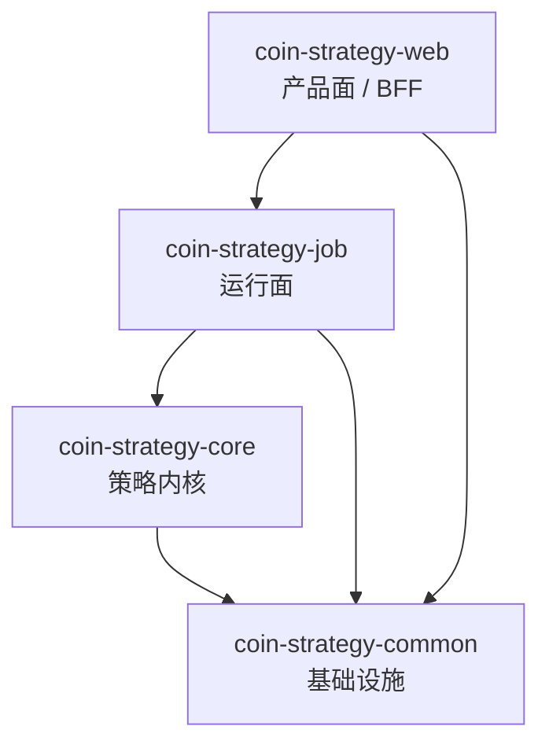

# 量化策略平台 MVP Java 架构设计文档

本文档基于当前仓库结构与 [PRODUCT_DESIGN.md](./PRODUCT_DESIGN.md) 中的产品定位整理，目标是给出一版可直接指导当前 `CoinStrategy` 仓库演进的 MVP 架构方案。

## 1. 文档目标

第一阶段产品定位为“以策略为中心的信号/半自动跟投平台”，而不是一步做到“全自动托管跟单平台”。

这样设计有三个原因：

1. 当前仓库已经具备“策略执行能力 + smart wallet 数据服务 + Web 看板”的雏形，适合沿着现有结构演进。
2. 如果第一阶段直接做全自动托管，账户授权、执行风控、账单分润、对账审计会显著拉高复杂度。
3. 从产品验证路径上，先证明“策略可展示、可解释、可跟投、可结算”更符合 [PRODUCT_DESIGN.md](./PRODUCT_DESIGN.md) 中的 Phase 1 到 Phase 3 路线。

MVP 的核心目标：

- 对用户：看得见策略、看得懂表现、能参与跟投。
- 对策略方：沉淀业绩、沉淀用户、沉淀分润收入。
- 对平台：形成“策略发行 + 跟投 + 分润”的最小商业闭环。

## 2. MVP 范围

结合产品文档，本阶段优先支持：

- 策略类型：趋势策略、资金费率套利策略、Polymarket smart money 跟投策略
- 页面范围：策略列表页、策略详情页、用户个人看板
- 用户参与方式：订阅/跟投
- 分润方式：仅对已实现盈利抽成
- 结算方式：按策略维度、按日或按平仓事件结算
- 执行模式：信号型、半自动

本阶段暂不优先做：

- 全托管执行体系
- 用户自行上传策略
- 开放式策略市场
- 复杂多层分账和平台内清算
- 大规模链上策略同时接入

## 3. 总体架构

推荐保持当前多模块结构，但重新明确职责边界：

- `coin-strategy-core`
  - 负责策略内核与领域抽象
  - 只放策略领域能力，不做页面聚合
- `coin-strategy-job`
  - 负责运行面
  - 承担调度、拉数、信号生成、跟投任务、执行、结算、快照生成
- `coin-strategy-web`
  - 负责产品面 / BFF
  - 聚合策略页、个人页、订阅页所需查询接口
- `coin-strategy-common`
  - 负责基础设施共享
  - 包含 DAO / Entity / Mapper、公共枚举、第三方 Client、工具类

### 3.1 模块关系图



### 3.2 当前仓库与目标架构的对应关系

当前仓库中，以下能力可以直接作为演进基础：

- `coin-strategy-job` 已有调度入口
  - `coin-strategy-job/src/main/java/com/metaverse/coin/strategy/job/CoinStrategyJobApplication.java`
- `coin-strategy-job` 已有 smart wallet 数据采集、跟单任务、执行、结算、分析能力
  - `coin-strategy-job/src/main/java/com/metaverse/coin/strategy/job/smartwallet/`
- `coin-strategy-web` 已有策略看板 BFF 雏形
  - `coin-strategy-web/src/main/java/com/metaverse/coin/strategy/web/controller/StrategyDashboardController.java`
  - `coin-strategy-web/src/main/java/com/metaverse/coin/strategy/web/service/StrategyDashboardService.java`
- `coin-strategy-core` 已有策略模块，但抽象仍偏薄
  - `coin-strategy-core/src/main/java/com/metaverse/coin/strategy/core/Strategy.java`

结论：

- 现有架构方向基本正确
- 但 `core` 还没有成为真正的“策略内核”
- `job` 当前过于集中在 `smartwallet` 大包下，需要继续按领域拆分
- 数据模型仍偏 `smart_wallet_*` 语义，需要向“策略平台语义模型”演进

### 3.3 当前架构符合度检查

对照当前代码，结论不是“已经满足”，而是“部分满足方向，尚未满足最终边界”。

#### 原则一：策略展示层与执行层分开

当前状态：部分满足。

原因：

- `coin-strategy-web` 已独立为单独 Spring Boot 应用，具备 BFF 雏形。
- `StrategyDashboardService` 通过 HTTP 调用 `job` 侧接口，而不是直接访问数据库，这一点符合“展示层与执行层分开”的方向。
- 但当前 `web` 仍然直接绑定 `smart-wallet` 运行态接口和原始 JSON 结构，展示模型与运行服务模型耦合较深。
- 当前 `web` 主要还是“策略看板页”，还没有形成策略、个人资产、订阅三类稳定产品接口边界。

补充要求：

- `web` 侧继续保留 BFF 定位，但需要新增面向产品语义的 client/facade，而不是直接拼接 `smart-wallet` 路径字符串。
- `web` 侧接口要逐步从 `dashboard/api` 演进为 `strategy`、`portfolio`、`subscription` 三组产品接口。
- `job` 侧需要补一层稳定查询接口，避免页面直接依赖运行态内部字段。

#### 原则二：信号、订单、结算三套模型分开

当前状态：不满足。

原因：

- 当前代码中已经存在 `SmartWalletTradeEventEntity`、`SmartWalletFollowTaskEntity`、`SmartWalletOrderEntity`、`SmartWalletSettlementRunEntity` 等对象，说明链路已经初步分段。
- 但这些对象仍然围绕 `smart wallet` 语义组织，缺少平台级统一模型，例如 `TradingSignal`、`FollowSubscription`、`FollowOrder`、`ProfitSettlement`。
- 当前“信号 -> 跟投任务 -> 执行 -> 结算”链路更多体现在 service 编排里，还没有在文档和模型层彻底固定为独立边界。
- 当前仓库里还没有显式的“订阅关系模型”，也没有独立的“盈利分成结算单”模型。

补充要求：

- 新增平台级统一领域模型：`TradingSignal`、`FollowSubscription`、`FollowOrder`、`ProfitSettlement`。
- `SmartWalletTradeEventEntity` 只能作为 smart money 数据源事件，不再直接代表平台标准信号。
- `SmartWalletFollowTaskEntity` 只能作为运行任务或中间态对象，不能替代用户订单模型。
- 结算层必须独立落 `profit_settlement_batch`、`profit_settlement_detail`、`user_strategy_hwm` 三类核心表，不能仅依赖现有 settlement run/retry 表。

#### 原则三：所有收益分成只基于 realized pnl

当前状态：部分满足，但关键商业模型仍缺失。

原因：

- 当前 `smartwallet` 域中已经有结算同步、PnL 汇总、日报等能力，说明系统已开始处理“已结算”和“收益归档”问题。
- 但现有模型更多服务于策略运行结果和持仓同步，不等同于“用户分润结算”。
- 当前仓库中还没有看到明确的平台级“只对 realized pnl 抽成 + High Water Mark + 按策略结算”的完整落库模型。

补充要求：

- 产品结算规则必须单独成模，不与策略执行结算混用。
- 平台分润只能从 `follow_position` 平仓后的 realized pnl 进入结算。
- 必须补充 `hwmBefore`、`hwmAfter`、`shareRate`、`shareAmount` 等字段和对应账单流水。
- 文档中所有“收益”、“PnL”、“结算”表述，需要区分：
  - 策略运行收益
  - 用户跟投收益
  - 平台分润结算

#### 原则四：看板优先查快照表

当前状态：部分满足。

原因：

- 当前已有 `SmartWalletDailyReportEntity`、`SmartWalletPerformanceView`、`SmartWalletPnlSummaryView` 等结果型对象，说明已经存在一部分汇总视图思路。
- 但 `web` 侧当前仍直接读取 `positions`、`orders`、`timeline`、`conflicts` 等运行接口，页面展示依赖运行态数据接口。
- 平台维度、策略维度、用户维度的统一快照模型还没有完全抽出来。

补充要求：

- MVP 阶段就要新增三类快照表：
  - `platform_daily_snapshot`
  - `strategy_daily_snapshot`
  - `user_daily_snapshot`
- 页面核心卡片、收益概览、排行、热力图优先从快照表读取。
- 订单明细、持仓明细可以继续查明细表，但概览统计禁止在 `web` 侧实时聚合。

#### 原则五：common 不承载产品业务

当前状态：不满足。

原因：

- 当前 `coin-strategy-common` 中已经放入大量 `SmartWallet*Entity`、Mapper 和带明显业务语义的数据模型。
- 从仓库演进阶段看，这样做便于快速落地，但长期会让 `common` 变成“业务公共区”。
- 如果继续把订阅、分润、策略产品模型也放入 `common`，后续边界会继续恶化。

补充要求：

- `common` 只保留“基础设施共享”和“跨模块稳定协议”。
- 现有 `SmartWallet*Entity` 可以暂时保留，作为历史兼容层。
- 新增的平台业务模型优先落在对应业务模块下：
  - 策略产品模型放 `core` 或独立 `job.strategy`
  - 跟投与订阅模型放 `job.follow`
  - 分润与高水位模型放 `job.settlement`
- 后续如果抽通用 DTO，只抽“稳定接口模型”，不抽领域编排逻辑。

## 4. 核心设计原则

### 4.1 策略展示层与执行层分开

`web` 只做产品接口聚合，不直接承担复杂收益计算与结算逻辑。

### 4.2 信号、订单、结算三套模型分开

不要将“信号产生”、“用户跟投订单”、“结算流水”混在一个 `trade record` 大表里。

### 4.3 所有收益分成只基于 realized pnl

浮盈不抽成，只对已实现盈利结算，并且单独落库结算流水。

### 4.4 看板优先查快照表

策略详情页、用户个人看板、平台总览等查询优先读取快照或投影结果，避免直接扫订单明细实时聚合。

### 4.5 common 不承载产品业务

`coin-strategy-common` 只做共享基础设施，不继续堆放平台业务逻辑。

## 5. 核心领域模型

按照 MVP 目标，建议优先落这 6 个核心领域对象。

### 5.1 StrategyProduct

策略产品，不是算法实例。面向用户展示。

建议字段：

- `strategyCode`
- `name`
- `category`
- `description`
- `riskLevel`
- `supportedMarket`
- `executionPolicy`
- `feeMode`
- `status`

### 5.2 StrategyRun

某策略某次运行或某个周期的产物，用于跟踪信号批次、运行状态和运行结果。

建议字段：

- `runId`
- `strategyCode`
- `runType`
- `startedAt`
- `finishedAt`
- `status`
- `inputSnapshotRef`
- `summary`

### 5.3 TradingSignal

标准化信号，统一趋势策略、套利策略、smart wallet 跟投策略输出。

建议字段：

- `signalId`
- `strategyCode`
- `strategyRunId`
- `signalType`
- `market`
- `symbolOrMarketId`
- `side`
- `action`
- `confidence`
- `reason`
- `triggerPrice`
- `suggestedSize`
- `signalAt`
- `expireAt`

### 5.4 FollowSubscription

用户订阅/跟投关系，是用户参与策略的入口。

建议字段：

- `subscriptionId`
- `userId`
- `strategyCode`
- `status`
- `executionMode`
- `budgetLimit`
- `positionLimit`
- `riskPreset`
- `feePlan`
- `startedAt`
- `endedAt`

### 5.5 FollowOrder

用户侧跟投订单，承接信号与执行结果。

建议字段：

- `followOrderId`
- `subscriptionId`
- `signalId`
- `strategyCode`
- `orderStatus`
- `market`
- `symbolOrMarketId`
- `side`
- `price`
- `size`
- `notional`
- `executionMode`
- `executedAt`

### 5.6 ProfitSettlement

已实现盈利结算单，支持高水位机制。

建议字段：

- `settlementId`
- `userId`
- `strategyCode`
- `settlementBatchId`
- `realizedPnl`
- `feeBasePnl`
- `hwmBefore`
- `hwmAfter`
- `shareRate`
- `shareAmount`
- `status`
- `settledAt`

## 6. coin-strategy-core 设计

`coin-strategy-core` 应从当前较薄的 `Strategy` 接口，演进为真正的策略内核模块。

建议沉淀以下 4 个核心抽象。

### 6.1 StrategyDefinition

负责策略元数据定义。

职责：

- 描述策略基本信息
- 定义策略适用市场
- 定义风险等级
- 定义收费模式
- 定义执行方式

### 6.2 StrategySignalService

负责产出标准化 `TradingSignal`。

职责：

- 接收行情、事件、仓位、外部因子等输入
- 输出统一信号对象
- 不直接感知页面和用户视图

### 6.3 StrategyExecutionPolicy

负责定义策略执行方式。

建议枚举：

- `SIGNAL_ONLY`
- `SEMI_AUTOMATIC`
- `FULLY_AUTOMATIC`

MVP 阶段仅落地前两类。

### 6.4 StrategyMetricsCalculator

负责统一计算策略指标。

职责：

- 收益率
- 累计收益
- 最大回撤
- 胜率
- 盈亏比
- Sharpe Ratio
- 开单频次
- 当前持仓数

### 6.5 推荐包结构

```text
coin-strategy-core
└── src/main/java/.../core
    ├── definition
    ├── signal
    ├── execution
    ├── metrics
    ├── domain
    ├── trend
    ├── funding
    └── polymarket
```

## 7. coin-strategy-job 设计

`coin-strategy-job` 是运行面，也是当前仓库最接近 MVP 主链路的模块。

建议不再继续按 `smartwallet/service` 平铺，而是按领域拆包。

### 7.1 推荐领域分包

- `strategy`
  - 策略运行编排
  - StrategyRun 生命周期管理
- `signal`
  - 信号生成、去重、确认、归档
- `follow`
  - 跟投任务、跟投状态机、跟投订单
- `execution`
  - 交易所 / Polymarket 执行适配
- `settlement`
  - 已实现收益、结算批次、高水位、账单
- `risk`
  - 仓位限制、单策略限额、黑名单、熔断
- `analytics`
  - 平台 / 策略 / 用户快照生成
- `marketdata`
  - 行情、市场事件、钱包行为数据输入

### 7.2 分层方式

每个领域建议按 4 层写：

- `controller` / `facade`
- `application`
- `domain`
- `infrastructure`

例如跟投分润域：

```text
follow
├── controller
├── application
├── domain
└── infrastructure
```

典型类：

- `FollowSubscriptionController`
- `FollowSubscriptionAppService`
- `FollowOrderAggregate`
- `ProfitSharingDomainService`
- `FollowOrderMapper`
- `ExchangeExecutionGateway`

### 7.3 与当前 smartwallet 包的迁移关系

当前 `coin-strategy-job/src/main/java/com/metaverse/coin/strategy/job/smartwallet/` 已经包含以下能力：

- Polymarket 钱包发现与画像
- 共识信号计算
- 风控评估
- 跟投任务生成
- 执行网关
- 收益统计
- 结算同步
- 报表接口

建议迁移时采用“能力不动、包结构先动”的方式：

1. 先按 `signal/follow/execution/settlement/risk/analytics` 重新归类现有 service。
2. 再逐步将 `smartwallet` 特有命名抽象为平台级命名。
3. 最后将 smart wallet 作为一种策略来源，而不是整个平台的主语义。

## 8. coin-strategy-web 设计

`coin-strategy-web` 应明确为产品面 / BFF，不直接做复杂业务计算。

### 8.1 对应的 MVP 页面

- 策略列表页
- 策略详情页
- 用户个人看板

### 8.2 推荐 Controller 分组

- `StrategyController`
  - 策略列表
  - 策略详情
  - 策略指标
  - 策略信号与交易摘要
- `PortfolioController`
  - 用户组合总览
  - 当前持仓
  - 历史订单
  - 收益曲线
  - 结算记录
- `SubscriptionController`
  - 订阅列表
  - 创建订阅
  - 调整风控参数
  - 暂停/恢复跟投

### 8.3 BFF 规则

- `web` 不直接计算收益
- `web` 不直接聚合大批明细订单
- `web` 通过 job 或后续 query 服务读取投影结果
- ViewModel 允许按页面展示需要做轻量拼装

### 8.4 推荐包结构

```text
coin-strategy-web
└── src/main/java/.../web
    ├── controller
    │   ├── strategy
    │   ├── portfolio
    │   └── subscription
    ├── service
    │   └── facade
    ├── client
    └── model
        └── view
```

## 9. coin-strategy-common 设计边界

`coin-strategy-common` 继续保留，但只做共享基础设施。

适合放入：

- DAO / Entity / Mapper
- 公共枚举
- 第三方 Client
- 通用工具类
- 标准 API 接口与模型

不建议继续放入：

- 策略产品业务
- 跟投状态机
- 分润规则
- 结算编排逻辑
- 页面视图对象

## 10. 核心业务链路

MVP 的主链路如下：

```text
行情 / 事件数据
-> 策略计算
-> 生成 TradingSignal
-> 风控评估
-> 生成 FollowTask / FollowOrder
-> 执行或人工确认
-> 持仓 / 订单更新
-> 平仓后结算 realized PnL
-> 生成 ProfitSettlement
-> 更新用户看板、策略看板、平台看板
```

### 10.1 链路拆解

1. 数据输入层
   - 行情
   - 资金费率
   - Polymarket 钱包行为
   - 市场元数据

2. 策略层
   - 输出标准化 `TradingSignal`

3. 风控层
   - 单用户预算控制
   - 单策略仓位限制
   - 黑名单与市场过滤
   - 熔断与信号过期

4. 跟投层
   - 根据信号生成跟投任务
   - 与订阅关系绑定

5. 执行层
   - 纸面执行 / 半自动确认 / 实盘执行

6. 结算层
   - 只在 realized pnl 形成后结算
   - 维护 High Water Mark

7. 分析层
   - 生成平台、策略、用户维度的快照

### 10.2 当前代码到目标链路的映射

当前代码主链路大致已经具备雏形：

`PolymarketWalletDiscoveryService / PolymarketConsensusSignalService`
-> `SmartWalletSignalRiskService`
-> `SmartWalletFollowTaskService`
-> `PolymarketClobExecutionService / SmartWalletAccountingService`
-> `SmartWalletSettlementSyncService`
-> `PolymarketPortfolioAnalyticsService`

但还存在 3 个缺口：

1. 缺“平台标准信号层”
   - 当前更多是 smart wallet 事件直接进入 follow task。
   - 目标应先形成统一 `TradingSignal`，再进入跟投域。

2. 缺“订阅关系层”
   - 当前主要是任务驱动执行，尚未沉淀清晰的用户-策略订阅关系。
   - 目标应通过 `FollowSubscription` 绑定预算、仓位上限、风控预设、收费方案。

3. 缺“平台分润结算层”
   - 当前已有结算同步，但尚未形成用户账单级结算与高水位流水。
   - 目标应在 `ProfitSettlement` 层完成用户收益抽成闭环。

## 11. 数据库草案

### 11.1 策略中心

- `strategy_product`
- `strategy_metric_snapshot`
- `strategy_signal`
- `strategy_trade_record`

用途：

- 管理策略元数据
- 保存策略指标快照
- 归档策略信号
- 归档策略层交易事件或交易结果摘要

### 11.2 跟投系统

- `follow_subscription`
- `follow_order`
- `follow_position`
- `follow_execution_log`

用途：

- 表达用户与策略关系
- 保存用户侧跟投订单
- 保存用户侧持仓
- 记录执行与失败原因

### 11.3 分润结算

- `profit_settlement_batch`
- `profit_settlement_detail`
- `user_strategy_hwm`
- `billing_ledger`

用途：

- 保存按批次执行的分润结算
- 保存逐用户逐策略的分润明细
- 维护用户在单策略维度的高水位
- 提供可审计的账单流水

### 11.4 看板分析

- `platform_daily_snapshot`
- `strategy_daily_snapshot`
- `user_daily_snapshot`

用途：

- 支撑平台总览看板
- 支撑策略详情页中的概览指标和趋势图
- 支撑个人看板中的净值、收益、胜率、分润概览

## 12. MVP 阶段必须补齐的最小改造

为了让当前架构真正满足本文原则，建议至少补齐以下内容。

### 12.1 模型补齐

- 增加 `TradingSignal`
- 增加 `FollowSubscription`
- 增加 `FollowOrder`
- 增加 `ProfitSettlement`

说明：

- 这 4 个模型是平台产品闭环的最小骨架。
- 即使第一版先不全面替换旧表，也要先把新模型定义出来，作为未来收口方向。

### 12.2 job 侧分域补齐

- 在 `coin-strategy-job` 中新增以下包边界：
  - `strategy`
  - `signal`
  - `follow`
  - `execution`
  - `settlement`
  - `analytics`
- `smartwallet` 先作为策略来源或渠道来源保留，不再作为平台唯一主语义。

### 12.3 web 侧接口补齐

- 保留现有策略看板能力
- 新增：
  - `StrategyController`
  - `PortfolioController`
  - `SubscriptionController`
- `StrategyDashboardService` 后续应拆分为面向页面域的 facade，而不是继续单类承接所有页面逻辑

### 12.4 结算规则补齐

- 明确平台抽成只基于 realized pnl
- 明确按策略维度维护 High Water Mark
- 明确结算结果必须可追溯到订单、平仓和账单流水

### 12.5 查询模型补齐

- 将“概览卡片”和“趋势图数据”逐步迁移到 snapshot 表
- 将“订单明细”和“持仓明细”保留在明细表查询
- 严禁在 `web` 中直接对大批订单做运行时聚合来生成首页指标

## 13. 架构结论

当前架构与本文建议的关系可以概括为：

- 模块拆分方向正确
- 展示层与执行层已经初步分离
- 但平台级领域模型还没有完全建立
- `smartwallet` 仍然承担了过多平台主语义
- 分润结算与高水位机制仍需要独立成域

因此，当前架构可以继续沿用，但不能直接判定为“已经满足目标架构”。更准确的判断是：

- 已具备 MVP 演进基础
- 尚未完全满足本文的 5 条设计原则
- 需要通过“补模型、补分层、补快照、补结算域”四步完成收口
- `user_strategy_hwm`
- `billing_ledger`

用途：

- 批次化结算
- 明细账单
- 单用户单策略高水位
- 平台账务流水

### 11.4 看板分析

- `platform_daily_snapshot`
- `strategy_daily_snapshot`
- `user_daily_snapshot`

用途：

- 平台总览
- 策略详情页曲线与统计
- 用户个人看板

### 11.5 建模原则

- 看板查询优先查快照表
- 结算与看板不要直接扫订单明细实时聚合
- 信号、订单、结算分表
- High Water Mark 单独存储，不临时推导

## 12. API 草案

### 12.1 StrategyController

- `GET /api/strategies`
- `GET /api/strategies/{strategyCode}`
- `GET /api/strategies/{strategyCode}/metrics`
- `GET /api/strategies/{strategyCode}/signals`

### 12.2 PortfolioController

- `GET /api/portfolio/overview`
- `GET /api/portfolio/positions`
- `GET /api/portfolio/orders`
- `GET /api/portfolio/settlements`
- `GET /api/portfolio/timeline`

### 12.3 SubscriptionController

- `GET /api/subscriptions`
- `POST /api/subscriptions`
- `PUT /api/subscriptions/{id}`
- `POST /api/subscriptions/{id}/pause`
- `POST /api/subscriptions/{id}/resume`

## 13. MVP 版本路线

### 13.1 第一版

- 策略产品中心：趋势策略、资金费率套利策略、Polymarket 跟投策略
- 用户参与方式：订阅 / 跟投
- 分润：仅对已实现盈利抽成
- 展示：策略列表、策略详情、个人看板
- 执行：以信号型、半自动为主

### 13.2 第二版

- Polymarket smart money 更完整跟单能力
- 钱包脱敏公开交易流
- 完整 High Water Mark 账单
- 平台总览看板

### 13.3 第三版

- 托管 / 半托管执行
- 策略入驻市场
- 策略经理后台
- 策略审核与分发机制

## 14. 从当前仓库到目标架构的演进顺序

### 14.1 第一步：补齐 core 抽象

新增：

- `StrategyDefinition`
- `StrategySignalService`
- `StrategyExecutionPolicy`
- `StrategyMetricsCalculator`

目标：

- 统一策略产品定义
- 统一信号输出
- 统一指标口径

### 14.2 第二步：job 内按领域拆包

将现有 `smartwallet` 能力逐步迁移为：

- `signal`
- `follow`
- `execution`
- `settlement`
- `risk`
- `analytics`

目标：

- 降低单一大包复杂度
- 让 smart wallet 从“平台主语义”退回到“某类策略来源”

### 14.3 第三步：引入平台语义数据模型

优先新增：

- `strategy_product`
- `strategy_signal`
- `follow_subscription`
- `follow_order`
- `profit_settlement_batch`
- `profit_settlement_detail`
- `user_strategy_hwm`

目标：

- 让平台具备完整的“策略-用户-订单-结算”闭环

### 14.4 第四步：web 拆成三类产品接口

新增：

- `StrategyController`
- `PortfolioController`
- `SubscriptionController`

目标：

- 与 MVP 页面直接对齐
- 让 Web 成为清晰的产品入口层

### 14.5 第五步：快照化看板查询

新增：

- 平台快照
- 策略快照
- 用户快照

目标：

- 支撑后续数据量增长
- 降低策略详情页与个人看板实时聚合压力

## 15. 对当前仓库的判断

如果以“是否符合当前需求”来评估，结论如下：

- 当前仓库方向上是符合的
- 当前仓库结构上还没有完全进入“策略平台”形态
- 最适合的做法不是推倒重来，而是在现有 `core / job / web / common` 多模块基础上继续演进

更具体地说：

- `coin-strategy-job` 已经具备运行面雏形
- `coin-strategy-web` 已经具备 BFF 雏形
- `coin-strategy-core` 需要补足策略内核抽象
- `coin-strategy-common` 需要收敛到基础设施职责
- 数据模型需要从 `smart_wallet_*` 逐步升级到平台语义模型

## 16. 总结

这套 MVP 架构的核心不是“做一个更复杂的交易机器人”，而是把当前仓库演进成一个真正的“策略产品平台”：

- 策略可以被定义、展示、比较
- 用户可以订阅、跟投、查看收益
- 平台可以按 realized pnl 做结算与分润
- 系统可以通过快照和投影支撑后续规模化查询

这条路线与当前仓库现状兼容，也与 [PRODUCT_DESIGN.md](./PRODUCT_DESIGN.md) 中的产品路线保持一致，适合作为接下来一到两个版本的架构基线。
