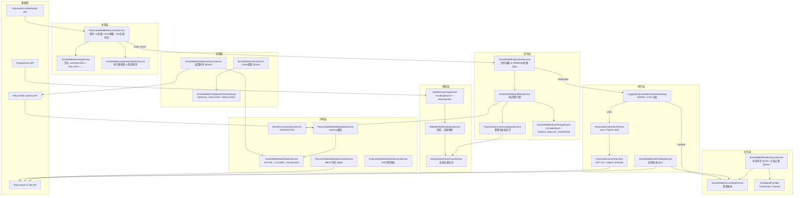
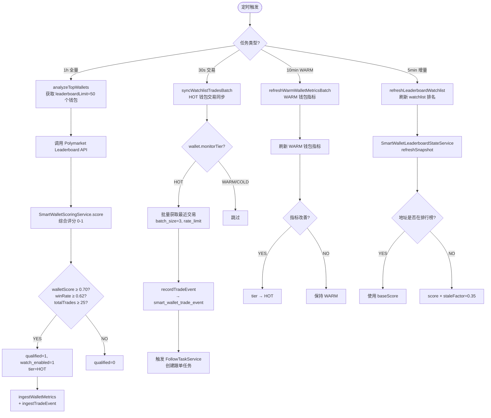
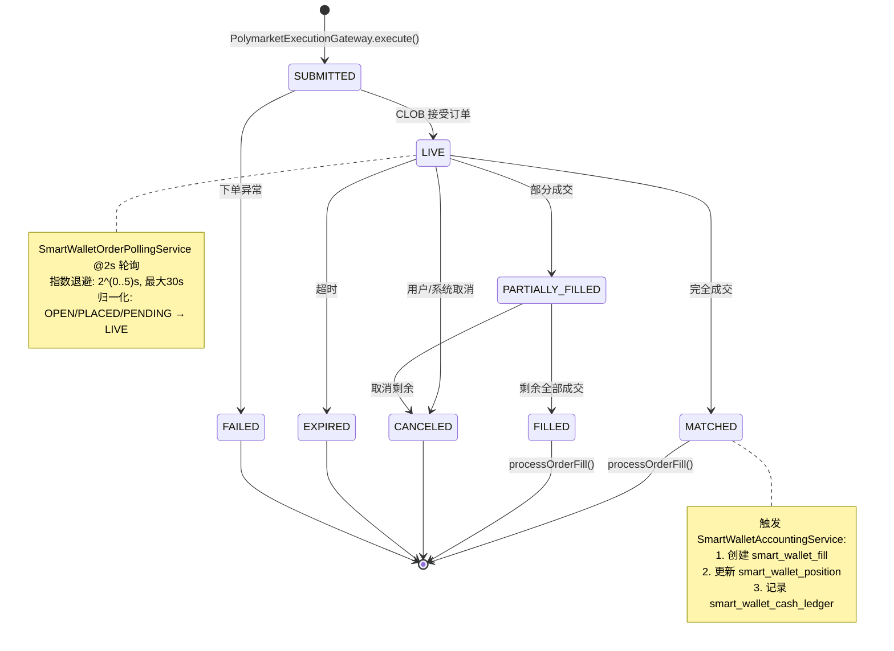

# Polymarket 跟单系统 — 完整架构分析报告

> 基于 `CoinStrategy` 项目源码逐文件分析，所有结论均引用类名/方法名/字段名。
> 分析时间：2026-04-26 | 分析范围：`coin-strategy-job/smartwallet` 模块 + `common-model` + `common-dao`

---

## 第一部分：项目模块总览

### 1.1 Maven 模块结构

| 模块 | 职责 |
|------|------|
| `coin-strategy-common/common-model` | 实体类（Entity）、枚举 |
| `coin-strategy-common/common-dao` | MyBatis-Plus Mapper 层 |
| `coin-strategy-common/common-api` | 统一接口（`OrderStatus`, `UnifiedOrder`, `ITradeService`） |
| `coin-strategy-common/common-client` | 交易所客户端（Binance/OKX/Gate/Sunwk） |
| `coin-strategy-job` | **核心业务逻辑所在**，包含 smartwallet 全部 Service/Controller/Config |

### 1.2 smartwallet 包结构一览

```
coin-strategy-job/src/main/java/.../job/smartwallet/
├── config/
│   ├── SmartWalletProperties.java          // 550+ 行配置项（master switch、风控阈值、Kelly参数等）
│   └── ExitSignalProviderConfig.java       // Exit策略Bean选择（RULES vs SCORING）
├── controller/
│   └── SmartWalletController.java          // REST API 入口
├── model/                                  // 51+ 个 Request/View/DTO 类
│   ├── ExecutionMode.java                  // enum: PAPER / LIVE
│   ├── SmartWalletSignal.java              // 跟单信号
│   ├── PredictionMarketOpportunity.java    // 市场机会
│   └── ... (SettlementXxx, ClaimXxx, SignalXxx, etc.)
├── service/                                // 48+ 个 Service 类
│   ├── [发现层] PolymarketWalletDiscoveryService, SmartWalletScoringService
│   ├── [监控层] PolymarketSmartWalletMonitorService, SmartWalletMarketMonitoringService
│   ├── [信号层] SmartWalletFollowTaskService, SmartWalletSignalRiskService, PolymarketConsensusSignalService
│   ├── [执行层] LoggingPolymarketExecutionGateway, PolymarketClobExecutionService
│   ├── [CLOB层] PolymarketJavaClobClient, PolymarketPythonSdkBridge, PolymarketClobClientRouter
│   ├── [仓位层] SmartWalletPositionSyncService, SmartWalletAccountingService
│   ├── [结算层] SmartWalletSettlementSyncService, SmartWalletClaimService
│   ├── [退出层] TimeAwareStopLossService, ScoredExitSignalProvider, KellyStakeCalculator
│   ├── [智能层] WalletEntityResolutionService, EntityAwareConsensusService, WalletClusteringService
│   ├── [行情层] PolymarketMarketDataStreamService, PolymarketMarketDataCacheService, PolymarketMarketMetadataService
│   └── [分析层] TradeEffectLabelService, FollowTradeAttributionService, WalletBehaviorProfileService
└── intelligence/
    ├── model/  (ClusterConfidence, EntityResolutionResult)
    └── service/ (WalletEntityResolutionService, WalletClusteringService, EntityAwareConsensusService, etc.)
```

### 1.3 核心服务清单（48 个 Service）

| 分类 | 类名 | 关键注解 | 核心职责 |
|------|------|----------|----------|
| **发现** | `PolymarketWalletDiscoveryService` | `@Scheduled` ×4 | 排行榜抓取、钱包分析、交易同步 |
| **发现** | `SmartWalletScoringService` | `@Service` | 钱包综合评分（0-1） |
| **发现** | `SmartWalletSelectionService` | `@Service` | 钱包筛选与准入 |
| **发现** | `SmartWalletLeaderboardStateService` | `@Service` | 排行榜快照 & 陈旧地址惩罚 |
| **监控** | `PolymarketSmartWalletMonitorService` | `@Service` | 事件驱动入口（ingestWalletMetrics / ingestTradeEvent） |
| **监控** | `SmartWalletMarketMonitoringService` | `@Service` | 市场聚合监控面板 |
| **监控** | `StrategyHealthMonitorJob` | `@Scheduled 60min` | 资金/仓位/信号健康检查 |
| **信号** | `SmartWalletFollowTaskService` | `@Scheduled` ×3 | 信号创建 → PENDING 处理 → 过期清理 |
| **信号** | `SmartWalletSignalRiskService` | `@Service` | 7 层风控门控（1000+ LOC） |
| **信号** | `PolymarketConsensusSignalService` | `@Service` | 多钱包共识评分 |
| **信号** | `SmartWalletEntryStrategyRouter` | `@Service` | 入场策略路由（ANY / ALL） |
| **智能** | `WalletEntityResolutionService` | `@Service` | 钱包→实体映射 |
| **智能** | `EntityAwareConsensusService` | `@Service` | 实体去重共识 |
| **智能** | `WalletClusteringService` | `@Service` | 资金来源 + 行为相似度聚类 |
| **智能** | `FundingSourceClusterer` | `@Service` | Polygonscan 资金追踪 |
| **智能** | `BehaviorSimilarityClusterer` | `@Service` | 行为特征余弦相似度 |
| **智能** | `WalletEntityIntelligenceJob` | `@Scheduled` | 聚类后台任务 |
| **智能** | `EntityFeatureSnapshotService` | `@Scheduled 6h` | 实体级聚合快照 |
| **执行** | `LoggingPolymarketExecutionGateway` | `@Component` | PAPER/LIVE 分发网关 |
| **执行** | `PolymarketClobExecutionService` | `@Service` | CLOB 执行编排 |
| **执行** | `PolymarketOrderRequestFactory` | `@Service` | 订单构造 & 验证 |
| **执行** | `PolymarketClobClientRouter` | `@Service` | Java/Python SDK 路由 |
| **执行** | `PolymarketJavaClobClient` | `@Component` | 原生 Java CLOB（EIP-712 签名） |
| **执行** | `PolymarketPythonSdkBridge` | `@Service` | Python SDK 子进程桥 |
| **执行** | `ExecutionWalletContextLoader` | `@Service` | 执行钱包凭证加载 & 校验 |
| **仓位** | `SmartWalletPositionSyncService` | `@Scheduled` ×3 | 仓位同步、止损、止盈 |
| **仓位** | `SmartWalletAccountingService` | `@Service` | 资金账本（available capital / PnL） |
| **仓位** | `SmartWalletOrderPollingService` | `@Scheduled 2s` | 挂单状态轮询 |
| **结算** | `SmartWalletSettlementSyncService` | `@Scheduled 5min` | 结算同步 & 重试 |
| **结算** | `SmartWalletClaimService` | `@Scheduled 1min` | Claim 处理 |
| **结算** | `SmartWalletConfiguredClaimGateway` | `@Service` | Claim 网关（MANUAL / RELAYER / SIMULATED） |
| **市场** | `SmartWalletMarketStateService` | `@Service` | 市场状态机（ACTIVE → CLOSED → RESOLVED） |
| **市场** | `SmartWalletMarketInfoService` | `@Service` | 市场信息中心化缓存 & FK 管理 |
| **市场** | `PolymarketMarketMetadataService` | `@Service` | Gamma API 元数据缓存 |
| **市场** | `PolymarketMarketDataStreamService` | `@Service` | WebSocket 行情快照（内存） |
| **市场** | `PolymarketMarketDataCacheService` | `@Scheduled` ×2 | REST 行情缓存（60s 刷新 + 5min 清理） |
| **市场** | `MarketSnapshotCollectorService` | `@Scheduled 45s` | 市场微结构快照持久化 |
| **市场** | `MarketConcentrationService` | `@Service` | 集中度风控（HHI / CR1 / CR3） |
| **市场** | `MarketConcentrationSnapshotService` | `@Scheduled 3min` | 集中度快照刷新 |
| **市场** | `SmartWalletMarketRepairService` | `@Service` | 结算不一致修复 |
| **退出** | `TimeAwareStopLossService` | `@Service` | 基于时间分层的止损 |
| **退出** | `ScoredExitSignalProvider` | `@Service` | 特征加权退出评分 |
| **退出** | `KellyStakeCalculator` | `@Component` | Kelly 公式仓位计算 |
| **分析** | `TradeEffectLabelService` | `@Scheduled 60s` | 交易效果标签（PnL 归因） |
| **分析** | `FollowTradeAttributionService` | `@Service` | 跟单归因分析 |
| **分析** | `WalletBehaviorProfileService` | `@Service` | 行为画像（稳定性/质量/可复制性） |
| **分析** | `WalletArchetypeClassifierService` | `@Service` | 原型分类（HF/THEMATIC/SWING/VALUE/NOISE） |
| **分析** | `TradeProfitabilityScoringService` | `@Service` | EV/概率/滑点估算 |

---

## 第二部分：真实业务流程

### 2.1 全链路数据流

```
[Polymarket Leaderboard API]
        │
        ▼ (每小时全量 / 每5min增量)
PolymarketWalletDiscoveryService
  ├── analyzeTopWallets()          → smart_wallet_profile (WRITE)
  ├── refreshLeaderboardWatchlist() → smart_wallet_profile.watch_enabled (UPDATE)
  └── syncWatchlistTradesBatch()   → smart_wallet_trade_event (WRITE)
        │                               每30s轮询HOT钱包
        ▼
PolymarketSmartWalletMonitorService
  ├── ingestWalletMetrics()        → smart_wallet_profile (UPDATE)
  └── ingestTradeEvent()           → smart_wallet_trade_event (WRITE)
        │
        ▼
SmartWalletFollowTaskService.recordTradeEvent()
  ├── 1. WalletEntityResolutionService.resolveEntity()   → wallet_entity_map (READ/WRITE)
  ├── 2. SmartWalletMarketStateService.refreshMarket()   → smart_wallet_market_info (WRITE)
  ├── 3. SmartWalletSignalRiskService.evaluate()          → 7层门控
  │     ├── Gate1: 钱包质量 (walletScore ≥ 0.70, winRate ≥ 0.62)
  │     ├── Gate2: 信号新鲜度 & 流动性
  │     ├── Gate3: 资金约束 (openPositions, totalOpenCost)
  │     ├── Gate4: 市场状态 (lifecycle = ACTIVE)
  │     ├── Gate5: 共识评分 (entity dedup, minDistinctEntities ≥ 2)
  │     ├── Gate6: 集中度风控 (HHI ≤ 2500, CR1 ≤ 0.40)
  │     └── Gate7: 盈利性 & Kelly仓位
  └── 4. 创建 smart_wallet_follow_task (status=PENDING / SKIPPED)
        │          同时创建 wallet_follow_candidate (enrichment记录)
        ▼
SmartWalletFollowTaskService.processPendingTasks() [每5s]
  ├── 取 status=PENDING 的任务
  └── 调用 PolymarketExecutionGateway.execute(signal, mode)
        │
        ├── [PAPER模式] → 生成模拟结果, orderId="paper-{uuid}"
        │     └── smart_wallet_order (WRITE, executionMode=PAPER)
        │
        └── [LIVE模式] → PolymarketClobClientRouter.placeOrder()
              ├── PolymarketJavaClobClient (EIP-712签名, HMAC-SHA256)
              └── smart_wallet_order (WRITE, executionMode=LIVE)
                    │
                    ▼
SmartWalletOrderPollingService [每2s]
  ├── 查询 status IN (LIVE, PARTIALLY_FILLED), nextPollAt ≤ now
  ├── 调用 getOrder(externalOrderId) 检查链上状态
  ├── 状态更新: LIVE → MATCHED/FILLED/CANCELED/EXPIRED
  └── 成交后: SmartWalletAccountingService.processOrderFill()
        └── smart_wallet_fill (WRITE)
        └── smart_wallet_position (WRITE/UPDATE)
        └── smart_wallet_cash_ledger (WRITE)
                    │
                    ▼
SmartWalletPositionSyncService [每15s/5min]
  ├── syncLivePositions()           → 同步链上仓位
  ├── checkStopLoss() [每5min]      → ExitSignalProvider.resolveStopLossThreshold()
  │     ├── TimeAwareStopLossService: 时间分层阈值
  │     └── ScoredExitSignalProvider: ROI动量+共识衰减+集中度
  └── checkTakeProfit() [每5min]    → 止盈检查
        │
        ▼ (退出 → 创建反向订单)
SmartWalletSettlementSyncService [每5min]
  ├── 扫描 OPEN/RESOLVED 仓位
  ├── 查询 Polymarket API 获取 market resolution
  ├── 更新 smart_wallet_market_info.resolved_outcome
  └── 仓位状态: OPEN → RESOLVED_UNCLAIMED
        │
        ▼
SmartWalletClaimService [每1min]
  ├── 扫描 status=RESOLVED_UNCLAIMED
  ├── [PAPER] → 直接模拟 claim, status=CLAIMED
  └── [LIVE]  → SmartWalletConfiguredClaimGateway
        ├── MANUAL_CONFIRM → 排队等人工确认
        ├── RELAYER → POST /redeem (conditionId, amounts)
        └── SIMULATED_SUCCESS → 模拟成功
              │
              ▼
  smart_wallet_position.status = CLAIMED
  smart_wallet_cash_ledger (settlement proceeds)
  smart_wallet_claim_run (WRITE)
```

### 2.2 定时任务总览

| 服务类 | 方法 | 间隔 | 职责 |
|--------|------|------|------|
| `PolymarketWalletDiscoveryService` | `analyzeTopWallets` | 1h | 全量排行榜分析 |
| `PolymarketWalletDiscoveryService` | `refreshLeaderboardWatchlist` | 5min | 增量 watchlist 刷新 |
| `PolymarketWalletDiscoveryService` | `syncWatchlistTradesBatch` | 30s | HOT 钱包交易同步 |
| `PolymarketWalletDiscoveryService` | `refreshWarmWalletMetricsBatch` | 10min | WARM 钱包指标刷新 |
| `SmartWalletFollowTaskService` | `processPendingTasks` | 5s | 处理 PENDING 跟单任务 |
| `SmartWalletFollowTaskService` | `reevaluateDeferredCandidates` | 2min | 延迟候选人重评估 |
| `SmartWalletFollowTaskService` | `autoExpireStalePending` | 5min | 过期 PENDING 任务清理 |
| `SmartWalletOrderPollingService` | `pollPendingOrders` | 2s | 挂单状态轮询 |
| `SmartWalletPositionSyncService` | `syncLivePositions` | 15s | 链上仓位同步 |
| `SmartWalletPositionSyncService` | `checkStopLoss` | 5min | 止损检查 |
| `SmartWalletPositionSyncService` | `checkTakeProfit` | 5min | 止盈检查 |
| `SmartWalletSettlementSyncService` | `runLocked` | 5min | 结算同步 |
| `SmartWalletClaimService` | `processClaims` | 1min | Claim 处理 |
| `SmartWalletLiveValidationService` | scheduled poll | 45s | LIVE 验证执行 |
| `PolymarketMarketDataCacheService` | `refreshActiveMarkets` | 60s | 活跃市场行情刷新 |
| `PolymarketMarketDataCacheService` | `evictStaleOrderBooks` | 5min | 过期 OrderBook 清理 |
| `MarketSnapshotCollectorService` | collect | 45s | 市场微结构快照 |
| `MarketConcentrationSnapshotService` | refresh | 3min | 集中度快照 |
| `TradeEffectLabelService` | `buildRecentLabels` | 60s | 交易效果标签回填 |
| `StrategyHealthMonitorJob` | health check | 60min | 策略健康诊断 |
| `WalletEntityIntelligenceJob` | clustering | 1h | 实体聚类 |
| `EntityFeatureSnapshotService` | snapshot | 6h | 实体特征快照 |

---

## 第三部分：核心数据模型

### 3.1 实体类清单（`common-model` 中的 Entity）

| 实体类 | 对应表 | 关键字段 |
|--------|--------|----------|
| `SmartWalletProfileEntity` | `smart_wallet_profile` | walletAddress, winRate, walletScore, qualified, watchEnabled, monitorTier(HOT/WARM/COLD) |
| `SmartWalletTradeEventEntity` | `smart_wallet_trade_event` | walletAddress, externalTradeId, marketId, outcome, side, price, sizeUsdc, processed |
| `SmartWalletFollowTaskEntity` | `smart_wallet_follow_task` | walletAddress, entityId, sourceEventId, followCandidateId, marketInfoId, status, executionMode |
| `SmartWalletOrderEntity` | `smart_wallet_order` | followTaskId, positionId, marketInfoId, executionAddress, externalOrderId, status, executionMode |
| `SmartWalletFillEntity` | `smart_wallet_fill` | orderId, positionId, side, price, size, feeUsdc, realizedPnlUsdc |
| `SmartWalletPositionEntity` | `smart_wallet_position` | executionAddress, marketInfoId, netSide, quantity, averageEntryPrice, costBasisUsdc, status |
| `SmartWalletCashLedgerEntity` | `smart_wallet_cash_ledger` | executionAddress, asset, entryType, direction, amount, balanceAfter |
| `SmartWalletDailyReportEntity` | `smart_wallet_daily_report` | reportDate, executionAddress, totalOrders, realizedPnlUsdc, winRate |
| `SmartWalletMarketInfoEntity` | `smart_wallet_market_info` | marketId, question, outcome, tokenId, indexSet, marketEndAt, marketLifecycle, resolvedOutcome |
| `SmartWalletSettlementRunEntity` | `smart_wallet_settlement_run` | triggerType, status, scannedPositions, resolvedPositions |
| `SmartWalletMarketSnapshotEntity` | `smart_wallet_market_snapshot` | marketId, outcome, bestBid/Ask, spread, midpoint, depth@1c/3c/5c |
| `SmartWalletBehaviorProfileEntity` | `smart_wallet_behavior_profile` | archetype, followLane, stabilityScore, qualityScore, replicabilityScore |
| `SmartWalletOrderAnalysisEntity` | `smart_wallet_order_analysis` | investedUsdc, realizedPnlUsdc, roiRate, holdMinutes, exitStyle, isWin |
| `SmartWalletWalletFeatureDailyEntity` | `smart_wallet_wallet_feature_daily` | trades7d/30d, markets30d, pnl30d, winRate30d, followableRate |
| `WalletEntityMapEntity` | `wallet_entity_map` | walletAddress, entityId, clusterMethod, clusterConfidence, isPrimaryWallet |
| `WalletEntityFeatureSnapshotEntity` | `wallet_entity_feature_snapshot` | entityId, walletCount, aggregatedWinRate, entityScore |
| `WalletFollowCandidateEntity` | `wallet_follow_candidate` | sourceEventId, entityId, entityWalletCount, isEntityFirstSignal, enrichmentStatus |

### 3.2 关键 ID 关联链

```
marketId (Polymarket conditionId)
   ↕  SmartWalletMarketInfoService.getOrCreate(marketId, outcome)
smart_wallet_market_info.id  ← marketInfoId
   ↕  被以下表引用为 FK:
   ├── smart_wallet_follow_task.market_info_id
   ├── smart_wallet_order.market_info_id
   ├── smart_wallet_fill (通过 order → position → marketInfoId)
   └── smart_wallet_position.market_info_id

tokenId (Polymarket CLOB token ID)
   → 存储在 smart_wallet_market_info.token_id
   → 由 PolymarketMarketMetadataService 从 Gamma API 获取
   → 用于 CLOB 下单: PolymarketOrderRequestFactory.prepare() 中 resolveTokenId()

indexSet (CTF bitmask, 1=YES, 2=NO)
   → 存储在 smart_wallet_market_info.index_set
   → 由 PolymarketMarketMetadataService 解析 outcome → indexSet 映射
   → 用于 EIP-712 签名

conditionId = marketId (在 Polymarket 中等价)
   → 用于链上结算: SmartWalletConfiguredClaimGateway.submitViaRelayer(conditionId, amounts)
```

### 3.3 订单状态流转

```
【Order 状态机】 (SmartWalletOrderEntity.status)

SUBMITTED ──→ LIVE ──────→ MATCHED ──→ (成交处理)
    │           │              │
    │           ├→ PARTIALLY_FILLED ──→ FILLED
    │           │
    │           ├→ CANCELED
    │           │
    │           └→ EXPIRED
    │
    └→ FAILED (下单失败)

状态归一化 (LoggingPolymarketExecutionGateway):
  OPEN / PLACED / PENDING → LIVE
  PARTIAL → PARTIALLY_FILLED

轮询 (SmartWalletOrderPollingService):
  查询条件: status IN (LIVE, PARTIALLY_FILLED) AND nextPollAt ≤ now
  终态判断: MATCHED / CANCELED / EXPIRED / FILLED → 清除 nextPollAt
  指数退避: 2^(0..5) 秒, 最大30s
```

### 3.4 仓位状态流转

```
【Position 状态机】 (SmartWalletPositionEntity.status)

OPEN ───→ PARTIALLY_CLOSED ───→ CLOSED (提前退出)
  │                                  │
  │                                  ▼
  ├────────────────────────→ RESOLVED_UNCLAIMED (市场结算)
  │                                  │
  │                                  ├→ CLAIMED (claim成功)
  │                                  │
  │                                  └→ WAITING_CONFIRMATION (等待人工确认)
  │
  └→ SETTLEMENT_PENDING_ORACLE (UMA预言机未决)

触发条件:
  OPEN → PARTIALLY_CLOSED:  部分仓位退出 (SmartWalletPositionSyncService)
  OPEN → RESOLVED_UNCLAIMED: SmartWalletSettlementSyncService 发现市场已结算
  RESOLVED_UNCLAIMED → CLAIMED: SmartWalletClaimService 执行 claim
  RESOLVED_UNCLAIMED → WAITING_CONFIRMATION: live-gateway-mode=MANUAL_CONFIRM
```

### 3.5 Follow Task 状态流转

```
【FollowTask 状态机】 (SmartWalletFollowTaskEntity.status)

PENDING ──→ FOLLOWED (执行成功)
    │
    ├→ SKIPPED (风控拒绝 / 共识不足)
    │
    ├→ FAILED (执行失败)
    │
    └→ EXPIRED (autoExpireStalePending, 默认5×信号最大年龄)

状态来源:
  PENDING:   SmartWalletFollowTaskService.recordTradeEvent() 创建
  SKIPPED:   SmartWalletSignalRiskService.evaluate() 拒绝
  FOLLOWED:  PolymarketExecutionGateway.execute() 成功
  FAILED:    执行异常
  EXPIRED:   SmartWalletFollowTaskService.autoExpireStalePending() 定时清理
```

---

## 第四部分：Mermaid 流程图

### 4.1 总体流程图



### 4.2 监控模块流程图



### 4.3 Market 数据流图

```mermaid
flowchart TD
    subgraph 外部数据源
        GAMMA[Gamma API<br/>https://gamma-api.polymarket.com]
        CLOB[CLOB API<br/>https://clob.polymarket.com]
        WS[WebSocket Stream]
    end

    subgraph 缓存层
        META[PolymarketMarketMetadataService<br/>localMetadata + cache Map]
        REST_CACHE[PolymarketMarketDataCacheService<br/>activeMarkets + orderBookCache<br/>@60s刷新 / @5min清理]
        WS_CACHE[PolymarketMarketDataStreamService<br/>ConcurrentHashMap tokenId→Snapshot<br/>TTL=20s]
    end

    subgraph 持久层
        MI[smart_wallet_market_info<br/>marketId, outcome, tokenId<br/>indexSet, marketEndAt<br/>lifecycle, resolvedOutcome]
        MS[smart_wallet_market_snapshot<br/>bid/ask/spread, depth<br/>volume, trades, volatility]
        MC[smart_wallet_market_concentration_snapshot<br/>HHI, CR1, CR3, CR5]
    end

    subgraph 消费者
        RISK[SmartWalletSignalRiskService]
        EXEC[PolymarketOrderRequestFactory]
        SETTLE[SmartWalletSettlementSyncService]
        EXIT[ExitSignalProvider]
    end

    GAMMA -->|metadata| META
    CLOB -->|orderbook, prices| REST_CACHE
    WS -->|real-time| WS_CACHE

    META -->|getOrCreate| MI
    REST_CACHE -->|@45s| MS
    WS_CACHE -->|@45s fallback| MS

    META --> RISK
    META --> EXEC
    META --> SETTLE
    MI --> RISK
    MI --> EXEC
    REST_CACHE --> EXIT
    WS_CACHE --> EXIT
    MC --> RISK

    GAMMA -->|@3min batch=24| MC
```

### 4.4 订单状态流转图



### 4.5 结算/Claim 流程图

```mermaid
flowchart TD
    TRIGGER([SmartWalletSettlementSyncService<br/>@Scheduled 每5min]) --> SCAN[扫描 OPEN 仓位<br/>limit=50, marketLimit=20]
    SCAN --> FETCH[批量获取 market metadata<br/>PolymarketMarketMetadataService]
    FETCH --> CHECK{market.resolved?}

    CHECK -->|YES| RESOLVE[更新 market_info.resolvedOutcome<br/>position.status → RESOLVED_UNCLAIMED]
    CHECK -->|NO, 已过期| ORACLE{oracle pending?}
    CHECK -->|NO, 未过期| FUTURE[skippedFutureMarkets++<br/>跳过]

    ORACLE -->|YES| PENDING[status → SETTLEMENT_PENDING_ORACLE<br/>永不abandon, UMA争议可能持续数天]
    ORACLE -->|NO| RETRY_Q[加入 settlement_retry 队列<br/>指数退避: 2^(n-1) min]

    RESOLVE --> CLAIM_TRIGGER([SmartWalletClaimService<br/>@Scheduled 每1min])
    CLAIM_TRIGGER --> CLAIM_SCAN[扫描 RESOLVED_UNCLAIMED 仓位]
    CLAIM_SCAN --> MODE{executionMode?}

    MODE -->|PAPER| PAPER_CLAIM{paperAutoClaimEnabled?}
    PAPER_CLAIM -->|YES| AUTO_CLAIM[直接模拟 claim<br/>status → CLAIMED]
    PAPER_CLAIM -->|NO| SKIP_CLAIM[跳过]

    MODE -->|LIVE| LIVE_CLAIM{liveAutoClaimEnabled?}
    LIVE_CLAIM -->|YES| GATEWAY{liveGatewayMode?}
    LIVE_CLAIM -->|NO| SKIP_CLAIM

    GATEWAY -->|MANUAL_CONFIRM| MANUAL[ClaimSubmission.manualConfirmRequired<br/>status → WAITING_CONFIRMATION]
    GATEWAY -->|RELAYER| RELAYER[POST /redeem<br/>conditionId + amounts]
    GATEWAY -->|SIMULATED_SUCCESS| SIM[ClaimSubmission.claimed]
    GATEWAY -->|SIMULATED_SUBMITTED| SIM_SUB[ClaimSubmission.submitted]

    RELAYER --> TX{txHash?}
    TX -->|YES| CLAIMED[status → CLAIMED<br/>记录 cash_ledger]
    TX -->|FAIL| CLAIM_RETRY[加入 claim_retry 队列<br/>指数退避, max=10次]

    AUTO_CLAIM --> LEDGER[SmartWalletAccountingService<br/>记录 settlement proceeds]
    CLAIMED --> LEDGER
    SIM --> LEDGER
```

### 4.6 实体去重 & 共识评分流程

```mermaid
flowchart TD
    EVENT[新 trade_event 到达] --> RESOLVE[WalletEntityResolutionService<br/>.resolveEntity(walletAddress)]
    RESOLVE --> CACHE{wallet_entity_map<br/>中已有?}

    CACHE -->|YES| RETURN[返回 entityId + confidence]
    CACHE -->|NO| CLUSTER[触发异步聚类]

    CLUSTER --> FUND[FundingSourceClusterer<br/>Polygonscan 资金追踪]
    CLUSTER --> BEHAVIOR[BehaviorSimilarityClusterer<br/>余弦相似度 ≥ 0.75]

    FUND --> MERGE[合并聚类结果]
    BEHAVIOR --> MERGE
    MERGE --> PERSIST[写入 wallet_entity_map<br/>entityId, method, confidence]

    PERSIST --> FALLBACK[返回 self-entity 作为暂时结果]

    RETURN --> CONSENSUS[EntityAwareConsensusService<br/>构建实体级共识]
    FALLBACK --> CONSENSUS

    CONSENSUS --> DEDUP[去重: 同一 entity 的多个钱包<br/>只算 1 个 distinct entity]
    DEDUP --> SCORE[加权共识评分<br/>behaviorComposite × recency × independence]
    SCORE --> GATE{minDistinctEntities ≥ 2?<br/>consensusScore ≥ 0.65?}

    GATE -->|PASS| ACCEPT[信号通过共识门控]
    GATE -->|FAIL| REJECT[SKIPPED: 共识不足]
```

---

## 第五部分：已实现能力

### 5.1 完整实现的模块

| 能力 | 实现类 | 状态 |
|------|--------|------|
| **排行榜发现** | `PolymarketWalletDiscoveryService` | ✅ 完整（4个定时任务，HOT/WARM/COLD 分层） |
| **钱包评分** | `SmartWalletScoringService` | ✅ 完整（7维加权评分公式） |
| **钱包行为画像** | `WalletBehaviorProfileService` + `WalletArchetypeClassifierService` | ✅ 完整（5种原型分类，3个质量分数） |
| **实体去重** | `WalletEntityResolutionService` + `WalletClusteringService` | ✅ 完整（资金来源 + 行为相似度双路径） |
| **共识评分** | `PolymarketConsensusSignalService` + `EntityAwareConsensusService` | ✅ 完整（实体级去重 + 5维加权） |
| **7层风控** | `SmartWalletSignalRiskService` | ✅ 完整（1000+ LOC，钱包/信号/资金/市场/共识/集中度/盈利性） |
| **入场策略路由** | `SmartWalletEntryStrategyRouter` | ✅ 完整（CONSENSUS + SINGLE_WALLET_OVERRIDE，ANY/ALL 模式） |
| **Kelly 仓位计算** | `KellyStakeCalculator` | ✅ 完整（含稳定性/滑点/相关性调整） |
| **PAPER 执行** | `LoggingPolymarketExecutionGateway` | ✅ 完整（模拟成交 + paper-前缀 orderId） |
| **LIVE CLOB 执行** | `PolymarketJavaClobClient` | ✅ 完整（EIP-712 签名 + HMAC-SHA256 + tick-size snapping） |
| **Python SDK 桥接** | `PolymarketPythonSdkBridge` | ✅ 完整（子进程 + JSON stdin/stdout） |
| **订单轮询** | `SmartWalletOrderPollingService` | ✅ 完整（2s 轮询 + 指数退避） |
| **时间分层止损** | `TimeAwareStopLossService` | ✅ 完整（4个时间分层 + 趋势加速） |
| **评分退出** | `ScoredExitSignalProvider` | ✅ 完整（ROI动量 + 7个特征权重） |
| **止盈** | `SmartWalletPositionSyncService.checkTakeProfit` | ✅ 完整 |
| **结算同步** | `SmartWalletSettlementSyncService` | ✅ 完整（重试队列 + ORACLE_PENDING 处理） |
| **Claim 处理** | `SmartWalletClaimService` + `SmartWalletConfiguredClaimGateway` | ✅ 完整（4种模式 + 重试） |
| **资金账本** | `SmartWalletAccountingService` | ✅ 完整（现金流水 + 可用资金计算） |
| **日报** | `SmartWalletDailyReportEntity` | ✅ 完整 |
| **市场元数据** | `PolymarketMarketMetadataService` + `SmartWalletMarketInfoService` | ✅ 完整（三级缓存 + FK 归一化） |
| **行情缓存** | `PolymarketMarketDataCacheService` (REST) + `PolymarketMarketDataStreamService` (WS) | ✅ 完整（双通道 + TTL） |
| **集中度风控** | `MarketConcentrationService` + `MarketConcentrationSnapshotService` | ✅ 完整（HHI + CR1/CR3/CR5） |
| **市场快照** | `MarketSnapshotCollectorService` | ✅ 完整（微结构 + depth 分析） |
| **交易效果标签** | `TradeEffectLabelService` | ✅ 完整（T0/T10s/T30s/T60s/T5m/T15m 时间窗口） |
| **归因分析** | `FollowTradeAttributionService` | ✅ 完整（3维分组 + 聚合统计） |
| **健康监控** | `StrategyHealthMonitorJob` | ✅ 完整（资金/仓位/信号全面诊断） |
| **数据恢复** | `SmartWalletRecoveryService` | ✅ 完整（8步恢复流程 + AtomicBoolean 防并发） |
| **数据重置** | `SmartWalletDataResetService` | ✅ 完整（TRUNCATE + FK check disable） |
| **回测** | `SmartWalletReplayBacktestService` | ✅ 完整（30/60/90 天窗口回放） |

### 5.2 模拟单与真实单隔离

**引用**: `LoggingPolymarketExecutionGateway.execute()`, `ExecutionMode` enum

| 维度 | PAPER | LIVE |
|------|-------|------|
| orderId | `"paper-" + UUID` | CLOB 返回的真实 orderId |
| executionAddress | `"paper-book"` | 实际钱包地址 |
| 链上交互 | 无 | EIP-712 签名 → CLOB 提交 |
| Claim | `paperAutoClaimEnabled` 直接模拟 | 经 `SmartWalletConfiguredClaimGateway` |
| 数据库隔离 | `smart_wallet_order.execution_mode = 'PAPER'` | `execution_mode = 'LIVE'` |
| 全局开关 | 默认模式 | `autoExecutionEnabled = true` 才启用 |

**结论**: PAPER 和 LIVE 在同一张表中存储，通过 `execution_mode` 字段区分。`SmartWalletLiveValidationService` 有配置 `skipIfPaperPendingExists` 来控制是否在 PAPER 单存在时跳过 LIVE 执行。

---

## 第六部分：缺失 / 风险点

### 6.1 重复下单风险

**风险**: `SmartWalletFollowTaskService.processPendingTasks()` 每 5s 轮询 PENDING 任务。如果执行网关延迟高（CLOB 下单超过 5s），同一任务可能被两次轮询线程取到。

**引用**: `SmartWalletFollowTaskService.processPendingTasks()` — 该方法通过先将 status 从 PENDING 更新为 IN_PROGRESS（或类似中间态）来避免，但 **需要确认是否存在 SELECT-then-UPDATE 的 race condition**。

**建议**:
- 使用数据库乐观锁（`UPDATE ... SET status='EXECUTING' WHERE id=? AND status='PENDING'`，检查影响行数 = 1）
- 或者使用 `@SchedulerLock`（ShedLock）防止多实例竞争

**严重程度**: 🔴 高 — 可能导致真金白银重复下单

### 6.2 重复结算风险

**风险**: `SmartWalletSettlementSyncService` 和 `SmartWalletClaimService` 都是定时任务。如果结算同步将仓位标记为 RESOLVED_UNCLAIMED，但 Claim 任务在同一秒也扫描到该仓位，可能触发重复 claim。

**引用**: `SmartWalletSettlementSyncService.runLocked()` 方法名暗示有锁机制，`SmartWalletClaimService` 也应有类似保护。

**建议**: 确认 claim 操作是否有幂等性保证（如 claim_retry 表的唯一约束 + 状态检查）

**严重程度**: 🟡 中 — Claim 操作通常在链上有幂等性，但本地状态可能不一致

### 6.3 WebSocket 连接管理 【推断】

**引用**: `PolymarketMarketDataStreamService` 有 `ingestMockEvent()` 方法用于接收 WS 消息，以及 `wsEnabled` / `wsConnected` 状态字段（在 `PolymarketMarketDataDiagnosticsView` 中）。

**但**: 在已读取的代码中 **未找到 WebSocket 客户端连接建立的代码**（如 `@ClientEndpoint`, `WebSocketClient`, 或 OkHttp WebSocket）。`ingestMockEvent()` 接受的是手动注入的 payload。

**推断**: WS 连接可能在另一个未读取的模块中建立，或者当前仅通过 REST 轮询 + Mock 事件实现。

**建议**: 如果 WS 尚未实现，当前系统依赖 REST 缓存（60s TTL），行情延迟可能影响止损/止盈的实时性。

**严重程度**: 🟡 中

### 6.4 Settlement 与 Position 状态不同步

**场景**: 市场已 resolved 但 `PolymarketMarketMetadataService` 缓存未刷新（15 min TTL），导致仓位停留在 OPEN 状态超过必要时间。

**引用**: `SmartWalletSettlementSyncService` 每 5 min 扫描一次，每次 `positionLimit=50, marketLimit=20`。如果有 > 50 个待结算仓位，部分会延迟处理。

**建议**: 增加结算同步的并发度或优先级队列（按市场结束时间排序）

**严重程度**: 🟢 低 — 延迟结算不影响资金安全，只影响 PnL 时效性

### 6.5 Oracle Pending 永不超时

**引用**: `SmartWalletSettlementSyncService` — "ORACLE_PENDING retries never transition to ABANDONED (UMA dispute window can last days)"

**风险**: 如果 UMA 预言机永久无法解决（极端情况），相关仓位将永久停留在 SETTLEMENT_PENDING_ORACLE 状态，占用资金额度。

**建议**: 增加一个极端超时（如 30 天），超时后标记为 MANUAL_REVIEW 并发出告警

**严重程度**: 🟡 中

### 6.6 集中度数据延迟

**引用**: `MarketConcentrationSnapshotService` 每 3 min 刷新，batch=24 个市场。如果有 > 24 个活跃市场需要监控，部分市场的集中度数据可能过时。

**风险**: 在集中度快速变化的市场中（如鲸鱼突然建仓），风控可能基于过时数据做出错误决策。

**建议**: 对 OPEN 仓位相关的市场优先刷新集中度

**严重程度**: 🟡 中

### 6.7 单点故障 — 内存状态

**引用**:
- `SmartWalletRegistryService` — `ConcurrentHashMap<String, SmartWalletProfile>`
- `PredictionMarketOpportunityService` — `ConcurrentHashMap<String, PredictionMarketOpportunity>`
- `SmartWalletLeaderboardStateService` — `ConcurrentHashMap<String, Integer>`
- `TimeAwareStopLossService` / `ScoredExitSignalProvider` — `ConcurrentHashMap<Long, Deque<BigDecimal>> priceHistory`

**风险**: 以上服务在进程重启后丢失内存状态。`priceHistory` 丢失意味着趋势止损在重启后需要重新积累数据，期间无法触发趋势退出。

**建议**: 
- 关键价格历史持久化到 Redis 或数据库
- 或在 `SmartWalletRecoveryService` 中添加 priceHistory 恢复步骤

**严重程度**: 🟡 中

### 6.8 异步任务竞争

**场景**: 多个定时任务共享数据：
- `SmartWalletPositionSyncService` (15s) 更新仓位状态
- `SmartWalletSettlementSyncService` (5min) 也更新仓位状态
- `SmartWalletClaimService` (1min) 也更新仓位状态

**引用**: 三个服务都操作 `smart_wallet_position.status`，如果没有 CAS 机制，可能出现：
- PositionSync 将仓位标记为 PARTIALLY_CLOSED
- 同时 SettlementSync 将同一仓位标记为 RESOLVED_UNCLAIMED
- 导致状态跳跃

**建议**: 在 Position 实体上增加 version 字段，使用 MyBatis-Plus 的 `@Version` 乐观锁

**严重程度**: 🔴 高

### 6.9 market_end_at 缺失处理

**引用**: `SmartWalletRecoveryService` 中有 "backfill missing market end dates" 步骤，说明 `smart_wallet_market_info.market_end_at` 可能为 null。

**风险**: 时间分层止损 (`TimeAwareStopLossService`) 依赖 `remainingHours` 计算，如果 `market_end_at` 为 null，将无法计算正确的止损阈值。

**引用**: `TimeAwareStopLossService` — "Expired market: use tightest (minimum) threshold" — 说明有兜底逻辑，但如果 null 未被处理为 "expired"，可能使用最宽松的阈值。

**建议**: 在 `resolveStopLossThreshold` 中显式处理 `market_end_at = null` 的情况

**严重程度**: 🟡 中

### 6.10 【未在代码中找到】Controller 层

**说明**: 在 `coin-strategy-job/src/main/java/.../smartwallet/controller/` 目录下未匹配到 Controller 文件。`SmartWalletController.java` 路径被提及但 Glob 扫描未返回。

**可能原因**: Controller 可能在另一个模块（如 `coin-strategy-web`）中，或者以非标准命名存在。

**影响**: 无法确认 REST API 的完整端点清单和鉴权机制。

---

## 第七部分：建议补充的代码或重构方向

### 7.1 高优先级修复

#### P0: 防重复下单 — 乐观锁

```java
// SmartWalletFollowTaskService.processPendingTasks()
// 建议改为:
int affected = followTaskMapper.update(null,
    new LambdaUpdateWrapper<SmartWalletFollowTaskEntity>()
        .set(SmartWalletFollowTaskEntity::getStatus, "EXECUTING")
        .eq(SmartWalletFollowTaskEntity::getId, task.getId())
        .eq(SmartWalletFollowTaskEntity::getStatus, "PENDING")  // CAS
);
if (affected == 0) {
    log.warn("Task {} already claimed by another thread", task.getId());
    return;
}
```

#### P0: Position 乐观锁

```java
// SmartWalletPositionEntity 增加:
@Version
private Integer version;

// MyBatis-Plus 自动处理 WHERE version=? AND SET version=version+1
```

### 7.2 中优先级改进

#### P1: WebSocket 行情客户端

```java
@Service
public class PolymarketWebSocketClient {
    // 基于 OkHttp WebSocket 或 Java-WebSocket
    // 订阅 tokenIds for active positions & follow tasks
    // 推送到 PolymarketMarketDataStreamService.ingestMockEvent()
    // 自动重连 + 心跳检测
}
```

#### P1: 价格历史持久化

```java
// 方案1: Redis
@Service
public class PriceHistoryRedisService {
    // LPUSH price_history:{positionId} {price}
    // LTRIM price_history:{positionId} 0 {maxSize}
    // TTL = position lifetime
}

// 方案2: 在 SmartWalletRecoveryService 中添加恢复步骤
// 从 smart_wallet_market_snapshot 重建 priceHistory
```

#### P1: Settlement 优先级队列

```java
// SmartWalletSettlementSyncService 改进:
// 按 market_end_at ASC 排序扫描，优先处理已过期市场
// 对 OPEN 仓位相关市场优先刷新集中度
```

### 7.3 低优先级优化

#### P2: Oracle Pending 超时机制

```java
// 增加配置:
// smart-wallet.settlement-sync.oracle-pending-max-days: 30
// 超时后 status → MANUAL_REVIEW, 发送告警通知
```

#### P2: 分布式锁（多实例部署）

```java
// 如果未来需要多实例部署:
// 方案1: ShedLock (@SchedulerLock)
// 方案2: Redisson 分布式锁
// 适用于: PolymarketWalletDiscoveryService, SmartWalletSettlementSyncService, SmartWalletClaimService
```

#### P2: 监控告警增强

```java
// StrategyHealthMonitorJob 当前只有 log 输出
// 建议增加:
// - 钉钉/飞书/Slack webhook 告警
// - Prometheus metrics 暴露
// - 关键指标: open_positions, available_capital, settlement_retry_count, claim_retry_count
```

#### P2: 市场状态机显式化

```java
// 当前 SmartWalletMarketStateService 中的状态转换是隐式的
// 建议使用 Spring Statemachine 或显式枚举 + transition guard:
public enum MarketLifecycle {
    ACTIVE,
    CLOSED_UNRESOLVED,
    RESOLVED,
    SETTLEMENT_PENDING_ORACLE;

    public boolean canTransitionTo(MarketLifecycle target) {
        return switch (this) {
            case ACTIVE -> target == CLOSED_UNRESOLVED || target == RESOLVED;
            case CLOSED_UNRESOLVED -> target == RESOLVED || target == SETTLEMENT_PENDING_ORACLE;
            case SETTLEMENT_PENDING_ORACLE -> target == RESOLVED;
            case RESOLVED -> false; // terminal
        };
    }
}
```

### 7.4 架构建议总结

| 优先级 | 问题 | 建议 | 影响 |
|--------|------|------|------|
| 🔴 P0 | 重复下单 | CAS 乐观锁 on follow_task | 资金安全 |
| 🔴 P0 | Position 竞态 | @Version 乐观锁 | 状态一致性 |
| 🟡 P1 | WS 行情缺失 | 实现 WebSocket 客户端 | 止损实时性 |
| 🟡 P1 | 内存状态丢失 | Redis 持久化 priceHistory | 重启安全性 |
| 🟡 P1 | 结算优先级 | 按 market_end_at 排序 | 结算时效 |
| 🟢 P2 | Oracle 永不超时 | 30天超时 + MANUAL_REVIEW | 资金释放 |
| 🟢 P2 | 分布式锁 | ShedLock | 多实例部署 |
| 🟢 P2 | 告警通道 | Webhook 集成 | 运维效率 |
| 🟢 P2 | 市场状态机 | 显式 FSM | 代码可维护性 |

---

> **本文档基于 2026-04-26 对 `CoinStrategy` 项目 `smartwallet` 模块的完整代码分析生成。**
> **所有结论引用实际类名/方法名/字段名，推断处已标记【推断】，未找到处已标记【未在代码中找到】。**
