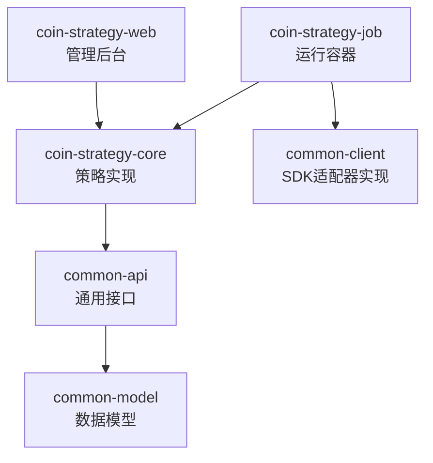

# CoinStrategy 量化交易平台

## 项目概述

CoinStrategy 是一个面向加密货币市场的量化交易平台，目标是在统一框架下接入多家交易所、按额度托管用户资金，并支撑多种交易策略的研发与运行。

### 建设目标

1. **交易所接入**：对接 Binance、OKX 等 CEX API，统一行情与交易能力。
2. **数据底座**：设计数据库表结构，完成数据持久化与监控数据的读写。
3. **用户与额度**：导入用户 API Key / Secret，按用户设定的配额独立操作资金（如账户有 1w U、仅支配 5000 U，则只操作这 5000 U），互不影响其他任务。
4. **收益分析**：记录每日收益数据，分析收益点并形成可视化图表。

### 功能边界

1. **API Key 管理**：便于用户录入 API Key / Secret —— 前期通过数据库操作，后期提供管理界面。
2. **额度隔离**：严格按用户设定的配额操作，为程序设定限额，不影响账户内其他资金与任务。
3. **账户范围**：第一版仅在指定单账户内操作，不做跨账户转账；后期再支持多 CEX 对冲套利。

### 策略路线

1. **对冲策略**（优先实现）
2. **网格策略**（第二阶段）
3. **指标分析自动交易**（第三阶段）：基于历史涨跌、开收盘价、涨幅、超跌等数据分析指定币种，自动控制买入与卖出。

### 链上交互

1. 参与项目方空投，以链上交易为主。
2. 记录交易损耗与参与过的项目。

## 系统架构设计 (System Architecture)

基于目前的 `common-client` 对接情况，为了支持后续多种策略研发，采用以下分层架构：

### 架构图

```mermaid
graph TD
    S[策略层 Strategy] --> |调用| API[通用接口层 common-api]
    API --> |实现| Adapter[适配层 Adapter]
    Adapter --> |调用| SDK[现有 common-client (Binance/Okx/Gate)]
    SDK --> |请求| Exchange[交易所 API]
```

### 架构说明

1.  **策略层 (Strategy)**: 专注于交易逻辑（如网格、对冲、指标分析），不感知具体交易所。只操作通用模型。
2.  **通用接口层 (common-api)**: 定义标准化的数据模型（Order, Ticker, Balance）和接口（ITradeService, IMarketDataService）。
3.  **适配层 (Adapter)**: 实现通用接口，将通用请求转换为具体交易所 SDK 的调用，并将结果转换为通用模型。
4.  **SDK 层 (common-client)**: 现有的 Binance, OKX, Gate 对接代码，负责底层的 HTTP 通信和签名。

### 模块职责与依赖 (Module Responsibilities & Dependencies)

#### 模块职责定位

*   **coin-strategy-core**: **(新增)** 策略的核心实现层。
    *   依赖 `common-api` (获取标准接口和模型)。
    *   编写具体的策略逻辑类（如 `GridStrategy`, `ArbitrageStrategy`）。
    *   **不直接依赖** `common-client`（通过 `common-api` 接口与适配层交互，解耦底层 SDK）。
*   **coin-strategy-job**: **(现有)** 策略的**运行容器**。
    *   负责定时调度、启动/停止策略。
    *   依赖 `coin-strategy-core`（获取策略逻辑）。
    *   依赖 `common-client`（注入具体的适配器实现）。
*   **coin-strategy-web**: **(现有)** 策略的**管理后台**。
    *   负责策略参数配置、收益展示、启停控制。
    *   依赖 `coin-strategy-core`（获取策略元数据）。
*   **common-api**: **(新增)** 通用接口层。
    *   定义标准化的数据模型（Order, Ticker, Balance）。
    *   定义标准服务接口（ITradeService, IMarketDataService）。

#### 模块依赖关系图



## 平台架构文档

*   [量化策略平台 MVP Java 架构设计文档](polymarket/MVP_ARCHITECTURE.md)

## 前端启动与停止

如需本地查看页面效果，可启动 `coin-strategy-frontend` 前端开发服务。

### 启动步骤

1. 在项目根目录进入前端目录：

```powershell
cd coin-strategy-frontend
```

2. 安装依赖（前端使用 `npm`，仓库中包含 `package-lock.json`）：

```powershell
npm install
```

3. 启动开发服务：

```powershell
npm run dev
```

4. 启动成功后，在浏览器访问：

```text
http://127.0.0.1:5173
```

### 默认后端配置

*   前端默认请求后端地址为 `http://127.0.0.1:8081`
*   该值定义在 `coin-strategy-frontend/.env.development`
*   开发代理仅代理 `/strategy/api`，相关配置定义在 `coin-strategy-frontend/vite.config.ts`

### 注意事项

*   如果后端服务没有启动，或者后端端口不是 `8081`，页面虽然可以打开，但接口请求会失败
*   如果你的后端不是运行在 `8081`，可以修改 `coin-strategy-frontend/.env.development` 中的 `VITE_API_BASE_URL`

### 停止前端服务

在启动前端服务的终端窗口中按：

```powershell
Ctrl + C
```

如果终端提示是否终止批处理，输入：

```powershell
Y
```

然后回车即可停止服务。

## 策略文档索引 (Strategy Documentation)

*   [资金费率套利策略 (Funding Rate Arbitrage)](funding-rate/FUNDING_RATE_ARBITRAGE.md)
*   [TOP50 趋势与波动率策略 (Top 50 Trend & Volatility)](TOP50_STRATEGY.md)
*   [常规技术分析策略 (Conventional Technical Analysis)](CONVENTIONAL_TECHNICAL_STRATEGY.md)
*   [链上借贷+LP稳定币策略 (On-chain Lending & LP)](funding-rate/CEX_LOAN_ONCHAIN_STABLE_LP_STRATEGY.md)
