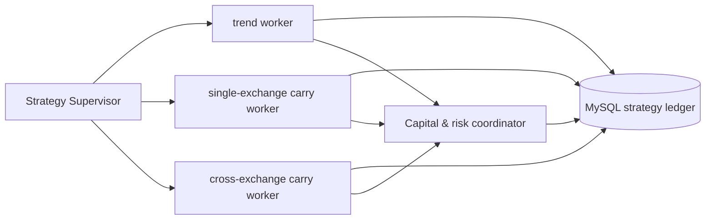

# CoinStrategy Python 策略运行平台 v1

## 目标

Python 作为实际策略运行时。趋势、单交易所资金费套利、跨所资金费套利等策略均可独立启动、停止、升级和部署；任一策略故障不得影响其他策略。共享资金账户时，开仓前统一检查账户预算与并发风险。

## 账本原则

- 趋势策略复用 MySQL 的 `htx_trade_account`、`htx_trend_position`、`htx_trend_order`、`htx_trend_signal`、`htx_trend_candidate_signal`、`htx_trend_factor_snapshot`、`htx_trend_exit_decision` 与 `coin_strategy_ledger_event`。
- 前端继续从现有表读取，因此 Python 写入后无需另建页面数据通道。
- SQLite 只用于离线回放与本地纸面测试，不能作为服务器真实策略账本。
- 数据库迁移只由部署流程显式执行；Python worker 启动时只校验 schema，不执行 DDL。

## 并行与隔离

每个 worker 有独立 `strategy_instance_id`、配置、日志、心跳、运行线程和部署服务。策略之间不读取对方私有状态；只有资金预算、账户并发仓位和硬风险限制由协调器统一读取。策略额度与 `strategy_account_risk_limit` 的账户总额度必须同时满足，live 执行器先用 `strategy_risk_reservation` 原子预留资金与一个仓位，成交终态后才释放，避免多 worker 并发超额。

## 部署单元

- `coinstrategy-python-trend.service`：趋势策略 worker。
- `coinstrategy-python-carry-single.service`：单所现货合约套利 worker，后续实现。
- `coinstrategy-python-carry-cross.service`：跨所套利 worker，后续实现。

三个服务可分别滚动、回滚、禁用。真实下单仍需账户级、策略级和执行器级三层开关同时开启。

## 首版运行边界

- Python 趋势 `OBSERVE` worker 已可通过公开 HTX 行情并发扫描合约，向既有 MySQL 趋势信号、因子快照和候选表写入页面可读证据，并写自己的运行心跳。仓位、订单和统一账本写入接口已对齐，但只会在后续纸面/live 执行器接入后调用。
- `PAPER`、`LIVE` 不会被观察 worker 误启用；它们必须接入独立的订单执行和交易所对账器后才可运行。
- `CARRY_SINGLE`、`CARRY_CROSS` 均以安全禁用 worker 注册。它们能被独立部署和观测，但没有得到授权的套利实现之前不会读取密钥或发送订单。
- 每次 live 入场应先写 `htx_trend_position` 和 `htx_trend_order` intent，再由 HTX 回执更新；`coin_strategy_ledger_event` 只追加经济事件，不能用当前浮盈覆盖已实现收益。
- Python 进程启动先只读检查必需 schema。没有已执行的显式 DDL 或实例/预算记录即失败退出，不自动修库，也不借用 Java 运行中的账户额度。

## 实施顺序

1. **完成**：Python MySQL 趋势仓储与页面同表口径，包含仓位/订单 intent、订单状态、统一账本、信号、候选、因子、退出决策与心跳接口。
2. **完成**：策略平台注册、心跳、资金预算与 worker supervisor；趋势观察 worker 已可运行，套利 worker 为禁用占位。
3. **待执行**：Python 趋势 worker 用 MySQL 做完整纸面订单/成交/对账，并逐笔与 Java 决策回放比较。
4. **待执行**：趋势 Python 小仓灰度，且必须先停止相同账户与策略实例的 Java live writer。
5. **待执行**：单所与跨所资金费套利在各自独立的订单、仓位、费用和对账模型完成回放后接入。
