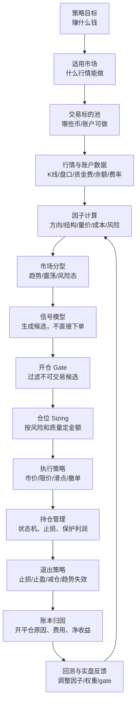
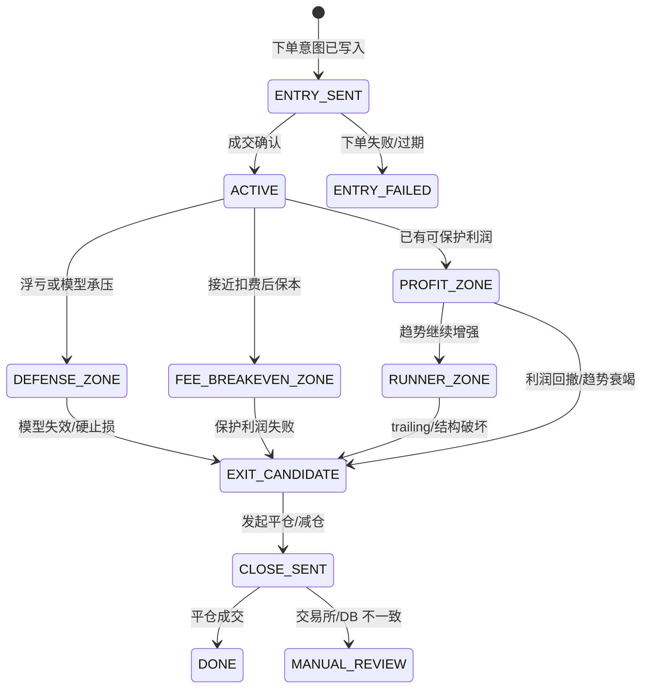

# CoinStrategy 策略闭环定义模板 v1

> **上层总纲**：本模板承接 [CoinStrategy 策略总纲 v1](COINSTRATEGY_STRATEGY_MASTER_PLAN_V1.md)，为趋势、套利、网格和后续新策略提供统一定义方式。

> **落地路线**：实施顺序见 [CoinStrategy 策略体系实施路线图 v1](COINSTRATEGY_STRATEGY_IMPLEMENTATION_ROADMAP_V1.md)。趋势策略的现有执行链路重构见 [HTX 趋势策略开仓与持仓管理重构计划 v1](HTX_TREND_EXECUTION_REFACTOR_PLAN_V1.md)。

> **结论先行**：一个策略不能只定义开仓信号和平仓信号。完整策略必须定义“赚什么钱、什么行情能做、用什么证据判断、什么时候不开、开多少、怎么成交、开仓后怎么管理、如何落袋、如何记账、如何回测、如何根据实盘反馈修正”。以后 CoinStrategy 的任何真实策略上线前，都必须按本文模板补齐闭环。

---

## 0. 文档定位

| 项 | 内容 |
|---|---|
| 文档类型 | 策略标准模板 / 策略闭环定义规范 |
| 目标读者 | 策略研发、后端、前端、回测、运维、实盘观察人员 |
| 适用范围 | 趋势策略、套利策略、网格策略、后续组合策略 |
| 非目标 | 不替代具体策略设计；不直接给出某个币种参数；不在本文改实盘代码 |
| 核心约束 | 新策略必须先按模板写清楚，再进入回测和真实交易 |

---

## 1. 策略闭环总览

策略闭环由 14 个模块组成。开仓信号和平仓信号只是其中两环。



图源文件：[strategy-closed-loop-template-v1.drawio](diagrams/strategy-closed-loop-template-v1.drawio)。

---

## 2. 标准策略定义卡片

任何策略先填这张卡片，避免只写几个条件就上线。

| 字段 | 必填 | 说明 | 示例 |
|---|---|---|---|
| `strategy_family` | 是 | 策略族 | `TREND` / `ARBITRAGE` / `GRID` |
| `strategy_name` | 是 | 策略名 | `HTX_TREND_V2` |
| `model_name` | 是 | 模型名 | `BOX_BREAKOUT` / `FIB_PULLBACK` |
| `profit_source` | 是 | 收益来源 | 方向趋势、资金费、区间波动 |
| `market_regime` | 是 | 适用市场 | `BROAD_UP` / `BROAD_DOWN` / `RANGE` |
| `timeframe_profile` | 是 | 周期画像 | `INTRADAY_15M` / `SWING_4H` |
| `tradable_universe` | 是 | 标的池 | 主流币、热度币、XAUT、白名单 52 币 |
| `entry_hypothesis` | 是 | 开仓假设 | 突破后资金继续推升 |
| `invalidation_rule` | 是 | 何时证明假设错了 | 跌回箱体并收盘确认 |
| `exit_profile` | 是 | 退出方式组合 | 分批止盈 + ATR trailing + 模型失效 |
| `risk_budget` | 是 | 单笔/单策略风险 | 单笔权益 0.5%–1% |
| `data_required` | 是 | 所需数据 | K线、盘口、资金费、费率、账户余额 |
| `ledger_required` | 是 | 账本字段 | 开仓价、平仓价、费用、净 PnL、原因 |
| `backtest_required` | 是 | 回测样本 | 好行情、差行情、震荡行情、真实亏损样本 |
| `live_observation` | 是 | 实盘观察指标 | 胜率、盈亏比、PF、MFE 捕获率、手续费占比 |

策略定义如果填不出 `profit_source`、`entry_hypothesis` 和 `invalidation_rule`，说明它还不是策略，只是一个信号片段。

---

## 3. 模块 1：策略目标

策略目标回答“这套策略到底赚什么钱”。

| 策略族 | 收益来源 | 不该赚的钱 |
|---|---|---|
| 趋势策略 | 上涨/下跌方向延续带来的价格波动 | 不能靠频繁小赚覆盖不了手续费的噪音交易 |
| 网格策略 | 震荡区间内的来回波动 | 不能在单边趋势里无限逆势补仓 |
| 资金费套利 | 对冲后的资金费或基差收益 | 不能暴露裸方向风险假装套利 |
| 跨所套利 | 交易所间资金费、价差或基差错配 | 不能忽略转账、限额、交易所风险 |

定义策略目标时必须写清楚三件事：

```text
1. 收益从哪里来。
2. 什么情况下收益来源不存在。
3. 策略失败时最可能亏在哪里。
```

---

## 4. 模块 2：适用市场与市场分型

策略必须先判断市场，再决定是否允许信号进入下单链路。

| 市场分型 | 趋势策略 | 网格策略 | 套利策略 |
|---|---|---|---|
| `BROAD_UP` 普涨 | 优先多单，空单降权 | 不开逆势网格 | 套利照常，但注意现货追高风险 |
| `BROAD_DOWN` 普跌 | 优先空单，多单降权 | 不开逆势网格 | 套利照常，但注意保证金风险 |
| `MIXED` 分化 | 只做高分单币结构 | 可做局部区间 | 套利按机会独立评估 |
| `RANGE` 震荡 | 少做或不做趋势追单 | 可启用网格/区间 | 套利照常 |
| `HIGH_VOL_RISK` 高波动风险 | 暂停新开仓或降仓 | 暂停加仓 | 缩小仓位、提高保证金 |
| `LOW_VOL_DEAD` 低波动无效 | 不开，收益覆盖不了成本 | 只有区间足够大才做 | 只做收益覆盖成本的机会 |

市场分型不能替代单币结构。普涨只能提高顺风候选权重，不能让一个没有结构、没有盈亏比的币直接下单。

---

## 5. 模块 3：交易标的池

标的池决定哪些币有资格被扫描。标的池不是越大越好，必须有进入和剔除规则。

| 维度 | 进入条件 | 剔除条件 |
|---|---|---|
| 流动性 | 成交额和深度足够 | 点差大、深度薄、滑点不可控 |
| 数据质量 | K 线稳定、盘口可取 | 行情缺失、K 线异常、合约规则不明 |
| 波动质量 | ATR 能覆盖费用 | 长期低波动或插针过多 |
| 风险事件 | 无维护、无异常公告 | 交易所风控、停牌、交割、异常资金费 |
| 策略表现 | 历史回测和实盘质量达标 | 连续拖累净收益、PF 长期不足 |

后续 50 个、100 个币并发扫描时，标的池还要分层：核心主流币、强流动山寨、热度币、观察币。真实开仓只从合格层里选，不从所有候选里盲目抢交易量。

---

## 6. 模块 4：数据输入

策略输入要分为行情数据、账户数据、交易成本和历史表现。

| 数据组 | 必要字段 | 用途 |
|---|---|---|
| K 线 | 15m/30m/1h/4h/1d OHLCV | 入场、趋势确认、退出判断 |
| 盘口 | bid/ask、点差、深度 | 判断能否成交、估算滑点 |
| 合约规则 | 合约面值、最小张数、杠杆范围 | sizing 和下单校验 |
| 账户 | 可用余额、保证金、持仓、挂单 | 风控、仓位上限、冲突判断 |
| 成本 | 账户手续费率、资金费、点差 | expected net 和持仓成本 |
| 历史表现 | 模型胜率、PF、均赚均亏、回撤 | 动态降权、停用、仓位调整 |

数据输入必须记录版本和时间。信号过期不是小问题，它会让“当时正确的信号”变成“现在错误的下单”。

---

## 7. 模块 5：因子体系

因子是策略判断的证据。每个因子必须说明“它解决什么问题”。

| 因子组 | 典型因子 | 解决的问题 |
|---|---|---|
| 方向因子 | EMA 斜率、ROC、多周期方向 | 当前方向是否明确 |
| 结构因子 | 箱体、swing high/low、Fibonacci、Donchian | 价格在哪个结构位置 |
| 趋势强度 | ADX、ATR%、趋势持续 K 数 | 是趋势还是噪音 |
| 量价因子 | 成交量放大、收盘位置、影线 | 突破/回踩是否真实 |
| 市场广度 | 上涨币占比、下跌币占比、BTC/ETH 锚点 | 单币是否顺大环境 |
| 成本因子 | 费率、点差、滑点、资金费 | 收益是否覆盖交易成本 |
| 风险因子 | 冷却、相关性暴露、连续亏损 | 是否进入策略失效期 |
| 表现因子 | 模型 PF、均赚均亏、MFE/MAE | 策略近期是否仍有效 |

因子必须落库或进入快照。没有快照，就无法回测“当时为什么开”和“为什么亏”。

---

## 8. 模块 6：信号模型

信号模型只负责生成候选，不负责真实下单。

### 8.1 信号输出标准

```text
candidate_id
strategy_family
strategy_name
model_name
symbol
side
market_regime
timeframe_profile
entry_hypothesis
entry_price_hint
invalidation_price
expected_target_price
expected_net_after_fee
risk_reward_ratio
model_score
factor_snapshot_id
signal_strength
signal_created_at
```

### 8.2 趋势策略模型示例

| 模型 | 适合场景 | 开仓假设 | 失效条件 |
|---|---|---|---|
| `BOX_BREAKOUT` | 横盘后启动 | 突破箱体后资金继续推升/打压 | 收盘跌回箱体、突破 K 被反向打穿 |
| `DONCHIAN_BREAKOUT` | 强趋势启动 | 创 N 周期新高/新低后趋势延续 | 反向通道突破、趋势强度衰竭 |
| `FIB_PULLBACK_CONTINUATION` | 趋势中继 | 回踩关键比例后重新转强 | 跌破 swing、跌破 0.786、跌回箱体 |
| `MULTI_TIMEFRAME_MOMENTUM` | 日内小趋势 | 15m/30m/1h 多周期共振延续 | 多周期同时转弱、短线动量失效 |
| `BROAD_MARKET_TREND` | 普涨/普跌行情 | 大盘广度带动单币顺势 | BTC/ETH 锚点反转、市场广度瓦解 |

### 8.3 套利策略模型示例

| 模型 | 适合场景 | 开仓假设 | 失效条件 |
|---|---|---|---|
| `SINGLE_EXCHANGE_SPOT_PERP_FUNDING` | 单所正资金费 | 现货多 + 合约空可获得资金费 | 资金费不覆盖成本、对冲偏离扩大 |
| `CROSS_EXCHANGE_FUNDING_SPREAD` | 跨所资金费差 | 两交易所资金费差可覆盖成本 | 资金费收敛、转账/提现/价格风险扩大 |
| `BASIS_MEAN_REVERSION` | 基差异常 | 基差回归 | 基差继续扩张且超过风险边界 |

---

## 9. 模块 7：开仓 Gate

开仓 gate 是“能不能开”的硬过滤。它不能和模型分数混在一起。

| Gate 类型 | 拦截什么 | 说明 |
|---|---|---|
| 模式 Gate | 观察模式、实盘关闭、dry-run | 应最前置，避免浪费后续判断 |
| 账户 Gate | 账户未启用、余额不足、费率缺失 | 多账号时代必须账户级判断 |
| 策略 Gate | 策略暂停、策略互斥、资金池不足 | 避免趋势/套利抢同一资金 |
| 市场 Gate | CHOP、高波动风险、低波动无效 | 大环境不适合时不开 |
| 信号 Gate | 过期、分数不足、方向置信不足 | 防止慢信号和弱信号下单 |
| 结构 Gate | 无失效价、无目标价、盈亏比不足 | 没有退出边界就不开 |
| 成本 Gate | 费用、点差、滑点、资金费不划算 | 防止为手续费打工 |
| 暴露 Gate | 已有仓位、挂单、外部仓位冲突 | 防止重复下单和误接管 |
| 执行 Gate | 保证金、杠杆、最小张数、下单限制 | 下单前最后校验 |

Gate 的输出必须是结构化的：

```text
gate_stage
gate_name
result = PASS / REJECT / OBSERVE / MANUAL_REVIEW
actual_value
required_value
reason_zh
```

---

## 10. 模块 8：仓位 Sizing

仓位不是“余额多就开大”，而是由风险、信号质量、波动和账户状态共同决定。

### 10.1 基础公式

```text
single_trade_risk = account_equity * risk_per_trade_pct
stop_distance = abs(entry_price - invalidation_price)
raw_position_size = single_trade_risk / stop_distance
notional = raw_position_size * entry_price
```

再经过合约面值、最小张数、最大名义额、杠杆、保证金、相关性暴露修正。

### 10.2 乘数来源

| 乘数 | 放大/缩小依据 |
|---|---|
| 市场分型乘数 | 顺风放大，震荡/高风险缩小或禁开 |
| 信号强度乘数 | 强信号标准仓，弱信号小仓或观察 |
| 模型质量乘数 | PF、均赚均亏、近期回撤决定上限 |
| 波动乘数 | 高波动缩小，低波动且收益不足禁开 |
| 账户乘数 | 不同账户费率、余额和风险预算不同 |
| 相关性乘数 | 多个同向高相关币同时开仓时缩小 |

仓位 sizing 必须输出“为什么是这个金额”，否则亏损后无法判断是方向问题还是仓位问题。

---

## 11. 模块 9：执行策略

执行策略回答“信号通过后怎么成交”。

| 执行动作 | 适用场景 | 风险 |
|---|---|---|
| 市价单 | 强信号、流动性好、需要立刻成交 | 滑点和吃单手续费 |
| 限价单 | 普通信号、允许等待 | 追不上行情或挂单过期 |
| 分批下单 | 仓位较大或盘口薄 | 执行复杂，可能部分成交 |
| 撤旧单重下 | 强信号且已有同向旧挂单 | 需要严格审计，避免重复 |
| 只观察 | 信号好但 gate 有缺口 | 不承担真实风险 |

执行结果必须回写：下单意图、交易所订单号、成交价、成交张数、手续费、滑点、失败原因。

---

## 12. 模块 10：持仓管理

持仓管理不是等平仓条件触发，而是持续判断仓位状态。

### 12.1 仓位状态机



### 12.2 持仓管理必须记录

| 字段 | 说明 |
|---|---|
| `position_state` | 当前仓位状态 |
| `mfe_usdt` | 最大有利浮盈 |
| `mae_usdt` | 最大不利浮亏 |
| `max_favorable_price` | 入场后最有利价格 |
| `giveback_rate` | 从最大浮盈回吐比例 |
| `time_in_position_bars` | 持仓 K 数 |
| `current_exit_candidates` | 当前所有退出候选 |
| `management_reason` | 本轮管理为什么持有/减仓/平仓 |

---

## 13. 模块 11：退出策略

退出策略分为“止损、止盈、保护利润、趋势衰竭、时间失效、成本恶化、异常风险”七类。止损只是退出的一部分。

| 退出类 | 目标 | 典型动作 |
|---|---|---|
| 硬风险退出 | 活下来 | 交易所仓位异常、保证金风险、DB/交易所不一致 |
| 模型失效退出 | 开仓理由不存在就走 | 跌回箱体、破 swing、锚点反转 |
| 初始止损 | 控制单笔最大亏损 | 触达 invalidation price 全平 |
| 分批止盈 | 先落袋一部分 | 到 1R/目标区/前高前低减仓 |
| 利润保护 | 防止盈利单变亏损 | break-even lock、profit lock、ATR trailing |
| 趋势衰竭 | 趋势不再值得拿 | ADX 下滑、量价背离、多周期转弱 |
| 时间退出 | 预期迟迟不兑现 | 仅对短线动量模型严格使用 |
| 成本退出 | 持仓成本侵蚀收益 | 资金费、费用、滑点恶化；不能单独成为万能平仓理由 |

### 13.1 退出决策顺序

```text
1. 先看硬风险：系统或交易所异常时保护账户。
2. 再看模型是否失效：开仓假设错了就退出。
3. 再看当前盈亏状态：亏损区、保本区、盈利区、runner 区区别处理。
4. 再生成退出候选：止损、分批止盈、移动止损、趋势衰竭、时间失效。
5. 最后选择动作：继续持有、上移止损、部分平仓、全部平仓、人工复核。
```

### 13.2 盈亏状态与动作

| 状态 | 定义 | 默认动作 |
|---|---|---|
| `LOSS_ZONE` | 扣费后净亏 | 看模型是否失效；失效则止损，不失效则按结构给空间 |
| `FEE_BREAKEVEN_ZONE` | 接近扣费后保本 | 不急着平，但开始保护手续费和滑点 |
| `PROFIT_ZONE` | 已有扣费后利润 | 考虑分批止盈或上移保护价 |
| `RUNNER_ZONE` | 趋势延续且浮盈扩大 | 让利润奔跑，用 trailing 和结构保护 |
| `EXHAUSTION_ZONE` | 浮盈回吐或趋势衰竭 | 部分或全部落袋 |

### 13.3 模型匹配退出

| 模型 | 不该怎么平 | 应该怎么平 |
|---|---|---|
| `BOX_BREAKOUT` | 只因 2 根 K 没涨就平 | 看是否跌回箱体、突破 K 是否失守、量价是否失败 |
| `FIB_PULLBACK_CONTINUATION` | 不因短线 no-extension 一刀切 | 看 swing、0.786、箱体边界和重新转强是否失效 |
| `MULTI_TIMEFRAME_MOMENTUM` | 不拿成长线单 | 可使用较严格时间退出和短周期衰竭退出 |
| `DONCHIAN_BREAKOUT` | 不用很窄的短线止盈 | 用通道反转、ATR trailing、趋势衰竭 |
| `BROAD_MARKET_TREND` | 不被单根 15m 噪音洗出去 | 看 BTC/ETH 锚点、市场广度和 1h/4h 结构 |

---

## 14. 模块 12：账本与归因

账本必须能回答“这笔交易到底为什么赚/亏”。

| 账本字段 | 说明 |
|---|---|
| `account_id` / `account_label` | 多账号归属 |
| `strategy_family` / `strategy_name` / `model_name` | 策略归属 |
| `symbol` / `side` | 合约和方向 |
| `entry_reason` / `entry_hypothesis` | 为什么开仓 |
| `entry_price` / `close_price` | 开平仓成交价 |
| `entry_fee` / `close_fee` / `funding_fee` | 成本拆分 |
| `gross_pnl` / `net_pnl_after_fee` | 毛收益和扣费后净收益 |
| `exit_reason` / `exit_engine_reason` | 为什么平仓 |
| `mfe_usdt` / `mae_usdt` / `giveback_rate` | 平仓质量分析 |
| `factor_snapshot_id` | 回放当时因子 |
| `gate_trace_id` | 回放 gate 过程 |

归因分类至少包含：方向错、入场太晚、假突破、退出太早、退出太晚、手续费侵蚀、滑点问题、仓位过大、市场分型错误、模型失效。

---

## 15. 模块 13：回测验证

回测必须复现完整策略闭环，而不是只测开仓点。

| 回测维度 | 必须输出 |
|---|---|
| 收益 | 扣费后净 PnL、毛 PnL、手续费、资金费 |
| 稳定性 | 胜率、profit factor、平均盈亏比、单笔期望 |
| 风险 | 最大回撤、连续亏损、单日亏损、相关性暴露 |
| 平仓质量 | MFE 捕获率、MAE、利润回吐、过早退出率 |
| 模型表现 | 各模型 PnL、PF、胜率、均赚均亏 |
| 市场分型 | BROAD_UP/BROAD_DOWN/MIXED/RANGE 下表现 |
| 标的表现 | 币种级 PnL、手续费占比、成交量 |
| 实盘对照 | 是否能复现真实亏损单的开仓和平仓原因 |

第一批固定样本：

| 日期 | 样本意义 |
|---|---|
| 2026-09-18 | 好行情，验证能不能抓到主要趋势 |
| 2026-09-19 | 差行情/回撤，验证少亏能力 |
| 2026-09-20 | 混合行情，验证分型和过滤 |
| 2026-09-21 | 真实亏损复盘，验证修复是否有效 |

---

## 16. 模块 14：实盘观察与反馈

实盘观察不是看“今天赚没赚”这么粗。必须按策略闭环回看。

| 观察问题 | 指标 |
|---|---|
| 是否方向判断正确 | 多空方向胜率、市场分型准确率 |
| 是否入场太晚 | 信号价到成交价滑点、入场后 MAE |
| 是否平仓太早 | MFE 捕获率、平仓后继续趋势比例 |
| 是否亏损大于盈利 | 均赚、均亏、盈亏比、PF |
| 是否手续费吃掉利润 | fee_to_gross_profit_ratio |
| 哪个模型拖累 | model-level net PnL / PF |
| 哪个币拖累 | symbol-level net PnL / drawdown |
| 是否过度交易 | 每日交易次数、低质量信号占比 |
| 是否仓位不合理 | 单笔风险、相关性暴露、最大同时仓位 |

反馈动作必须可控：

```text
先降权 → 再禁开 → 再重写模型 → 最后才删除策略。
```

---

## 17. 策略上线门槛

| 阶段 | 门槛 | 是否允许真实开仓 |
|---|---|---|
| 设计完成 | 本模板 14 个模块填齐 | 否 |
| 数据观察 | 因子、候选、gate、退出候选可落库 | 否 |
| 回测通过 | 覆盖好/差/震荡/真实亏损样本 | 否 |
| 小仓灰度 | 单账号小仓，仓位上限严格 | 是，小仓 |
| 稳定运行 | 净 PnL、PF、回撤、手续费占比达标 | 是，逐步放大 |
| 多账号扩展 | 账户级费率、资金、账本、风险隔离完成 | 是，账户级放大 |

建议第一版硬门槛：

```text
扣费后 profit factor > 1.15
手续费占毛利润 < 35%
至少覆盖好行情、差行情、震荡行情、真实亏损样本
能够解释每一笔真实平仓原因
```

---

## 18. 当前趋势策略的补齐清单

结合现有 HTX 趋势系统，下一步不应继续只改一个 ATR 或结构止损参数，而应按下面顺序补齐。

| 优先级 | 项 | 原因 | 行为影响 |
|---|---|---|---|
| P0 | 固化策略闭环模板 | 后续所有策略按统一口径设计 | 文档，无实盘影响 |
| P1 | 退出系统单独重构计划 | 平仓不是止损；需要分批止盈、利润保护、趋势衰竭、模型失效 | 先文档/诊断 |
| P2 | 退出候选快照 | 每轮持仓管理记录所有退出候选和未执行原因 | 不改真实平仓 |
| P3 | MFE/MAE/giveback 落库 | 判断平仓太早还是太晚 | 不改真实平仓 |
| P4 | 模型匹配退出 | BOX/FIB/MOMENTUM/DONCHIAN 不共用同一退出 | 灰度后影响平仓 |
| P5 | 分批止盈与 runner | 解决“赚钱容易，落袋很难” | 小仓灰度 |
| P6 | 多周期退出 | 15m 防守，1h/4h 判断趋势是否继续 | 小仓灰度 |
| P7 | 回测对比 | 证明改造后提高净收益和 PF | 上线前必做 |

---

## 19. 策略文档模板

以后新增策略文档时，按以下目录写：

```text
1. 策略目标
2. 适用市场与禁用市场
3. 标的池与账户范围
4. 数据输入
5. 因子列表与权重
6. 信号模型
7. 开仓 Gate
8. 仓位 Sizing
9. 执行策略
10. 持仓管理
11. 退出策略
12. 账本与归因
13. 回测验证
14. 实盘观察与反馈
15. 上线门槛与回滚方案
```

模板的目的不是让文档变长，而是避免策略缺胳膊少腿。某一节如果确实不适用，也必须写“为什么不适用”。

---

## 20. 下一步执行建议

立即下一步建议如下：

1. 为 HTX 趋势策略新增一份独立的“退出系统重构计划”，专门覆盖止损、止盈、分批减仓、利润保护、趋势衰竭、时间退出和模型失效。
2. 在代码层先做无行为变更的退出候选快照：每轮持仓管理把所有可能退出候选、MFE、MAE、giveback、PnL 状态写入诊断。
3. 保持结构止损真实开关关闭，直到回测证明它不会降低 MFE 捕获率或过早扫掉趋势单。
4. 回测 2026-09-18 至 2026-09-21，重点比较改造前后：净 PnL、PF、均赚均亏、MFE 捕获率、利润回吐和过早退出率。
