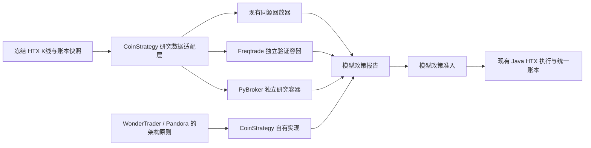

# HTX 趋势策略外部框架采纳评估 v1

> **结论**：不把五个项目整体嵌入 CoinStrategy，也不让它们接管 HTX 实盘账户。按“研究验证工具、可复用架构原则、不可采纳代码”三类拆开使用。现有 Java 交易、账本和 HTX V5 连接仍是唯一真实执行路径。

## 1. 评估原则

要采纳的是已验证的工程能力，而不是再引入五套平行交易系统。每项候选至少满足：

1. 能消费我们的冻结 K 线、费用和合约面值；
2. 结果能按 `run_id`、模型、方向、市场分型回写或对照；
3. 不持有 HTX API Key，不得绕过统一订单、仓位、账本与 v4 退出链；
4. 许可证允许目标用途，且不复制不兼容源代码；
5. 对 15m 至 1d 趋势策略有实际增益，而不是为低延迟或其他市场重复造系统。

## 2. 总体接入形态



外部工具只产生研究报告、模拟订单和差异诊断；不能直接开仓、平仓、修改 HTX 配置或写入真实订单表。

## 3. 逐项目结论

| 项目 | 实际能力与维护状态 | 对 HTX 趋势策略的价值 | 结论 |
|---|---|---|---|
| [Freqtrade](https://github.com/freqtrade/freqtrade) | Python 加密交易框架；当前 README 列出 HTX **现货**支持，合约支持列表未包含 HTX；有回测、dry-run、hyperopt、look-ahead 与 recursive 分析、FreqAI。GPL。 | 作为独立的策略回测对照器，尤其借鉴前视偏差、递归指标和滑动训练验证。不能直接执行 HTX 合约趋势单。 | **采纳为隔离研究验证工具，不作为运行时依赖。** |
| [WonderTrader](https://github.com/wondertrader/wondertrader) | C++ 核心，MIT；CTA/SEL/HFT/UFT、统一回测、策略组合、目标仓位合并、M+1+N 多账户执行、信号执行分离与“离合器”机制。现有官方接口面向中国期货/股票。 | 对 52 币扫描、多账户同步、组合净敞口、策略信号与执行断开后的观察很有价值。 | **采纳架构原则，以 Java 自有实现落地；不引入 C++ 引擎。** |
| [PandoraTrader](https://github.com/pegasusTrader/PandoraTrader) | C++ CTA/HFT 平台，Tick 回测、行情/交易 API、订单回调、内嵌撤单和自成交风控；接口主要为 CTP/QDP/Femas 等。仓库未见许可证声明。 | 有助于完善 HTX 的订单状态机、部分成交、撤单、订单回报和逐笔执行模拟。 | **仅作行为与测试案例参考；不复制或引入代码。** |
| [PyBroker](https://github.com/edtechre/pybroker) | Python 研究框架；自定义数据源、多标的、多周期、Walk-forward、Bootstrap 显著性、Optuna、滑点与仓位轮换。Apache 2.0 + Commons Clause。 | 最适合作为第二个独立研究引擎，验证现有模型在冻结 K 线上的样本外稳定性、统计显著性与参数稳健性。 | **可做隔离研究适配器，先完成许可证用途复核；不进入实盘执行。** |
| [sdoosa-algo-trade-python](https://github.com/sreenivasdoosa/sdoosa-algo-trade-python) | 2022 年后基本停更；印度 NSE/NFO、Zerodha 的教学项目，涵盖 Broker Adapter、Ticker、Order Manager、Trade Manager 和策略基类；无许可证声明。 | 可借鉴最小 Broker Adapter、订单状态与策略生命周期的教学结构。我们的账户账本、HTX 接口和策略规模已超过该项目。 | **只保留架构阅读价值，不接入、不复制代码。** |

## 4. 应采纳的具体能力

### 4.1 Freqtrade：研究质量闸门

以 CoinStrategy 自有实现复刻以下测试思想，不复制 GPL 源码：

- **look-ahead analysis**：任何 15m/30m/1h/4h/1d 指标或合并周期都不能读取未来 bar；
- **recursive analysis**：递推指标在不同 warm-up 长度下是否稳定，防止 EMA、ATR、ADX 初始值影响交易结论；
- **dry-run 对照**：真实执行与模拟执行使用同一价格计划、TTL、费用和订单状态；
- **滚动训练/验证**：若未来引入机器学习，只允许历史窗口训练、后续窗口验证，严禁样本外调参。

这部分应接在 `BT-01 / BT-02A / MODEL-01` 前后，成为研究报告的强制质量字段。

### 4.2 WonderTrader：组合和执行架构

采纳四个原则：

1. **目标仓位优先**：模型输出目标风险敞口，执行层决定如何变成订单；模型不直接操纵交易所订单。
2. **信号与执行分离**：可关闭真实执行而持续生成候选、价格计划和理论仓位，用于核验策略质量。
3. **M+1+N 多账户模型**：一套模型政策和组合风险预算，按账户费率、资金、风险偏好与可用保证金计算各账户执行量；不是简单复制订单。
4. **组合净敞口控制**：合并同方向、高相关币种暴露，降低自成交、重复 Beta 和费用浪费。

对应 CoinStrategy 的新对象应是 `TargetExposure` 与 `PortfolioRiskBudget`，位于“模型政策通过”与“价格计划/下单”之间。它们不替代单币种初始止损或 v4 退出。

### 4.3 PandoraTrader：订单状态与逐笔模拟

采纳的不是低延迟 C++ 代码，而是订单生命周期：

```text
INTENT → SUBMITTED → ACCEPTED → PARTIALLY_FILLED → FILLED
                   ↘ REJECTED / EXPIRED / CANCEL_PENDING → CANCELLED
```

每个状态需要同时保存交易所订单 ID、`run_id`、计划价格区间、剩余张数、成交均价、费用、最后交易所回报时间和异常原因。

这直接服务 `BT-03` 与 `ENTRY-01`：市价、被动限价、IOC、撤单与一次重报价在相同候选上进行回放比较；未成交不得伪造成持仓，部分成交只能按实际张数建立仓位。

### 4.4 PyBroker：独立统计验证器

PyBroker 只消费只读导出的冻结数据，不访问 HTX：

```text
Frozen dataset / 候选 / 价格计划
  → PyBroker 自定义数据源适配
  → 模型级 Walk-forward
  → Bootstrap 区间、参数稳定性、长短候选排序
  → JSON 研究报告
  → 与 CoinStrategy 同源回放器对照
```

验收不是两边 PnL 完全相同，而是：相同价格、费用、滑点和同 K 线止损优先假设下，交易数、方向、入场时间、风险、退出分类和净收益差异可解释。若不一致，先修数据或执行假设，不能挑选较好的一边作为实盘结论。

在引入任何 PyBroker 包或其代码前，必须确认 Commons Clause 对本系统的实际用途、未来对外提供策略服务的边界是否允许。

### 4.5 sdoosa：最小适配器边界

只保留三条工程启发：`MarketDataAdapter`、`OrderAdapter`、`Position/TradeManager` 应分开；策略不能直接依赖交易所 SDK；订单回报是状态迁移的唯一事实来源。现有 CoinStrategy 已有更完整的账本和账户模型，因此不应倒退为该项目的单进程教学结构。

## 5. 不采纳的内容

- 不将 Freqtrade、WonderTrader、PandoraTrader 或 sdoosa 的订单执行器连到 HTX 真实账户；
- 不将 Freqtrade 的 HTX **现货**结果直接当作 HTX 合约策略的准入依据；
- 不把 HFT/Tick 框架当作 15m 至 1d 趋势策略的收益来源；
- 不复制 PandoraTrader 或 sdoosa 的代码，二者仓库未见许可证声明；
- 不在许可证用途未确认前将 PyBroker 纳入可对外提供的产品或服务；
- 不绕过 `run_id`、价格计划、真实订单、账户费率和统一账本。

## 6. 建议实施顺序

| 优先级 | 工作 | 依赖 | 交付与验收 |
|---|---|---|---|
| P0 | 将 Freqtrade 的前视偏差、递归稳定性检查以自有测试实现 | 已完成冻结数据集 | 每个回测报告声明是否通过，失败样本不得晋级模型政策。 |
| P1 | 完成现有 `BT-01`、`BT-02A`、`MODEL-01/02` | P0 | 先得到自有同源基线，避免两个研究引擎同时引入不一致。 |
| P2 | 建立 PyBroker 只读研究适配器 PoC，并完成许可证用途复核 | P1 | 对相同数据集输出 Walk-forward 与 Bootstrap 报告，差异可解释。 |
| P3 | 落地 WonderTrader 的 `TargetExposure`、组合风险预算、账户分配 | P1 | 相关币种、同方向和账户风险被统一限制；不改变单币模型逻辑。 |
| P4 | 完善 Pandora 式订单状态机和 `BT-03` 执行回放 | P1 | 市价、限价、IOC、撤单和部分成交都有可回放结果。 |

### 6.1 执行记录（2026-10-04）

- **P0 已完成**：新增自有 `htx_trend_research_quality_gate.py`，不引入 Freqtrade 代码。它在内容寻址数据集 `research:c5cfa7cd77cf22c0fefa271ef6ba7e93` 的 52 个合约上完成 156 个未来数据变更探针和 156 个递归 warm-up 探针；结果为 `PASS`，前视泄漏数为 `0`，256 根启动历史不稳定数为 `0`。研究验收报告现在必须消费同一数据集的 `PASS` 质量报告，否则只能输出 `INSUFFICIENT_EVIDENCE`。
- **P1 的实现已闭环，历史执行证据仍待采集**：`HtxTrendFrozenGateAblationCommand` 已复用 Java 生产信号、组合计算和反向大盘风险 Gate；2026-09-18 的 52 币种验收有 4,743 个原始候选，当前 Gate 拦截 39 个，多周期实验额外拦截 500 个，当前路径与“仅反向大盘风险”对照一致。`HtxTrendFrozenExecutionEvidence`、`HtxTrendFrozenExecutionReplay` 和离线命令已将 BT-01/完整 BT-02A 所需的候选全量、最终 Gate、费率/盘口/保证金/杠杆/仓位预检、成交和 Fibonacci v4 退出输入定义为同一冻结合同；任一项缺失都会输出 `INSUFFICIENT_EVIDENCE`，不会伪造 PF、PnL 或回撤。`htx_trend_model_policy.py` 已把同一数据集的质量闸门与样本外报告固化成不可开启实盘的准入报告：Donchian `PF=0.82`、EMA/VWAP `PF=0.95`、Fibonacci `PF=1.13`，均未达到 `PF≥1.30`，当前全部 `REJECT`。下一轮只缺真实或同一价格计划模拟的完整执行事实；输入到位后，工具会直接输出四组 Gate 的候选数、漏单数、扣费后 PnL、PF、期望和回撤。
- **P2 完成只读输入适配、许可证收口与隔离运行时检查，未完成独立框架验证**：PyBroker 的原始许可证为 Apache 2.0 with Commons Clause，因此不引入其源码、生产运行时或对外服务能力。项目外隔离的 Python 3.11.15 环境已实际安装并导入 `lib-pybroker 2.0.1`；`htx_trend_pybroker_export.py` 从同一三个月冻结集校验并导出 459,264 根 15m OHLCV 行，`htx_trend_pybroker_runtime_smoke.py` 以 PyBroker 的自定义数据源只读验证 CSV 可用性。该检查不产生订单、PnL、Walk-forward 或 Bootstrap 结果。P1 的完整执行事实已按当前计划冻结，故独立模型验证仍为 `INSUFFICIENT_EVIDENCE`。
- **P3 完成分配器、审计快照和候选批次只读接入，未上线组合风控**：`HtxTrendPortfolioAllocator` 输出 `TargetExposure`、组合风险预算与账户选择；`HtxTrendPortfolioAllocationAuditService` 将接受、拒绝的分配决策写为不可变 `trend-target-exposure-v1` 快照。启用 `htx.trend.portfolio-audit-enabled=true` 后，`HtxTrendFollowingService` 会在整批候选排序完成、首个真实 Gate 之前记录该证据；默认关闭，审计结果不被 `openIfEligible` 读取，不改变排序、Gate、仓位或纸面/实盘订单。当前仅以 DB 主账户身份、全局可用保证金和配置的保守 taker 费率回退值进行观测；多账户实际费率和执行分配仍待完整执行证据与独立授权。
- **P4 完成纸面订单状态与 BT-03 输入合同，未完成正式比较结论**：`HtxTrendOrderStateMachine` 固化 `INTENT → SUBMITTED → ACCEPTED → PARTIALLY_FILLED → FILLED` 及拒绝、过期、撤单状态；`HtxTrendPaperExecutionService` 现在将旧的一次性回传同步记为不可变生命周期事件。`htx_trend_bt03_input_builder.py` 只接受冻结价格计划与校验过的后续 K 线，`htx_trend_execution_mode_replay.py` 才可比较市价、被动限价、IOC 和一次重报价。当前生产外没有有效期内的完整价格计划样本，首份 BT-03 结果为 `INSUFFICIENT_EVIDENCE`，不得形成成交率、PF 或实盘执行结论。

## 7. 决策

当前采用“**双研究引擎 + 单一真实执行引擎**”路线：

- CoinStrategy Java：唯一真实 HTX 执行、账户、仓位、退出与账本系统；
- 现有同源回放器：准入的基线评估器；
- Freqtrade：独立的研究质量检查参考，实现其测试思想而不复制 GPL 代码；
- PyBroker：经许可证复核后作为只读统计验证器；
- WonderTrader / PandoraTrader / sdoosa：只转化成自有架构与测试要求，不嵌入第三方运行时。

这样能把五个项目的强项纳入策略体系，同时避免多套订单系统争夺同一个 HTX 账户、出现账本分裂或引入无法控制的许可证风险。
