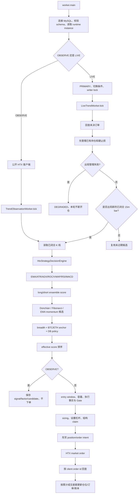

# HTX Python 当前运行流程与计算明细 v1

## 先说结论

如果现在启动当前 Python 趋势策略，主入口是 `htx_trend.worker:main`。OBSERVE 和 LIVE 都通过 `HtxStrategyDecisionEngine` 调用同一套 `java_entry_contract.evaluate/candidates`；LIVE 在此基础上增加账户事实、执行门禁、仓位计算、HTX 下单、订单回查和持仓退出。

当前入场逻辑**没有计算 K 线回归斜率、价格斜率、EMA 斜率、成交量斜率或收益率回归斜率**。它计算的是 EMA 相对排列、12 根 K 线点到点 ROC、Donchian/箱体突破、ATR、ADX 和量比。市场锚点还比较最新收盘价与前一根收盘价，但这只是单根方向判断，不是斜率。

还有两个容易被名称误导的事实：

1. `EMA_VWAP_MOMENTUM_CONTINUATION` 当前触发条件实际使用 EMA 排列、ROC 和 ADX，**没有使用 VWAP 条件**。
2. RSI 与 MACD 会在 `snapshot()` 中计算；OBSERVE 会保存它们，但当前 ensemble 评分、三类候选、LIVE Gate 和退出决策均不读取它们。

本说明描述本地代码基线 `965bf718`。环境变量和数据库 policy 可以覆盖部分默认参数；本文没有把本地默认值当成服务器当前配置。

## 总流程

详细可编辑图见 [`diagrams/htx-python-current-runtime-flow-v1.drawio`](diagrams/htx-python-current-runtime-flow-v1.drawio)。



## 1. 启动阶段

入口在 [`worker.py`](../../htx-trend-python/src/htx_trend/worker.py)：

1. 解析 `--strategy-instance`、`--once`、`--interval-seconds`；默认每 45 秒 tick 一次。
2. 连接 MySQL，执行 `validate_runtime_schema()`，读取已注册且启用的 runtime instance。
3. 如果不是存量 `HTX_TREND_V1`，加载 `HTX_TREND_STRATEGY_ADMISSION_PATH`；版本不匹配直接停止。
4. OBSERVE 使用公开 HTX 客户端，构造 `TrendObservationWorker`。
5. LIVE 还必须满足：绑定启用的 PRIMARY 账户、退出 parity 已批准、首次切换显式设置 `HTX_TREND_MIXED_MARKET_REQUIRES_STRONG_CANDIDATE=false`、没有启用镜像账户。随后获取 Java/Python 共用 writer lock，构造私有 HTX 客户端、entry executor、position manager 和 live worker。
6. `StrategySupervisor.tick_all()` 调 worker；异常转换为健康状态并写 heartbeat。

LIVE 创建时还要求 `HTX_TREND_ENABLED=true`、合约列表非空、`HTX_TREND_COMBINATION_ENTRY_ENABLED=true`。Python 没实现 Java legacy 单合约入场，所以组合开关关闭时拒绝启动。

## 2. 每个 LIVE tick 先做什么

`LiveTrendWorker.tick()` 的顺序是固定的：

1. `writer_guard()` 确认当前进程仍持有写锁。
2. `reconcile_pending()` 按原 client order id 查询 HTX，恢复 ENTRY/CLOSE/UNKNOWN 等未决订单。
3. `LivePositionManager.manage()` 管理所有已有持仓。任一持仓管理失败会让本轮返回 `DEGRADED`，不继续新开仓。
4. 从数据库读取 enabled strategy policies。
5. 根据当前时间减去 10 秒 close grace，计算最近的已稳定 K 线收盘时点。只有收盘时点变化才扫描全部合约；其余 scheduler tick 复用缓存候选。
6. 新 bar 扫描前读取最近 35 分钟的历史 breadth，避免本轮刚写的 signal 反过来影响本轮市场分类。
7. 扫描、计算 anchor、保存 observation、匹配 policy，并缓存每个合约当前候选。
8. 清除超过 600 秒 freshness 的候选，按 `effective_score → base_score → expected_r` 排序。
9. 只有在 K 线收盘后 15–60 秒的 entry window 内，或候选仍在 carryover freshness 内，才尝试入场。

默认扫描 52 个合约，线程数 6；入场周期是 15min，配置会为每个合约请求 160 根闭合 K 线。代码同时请求一份默认 60min `trend` window，但当前 `_scan_one()` 没把它传入决策、排序或 Gate；它目前不影响 LIVE 入场结果。

## 3. K 线如何进入计算

`HtxMarketData.kline_window()` 向 HTX 请求 `size + 1` 根 K 线。`completed_candles()` 会：

- 按 `open_time` 去重和排序；
- 只保留 `open_time + period_seconds <= now - close_grace` 的 K 线；
- 去掉仍在形成中的最后一根；
- 最后截取所需的 `size` 根。

`HtxStrategyDecisionEngine.decide()` 再按时间排序，先校验新策略的作用面权限，然后依次调用：

```text
java_entry_contract.evaluate(candles)
  -> 指标 snapshot
  -> long/short 分数
  -> 方向与市场状态

java_entry_contract.candidates(candles, signal)
  -> 三类结构候选
  -> 止损、目标、expected R
```

它同时生成 input hash、config hash 和 decision hash，让回放、OBSERVE 和运行时可以核对是否同源。

## 4. 指标在哪里算、怎么算、在哪里使用

默认至少需要 `max(120, 20, 12, 14, 14, 20) + 5 = 125` 根有效 K 线，否则返回 FLAT。

| 指标 | 当前公式与默认周期 | 对当前决策的真实作用 |
|---|---|---|
| EMA20/60/120 | `α=2/(n+1)`，以第一项为初值递推；保留 18 位小数 | `close > EMA20 > EMA60 > EMA120` 多头 +30；空头对称。部分排列 +12。还用于 regime、EMA 候选与退出 |
| ROC12 | `(close[t]-close[t-12]) / close[t-12]` | `>=0.0015` 给多头加分，`<=-0.0015` 给空头加分；分值 `min(20, abs(ROC)/0.0015×10)` |
| Donchian20 | 当前 K 线之前 20 根的最高 high / 最低 low | 收盘突破相应边界 +20；也决定 Donchian 候选和止损 |
| ATR14 | TR 为 `max(H-L, abs(H-prevClose), abs(L-prevClose))`；最近 14 个 TR 简单平均 | `ATR/close >= 0.0010` 给当前 bias +10；用于追价、波动上限、止损距离和退出。不是 Wilder 平滑 ATR |
| ADX14 | 由滚动 DM/TR 得到 DI、DX，再对生成的尾部 DX 取平均 | `ADX>=16` 给 bias +10；regime 要求 `>=16`；EMA 候选要求 `>=20`。不是 Wilder 递推 ADX |
| Volume ratio20 | 当前有效量 / 前 20 根正有效量均值；单根取值顺序为 `amount → volume → turnover` | `>=1.10` 给 bias +10；Fib Gate 另算最近 K 线质量量比 |
| VWAP20 | `Σ(((H+L+C)/3)×量) / Σ量`，量优先 `volume`，否则 `amount` | 会计算并保存，但当前评分、`EMA_VWAP` 候选和 Gate 均不使用 |
| RSI14 | 最近 14 个 close change 的简单平均 gain/loss，`100-100/(1+RS)` | 会计算；OBSERVE 保存；当前入场、Gate、LIVE 退出不使用 |
| MACD12/26/9 | 快慢 EMA 差、signal EMA、histogram | 会计算；OBSERVE 保存；当前入场、Gate、LIVE 退出不使用 |

LIVE 的 factor snapshot 保存 EMA、ATR、ATR%、ADX、ROC、VWAP；OBSERVE 额外保存 RSI 和 MACD 三项。是否保存不等于是否进入交易判断。

### 斜率问题的精确答案

| 可能被称为“斜率”的量 | 当前是否计算 | 说明 |
|---|---:|---|
| K 线收盘价线性回归斜率 | 否 | 没有 least squares、regression coefficient 或单位时间价格变化率 |
| EMA20/60/120 的自身斜率 | 否 | 只比较同一时点三条 EMA 的高低顺序 |
| 成交量趋势斜率 | 否 | 只有当前量与前 20 根均量之比 |
| 收益率序列斜率 | 否 | ROC12 是两个端点的累计变化率，不拟合 12 个点的斜率 |
| 最新 close 与上一 close 的方向 | 是，但不是斜率 | 只用于 BTC/ETH anchor 和退出高周期方向，是一根 K 线的涨跌比较 |

因此，当前策略说“趋势”时，实际证据是**均线排列 + ROC 方向 + ADX 强度 + 突破结构**，不是拟合出的 K 线斜率。

## 5. ensemble 方向分数

`java_entry_contract._score()` 分别累计 long 和 short：

1. 完整 EMA 排列 +30，部分排列 +12。
2. ROC 超阈值，按强度最多 +20。
3. 收盘价突破 Donchian 边界 +20。
4. 先由上述得分和 ROC 确定 bias；ADX 达标 +10、ATR% 达标 +10、量比达标 +10 都加到 bias 一侧。
5. long/short 各自封顶 100。
6. `max(long, short) >= 60` 且两者差值 `>=12` 才输出 LONG/SHORT，否则 FLAT。

市场状态随后判定：ATR% 低于 0.10% 为 `LOW_VOLATILITY`；严格多头 EMA 排列且 ADX>=16 为 `TRENDING_UP`，空头对称；其余是 `RANGE`。默认候选生成要求状态为 TRENDING_UP/DOWN。

## 6. 三类候选怎样形成

候选只在 15min、signal 非 FLAT、有指标、默认为 trending regime 时生成。结构窗口默认 32 根，历史突破回看 8 根。

| 模型 | 触发 | 候选加分 | invalidation | target |
|---|---|---:|---|---|
| Donchian breakout | 当前 close 突破 channel；同时突破 box 时最强 | `+12` 或 `+15` | 反向 Donchian 边界 | box 向外延伸一个 box 宽度 |
| Fibonacci pullback | 先找到历史 box breakout impulse，当前 close 回踩 38.2%–61.8% 区间，并重新位于 EMA20 的正确一侧 | 单确认 `+10`，box+channel 双确认 `+20` | Fib 区间边界 | impulse 的 1.272–1.618 延伸区 |
| EMA/VWAP momentum | 严格 EMA20/60/120 排列、ROC 同向、ADX>=20 | `+12` | EMA120 与 `close ± 1.25×ATR` 中更保守的边界 | 当前 33 根结构 swing 极值 |

`expected_r = max(方向目标距离, 0) / 止损距离`。候选分数封顶 100，并按候选分数先排序。这里再次强调：第三个模型虽然名称含 VWAP，当前触发表达式没有读取 `factor.vwap`。

## 7. 市场 breadth、BTC/ETH anchor 与 policy 排序

### Breadth

从扫描前已经落库的最近 35 分钟信号统计，至少要有 20 个币种：

- long ratio >=70% 且 short ratio <=15%：`BROAD_UP`；
- short ratio >=70% 且 long ratio <=15%：`BROAD_DOWN`；
- 其他：`MIXED`。

### Anchor

分别读取 BTC-USDT、ETH-USDT 的 15min、30min、60min、4hour，各周期用 EMA8/21：

- LONG：`latest close > previous close`、`EMA8 > EMA21`、`latest close >= EMA8`；
- SHORT：完全对称；
- 否则 FLAT。

需要至少 4 个同向周期信号、2 个币种都各有至少 2 个同向周期、反向信号不超过 1，才得到 BROAD_UP/DOWN anchor。

### Policy 和排序

候选必须与数据库 policy 的 `primary_model + confirmation_models` 完全匹配，且原始候选分达到 policy threshold。市场只调整排序：

- breadth 与 anchor 同向，候选也同向：`+8 × modelWeight`；
- 候选与共识反向：`-12 × modelWeight`；
- breadth 与 anchor 没形成共同方向：`-2 × modelWeight`。

模型权重为 Donchian 1.2、EMA momentum 1.0、Fibonacci 0.8。`effective_score` 限制在 0–100；最终排序是 effective score、base score、expected R 依次降序。

## 8. LIVE Gate 的真实顺序

新策略版本先验证 admission 的 RANKING、GATE、SIZING 权限；V1 按兼容合同豁免。随后 executor 再做一次 DB policy 精确匹配，并计算：

- `momentum_quality = min(100, (candidate.score + ADX) / 2)`；
- candidate trend state；
- breadth/anchor 自适应仓位倍率；
- HTX 账户费率、盘口深度、已有订单/持仓、可用保证金等事实。

`evaluate_gate()` 的失败关闭顺序是：

```text
FUNDING
-> DATA_FRESHNESS
-> COOLDOWN
-> COUNTER_MARKET
-> CANDIDATE_STATE
-> MIXED_MARKET
-> FIB_QUALITY
-> STRUCTURE
-> BOOK_SPREAD
-> ATR 波动上限
-> OPEN_ORDER / EXTERNAL_POSITION
-> POSITION_CAPACITY
-> CHASE
-> SIZING
-> TURNOVER / MULTI_LEVEL_DEPTH
-> COST（开关默认关闭）
-> MARGIN
-> READY
```

V1 LIVE 的常见默认边界包括：不利资金费率不超过 0.06%、signal 年龄不超过 600 秒、spread 不超过 0.10%、ATR% 不超过 5%、追价不超过 0.2 ATR、可执行深度至少为计划张数的 3 倍。Fibonacci 还要求量比、实体占振幅、逆向影线和单根振幅质量。

## 9. 仓位怎样算

先由 policy 形成名义金额：

1. local regime multiplier：MIXED 为 0.5；base score>=95 为 1.5；>=90 为 1.25；否则 1。
2. adaptive multiplier：强候选默认 1.15；breadth 同向 1.50、反向 0.50、MIXED 0.50；最终夹在 0.25–1.80。
3. `planned_notional = min(base_notional × policyMultiplier × adaptiveMultiplier, policy.max_notional)`。

`size_plan()` 同时计算：

```text
risk_per_contract = abs(entry - invalidation) × contract_size
by_risk   = floor(risk_per_trade / risk_per_contract)
by_target = floor(target_notional / (entry × contract_size))
by_max    = floor(max_notional / (entry × contract_size))
```

- 存量 `HTX_TREND_V1` 为保持 Java 兼容，使用 `min(by_target, by_max)`，没有把 `by_risk` 纳入最终张数。
- 通过准入的新 Python 版本使用 `min(by_risk, by_target, by_max)`，先受单笔风险约束。
- 张数为 0 或名义金额低于最小值时拒绝。

## 10. 下单、未知状态和成交入账

Gate 通过后的顺序：

1. 调 HTX 设置多/空方向杠杆。
2. Fibonacci 候选原子 claim entry cycle，避免同一结构重复入场。
3. 先持久化 position intent 和 order intent。
4. 使用 market order 调 HTX；live executor 会再次检查 writer ownership。
5. 获得 exchange order id 后只标记 `ACCEPTED/ENTRY_SENT`，这还不是成交。
6. 一旦请求可能已经离开进程，任何异常都记录为 `UNKNOWN`，不能假设 HTX 拒单，也不释放结构占用。
7. 后续 tick 用原 client order id 查询 HTX。订单投影按累计成交差额更新，防止重复 fill；只有交易所确认的成交、费用和 realized profit 才更新仓位与账本。

## 11. 已有持仓如何退出

持仓管理发生在新入场扫描之前：

1. 检查是否有 CLOSE/UNKNOWN 在途订单。
2. 对比数据库剩余张数与 HTX 同向/反向持仓；不一致时把仓位标成 UNKNOWN，不接管外部仓位。
3. 用多头 bid、空头 ask 作为可执行 reference price。
4. **先检查硬止损**：多头边界为 `max(stop, invalidation)`，空头为 `min(stop, invalidation)`。硬止损不依赖模型 K 线、资金费或高周期数据。
5. 未触发硬止损时，再读取 160 根 15min 闭合 K 线并复用 `evaluate()` 计算 signal/EMA/ATR；随后读取 30min、60min、4hour、1day 各 80 根，用 close 单根方向 + EMA8/21 判断高周期反向数量。
6. 读取账户 taker fee；失败时显式使用 configured fallback。计算 gross PnL、分摊 entry fee、预计 close fee、净 PnL、历史最高/最低、净 MFE、资金费风险、FLAT 连续 bar 和保护价 breach 连续 bar。
7. 只有 `primary_model=FIB_PULLBACK_CONTINUATION` 且 `HTX_TREND_EXIT_ENGINE_ENABLED=true` 时调用 `decide_v4()`；其他持仓调用 `decide_legacy()`。
8. V4 若 `HTX_TREND_EXIT_ENGINE_LIVE_ENABLED=false`，仍保存决策，但不发送平仓；它不会回落成可执行 legacy。
9. `FULL_CLOSE/PARTIAL_CLOSE` 最终生成 reduce-only market close intent；HTX 结果仍走相同 reconciliation 和累计成交投影。

### Fibonacci v4 具体计算

V4 计算初始风险距离、最大有利距离 `favorable`、`maxR`、从最好价回撤 `adverse`、按张成本距离、当前净 PnL 和净 MFE。默认利润保护参数为：0.50 ATR 武装、0.15 ATR 锁利、0.75 ATR 分批资格、0.40 ATR 早期回撤、至少 2 倍预计平仓费的净利润、保护价连续 2 根 breach 确认。

持仓状态：反向 signal，或“至少 2 个高周期反向且市场也反向”时 INVALIDATED；signal FLAT、EMA20/120 反向、任一高周期反向或市场反向时 WEAKENING；否则 TRENDING。决策会综合硬失效、未武装的 FLAT 亏损预算、资金费成本、保护价越线、ATR 回撤、结构目标、remaining reward 与 protected risk，输出 HOLD、ARM_TRAILING、PARTIAL_CLOSE 或 FULL_CLOSE。

当前 `exit_experiment_v5` 观察核没有接入这条 LIVE 调用链，不能把 V5 研究结果当作当前实盘退出行为。

## 12. OBSERVE 与 LIVE 的差别

| 环节 | OBSERVE | LIVE |
|---|---|---|
| 行情 | 公共 HTX K 线/盘口/资金费 | 账户客户端读取行情和私有事实 |
| 决策核 | 同一个 `HtxStrategyDecisionEngine` | 同一个 `HtxStrategyDecisionEngine` |
| Breadth | 用本 tick 结果聚合 | 用扫描前历史信号，再结合独立 BTC/ETH anchor |
| 指标保存 | 包含 RSI/MACD | 保存 EMA/ATR/ADX/ROC/VWAP 子集 |
| Policy | 记录匹配结果和计划金额 | 精确匹配后进入 account/exchange Gate |
| 下单 | 永不下单 | 通过全部条件才写 intent 并调用 HTX |
| 退出 | 不管理真实持仓 | tick 开头先做硬止损和 v4/legacy 退出 |

## 13. 最终调用情况

```text
python -m htx_trend.worker --strategy-instance <key>
  -> worker.main
     -> MySQL schema/runtime/admission
     -> OBSERVE: TrendObservationWorker.tick
     |    -> HtxMarketData.kline_window(completed bars)
     |    -> HtxStrategyDecisionEngine.decide(OBSERVE)
     |    -> evaluate -> indicators -> score -> regime
     |    -> candidates -> route -> policy observation
     |    -> signal/factor/candidate persistence
     |
     -> LIVE: LiveTrendWorker.tick
          -> writer_guard
          -> HtxTrendEntryExecutor.reconcile_pending
          -> LivePositionManager.manage
          |    -> hard stop first
          |    -> evaluate(15m) + timeframe_side(30m/60m/4h/1d)
          |    -> decide_v4(Fib + enabled) / decide_legacy(other)
          |    -> reduce-only close intent -> HTX -> reconciliation
          -> stable completed-bar check
          -> historical breadth + BTC/ETH anchor
          -> parallel _scan_one
               -> 15m/60m windows, funding, book, contract spec
               -> HtxStrategyDecisionEngine.decide(RANKING)
               -> evaluate -> indicators -> score -> regime
               -> candidates(Donchian/Fib/EMA momentum)
          -> select_policy + effective-score ranking
          -> entry window + freshness + position slots
          -> HtxTrendEntryExecutor.submit
               -> admission(new versions)
               -> policy/state/context/account facts
               -> evaluate_gate(in fixed order)
               -> sizing
               -> set leverage
               -> Fib structure claim
               -> position/order intents
               -> HTX market order
               -> reconcile by client order id
               -> confirmed fill/fee/PnL ledger projection
```

## 源码索引

- 启动与模式选择：`htx-trend-python/src/htx_trend/worker.py`
- 闭合 K 线与 HTX 公共事实：`market_data.py`
- 统一决策核：`strategy_decision.py`
- 指标公式：`indicators.py`
- ensemble、regime 与三类候选：`java_entry_contract.py`
- LIVE tick、breadth 和 anchor：`live_worker.py`
- policy 匹配与排序：`policy.py`
- Gate、价格计划和仓位计算：`execution.py`
- intent、下单与回查：`execution_service.py`
- 持仓管理：`position_manager.py`
- Fibonacci v4 与 legacy 退出：`exits.py`
