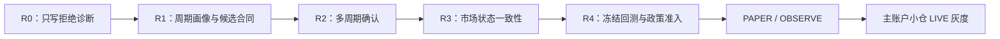

# HTX Python 趋势策略不开单问题与修复评审 v1

## 1. 评审目的

这份文档回答三个问题：

1. 当前 Python 策略为什么持续没有开单？
2. 哪些是确定的实现或配置错误，哪些只是当前行情没有满足模型假设？
3. 怎样修复“应有机会时可以开单”的能力，同时不把未验证模型或低质量信号直接放进实盘？

本文基于 49.51.250.174 的服务、数据库、实际运行配置与同一套只读 K 线复算得出。它是评审方案，不是上线授权；所有实盘参数、开关、SQL、服务包和订单保持不变。

## 2. 当前事实

### 2.1 服务与开关正常

| 项目 | 事实 |
|---|---|
| 服务 | `htx-trend-worker@htx-trend-live-primary` 为 `active/running`，启动于 2026-10-12 22:50:18 |
| 运行模式 | `LIVE`，不是 OBSERVE 或 PAPER |
| 开仓开关 | `HTX_TREND_ENABLED=true`、`HTX_TREND_ENTRY_ENABLED=true`、`HTX_TREND_OBSERVE_ONLY=false` |
| 组合开仓 | `HTX_TREND_COMBINATION_ENTRY_ENABLED=true` |
| 仓位容量 | 最大并发仓位为 5；当前活动仓位为 0 |
| 服务健康 | 最近心跳均为 `HEALTHY`；没有数据、鉴权或服务崩溃导致的停扫证据 |

因此，问题不是“服务没启动”“开仓开关关闭”“账户已满”或“HTX API 失败”。

### 2.2 当前实际扫描范围与频率

| 配置 | 当前值 | 实际含义 |
|---|---:|---|
| 扫描合约 | `BTC-USDT`、`ETH-USDT` | 当前不是 52 币种扫描 |
| 入场周期 | `4hour` | 每四小时才有一次新的候选扫描，不是每 15 分钟一次 |
| 调度周期 | 45 秒 | 45 秒只是心跳与已缓存候选检查，不会生成新 4 小时信号 |
| 开仓窗口 | 收盘后第 15–60 秒 | 仅对新 4 小时 K 线对应候选开放；候选有效期最多 10 分钟 |
| 市场广度最小样本 | 20 币 | 与当前仅扫描 2 币矛盾 |

自服务启动后，BTC/ETH 共完成 5 次新 4 小时 K 线扫描，写入 10 条信号与因子快照：

| 标的 | SHORT | FLAT | 可执行候选 |
|---|---:|---:|---:|
| BTC | 1 | 4 | 0 |
| ETH | 4 | 1 | 0 |
| 合计 | 5 | 5 | **0** |

数据库中服务启动后的 `htx_trend_candidate_signal` 行数为 **0**。这说明候选层之前就已结束；真实 Gate、盘口、手续费、保证金和下单模块均未被调用。

## 3. 根因分级

### 根因 A：4 小时配置与候选生成器硬编码冲突【确定性故障】

当前运行配置把 `HTX_TREND_PERIOD` 设为 `4hour`，但候选生成合同规定：只有 `15min` 周期才允许生成 Donchian、Fibonacci 或 EMA/动量候选。

逻辑等价于：

```text
若 entry_period != 15min：直接返回空候选
```

这意味着只要实盘使用 4 小时入场周期，任何 4 小时趋势、突破或回踩都无法进入候选队列，之后的 policy、Gate 与下单路径也永远不会执行。

这是**配置—实现不兼容**，不是策略认为“当前不该开单”。它会让 4 小时实盘永久没有开仓机会。

### 根因 B：当前运行不是设计中的多周期策略【确定性缺口】

策略合同约定：

```text
15m/30m：入场
1h/4h：方向确认
1d：大环境
```

但当前 Python LIVE 路径实际用入场周期 K 线生成方向、分数和候选；配置中的 `trend_period=60min` 会被读取，却没有参与候选确认、候选排序或真实 Gate。当前部署的行为是“4 小时单周期扫描”，不是“短周期入场 + 高周期确认”。

影响是两方面：

1. 改成 15 分钟后，策略仍不能自动获得 1h/4h 确认；
2. 保持 4 小时后，系统也没有 1d 大环境确认或独立的波段持仓画像。

### 根因 C：市场广度永远为 MIXED【确定性配置矛盾】

市场广度要求至少 20 个合约才可以判断 `BROAD_UP` 或 `BROAD_DOWN`；当前扫描池只有 BTC 和 ETH，因此市场状态必然降级为 `MIXED`。

当前 `mixed_market_requires_strong_candidate=false`，所以这不是本轮“零候选”的直接拦截者；但它会让排序、仓位倍率、记录和诊断长期失真。系统既没有全市场广度，也没有明确切换成“仅 BTC/ETH 锚点模式”。

### 根因 D：已授权模型范围很窄【设计事实，不应直接放开】

当前启用政策只授权以下组合：

| 可进入真实路径的主模型 | 必需确认结构 | 原始分数门槛 |
|---|---|---:|
| Donchian 突破 | 箱体突破 | 85 |
| Fibonacci 回踩 | 箱体突破 | 85 |
| Fibonacci 回踩 | Donchian 突破 | 85 |
| Fibonacci 回踩 | 箱体 + Donchian 双确认 | 90 |

EMA/VWAP/动量没有启用政策。即使它产生了候选，也会被标记为 `POLICY_NOT_MATCHED`，不会下单。

这不是遗漏配置即可直接修复。冻结数据回放显示，EMA/VWAP、Donchian 与 Fibonacci 当前研究结果均未通过正式扣费后准入门槛：三者样本外 PF 均低于 1.30。因此不能为了增加交易次数直接把 EMA/VWAP 政策接到 LIVE；必须先完成独立回测、成本压力和样本外复验。

### 根因 E：当前 K 线没有满足任一结构模型【行情/模型事实】

对最新完成的 4 小时 K 线，以同一套模型合同做只读复算：

| 标的 | ensemble 信号 | 模型候选 | 原因 |
|---|---|---|---|
| BTC | `FLAT / RANGE`，分数 50 | 无 | 方向分数和结构均不足 |
| ETH | `SHORT / TRENDING_DOWN`，分数 60 | 无 | 虽然 EMA20/60/120 偏空、ADX 与 ATR 均强，但 ROC 为正；不满足空头动量延续；也没有当根 Donchian/箱体突破或有效 Fibonacci 回踩 |

即便临时忽略“4 小时不生成候选”的硬编码，这一根 ETH K 线仍不会产生候选。因此修复根因 A 后，并不意味着应对当前 K 线强行开仓；修复的含义是后续真正出现符合 4 小时结构的 K 线时，系统有能力进入候选链路。

### 根因 F：没有候选时缺少可读诊断【可观测性缺口】

当前会保存信号和因子，但当候选生成器直接返回空时，`htx_trend_candidate_signal` 不会记录一行“为什么没有候选”。面板只能看到 0 候选，无法区分：

- 周期不被候选引擎支持；
- 信号为 FLAT；
- 无箱体/Donchian 突破；
- 无 Fibonacci 回踩；
- EMA 动量不一致；
- 策略政策不存在；
- 候选未通过真实 Gate。

这让“没有开单”看起来像一个结果，而非一条可审计的决策链。

### 附带问题：一笔旧 CLOSE/INTENT 订单持续回查【运行噪音】

账户仍有一笔 2026-09-24 的 ETH `CLOSE / INTENT` 历史订单。每个心跳中的 `recovered=1` 都来自它。它没有阻塞本轮开仓：活动仓位为 0，服务也保持健康；但应在订单对账专项中处理，避免持续产生恢复噪音。

## 4. 修复目标

本轮不以“让系统尽快多开单”为目标，而以以下四个结果为目标：

1. 已选择的策略周期必须真的可以生成候选；
2. 多周期必须真实参与判断，不允许只是配置字段；
3. 任何未开单都能定位到具体阶段和具体条件；
4. 增加开仓机会不能绕过模型级别的扣费后收益验证。

## 5. 待评审的策略画像

当前配置把“低频 4 小时策略”与“15 分钟候选合同”混在一起。应先确定策略画像，再实现对应链路。

### 方案 A：`INTRADAY_15M` 日内趋势画像

| 项目 | 定义 |
|---|---|
| 开仓周期 | 15 分钟；必要时 30 分钟作为次级入场 |
| 趋势确认 | 1h 与 4h |
| 大环境 | 1d + BTC/ETH + 全市场广度 |
| 适用目标 | 捕捉小趋势和中短周期延续，提供相对稳定的候选频率 |
| 主要风险 | 噪音、假突破、手续费/滑点侵蚀，需要严格成本 Gate |
| 适配现状 | 最接近现有候选生成器，但必须把 1h/4h 真正接入 Gate |

### 方案 B：`SWING_4H` 波段趋势画像

| 项目 | 定义 |
|---|---|
| 开仓周期 | 4 小时 |
| 趋势确认 | 1d |
| 大环境 | BTC/ETH 4h/1d 与更广市场状态 |
| 适用目标 | 低频捕捉较大趋势，持仓时间可为数天 |
| 主要风险 | 候选频率较低；止损、目标、退出不能套用 15 分钟逻辑 |
| 适配现状 | 当前实盘配置意图接近此方案，但候选引擎与多周期确认尚未实现 |

### 方案 C：双画像并行

| 项目 | 定义 |
|---|---|
| 运行方式 | 日内与波段分别作为独立策略实例、独立预算、独立持仓和独立统计 |
| 优点 | 同时覆盖小行情和大趋势，不把 15 分钟噪音混入波段仓位 |
| 风险 | 需要更清晰的账户级相关性、同币种冲突和资本分配治理 |
| 前提 | A、B 均完成独立回放与 PAPER；不能用一个策略配置混合实现 |

**建议评审顺序**：先确认 A、B、C 中的目标画像。若目标是恢复较高候选频率，应选择 A；若目标是 BTC/ETH 低频波段验证，应选择 B；若要两者兼有，必须走 C 的独立实例方案，不能继续用一个 `HTX_TREND_V1` 配置兼容所有周期。

## 6. 方案设计

### 阶段 R0：先补诊断，不改变实盘行为

**解决的问题**：当前只有“0 候选”，没有“为什么 0 候选”。

**实现方式**：

1. 对每个合约、每个已完成入场 K 线写一条候选评估记录；即使没有可交易候选，也写 `REJECTED`。
2. 标准化记录以下原因：
   - `TIMEFRAME_UNSUPPORTED`；
   - `NO_DIRECTION_SIGNAL`；
   - `REGIME_NOT_TRENDING`；
   - `NO_BOX_BREAKOUT`；
   - `NO_DONCHIAN_BREAKOUT`；
   - `NO_FIB_RETEST`；
   - `EMA_MOMENTUM_CONFLICT`；
   - `POLICY_NOT_MATCHED`；
   - `POLICY_SCORE_BELOW_THRESHOLD`；
   - 真实执行 Gate 的现有拒绝原因。
3. 把 `entry_period`、`timeframe_profile`、市场状态来源、1h/4h/1d 确认结果写入同一 `run_id`。
4. 对旧 `CLOSE/INTENT` 订单增加单独的对账状态和告警，避免它在候选诊断里造成噪音。

**验收**：连续 24 小时内，每个扫描合约都能回答“未生成候选”或“候选被哪一层拒绝”；此阶段不改变候选数量或下单行为。

### 阶段 R1：让策略周期与候选模型一致

**解决的问题**：`4hour` 配置无法产生候选。

**实现方式**：

1. 从候选模型中移除“只能 15 分钟”的全局硬编码，改为按 `timeframe_profile` 声明允许周期。
2. 每个候选模型明确支持周期：

| 模型 | `INTRADAY_15M` | `SWING_4H` | 说明 |
|---|---|---|---|
| Donchian/箱体突破 | 15m/30m | 4h | 回看窗口、目标和持仓期限按画像独立参数化 |
| Fibonacci 回踩延续 | 15m/30m | 4h | 只能从同画像内的独立突破结构拉线，不可复用旧交易结构 |
| EMA/VWAP 动量 | 15m/30m | 4h EMA/动量版本 | 暂不授权 LIVE；先做独立回放 |

3. 把 `entry_period`、结构窗口、Fibonacci 回看、预期收益、信号有效期、初始止损、目标和最长持有时间打包为版本化 profile。
4. 保留当前 V4 退出为唯一实盘退出版本；若新增 `SWING_4H`，先只输出其退出输入和 shadow 决策，不替换 V4。

**验收**：使用固定的 15m、4h 冻结 K 线回放，三模型在各自允许周期能够生成候选或给出明确拒绝原因；4h 不再因为周期字符串直接返回空。

### 阶段 R2：接通真正的多周期判断

**解决的问题**：1h/4h/1d 现在被读取却没有影响开仓。

**实现方式**：

1. 为每个候选建立独立 `TimeframeContext`：入场周期、确认周期、大环境周期、数据质量和方向/结构结果。
2. `INTRADAY_15M`：15m 产生结构候选；1h/4h 决定允许、降仓、仅观察或拒绝。
3. `SWING_4H`：4h 产生结构候选；1d 决定允许、降仓、仅观察或拒绝。
4. 高周期只作为确认、冲突、仓位和退出宽度的证据；它不能凭空把没有结构的低周期信号提升为真实候选。
5. 持仓管理读取同一 `TimeframeContext`，避免用 15m 噪音直接平掉 4h 波段仓。

**验收**：固定 K 线回放能分别展示“低周期结构、确认周期、环境周期”三层结论；改变任一高周期输入会有可解释影响，而不是只存在于日志。

### 阶段 R3：让市场状态与扫描池一致

**解决的问题**：2 币扫描却要求 20 币广度，市场状态永远为 `MIXED`。

**实现方式**：

1. 若采用 `INTRADAY_15M`，把“交易池”和“市场状态观察池”分开：交易池可有限，广度池需覆盖足够主流合约。
2. 若采用 BTC/ETH 的 `SWING_4H`，明确使用 `ANCHOR_ONLY` 市场状态；不再假装有全市场广度。
3. 市场状态记录来源、样本数、缺失率和最终可信度；样本不足应标为 `UNCLASSIFIED`，而不是误记为 `MIXED`。

**验收**：市场状态的样本数与策略使用范围一致；面板可区分 `BROAD_*`、`ANCHOR_ONLY`、`UNCLASSIFIED` 和 `MIXED`。

### 阶段 R4：模型政策与研究准入分离

**解决的问题**：当前候选模型、可执行政策和研究准入状态不一致，容易为了交易次数直接放开未验证模型。

**实现方式**：

1. 政策表增加 `timeframe_profile`、`model_version`、`admission_status`、`effective_from` 与 `evidence_ref`。
2. 每个模型、方向、周期画像独立统计：样本数、胜率、扣费后净收益、PF、期望、回撤、持仓时间和 MFE/MAE。
3. EMA/VWAP、Donchian、Fibonacci 在新的 profile 下必须通过冻结数据的训练/验证/样本外与成本压力测试，才可以建立 LIVE 政策。
4. 任何 `REJECT` 或 `INSUFFICIENT_EVIDENCE` 模型只能 OBSERVE/PAPER，不能通过配置绕过。

**验收**：每一条 LIVE 政策都能追溯到一个经过验证的模型版本和证据集；模型与政策之间不存在隐式默认放行。

## 7. 不采用的“快速修复”

| 做法 | 为什么不采用 |
|---|---|
| 直接降低分数、ADX、点差或预期 R 门槛 | 当前候选数为 0，尚未触及这些 Gate；降低它们无法修复 4h 候选被提前返回为空的问题 |
| 直接把 EMA/VWAP 加入真实政策 | 现有冻结回放的扣费后结果未通过准入，贸然启用只会用更多交易次数放大负期望 |
| 把 4h 强行当作 15m 调用 | 即使能绕过字符串限制，结构窗口、目标、止损、信号有效期和退出都不再符合周期语义 |
| 把市场广度阈值从 20 改为 2 | 只能消除表面 `MIXED`，无法获得真实全市场信息；BTC/ETH 双币策略应改为 `ANCHOR_ONLY`，而不是伪造广度 |
| 通过延长开仓窗口解决 | 当前没有候选，窗口不是主要瓶颈；窗口优化应在 R1 后以真实候选时效数据决定 |

## 8. 推荐的验证与上线顺序



| 阶段 | 是否允许改变真实开仓 | 需要的证据 |
|---|---|---|
| R0 | 否 | 24 小时完整拒绝归因 |
| R1 | 否 | 15m/4h 固定 K 线单元测试和同源回放 |
| R2 | 否 | 多周期冲突、确认、数据缺失和持仓再评估测试 |
| R3 | 否 | 观察池/交易池一致性报告 |
| R4 | 否 | 训练、验证、样本外、成本压力和参数敏感性报告 |
| PAPER / OBSERVE | 否 | 真实盘口、费率、候选时效、限价/市价执行偏差 |
| LIVE 灰度 | 是，需单独批准 | 已通过模型政策、限额、回滚包、心跳与账本验收 |

## 9. 本次评审需要确认的决定

1. **策略画像**：先建设 `INTRADAY_15M`、`SWING_4H`，还是两者作为独立实例并行？
2. **当前 LIVE 定位**：BTC/ETH 4h 是有意的低频波段灰度，还是本应恢复多币种 15m 候选？
3. **市场状态来源**：日内策略是否使用完整广度池；波段策略是否使用 `ANCHOR_ONLY`？
4. **模型准入边界**：是否确认 R4 前保持 EMA/VWAP、Donchian、Fibonacci 不新增 LIVE 政策，只观察和回测？
5. **修复顺序**：是否同意先做 R0/R1，先恢复“周期可产生候选”和“无候选可解释”，再讨论是否扩大交易池和启用新模型？

## 10. 最终结论

当前“没有开单”有一个确定性工程原因：4 小时实盘配置进入了仅支持 15 分钟候选的代码路径，导致候选数永久为零。这个问题必须修复。

但它不是唯一结论。当前策略还没有真正接通多周期判断，市场广度与扫描范围也不一致，并且所有趋势模型都尚无可直接扩大实盘权限的扣费后研究结论。因此正确路径是：先修复周期画像与诊断链路，再用冻结数据和 PAPER 验证每个模型，而不是通过降低门槛或直接放开 EMA 来制造交易量。
