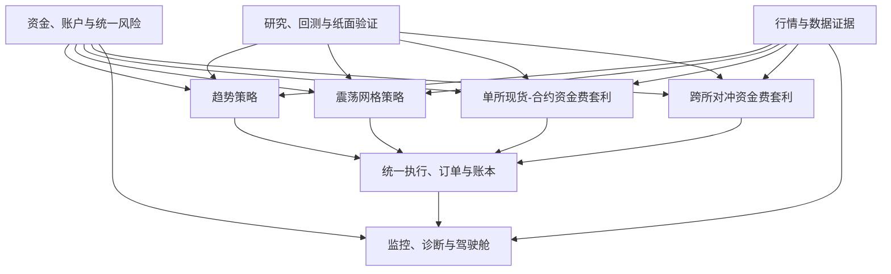

# CoinStrategy 策略体系模块化审计 v1

> **上层方向**：本审计按 [CoinStrategy 策略总纲 v1](COINSTRATEGY_STRATEGY_MASTER_PLAN_V1.md) 的“趋势 + 套利双引擎、统一资金与风控”框架组织，不按代码文件组织。
>
> **策略闭环标准**：每个模块的能力边界遵循 [CoinStrategy 策略闭环定义模板 v1](COINSTRATEGY_STRATEGY_CLOSED_LOOP_TEMPLATE_V1.md)：数据 → 市场分型 → 因子 → 模型 → 开仓 → 仓位 → 持仓/退出 → 执行账本 → 回测 → 实盘反馈。

## 1. 先说结论

CoinStrategy 已经具备“模块化策略平台”的**部分底座**，但还没有形成完整的、可以让趋势、网格、单所套利和跨所套利平等接入的策略平台。

目前最成熟的是趋势策略链路中的行情处理、技术指标、候选生成、开仓前成本与风险检查、订单账本、写入保护和研究证据。它们可以被后续策略复用。

目前最缺的是策略之间的统一接口：趋势策略已有较完整的实现，网格、单所资金费套利和跨所资金费套利还没有各自独立的策略闭环、状态机、回测和运行 worker。因此现在的“多策略平台”仍是目标架构，而不是已经完成的能力。

模块化的判断不应是“代码是否拆了很多文件”，而应是：

1. 一个模块能否脱离某个具体策略复用；
2. 一个策略能否独立启停、回测、纸面验证、部署和记账；
3. 策略之间是否只共享资金、风险、执行和账本，而不互相污染信号与仓位；
4. 任意一笔交易能否完整解释和回放。

按这个标准，当前总体状态为：**共享基础能力已具雏形，趋势策略可运行，其他策略模块尚待建设，研究—模拟—实盘闭环尚待统一。**

## 2. CoinStrategy 应有的模块化总框架



这里的边界必须固定：

| 层级 | 负责什么 | 不负责什么 |
|---|---|---|
| 共享底座 | 账户、资金预算、风险上限、行情、执行、账本、证据、回测规范 | 不决定某个币该做多还是做空 |
| 策略模块 | 根据自己的假设产生候选、定义开仓/持仓/退出规则 | 不直接挪用其他策略的资金或修改其他策略仓位 |
| 执行模块 | 按策略已经批准的订单意图下单、回查、对账、记账 | 不自行创造信号或替策略修改方向 |
| 研究与验证模块 | 冻结数据、回测、消融、纸面、统计评价 | 不直接改变实盘参数或下单开关 |
| 驾驶舱 | 展示账户、策略、仓位、订单、盈亏、风险和诊断 | 不暴露完整策略公式或私钥/凭据 |

## 3. 现有模块化能力盘点

状态说明：

- **已模块化，可复用**：职责和输入输出清晰，可被其他策略直接使用。
- **部分模块化，可复用但需收口**：已有能力，但还与趋势策略或具体运行方式耦合。
- **待模块化**：方向或局部代码存在，尚不能作为独立策略能力使用。
- **未建设**：总纲已定义，但没有可验证实现。

### 3.1 资金、账户、风险与账本

这是所有策略的共同底座，也是未来多账户、多交易所的第一优先级。

| 子模块 | 当前状态 | 已有能力 | 是否可复用 | 待补内容 |
|---|---|---|---|---|
| 账户身份与凭据 | 部分模块化 | 账户可区分、凭据可从受控存储读取、主账户/镜像账户有边界 | 是 | 扩展到更多交易所时需统一交易所账户合同，不能把凭据混入策略配置 |
| 资金预算 | 部分模块化 | 已有账户级最大名义额、最大仓位数、策略资金分配与风险预占能力 | 是 | 将趋势、套利、网格的预算与占用统一为同一资金池口径 |
| 风险限制 | 部分模块化 | 单笔、总敞口、同向仓位、写入权等硬边界已有基础 | 是 | 补相关性暴露、跨交易所暴露、套利对冲偏离和组合回撤风险 |
| 订单与成交账本 | 已模块化，可复用 | 订单意图、成交差额、部分成交、重启对账、手续费和净盈亏记录已有基础 | 是 | 统一现货、合约、双腿套利、网格订单的账本口径 |
| 仓位账本 | 部分模块化 | 趋势合约仓位可管理、可关联订单与退出原因 | 部分 | 增加现货腿、对冲组、网格库存、跨所保证金和策略归属 |
| 费用与净收益 | 部分模块化 | 可读取账户费率并参与预期收益和账本计算 | 是 | 所有策略强制使用“扣开平手续费、滑点、资金费后的净收益”作为第一口径 |

**判断**：资金、账户、账本是已有基础最值得沉淀的共享模块。未来套利不能复制趋势的账本，而应在统一账本上新增“对冲组、腿、资金费、基差、交易所”维度。

### 3.2 行情、数据质量与运行证据

| 子模块 | 当前状态 | 已有能力 | 是否可复用 | 待补内容 |
|---|---|---|---|---|
| 多周期 K 线 | 已模块化，可复用 | 完成 K 线、周期、合约规格和盘口数据有统一表达；支持 15m、30m、1h、4h、1d 等 | 是 | 明确每个策略使用哪些周期，以及数据缺口时的 fail-safe 规则 |
| 指标与特征 | 已模块化，可复用 | EMA、ATR、ADX、ROC、VWAP、RSI、MACD、斜率等可重复计算 | 是 | 建立特征字典和版本，明确哪些指标只是观察，哪些真正参与决策 |
| 市场广度与 BTC/ETH 锚点 | 部分模块化 | 趋势策略已记录市场宽度与主流币方向 | 部分 | 形成策略无关的市场状态服务，供趋势、网格和套利共同读取 |
| 行情质量检查 | 部分模块化 | 冻结数据可检查连续性、重复、OHLC 合法性、缺失等 | 是 | 运行时每轮数据也要产出质量状态，数据异常不能被静默当作普通无信号 |
| K 线冻结与证据 | 部分模块化 | 原始/标准化 K 线、因子和决策证据已有保存能力 | 部分 | 统一运行证据与研究数据集格式；不能让冻结写入阻塞实时开仓窗口 |
| 订单全链路证据 | 部分模块化 | 候选、部分 gate、订单、成交、退出已有记录 | 部分 | 用一个 `run_id` 串起市场状态、因子、候选、gate、价格计划、成交、持仓与退出 |

**判断**：数据底座已能支持策略研究，但“运行时数据留存”和“回测数据冻结”仍是两条链。要形成可验证体系，必须合并为同一证据口径。

### 3.3 市场分型模块

市场分型是“先判断该做趋势、网格还是不做”的公共决策层，不应该由某一个入场模型暗中承担。

| 市场状态 | 目标策略行为 | 当前状态 | 模块化结论 |
|---|---|---|---|
| 上涨趋势 | 趋势多头优先；逆势空头严格降级 | 已有部分方向、宽度、锚点能力 | 可作为趋势模块的输入，尚未成为全平台市场状态服务 |
| 下跌趋势 | 趋势空头优先；逆势多头严格降级 | 已有部分方向、宽度、锚点能力 | 同上 |
| 震荡区间 | 关闭追趋势；满足成本和区间质量时交由网格/区间策略 | 震荡识别有局部条件 | 网格策略未形成独立模块，尚不能自动承接 |
| 高波动风险 | 降低风险或暂停新开仓，优先保护已有仓位 | 有 ATR/风险判断基础 | 需要独立的全局风险态，不能只停留在趋势 gate |
| 低波动死区 | 不开趋势仓，避免成本吞噬 | 有局部门槛 | 应成为所有短周期策略共用的市场环境标签 |

**判断**：市场分型已具备趋势策略的雏形，尚未模块化为“平台公共服务”。这是趋势与网格能够正确切换的前提，也是 P0 需要收口的能力。

### 3.4 趋势策略模块

趋势策略应由独立模型并行产生候选，而不是把所有模型压成一个不可解释的大分数。

| 子模块 | 当前状态 | 已有能力 | 可复用性 | 待补内容 |
|---|---|---|---|---|
| 箱体/Donchian 突破 | 部分模块化 | 已能识别突破候选和结构价格 | 仅趋势策略复用 | 明确适用阶段、假突破确认、与后续回踩的交接规则 |
| Fibonacci 回踩延续 | 部分模块化 | 已能产出回踩、失效价和目标结构 | 仅趋势策略复用 | 需要独立统计其胜率、盈亏比、持仓长度和退出质量，不能承担全部开仓来源 |
| EMA/VWAP/动量延续 | 部分模块化 | 有 EMA、ROC、ADX 等判断和观察能力 | 仅趋势策略复用 | 当前策略表达与真实候选政策仍需对齐，形成可真实下单、可单独评估的模型路径 |
| 多周期趋势 | 部分模块化 | 已有 15m 至 1d 的数据与部分确认逻辑 | 仅趋势策略复用 | 明确短线、波段、长线分别使用的入场、仓位和退出体系 |
| 模型路由与候选排序 | 部分模块化 | 多模型候选、市场状态和政策路由已有基础 | 可推广为策略内部公共模块 | 统一“模型独立候选、支持/冲突证据、排序和容量分配”的合同 |
| 冷却与强信号解冻 | 部分模块化 | 有冷却和部分解冻思路 | 仅趋势策略复用 | 需记录上一单失败类型、当前模型证据和解冻理由，避免粗暴阻塞强信号 |

**判断**：趋势策略是当前最完整的策略模块，但内部仍处于“多模型代码存在、实盘路径没有完全均衡使用”的阶段。模块化整改目标不是加更多指标，而是让每种模型拥有自己的适用市场、开仓假设、失效条件、退出逻辑和统计结果。

### 3.5 震荡网格策略模块

| 子模块 | 当前状态 | 已有能力 | 待建设 |
|---|---|---|---|
| 震荡市场准入 | 部分模块化 | 可识别部分 CHOP/低趋势环境 | 需要市场分型明确输出 `RANGE`，作为网格启动前置 |
| 区间识别 | 待模块化 | 有箱体与波动结构信息可复用 | 定义区间上/下沿、有效期、波动覆盖成本和失效条件 |
| 网格生成与再平衡 | 未建设为当前平台策略模块 | 历史移动网格经验可作参考 | 网格数量、间距、单格资金、库存上限、补单与撤单规则 |
| 网格库存与风控 | 未建设 | 可复用订单账本、资金预算与执行模块 | 现货/合约库存、方向偏移、趋势突破时停止网格和清库存 |
| 网格回测 | 未建设 | 可复用数据冻结、费用滑点、回测框架目标 | 特别验证低波动下费用侵蚀、趋势突破损失和库存风险 |

**判断**：网格目前不是可独立运行的模块。正确的建设方式是把它作为 `RANGE` 状态下的一种策略插件，而不是与趋势策略共享同一套候选和退出逻辑。

### 3.6 套利策略模块

| 子模块 | 单所现货—合约资金费套利 | 跨所对冲资金费套利 | 当前状态 |
|---|---|---|---|
| 机会识别 | 资金费、基差、现货/合约价格、费率、深度 | 双交易所资金费差、基差、深度、转账和交易所风险 | 未形成独立策略模块 |
| 开仓 | 现货多 + 合约空的双腿对冲 | 两所反向合约或现货/合约对冲 | 未形成原子意图和双腿执行状态机 |
| 持仓 | 资金费结算、基差、对冲偏离、保证金 | 双所资金费、基差、保证金、交易所健康度 | 未形成对冲组账本和风险监控 |
| 退出 | 资金费不覆盖成本、基差失控、对冲偏离、保证金风险 | 同左，加交易所/转账风险 | 未形成独立退出与补偿机制 |
| 回测与纸面 | 费用、资金费、基差、成交概率 | 同左，加跨所延迟与资金占用 | 未建设完整验证链路 |

**判断**：套利属于总纲中的核心稳定收益模块，但当前只能复用账户、风险、订单、账本和数据底座；策略本身尚未开始模块化实现。它不能与趋势策略共用“方向信号”和“止盈止损”，必须使用“对冲完整度、资金费覆盖、基差、保证金、执行风险”作为自己的闭环。

### 3.7 开仓、执行与订单生命周期

| 子模块 | 当前状态 | 已有能力 | 待补内容 |
|---|---|---|---|
| 候选 → Gate | 部分模块化 | 趋势候选可经过趋势、成本、点差、流动性、资金费、容量等检查 | 需要让每个拒绝原因以统一枚举和实际值写入证据，供所有策略使用 |
| 价格计划 | 部分模块化 | 支持市价、限价、IOC/市价回退等计划表达 | 将“建议价格”与“实际执行方式”分开；不同账户/费率可选择不同方式 |
| 下单意图与预占 | 已模块化，可复用 | 先写 intent、预占风险，再提交交易所，便于幂等恢复 | 套利需扩展为双腿/多腿原子意图与补偿流程 |
| 成交回查与部分成交 | 已模块化，可复用 | 使用累计成交差额对账，支持重启恢复 | 扩展到现货、跨所与多腿，统一成交状态机 |
| 镜像/跟单 | 部分模块化 | 有可选镜像能力 | 必须作为执行层可选 decorator；不能混入主策略信号或默认替主账户下单 |
| 写入保护 | 已模块化，可复用 | 同一账户/策略写锁避免双 writer | 多策略并行时需定义锁粒度：账户级执行、策略级状态、对冲组级操作 |

**判断**：执行和订单生命周期是当前最适合跨策略复用的模块。后续应该把它做成“策略提交订单意图，执行模块负责可靠送达和对账”，而不是让每个策略自行调用交易所。

### 3.8 持仓管理、止损、止盈与退出

| 子模块 | 当前状态 | 已有能力 | 待补内容 |
|---|---|---|---|
| 初始风险与模型失效 | 部分模块化 | 趋势仓位可用失效价和风险边界管理 | 每种模型必须定义自身失效，不能用统一固定百分比替代结构 |
| 趋势持仓评估 | 部分模块化 | 已有对 K 线、方向、ATR、平盘等的持仓判断 | 统一 15m/1h/4h/1d 的持仓趋势状态，避免短周期噪音误平长线单 |
| 利润保护/分批/runner | 部分模块化 | 有 V4 退出决策、保护和部分退出基础 | 必须用 MFE、回吐、结构目标、剩余预期净收益和趋势质量共同决定，不可只靠固定比例 |
| 紧急风险退出 | 部分模块化 | 有硬风险、模型失效和对账失败保护思路 | 要把交易所异常、数据异常、保证金风险、对冲失效纳入统一优先级 |
| 退出归因 | 部分模块化 | 能记录部分退出原因 | 统一区分方向错、入场错、过早退出、过晚退出、成本侵蚀、执行失败 |
| 版本治理 | 部分模块化 | 当前实盘主链使用 V4；仓库中的 V5 仅是实验实现 | 没有用户明确批准前，V5 不能接入 runtime，也不能改变 V4 的实盘语义 |

**判断**：退出不能作为趋势策略的附属补丁。它应当是每个策略都实现的标准接口，但具体规则必须由策略模型定义：趋势退出看结构和延续价值，网格退出看区间失效与库存，套利退出看对冲偏离和资金费覆盖。

### 3.9 回测、参数扫描、纸面与实盘反馈

| 子模块 | 当前状态 | 已有能力 | 待补内容 |
|---|---|---|---|
| 冻结历史数据 | 部分模块化 | 可采集、校验、内容寻址保存 K 线 | 覆盖策略所需的完整周期、标的、时间范围和原始请求证据 |
| 历史回测 | 部分模块化 | 已能回放部分入场/候选 | 必须重放完整 Gate、仓位、执行、费用、退出和资金曲线 |
| 参数扫描/消融 | 部分模块化 | 有单条件消融和研究合同基础 | 每次仅改变一个条件，输出胜率、PF、回撤、样本数、成本敏感性和样本外结果 |
| PAPER | 部分模块化 | 有模拟订单与账本基础 | 必须接入与 LIVE 相同的决策、Gate、成本、退出和证据合同 |
| LIVE 评估 | 部分模块化 | 有订单、仓位、候选、部分因子和服务心跳 | 补策略版本、模型、市场状态分层的净收益、回撤、MFE/MAE、拒绝原因和执行质量报表 |
| 策略晋级 | 待模块化 | 有策略准入类型和部分门槛 | 固化“想法 → 回测 → 参数扫描 → PAPER → LIVE”的准入条件，禁止参数直接改实盘 |

**判断**：研究和验证组件很多，但还没有完全形成一条同源流水线。只有回测、PAPER、LIVE 使用同一策略合同和成本口径，模块化才真正能提升胜率与收益质量，而不只是方便开发。

### 3.10 监控、诊断与驾驶舱

| 模块 | 当前状态 | 已有能力 | 待补内容 |
|---|---|---|---|
| 服务健康 | 部分模块化 | worker 心跳、运行模式、部分失败状态 | 统一所有策略 worker 的健康、延迟、数据新鲜度和告警口径 |
| 策略总览 | 待模块化为完整产品 | 有趋势页面和数据接口基础 | 以“资金池 → 策略 → 账户 → 仓位/订单”的层级展示，支持 10/100 个账户 |
| 策略诊断 | 部分模块化 | 可查候选、部分 gate、订单、退出 | 展示链路卡点、模型表现、拒绝原因、退出归因；不展示完整策略公式 |
| 账户视图 | 部分模块化 | 已能区分部分账户数据 | 支持按账户、交易所、策略族、策略名筛选；不是为每个账户堆一个卡片 |
| 风险驾驶舱 | 待模块化 | 有局部风险限制 | 汇总敞口、保证金、相关性、对冲偏离、日内回撤、策略健康和交易所状态 |

## 4. 哪些模块现在可以直接复用

下列能力可以作为未来策略的共享服务，原则上不应重新实现：

1. **账户与凭据管理**：账户身份、费率、权限、运行状态与安全读取。
2. **风险预算与写入保护**：最大仓位、总敞口、账户级风险预占和同一账户写锁。
3. **行情标准化**：完成 K 线、盘口、合约规格、资金费的统一数据对象。
4. **技术指标与统计特征**：EMA、ATR、ADX、ROC、VWAP、MACD、RSI、斜率、波动率等纯计算能力。
5. **订单生命周期**：订单意图、幂等 ID、部分成交、累计差额、交易所回查、重启恢复和账本写入。
6. **成本模型基础**：账户费率、点差、滑点、资金费和扣费后净收益表达。
7. **数据冻结与证据哈希**：为任何策略留存可校验的输入、因子、决策与结果。
8. **运行监督**：策略实例、心跳、运行模式、资本分配和只读/纸面/实盘的基础治理。

## 5. 哪些模块必须优先模块化整改

### 第一优先级：让趋势策略本身成为一个完整插件

1. **统一市场分型服务**：从趋势入场内部抽出，明确输出 `TREND_UP / TREND_DOWN / RANGE / HIGH_RISK / LOW_VOL`，供趋势、网格和套利共同消费。
2. **统一趋势模型合同**：Donchian/箱体、Fibonacci、EMA/VWAP/动量各自独立候选；共同使用市场状态、因子快照、价格计划和模型统计，不再让某个模型隐性主导。
3. **统一退出合同 V4**：开仓模型提供假设、失效和目标；退出引擎统一返回持有、保护、减仓或全平及原因。当前 V4 保持唯一实盘退出版本。
4. **统一运行证据**：每笔交易以 `run_id` 串起从 K 线到退出的完整链路，支持准确复盘与回测样本沉淀。

### 第二优先级：让共享执行与账本脱离趋势策略

1. 将趋势专用的订单、仓位和账户读取拆成通用执行端口。
2. 让所有策略只提交“订单意图”或“对冲组意图”，由统一执行模块负责下单、回查、部分成交、撤单和账本。
3. 将账本按策略族、策略名、模型、账户、交易所、对冲组、订单腿统一记录。
4. 把镜像账户实现为可选执行功能，绝不成为信号和风控的隐式分支。

### 第三优先级：建立网格与套利的独立闭环

1. **网格**：只在 `RANGE` 状态允许启动；独立管理区间、库存、网格订单和趋势突破退出。
2. **单所资金费套利**：独立管理现货腿和合约腿、资金费收益、基差、保证金与对冲偏离。
3. **跨所套利**：独立管理两个交易所的账户、价格、资金费、深度、延迟、转账和交易所风险。
4. 三者都复用账户、执行、账本、风险与证据，不复用趋势方向模型和趋势退出规则。

### 第四优先级：建立同源验证流水线

```text
策略假设 / 参数版本
  → 冻结数据
  → 全生命周期回测
  → 单条件消融 / 参数扫描
  → 样本外验证
  → PAPER
  → 小仓 LIVE
  → 净收益、回撤、订单、持仓、归因记录
  → 策略晋级、降权或下线
```

这个流水线应服务全部策略，不只服务趋势。其目的不是让开仓变少，而是证明每项限制、每个模型和每个退出动作对扣费后收益是否有正贡献。

## 6. 目标模块接口：每个策略必须交付什么

未来任何策略模块都应提供以下十项能力，缺任何一项都不能进入真实交易：

| 模块接口 | 策略需要提供的内容 |
|---|---|
| 策略卡片 | 收益来源、标的、周期、资金池、市场假设、风险上限 |
| 数据需求 | K 线/盘口/资金费/外部数据的周期、完整性和新鲜度要求 |
| 市场适用性 | 允许的市场分型及禁止条件 |
| 因子与模型 | 因子列表、版本、模型候选和评分解释 |
| 开仓计划 | 方向、建议价格、失效价、目标价、订单方式、有效期 |
| Gate | 成本、流动性、保证金、风险、容量、冲突仓位等硬条件 |
| 仓位规则 | 风险预算、杠杆、名义额、分批和相关性限制 |
| 持仓/退出 | 止损、止盈、趋势/对冲失效、时间退出、异常退出与归因 |
| 验证合同 | 回测、消融、PAPER、LIVE 的统一指标和晋级门槛 |
| 观测合同 | `run_id`、证据、账本、心跳、告警与驾驶舱读模型 |

## 7. 推荐的实施顺序

| 阶段 | 做什么 | 不做什么 | 验收结果 |
|---|---|---|---|
| M0 | 固化本文件的策略模块边界与策略闭环合同 | 不改开仓参数 | 所有新增工作能归属到一个共享模块或一个独立策略插件 |
| M1 | 收口趋势的市场分型、模型候选、V4 退出和运行证据 | 不引入 V5 实盘退出 | 任一趋势订单能完整回放，三个趋势模型能独立统计 |
| M2 | 拆出通用执行、对账、账本、风险预算和账户接口 | 不改变下单逻辑 | 网格和套利可复用执行底座而不复制趋势代码 |
| M3 | 建立全生命周期回测、参数扫描、PAPER 和晋级流程 | 不根据单日实盘直接调参 | 回测/PAPER/LIVE 统一成本、仓位、退出和统计口径 |
| M4 | 实现 `RANGE` 网格策略插件 | 不与趋势共享方向和退出 | 震荡市场可独立启停、记账、回测和风控 |
| M5 | 实现单所资金费套利插件 | 不先做跨所资金调拨 | 双腿对冲、资金费、基差和保证金可独立审计 |
| M6 | 实现跨所资金费套利插件与统一驾驶舱 | 不让策略互相管理仓位 | 多账户、多交易所、多策略可按资金池统一管理 |

## 8. 当前不应误判为“已经模块化”的内容

1. **有多个指标，不等于有多模型策略**。RSI、MACD 等计算存在，不表示它们已经提高了真实开仓准确率；必须经消融和样本外验证后才能进入策略合同。
2. **有 V5 文件，不等于 V5 已上线**。当前 Python 运行入口仍以 V4 退出为主；实验版本必须保持隔离，不能自行接入实盘。
3. **有网格历史逻辑，不等于有网格策略插件**。网格仍缺市场准入、库存、区间失效、回测和独立风险账本。
4. **有套利概念，不等于套利策略已实现**。套利尚缺双腿执行、对冲组账本、资金费和基差退出、跨所风险控制。
5. **有回放工具，不等于完整回测闭环**。若没有同源 Gate、成本、成交、仓位和退出，结果不能作为实盘晋级依据。
6. **按文件拆分，不等于策略可独立部署**。独立策略必须有独立实例、状态、资金预算、心跳、证据和回滚能力。

## 9. 最终判断

CoinStrategy 当前已经拥有可复用的交易系统基础：账户与风险、标准化行情、技术指标、订单生命周期、账本、数据证据和运行监督。这些应沉淀为平台公共能力。

趋势策略是第一个完整度较高的策略插件，但它仍需收口市场分型、模型独立性、V4 退出合同与全链路证据。网格和两类资金费套利目前属于规划中的独立策略插件，不能与趋势策略混写、混用信号或混用退出规则。

后续模块化工作的目标不是“把代码拆得更细”，而是让每种策略都能独立地回答：**在哪种市场赚钱、依据什么开仓、承担多少风险、何时退出、扣费后赚了多少、为什么这笔交易成功或失败，以及是否值得继续分配资金。**

## 附录：实施定位映射（供研发使用）

正文面向策略和产品讨论，以下仅用于把模块边界回链到现有实现，不作为架构阅读前提。

| 策略模块 | 现有实现基础 | 迁移方向 |
|---|---|---|
| 趋势决策与候选 | 决策门面、Java 兼容入场合同、趋势候选/结构类型 | 收口为中性的趋势模型合同，Java 只保留 parity 基线 |
| 执行与订单 | 执行 Gate、开仓执行器、HTX V5 适配器、订单差额核算 | 拆成策略无关的交易所端口和订单生命周期服务 |
| 持仓与退出 | 持仓管理器、V4 退出决策 | 形成 V4 的稳定退出接口；实验 V5 继续隔离 |
| 账本与资金 | MySQL 仓储、账户事实、资本风险协调、写锁 | 拆成账户/风险/订单/仓位/账本/策略实例等共享仓储接口 |
| 数据与研究 | K 线归档、冻结采集、研究合同、回放、实验 | 合并为统一证据与验证流水线 |
| 运行与多策略 | worker、监督器、运行实例、心跳 | 形成可注册的策略 worker 插件，不再在平台内硬编码趋势细节 |
