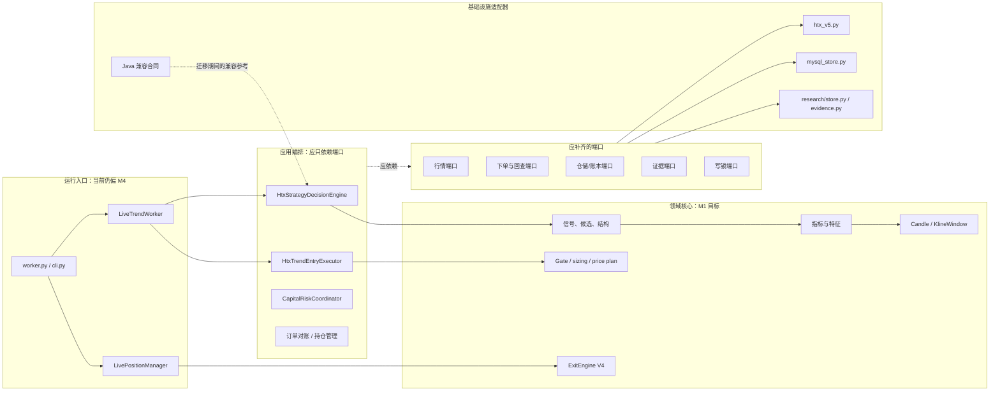

# HTX Python 策略框架模块化审计与整改路线 V1

## 1. 结论

当前框架是**部分模块化**，不是单体脚本：行情、指标、入场决策、执行门禁、订单核算、HTX 通信、MySQL 账本、写锁、研究证据和运行监督已经有独立代码边界，也有相当一部分可复用能力。

但它还不是一个可以安全承载“趋势、单所资金费套利、跨所套利”等多个策略的完整模块化平台。主要原因不是文件数量不够，而是以下边界尚未收口：

1. Python 运行链仍以 `java_entry_contract.py` 作为真实入场核心；它与 `models.py` 的历史研究计算并存，存在两套相近但职责不同的模型实现。
2. `worker.py`、`live_worker.py`、`execution_service.py`、`position_manager.py` 直接组合 HTX、MySQL、策略、下单和退出细节，编排层依赖了过多具体实现。
3. `mysql_store.py` 是一个 659 行左右的“大仓储”，同时承载账户、运行实例、风险额度、候选、订单、仓位、账本和心跳；它可用，但不是按业务聚合可替换的仓储接口。
4. 旧的 `runtime.py / paper.py / ledger.py / runner.py` 与新的 `research/* / evidence.py` 两套回放、纸面和证据体系同时存在，尚未统一为同一条研究—模拟—实盘证据链。
5. 当前退出实盘主链仍调用 `exits.py` 的 V4。仓库中有 V5 文件和测试，但 `worker.py` 与 `position_manager.py` 没有导入它们；V5 只能归类为实验代码，不能被称为当前退出版本或自行接入实盘。

因此本次审计的定位是：**保留已经可用的模块，先建立明确的端口与依赖方向，再逐步把当前“文件拆分”升级为“可独立演进、可替换、可单独部署”的模块化架构。**

## 2. 审计口径

本文件不以“一个 `.py` 文件”作为一个模块。只有满足下列条件，才称为可复用模块：

| 等级 | 定义 | 可复用性 |
|---|---|---|
| M1：独立核心 | 输入输出为领域类型或纯数据；不读取环境变量、不访问 HTTP/MySQL、不下单 | 可直接用于趋势、套利、回测和纸面交易 |
| M2：端口化适配器 | 依赖外部系统，但协议、职责和错误边界清晰 | 可替换为别的交易所、数据库或文件存储 |
| M3：职责已拆分 | 有单独类/文件和测试，但上层直接依赖具体实现或混合多个职责 | 可复用，但需要调用方理解内部细节 |
| M4：待模块化 | 入口编排、跨层调用或重复实现使其无法独立演进 | 需先收口边界后再复用 |

“当前运行”只代表 `htx_trend.worker:main` 能到达的 Python 链路；“实验”代表文件存在或测试通过，但没有进入该主链。二者不能混为一谈。

## 3. 当前全景与依赖问题



当前实际代码中，`LiveTrendWorker`、`HtxTrendEntryExecutor`、`LivePositionManager` 和 `StrategySupervisor` 直接 import `HtxMarketData`、`HtxTrendMySqlRepository`、`HtxV5Client` 或其特定数据结构。上图中的虚线端口尚未正式落地，因此依赖方向还没有完全倒置。

## 4. 已做到模块化、可保留复用的能力

### 4.1 M1：领域计算与稳定数据合同

| 模块 | 当前职责 | 状态 | 可复用范围 | 审计结论 |
|---|---|---|---|---|
| `market_data.py` 的 `Candle`、`KlineWindow`、周期函数、盘口/合约数据类型 | 统一完成 K 线、周期、合约、资金费、盘口的数据表达 | M1/M2 混合 | 所有策略、回测、纸面、实盘 | 领域数据类型可复用；`HtxMarketData` 客户端应拆到 adapter，见第 5 节 |
| `indicators.py` | EMA、ATR、ADX、ROC、VWAP、RSI、MACD 等确定性计算 | M1 | 趋势、套利的价格/波动过滤、研究 | 已具备纯计算特性；目前 RSI/MACD 虽会计算和留痕，但尚未成为实盘开仓或退出条件 |
| `models.py` 的 `TrendSide`、`ModelCode`、`ModelCandidate`、`PriceStructure` | 标准化方向、模型名、入场/失效/目标结构 | M1 | 入场、退出、回放、外部信号输出 | 类型定义应保留为正式领域语言；其中旧候选计算只作历史研究函数，不能与实盘决策核混称为同一实现 |
| `strategy_context.py` | 市场状态、候选趋势状态、Fibonacci 质量、反市场判断 | M1 | 入场筛选、持仓再评估、退出诊断 | 已适合做共享上下文模块；后续应由入场和退出共同使用同一快照合同 |
| `execution.py` 的 Gate、价格计划、冷却、仓位计算 | 点差、资金费、流动性、预期 R、价格和风险的纯规则 | M1/M3 | 各策略共用的执行前检查与 sizing | 绝大部分无交易所写操作；文件职责偏多，但规则本身可复用 |
| `exits.py` 的 V4 决策 | 当前授权的退出状态与动作决策 | M1 | 趋势策略退出、回放、纸面模拟 | 必须继续以 V4 为当前基线；需抽出正式 `ExitEngine` 合同，不能在未授权情况下切 V5 |
| `order_accounting.py` | 累计成交差额、成交变化核算 | M1 | 市价、限价、部分成交、镜像/对账 | 是订单生命周期中最应复用的确定性模块 |
| `research/features.py` | 统计特征、回报、波动、斜率、指标派生 | M1 | 所有研究模型与特征工程 | 已与交易所/账户隔离，适合成为共享研究特征库 |
| `research/contracts.py` | 策略定义、特征定义、条件定义、决策 trace 合同 | M1 | 策略研究、消融、回测、准入 | 是多策略平台的重要基础，后续趋势/套利都应采用同一实验合同 |

### 4.2 M2：职责清晰、可替换的外部适配器

| 模块 | 对外系统 | 已有边界 | 可复用性 | 仍需注意 |
|---|---|---|---|---|
| `htx_v5.py` | HTX V5 REST | 签名、请求、行情和私有交易 API 封装 | 可作为 HTX 交易所适配器 | 应实现抽象 `ExchangeGateway`，上层不能继续依赖 `SwapOrderRequest` 等 HTX 专有类型 |
| `account_facts.py` | HTX 账户/费率/仓位 | 把交易所账户结果转换为执行所需事实 | 可用于不同策略的共享账户预检 | 不应让策略领域层调用私有 API |
| `credentials.py` | 数据库密文凭据 | 材料化运行凭据 | 可用于所有 HTX worker | 保持仅运行时读取，禁止落入策略配置或日志 |
| `writer_lock.py` | MySQL/共享写入权 | 防止同一策略账户出现双 writer | 可用于所有实盘策略 worker | 应抽象为 `WriterLease` 端口，便于后续 Redis 或数据库实现替换 |
| `research/store.py` | 本地文件 + SQLite 索引 | 内容寻址证据、哈希校验、outbox | 可用于历史数据冻结和实验归档 | 可作为研究证据主存储；不要再形成另一套不兼容文件格式 |
| `evidence.py` | 本地运行期归档 | 追加式 K 线/窗口快照 | 可用于运行证据留存 | 与 `research/store.py` 的对象格式和生命周期尚未统一 |

### 4.3 M3：已有模块边界，但尚未真正独立

| 模块 | 已具备的价值 | 当前耦合点 | 下一步 |
|---|---|---|---|
| `strategy_decision.py` / `HtxStrategyDecisionEngine` | 提供 OBSERVE、BACKTEST、PAPER、LIVE 共用的决策门面，包含输入/配置/决策哈希 | 实际核心仍命名为 `java_entry_contract`，迁移来源渗入长期领域 API | 把 Java 合同降级到 `compatibility/`；保留固定样本 parity，逐步让中性 Python 决策核心成为唯一实现 |
| `policy.py` | 候选路由、市场状态选择与策略政策 | 具体数据库 policy、执行层和运行层仍有交叉读取 | 形成版本化 `EntryPolicy` 合同，由仓储加载、应用层注入 |
| `execution_service.py` / `HtxTrendEntryExecutor` | 已实现 intent → 预占 → 交易所接受 → 回查的正确顺序 | 同时知道 HTX 请求、MySQL 表、候选状态、策略 policy 和账户事实 | 拆为 `EntryApplicationService` 加 `OrderRepository`、`ExchangeGateway`、`AccountFactsPort` |
| `position_manager.py` | 先管理持仓再扫描新单，支持退出、关闭单和对账 | 直接读取 K 线、调用 HTX、调用仓储、选择 V4/legacy，退出与执行细节混合 | 拆为 `PositionMonitor`、`ExitApplicationService`、`CloseOrderExecutor`；当前 V4 不变 |
| `strategy_platform.py` | 定义 worker 健康状态、运行模式、资本/风险协调器、禁用策略占位符 | 直接 import 趋势行情、趋势决策、MySQL；`HTX_TREND_V1` 有特殊分支 | 下沉通用 `StrategyWorker`、`CapitalRiskCoordinator` 到平台内核；趋势和套利以插件注册 |
| `mysql_store.py` | 现有 Java/Python 共用账本的单一写入适配器，且不在启动时执行 DDL | 单类承担多个聚合，应用层直接依赖它 | 按账户、运行实例、订单、仓位、账本、策略 policy、风险预算拆 repository port 与 MySQL 实现 |
| `live_worker.py` | 批量扫描、候选缓存、排序、窗口、开仓编排 | 直接耦合市场、仓储、决策、policy、执行器；文件承担过多流程 | 保留为顶层 coordinator，抽出 `ScanCoordinator`、`CandidateRanker`、`EntryWindowCoordinator` |

## 5. 待更新为模块化的模块与优先级

### P0：先收口，避免策略逻辑继续分叉

| 编号 | 待模块化项 | 当前问题 | 目标边界 | 验收标准 |
|---|---|---|---|---|
| MOD-01 | 入场决策核心统一 | `java_entry_contract.py` 是实盘核心，`models.py` 又保留历史候选计算；命名和实现来源容易造成第二套规则 | `domain/entry/` 只保留一个中性 `EntryDecisionEngine`；Java 变为 parity fixture/兼容层 | 固定 K 线在 Java 与 Python 兼容样本上完全一致；运行、回放、PAPER 只调用一个 Python 决策入口 |
| MOD-02 | 退出 V4 合同化 | V4、legacy 与仓库中的 V5 文件并存，调用位置分散 | `domain/exit_v4.py` 定义 `ExitEngine`、输入/状态/决策；`legacy` 显式隔离 | 当前 runtime 仅 import V4；禁止导入 V5；每次动作都有一致的退出证据与回放结果 |
| MOD-03 | 基础设施倒置 | `market_data.py`、worker、live worker、平台均直接引用 HTX/MySQL | `ports/market.py`、`ports/exchange.py`、`ports/repository.py`、`ports/lock.py` | Domain 不 import `htx_v5`/`mysql_store`；Application 仅依赖 Protocol；HTX/MySQL 可替换 |
| MOD-04 | 运行证据统一 | `evidence.py` 与 `research/store.py` 都可保存证据，但格式与调用路径不同 | 单一 `EvidenceStore` 端口，运行 K 线、因子、决策、订单、退出关联同一个 `run_id` | 一笔实盘或 PAPER 交易可由 `run_id` 回放到原始 K 线、决策、gate、成交和退出 |

### P1：拆应用编排，形成可独立部署的策略 worker

| 编号 | 待模块化项 | 处理方式 | 收益 |
|---|---|---|---|
| MOD-05 | `mysql_store.py` 聚合拆分 | 拆为 `AccountRepository`、`RuntimeRepository`、`CandidateRepository`、`OrderRepository`、`PositionRepository`、`LedgerRepository`、`RiskRepository`；保留一个 MySQL transaction unit-of-work | 账户、趋势、套利和看板不会被一个仓储类绑死；读模型和写模型也可分别优化 |
| MOD-06 | `execution_service.py` 与 `position_manager.py` 拆职责 | 应用层分别负责开仓、平仓、对账；HTX 请求由 gateway；账本由 repository | 可对单个动作做幂等测试，镜像账户成为可选 decorator，不再侵入主交易链 |
| MOD-07 | `live_worker.py` 只做 coordinator | 扫描、候选缓存、排序、开仓窗口、持仓管理、对账各拆应用服务 | 52 币并发扫描、窗口保鲜、持仓管理可以独立压测与调度 |
| MOD-08 | 多策略插件合同 | 定义 `StrategyDefinition`、`StrategyWorkerFactory`、`StrategyState`、`CapitalRequest`、`StrategyReadModel` | 趋势、单所资金费套利、跨所套利可独立部署；只通过资本预算、风险限额、账本和执行端口协作 |

### P2：合并研究、回测与 PAPER，防止结论与实盘脱节

| 编号 | 待模块化项 | 当前重复 | 整改要求 |
|---|---|---|---|
| MOD-09 | 统一模拟执行内核 | `runtime.py / paper.py / ledger.py / runner.py` 与 `research/replay.py / experiments.py` 有两套路径 | 统一到 `simulation/`：同一 Entry/Exit/Gate/Sizing/Fill/Cost 合同；研究只替换数据和执行模式 |
| MOD-10 | 数据冻结与特征快照标准化 | `datasets.py`、`evidence.py`、`research/collector.py` 各自保存部分数据 | 统一 raw response、normalized candle、质量报告、特征版本、决策 trace、manifest；每个对象内容寻址 |
| MOD-11 | 研究准入与生产准入分离 | `HTX_TREND_V1` 目前有兼容路径；新模型准入合同存在但没有覆盖所有运行证据 | `StrategyAdmissionArtifact` 只用于研究晋级，运行配置只选择已封存版本；禁止运行时以 env 覆盖研究结论 |

### P3：治理与看板模块

| 编号 | 待模块化项 | 说明 |
|---|---|---|
| MOD-12 | Dashboard read model | 页面不应直接拼订单/仓位/候选的原始表；建立账户、策略、运行、仓位、决策、退出的只读查询服务 |
| MOD-13 | 依赖守卫和公开 API | 每个包明确 `__all__`/公开入口；增加 AST import 规则，禁止 domain 依赖 adapter、禁止策略互相 import 内部状态 |
| MOD-14 | 配置与版本治理 | 把环境变量解析集中到 runtime config；领域规则参数写入版本化策略卡片、hash 和 admission artifact，避免各模块重复 `from_env()` |

## 6. 目标目录结构

以下是重构后的目标，不是本次立即改动。迁移必须逐模块替换并维持 V4 退出和当前实盘行为，不允许一次性重写。

```text
htx_trend/
  domain/
    market.py              # Candle、KlineWindow、合约/盘口领域类型
    indicators.py          # 纯指标与特征
    entry.py               # 唯一入场决策核心
    candidate.py           # 模型候选与结构合同
    execution_rules.py     # Gate、价格计划、sizing
    exit_v4.py             # 当前授权退出合同
    order_accounting.py    # 累计成交差额核算
  application/
    scan.py                # 扫描与候选刷新
    entry.py               # 开仓 intent、预占、提交、回查
    position.py            # 持仓监控与退出协调
    reconcile.py           # 未决订单与交易所对账
    supervisor.py          # worker 生命周期、健康状态、预算协调
  ports/
    market_data.py
    exchange.py
    account_facts.py
    repository.py
    evidence.py
    writer_lease.py
    clock.py
  adapters/
    htx_v5/
    mysql/
    evidence_file/
    credentials/
  strategies/
    trend/
    funding_carry_single_exchange/
    funding_carry_cross_exchange/
  research/
    datasets/
    simulation/
    experiments/
    admission/
  compatibility/
    java_entry_contract.py # 只保留 parity fixture，不进入长期领域命名
  experimental/
    exit_v5/               # 隔离；无明确授权不得被 runtime import
  runtime/
    worker.py
    cli.py
```

依赖规则必须固定为：`domain` 不依赖任何 adapter；`application` 只依赖 `domain + ports`；`adapters` 实现 `ports`；`runtime` 负责装配；策略之间不得读取彼此的仓位、候选或私有状态。

## 7. 已有模块如何服务未来多策略

| 未来能力 | 可直接复用 | 需要新增/调整 | 隔离原则 |
|---|---|---|---|
| 趋势策略 | Candle、指标、候选、Gate、订单核算、V4 退出、HTX/MySQL adapter | 决策核心统一、退出端口、运行编排拆分 | 每种时间框架使用独立策略状态和证据 `run_id` |
| 单交易所现货—合约资金费套利 | 账户事实、费率、合约规格、订单核算、仓储、写锁、资本风险协调 | 现货 gateway、双腿原子性/补偿、funding schedule、对冲暴露账本 | 不复用趋势候选/退出状态；只共享账户预算和风险上限 |
| 跨所资金费套利 | 研究合同、执行端口、成本模型、账本、证据、worker 健康 | 多交易所 gateway、转账/保证金、基差和交易所风险模型 | 每个交易所适配器单独实现，策略不写 HTX 专有分支 |
| 外部信号输出 | `ModelCandidate`、结构价位、决策 hash、证据 store | Signal API/read model、权限与过期机制 | 输出“建议入场/失效/目标/有效期”，不把外部执行混入本地实盘 worker |

## 8. 迁移顺序与不可违反的约束

### 第一步：只做无行为变化的模块收口

1. 新增 `ports` Protocol 和依赖守卫，不改变任何 HTX 请求、参数或开关。
2. 让 `HtxMarketData`、`HtxV5Client`、`HtxTrendMySqlRepository` 分别实现端口；应用层改为注入端口。
3. 标记 `java_entry_contract.py` 为 compatibility，补固定 K 线 parity 测试。
4. 把 V4 退出输入/输出抽到稳定合同；确认 `worker.py` 与 `position_manager.py` 仍只使用 V4。

### 第二步：合并重复的策略与研究路径

1. 用一个中性 Python 入场核心替代长期运行时对 `java_*` 名称的依赖，Java 只作为对比基线。
2. 以同一套决策、Gate、sizing、fill 和 exit 合同统一回测、PAPER、LIVE。
3. 合并 `evidence.py` 与研究 CAS 的对象和引用格式；运行 K 线冻结必须异步/追加式，不能阻塞开仓窗口。

### 第三步：多策略独立运行

1. 每个策略拥有独立 `strategy_instance`、心跳、证据命名空间、订单/仓位归属和风险预算。
2. 同一账户只通过 `CapitalRiskCoordinator`、账户级风险与写锁协调；策略不得直接管理对方的仓位。
3. 单个策略 worker 的停止、重启、回放、纸面模式和部署不影响其他策略。

### 明确禁止事项

- 不在服务启动时执行 DDL；生产 SQL 必须先独立审查与执行。
- 不允许 Java 与 Python 对同一账户/同一策略实例同时获得写锁并下单。
- 未经用户明确授权，不得把仓库中的 V5 退出实验代码接到当前 V4 实盘链路。
- 不得将 API key、密钥或数据库密码写入策略模块、文档、日志或研究证据。
- 不得为了“模块化”重写已验证的订单状态机、账本或 V4 退出逻辑；先迁移接口，再做等价回放验证。

## 9. 模块化验收清单

完成上述整改后，至少要同时满足以下条件，才能称为“可复用的策略平台”：

1. **依赖检查**：AST/静态测试证明 `domain` 不 import HTTP、MySQL、环境变量或下单模块；`application` 不 import HTX/MySQL 的具体类。
2. **入场一致性**：固定 K 线下 Java 基线与 Python 决策的方向、分数、候选、入场价、失效价、目标价一致；任何差异必须以策略版本升级而非隐式代码差异处理。
3. **退出一致性**：V4 的同一仓位输入在 LIVE shadow、PAPER 和回放中输出同一动作、保护价、剩余敞口和理由。
4. **订单可恢复**：服务重启后可按 client order id 恢复 intent、部分成交、平仓和账本；不重复下单。
5. **证据可回放**：任意订单可从 `run_id` 回查到 raw/normalized K 线、质量报告、特征、候选、Gate、账户事实、价格计划、成交与退出。
6. **策略可隔离**：趋势、单所套利、跨所套利在独立 worker/策略实例运行，彼此只共享受限的账户预算和风险边界。
7. **部署可控**：每个 worker 有单独包、配置、心跳和回滚点；不通过 `git pull` 直接改变服务器运行代码。

## 10. 本次审计的最终判断

当前最值得保留的模块化资产是：K 线/指标/候选领域类型、执行 Gate 与价格计划、订单差额核算、HTX V5 适配器、账户事实、写锁、内容寻址研究证据、研究合同与策略准入类型。

当前最需要整改的不是再加指标或再开一个策略，而是把**唯一入场决策核心、V4 退出核心、运行证据、端口适配和应用编排**收口。完成 P0/P1 后，趋势策略才能稳定地作为第一个策略插件运行；资金费套利再接入时也不会复制一套账户、订单、账本和部署逻辑。

本文件只定义模块边界与迁移验收，不改变现有策略表现、交易开关或生产环境。
