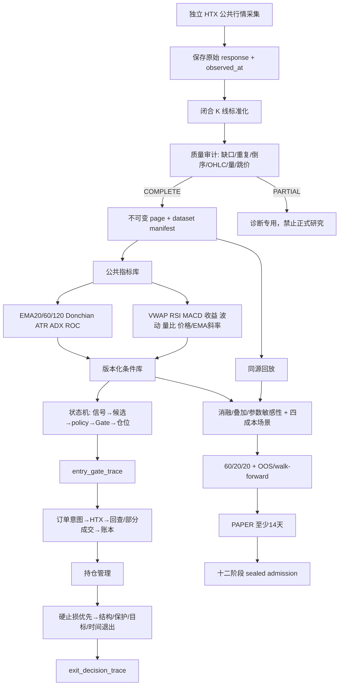

# HTX Python 十二阶段研究运行框架实施记录

## 1. 当前结论

Python 框架的 M0–M4 已形成可运行闭环：连续采集、不可变证据、公共指标、版本化条件、真实短路 Gate 记录、入场/退出证据、同源入口回放、消融实验合同和十二阶段 admission 均已落地。没有修改 Java，也没有改变现有 `HTX_TREND_V1` 的公式和交易参数。

2026-10-11 使用 HTX 公共接口冻结了 BTC-USDT、ETH-USDT 的六个月行情，周期为 `15min/30min/60min/4hour/1day`。最终 manifest `66c65fd4d1dd69aa70d0153e63807ea9cb767d84779b41eb9e3aa745c494afe0` 为 `COMPLETE`。第一次批次因 HTX 日线按 Asia/Shanghai 00:00，也就是 UTC 16:00 锚定而被质量门拒绝；修正锚点后重新采集，旧批次仍按内容 hash 保留。

同源 15 分钟入口回放结果：

| 品种 | 决策点 | 非 FLAT | 有候选的 bar | 结果 hash |
|---|---:|---:|---:|---|
| BTC-USDT | 17,409 | 6,986 | 5,195 | `23f6b2da131d094f7149ce43bd77d234de078d29675b8b7ac3a8cde7b58e208a` |
| ETH-USDT | 17,409 | 7,119 | 5,396 | `4c90c3a00c14c15a8c8a581e99393992a3ad83ec4d39a18a5d812fbb448cf4f4` |

这些数字只表示共享入口核的确定性回放，尚未经过完整 Gate、next-bar 成交、退出、费用和资金费生命周期，不能用于报告 PF、胜率或策略准入。

## 2. 最终调用逻辑



运行时路径：

```text
worker.py
  -> FileEvidenceStore(HTX_PYTHON_EVIDENCE_DIR)
  -> HtxMarketData.history_kline_envelope
       -> runtime_raw_kline
       -> completed_candles
       -> runtime_kline_window
  -> HtxStrategyDecisionEngine
       -> java_entry_contract.evaluate/candidates
       -> decision_trace（指标值、阈值、PASS/FAIL/SKIPPED）
  -> LiveTrendWorker
       -> evidence FAILED 时停止新增风险
       -> policy selection
       -> HtxTrendEntryExecutor.evaluate_gate
            -> 按真实短路顺序记录 entry_gate_trace
            -> sizing / risk reservation / idempotent order lifecycle
  -> LivePositionManager
       -> 先执行硬止损
       -> 读取管理与高周期 K 线
       -> exit kernel
       -> exit_decision_trace
       -> reduce-only order / reconcile
```

证据磁盘故障对两条路径的影响不同：开仓扫描失败关闭；已有仓位的硬止损和保护退出继续执行，证据写入只记录为降级。

## 3. 条件调用表

| 阶段 | 当前条件编号 | 实际作用 |
|---|---|---|
| 数据 | `data.warmup`、`data.positive_ohlc`、`data.signal_freshness` | 拒绝预热不足、非法价格、未闭合或过期信号 |
| 信号/候选 | `signal.ema_*`、`signal.momentum`、`signal.donchian_breakout`、`signal.adx`、`signal.atr_activity`、`signal.volume_ratio`、`signal.score_*` | 保留 V1 当前打分和候选行为 |
| 仅记录 | `signal.vwap_observation`、`signal.rsi_observation`、`signal.macd_observation` | 当前不改变交易；供后续叠加/消融 |
| 市场 | `gate.counter_market`、`gate.mixed_market_quality` | 市场方向冲突和 MIXED 质量门 |
| 开仓 Gate | `gate.model_score`、`funding_*`、`cooldown`、`candidate_state`、`fib_quality`、`unique_structure`、`book_spread`、`atr_pct`、`entry_chase`、`average_turnover`、`executable_depth`、`fee_protection` | 按生产短路顺序计算；短路后不伪造后续 PASS |
| 仓位/安全 | `gate.open_orders`、`gate.external_position`、`gate.position_capacity`、`gate.margin`、`sizing.valid_contracts`、`runtime.writer_guard`、`execution.*` | 安全条件标记为不可消融 |
| 持仓 | `holding.management_data_complete`、`holding.signal_freshness`、`holding.higher_timeframe_opposition`、`holding.funding_cost` | 管理数据和持仓环境 |
| 退出 | `position.hard_stop`、`exit.structure_invalidation`、`exit.profit_protection`、`exit.target`、`exit.time_or_flat` | 状态机处理动作优先级；硬止损先于模型数据 |

斜率已作为公共研究特征实现：`close_slope20` 和 `ema20_slope10` 使用线性回归斜率并按当前价格归一化。它们在 `HTX_TREND_V1` 中不参与交易。

## 4. 十二阶段实况

| 阶段 | 当前状态 | 依据/剩余事项 |
|---|---|---|
| 1 策略卡片 | 工程完成 | `StrategySpec` 固定版本、参数、转换、失败/暂停条件；正式候选需独立冻结卡片 |
| 2 数据冻结 | 通过当前 BTC/ETH 数据集 | 六个月五周期 COMPLETE manifest；内容寻址 raw/normalized/observed_at |
| 3 数据质量 | 通过当前 BTC/ETH 数据集 | 错误日线锚点批次被拒绝，修正版完整 |
| 4 特征字典 | 工程完成 | FeatureSpec 固定公式、输入、窗口、预热、滞后、单位、缺失处理 |
| 5 信号状态机 | 工程完成 | ConditionSpec/Result、DecisionContext/Trace、Gate 短路调用顺序 |
| 6 仓位与风险 | 工程完成，待候选实证 | 当前 sizing、容量、保证金和安全约束已登记 |
| 7 成本与执行 | 工程完成，待完整回测 | 四成本场景合同已冻结；完整 fill simulation 尚未产生结果 |
| 8 同源回测 | 部分 | 入口核六个月回放完成；完整订单/退出/资金曲线未完成 |
| 9 消融与敏感性 | 工程完成，未运行正式矩阵 | 实验计划/result ledger 可保存失败组合，安全条件不可关闭 |
| 10 OOS 与稳健性 | 工程完成，未运行正式候选 | 强制 60/20/20；test 数据集阻止被另一个 plan 重复消费 |
| 11 PAPER | `INSUFFICIENT_EVIDENCE` | 尚无连续至少14天的正式 PAPER 生命周期记录 |
| 12 报告与准入 | `INSUFFICIENT_EVIDENCE` | 不生成虚假 PASS；新版本仍不能进入 RANKING/GATE/SIZING/EXIT |

因此当前可以使用数据采集、OBSERVE、研究回放与实验平台；不能据此声称新策略已获得 LIVE 准入。

## 5. 命令

```bash
htx-trend collect-history --evidence /data/htx-python \
  --symbols BTC-USDT ETH-USDT --start 2026-04-11T00:00:00Z --end 2026-10-11T00:00:00Z
htx-trend collect-tick --evidence /data/htx-python --symbols BTC-USDT ETH-USDT
htx-trend verify-evidence --evidence /data/htx-python --hash <manifest>
htx-trend evidence-entry-replay --evidence /data/htx-python --manifest-hash <manifest> \
  --symbol BTC-USDT --period 15min
```

## 6. 尚需真实时间完成的工作

1. 在完整生命周期 backtest 中加入 next-bar 成交、同根止盈止损歧义、部分成交、撤单、资金费和合约乘数。
2. 预注册候选与回撤/成本标准后运行正式消融、敏感性、OOS 和 walk-forward。
3. 候选冻结后运行不少于14天 PAPER，记录错失率、滑点、退出复盘和重启恢复。
4. 只有上述证据满足门槛，才生成允许交易作用面的 sealed admission；失败则生成拒绝报告。
