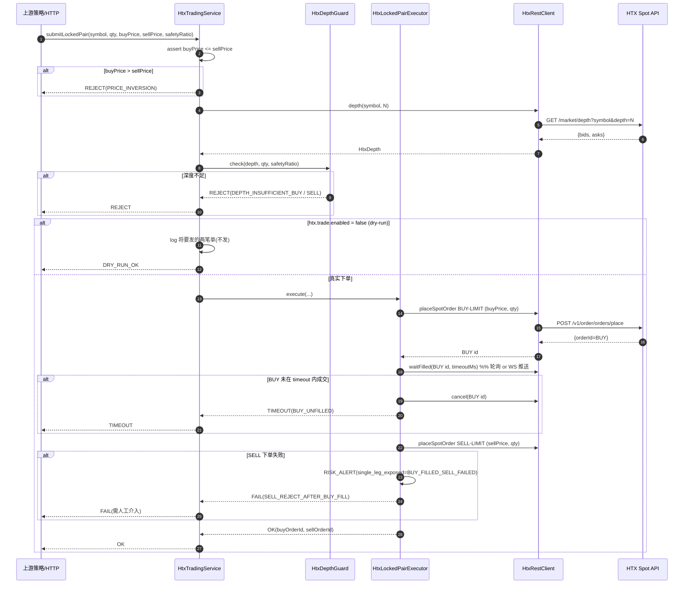

# HTX 现货自动交易 SDK v1

> **文档遵循金字塔原则**:结论 → 分论点 → 证据 → next steps。
> **范围**:CoinStrategy 新增 HTX(火币)现货执行能力。仅做"执行 SDK",不含策略。
> **v1.0.1 hotfix**(2026-07-28 review-driven):#1 partial-filled 恢复 + #2 SELL 腿 fill 确认 + #4 placeOrder data 类型 + #7 clientOrderId 幂等。见 §12。
> **v1.0.2 hotfix**(2026-07-28 review-driven):#3 minNotional 双边 + #5 queryOrder 熔断 + #6 cancel 后核验 + #10 depth ordering 断言。见 §13。

---

## 1. 结论(TL;DR)

在 CoinStrategy 现有 `binance / okx / gate` 三家交易所 client 之上,新增第四家 **HTX**,以 **"能力层 + 编排层"两级架构**落地:

- **能力层**(`coin-strategy-common/common-client/htx/`)= 一枚 `HtxApiService` 门面,底层聚合两条通道:REST(下单/查单/撤单/账户/深度)+ WebSocket(增量深度/成交推送/订单推送),HmacSHA256 签名,`@ConditionalOnExpression` 缺 AK/SK 不装配。
- **编排层**(`coin-strategy-job/service/htx/`)= 一枚 `HtxTradingService`(面向调用者的门面)+ 一枚 `HtxLockedPairExecutor`(锁利双腿执行器)+ 一枚 `HtxDepthGuard`(深度校验)。
- **执行硬约束**(用户已拍板):同一笔"买卖对"在**下单前**必须满足 `buyPrice ≤ sellPrice` 且订单簿前 N 档累计量 ≥ `qty × safetyRatio`,任一不满足**整体放弃**,不产生单腿裸露。
- **安全边界**:默认 `htx.trade.enabled=false` 走 **dry-run**(只打印将要发的单),真下单需要显式开关。

---

## 2. 分论点

### P1. 复用现有目录范式,不发明新分层

CoinStrategy 已经把"交易所接入"按同一模式抽了三次(binance / okx / gate),证据:

| 已有实现 | 关键文件 | 门面类 | 配置类 |
|---|---|---|---|
| Binance | `common-client/binance/` + `job/config/BinanceConfig.java` | `BinanceApiService`(516 行) | `BinanceConfig` `@ConditionalOnExpression("'${binance.api.api-key:}' != ''" ...)` |
| OKX | `common-client/okx/` + `okx/interceptor/AuthenticationInterceptor.java` | `OkxApiService` | ClientConfiguration Bean + `SignUtils.signRest` (HmacSHA256+Base64) |
| Gate | `common-client/gate/` + `job/config/GateConfig` | `GateApiService` | 官方 SDK ApiClient 注入 AK/SK |
| **HTX(本次)** | **`common-client/htx/` + `job/config/HtxConfig.java`** | **`HtxApiService`** | **`@ConditionalOnExpression("'${htx.api.access-key:}' != '' && '${htx.api.secret-key:}' != ''")`** |

**含义**:HTX 侧完全沿用既有模式,不引新架构风格。团队看 binance 那套怎么写,HTX 就照着写。

### P2. HTX 的鉴权模型决定了"必须自建签名器"

HTX 现货 REST **不用现成 Java SDK**(火币官方 Java SDK 长期不再更新且未上 Maven Central);两个客观事实:

- **签名算法**:HmacSHA256 over `METHOD\nHost\nPath\nSortedQuery`,结果 Base64 编码。`common-base/utils/SignUtils.java` 已经有 `hmacSHA256(byte[] key, byte[] content)` 原语,可复用,只需再包一层 HTX 专用签名工具类。
- **必带参数**:`AccessKeyId`、`SignatureMethod=HmacSHA256`、`SignatureVersion=2`、`Timestamp=yyyy-MM-ddTHH:mm:ss`(UTC)。**Timestamp 参与签名前须 URL 编码**。

**含义**:common-client 侧新增 `HtxSignUtils`(单文件 <60 行)即可,不引第三方签名依赖。

### P3. 双腿"锁利"是一个不可分的原子决策,不能拆两条独立指令

用户拍板的语义是:

> **同一笔买卖对:买单成交价 ≤ 卖单成交价(锁利)**,且**深度支持双腿目标数量**。

这意味着执行器**必须**处理三类失败:

| 场景 | 期望行为 | 反例(禁止) |
|---|---|---|
| `buyPrice > sellPrice` | 未下任何单,直接返回拒绝原因 | 只下买单等价格回归 |
| 深度前 N 档累计量 < `qty × safetyRatio` | 未下任何单,返回拒绝原因 | 部分成交后再重新评估 |
| 买单已成交但卖单被拒 / 网络中断 | 记录**单腿裸露风险**并触发保守动作(下限价单挂原价 / 转风控告警) | 静默失败 |

**含义**:执行器**必须**先做 pre-check(买卖价 + 双腿深度)再挂单;买腿成交前不发卖腿,买腿成交后立即发卖腿。这是"预校验 + 顺序执行"模型,不是"同时下双腿再事后对账"模型——后者在链上/链下都会带来单腿裸露窗口。

### P4. 深度校验用"累计量 × 安全系数",不用"预估滑点"

用户在澄清中选择**前 N 档累计量 >= 目标数量 × 安全系数**(N 与 safetyRatio 可配)。理由:

- **可解释性**:阈值以"体量倍数"表达,业务方读得懂。
- **无需模型假设**:滑点模型要假设成交撮合顺序,累计量校验不需要。
- **计算便宜**:一次遍历 depth top-N 即可,便于 hot-path 高频调用。

**含义**:`HtxDepthGuard` 只做一件事:拉 depth top-N,累加卖挡直至 ≥ `qty * safetyRatio`(买腿看 asks),累加买挡直至 ≥ `qty * safetyRatio`(卖腿看 bids)。滑点模型留给未来 v2。

### P5. dry-run 是本次落地的**默认路径**,不是可选路径

**含义**:

- `htx.trade.enabled=false` (缺省)时,`HtxTradingService.spotBuy/spotSell` 仅打印将要发的报文,不调 REST。
- `htx.trade.enabled=true` 才走真实 API。
- 单测覆盖 dry-run 与 real 两种分支(用 mock `HtxApiService` 断言 real 走真实调用、dry-run 不触及 API)。

### P6. WebSocket 是"增强项",不是"阻塞项"

用户选了 REST(核心)+ WebSocket(增量深度/成交/订单)。**架构分层**:

- **REST**:v1 必做,`HtxRestClient` 直接落地。
- **WebSocket**:v1 提供**接入骨架**(`HtxWebSocketClient` + 订阅注册中心 + gzip 解压 + ping/pong),但**订阅回调只提供 3 个内建 topic**:`market.{symbol}.depth.step0` / `market.{symbol}.trade.detail` / `orders#{account-id}`。策略层暂不消费,先做能力层就绪。

**含义**:WS 通道的存在证明架构留出了"高频路径",但**本次交付不消耗 WS 数据**;策略需要时再挂消费者。

---

## 3. 组件全景与目录布局

> **v1.1 更新**:HTX 已从 `coin-strategy-job` 拆到独立服务 `coin-strategy-htx`(端口 8082),避免与 polymarket / funding-rate 策略共享 JVM。理由:爆炸半径、依赖差异、发布节奏。见本文档 §11 与 activeContext v2.8.2。

```
coin-strategy-common/
  common-base/src/main/java/.../base/utils/
    SignUtils.java                                # 已存在:hmacSHA256 原语复用
  common-client/src/main/java/.../client/htx/     # 新增(供 htx 服务独占使用,其他模块不引)
    HtxApiService.java                            # 门面,聚合 rest+ws
    HtxSignUtils.java                             # HTX 专用签名(HmacSHA256+Base64,含 sortedQuery)
    rest/
      HtxRestClient.java                          # OkHttp3 + interceptor 签名
      HtxSpotService.java                         # 下单/查单/撤单/批量撤
      HtxMarketDataService.java                   # depth/ticker/kline
      HtxAccountService.java                      # accounts/balance
    ws/
      HtxWebSocketClient.java                     # JDK 11 WebSocket + gzip
      HtxSubscription.java                        # depth/trade/order 三 topic
    model/                                        # DTO(HtxDepth / HtxOrder / HtxAccount ...)

coin-strategy-htx/                                # 新增独立服务模块(port 8082)
  pom.xml                                         # 只拉 common-client + common-base + spring-boot-starter-web/validation
  src/main/java/.../htx/
    CoinStrategyHtxApplication.java               # main + @SpringBootApplication
    config/HtxConfig.java                         # @ConditionalOnExpression 装 HtxApiService
    service/                                      # 编排层
      HtxTradingService.java                      # 面向调用者的门面(submitLockedPair)
      HtxLockedPairExecutor.java                  # 双腿锁利执行器
      HtxDepthGuard.java                          # 深度校验
      HtxTradeProperties.java                     # htx.trade.enabled / topN / safetyRatio
      HtxLockedPairRequest.java / HtxLockedPairResult.java
    controller/
      HtxController.java                          # GET /accounts / GET /spot/depth / POST /spot/locked-pair
  src/main/resources/
    application.yml                               # port=8082,context-path=/htx/api,默认 htx.trade.enabled=false
    logback-spring.xml                            # logs/coin-strategy-htx.log(SizeAndTime rolling)
```

---

## 4. 双腿锁利执行时序(核心流程)

> **图**:`docs/architecture-refactor/htx-locked-pair-flow.drawio`(建议 v1.1 补上;当前用 mermaid 表达时序,便于快速评审)



**关键点**:

- **步骤 3–8**:pre-check 全部通过前,**一分钱都不下**。
- **步骤 10–11**:买腿先下,等成交再挂卖腿。避免"卖单先下但买单被拒"的裸露空头。
- **步骤 15–17**:买腿成交、卖腿被拒 → 触发 `RISK_ALERT`,记 outbox / metric,不吞掉。
- **dry-run 路径**:在步骤 8 之后短路,不进入 Exec。

---

## 5. 深度校验模型

**公式**:给定 `qty` 与 `safetyRatio`(默认 3.0)、`topN`(默认 10):

```
buy_ok  = (SUM asks[0..N-1].amount)  >= qty * safetyRatio
sell_ok = (SUM bids[0..N-1].amount)  >= qty * safetyRatio
depth_ok = buy_ok && sell_ok
```

**为什么两侧都校验**:

- 买腿吃卖盘(asks),不足则**买不到**。
- 卖腿吃买盘(bids),不足则**卖不掉**。

**边界值**(v1 默认):

| 配置键 | 默认 | 说明 |
|---|---|---|
| `htx.depth-guard.top-n` | 10 | 参与累加的档位数 |
| `htx.depth-guard.safety-ratio` | 3.0 | 目标数量的倍数阈值 |
| `htx.depth-guard.min-quote-notional` | 20 | 小于此名义金额(USDT)直接拒(避免刷单) |

---

## 6. 与既有交易所 client 的对齐点

| 维度 | Binance | HTX |
|---|---|---|
| 门面命名 | `BinanceApiService` | `HtxApiService` |
| 配置类命名 | `BinanceConfig` | `HtxConfig` |
| 装配条件 | `@ConditionalOnExpression("'${binance.api.api-key:}' != '' && '${binance.api.secret-key:}' != ''")` | `@ConditionalOnExpression("'${htx.api.access-key:}' != '' && '${htx.api.secret-key:}' != ''")` |
| 领域 Service | `BinanceTradingService` | `HtxTradingService` |
| 签名工具 | 官方 connector 内置 | `HtxSignUtils`(自建,复用 `common-base/SignUtils.hmacSHA256`) |
| 交易开关 | (无 dry-run)  | `htx.trade.enabled` (dry-run 默认) |

**注**:HTX 引入的**新范式**只有一个——`htx.trade.enabled` dry-run 默认开关。此为用户澄清中拍板的安全边界,是本次相对既有三家的**唯一新增约束**,应作为 v1.1 反向推给其他家的模板(见 next steps)。

---

## 7. 数据契约(关键 DTO)

```java
// coin-strategy-common/common-client/.../htx/model/
public class HtxDepth {
    private long ts;
    private String symbol;
    private List<HtxPriceLevel> bids;
    private List<HtxPriceLevel> asks;
}
public class HtxPriceLevel { private BigDecimal price; private BigDecimal amount; }

public class HtxOrder {
    private long orderId;
    private String clientOrderId;
    private String symbol;
    private String side;   // BUY / SELL
    private String type;   // LIMIT / MARKET
    private BigDecimal price;
    private BigDecimal quantity;
    private BigDecimal filledAmount;
    private String state;  // submitted / partial-filled / filled / canceled ...
}

public class HtxLockedPairRequest {
    private String symbol;
    private BigDecimal quantity;
    private BigDecimal buyPrice;
    private BigDecimal sellPrice;
    private BigDecimal safetyRatio;   // 可选,缺省用配置
    private Long waitFillTimeoutMs;   // 可选,缺省 5000
}

public class HtxLockedPairResult {
    private ResultCode code;         // OK / DRY_RUN_OK / REJECT_PRICE_INVERSION / REJECT_DEPTH / TIMEOUT / FAIL_AFTER_BUY_FILL
    private Long buyOrderId;
    private Long sellOrderId;
    private String message;
}
```

---

## 8. 风险与不做的事(v1 明确边界)

| 项 | v1 决定 | 备注 |
|---|---|---|
| 跨所套利 | 不做 | 用户澄清明确只做单所现货 |
| 期货/合约 | 不做 | 仅现货 |
| 保证金/借贷 | 不做 | |
| 网格自动做市 | 不做 | 只做一次性双腿锁利 |
| 单腿裸露自愈 | v1 仅告警 + 挂原价补单(挂在 API 层内)不主动 hedge | v2 若需要接 wallet-service 做 hedge,再立项 |
| 订单持久化 | v1 只走日志 + `htx_order_local_log` 表(可选) | v2 引入 outbox / DB record |
| 撤单风控 | v1 提供 cancel API,不自动周期撤 | |
| Watch 全 orderbook 变化 | v1 只在下单时拉一次 depth | v2 引入 WS 增量 depth,近实时校验 |

---

## 9. Next Steps(验收标准)

| # | 事项 | 责任人 | 何时 | 验收标准 |
|---|---|---|---|---|
| 1 | 落地 `HtxApiService` + `HtxSignUtils` + `HtxRestClient` + `HtxSpotService/HtxMarketDataService/HtxAccountService` | Agent | 本轮 | `mvn -pl coin-strategy-common/common-client -am compile` 通过 |
| 2 | 落地 `HtxTradingService` + `HtxLockedPairExecutor` + `HtxDepthGuard` + `HtxConfig` | Agent | 本轮 | 同上 + `job` 模块编译通过 |
| 3 | 单测:`HtxDepthGuardTest`(4 用例:双侧足够 / 卖侧不足 / 买侧不足 / 数量为零)+ `HtxLockedPairExecutorTest`(4 用例:买价>卖价拒 / 深度不足拒 / dry-run 只打印不下单 / 正常路径成交后再下卖单)| Agent | 本轮 | `mvn -pl coin-strategy-job -am test -Dtest='Htx*Test'` 全绿 |
| 4 | dry-run 演示:通过 `HtxController.dryRunLockedPair` 触发一次,截取"REJECT_PRICE_INVERSION / REJECT_DEPTH / DRY_RUN_OK"三条日志 | Agent | 本轮 | 日志附在 activeContext 交付段 |
| 5 | v1.1 反推:把 `htx.trade.enabled` dry-run 模式推回 binance/okx/gate,统一各家 | 后续 | 下一轮 | 独立 ADR |
| 6 | WS 通道接入策略消费者 | 后续策略需求驱动 | — | — |

---

## 10. 与 `RATE_MOMENTUM_STRATEGY.md` / `TOP50_STRATEGY.md` 等策略文档的关系

- 本文档**只描述执行 SDK 的合约与拓扑**,不定义"何时该触发一笔锁利对"——那是策略层的事。
- 策略文档若要在 HTX 上跑,只需**依赖 `HtxTradingService.submitLockedPair(...)` 单点**,不接触 REST / WS 细节。
- 具体某个策略如何决定 `buyPrice / sellPrice / qty / safetyRatio`,由该策略自己的设计文档承接。

---

## 11. 独立服务运行手册(v1.1 · 2026-07-28)

### 为什么独立成 `coin-strategy-htx`

`coin-strategy-job` 已承担 polymarket 跟单 + Binance 资金费率套利 + 天气策略等多套并跑,共享 JVM / 线程池 / 8081 端口。三条独立理由:

1. **爆炸半径**:HTX WSS 断线堆积 / OkHttp 连接池耗尽会拖垮 polymarket;反之亦然。
2. **依赖差异**:HTX 侧只吃内存态,不接 MySQL / Kafka;job 却依赖二者。塞进 job 让 HTX 冷启拖上整个策略栈。
3. **发布节奏**:HTX 改一行不应触发 polymarket 生产重启。

### 目录

```
coin-strategy-htx/                                 # 端口 8082 · context-path /htx/api
  pom.xml                                         # 仅依赖 common-client + common-base + web/validation
  src/main/java/.../htx/
    CoinStrategyHtxApplication.java
    config/HtxConfig.java
    controller/HtxController.java
    service/{HtxTradingService,HtxLockedPairExecutor,HtxDepthGuard,HtxTradeProperties,HtxLockedPairRequest,HtxLockedPairResult}.java
  src/main/resources/{application.yml, logback-spring.xml}
```

### 环境变量

| 变量 | 必填 | 说明 |
|---|---|---|
| `HTX_ACCESS_KEY` | 是 | HTX 后台 AccessKey |
| `HTX_SECRET_KEY` | 是 | HTX 后台 SecretKey |
| `HTX_SPOT_ACCOUNT_ID` | 首次可空 | 首启后 `GET /htx/api/htx/accounts` 拿到再回填 |
| `HTX_TRADE_ENABLED` | 否 | `false`(默认)dry-run;`true` 真下单 |
| `HTX_SERVER_ADDRESS` | 否 | `127.0.0.1`(默认)· `0.0.0.0` 对外 |
| `SPRING_PROFILES_ACTIVE` | 否 | `local`(默认) |

### 三步启动

```bash
# 1. 打包(只编 coin-strategy-htx + common-client + common-base,~2 秒)
export JAVA_HOME=$(/usr/libexec/java_home -v 17)
cd /Users/lichangzheng.ray/Ray/CoinStrategy
mvn -pl coin-strategy-htx -am -DskipTests package

# 2. 启动(dry-run 默认,不会真下单)
export HTX_ACCESS_KEY=your_ak
export HTX_SECRET_KEY=your_sk
java -jar coin-strategy-htx/target/coin-strategy-htx-0.0.1-SNAPSHOT.jar
# 冷启 <1 秒:Started CoinStrategyHtxApplication in 0.991 seconds ... on port 8082

# 3. 拿 spotAccountId,回填环境或 application.yml
curl -s http://127.0.0.1:8082/htx/api/htx/accounts | jq
```

### 触发锁利对

```bash
# dry-run(HTX_TRADE_ENABLED=false):只打印,不下单
curl -sX POST http://127.0.0.1:8082/htx/api/htx/spot/locked-pair \
  -H 'Content-Type: application/json' \
  -d '{"symbol":"btcusdt","quantity":"0.001","buyPrice":"60000","sellPrice":"60100"}'
# → {"code":"DRY_RUN_OK","message":"dry-run"}

# 真下单(HTX_TRADE_ENABLED=true 且 spot-account-id 已配)
export HTX_TRADE_ENABLED=true
export HTX_SPOT_ACCOUNT_ID=1234567
java -jar coin-strategy-htx/target/coin-strategy-htx-0.0.1-SNAPSHOT.jar
# 同样 curl,返回 {"code":"OK","buyOrderId":X,"sellOrderId":Y}
```

### 返回码语义

| code | 何时 |
|---|---|
| `OK` | 双腿都终态 filled(实盘) |
| `BUY_PARTIAL_FILL_RECOVERED` | 买腿部分成交超时,余单已撤,卖腿按实际成交量补齐(v1.0.1 · 双腿终态可能是 filled 或 SELL 未完成) |
| `SELL_PENDING` | 买腿全成 · 卖腿已下但超时未终态 · sellOrderId 有效可追踪(v1.0.1) |
| `DRY_RUN_OK` | 校验通过但 dry-run,未触真实 API |
| `REJECT_PRICE_INVERSION` | `buyPrice > sellPrice` |
| `REJECT_DEPTH_BUY/SELL/BOTH` | 前 N 档深度累计 < qty × safetyRatio |
| `REJECT_MIN_NOTIONAL` | qty × sellPrice < 20 USDT 阈值 |
| `REJECT_INVALID_INPUT` | 缺 symbol / qty ≤ 0 / null 字段 |
| `DEPTH_FETCH_FAILED` | HTX 网关无法访问或返回错误 |
| `BUY_ORDER_REJECTED` | 买腿 REST 返回 error / 订单终态被拒 / order id 非数字(v1.0.1) |
| `BUY_WAIT_TIMEOUT` | 买腿超时且零成交,已撤单 |
| `FAIL_AFTER_BUY_FILL` | 买腿成交但卖腿被拒或终态失败——**单腿裸露风险,需人工介入** |

### 与 polymarket 服务的独立性

| 关注点 | coin-strategy-htx | coin-strategy-job |
|---|---|---|
| 端口 | 8082 | 8081 |
| 依赖 | common-client + common-base | + common-service / dao / mybatis-plus / kafka 客户端 |
| DB | 无 | MySQL |
| MQ | 无 | Kafka |
| 冷启动 | <1 秒 | 数十秒 |
| 单一进程故障 | HTX 挂不影响 polymarket | polymarket 挂不影响 HTX |

---

## 12. v1.0.1 Hotfix(2026-07-28 code review 驱动)

第一轮代码审阅发现 10 项缺陷(2 CRITICAL / 5 HIGH / 3 MEDIUM)。本 hotfix 落地 4 项 CRITICAL/HIGH 修复,进真实盘前必须:

### #1 · partial-filled 状态处理与补腿(CRITICAL)

**问题**:v1 while 循环只检查 `filled/canceled/partial-canceled/rejected`,漏了中间态 `partial-filled`。买腿部分成交后 while 走完超时,`cancelOrder` 撤余单,但已成交部分留在账户,返回 `BUY_WAIT_TIMEOUT`——单腿裸露。

**修复**:`waitForFill` 循环内读 `filledAmount`;超时后若 `filledAmount > 0`:cancel 余单 + SELL 按实际成交量下单(不再是 request 里的原 qty)。新增返回码 `BUY_PARTIAL_FILL_RECOVERED`。

### #2 · SELL 腿 fill 确认(CRITICAL)

**问题**:v1 SELL 只要交易所接单就 `return OK`,不轮询是否成交。市场急跌时 SELL 挂盘长期不成,调用方误以为已锁利。

**修复**:SELL 也走 `waitForFill` 循环。终态 filled → `OK`;终态 rejected → `FAIL_AFTER_BUY_FILL`;超时仍开着 → `SELL_PENDING`(附 sellOrderId 让调用方追踪)。返回值增 `sellFilledAmount` 字段。

### #4 · placeOrder 返回类型改 String(HIGH)

**问题**:HTX 官方 `data` 字段是 JSON 字符串(如 `"59378"`),v1 反序列化用 `Long`,fastjson2 lenient 模式可能对含前缀或大数字返回 null,导致订单实际下出但代码路径视为"被拒"。

**修复**:`HtxSpotService.placeOrder / cancelOrder` 返回 `HtxRestResponse<String>`;executor 内 `Long.parseLong` 显式解析,非数字直接返回 null 走 `BUY_ORDER_REJECTED` 分支。

### #7 · clientOrderId 幂等(HIGH)

**问题**:v1 两个 placeOrder 都传 null clientOrderId,调用方超时重发会导致重复下单、持仓翻倍。

**修复**:`HtxLockedPairRequest` 加 `clientOrderId` 字段(可选);executor 派生 `${clientOrderId}-BUY` / `${clientOrderId}-SELL` 传给 HTX,交易所侧幂等,重发返回原订单不重复下单。字段总长按 HTX 64 字符上限截断。

### 验证

- `mvn -pl coin-strategy-htx -am test -Dtest='Htx*Test'` → **16/16 全绿** 3.4s(11 HtxTradingServiceTest + 5 HtxDepthGuardTest,新增 6 用例覆盖 partial-fill recovery / sell pending / sell terminal rejected / non-numeric order id / clientOrderId 派生 / 无 clientOrderId 兼容)
- 关键日志证据:
  - `HTX BUY 1001 partial-filled at timeout: filled=0.3 of 1; cancelling remainder and hedging with SELL` → #1
  - `HTX SELL 2002 not fully filled within 20ms; returning SELL_PENDING` → #2
  - `HTX SELL 2002 rejected after placement (filled=1) — single leg exposed` → #2 fail path
  - `HTX returned non-numeric order id: hf_notNumber` → #4

### 剩余 6 项(v1.0.2 / v1.1 排产)

- 🟠 #3 minNotional 双边校验(买腿也应过 20 USDT)
- 🟠 #5 queryOrder 网络错误连续 K 次熔断
- 🟠 #6 cancelOrder 结果核验(cancel 后再 query 一次)
- 🟡 #8 depth 快照与下单时间窗(接 WS 增量 depth)
- 🟡 #9 submitLockedPair 同步阻塞(异步化 + taskId)
- 🟡 #10 depth ordering 断言(asks 升序 / bids 降序)

---

## 13. v1.0.2 Hotfix(2026-07-28 · v1.0.1 之后)

v1.0.1 完成 2 CRITICAL + 2 HIGH,剩余 3 HIGH + 3 MEDIUM。本次落地 4 项(3 HIGH + 1 MEDIUM),把"投产前应修完"清单清零;剩 2 项 MEDIUM(#8 WS 增量 depth / #9 executor 异步化)排 v1.1。

### #3 · minNotional 双边校验(HIGH)

**问题**:v1.0.1 只用 `qty × sellPrice` 判 minNotional。极端价差(如 buyPrice=15000, sellPrice=25000,qty=0.001)下 sell 侧 25 过阈,buy 侧 15 不过阈,交易所会在 BUY 落地时拒。

**修复**:`HtxTradingService.submitLockedPair` 计算 `buyNotional / sellNotional`,取 `.min(...)` 与 `minNotional` 比较——较弱一条腿不过阈就整体拒绝。日志同时记录两条腿的名义值,便于诊断哪一侧被卡。

### #5 · queryOrder 网络错误熔断(HIGH)

**问题**:v1.0.1 的 `waitForFill` 循环里 queryOrder 返回非 ok 时静默 continue。HTX API 短时抖动(5xx / gateway timeout)导致连续查询失败,while 走完超时,代码走 cancel 分支——**但订单可能已成交**,cancel 会真的撤掉一个正在成交或已成交的单,或撤空跑,状态永远盲区。

**修复**:
- `HtxTradeProperties.Trade.queryFailureThreshold`(默认 5)配置项
- `waitForFill` 记录 `consecutiveFailures` · 每次成功查询清零 · 达阈值置 `infraFailure=true` 提前退出循环
- BUY 与 SELL 两侧均在循环后检查 `infraFailure`,若为真直接返回 `QUERY_INFRA_ERROR` + orderId **不做 cancel**(避免 blind cancel 已成交单)
- 上游拿到 orderId 走死信 / 人工核对 / 独立 reconciler

### #6 · cancelOrder 后核验(HIGH)

**问题**:v1.0.1 的 BUY 超时零成交路径里 `cancelOrder(buyId)` 返回后立即返回 TIMEOUT,不核实实际状态。cancel 请求与订单成交在同一秒竞态时,cancel 可能失败(HTX 返回 order-orderstate-error)或成功但订单已 filled,我方仍返回 TIMEOUT → **持仓存在但视为未成交,单腿裸露**。

**修复**:
- cancel 之后立即 `queryOrder(buyId)` 一次
- 若 `filledAmount > 0`:走 partial-fill recovery 路径(与 #1 合流),SELL 按实际 filled 量补齐,返回 `BUY_PARTIAL_FILL_RECOVERED`
- 若 `filledAmount = 0` 或 query 失败:才返回 TIMEOUT

**保守规则**:cancel-race 恢复**始终**按 partial 处理(用 `filledAmount` 不用 request qty)。即使 postCancel 显示 `state=filled`,HTX 也可能微调 executed 量,下游只对实际成交量对冲。

### #10 · depth ordering 断言(MEDIUM)

**问题**:v1.0.1 的 `HtxDepthGuard.sumTopN` 假设 `asks[0]` 最优卖价、`bids[0]` 最优买价。HTX 现行 step0 如此,但**代码无显式断言**,若 API 变动或聚合返回顺序错乱,累加值语义错但校验会 pass。

**修复**:`HtxDepthGuard.check` 首先调用 `isMonotonic(asks, ascending=true)` / `isMonotonic(bids, ascending=false)`:
- asks 必须严格升序(price 递增)
- bids 必须严格降序(price 递减)
- 同价重复级也拒绝(HTX 上游会聚合同价流动性)
- 违反立即返回 `buyOk=sellOk=false` + 特殊日志 `HTX depth ordering violation for {symbol}; refusing to trade`

### 验证

- `mvn -pl coin-strategy-htx -am test -Dtest='Htx*Test'` → **23/23 全绿** 2.3s(15 HtxTradingServiceTest + 8 HtxDepthGuardTest,v1.0.1 后从 16 加到 23)
- 新增 7 用例:`hotfix3_minNotionalBuyLegBelowFloorRejects` / `hotfix5_queryOrderInfraFailuresTripCircuitBreaker`(断言:trip 后 **不 cancel 也不下 sell**) / `hotfix6_cancelRaceRecoversFillsInsteadOfReturningTimeout`(断言:sell amount 是 0.7 不是 1) / `hotfix10_unsortedAsksRejectsAsDepthBoth`(trading 层集成) / `hotfix10_asksOutOfOrderRejects` / `hotfix10_bidsOutOfOrderRejects` / `hotfix10_equalPriceLevelsRejects`(guard 层单元)

### 剩余 v1.1 排产(2 MEDIUM · 需要产品决策)

**#8 · WS 增量 depth 替代 REST 拉取**
- **背景**:每次锁利拉一次 REST depth(~200ms)+ 下单(~200ms)之间存在 300-800ms 时间窗。快速行情下窗口内订单簿被打穿,校验值失效。
- **v1.1 方案**:`HtxWebSocketClient` 已就位,订阅 `market.{symbol}.depth.step0`,内存缓存最新 book。`submitLockedPair` 读缓存(<10ms 窗口)。校验通过后立即下单。
- **决策要点**(需产品输入):
  1. 每个 symbol 独立订阅还是全局 subscribe-on-demand + LRU 淘汰?
  2. WS 断线 fallback 到 REST 还是直接 REJECT?
  3. book 缓存陈旧超过 N ms 视为失效——阈值多少?
- **暂缓理由**:v1.0.2 之后校验语义已经收紧(双侧深度 × 3 安全系数 + ordering 断言),窗口失效需要非常极端的行情。策略层用小额 qty + 高 safetyRatio 可以进一步降低风险。

**#9 · submitLockedPair 异步化**
- **背景**:v1.0.2 的 `submitLockedPair` 全同步,BUY + SELL 各一次 timeout(默认 5s),最坏 10s+ 阻塞。并发 100 条 tomcat 线程池占满,其他 HTX API 排队;HTTP client 短超时可能触发 double-submit(#7 clientOrderId 已缓解)。
- **v1.1 方案**:executor 内部 `CompletableFuture.supplyAsync(new AsyncTaskExecutor)`,`submitLockedPair` 立即返回 `taskId`;新增 `GET /htx/spot/locked-pair/{taskId}` 查询接口。
- **决策要点**(需产品输入):
  1. taskId 生命周期:内存态 30 分钟 vs 落 DB 永久?
  2. 异步池大小 · 拒绝策略(超容时是排队、拒绝还是回落同步)?
  3. 是否引入 Kafka `htx.locked_pair.result.v1` 事件广播供策略消费?
- **暂缓理由**:v1.0.2 已有 clientOrderId 幂等(HTX 侧去重),HTTP 短超时最坏是"客户端等太久断开"而非"重复下单"。同步阻塞在低 QPS 策略场景(每分钟几笔)可接受。真上量再异步化。

### 修复清单总览(v1 → v1.0.1 → v1.0.2)

| # | 级 | 版本 | 状态 |
|---|---|---|---|
| 1 | 🔴 | v1.0.1 | ✅ partial-filled 恢复 |
| 2 | 🔴 | v1.0.1 | ✅ SELL fill 确认 |
| 3 | 🟠 | v1.0.2 | ✅ minNotional 双边 |
| 4 | 🟠 | v1.0.1 | ✅ placeOrder String 类型 |
| 5 | 🟠 | v1.0.2 | ✅ queryOrder 熔断 |
| 6 | 🟠 | v1.0.2 | ✅ cancelOrder 核验 |
| 7 | 🟠 | v1.0.1 | ✅ clientOrderId 幂等 |
| 8 | 🟡 | v1.1 | ⏳ WS 增量 depth |
| 9 | 🟡 | v1.1 | ⏳ executor 异步化 |
| 10 | 🟡 | v1.0.2 | ✅ depth ordering 断言 |

**v1.0.2 完成后**:HTX SDK 可以进入真实盘小额冒烟测试。剩余 2 MEDIUM 属于"高并发 / 极端行情"防御,非阻塞投产。
