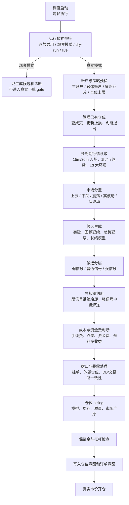

# HTX 趋势策略开仓与持仓管理重构计划 v1

> **上层设计**：本计划承接 [HTX 趋势策略系统 v1](HTX_TREND_STRATEGY_SYSTEM_V1.md)，只处理趋势合约执行链路、已有仓位管理、开仓 gate、多周期行情和实盘诊断。

> **实施路线**：本计划补充 [CoinStrategy 策略体系实施路线图 v1](COINSTRATEGY_STRATEGY_IMPLEMENTATION_ROADMAP_V1.md) 的 P2/P3/P4，作为后续分批研发和回测的任务拆分依据。

> **结论先行**：当前趋势策略的问题不是某一个参数太松或太紧，而是执行链路仍偏线性。后续要先把观察模式、实盘开关、账户和策略互斥等前置，再把持仓退出、冷却解冻、多周期信号和外部仓位处理拆成可诊断的分层决策。第一版先形成计划和诊断口径，不直接扩大真实仓位。

---

## 0. 文档定位

| 项 | 内容 |
|---|---|
| 文档类型 | 执行链路重构计划 / 分批实施清单 |
| 目标读者 | 策略研发、后端、前端、运维、实盘观察人员 |
| 适用模块 | `coin-strategy-htx` 趋势合约交易、HTX 趋势看板、回测工具 |
| 非目标 | 不恢复资金费套利；不自动接管人工仓位；不在本计划阶段放大真实仓位 |
| 当前问题 | 开仓 gate 顺序偏后置，退出逻辑偏规则叠加，冷却期缺少强信号解冻，多周期信息不足，挂单/外部仓位处理过硬。 |

---

## 1. 目标状态

执行链路要从“扫描到信号后一路判断到下单”改为“模式预检、持仓管理、候选生成、候选分层、真实开仓 gate、订单执行”六段。

### 1.1 关键原则

| 编号 | 原则 | 说明 |
|---|---|---|
| P-1 | 能前置就前置 | 观察模式、实盘开关、dry-run/live、策略互斥和账户配置必须在真实 gate 前判断。 |
| P-2 | 观察链路不阻塞真实链路 | observe-only 只落候选和诊断，不混入资金费、盘口、保证金等真实下单 gate。 |
| P-3 | 先管理仓位，再考虑开仓 | 已有仓位的成交、止损、退出优先级高于新开仓。 |
| P-4 | 强弱信号分层处理 | 冷却、挂单、外部仓位不能一刀切；强信号可进入更严格的例外流程。 |
| P-5 | 退出匹配开仓模型 | 突破、Fibonacci、长线趋势单要有不同失效条件。 |
| P-6 | 所有结果可回放 | 候选、gate、冷却解冻、退出原因必须可从数据库复盘。 |

---

## 2. Batch 1：执行链路重排与诊断口径

### 2.1 要改什么

把真实开仓前的判断拆成两类。

| 类别 | 判断项 | 目标行为 |
|---|---|---|
| 运行模式预检 | 趋势是否启用、是否观察模式、dry-run/live 是否满足 | 先判断；观察模式直接走候选诊断，不进入真实下单 gate。 |
| 真实执行预检 | 账户配置、策略互斥、仓位上限、合约模块开关 | 只有真实模式才判断；失败时记录清楚原因。 |
| 真实开仓 gate | 资金费、信号新鲜度、冷却、方向置信、盘口、外部仓位、保证金、杠杆 | 只对真实候选判断。 |

### 2.2 验收

| 验收项 | 标准 |
|---|---|
| 观察模式前置 | observe-only 下不会再进入资金费、盘口、保证金、杠杆和下单逻辑。 |
| 诊断可读 | 页面或 DB 能区分“观察模式跳过”和“真实 gate 拒绝”。 |
| 现有持仓不受影响 | 即使禁止新开仓，已有仓位仍继续管理和退出。 |
| 不扩大风险 | 本批不提高仓位，不新增真实开仓模型。 |

### 2.3 实施记录

| 日期 | 状态 | 内容 |
|---|---|---|
| 2026-09-22 | 已完成代码第一步 | observe-only 在真实开仓 gate 前返回 `OBSERVED`，并明确写入 `live entry gates bypassed`；真实模式仍继续资金费成本 gate。 |
| 2026-09-22 | 已完成代码第一步 | 杠杆范围检查限定为真实模式，观察模式不会因实盘杠杆配置不合适而丢失候选诊断。 |
| 2026-09-22 | 已完成诊断拆分 | 真实开仓拒绝原因增加阶段前缀：`mode gate`、`candidate scan`、`entry gate`、`execution preflight`、`order execution`；先复用现有 message/gate reason，不新增表结构。 |

---

## 3. Batch 2：已有仓位管理与退出引擎

### 3.1 移动止损分层

当前移动止损要拆成四类价格保护。

| 类型 | 说明 | 适用场景 |
|---|---|---|
| 模型失效价 | 开仓模型自带的失效价格，例如箱体下沿、Donchian 反向边界、Fibonacci 回踩区。 | 第一优先级，防止开仓假设已经不存在还继续拿。 |
| 手续费保护止损 | 浮盈覆盖开平仓手续费和点差后，止损至少推到扣费后保本区。 | 防止盈利单回落成手续费亏损。 |
| 结构止损 | 参考最近结构低点/高点、EMA 结构或箱体边界。 | 趋势延续中减少 ATR 机械扫损。 |
| ATR trailing | 用 ATR 跟踪波动范围。 | 作为兼容和兜底路径。 |

### 3.2 平仓判断顺序

| 顺序 | 退出类型 | 说明 |
|---|---|---|
| 1 | 硬风险退出 | 交易所仓位缺失、DB/交易所不一致、保证金风险、极端反向波动。 |
| 2 | 模型失效退出 | 突破失败、Fibonacci 区间跌破、趋势结构被破坏。 |
| 3 | 费用保护退出 | 已进入扣费后保本区，信号转弱时允许保本或小盈退出。 |
| 4 | 趋势衰竭退出 | ADX 转弱、量价背离、突破后无延续、多周期方向转弱。 |
| 5 | 资金费成本退出 | 持仓方向资金费持续不利且超过阈值。 |
| 6 | 移动止损/目标区退出 | ATR trailing、结构止损或目标区触发。 |

### 3.3 验收

| 验收项 | 标准 |
|---|---|
| 退出原因可分类 | 每笔平仓可归到硬风险、模型失效、费用保护、趋势衰竭、资金费成本、移动止损之一。 |
| 兼容旧数据 | 老仓位缺少模型字段时仍走旧退出路径。 |
| 费用保护有效 | 已覆盖手续费的仓位不会因为普通 flat 信号直接变成净亏退出。 |
| 可回测 | 退出引擎的每个原因能在回测报告中单独统计胜率和盈亏比。 |

### 3.4 实施记录

| 日期 | 状态 | 内容 |
|---|---|---|
| 2026-09-22 | 已完成第一刀 | 退出原因增加 `exit engine` 分类前缀：`HARD_RISK`、`MODEL_INVALIDATION`、`FEE_PROTECTION`、`TREND_EXHAUSTION`、`FUNDING_COST`、`TRAILING_STOP`、`TARGET_ZONE`；先复用现有平仓原因字段和订单 reason，不新增表结构。 |
| 2026-09-22 | 待继续 | 移动止损仍沿用原 ATR + fee-protected clamp；下一刀再拆模型失效价、手续费保护止损、结构止损、ATR trailing 的独立价格计算。 |

---

## 4. Batch 3：冷却期与强弱信号分层

### 4.1 信号强度口径

| 等级 | 定义 | 默认行为 |
|---|---|---|
| `WEAK` 弱信号 | 只达到最低候选阈值，或近期表现质量弱，或市场分型混乱。 | 不解冻，不处理挂单例外，按最小仓位或跳过。 |
| `NORMAL` 普通信号 | 模型、方向置信、流动性和成本均达标。 | 正常进入 gate。 |
| `STRONG` 强信号 | 分数显著高于 policy 阈值，BTC/ETH 多周期锚点同向，市场广度同向，ADX/ATR 达标。 | 可申请提前解冻，允许更高优先级处理。 |
| `EXTREME` 极强信号 | 强信号基础上，多周期 4h/1d 同向或突破级别更高。 | 可申请亏损冷却解冻，但必须更严格记录原因。 |

### 4.2 冷却解冻规则

| 冷却类型 | 默认冷却 | 可解冻条件 |
|---|---|---|
| 亏损冷却 | 最严格 | 只允许 `EXTREME`，且不能是上一笔失败的同模型弱复现。 |
| 保本冷却 | 中等 | `STRONG` 可提前解冻。 |
| 盈利冷却 | 最宽 | `STRONG` 突破可提前解冻。 |

解冻必须落库或写入候选诊断，至少包含：信号强度、模型名、分数、policy 阈值、市场分型、BTC/ETH 锚点、上一单净收益、上一单退出原因、解冻原因。

### 4.3 验收

| 验收项 | 标准 |
|---|---|
| 弱信号不解冻 | 亏损后同币种弱信号仍被冷却拦截。 |
| 强信号可解释 | 强信号解冻必须能在页面/DB 看到完整理由。 |
| 盈利冷却更灵活 | 盈利后遇到强突破，不必机械等待完整冷却期。 |
| 亏损冷却更谨慎 | 亏损后只有极强信号可解冻，且默认降仓。 |

---

## 5. Batch 4：多周期 K 线与长短线订单分层

### 5.1 周期分工

| 层级 | 周期 | 用途 |
|---|---|---|
| 入场层 | 15m / 30m | 找具体触发点，决定能不能开这一单。 |
| 趋势层 | 1h / 4h | 判断方向是否值得跟随。 |
| 大环境层 | 1d | 判断是否顺势、降仓、禁开或只做单边。 |
| 退出层 | 15m / 30m / 1h | 小周期防守，大周期决定是否继续拿。 |

### 5.2 模型分层

| 模型 | 目标 | 仓位和退出 |
|---|---|---|
| `INTRADAY_15M` | 捕捉小级别趋势 | 仓位较小，退出更快。 |
| `INTRADAY_30M` | 捕捉日内延续 | 仓位中等，要求 1h 同向。 |
| `SWING_4H` | 捕捉 4h 趋势段 | 仓位可更稳定，止损看 4h 结构。 |
| `TREND_1D` | 捕捉大级别趋势 | 第一版只做观察，不直接放大实盘。 |

### 5.3 验收

| 验收项 | 标准 |
|---|---|
| 因子快照扩展 | 每个候选记录 15m/30m/1h/4h/1d 的方向、EMA、ATR、ADX、ROC 和结构位置。 |
| 长短线不混用退出 | 4h/1d 候选不使用 15m 快进快出逻辑直接平仓。 |
| 回测可比较 | 能按 timeframe_profile 对比胜率、盈亏比、PF 和最大回撤。 |
| 实盘先观察 | `TREND_1D` 第一版只入库观察，不直接开大仓。 |

---

## 6. Batch 5：挂单与外部仓位处理

### 6.1 暴露处理矩阵

| 场景 | 弱信号 | 普通信号 | 强信号 |
|---|---|---|---|
| 已有同向挂单 | 跳过 | 等待或刷新状态 | 可进入撤旧单重下候选，但需单独开关。 |
| 已有反向挂单 | 跳过 | 跳过 | 默认跳过并报警。 |
| 交易所有同向外部仓位 | 跳过 | 不接管 | 记录可接管候选，默认不自动接管。 |
| 交易所有反向外部仓位 | 跳过 | 跳过 | 跳过并报警。 |
| DB 有仓位但交易所无仓位 | 人工复核 | 人工复核 | 人工复核。 |

### 6.2 验收

| 验收项 | 标准 |
|---|---|
| 不误接管人工仓位 | 外部仓位默认只提示，不自动接管。 |
| 强信号有例外入口 | 同向旧挂单可进入候选处理，但必须有开关和审计。 |
| 风险状态清晰 | 页面能看到是挂单阻塞、外部仓位阻塞，还是人工复核。 |

---

## 7. 新增状态口径

第一版优先复用现有 `htx_trend_candidate_signal`、`htx_trend_factor_snapshot`、`htx_trend_position`、`htx_trend_order`。如果字段不足，先通过 JSON/原因字段兼容，确认稳定后再迁移为结构化列。

| 字段 | 说明 | 首选落点 |
|---|---|---|
| `signal_strength` | `WEAK/NORMAL/STRONG/EXTREME`，用于冷却、挂单、仓位 sizing。 | 候选诊断 / 因子快照 |
| `cooldown_override_reason` | 冷却提前解冻原因。 | 候选诊断 / gate reason |
| `exit_engine_reason` | 平仓原因分类。 | 仓位退出原因 / 订单原因 |
| `timeframe_profile` | `INTRADAY_15M/INTRADAY_30M/SWING_4H/TREND_1D`。 | 候选诊断 / 仓位模型字段 |
| `exposure_action` | 挂单或外部仓位处理方式。 | gate reason / 页面诊断 |

---

## 8. 测试与回测

| 类型 | 用例 | 验收 |
|---|---|---|
| 单元测试 | observe-only 前置 | 观察模式不进入资金费、盘口、保证金、杠杆和下单。 |
| 单元测试 | 真实 gate 顺序 | 实盘模式按预检、候选、冷却、成本、盘口、保证金顺序执行。 |
| 单元测试 | 冷却解冻 | 弱信号不能解冻；强信号可解冻盈利/保本冷却；极强信号才可解冻亏损冷却。 |
| 单元测试 | 退出原因分类 | 每种退出路径都有唯一分类。 |
| 回测 | 2026-09-18 好行情 | 对比胜率、净 PnL、PF、平均盈亏比。 |
| 回测 | 2026-09-19 差行情 | 验证是否降低假突破和连续亏损。 |
| 回测 | 2026-09-20 混合行情 | 验证震荡/分化行情中是否降低交易损耗。 |
| 实盘观察 | Batch 1 + 诊断 | 不扩大仓位，只确认链路和拒绝原因更清楚。 |

---

## 9. 分批执行顺序

| 批次 | 名称 | 是否改真实开仓 | 完成标准 |
|---|---|---|---|
| Batch 1 | 执行链路重排与诊断口径 | 否 | observe-only 前置，真实 gate 诊断清楚。 |
| Batch 2 | 持仓管理与退出引擎 | 是，影响平仓 | 退出原因可分类，旧仓位兼容。 |
| Batch 3 | 冷却期与信号强度 | 是，影响开仓 | 强弱信号分层，解冻理由可审计。 |
| Batch 4 | 多周期与长短线分层 | 先观察，后灰度 | 多周期因子入库，长线模型先只观察。 |
| Batch 5 | 挂单与外部仓位处理 | 灰度 | 不自动接管人工仓位，强信号例外有审计。 |

---

## 10. 当前决策

1. 趋势策略继续以真实合约交易为目标，资金费套利暂放一边。
2. 外部仓位默认不自动接管，避免误处理人工仓位。
3. 多周期扩展优先服务趋势确认和退出，不急于马上新增大仓位长线单。
4. 第一批只改执行顺序和诊断，不提高仓位、不新增真实开仓模型。
5. 后续每批执行前必须先补对应回测或单测，避免直接用实盘试错。
