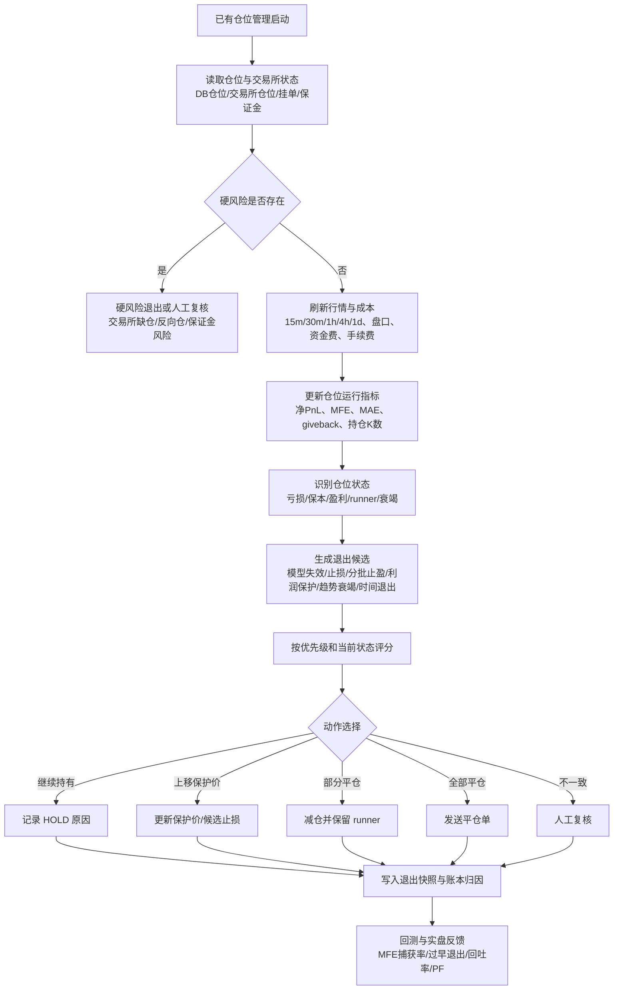

# HTX 趋势策略退出系统重构计划 v1

> **上层设计**：本计划承接 [CoinStrategy 策略闭环定义模板 v1](COINSTRATEGY_STRATEGY_CLOSED_LOOP_TEMPLATE_V1.md)、[HTX 趋势策略系统 v1](HTX_TREND_STRATEGY_SYSTEM_V1.md) 和 [HTX 趋势策略开仓与持仓管理重构计划 v1](HTX_TREND_EXECUTION_REFACTOR_PLAN_V1.md)。

> **结论先行**：HTX 趋势策略的退出系统不能再被理解成“ATR trailing 或结构止损谁替代谁”。平仓是一套独立决策系统，目标是控制亏损、识别模型失效、兑现部分利润、保护已赚利润、让强趋势继续奔跑，并把每次退出质量记录下来。第一阶段只做退出候选快照和归因，不改变真实平仓行为；通过回测和实盘样本验证后，再灰度接入真实减仓/平仓。

---

## 0. 文档定位

| 项 | 内容 |
|---|---|
| 文档类型 | 趋势退出系统重构计划 / 分批实施清单 |
| 目标读者 | 策略研发、后端、前端、回测、实盘观察人员 |
| 适用模块 | `coin-strategy-htx` 趋势合约持仓管理、趋势看板、回测工具、统一账本 |
| 非目标 | 不在本文恢复资金费套利；不直接扩大仓位；不直接启用新的真实平仓规则 |
| 当前问题 | 退出逻辑仍偏规则堆叠，过度依赖 ATR trailing、结构止损和短线 no-extension；缺少分批止盈、利润保护、MFE/MAE、模型匹配退出和退出质量回测。 |

---

## 1. 为什么要单独做退出系统

用户指出“赚钱容易，落袋很难”，这是趋势策略的核心矛盾：

```text
开仓解决的是：现在是否值得承担风险。
退出解决的是：承担风险之后，什么时候认错、什么时候落袋、什么时候继续拿。
```

退出系统必须同时处理三件互相冲突的事：

| 目标 | 如果做过头 | 如果做不足 |
|---|---|---|
| 快速认错 | 被正常回撤洗出去 | 亏损扩大、假突破拖成大亏 |
| 兑现利润 | 小赚就跑，错过大行情 | 盈利回吐，手续费后变亏 |
| 让趋势奔跑 | 回撤容忍过大，利润吐回去 | 没有 runner，盈亏比拉不开 |

因此，退出系统不能只有一个价格线。它应该是：

```text
仓位状态识别 → 退出候选生成 → 候选优先级排序 → 动作选择 → 账本归因 → 回测反馈
```

---

## 2. 退出系统总流程



图源文件：[htx-trend-exit-system-refactor-v1.drawio](diagrams/htx-trend-exit-system-refactor-v1.drawio)。

---

## 3. 退出系统的核心对象

### 3.1 仓位状态 `exit_state`

| 状态 | 定义 | 系统倾向 |
|---|---|---|
| `LOSS_ZONE` | 扣费后净亏，且尚未触发硬风险 | 优先判断模型是否失效；没失效则给结构空间，失效则止损。 |
| `FEE_BREAKEVEN_ZONE` | 接近扣费后保本 | 不因轻微信号转弱立刻全平；开始观察保护利润候选。 |
| `PROFIT_ZONE` | 已有明确扣费后利润 | 允许分批止盈或上移保护价。 |
| `RUNNER_ZONE` | 浮盈扩大且趋势仍强 | 保留 runner，用 trailing 和结构保护。 |
| `EXHAUSTION_ZONE` | 浮盈回吐、动量衰竭或多周期转弱 | 减仓或全平，优先保护已赚利润。 |
| `MANUAL_REVIEW` | DB/交易所/挂单状态不一致 | 不自动处理，记录并报警。 |

### 3.2 退出候选 `exit_candidate`

每轮持仓管理不应该只算一个“最终止损价”，而应同时生成多个退出候选。

| 字段 | 说明 |
|---|---|
| `candidate_type` | `HARD_RISK` / `MODEL_INVALIDATION` / `INITIAL_STOP` / `PARTIAL_TAKE_PROFIT` / `PROFIT_LOCK` / `ATR_TRAILING` / `STRUCTURE_STOP` / `TREND_EXHAUSTION` / `TIME_STOP` / `COST_DETERIORATION` |
| `action` | `HOLD` / `MOVE_STOP` / `PARTIAL_CLOSE` / `FULL_CLOSE` / `MANUAL_REVIEW` |
| `priority` | 优先级，硬风险最高，普通利润保护低于模型失效。 |
| `triggered` | 当前是否触发。 |
| `trigger_price` | 触发价格或参考价格。 |
| `score` | 候选强度，用于同类比较。 |
| `reason_zh` | 中文原因，页面和账本可直接展示。 |
| `evidence_json` | 触发证据：因子值、阈值、周期、K线时间。 |

### 3.3 动作 `exit_action`

| 动作 | 含义 | 第一版行为 |
|---|---|---|
| `HOLD` | 继续持仓 | 记录原因，不下单。 |
| `MOVE_STOP` | 上移保护价 | 第一阶段只记录候选，不改变真实止损。 |
| `PARTIAL_CLOSE` | 部分平仓 | 第一阶段只观察和回测，灰度后启用。 |
| `FULL_CLOSE` | 全部平仓 | 兼容现有真实平仓路径，新增分类和证据。 |
| `MANUAL_REVIEW` | 人工复核 | 不自动平人工/异常仓位。 |

---

## 4. 退出机制分类

### 4.1 硬风险退出

硬风险是最高优先级，不追求收益优化，只保护账户。

| 场景 | 动作 |
|---|---|
| DB 有仓位但交易所无仓位 | 标记 `MANUAL_REVIEW`，停止自动修改。 |
| 交易所出现反向外部仓位 | 标记 `MANUAL_REVIEW`，不自动接管。 |
| 保证金风险或爆仓距离异常 | 进入 `HARD_RISK`，可全平或报警。 |
| 行情/盘口/账户数据异常 | 暂停新的退出动作，只记录风险。 |

### 4.2 模型失效退出

模型失效回答“开仓理由还在不在”。它比普通 trailing 更重要。

| 开仓模型 | 失效证据 | 默认动作 |
|---|---|---|
| `BOX_BREAKOUT` | 收盘跌回箱体；突破 K 关键位被反向打穿；放量反向 | 触发模型失效，全平或强减仓。 |
| `FIB_PULLBACK_CONTINUATION` | 跌破 swing；跌破 0.786；跌回箱体；回踩后重新转强失败 | 触发模型失效，全平或强减仓。 |
| `MULTI_TIMEFRAME_MOMENTUM` | 15m/30m 同时反向，且 1h 不再支持 | 快速退出。 |
| `DONCHIAN_BREAKOUT` | 反向通道突破或趋势强度失败 | 退出或切为 trailing 管理。 |
| `BROAD_MARKET_TREND` | BTC/ETH 锚点和市场广度同时反向 | 减仓或退出，不被单根 15m 噪音触发。 |

### 4.3 初始止损

初始止损控制单笔最大亏损。它应该来自开仓时的 `invalidation_price`，不是开仓后随意改。

| 原则 | 说明 |
|---|---|
| 必须开仓前确定 | 没有 invalidation price 的候选不能真实开仓。 |
| 不得随意放宽 | 开仓后不能因为亏了就扩大初始风险边界。 |
| 可随利润上移 | 盈利后保护价可以上移，但不能让风险比初始更大。 |
| 与模型绑定 | Fibonacci、箱体、Donchian 的初始风险来源不同。 |

### 4.4 分批止盈

分批止盈解决“盈利单全拿到回撤，最后利润吐掉”的问题。

| 触发 | 动作 | 目的 |
|---|---|---|
| 到达 `1R` | 平 25%–40% | 先回收部分风险。 |
| 到达结构目标区 | 平 25%–50% | 在前高/箱体高度/扩展位先落袋。 |
| 出现放量冲高但收盘质量差 | 平一部分 | 防止冲高回落。 |
| 到达 `2R+` 且趋势仍强 | 保留 runner | 让大趋势贡献盈亏比。 |

第一版不直接启用真实分批止盈，先在退出候选快照中记录“如果分批会怎样”，并在回测中比较。

### 4.5 利润保护

利润保护不是简单保本。它要根据浮盈阶段逐步升级。

| 阶段 | 条件 | 保护动作 |
|---|---|---|
| 扣费保本区 | 净浮盈刚覆盖手续费/滑点 | 只记录保护候选；手续费保护止损暂不重写。 |
| 小盈利区 | 达到 0.5R–1R | 允许保护价接近保本。 |
| 标准盈利区 | 达到 1R–2R | 允许分批止盈 + 上移 trailing。 |
| runner 区 | 超过 2R 且趋势强 | 保留剩余仓位，用 ATR/结构 trailing。 |
| 回吐区 | 从 MFE 回吐超过阈值 | 减仓或全平，视趋势强度决定。 |

手续费保护止损目前保留为 TODO/实验项。原因是只用手续费保本去夹止损，可能让趋势单在正常波动里被机械扫掉；它必须和 MFE、结构、趋势强度一起判断。

### 4.6 ATR trailing

ATR trailing 是波动率移动止损，适合保护 runner，但它不是退出系统本身。

| 使用边界 | 说明 |
|---|---|
| 适合 runner | 趋势已走出利润后，用来跟随波动。 |
| 不适合所有模型统一参数 | 15m 动量、4h swing、Donchian 不应共用同一倍数。 |
| 不应该替代模型失效 | 开仓假设失效时，不等 ATR 慢慢触发。 |
| 不应该独自决定止盈 | 到达结构目标区时，应评估分批止盈。 |

### 4.7 结构止损

结构止损用于识别关键价位被破坏，不是为了“更宽松”或“更紧”而存在。

| 规则 | 说明 |
|---|---|
| 必须来自有效结构 | 箱体边界、swing、回踩低点/高点、Donchian 通道。 |
| 必须和模型相关 | Fibonacci 用 swing，箱体突破用箱体，动量模型可用短周期结构。 |
| 不自动放宽风险 | 不能突破初始风险边界。 |
| 先观察再启用 | 当前 `HTX_TREND_STRUCTURE_STOP_ENABLED=false` 保持关闭。 |

### 4.8 趋势衰竭退出

趋势衰竭回答“这段趋势还值不值得拿”。

| 因子 | 多头衰竭表现 | 空头衰竭表现 |
|---|---|---|
| ADX | ADX 下滑且价格无法创新高 | ADX 下滑且价格无法创新低 |
| ROC | 动量转弱 | 下跌动量转弱 |
| EMA 斜率 | 快慢线收敛或斜率变平 | 快慢线收敛或斜率变平 |
| 成交量 | 放量冲高回落 | 放量下杀回收 |
| 市场广度 | 多头宽度下降 | 空头宽度下降 |
| BTC/ETH 锚点 | 主流转弱或反向 | 主流转强或反向 |

趋势衰竭不能只看 15m。短周期只能提示风险，1h/4h 应决定趋势是否真的结束。

### 4.9 时间退出

时间退出只适合部分模型，不能一刀切。

| 模型 | 时间退出策略 |
|---|---|
| `MULTI_TIMEFRAME_MOMENTUM` | 可以严格；开仓后 N 根 K 没推进，且短周期转弱，则退出。 |
| `BOX_BREAKOUT` | 不因没立刻浮盈退出；要看是否跌回箱体或突破失败。 |
| `FIB_PULLBACK_CONTINUATION` | 不因短线 no-extension 退出；要看 swing/0.786/箱体是否失效。 |
| `DONCHIAN_BREAKOUT` | 主要看通道和 ATR trailing，不用短 no-extension。 |
| `BROAD_MARKET_TREND` | 时间窗口更长，15m 噪音不能触发退出。 |

### 4.10 成本恶化退出

成本可以参与退出，但不能成为万能退出理由。

| 成本 | 使用方式 |
|---|---|
| 手续费 | 用于计算净收益和分批止盈效果，不单独作为强制平仓。 |
| 点差/滑点 | 如果退出时成本异常，可能延迟非紧急减仓。 |
| 资金费 | 持仓方向持续付费且趋势弱时，作为衰竭退出加分项。 |
| 账户费率差异 | 多账号独立计算，不用主账户费率套所有账户。 |

---

## 5. 模型专属退出 Playbook

### 5.1 `BOX_BREAKOUT`

| 阶段 | 退出规则 |
|---|---|
| 刚开仓 | 看突破 K 是否守住，不因 1–2 根 K 没浮盈立即退出。 |
| 模型失效 | 收盘跌回箱体，或突破 K 关键位被反向打穿。 |
| 止盈 | 到箱体高度目标、前高/前低或 1R 可分批止盈。 |
| runner | 剩余仓位用结构低点/高点 + ATR trailing。 |

### 5.2 `FIB_PULLBACK_CONTINUATION`

| 阶段 | 退出规则 |
|---|---|
| 刚开仓 | 允许合理回踩，不用短 no-extension 一刀切。 |
| 模型失效 | 跌破 swing、0.786、箱体边界，或回踩后重新转强失败。 |
| 止盈 | 前高/前低、1.272/1.618 扩展位、1R/2R 分批。 |
| runner | 如果 1h/4h 仍顺势，保留小 runner。 |

### 5.3 `MULTI_TIMEFRAME_MOMENTUM`

| 阶段 | 退出规则 |
|---|---|
| 刚开仓 | 必须较快推进，否则模型优势下降。 |
| 模型失效 | 15m/30m 同时转弱，1h 不支持。 |
| 止盈 | 可更快分批，不把短动量单拿成长线。 |
| runner | 只有 1h/4h 接力时才保留。 |

### 5.4 `DONCHIAN_BREAKOUT`

| 阶段 | 退出规则 |
|---|---|
| 刚开仓 | 给趋势启动空间，避免过窄止损。 |
| 模型失效 | 反向通道突破或 ADX/ATR 失效。 |
| 止盈 | 不急于固定小止盈，优先 runner。 |
| runner | ATR trailing + 通道反向。 |

### 5.5 `BROAD_MARKET_TREND`

| 阶段 | 退出规则 |
|---|---|
| 刚开仓 | 依赖 BTC/ETH 和市场广度，不被单币短线噪音过早洗出。 |
| 模型失效 | BTC/ETH 锚点反向，市场广度瓦解，单币结构同步破坏。 |
| 止盈 | 市场普涨/普跌后分批落袋，保留小 runner。 |
| runner | 以 1h/4h 结构和广度维持为主。 |

---

## 6. 数据与接口规划

第一阶段优先复用现有表和 message/reason 字段，确认有效后再新增结构化表。

### 6.1 建议新增字段

| 字段 | 说明 | 第一阶段落点 |
|---|---|---|
| `exit_state` | 仓位当前退出状态 | 持仓管理消息 / 后续 position 字段 |
| `exit_profile` | 退出画像，如 `INTRADAY_FAST` / `SWING_RUNNER` | 持仓模型字段 / 因子快照 |
| `exit_action` | 本轮动作 | 持仓管理消息 |
| `exit_engine_reason` | 退出原因分类 | 订单 reason / position reason |
| `exit_candidate_json` | 本轮所有退出候选 | JSON 字段或新表 |
| `mfe_usdt` | 最大有利浮盈 | position / ledger |
| `mae_usdt` | 最大不利浮亏 | position / ledger |
| `max_favorable_price` | 最有利价格 | position / ledger |
| `giveback_rate` | 从最大浮盈回吐比例 | position / ledger |
| `partial_close_count` | 已分批平仓次数 | position / ledger |
| `remaining_runner_ratio` | 剩余 runner 比例 | position / ledger |
| `time_in_position_bars` | 持仓 K 数 | position / snapshot |
| `exit_model_version` | 退出模型版本 | snapshot / ledger |

### 6.2 退出快照建议表

后续可新增 `htx_trend_exit_snapshot`，先不急着建表。

| 字段 | 说明 |
|---|---|
| `id` | 主键 |
| `position_id` | 仓位 ID |
| `account_id` / `account_label` | 账户 |
| `contract_code` | 合约 |
| `side` | 方向 |
| `entry_model` | 开仓模型 |
| `exit_state` | 当前状态 |
| `net_pnl_after_fee` | 当前扣费后净浮盈 |
| `mfe_usdt` / `mae_usdt` | 最大有利/不利浮动 |
| `giveback_rate` | 利润回吐比例 |
| `exit_candidate_json` | 候选列表 |
| `selected_action` | 本轮动作 |
| `selected_reason` | 中文原因 |
| `created_at` | 快照时间 |

---

## 7. 分批实施计划

### Batch E1：退出候选快照，不改变真实行为

| 任务 | 验收 |
|---|---|
| 计算 MFE/MAE/max favorable price | 每个活动仓位每轮都能看到最大浮盈/最大浮亏。 |
| 计算 giveback_rate | 能判断盈利回吐比例。 |
| 生成退出候选列表 | 至少包含模型失效、初始止损、ATR trailing、结构止损候选、趋势衰竭、时间退出候选。 |
| 记录未执行原因 | 能解释为什么 HOLD、为什么没减仓、为什么没全平。 |
| 页面展示最小诊断 | 当前仓位能看到退出状态和候选摘要。 |
| 不改变真实平仓 | 与当前线上平仓行为一致。 |

### Batch E2：模型专属 no-extension / time-stop 重写

| 任务 | 验收 |
|---|---|
| 拆模型专属时间退出 | `MOMENTUM` 可严格，`BOX/FIB/DONCHIAN` 不共用短 no-extension。 |
| 回测 9/18–9/21 | 对比过早退出率和净 PnL。 |
| 保持灰度开关 | 未验证前不影响真实平仓。 |

### Batch E3：分批止盈与 runner 管理

| 任务 | 验收 |
|---|---|
| 定义 1R/2R/结构目标区 | 每笔仓位有可解释目标区。 |
| 模拟分批止盈 | 回测比较全平 vs 分批 vs runner。 |
| 记录 partial close 账本 | 分批成交能拆出净收益和剩余仓位。 |
| 小仓灰度 | 先单账号小仓启用。 |

实施记录：2026-09-22 已完成 E3 第一刀，只把 `PARTIAL_TAKE_PROFIT` 与 `PROFIT_PROTECTION` 写入退出快照候选和页面诊断，不发真实减仓单，不改变真实平仓条件。

### Batch E4：多周期退出确认

| 任务 | 验收 |
|---|---|
| 15m/30m 防守 | 捕捉短线风险，不单独杀长线单。 |
| 1h/4h 趋势确认 | 决定是否继续持有 runner。 |
| BTC/ETH 锚点退出 | 普涨/普跌模型用市场广度辅助退出。 |
| 回测按周期画像分组 | 输出 `INTRADAY_15M` / `SWING_4H` 等表现。 |

实施记录：2026-09-22 已完成 E4 第一刀，只把 `TIMEFRAME_CONFIRMATION` 写入退出快照候选，不进入真实 `exitReason`，不调用平仓单。当前先看活动仓位自己的 `30m/60m/4h` 方向画像：全部顺仓位方向记为 `hold`，两档及以上反向记为 `warn_major`，一档反向记为 `warn_short`，其余记为 `mixed`。这一步用于解释“runner 继续拿”或“高周期开始反向预警”，不改变真实平仓、开仓或 sizing。

### Batch E5：退出评分与自动化接入

| 任务 | 验收 |
|---|---|
| 候选评分 | 同时触发多个退出候选时能稳定选动作。 |
| 真实灰度 | 先启用低风险动作，如记录、上移保护价，再启用分批。 |
| 归因闭环 | 页面能区分方向错、入场错、退出早、退出晚、成本吃掉。 |

---

## 8. 回测指标

退出系统上线前必须看退出质量，而不只看总 PnL。

| 指标 | 说明 |
|---|---|
| `net_pnl_after_fee` | 扣费后净收益。 |
| `profit_factor_after_fee` | 扣费后 PF。 |
| `avg_win_loss_ratio` | 平均盈利 / 平均亏损。 |
| `mfe_capture_ratio` | 实际落袋利润 / 最大浮盈。 |
| `mae_before_profit` | 盈利前最大浮亏，判断止损空间是否合理。 |
| `giveback_rate` | 利润回吐比例。 |
| `premature_exit_rate` | 平仓后 N 根 K 内继续朝原方向运行的比例。 |
| `late_exit_rate` | MFE 后回吐过多才平仓的比例。 |
| `partial_take_profit_effect` | 分批止盈相对全平/不平的收益差。 |
| `runner_contribution` | runner 对总收益的贡献。 |
| `exit_reason_pnl` | 各退出原因的净收益、胜率、PF。 |
| `model_exit_pnl` | 各模型退出表现。 |
| `timeframe_exit_pnl` | 各周期画像退出表现。 |

固定回测样本：

| 日期 | 用途 |
|---|---|
| 2026-09-18 | 好行情，验证是否能让盈利单奔跑。 |
| 2026-09-19 | 差行情/回撤，验证是否能少亏。 |
| 2026-09-20 | 混合行情，验证分型和退出稳定性。 |
| 2026-09-21 | 真实亏损样本，验证亏损原因和退出质量。 |

---

## 9. 页面观察口径

页面不需要公开复杂策略细节，但内部驾驶舱要能回答退出质量。

| 页面问题 | 展示字段 |
|---|---|
| 当前仓位为什么还拿着 | `exit_state`、最高优先级 HOLD 原因。 |
| 为什么准备平仓 | 触发的 `exit_candidate` 和证据。 |
| 是否已经赚够但没落袋 | MFE、当前浮盈、giveback。 |
| 是否平早了 | 平仓后走势回放、premature exit。 |
| 是否平晚了 | MFE 捕获率、late exit。 |
| 哪种退出最伤 | exit reason PnL / PF。 |

公开页面避免暴露详细参数；内部诊断可以展示分类和证据，不展示完整策略权重。

---

## 10. 风险与上线边界

| 风险 | 控制方式 |
|---|---|
| 分批止盈降低大行情收益 | 回测 runner contribution，保留剩余仓位。 |
| trailing 太紧导致过早退出 | 用 premature_exit_rate 和 MFE capture 评估。 |
| trailing 太松导致利润回吐 | 用 giveback_rate 和 late_exit_rate 评估。 |
| 模型失效误判 | 每个模型专属规则，先影子观察。 |
| 费用保护过度干预 | 手续费保护止损暂放 TODO，不作为第一批真实行为。 |
| 页面暴露策略细节 | 对外页面只展示分类和健康状态，内部诊断才看细节。 |

上线边界：

```text
E1 只记录，不改变真实行为。
E2 先回测，再灰度。
E3 分批止盈必须小仓灰度。
E4 多周期退出必须和 entry timeframe_profile 绑定。
E5 才允许组合评分接管真实退出动作。
```

---

## 11. 当前执行建议

未完成的 E2–E5 任务、手续费保护止损和回测依赖已统一归档到 [CoinStrategy 策略未完成任务清单 v1](COINSTRATEGY_STRATEGY_BACKLOG_V1.md)。下一步围绕 E4 样本继续观察，不急着接入真实平仓：

1. 不启用新的真实多周期平仓规则。
2. 收集真实 ACTIVE 仓位的 `TIMEFRAME_CONFIRMATION` 样本。
3. 对比 `hold` / `warn_short` / `warn_major` 后续 3–12 根 K 线走势。
4. 用回测验证多周期反向预警是否能提高 MFE 捕获率、profit factor 和平均盈亏比。
5. 只有当回测和实盘样本都证明有效后，再考虑把 `warn_major` 接入减仓或退出评分。

这一步完成后，我们再决定是否进入 E2：模型专属 no-extension / time-stop 重写。
