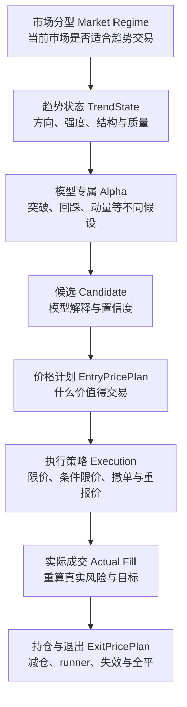
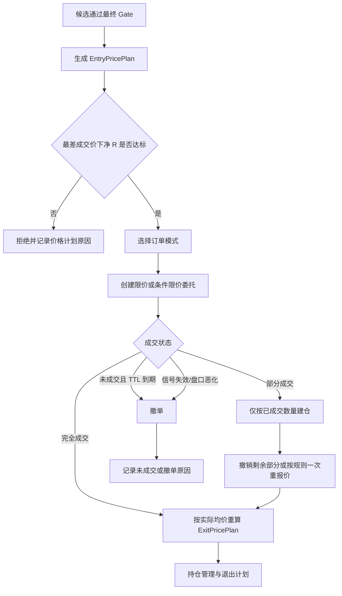

# HTX 趋势策略价格决策与多周期执行设计讨论稿 v1

> **讨论目的**：确认趋势策略是否应从“技术指标评分后立即按市价成交”升级为“先生成可交易的价格计划，再选择合适的委托方式”。本文是完整趋势系统中的**执行与价格计划规范**，不替代“市场分型、TrendState 和 Alpha 模型”的上游策略设计；本文只提出设计基线，不修改实盘参数、下单方式或仓位大小。

> **本次希望讨论并拍板的决策**：
>
> 1. 是否采用“评分负责发现机会，价格计划负责决定能否交易”的双层架构；
> 2. 是否先落地 `INTRADAY_15M` 与 `SWING_4H` 两种周期画像；
> 3. 是否采用“回踩限价、突破条件限价、严格限制追价”的混合执行方式，而非把所有订单都改成限价或市价。

---

## 1. 结论先行

当前策略已经能判断方向、结构、趋势强度和成本，但尚未把这些证据转换为一笔交易真正需要的价格条件：**理想开仓价、最差成交价、止损价、失效价、目标价、滑点上限、挂单有效期，以及在最差成交情形下仍成立的扣费后收益风险比。**

因此，下一阶段不应直接把市价单替换成限价单；应先新增统一的“价格计划”。技术评分只说明“这个方向值得研究”，价格计划才说明“在什么价格、承担多大风险、以什么方式成交才值得交易”。

价格计划还必须绑定周期画像。15 分钟、30 分钟、1 小时、4 小时和日线不是五份可以随意相加的 EMA；它们分别承担环境、方向、结构、触发与执行管理职责。4 小时趋势单不能被普通 15 分钟回撤直接全平；15 分钟单也不能借 4 小时趋势名义无限容忍亏损。

但价格计划的前提是：系统先能稳定回答“这个 Candidate 是否真是高质量趋势”。当前文档只定义该 Candidate 已经产生以后如何执行，不能用执行层的精细规则掩盖上游信号质量不足。

### 1.1 本文在完整趋势系统中的位置



本文覆盖图中的 **E 至 H**。A 至 D 应由一份与本文平级的“趋势信号与 Alpha 模型设计”定义；在其未完成前，本文只约束两层之间必须传递什么证据，不能自行定义一个新的大杂烩总分。

### 1.2 上游输入契约：`TrendState` 与模型专属 Alpha

`TrendState` 不是把所有技术指标简单累加后的单一分数，而是候选生成前的结构化市场描述。第一版建议至少输出下列维度；字段名可在实现时调整，职责不应混淆。

| 维度 | 中文含义 | 主要证据 | 作用 |
|---|---|---|---|
| `direction` | 当前方向 | 多周期趋势与结构 | 多、空或不交易。 |
| `regime` | 市场分型 | 市场宽度、波动、BTC/ETH 环境 | 判断是否允许趋势策略。 |
| `trend_strength` | 趋势强度 | ADX、EMA 斜率、持续性 | 区分趋势与无效波动。 |
| `structure_quality` | 结构质量 | 箱体、波段高低点、通道、支撑阻力 | 判断突破或回踩是否有结构基础。 |
| `momentum_quality` | 动量质量 | ROC、量价延续、回撤恢复 | 判断趋势是否仍在扩张。 |
| `participation_quality` | 参与质量 | 成交量、成交额、市场广度 | 避免缺乏参与的假突破。 |
| `derivatives_quality` | 合约质量 | 资金费、未平仓量、拥挤度，后续可扩展 | 识别过度拥挤和持仓成本。 |
| `market_alignment` | 大盘一致性 | BTC/ETH 多周期锚点、市场宽度 | 判断单币是否逆市场。 |
| `crowding_risk` | 拥挤风险 | 极端资金费、OI、清算和情绪数据，现阶段可为空 | 作为风险扣分，不与趋势强度混为一谈。 |
| `execution_quality` | 可执行质量 | 点差、深度、手续费、预估滑点 | 进入价格计划前的基础约束。 |

模型必须消费不同的证据组，而不是让 Fibonacci、箱体和 Donchian 因为描述同一结构就分别加分。例如：

| 模型 | 主要证据 | 次要证据 | 主要风险 |
|---|---|---|---|
| `BOX_BREAKOUT` | 结构质量、参与质量、动量质量、市场一致性 | 趋势强度 | 假突破、高周期阻力、执行成本。 |
| `DONCHIAN_BREAKOUT` | 通道突破、趋势强度、动量质量、市场一致性 | 参与质量 | 远离均线追价、通道边缘流动性不足。 |
| `FIB_PULLBACK_CONTINUATION` | 已存在趋势、回踩质量、EMA 与结构交集 | 参与质量 | 趋势衰竭、回踩结构破坏。 |
| `MULTI_TIMEFRAME_MOMENTUM` | 主周期方向、动量质量、参与质量 | 结构质量 | 动量耗尽、高周期阻力。 |

候选必须保留“模型假设”和“证据组贡献”，而不是只保留一个总分。若多个模型依赖同一个波段或同一箱体，系统只能把它记为一次结构证据，或将其标为相互确认；不得把它们当成三份独立 Alpha 后机械叠加仓位。

### 1.3 Meta Model 的预留边界

未来可以用 LightGBM/XGBoost 评估“规则候选发展成可交易趋势的概率”，但它不属于当前真实开仓能力，也不预测下一根 K 的涨跌。

训练样本应来自已完成的候选、价格计划、实际成交和退出账本，标签至少应围绕交易结果定义，例如“初始止损前是否达到 2R”“未来 N 根 K 的 MFE 是否达到 2R 且 MAE 未超过 1R”“扣费后实现净 R”。在样本量、时间切分、walk-forward 验证和账户费率口径不足前，Meta Model 只能保留字段与标签设计，不能接管真实开仓决策。

---

## 2. 当前事实与缺口

### 2.1 已具备的能力

现有趋势系统已经具备：

- 市场分型：普涨、普跌、分化、震荡、高波动风险、低波动无效；
- EMA、ATR、ADX、ROC、量能、箱体、Donchian、Fibonacci、BTC/ETH 锚点、市场宽度、盘口、深度、手续费与资金费等证据；
- 箱体突破、Donchian 突破、Fibonacci 回踩延续和多周期动量模型；
- 候选、因子快照、最终 Gate、订单、仓位与账本的 `run_id` 关联；
- 初始止损、模型失效价、ATR trailing、目标价、退出快照，以及默认关闭的分批退出状态机。

现有系统尚未正式落地上述 `TrendState` 对象、证据去重规则和模型专属 Alpha 契约。当前多个因子、候选与组合模型虽已存在，但不能把“已能记录很多指标”误认为“已完成了高质量趋势候选的统一定义”。

### 2.2 当前执行方式

真实开仓仍以盘口即时价格作为开仓价：多头取卖一，空头取买一，然后发送主动订单。风险预算、流动性和成本 Gate 会围绕这个即时价格计算。

```text
候选评分 / Gate 通过
    → 读取盘口
    → 多头使用 ask、空头使用 bid
    → 算仓位、成本、保证金
    → 主动下单
```

当前初始止损与固定目标主要按信号 K 线的收盘价和 ATR 计算。实际成交价若与信号收盘价存在偏离，计划风险、实际风险和目标收益便不再完全一致。

### 2.3 必须补齐的缺口

| 缺口 | 后果 |
|---|---|
| 没有统一 `EntryPricePlan` | 评分通过后只知道“现在买/卖”，不知道什么价位值得成交。 |
| 没有最差可成交价 | 价格追高后，系统可能仍在原有假设下开仓，实际盈亏比已变差。 |
| 止损与目标不以实际成交均价重算 | 真实单笔风险和预期净收益会失真。 |
| 没有 TTL、撤单和重报价规则 | 限价探路无法安全上线，过期信号也可能继续挂单。 |
| 没有 `timeframe_profile` 驱动退出 | 低周期噪音可能过早平掉高周期趋势，或低周期单被高周期叙事拖成大亏。 |
| Fibonacci、箱体和 Donchian 的结构证据可能重复计分 | 同一价格结构被多次加分，会夸大方向置信度。 |

---

## 3. 设计原则

### 3.1 评分与价格计划分工

```text
Market Regime → TrendState → 模型专属 Alpha → Candidate
                                                  ↓
                                           价格计划生成
                                                  ↓
                                      扣费后收益风险比是否成立
                                                  ↓
                                        委托执行与成交管理
```

| 层 | 回答的问题 | 不应承担的问题 |
|---|---|---|
| 信号层 | 用互不重复的证据解释方向、趋势质量和模型假设 | 不能直接决定用什么价格成交，也不能用总分掩盖结构冲突。 |
| 价格计划 | 什么价格可以成交；亏多少算模型失败；赚到哪里值得兑现 | 不能用价格微调伪造原本不存在的趋势。 |
| 执行策略 | 限价、条件限价或主动成交怎样减少成本和追价 | 不能绕过价格计划的最差成交价。 |
| 仓位管理 | 哪些利润应保护；高周期假设是否仍成立 | 不能用短周期噪音反复推翻主周期假设。 |

### 3.2 价格是区间，不是假精确

策略不应声称“必然在某一个精确价格开仓”。合理做法是定义价格区间：

- **理想成交价**：结构、均线、回踩或盘口最有利的价格；
- **可成交区间**：理想价至最差可成交价；
- **放弃区间**：超过最差价，说明追价后目标空间不足或止损距离过大；
- **失效边界**：价格达到该边界，原始开仓假设被证伪。

所有收益风险比、仓位和成本预估都按**最差可成交价**计算，避免只在理想价格下看起来划算。

### 3.3 先定义风险，再决定仓位

多头为例：

```text
每单位价格风险 = 最差可成交价 - 初始止损价
最大可承担亏损 = 账户级风险预算 × 策略级风险系数 × 本笔质量系数
可开数量 = 最大可承担亏损 / 每单位价格风险

目标净收益 = (目标价 - 最差可成交价) × 数量
             - 开仓手续费 - 平仓手续费 - 预估点差 - 预估滑点 - 资金费成本
净 R = 目标净收益 / 最大可承担亏损
```

空头按相反方向计算。若最差成交情形下的净 R 不达标，即使候选评分很高也不应开仓。

具体最低净 R、最大滑点、挂单时长和每个模型的风险预算必须用完整的同源回放与新口径实盘样本确定，本文不预设数值。

---

## 4. 统一价格计划

### 4.1 开仓价格计划 `EntryPricePlan`

| 字段 | 中文含义 | 生成依据 | 用途 |
|---|---|---|---|
| `timeframe_profile` | 周期画像 | 本笔交易持有目标 | 决定数据、止损和退出权限。 |
| `entry_trigger_price` | 触发价 | 突破边界、重新站回回踩区、收盘确认 | 尚未触发不得挂单或成交。 |
| `entry_ideal_price` | 理想开仓价 | 回踩区、EMA、箱体边界、波段结构交集 | 首选限价位置。 |
| `entry_max_acceptable_price` | 最差可成交价 | 目标空间、止损距离、盘口和滑点预算 | 超过即撤单或放弃。 |
| `invalidation_price` | 模型失效价 | 模型专属结构边界 | 模型被证伪时的强退出依据。 |
| `initial_stop_price` | 初始止损价 | 失效边界与最大风险约束 | 开仓后不得向亏损方向放宽。 |
| `target_1r_price` | 第一风险收益目标 | 实际风险距离 | 分批止盈/保护利润候选。 |
| `target_2r_price` | 第二风险收益目标 | 实际风险距离 | runner 前的第二兑现层。 |
| `structure_target_price` | 结构目标价 | 前高前低、通道、箱体投射、Fib extension | 比固定 ATR 更贴近行情空间。 |
| `max_slippage_bps` | 最大滑点 | 费率、点差、深度与模型预期空间 | 下单前和成交后核验。 |
| `order_mode` | 委托模式 | 模型类型和紧迫度 | `POST_ONLY_LIMIT` / `TRIGGER_LIMIT` / `IOC_LIMIT`。 |
| `order_ttl_seconds` | 挂单存活时间 | 信号周期和新鲜度 | 超时必须撤单并重新评估。 |
| `reprice_policy` | 重报价规则 | 信号是否仍有效 | 默认至多一次且不可放宽最差价。 |
| `min_net_r` | 最低扣费后净 R | 账户费率与策略门槛 | 最终开仓 Gate。 |

### 4.2 成交后的重算

开仓计划生成后，成交并不代表计划结束。成交回报必须以实际均价重算：

1. 实际开仓滑点：实际均价相对理想价和最差价的偏离；
2. 初始风险金额：实际均价到初始止损的真实距离；
3. 1R、2R 与净保本价；
4. 分批目标的剩余可得净收益；
5. 若部分成交，剩余未成交部分的撤单或重新报价决定。

若实际成交均价已突破最差可成交价，必须记录为执行异常；后续策略质量评估不能把它当作“模型自然亏损”。

### 4.3 平仓价格计划 `ExitPricePlan`

平仓不是只有一个 trailing stop。每笔仓位应同时有以下价格层：

| 层 | 价格或条件 | 默认动作 |
|---|---|---|
| 硬风险层 | 初始止损、模型失效价、交易所或保证金异常 | 全平或人工复核。 |
| 兑现层 | 1R、2R、结构目标、extension 目标 | 依画像减仓，保留 runner。 |
| 利润保护层 | 浮盈回吐、低周期动量衰竭、扣费后利润状态 | 上移保护价或部分减仓。 |
| 趋势延续层 | 高周期结构和多周期方向仍支持 | 继续持有 runner。 |
| 趋势失效层 | 主周期结构破坏、主要周期反向确认 | 全平。 |

止损价、失效价和利润保护价必须被清楚区分：止损是控制最大亏损；失效价是开仓理由被否定；利润保护是已有浮盈时减少回吐。三者不应互相替代。

---

## 5. 不同模型如何形成价格

### 5.1 箱体突破 `BOX_BREAKOUT`

| 项 | 多头示例 | 空头反向处理 |
|---|---|---|
| 触发 | K 线有效收在箱体上沿之外，量能确认 | 有效跌破箱体下沿。 |
| 理想价 | 回踩上沿后站稳的区域 | 反抽下沿受阻区域。 |
| 最差价 | 不超过箱体上沿加允许追价带 | 不低于箱体下沿减允许追价带。 |
| 失效 | 收盘重新跌回箱体，或跌破突破 K 关键低点 | 收盘重新回到箱体，或突破 K 高点被破。 |
| 目标 | 箱体高度投射、1h/4h 前高 | 箱体高度投射、1h/4h 前低。 |

强突破没有回踩时，可以使用带价格上限的条件限价；超过最差价后不再追单。被动限价错过行情是可接受的，追价导致负收益风险比不可接受。

### 5.2 Donchian 突破 `DONCHIAN_BREAKOUT`

通道边界提供触发，但不直接等同于最佳成交价。价格计划应优先寻找：通道边界、前高前低、30m/1h EMA 和盘口可成交区是否重合。若通道突破发生在远离均线且靠近高周期阻力的位置，应降低优先级或放弃，而不是因为“突破”本身就追价。

### 5.3 Fibonacci 回踩延续 `FIB_PULLBACK_CONTINUATION`

Fibonacci 的作用是标注回撤比例、失效边界和潜在扩展目标，不是独立预测器。

```text
有效回踩区 = Fibonacci 0.382 / 0.5 / 0.618
           ∩ 30m / 1h EMA 区域
           ∩ 最近波段结构或箱体边界
           ∩ 价格重新转强与成交量确认
```

只有交集成立时才形成 `entry_ideal_price`。回踩低点、0.786 或箱体边界可构成 `invalidation_price`，但必须按持有周期选择，不能用 15 分钟的微小波动替代 4 小时交易的失效边界。

### 5.4 多周期动量 `MULTI_TIMEFRAME_MOMENTUM`

动量模型不应在连续拉升后的任何位置追入。理想价应来自短周期回踩快 EMA、前突破位或微型结构重新突破；最差价由回踩完成前的局部结构和目标空间约束。若没有回踩、价格已远离快 EMA 且到达高周期阻力，模型只能保留为观察候选。

---

## 6. 周期画像与职责

### 6.1 周期不是重复投票

每个周期都可计算 EMA、ATR、ADX、ROC 和结构，但它们不能被当成五个同权投票。应先选择一个主周期画像，再分配不同周期职责。

| 周期 | 应承担的职责 | 不应单独决定的事情 |
|---|---|---|
| `1d` | 牛熊环境、账户风险上限、是否逆大盘 | 不负责短线精确入场。 |
| `4h` | 波段方向、主要结构、持仓预期、主要失效边界 | 不负责几分钟内的成交细节。 |
| `1h` | 趋势质量、结构确认、日内目标与风险保护 | 不应因单根噪音强制平掉 4h 仓位。 |
| `30m` | 入场结构与趋势延续确认 | 不替代 1d/4h 环境判断。 |
| `15m` | 触发、限价成交优化、短线利润保护、紧急风险信号 | 普通回撤不能推翻高周期交易假设。 |

### 6.2 第一阶段应支持的两种画像

| 画像 | 适用目标 | 环境与方向 | 开仓与价格 | 初始风险 | 平仓权限 |
|---|---|---|---|---|---|
| `INTRADAY_15M` | 捕捉日内小趋势 | 1d 控制风险；4h/1h 不反向 | 30m 定结构，15m 触发和成交 | 15m/30m 结构与 ATR | 15m 可减仓；全平需硬风险、30m 失效或 1h 明显反向。 |
| `SWING_4H` | 捕捉数日波段趋势 | 1d 定环境，4h 定方向与结构 | 1h 定结构，15m/30m 只优化成交 | 4h 结构与 4h ATR | 15m 只做利润保护或紧急风险；4h 模型失效或 1d 风险反转才全平。 |

`INTRADAY_30M` 可在两种画像验证后补充。`TREND_1D` 第一版只记录观察样本，不进入真实大仓位。

### 6.3 同币种、同方向的冲突规则

同一合约、同一方向在任一时刻只允许一个主画像持仓。否则 15m 与 4h 信号可能分别建仓、分别平仓，账本、风险和策略归因都会失真。

若已有 `SWING_4H` 多单，15m 多头信号默认只能作为加仓候选或利润保护证据，不能创建独立的无关仓位；金字塔加仓仍属独立待设计事项，第一阶段不启用。

---

## 7. 混合执行方式

不应“一律市价”，也不应“一律被动限价”。执行方式应由模型和价格计划决定。

| 场景 | 推荐方式 | 原因 | 失败处理 |
|---|---|---|---|
| Fibonacci/EMA/结构回踩 | `POST_ONLY_LIMIT` 被动限价 | 目标是以更好价格探路，优先降低手续费和追价。 | TTL 到期、结构破坏或信号过期即撤单。 |
| 普通箱体/Donchian 突破 | `TRIGGER_LIMIT` 条件限价 | 确认突破后成交，但价格有上限。 | 超过最差成交价不追单。 |
| 极强、快速突破且盘口足够深 | `IOC_LIMIT` 带上限的主动限价 | 优先保证价格上限，不使用无上限市价单。 | 未成交部分取消，不无条件市价补齐。 |
| 点差过大、深度不足、数据异常 | 不下单 | 执行成本会吞掉模型边际。 | 写入拒绝原因与成本证据。 |

正式实现前必须先核实 HTX 合约 API 对 `post-only`、条件单、IOC、撤单与部分成交查询的真实支持范围；不能假设接口能力。

### 7.1 委托状态机



---

## 8. 退出与减仓的多周期规则

平仓也必须尊重主周期画像。建议把动作分为四类：

| 动作 | 触发来源 | `INTRADAY_15M` | `SWING_4H` |
|---|---|---|---|
| 硬止损 / 模型失效全平 | 初始止损、失效价、保证金或交易所异常 | 立即执行 | 立即执行 |
| 低周期利润保护 | 15m 动量衰竭、局部结构破坏、MFE 回吐 | 可以部分减仓或上移保护 | 只可减仓/收紧保护，不能因普通噪音全平 |
| 主周期趋势失效 | 30m/1h 或 4h/1d 结构与方向反转 | 30m/1h 失效可全平 | 4h 失效或 1d 风险状态明显反转可全平 |
| 结构目标兑现 | 1R、2R、前高前低、通道、extension | 分批兑现后保留少量 runner | 分批兑现，runner 用 4h 结构管理 |

ATR trailing 仍有价值，但它只是利润保护工具之一。它必须按主周期的 ATR 与状态计算：15m 仓位可用 15m/30m ATR；4h 仓位不能只用 15m ATR 追踪。当前的通用 ATR trailing、目标价与反向信号退出需要在此框架下拆分，而不是继续叠加例外规则。

---

## 9. 外部信号交付与模拟执行

### 9.1 对外提供的不是“看多/看空”，而是可核验计划

外部系统可以订阅趋势信号并执行测试单，但只允许接收经过最终 Gate 的、带价格计划的事件。外部信号不是当前页面里的候选列表，也不是“BTC 看多、评分 85”这类方向提示。

```text
Candidate 通过最终 Gate
    → 生成并冻结 EntryPricePlan
    → 发布 ExternalSignal（不调用 HTX 下单）
    → 外部模拟执行器接受、拒绝、部分成交或超时
    → 回传实际成交结果
    → 系统重算 ExitPricePlan 并持续发布减仓/平仓/撤单事件
```

首期只支持 `PAPER_EXECUTION`：策略发布信号，外部模拟执行器消费和回传结果；策略服务不得因发布信号而调用本地 HTX 交易接口。真实账户委托是后续独立灰度，不与信号发布同时上线。

### 9.2 外部信号最小合同

| 字段 | 说明 |
|---|---|
| `signal_id` | 外部事件唯一标识。 |
| `run_id` | 趋势候选、价格计划、订单和回传的全链路幂等键。 |
| `event_type` | `ENTRY_READY` / `ENTRY_CANCELLED` / `EXIT_REDUCE` / `EXIT_CLOSE` / `PLAN_EXPIRED`。 |
| `contract_code`、`side`、`timeframe_profile`、`model` | 交易对象、方向、持有周期和模型假设。 |
| `entry_trigger_price`、`entry_ideal_price`、`entry_max_acceptable_price` | 外部执行器可接受的开仓边界。 |
| `invalidation_price`、`initial_stop_price`、`target_1r_price`、`structure_target_price` | 风险、失效和兑现计划。 |
| `max_slippage_bps`、`order_mode`、`valid_until` | 执行质量与信号时效边界。 |
| `planned_risk_usdt`、`min_net_r` | 计划风险和扣费后最低收益风险比。 |
| `policy_version`、`factor_snapshot_id`、`plan_version` | 审计、回放和版本关联。 |

外部执行器只能在 `valid_until` 之前、价格不劣于 `entry_max_acceptable_price`、且未收到撤销事件时接受委托。它必须按 `run_id` 幂等处理，不能因为重复推送建立重复仓位。

### 9.3 外部执行的两种模式

| 模式 | 行为 | 首期状态 |
|---|---|---|
| `SIGNAL_ONLY` | 对外展示候选和价格计划，由人工或外部系统自行决定是否交易；系统只记录订阅。 | 可与价格计划同时提供。 |
| `PAPER_EXECUTION` | 外部模拟执行器按限价、TTL、部分成交与滑点规则回传模拟成交；策略据此发布退出信号。 | **首期目标。** |
| `DELEGATED_LIVE_EXECUTION` | 外部受控执行器真实下单、撤单并回传成交。 | 暂不实现，必须另行回测、风控和账户授权评审。 |

无论模式如何，外部执行器都不应获得策略数据库凭据或 HTX API Key。它只消费签名或受鉴权保护的信号，并向专用回传接口提交成交事实。

### 9.4 对当前系统的改动范围

这不是重写趋势因子或模型的大改动，但也不是在现有 Dashboard 上加一个导出按钮。改动集中在模型与执行之间：

| 层 | 当前状态 | 需要新增的内容 | 改动规模 |
|---|---|---|---|
| 信号候选 | 已有 `run_id`、最终 Gate、因子快照 | 补齐 `TrendState` 和模型证据去重，作为价格计划上游输入 | 中等，先只读。 |
| 价格计划 | 仅有失效价、目标区和 ATR 止损碎片 | `EntryPricePlan` / `ExitPricePlan`、最差价、TTL、滑点与净 R | 中等偏大，核心新增。 |
| 信号交付 | 当前只有 Dashboard 只读查询 | 事件表或 outbox、只读订阅接口、撤销与版本事件 | 中等。 |
| 模拟执行 | 当前没有 | 限价、TTL、部分成交、滑点与回传状态机 | 中等。 |
| 本地 HTX 实盘 | 已存在主动下单路径 | 首期不动、不切换、不扩大风险 | 无行为改动。 |

因此，第一阶段不会推翻 EMA、Fibonacci、箱体或现有 HTX 下单服务；它会把“候选 → 价格计划 → 模拟外部成交 → 退出信号”的新链路并行建立。通过回放后，才决定是否替代任何真实执行路径。

---

## 10. 必须记录的数据与评估指标

### 10.1 每笔计划与执行记录

| 数据组 | 必须记录字段 |
|---|---|
| 价格计划 | 全部 `EntryPricePlan`、`ExitPricePlan` 字段、生成时间、模型与周期画像。 |
| 委托执行 | 委托类型、限价、触发价、TTL、撤单/重报价次数、部分成交量、实际均价。 |
| 成本 | 账户实际 maker/taker 费率、点差、盘口深度、预估与实际滑点、资金费。 |
| 风险 | 计划单笔风险、实际单笔风险、计划净 R、实现净 R、最大不利波动 MAE。 |
| 归因 | 未成交、追价拒绝、模型失效、方向错误、入场差、过早退出、过晚退出、成本侵蚀。 |

### 10.2 回测与实盘观察不能只看胜率

| 指标 | 要回答的问题 |
|---|---|
| 扣费后 PF、期望值、平均盈亏比 | 策略整体是否真正赚钱。 |
| 计划净 R 与实现净 R 差异 | 模型想赚的钱是否被执行和成本吃掉。 |
| 实际滑点与滑点预算偏差 | 最差成交价是否合理。 |
| 挂单成交率、撤单率、错失后走势 | 限价是否降低成本但错过过多优质行情。 |
| MFE/MAE、MFE 捕获率、利润回吐 | 入场是否太差、退出是否太早或太晚。 |
| 按模型 × 周期画像 × 市场分型的 PF | 哪种模型在哪种环境下有效。 |
| 目标触达率与分批后 runner 收益 | 分批与 runner 是否提升盈亏比。 |

历史 2026-09-18 至 2026-09-21 的生产候选因缺失稳定 `run_id`、最终 Gate 和因子快照，已被标记为 `INSUFFICIENT_EVIDENCE`，不能据此设定上述参数。新口径样本积累后才可进行同源回放与定标。

---

## 11. 方案比较与推荐

| 方案 | 描述 | 优点 | 缺点 | 结论 |
|---|---|---|---|---|
| A：维持市价为主 | 评分通过后立即主动成交 | 实现简单、成交率高 | 追价和滑点不可控，风险与目标价不一致 | 不推荐。 |
| B：所有订单改被动限价 | 所有信号在当前价格挂单等待 | 手续费和价格更好 | 强突破容易完全错过，成交率与信号质量脱钩 | 不推荐。 |
| C：统一价格计划 + 混合执行 | 回踩用被动限价；突破用条件/IOC 限价；严格限制最差价 | 风险、收益、成本和执行统一可回放 | 需要补齐状态机、账本和回测 | **推荐。** |

推荐 C 的反转条件：若在完整同源样本中，混合执行相较市价执行显著降低优质信号成交率，并且扣费后 PF、净期望和最大回撤均没有改善，则应保留价格计划与风险校验，但重新调整具体委托方式，而不是执着于 maker 成交。

---

## 12. 分批实施建议

### 零批：先定义趋势信号与 Alpha 上游输入

1. 单独定义 `MarketRegime → TrendState → Model Alpha → Candidate` 的数据合同、证据组和去重规则。
2. 每个模型必须说明主要证据、次要证据、冲突证据、失效条件和可生成的周期画像。
3. `TrendState` 与模型证据写入因子快照，但不把它们立即转成单一总分或机器学习模型。
4. 验收：任意候选都能解释“为什么是该模型、哪些证据独立、哪些证据只是同源确认”。

### 第一批：只读价格计划与数据真实性

1. 定义 `EntryPricePlan`、`ExitPricePlan`、`timeframe_profile` 数据结构，并落库关联 `run_id`。
2. 在不改变真实下单的情况下，为每个真实候选生成计划价格、最差价、失效价、目标价和净 R。
3. 对照实际市价成交结果，记录假设限价是否成交、预估与实际滑点差异。
4. 验收：每笔候选都能回答“为什么这个价格可交易或不可交易”。

### 第二批：外部模拟执行与 `INTRADAY_15M` 限价回放

1. 为经过最终 Gate 和价格计划校验的候选发布 `ENTRY_READY`，但不调用 HTX 真实下单。
2. 外部模拟执行器只针对回踩类模型模拟 `POST_ONLY_LIMIT` 的 TTL、撤单、部分成交和成交回传。
3. 比较市价、被动限价、一次重报价三种执行结果。
4. 验收：按模型、币种和市场分型输出成交率、净 R、成本、错失率与 PF；每一笔模拟成交可通过 `run_id` 回查计划与回传；不以单日数据定参数。

### 第三批：`SWING_4H` 与多周期退出

1. 为 4h 候选生成独立的 4h 止损、目标和持仓期限。
2. 将 15m 的职责限制为成交优化、紧急风险与部分利润保护。
3. 验收：4h 单不会被普通 15m 回撤全平，且硬止损和模型失效仍可立即执行。

### 第四批：小仓灰度

1. 仅在完成回放、接口能力确认和订单状态机测试后，对一个账户、少量高流动合约启用。
2. 初始不允许自动追价转市价；未成交即撤单并记录。
3. 验收：订单、仓位、成交、费用、计划/实际价格和净 PnL 可逐笔对账。

---

## 13. 本轮讨论需要回答的问题

1. 是否确认完整链路应为“市场分型 → TrendState → 模型专属 Alpha → Candidate → 价格计划 → 执行 → 持仓与退出”，而不是直接从指标总分进入下单？
2. 是否同意先单独设计信号与 Alpha 上游层，再进入价格计划和委托状态机实现？
3. 是否确认 Fibonacci、箱体、Donchian 等同源结构只能作为一次独立证据或相互确认，不能机械重复加分或叠加仓位？
4. 是否同意第一阶段只实现 `INTRADAY_15M` 与 `SWING_4H`，日线长趋势先观察？
5. 对突破单，是否接受“超过最差可成交价就错过，不追价”的纪律？
6. 分批止盈是否按“1R/结构目标先减仓，高周期未失效则保留 runner”的原则设计，而不预设具体比例？
7. 是否接受具体 ATR 倍数、最低净 R、TTL、重报价次数等参数必须等待完整同源回放与新实盘样本后再定？
8. 是否确认 Meta Model 只预留可训练的快照和标签，在新口径样本、walk-forward 验证和成本口径充分前不参与真实开仓？
9. 是否确认外部信号首期只进入模拟执行器，且外部执行器只能在有效期、价格上限和幂等约束下回传成交，不连接真实账户？

---

## 14. 与现有文档和待办的关系

| 已有内容 | 本文补充的内容 | 后续处理 |
|---|---|---|
| `HTX_TREND_STRATEGY_SYSTEM_V1` | 模型、因子、分型和原则 | 增加价格计划作为模型到执行之间的必经层。 |
| 待新增的“趋势信号与 Alpha 模型设计” | `MarketRegime`、`TrendState`、模型专属证据、候选置信度和去重 | 作为本文上游规范；应先讨论、后单独立项。 |
| `HTX_TREND_EXECUTION_REFACTOR_PLAN_V1` Batch 4 | 周期分工与长短线画像 | 将其细化为可执行的主周期权限、价格来源和退出权限。 |
| `ENTRY-01` | 试探性限价入场 | 升级为价格计划、订单状态机、回放和灰度任务。 |
| `ENTRY-03` | 长短线订单分层 | 升级为 `INTRADAY_15M` / `SWING_4H` 的独立价格与退出计划。 |
| `EXIT-02/03/04/05` | 分批、runner、多周期退出与费用保护 | 统一纳入 `ExitPricePlan`，先回放再启用。 |
| 外部信号交付 | 当前无专用对外合同，Dashboard 仅可读展示 | 先增加 outbox、订阅与模拟回传，真实委托另立灰度。 |

本文尚未改变上述待办状态；待讨论结论确认后，应先把“趋势信号与 Alpha 模型设计”落成独立文档，再把价格计划、数据库迁移、回测任务和灰度开关拆为正式实施计划。

---

## 15. 本轮外部反馈处理记录

| 反馈 | 处理结论 |
|---|---|
| 价格计划、最差成交价、周期职责与成交后重算方向正确 | 保留并明确本文是执行层规范。 |
| 现有文档更关注“有 Candidate 后怎么交易”，没有完整回答 Candidate 是否高质量 | 新增 `TrendState`、模型专属 Alpha 与上游输入契约，明确其为本文先决条件。 |
| 不应把 EMA、ADX、ROC、Fibonacci、箱体和 Donchian 做成一个大杂烩总分 | 新增证据组、模型专属关注点和同源结构去重原则。 |
| 应为 Meta Model 预留训练数据 | 增加只读预留：候选、计划、成交、退出与 2R/MFE/MAE 标签；不提前上线 ML。 |
| 先 Shadow / 回放 / 15m / 4h / 小仓灰度 | 保留，但在价格计划实现前新增“零批：信号与 Alpha 上游设计”。 |
