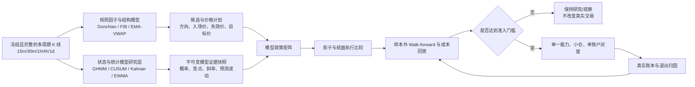

# HTX 趋势策略状态识别与统计模型接入计划 v1

> **目标**：在不替换 Donchian、Fibonacci 回踩、EMA/VWAP 动量三类结构模型的前提下，补齐市场状态、突变识别、持仓趋势质量、波动风险和候选质量的统计模型。新模型先生成可验证证据，后决定是否影响真实交易；不以“多加指标”或“合成更高分”代替验证。

## 1. 先定职责边界

当前系统已有规则式市场分型 `HtxTrendMarketRegimeService`，按日线、4h、1h、市场广度、波动和拥挤给出 `TREND_UP`、`TREND_DOWN`、`RANGE`、`PULLBACK` 等标签；候选侧已有 Donchian、Fibonacci、EMA/VWAP 并行分析。它们是可解释的结构假设，不应被统计模型取代。

| 决策环节 | 现有能力 | 新模型 | 输出 | 明确不做什么 |
|---|---|---|---|---|
| 市场状态 | 规则式多周期分型、BTC/ETH 锚点、广度 | **Gaussian HMM（GHMM）** | 各状态概率、状态转换概率、置信度 | 不给出具体买卖价，不直接开仓 |
| 高周期研究对照 | 1d/4h 规则方向 | **Markov-Switching Regression（MS-AR）** | 均值/波动状态切换 | 仅作 GHMM 对照，不同时进入真实链路 |
| 插针与假突破 | ATR、K 线形态、Fibonacci 结构 | **双边 CUSUM**，随后研究 **BOCPD** | 变点、突变幅度、持续性、置信度 | 首轮不直接平仓或否决全部候选 |
| 持仓趋势质量 | EMA 斜率、ROC、ADX、ATR | **Kalman Trend Filter** | 平滑趋势斜率、状态置信度、衰竭/反转预警 | 不取代模型失效价或交易所硬止损 |
| 风险、仓位与保护带 | 固定/ATR 宽度 | **EWMA 波动率**；GARCH 仅作研究对照 | 预测波动、仓位风险宽度、保护带宽度 | 不单独决定方向或放大仓位 |
| 候选质量 | 模型证据、Gate、方向质量统计 | **Meta-labeling**（先逻辑回归，后再比较 XGBoost） | 在给定方向假设下的成功概率、校准区间 | 不从原始价格直接预测涨跌，不绕开模型政策 |

**结构模型仍负责价格。** Donchian、Fibonacci、EMA/VWAP 各自给出触发、理想成交、最差成交、失效和目标；GHMM 等模型只回答“此环境是否允许该模型、风险应多大、保护带该多宽、持仓是否仍有延续价值”。

## 2. 总体链路

同一根稳定 K 线仍可被全部结构模型并行分析。GHMM 状态也不是“把 K 线分给某一个模型”，而是为同一个时点给出多种状态的概率，例如 `TREND_UP=0.72`、`RANGE=0.19`、`HIGH_VOL_RISK=0.09`。

## 3. 统一数据与版本合同

### 3.1 输入

所有研究模型只读取内容寻址的完整冻结数据集和同刻可获得的特征：

- 52 个白名单合约的 OHLCV，15m / 30m / 1h / 4h / 1d；
- 现有 EMA、ATR、ADX、ROC、VWAP、Donchian、Fibonacci 结构、市场广度和 BTC/ETH 锚点；
- 实际或明确标记为回退的账户费率、价格计划、盘口/滑点数据；
- 已平仓净 PnL、MFE/MAE、给利回吐、退出原因和执行状态。

禁止把未来 K 线、未来成交、最终平仓结果或重新计算后的全窗口统计输入当前时点的特征。训练、验证、样本外窗口按时间顺序切分，不能随机打散。

### 3.2 统一输出

新增模型证据必须通过 `dataset_key + contract_code + bar_time + timeframe_profile + model_name + model_version` 幂等关联，并保留输入特征版本、训练区间、推理时间和数据完整性。首版优先在现有因子快照/市场分型快照中双写 JSON 证据；字段稳定且查询量足够后再评估独立表。

统一状态口径：

| 字段 | 示例 | 含义 |
|---|---|---|
| `regime_source` | `RULE_V1` / `GHMM_V1` | 状态的来源，不能混用 |
| `regime_probabilities` | `TREND_UP:0.72` | 全量状态概率，禁止只存赢家标签 |
| `transition_probability` | `P(TREND_UP→RANGE)` | 下一状态转移风险 |
| `change_point_state` | `NONE` / `WATCH` / `CONFIRMED` | CUSUM/BOCPD 的事件等级 |
| `trend_filter_state` | `RISING` / `DECAYING` / `REVERSING` | Kalman 的持仓趋势状态 |
| `forecast_volatility` | 年化或每周期波动，带单位 | EWMA/GARCH 输出 |
| `meta_label_probability` | `0.61` | 在既定交易假设下的成功概率 |
| `decision_boundary` | `RESEARCH` / `SHADOW` / `PAPER` / `LIVE` | 当前输出能影响到哪个层级 |

模型版本必须固定数据集、特征合同、训练窗口、超参数和代码提交；不得用同一个版本名覆盖历史推理。

## 4. 分阶段执行计划

### Phase 0：研究约束与基线（MODEL-REGIME-00）

**工作**

1. 为规则式市场分型、三类结构模型和当前 v4 FIB 退出建立同一冻结数据基线。
2. 固化状态词典：`TREND_UP`、`TREND_DOWN`、`RANGE`、`HIGH_VOL_RISK`；不以 HMM 内部状态编号直接表达业务语义。
3. 定义样本外准入指标和最小样本：扣费后 PF、期望、最大回撤、胜率、平均盈亏比、MFE 捕获率、校准误差、状态稳定性和换手成本。
4. 建立前视偏差、递归稳定性、缺失数据、状态塌缩和类别漂移检查。

**验收**：每项后续实验都能复现基线；不完整数据只能输出 `INSUFFICIENT_EVIDENCE`，不能得出状态或盈利结论。

**执行记录（2026-10-07）**：复用 `research:c5cfa7cd77cf22c0fefa271ef6ba7e93`，即 52 个合约、五个周期、260 个 `RAW_PUBLIC` 输入均为 `COMPLETE` 的冻结数据集；同一数据集此前已通过 156 次前视/递归稳定性探针。基线不需要重新采集，Phase 0 以复用方式完成。

### Phase 1：GHMM 离线状态研究（MODEL-REGIME-01）

**工作**

1. 以市场级 BTC/ETH 与横截面广度构建 GHMM 特征：多周期收益、实现波动、ATR 标准化幅度、趋势斜率、广度、相关性与成交参与度；币种自身状态另建合同，不能与市场状态混成一个模型。
2. 用滚动训练与 walk-forward 推理生成状态概率和转移概率；状态数从四类业务状态开始，通过样本外稳定性而非训练集拟合优度决定是否调整。
3. 使用状态均值、波动、持续期、转移矩阵与对应策略结果映射业务名称；禁止把 HMM 标签编号硬编码为“上涨/下跌”。
4. 输出只读快照和报告：规则分型与 GHMM 的一致/冲突、每种状态下三类结构模型的候选数、净 PnL、PF、回撤、漏单率和费用占比。

**验收**：状态不塌缩、样本外可复现、转移概率可解释；至少证明它对扣费后策略结果有增益或明确否定增益。此阶段不得改变 Gate、仓位、开平仓。

**执行记录（2026-10-07）**：首轮纯离线 GHMM 已完成，证据见 `evidence/HTX_TREND_GHMM_REGIME_20261007.md`。四类状态均有样本，但样本外 `HIGH_VOL_RISK` 占比 `52.77%`，超过健康上限 `50%`，且 60 次迭代未收敛；结论为 `NEEDS_CALIBRATION`。因此不能跳过校准直接进行 MS-AR 对照、纸面矩阵或任何真实 Gate 接入。

### Phase 2：高周期对照实验（MODEL-REGIME-02）

**工作**：用 MS-AR 在 4h/1d 研究均值与波动的切换，并与 GHMM、规则式分型对照。它只回答“高周期状态是否稳定”，不与 GHMM 同时加入真实决策。

**验收**：报告包含三种分型对同一结构模型的样本外结果。若 GHMM 没有稳定优势，停止进入实盘接入而保留报告。

### Phase 3：变点与假突破识别（MODEL-CHANGE-01）

**工作**

1. 先实现双边 CUSUM 只读事件：输入标准化收益、实体/影线比、相对 ATR 冲击、VWAP 偏离和成交参与度。
2. 区分 `SPIKE_WATCH`、`BREAK_CONFIRMED`、`REVERSAL_WATCH`、`DATA_ANOMALY`；必须记录触发阈值、持续 bar 数与解除原因。
3. 对 Fibonacci 回踩、Donchian 突破分别回放“有/无 CUSUM 过滤”的假突破率、漏掉趋势率、入场后 1/4/8/16 根净收益。
4. BOCPD 只在 CUSUM 证据不足时做离线比较，不先进入生产依赖。

**验收**：能识别 BNB 式插针/快速反插针场景，同时量化其误杀正常突破的代价。首轮仅写候选风险证据，不直接取消下单或触发平仓。

### Phase 4：持仓趋势质量与波动风险（MODEL-HOLD-01）

**工作**

1. Kalman Filter 对每笔已开仓的 15m 价格趋势生成平滑斜率、估计噪声、趋势置信度和衰竭/反转预警；4h/1d 只用于调节持仓价值与保护带，不覆盖短周期价格事实。
2. EWMA 预测短周期波动，形成最小保护带、仓位风险和动态保护宽度的研究建议；GARCH 作为 EWMA 的样本外对照，不直接上生产。
3. 将 Kalman 与 EWMA 证据写入 `htx_trend_exit_decision` 的诊断部分，比较它们对 MFE 捕获率、给利回吐、过早退出率、最大损失和净收益的影响。
4. 不改变 v4 的模型失效、硬风险、已有利润保护和交易所对账优先级；新证据只能提出 `HOLD`、`TIGHTEN_PROTECTION`、`REDUCE_CANDIDATE`、`EXIT_CANDIDATE`。

**验收**：在强趋势回踩时不因短噪声误退出；在趋势衰竭或急转时能比现有 15m ATR 机制更早提供可验证预警。首轮为影子决策，不发送真实减仓/平仓。

### Phase 5：状态 × 模型 × 周期画像纸面矩阵（MODEL-PAPER-01）

**工作**

1. 形成可配置、可审计的政策矩阵，例如：

| GHMM 状态 | Donchian | Fibonacci | EMA/VWAP | 仓位与保护建议 |
|---|---|---|---|---|
| `TREND_UP/DOWN` 且概率稳定 | 允许对应方向启动 | 允许顺势回踩 | 允许顺势加速 | 正常风险预算 |
| `RANGE` | 禁止突破追单或降级观察 | 禁止延续交易 | 仅观察，不授权 | 降为零真实风险 |
| `HIGH_VOL_RISK` | 仅影子 | 仅影子 | 仅影子 | 禁开或显著缩小纸面风险 |
| 状态转换风险高 | 等待确认 | 等待回踩稳定 | 等待持久化 | 收紧新仓风险 |

2. 同时保留“现有规则基线”和“状态过滤策略”两条纸面路径，用相同价格计划、费率、盘口、退出假设回放。
3. 只让 GHMM 首先改变一个决策：模型准入**或**仓位上限。不得同时改变方向、Gate、仓位、减仓和全平。

**验收**：状态过滤后的样本外扣费后 PF、期望、回撤和机会损失相对基线可解释；单一状态或少量币种不能主导结论。

### Phase 6：Meta-labeling 候选质量（MODEL-QUALITY-01）

**前提**：真实/纸面执行账本中有足量、同口径、已结算的候选、费用、滑点、退出和前瞻标签；当前不满足则不启动训练。

**工作**

1. 标签定义为“在既定方向、价格计划、止损与退出合同下，扣费后是否达到正期望”，而不是未来价格是否上涨。
2. 特征只能使用开仓时可见的结构证据、GHMM 概率、CUSUM 状态、多周期趋势、EWMA 波动、流动性/成本和市场广度。
3. 先用带时间滚动校准的逻辑回归提供可解释基线，再与 XGBoost 比较；只有样本外校准、稳定性和经济结果同时改善才保留更复杂模型。
4. 输出概率分桶的胜率、PF、期望、Brier score、校准曲线、特征漂移和按模型/方向/状态的稳定性。

**验收**：Meta-label 只能缩小、排序或拒绝既有结构候选，不能在没有 Donchian/FIB/EMA-VWAP 假设时自行造单；任何版本失败都回退为观察。

### Phase 7：单一能力真实灰度（MODEL-LIVE-01）

**顺序**

1. GHMM 只影响模型准入或最大仓位之一，主账户小仓、单模型、单周期画像灰度；
2. 通过前瞻样本后，Kalman/EWMA 只影响已武装利润保护仓位的保护宽度；
3. 最后才评估 CUSUM 是否能成为真实开仓前确认，Meta-label 是否能参与候选排序。

每次灰度都必须是单一版本、单一开关、可回退、可对照。TradeX 或其他账户只有在主账户验证完成后才可能作为对照，不能自动跟随实验性模型。

**上线门槛**：相对同窗口基线，扣费后期望和 PF 不下降、回撤不扩大、未出现账本不一致或无法解释的决策；失败、漂移或数据质量异常立即退回影子。

## 5. 当前代码的接入点

| 现有组件 | 继续负责 | 新证据接入方式 |
|---|---|---|
| `HtxTrendMarketRegimeService` | 规则式研究分型与可解释基线 | 同时写 `RULE_V1`，与 `GHMM_V1` 并列，不互相覆盖 |
| `HtxTrendEnsembleSignalCalculator` | 多周期因子与趋势候选 | 消费“只读状态上下文”仅用于记录，未获授权前不改分数 |
| `HtxTrendCombinationCalculator` | 结构候选合成和既有 Gate 前逻辑 | 维持基线路径，纸面路径通过明确 policy matrix 比较 |
| `HtxTrendModelAnalyzer` | 同窗三模型并行证据 | 增加状态/变点/波动支持或冲突证据，不创建单一总分 |
| `HtxTrendFollowingService` | 批量候选、排序、真实下单 | 只在 Phase 7 读取被批准的一项模型结论 |
| `htx_trend_exit_decision` / v4 退出引擎 | FIB 的真实退出事实与执行 | Phase 4 只写影子动作和证据，不能并行接管真实退出 |
| 冻结 K 线、回放与纸面执行 | 模型验证、成本和生命周期回放 | 作为所有统计模型唯一可晋级的数据来源 |

## 6. 验证指标与否决规则

所有模型按 `模型 × 方向 × 周期画像 × 市场状态 × 账户` 分层报告，至少包括：

- 扣费后净 PnL、PF、期望、胜率、平均盈利/亏损、最大回撤；
- MFE、MAE、MFE 捕获率、利润回吐率、过早/过晚退出率；
- 候选数、Gate 拦截率、错失趋势率、成交率、滑点和费用占比；
- HMM 状态持续期、转移风险、状态塌缩率；变点命中/误报；Kalman 预警提前量；波动预测误差；Meta-label 校准误差。

以下任一情况不得进入真实灰度：样本外证据不足、使用未来信息、模型状态不可稳定复现、费用/滑点不完整、结果仅来自单一行情阶段、或收益改善由单一币种/少量交易驱动。

## 7. 依赖、风险与不做事项

- 当前三模型的三个月研究政策均为 `REJECT`（Donchian PF `0.82`、EMA/VWAP PF `0.95`、Fibonacci PF `1.13`，低于 `1.30`）。统计模型不能成为扩大真实风险的理由。
- HMM 对状态数、特征缩放和训练窗口敏感，必须滚动重训并保留版本；不能根据肉眼把状态标签改成想要的答案。
- CUSUM/BOCPD 会带来漏单风险；Kalman/GARCH 会滞后；Meta-label 容易因样本选择和费用遗漏过拟合。每项都保留规则基线和消融对照。
- 不引入第二套真实交易引擎；不让 Python 研究运行时持有 HTX 凭据；不在服务启动时执行 SQL；不创建未验证的 v5/v6 退出链路。
- 若稳定字段需要建表，生产 SQL 必须先人工执行、验表，再替换服务包；服务启动只做校验，不做迁移。

## 8. 交付物与任务清单

| ID | 交付物 | 状态 | 前置 | 不可变边界 |
|---|---|---|---|---|
| MODEL-REGIME-00 | 数据/特征/指标合同与规则基线报告 | 待实现 | COMPLETE 冻结数据 | 只读 |
| MODEL-REGIME-01 | GHMM walk-forward、快照与状态报告 | 待实现 | 00 | 只读 |
| MODEL-REGIME-02 | MS-AR 高周期对照报告 | 待实现 | 01 | 只读 |
| MODEL-CHANGE-01 | CUSUM 事件快照与假突破回放 | 待实现 | 00 | 只读 |
| MODEL-HOLD-01 | Kalman/EWMA 影子退出证据 | 待实现 | 00、完整退出账本 | 不改变 v4 真实动作 |
| MODEL-PAPER-01 | 状态×模型纸面政策矩阵与对照回放 | 待实现 | 01、CHANGE-01、HOLD-01 | 不改真实 Gate |
| MODEL-QUALITY-01 | Meta-label 校准与经济结果报告 | 阻塞 | 足量已结算样本 | 只可排序/拒绝 |
| MODEL-LIVE-01 | 单一能力单账户小仓灰度报告 | 阻塞 | PAPER 通过、用户明确授权 | 单开关、可回退 |

## 9. 参考依据

- James D. Hamilton, “A New Approach to the Economic Analysis of Nonstationary Time Series and the Business Cycle”, *Econometrica* (1989), DOI: `10.2307/1912559`。
- Mark Kritzman et al., “Regime Shifts: Implications for Dynamic Strategies”, *Financial Analysts Journal* (2012), DOI: `10.2469/faj.v68.n3.3`。
- `statsmodels` Markov regression 文档：作为 MS-AR 研究实现的统计定义参考，实际依赖与许可证在实施阶段复核。
