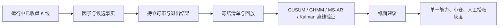

# HTX 趋势策略运行证据积累与统计模型接入 v1

## 1. 目标与边界

“证据不足”不是把新模型直接接进开仓，而是当前数据尚不能可靠回答三个问题：

1. 一个候选出现时，**当时已知的完整 K 线、结构、成本和市场状态**是什么；
2. 开仓后，价格、趋势质量、MFE、MAE、回吐与保护价如何逐根变化；
3. 该模型的建议若执行，是否比同一笔交易的 v4 基线带来**扣费后的经济增益**。

本轮只增加可回放的事实记录。GHMM、MS-AR、CUSUM、Kalman 和 EWMA 不读取这些新记录来阻止开仓、放大仓位或触发真实平仓。真实退出仍只有 v4 的既有路径。

## 2. 已有事实层与本轮补口

| 事实 | 存放位置 | 现状 | 本轮处理 |
|---|---|---|---|
| 交易所 K 线原始版本 | `htx_trend_runtime_kline_candle` | 已运行 | 保留内容哈希版本；只把已收盘 K 线送入研究证据窗口。 |
| 实际计算窗口 | `htx_trend_runtime_kline_snapshot` | 已运行 | 决策 bar 被钳制在已采集窗口末端，避免低周期时点把未收盘高周期 bar 标为事实。 |
| 候选与因子 | `htx_trend_factor_snapshot` | 已运行 | 继续保存多周期因子、模型覆盖、价格计划与 Gate 结果。 |
| 持仓全过程 | `htx_trend_position_mark_snapshot` | 新增，待生产 SQL | 每根已完成 15m 管理 bar 追加一条标记、净浮盈、MFE/MAE、回吐、保护价、趋势状态及建议动作。 |
| 退出判断 | `htx_trend_exit_decision` / `htx_trend_assessment` | 已运行 | 与新的持仓盯市快照用 `position_id + run_id + bar_time` 关联。 |

`position_mark_snapshot` 不是仓位状态的替代品，也不覆盖 `htx_trend_position`。它解决的是“曾经盈利、为何未保护、何时趋势变弱”的因果追溯。

## 3. 已收盘数据合同

运行时研究只能使用 `bar_time + period + candleCloseGraceSeconds <= 当前时间` 的 K 线。每个窗口必须满足：

- `window_end_bar_time <= target_bar_time`；
- 没有缺 bar 才是 `COMPLETE`；
- `PARTIAL` 可留作故障诊断，不能用于模型训练、参数扫描或经济结论；
- 回放只读取目标 bar 及之前的数据，未来 K 线仅能做结果标签，不能回流到当时特征。

这避免了活跃 K 线、交易所修订和前视数据把回测结果变好看的问题。

## 4. 统计模型的接入顺序

### 4.1 CUSUM：下一项可立即积累

以 15m 已收盘 K 线的标准化收益、实体/影线比例、ATR 冲击、VWAP 偏离和成交参与度生成只读的变点事件。它用于量化 BNB 式插针、假突破和急转：先比较“提示了什么”与候选后 1/4/8/16 根的净收益，不自动取消候选或平仓。

### 4.2 GHMM：保留特征，不保留硬过滤

GHMM 已完成统计校准，但“上行只多、下行只空”的简单过滤使总体 PF 从 `0.919` 降至 `0.887`。后续可将状态概率作为候选和持仓诊断字段，只有在同源回放与纸面中证明对某一模型有增益，才申请改变一个决策维度。

### 4.3 MS-AR：不满足证据时保持禁用

MS-AR(1) 的 4h 验证集尚未收敛，1d 只有 92 根完整日线，低于预注册的 128 根最低样本线。当前运行数据会继续积累日线，但仅靠等待还差至少 36 根日线；不能为提前接入而降低样本门槛。达到样本后仍需重新完成验证集收敛、样本外状态健康和结构模型经济对照。

### 4.4 Kalman / EWMA：使用新增盯市数据做影子退出

Kalman 平滑斜率和 EWMA 预测波动先读取持仓期间的完整快照，输出 `HOLD`、`TIGHTEN_PROTECTION`、`REDUCE_CANDIDATE` 或 `EXIT_CANDIDATE`。它们只写证据并与 v4 实际动作比较，不能替换 v4 的硬风险、模型失效或已武装的利润保护。

## 5. 后续接入门槛

任意新模型均须按以下顺序晋级：

1. 输入完整率、窗口哈希和样本量达标；
2. 离线 Walk-forward：训练、验证、样本外严格分离；
3. 用相同费率、盘口、滑点和 v4 退出合同对照，评估扣费后 PF、期望、最大回撤、MFE 捕获率、过早退出率和漏单率；
4. 纸面路径记录建议与可成交结果；
5. 只改变一个能力，例如候选排序或保护带宽度；
6. 由用户明确授权后，才允许单账户小仓灰度。

任何一步返回 `PARTIAL`、`INSUFFICIENT_EVIDENCE` 或经济指标无增益，模型停留在只读观察，不进入真实 Gate。

## 6. 上线前执行清单

本轮代码与 SQL 均为追加式，服务启动不会执行 SQL：

1. 先人工执行 [2026-10-08__htx_trend_runtime_position_mark_evidence.sql](../../sql/htx/2026-10-08__htx_trend_runtime_position_mark_evidence.sql)；
2. 验证表、唯一键和三个查询索引存在；
3. 部署匹配 JAR 后，只检查新行是否连续写入，不变更交易、仓位、v4 开关或环境变量；
4. 积累足量持仓样本后，再启动 `MODEL-CHANGE-01` 的 CUSUM 只读事件。
