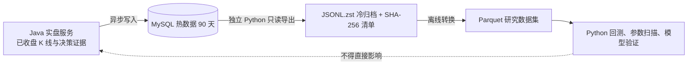

# HTX 趋势策略运行证据归档 v1

## 结论

实盘数据库保留可查询的近期证据；超过热数据保留期的数据由独立 Python 进程导出为不可变的 `JSONL.zst` 文件。归档是只读副本，成功校验前绝不删除数据库行，也不会由 Java 服务、策略扫描、开仓或平仓流程触发。

## 1. 数据分层

| 层级 | 数据 | 存放 | 初始保留规则 | 用途 |
|---|---|---|---|---|
| 热数据 | 已收盘 K 线、决策窗口、持仓盯市 | MySQL | 最近 90 天 | 页面、订单反查、线上诊断、短期回放 |
| 冷归档 | 同一批运行证据的只读副本 | `JSONL.zst` + 清单 | 长期保留 | Python 模型验证、事故复盘、可重复研究 |
| 训练输入 | 从已验证归档导出的列式数据 | 后续 Parquet | 由研究数据集清单管理 | 参数扫描、walk-forward、模型训练 |

`JSONL.zst` 不是实时输入格式。它的作用是用低成本、可校验的文件保存事实；当 Python 研究需要列式读取时，由离线任务再转换为 Parquet。这样不在交易机的热路径引入 `pyarrow`、Spark 或训练依赖。

## 2. 首批归档范围

| 表 | 内容 | 归档原因 |
|---|---|---|
| `htx_trend_runtime_kline_candle` | 内容寻址的已收盘公开 K 线版本 | 未来模型的原始市场事实 |
| `htx_trend_runtime_kline_snapshot` | 每次计算实际引用的 K 线窗口与完整性 | 可重现当时可见输入 |
| `htx_trend_position_mark_snapshot` | 持仓期逐 bar 盯市、MFE/MAE、保护价和退出建议 | 解释利润回吐与退出质量 |

候选、因子、订单和成交账本当前继续留在数据库，因其用于页面和账户级对账。它们的归档将在查询口径稳定后单独设计，避免过早移走运行诊断所需的关联数据。

## 3. 执行合同

1. 每月对早于 90 天前的月份运行一次导出；运行前先指定明确的 `--before` 边界。
2. 导出程序只调用 MySQL `SELECT`，按表和主键稳定排序；不包含 `DELETE`、`UPDATE`、`TRUNCATE` 或 DDL。
3. 每张表生成一个 `.jsonl.zst` 文件和一个总清单。清单记录行数、SHA-256、时间边界、表名与生成时间。
4. 校验文件可解压、每行是 JSON、行数和清单一致后，才视为归档成功。
5. 删除热数据是另一个人工批准的运维动作：必须先抽样从归档恢复并核对 SHA-256，且另行执行专门 SQL；本工具永远不做删除。

## 4. 与实盘及 Python 演进的边界

未来迁移到 Python 时，策略计算器可以先复用同一份 K 线、窗口、盯市与账本合同，再逐项替换 Java 的候选或退出实现。归档格式不是策略语言绑定，也不是新的实时交易通道。

## 5. 验收

- 工具仅使用 `SELECT`，并拒绝未知表名与非 ISO 时间边界。
- 每个归档文件均有行数和 SHA-256，且可解压为逐行 JSON。
- 导出失败时不生成最终文件，原数据库不受影响。
- 实盘服务不读取归档目录；归档失败不影响候选、Gate、下单或退出。
