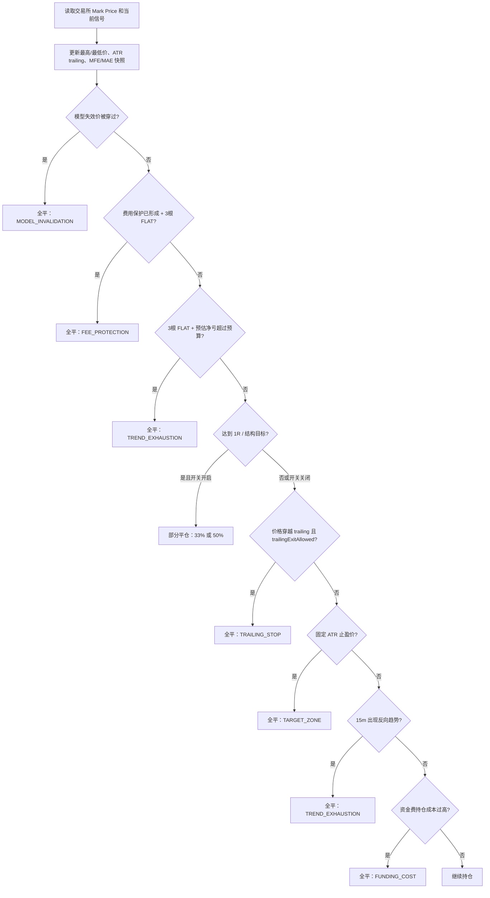

# HTX 趋势空单盈利回吐事故复盘（2026-09-24）

> 结论日期：2026-09-24（Asia/Shanghai）  
> 范围：主账户趋势策略的 DOGE、SUI、XRP、ZEC 空单；LTC 作为用户点名标的单独核验。  
> 执行边界：本报告只读生产数据库、服务配置、已部署代码和 HTX 公开 K 线；**未改代码、未执行 SQL、未改变环境变量、未部署、未下单。**

## 结论（BLUF）

这不是“市场已经反转而系统正确止损”的案例。DOGE、SUI、两笔 XRP 和 ZEC 在持仓中都出现过扣除双边手续费后的浮盈，但系统没有把这部分浮盈变为已实现利润，最终都在**三根 15 分钟 `FLAT` 信号确认且已亏损超过预算**后，作为 `TREND_EXHAUSTION` 全仓平掉。

原因分为三层，且都有明确证据：

1. **分批止盈在生产环境只是观察，不会下真实减仓单。** SUI 明确达到 1R，理论应减 33%，但开关未设置，默认 `false`，仓位 `partial_exit_stage=0`，订单表中没有 `PARTIAL_CLOSE`。
2. **ATR trailing 的“曾达到 1R 后继续有效”状态没有持久化。** 它错误地要求“当前回撤后的价格”仍在 1R 之外，且要求两个高周期出现反向信号。SUI 的价格已穿越 trailing stop，但反弹后不再满足当前 1R，且 30m/60m/4h 是 `FLAT` 而不是反向多头，故没有真实平仓。
3. **未达到 1R 的微利没有真实利润保护。** `PROFIT_PROTECTION` 只写诊断文本，不调用 `closePosition()` 或 `partialClosePosition()`；DOGE、ZEC、XRP 因此可以从小幅或中等浮盈一路回吐到亏损。

这五笔的最佳扣费后浮盈合计约 **+8.3415 U**；最终实际已实现净收益合计约 **-2.5790 U**。这里的“最佳浮盈”是按策略每轮 Mark Price 采样和双边 taker 手续费估算，不是已经可保证成交的利润；但足以证明系统缺少把已出现盈利转成已实现利润的退出执行机制。

LTC 需要纠正：生产库当前能识别到的 `LTC-USDT` 空单仅有 id=`3`，最终实际净收益约 **+0.0109 U**，不是“盈利后变亏”的样本。若用户指的是另一笔 LTC，请按订单时间或订单 ID 补充，不能用这笔盈利单替代亏损证据。

## 1. 数据来源与口径

| 数据 | 用途 | 限制 |
|---|---|---|
| 生产 `htx_trend_position` | 开仓、平仓、最高/最低 Mark Price、MFE/MAE、退出原因、风险价位 | `highest_price/lowest_price` 为策略轮询期间的采样，不保证捕获每个极端 wick |
| 生产 `htx_trend_order` | 验证 ENTRY/CLOSE/是否存在 `PARTIAL_CLOSE`、实际成交价格和费用 | 成交后才有实际已实现收益 |
| 生产 `htx_trend_signal` | 验证平仓前的 15m 信号序列 | 信号以稳定 K 线为准，`FLAT` 是“当前模型不再确认趋势”，不等同于价格必然反转 |
| 生产 `/opt/coinstrategy/htx-trade/env/htx.env` | 验证实际退出配置 | 仅读取非敏感退出参数；密钥未读取、未输出 |
| 已部署基线 `ba44e675` 与源码 | 验证退出调用顺序和开关默认值 | 当前本地 `f8f35d37` 尚未部署；本报告只引用与本事故相关、在生产基线中已有的退出逻辑 |
| HTX 公开 15m K 线 | 复核 SUI 是否穿越结构目标 | 交易所 K 线低点可能比本地 Mark Price 采样更极端，二者不能混为同一口径 |

**净收益口径**：`价格已实现盈亏 - 开仓手续费 - 平仓手续费`。  
**MFE 口径**：按持仓期内记录的最有利 Mark Price，重新估算“若当时市价平仓后的净收益”；它用于评估退出质量，不等同于真实已落袋利润。  
**1R（空单）**：`开仓价 - (初始止损价 - 开仓价)`。

## 2. 逐仓结论

### 2.1 汇总

| 仓位 | 开仓 → 平仓 | 最佳扣费后 MFE | 最终实际净收益 | 1R / 结构目标是否达到 | 实际退出原因 | 为什么未减仓/平仓 |
|---|---:|---:|---:|---|---|---|
| DOGE id=153 | 09-23 22:45 → 09-24 13:08 | +3.4843 U | -0.4201 U | 否 / 否 | 3 根 FLAT 后亏损控制 | 未到 1R；没有真实微利回撤保护；trailing 虽被价格穿过但未被允许执行 |
| SUI id=154 | 09-23 22:45 → 09-24 11:04 | +2.8607 U | -0.3528 U | **达到 1R** / 策略采样未到结构目标；公开 K 线到结构目标下方 | 3 根 FLAT 后亏损控制 | **分批止盈应触发但 live 开关关闭**；trailing 穿越后被错误的当前价/高周期 gate 拦住 |
| XRP id=156 | 09-24 04:45 → 05:31 | +0.5484 U | -0.6320 U | 否 / 否 | 3 根 FLAT 后亏损控制 | 未到 1R；无微利保护；不满足 trailing 激活 |
| ZEC id=159 | 09-24 17:45 → 19:07 | +1.1027 U | -0.5009 U | 否 / 否 | 3 根 FLAT 后亏损控制 | 未到 1R；无微利保护；不满足 trailing 激活 |
| XRP id=160 | 09-24 18:15 → 19:01 | +0.3454 U | -0.6732 U | 否 / 否 | 3 根 FLAT 后亏损控制 | 未到 1R；无微利保护；不满足 trailing 激活 |
| LTC id=3 | 09-16 16:48 → 18:54 | 旧仓无 MFE 快照 | **+0.0109 U** | 不适用 | fee protection 后 FLAT 平仓 | 该笔最终不是亏损单，不能作为本事故样本 |

五笔亏损空单的 MFE 总和为 `3.4843 + 2.8607 + 0.5484 + 1.1027 + 0.3454 = +8.3415 U`；最终实际净收益合计为 `-2.5790 U`。

### 2.2 DOGE-USDT，id=153

- 开仓：`0.094710`，11 张；初始止损 `0.099219`；1R `0.090201`；结构目标 `0.090646`。
- 持仓最低 Mark Price：`0.091468`，尚未触及 1R 或结构目标；但扣费后 MFE 已到 `+3.4843 U`，说明名义额与此价格段的浮盈足够覆盖费用。
- 最终成交：`0.095016`；价格盈亏 `-0.3366 U`；实际净收益 `-0.4201 U`。
- 平仓前信号：12:30、12:45、13:00 连续三根 15m 都是 `FLAT`。12:15 起已不再确认 Fibonacci 延续，价格随后从 `0.093556` 反弹至 `0.094732`。
- 最终引擎理由：`TREND_EXHAUSTION: short exit on confirmed flat trend loss control`，预估净亏 `-0.4278 U`，损失预算 `0.3125 U`，`flatBars=3/3`。

**判断**：该笔的 1R 分批目标未触及，未减仓属于现有规则的预期行为；问题在于 MFE 之后没有实际运行的“利润回撤”退出。最终快照已显示 `TRAILING_STOP:trigger@0.092245`，但 trailing 不具备执行资格，见第 4 节。

### 2.3 SUI-USDT，id=154（确定性缺陷样本）

- 开仓：`0.970200`，91 张；初始止损 `0.998100`；1R `0.942300`；结构目标 `0.914432`。
- 持仓最低 Mark Price：`0.938000`，**已经低于 1R `0.942300`**，所以第一阶段 33% 减仓条件已满足。
- HTX 公开 15m K 线在 09-24 00:00 的低点为 `0.9001`，亦低于结构目标。该 wick 未必被引擎的 Mark Price 轮询捕获，但引擎自己的 `0.938000` 采样已足以证明 1R 触发。
- 生产库：`partial_exit_stage=0`、`remaining_contract_volume=0`（因最终全平）、订单表只有 `ENTRY` 和 `CLOSE`，**不存在 `PARTIAL_CLOSE`**。
- 最终成交：`0.973300`；价格盈亏 `-0.2821 U`；实际净收益 `-0.3528 U`。
- 最终快照：`TRAILING_STOP:trigger@0.9482/ATR_TRAILING`，即最终反弹已穿过 trailing stop；但没有产生 trailing 的 CLOSE。
- 平仓前信号：09:45 至 10:45 连续均为 `FLAT`，且 ADX 约 `10.9–12.4`，理由为 `ADX below threshold`。最终走 `flatBars=3/3` 的亏损控制。

**判断**：SUI 不只是“退出参数不佳”，而是有两处可复现的执行问题：

1. 达到 1R 后分批止盈只在 `partial-take-profit-live-enabled=true` 时才会真正下单；生产环境未设置此环境变量，因此默认 `false`。91 张仓位没有减掉任何一张。
2. trailing 虽显示已触发，真实退出还要通过 `trailingExitAllowed()`。它用**当前反弹后的价格**再次校验是否仍达到 1R，并要求足够的高周期反向；两项均可能失败。已达到 1R 的历史事实没有被保存成不可逆的 `trailing_armed` 状态。

### 2.4 XRP-USDT，id=156

- 开仓：`1.487410`，9 张；初始止损 `1.542700`；1R `1.432120`；结构目标 `1.451913`。
- 持仓最低 Mark Price：`1.480130`，没有触及 1R 或结构目标；但 MFE `+0.5484 U` 已证明曾有费用后浮盈。
- 最终成交：`1.493240`；价格盈亏 `-0.5247 U`；实际净收益 `-0.6320 U`。
- 信号序列：开仓前 04:15 为 Donchian 空头确认；04:30、04:45、05:00、05:15 连续转为 `FLAT`。最终 05:30 价格上到 `1.500000`，引擎在此期间完成平仓。
- 最终引擎理由：`flatBars=3/3`，预估净亏 `-0.6437 U`，损失预算 `0.4016 U`。

**判断**：这一笔没有达到 1R，分批止盈即使开启也不会触发。问题不是“错过目标价”，而是当前系统没有“浮盈达到一定金额后，回撤一定比例即减仓或保本退出”的实盘执行路径；它只能等到趋势变 `FLAT` 且已亏损超过预算。

### 2.5 ZEC-USDT，id=159

- 开仓：`1479.020000`，7 张；初始止损 `1507.030000`；1R `1451.010000`；结构目标 `1434.535600`。
- 持仓最低 Mark Price：`1462.090000`，未达到 1R，但 MFE 为 `+1.1027 U`。
- 最终成交：`1484.990000`；价格盈亏 `-0.4179 U`；实际净收益 `-0.5009 U`。
- 信号序列：17:15/17:30 为 SHORT，17:45 起连续为 `FLAT`；18:00、18:15、18:30 仍为 FLAT。价格先从 `1479.73` 下到 `1467.00`，随后回升到 19:00 的 `1484.22`。
- 最终引擎理由：`flatBars=3/3`，预估净亏 `-0.3966 U`，损失预算 `0.3106 U`。

**判断**：ZEC 真实体现了“获利未到 1R → 不做任何利润保护 → 价格反向 → 三根 FLAT 后才承认趋势耗尽”的链路。不是模型失效、初始止损、trailing 或反向趋势平仓。

### 2.6 XRP-USDT，id=160

- 开仓：`1.458090`，6 张；初始止损 `1.493830`；1R `1.422350`；结构目标 `1.435362`。
- 持仓最低 Mark Price：`1.451170`，未达到 1R/结构目标，MFE `+0.3454 U`。
- 最终成交：`1.468140`；价格盈亏 `-0.6030 U`；实际净收益 `-0.6732 U`。
- 信号序列：17:30 为 SHORT，17:45 起转 FLAT；该仓开后 18:15、18:30、18:45 均为 FLAT，19:00 继续 FLAT。
- 最终引擎理由：`flatBars=3/3`，预估净亏 `-0.6450 U`，损失预算 `0.2625 U`。

**判断**：这是最快的回吐样本。仓位只运行约 46 分钟，尚未接近 1R；但短暂浮盈没有任何独立的实际保护机制，最终在三根 `FLAT` 后以约 2.6 倍于预算的亏损成交。

## 3. 当前生产的真实平仓标准

当前运行包仍是 `ba44e675` 时代的逻辑。对活动仓位，实际调用顺序如下：



当前生产生效的关键参数如下：

| 项目 | 当前值 | 实际含义 |
|---|---:|---|
| `HTX_TREND_FLAT_LOSS_EXIT_CONFIRMATION_BARS` | `3` | 必须等三根近期 15m K 线都是 FLAT 才触发亏损控制 |
| `HTX_TREND_MAX_FLAT_EXIT_LOSS_USDT` | `0.25` | 亏损控制的绝对预算下限 |
| `HTX_TREND_MAX_FLAT_EXIT_LOSS_RATE` | `0.0030` | 亏损控制预算还取开仓名义额的 0.3%，两者取大 |
| `HTX_TREND_PARTIAL_TAKE_PROFIT_LIVE_ENABLED` | 未设置，默认 `false` | 1R/结构目标只记录诊断，不会真实减仓 |
| `HTX_TREND_TAKE_PROFIT_ATR_MULTIPLIER` | 未设置，默认 `0` | 固定 ATR 全平止盈价为 `NULL`，不会使用 |
| `HTX_TREND_TRAILING_ACTIVATION_R` | 默认 `1.0` | trailing 要求当前价格也仍满足 1R 才可能平仓 |
| `HTX_TREND_RUNNER_TRAILING_REQUIRE_TIMEFRAME_EXHAUSTION` | 默认 `true` | trailing 还要求高周期出现足够反向，而不是 FLAT |
| `HTX_TREND_RUNNER_TIMEFRAME_MAJOR_OPPOSITE_COUNT` | 默认 `2` | 30m、60m、4h 中至少两个必须显式反向 |

**本事故五笔的实际路径均为 `F → G`。** 它们没有走模型失效、fee protection、partial close、ATR trailing、固定止盈、反向趋势或资金费成本退出。

## 4. 确定根因

### 根因 A：1R/结构分批止盈被配置成“观察功能”

实现中确实会计算 1R、2R 和结构目标；但真实减仓被如下开关包住：

- `HtxTrendFollowingService.java:1370-1373`：只有 `partialExit.triggered()` **且** `isPartialTakeProfitLiveEnabled()` 才会调用 `partialClosePosition()`。
- `application.yml:163`：默认 `HTX_TREND_PARTIAL_TAKE_PROFIT_LIVE_ENABLED=false`。

这不是推测。SUI 的引擎采样价 `0.9380` 已触发其 1R `0.9423`，但 DB 仍是 `partial_exit_stage=0`，订单账本没有 `PARTIAL_CLOSE`。因此 SUI 的“没有减仓”是确定性配置/执行缺陷。

### 根因 B：ATR trailing 的激活不是状态机，而是回撤时重新判断当前 1R

真实 trailing 退出需同时满足：

1. 当前价格穿越 trailing stop；
2. `trailingExitAllowed()` 为真。

第二个判断以**当前 reference**重新计算 1R：

- `HtxTrendFollowingService.java:2973-2980` 调用 `trailingExitAllowed()`；
- `HtxTrendExitRules.java:44-53` 在 `targetReached(side, reference, activationTarget)` 不成立时直接返回 `false`；
- 之后还要求至少两个高周期出现真正反向信号。

对于空单，价格先下跌达到 1R、随后反弹穿过 trailing stop 时，反弹后的当前价格通常已经高于 1R 目标，所以它重新判断为“未激活”。系统没有存储 `trailing_armed=true` 或 `max_favorable_r`，从而丢失“曾达到过 1R”的事实。

SUI 是直接证据：最终候选写了 `TRAILING_STOP:trigger@0.9482`，但没有 ATR trailing 平仓；其高周期快照为 `30m=FLAT,60m=FLAT,4h=FLAT`，并非两个明确的反向多头。此处既有**状态缺陷**，也有**高周期 gate 过重的策略设计问题**。

### 根因 C：利润保护没有执行分支

`profitProtectionCandidate()` 只把 `simulate_trigger` 或 `observe` 写入 `exit_snapshot_candidates`：

- `HtxTrendFollowingService.java:2701-2704`：把文字加入候选摘要；
- `HtxTrendFollowingService.java:2734-2748`：计算 50% MFE 保护线，但没有返回平仓指令；
- `monitorActive()` 的真实平仓分支中没有读取该结果调用下单。

因此，“浮盈回撤 35% 后保住至少一半 MFE”的想法只是页面/账本诊断，不是策略动作。DOGE、ZEC、两笔 XRP 都属于这个缺口：未到 1R，却已出现扣费后浮盈；系统没有可执行的微利保护，只能继续等趋势条件恶化。

### 根因 D：FLAT 亏损控制比预算晚，且“连续”的语义不够严谨

亏损控制逻辑在：

- `HtxTrendFollowingService.java:2638-2658`：必须当前为 FLAT、最近 N 根统计为 FLAT、且预估净亏至少达到预算；
- `HtxTrendFollowingService.java:2890-2899`：预算为 `max(0.25 U, 开仓名义额 × 0.003)`；
- `HtxTrendSignalMapper.java:34-45`：查询最近 N 个 bar 后，统计其中属于 FLAT 的数量。

该 SQL 表达的并不是持久化的“连续 FLAT 状态机”，而是“最近 N 根 bar 中 FLAT 的数量=N”。本次五笔的最后 N 根确实均为 FLAT，因此结论成立；但实现仍应明确为连续 streak，避免未来把插入顺序、缺 bar 或多周期记录误判为连续确认。

更关键的是，预算在“决定开始退出”时才检查；三根 15m 等待期间价格继续反向，实际亏损可显著超过预算：

| 仓位 | 触发预算 | 最终快照预估净亏 | 最终实际净收益 |
|---|---:|---:|---:|
| DOGE 153 | 0.3125 U | -0.4278 U | -0.4201 U |
| SUI 154 | 0.2649 U | -0.3164 U | -0.3528 U |
| XRP 156 | 0.4016 U | -0.6437 U | -0.6320 U |
| ZEC 159 | 0.3106 U | -0.3966 U | -0.5009 U |
| XRP 160 | 0.2625 U | -0.6450 U | -0.6732 U |

所以这套机制实际是“确认趋势已经耗尽后止损”，不是“在风险预算处严格止损”。

## 5. 已排除的解释

| 假设 | 结论 | 证据 |
|---|---|---|
| 是 ATR trailing 正确卖出导致利润小 | 否 | 五笔最终 `exit_reason` 都是 `TREND_EXHAUSTION`；SUI 虽候选显示 trailing 触发，但没有真实 trailing close |
| 是模型失效价或初始止损触发 | 否 | 所有最终快照均为 `MODEL_INVALIDATION:watch`、`INITIAL_STOP:watch` |
| 是反向趋势触发 | 否 | 平仓时为 `FLAT`，不是 SHORT 仓位所需的 `LONG` 反向信号 |
| 是资金费成本强制退出 | 否 | 最终 reason 均为 FLAT loss control，无 funding-cost exit |
| 是手续费单独把盈利打成亏损 | 否 | 手续费会降低净值，但所有五笔最终价格盈亏本身已为负；核心问题是盈利未锁定和回撤后退出过晚 |
| LTC 同样盈利转亏 | 否 | 已查到的 LTC id=3 最终净收益为正 `+0.0109 U` |

## 6. 事故的策略含义

当前退出体系存在一个明显的空档：

```text
亏损区：初始止损 / 模型失效 / 三根 FLAT 亏损控制
          ↓
微利区：只有诊断，没有真实动作   ← 本事故主要空档
          ↓
1R 以上：分批止盈存在，但生产关闭；trailing 还受当前价和高周期双重 gate
```

这使得策略在“方向短暂正确但没有走到完整 1R”的大量真实交易里，无法区分：

- 正常回踩，应该继续持有；
- 已出现可落袋利润、应先降低风险；
- 趋势已经失速、应缩仓；
- 结构已破坏、应全平。

因此当前问题不能用“把 ATR trailing 调紧”解决。单纯调紧会把正常趋势回踩也过早卖掉；单纯调松则继续放大盈利回吐。需要把这四个状态拆为独立的退出决策，并通过历史回放验证。

## 7. 后续方案的前置事实（本报告不实施）

在制定方案前，以下是不可跳过的修复目标：

1. **`EXIT-A`：持久化 trailing 武装状态。** 首次达到 1R 后写入 `trailing_armed_at`、`max_favorable_r` 和保护价；之后价格穿越 trailing 不能因为反弹后“不再当前达到 1R”而失效。
2. **`EXIT-B`：分批止盈从观察改为独立灰度执行。** 先用同源 K 线回放验证 1R 减 33%、2R 再减、runner 的 PF/平均盈亏比/回撤；通过后只对一个账户小仓开启，不直接全账户放开。
3. **`EXIT-C`：新增独立的微利回撤保护。** 它必须在未到 1R 的区域工作，但要有最低净利润、最小持仓时间、趋势/结构继续确认等条件；不能把它混入 ATR trailing 或三根 FLAT 止损。
4. **`EXIT-D`：把 FLAT 退出改为明确的连续状态与分层动作。** 连续 streak 需可审计；当浮盈、保本、亏损三个区间进入 FLAT 时，分别定义减仓、收紧保护和全平规则，而不是一律等待全仓亏损。
5. **`OBS-A`：补全退出事件账本。** 每次“曾触发但未执行”的分批、利润保护、trailing，都应记录 `eligible / blocked / executed`、阻断 gate、当时价、MFE、风险价和后续价格，以便再回测而不是事后猜测。

在 `EXIT-A` 与 `EXIT-B` 的回测、账本和灰度开关完成前，**不应直接开启现有 `HTX_TREND_PARTIAL_TAKE_PROFIT_LIVE_ENABLED`**：它能缓解 SUI 类问题，但 trailing 状态缺陷和微利回撤空档仍在，直接放开无法证明整体正期望。

## 8. 可复核定位

| 定位 | 说明 |
|---|---|
| `coin-strategy-htx/.../HtxTrendFollowingService.java:1360-1383` | 真实退出优先级；分批止盈受 live 开关控制 |
| `coin-strategy-htx/.../HtxTrendFollowingService.java:2638-2658` | 三根 FLAT 且超过亏损预算时全平 |
| `coin-strategy-htx/.../HtxTrendFollowingService.java:2716-2748` | 1R/结构目标与利润保护仅形成候选摘要 |
| `coin-strategy-htx/.../HtxTrendFollowingService.java:2973-3034` | trailing 退出需要当前价仍达 1R 及高周期确认 |
| `coin-strategy-htx/.../HtxTrendExitRules.java:44-53` | trailing 的当前价激活条件 |
| `coin-strategy-htx/.../persistence/mapper/HtxTrendSignalMapper.java:34-45` | “最近 N 根 FLAT”实际 SQL 语义 |
| `coin-strategy-htx/src/main/resources/application.yml:161-169,187-191` | trailing、分批止盈、固定止盈、FLAT 退出默认参数 |

## 9. 预防沉淀

- 本事故对应的诊断签名：`盈利 MFE 为正 + PARTIAL_TAKE_PROFIT:observe/simulate_trigger + 最终 TREND_EXHAUSTION flatBars=N/N`。
- 应沉淀为趋势退出引擎缺陷：**“退出候选被记录不等于退出动作被执行”**。
- 本报告尚未录入生产缺陷账本、尚未创建修复提交；待用户确认后，以 `EXIT-A` 至 `EXIT-D` 的方案和回测门槛进入实施。
