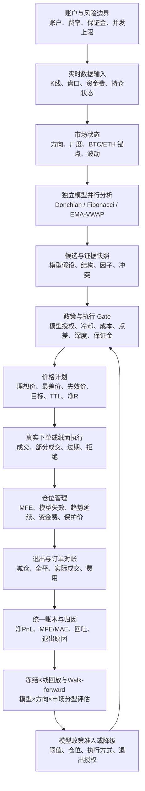

# HTX 趋势策略现行运行流程与闭环说明 v1

> **用途**：用一份中文文档说明系统从账户资金、行情、信号、价格、订单、持仓、退出到回测反馈的完整流程，并明确每项能力是“已在生产链路验证”“代码存在但默认关闭”还是“待实现”。
>
> **范围**：只覆盖 HTX 合约趋势策略。网格、现货—合约资金费套利和跨所套利不在本文的交易流程内。
>
> **关键边界**：代码存在、JAR 已部署、某环境开关已开启、某笔仓位实际走过该链路，是四个不同层次的事实。本文不把它们混为一谈。

## 1. 一张图看完整闭环



当前系统前半段已经可以产生可追溯候选和价格计划，后半段的研究验证与政策准入仍在补齐。真正成熟的流程不是“指标出现就下单”，而是让 **L → M → F** 成为唯一允许改变实盘策略行为的路径。

## 2. 状态标记

| 标记 | 含义 |
|---|---|
| **生产已验证** | 已在 49 服务器运行，并有可追溯的数据库、日志或 `run_id` 证据。 |
| **已部署但受开关/政策限制** | JAR 或数据库结构存在，默认关闭或仅对特定模型、账户、仓位类型生效。 |
| **研究中** | 已有设计或工具，但还没有足够同源样本支持实盘行为。 |
| **待实现** | 尚无可用于实盘决策的完整能力。 |

## 3. 账户与风险起点

### 3.1 账户、成本与资金边界

每个策略循环首先加载账户身份、账户费率档案、可用保证金、已有仓位和策略运行开关。

输入包括：

- 账户、策略族、策略名、模型名与稳定 `run_id`；
- 合约开/平手续费率与费率来源；
- 交易所当前仓位、挂单、保证金和本地账本状态；
- `observe-only`、真实下单、dry-run、账户镜像和策略互斥开关；
- 最大并发仓位、单笔风险、保证金与流动性限制。

**当前状态**：账户、订单、仓位和费用的统一账本已落库；账户费率档案已能按账户与合约记录。账户级“最多开几个仓位”已存在，但组合级相关性、总 Beta、币种集中度和总风险预算尚未成为真实仓位分配器。

### 3.2 应有的拒绝顺序

不满足运行模式或账户配置时，应在读取行情和生成交易成本前退出：

```text
运行模式 / 账户授权不满足
    → 仅记录原因，停止真实开仓链路
已有仓位
    → 先进入持仓管理，而不是阻塞其他候选扫描
可用开仓容量
    → 决定可从排序候选中选择多少笔
```

这使“观察”“不允许真实交易”和“没有可用仓位”不会被误写成行情或模型失败。

## 4. 实时开仓流程

### 4.1 行情与市场状态

系统以 52 个合约为候选范围，读取 15m、30m、1h、4h 与 1d K 线；同时使用盘口、费率、资金费和交易所仓位信息做可执行性判断。

不同周期的职责是：

| 周期 | 主要职责 | 不应承担的职责 |
|---|---|---|
| 1d | 大环境、长期方向与风险背景 | 直接触发日内开仓。 |
| 4h / 1h | 主趋势、结构和持仓价值 | 用单根短线波动直接否定日内价格计划。 |
| 30m | 日内趋势确认与结构衔接 | 替代入场触发。 |
| 15m | 入场触发、短线结构、初始风险与日内管理 | 无限容忍与高周期方向相反的亏损。 |

市场状态额外记录 BTC/ETH 多周期锚点、市场宽度、普涨/普跌/分化/震荡和波动环境。它应影响候选排序与风险预算，而不能替代单币自身的结构证据。

**当前状态**：多周期输入、BTC/ETH 锚点和市场广度已在候选证据中使用；是否能稳定提高收益仍待冻结数据评估。

### 4.2 模型并行，而非单根 K 线“归属”

同一批已完成 K 线可以被多个模型同时分析。模型不是互相抢占 K 线，而是提出不同的交易假设：

| 模型 | 主要机会 | 典型证据 | 当前真实交易授权 |
|---|---|---|---|
| `DONCHIAN_BREAKOUT` | 趋势启动与箱体外扩 | 通道突破、参与度、趋势强度、市场一致性 | **研究中**：尚未完成模型级回测与独立退出授权。 |
| `FIB_PULLBACK_CONTINUATION` | 已确认趋势中的回踩延续 | 既有趋势、回踩区、EMA/结构交集、动量恢复 | **生产已验证**：当前可进入真实 Gate 的主要模型。 |
| `EMA/VWAP` 动量延续 | 日内趋势加速与恢复 | EMA 斜率、VWAP 位置、ROC、量价参与 | **研究中**：可记录候选和证据，不因候选出现自动交易。 |

多个候选若依赖同一波段、箱体或回踩结构，必须被标记为同源确认，不能把它们当成独立 Alpha 机械叠加仓位。

### 4.3 候选、政策和 Gate

候选会冻结模型、方向、周期画像、结构证据、因子值、市场状态、支持证据与冲突证据，并生成稳定 `run_id`。

之后按顺序进行：

```text
候选
  → 模型政策是否已授权
  → 同币种/同方向仓位、挂单与冷却检查
  → 方向与市场状态一致性
  → 成本、资金费、点差、深度、保证金与风险检查
  → 候选排序与并发仓位选择
  → 最终 Gate 通过或写明拦截原因
```

**生产已验证**：候选、最终 Gate、价格计划和 outbox 已可用同一 `run_id` 相互反查。

**当前缺口**：方向质量与模型质量快照仍是观测层，尚未用足量样本决定“允许、缩仓、禁入”；冷却期强信号解冻、人工外部仓位与挂单处理矩阵也尚未完整落地。

### 4.4 价格计划与下单

最终 Gate 通过后，系统写入 `trend-price-plan-v1`。计划应包含：

- 方向、计划张数和周期画像；
- 触发价、理想成交价、最差可接受价；
- 初始止损、模型失效价、1R/2R/结构目标；
- 有效期（TTL）、风险、预估双边手续费与扣费后净 R；
- 盘口与执行成本依据。

同一 `run_id` 随后生成 `signal-outbox-v1:ENTRY_READY`，可供外部系统或纸面执行器消费。它不携带交易所密钥。

```text
最终 Gate 通过
  → 价格计划冻结
  → ENTRY_READY 事件
  ├─ 本地真实 HTX 执行：创建订单意图并下单
  └─ 外部纸面执行：回传 FILLED / PARTIALLY_FILLED / REJECTED / EXPIRED
```

**生产事实**：价格计划和 `ENTRY_READY` 已验证；当前计划的订单方式仍是 `MARKET_BASELINE`，即以当时盘口价格为基准。它解决了“为何愿意在此价交易”的审计问题，尚未实现“在哪个价格挂限价、何时撤单或重报价”的真实执行规则。

因此，真实下单当前仍以主动成交为主；限价探路、IOC、部分成交后建仓、撤旧单重下和一次重报价属于待回放验证的执行能力，不能因为价格计划存在就误认为已上线。

## 5. 成交、仓位与退出流程

### 5.1 成交后必须重算

真实成交后，仓位应以实际均价、实际张数和实际费用重算：初始风险、止损距离、结构目标、净 R、MFE、MAE 和保护价。纸面回传链路已按该原则生成独立纸面退出计划。

### 5.2 Fibonacci 仓位的 v4 退出链

对 `FIB_PULLBACK_CONTINUATION`，唯一设计中的退出负责人是 `fib-exit-engine-v4`。其决策优先级是：

```text
交易所/账本不一致或硬风险
  → 模型失效与初始风险
  → 未武装仓位的亏损预算
  → MFE 利润保护与保护价穿越
  → 趋势延续价值与动态减仓
  → 反转确认或资金费成本
  → reduce-only 下单与成交对账
```

v4 管理的核心事实包括：最高有利价格、扣费后 MFE、是否已武装、保护价、允许回吐、已实现收益、剩余张数和退出决策。保护价只能向有利方向移动，不能因回撤、重启或后续指标变化而放松。

| 退出状态 | 含义 |
|---|---|
| `THESIS_INTACT` | 模型假设仍成立，尚未达到利润保护条件。 |
| `PROFIT_AT_RISK` | 已有浮盈出现回吐风险，收紧保护并评估是否动态减仓。 |
| `PROFIT_PROTECTED` | 保护价已锁住有意义的扣费后收益。 |
| `RUNNER` | 部分利润兑现后，剩余仓位继续按模型专属保护带运行。 |
| `REVERSAL_CONFIRMED` / `INVALIDATED` | 结构、动量与市场证据确认反转，或原假设已失效。 |

**重要状态说明**：v4 代码与设计已存在，但真实退出是否发生取决于 `HTX_TREND_EXIT_ENGINE_ENABLED`、`HTX_TREND_EXIT_ENGINE_LIVE_ENABLED`、监督器/实时价格开关，以及仓位是否为 FIB 模型。非 FIB 仓位不能借用 v4 的退出结论。每次部署与每笔真实退出都必须从 `htx_trend_exit_decision` 和交易所成交回报验证，而不能只看代码版本。

### 5.3 退出执行的现实边界

- 默认退出监督器和实时价格流均可关闭；关闭时，退出响应仍依赖完整扫描或交易所持仓轮询。
- 本地最新价触发不能等同于交易所原生条件单；网络、进程或 API 异常仍可能造成保护穿透。
- HTX V5 条件单接口尚未完成可验证接入，因此当前不应宣称已有交易所托管的止盈止损保护。
- 每次减仓、全平、订单拒绝和部分成交都必须回写账本，否则 MFE 捕获率、实际净收益和下一轮质量统计会失真。

## 6. 账本、归因与研究反馈

### 6.1 统一账本

订单、仓位、候选、因子快照、价格计划、纸面执行和退出决策均应通过 `account_id`、策略、模型与 `run_id` 关联。结算口径必须使用：

```text
已实现净收益
  = 已实现价差收益
  - 实际开仓费用
  - 实际平仓费用
  - 可归属资金费
  - 可归属滑点与执行成本
```

看板和质量统计不可将未实现盈亏、预估费用和已实现净收益混为同一字段。

### 6.2 从交易结果回到模型政策

每笔已平仓交易还应归因：方向错、入场错、过早退出、过晚退出、成本侵蚀、执行失败或模型失效。单笔归因不能直接改线上阈值；它必须先汇总到：

```text
模型 × 方向 × 市场分型 × 周期画像 × 账户
    → 样本数、胜率、PF、期望、平均盈亏比、MFE/MAE
    → 回吐率、MFE 捕获率、滑点和费用占比
    → Walk-forward 的训练 / 验证 / 样本外结果
    → 模型政策：允许、降仓、观察或禁入
```

**当前状态**：方向质量快照、因子快照、订单与退出归因字段已有基础；模型级政策标定、同源 Walk-forward、Gate 消融和执行方式回放尚未完成。因此，当前统计可以用于发现问题，不能单凭少量盈利或亏损直接升级或停用模型。

## 7. 当前已闭环与未闭环事项

| 范围 | 已闭环事实 | 未闭环或风险 |
|---|---|---|
| 数据 | 三个月、52 币、五周期冻结数据集已生成 `COMPLETE` 清单。 | 尚未完成基于该数据集的模型评估与 Walk-forward。 |
| 信号 | 多周期因子、候选证据、独立模型合同和 `run_id` 已存在。 | Donchian、EMA/VWAP 缺模型级盈利与退出证据，不能直接实盘授权。 |
| Gate | 模型政策、成本、盘口、资金费、保证金和并发检查可记录原因。 | 强弱信号分层、冷却解冻、外部仓位与挂单矩阵未完整实现。 |
| 执行 | 价格计划、outbox、纸面回传与过期校验已存在。 | 真实限价、部分成交、撤单和重报价尚未经同源回放证明。 |
| 退出 | FIB v4 有统一模型失效、MFE 保护和动态减仓设计。 | 实盘开关与逐仓证据须核验；交易所原生条件单未接入；其他模型没有独立退出授权。 |
| 组合 | 并发仓位、候选排序和市场状态已有基础。 | 相关性、总风险、方向集中度和 Beta 预算尚未成为仓位分配规则。 |
| 反馈 | 账本、费用、退出决策和方向质量快照可记录。 | 结果尚未通过 Walk-forward 转成版本化模型政策，实盘与研究之间仍存在断点。 |

## 8. 下一步的唯一正确顺序

1. 使用 `research:c5cfa7cd77cf22c0fefa271ef6ba7e93` 冻结数据集，生成市场分型、结果标签和模型评估账本。
2. 执行同源 `BT-01` Walk-forward 与 `BT-02A` Gate 消融：按模型、方向、市场分型、周期画像比较扣费后 PF、期望、回撤、MFE/MAE 和漏单率。
3. 形成 `MODEL-01/02` 模型政策：Fibonacci、Donchian、EMA/VWAP 分别决定在哪些状态可交易、仓位多大、何时禁入，以及哪个退出引擎负责。
4. 执行 `BT-03`：用相同价格计划比较市价基线、被动限价、IOC 和重报价的成交率、成本、错失行情和净收益。
5. 在模型政策通过后，再做单账户、小仓、可回退的限价与 v4 退出灰度；每笔都要求 `run_id → 价格计划 → 成交 → 退出决策 → 净收益归因` 全链可查。
6. 最后才将相关性、方向集中度、总风险预算接入组合仓位分配，并扩展到更多账户和策略族。

## 9. 运维检查清单

每次确认“策略为何开单、为何未开、为何退出、是否真的赚钱”时，按以下顺序查询：

1. 服务是否运行、真实下单与退出开关是什么；
2. 当前交易所仓位与本地活动仓位是否一致；
3. 候选数量、各 Gate 的主要拒绝原因和候选是否超过 TTL；
4. 对指定 `run_id` 反查因子快照、最终 Gate、价格计划、订单、成交、仓位和退出决策；
5. 使用实际成交价与实际费用核对账本净收益；
6. 对已平仓订单查看 MFE/MAE、给利润回吐、退出归因及后续前瞻窗口；
7. 只有样本量、样本外结果和执行成本均满足模型政策门槛时，才调整实盘参数或扩大仓位。

## 10. 关联资料

- [趋势策略系统总纲](HTX_TREND_STRATEGY_SYSTEM_V1.md)
- [价格计划与多周期讨论稿](HTX_TREND_PRICE_AND_TIMEFRAME_DESIGN_DISCUSSION_V1.md)
- [Fibonacci 利润保护与退出计划](HTX_TREND_MFE_PROFIT_PROTECTION_PLAN_V1.md)
- [纸面执行链路](HTX_TREND_PAPER_EXECUTION_CHAIN_V1.md)
- [策略待办与实施状态](COINSTRATEGY_STRATEGY_BACKLOG_V1.md)
