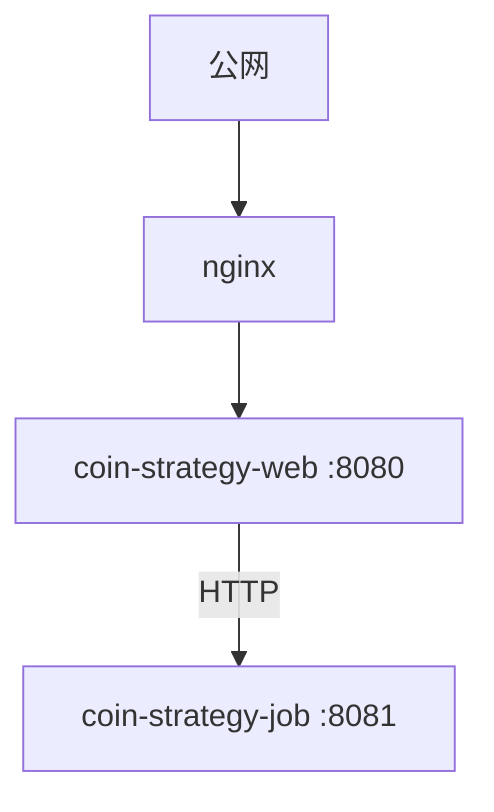
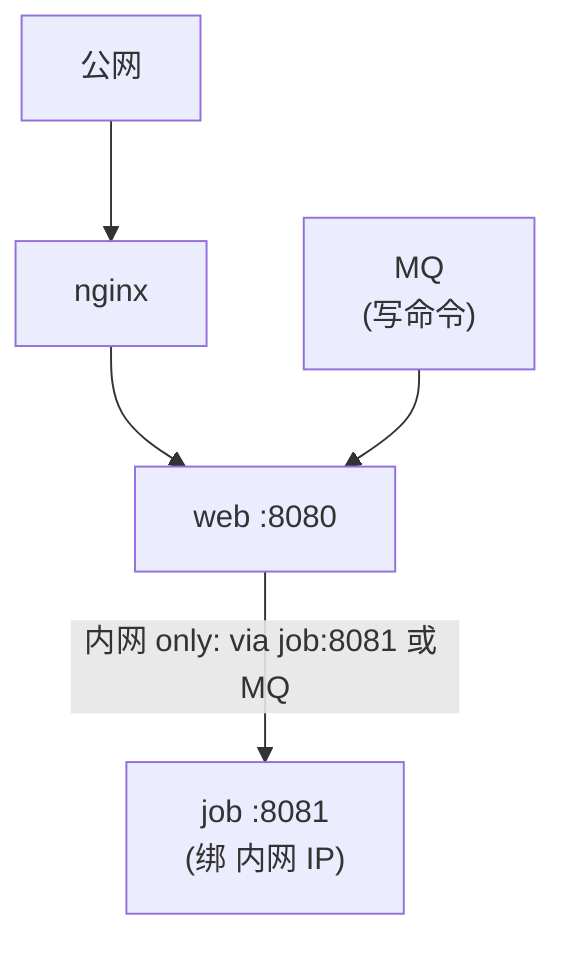

# Priority 5：网络层收敛与 job 内网化部署建议

> 目标：让 job 服务（8081）**只接受内网调用**；web 服务（8080）是唯一对外入口。
> 不能本地化的接口（外部 API、job 进程内存自省）通过这层硬化变成"只能从内网命中"。

---

## 一、当前网络拓扑（推测）



问题：`coin-strategy-job:8081` 在内网，但如果没有显式防火墙规则，理论上：
- 任何能访问 job 主机的进程都能调它
- 如果运维/测试网络与生产网络互通，存在被误调用风险
- web 端 `JobApiForwardService` 仍把 web 进来的请求转给 job，等价"外部入口"

---

## 二、目标拓扑



job 只接收：
  - 来自 web（同 VPC/同主机）的 HTTP（持续到 Priority 4 完全 MQ 化前）
  - MQ 消息（strategy_manual_trigger 表 + Consumer）
  - 自身 @Scheduled

---

## 三、具体执行清单

### 3.1 应用层（Spring Boot 配置）

**`coin-strategy-job/src/main/resources/application.yml`** 加：

```yaml
server:
  port: 8081
  # 只监听内网网卡（不监听 0.0.0.0），公网完全不可达
  address: 127.0.0.1     # 单机部署用 loopback
  # 或者多机：address: 10.x.x.x  指定内网 IP
```

如果生产是 K8s 多副本，改成：
- 不暴露 `Service.type=LoadBalancer`，只用 `ClusterIP`
- `web` Pod 通过 `coin-strategy-job.<namespace>.svc.cluster.local:8081` 访问 job

### 3.2 防火墙/安全组

**生产/测试环境**：

| 端口 | 来源 | 允许 |
|---|---|---|
| 80/443 → web:8080 | 公网 | ✅ |
| web 主机 → job:8081 | 内网 | ✅ |
| 其他 IP → job:8081 | 任何 | ❌ |
| 运维跳板机 → job:8081 | 跳板机 IP 白名单 | ✅（手动诊断用） |

K8s NetworkPolicy 样例：

```yaml
apiVersion: networking.k8s.io/v1
kind: NetworkPolicy
metadata:
  name: coin-strategy-job-ingress
spec:
  podSelector:
    matchLabels:
      app: coin-strategy-job
  policyTypes:
    - Ingress
  ingress:
    - from:
        - podSelector:
            matchLabels:
              app: coin-strategy-web
        - podSelector:
            matchLabels:
              app: ops-bastion       # 运维跳板
      ports:
        - protocol: TCP
          port: 8081
```

### 3.3 nginx/网关层

**只允许暴露 web 端路径**，明确不暴露 job 自身路径：

```nginx
upstream web_backend {
    server coin-strategy-web:8080;
}

server {
    listen 443 ssl;
    server_name api.your-domain.com;

    # 只暴露 web 业务路径
    location /strategy/api/ {
        proxy_pass http://web_backend;
    }

    # 显式拒绝 job 端口 + 任何 job 直访路径
    # 注意：如果有人通过 IP+8081 绕过，3.1 的 server.address 已经堵住
    location ~ ^/(binance|api/weather|smart-wallet)/ {
        # web 端已有 proxy controllers，这些路径走 web 内部，对外不直接对应 job
        proxy_pass http://web_backend;
    }
}
```

### 3.4 job 自身添加来源校验（兜底）

即使前面三层失守，job 内还能加请求来源 IP 校验：

**在 `coin-strategy-job` 加一个 Filter**：

```java
@Component
@Slf4j
public class JobInternalAccessFilter implements Filter {

    private static final Set<String> ALLOWED_INTERNAL_CIDRS = Set.of(
            "127.0.0.0/8",
            "10.0.0.0/8",
            "172.16.0.0/12",
            "192.168.0.0/16"
            // 加 K8s pod CIDR 段
    );

    @Override
    public void doFilter(ServletRequest request, ServletResponse response, FilterChain chain)
            throws IOException, ServletException {
        HttpServletRequest req = (HttpServletRequest) request;
        String remoteAddr = req.getRemoteAddr();
        if (!isAllowedInternal(remoteAddr)) {
            log.warn("[JobInternalAccessFilter] reject external access from {} to {}",
                    remoteAddr, req.getRequestURI());
            ((HttpServletResponse) response).sendError(HttpStatus.FORBIDDEN.value(),
                    "External access to job service is not permitted");
            return;
        }
        chain.doFilter(request, response);
    }

    private boolean isAllowedInternal(String ip) {
        return ALLOWED_INTERNAL_CIDRS.stream().anyMatch(cidr -> matchCidr(ip, cidr));
    }

    /**
     * CIDR 匹配（仅 IPv4）：判断 ip 是否落在 cidr 网段内。
     * cidr 形如 "10.0.0.0/8"。解析失败（非法 IP / IPv6 / 非法前缀）一律返回 false（fail-closed）。
     */
    private boolean matchCidr(String ip, String cidr) {
        try {
            String[] parts = cidr.split("/");
            int prefixLen = Integer.parseInt(parts[1]);
            if (prefixLen < 0 || prefixLen > 32) {
                return false;
            }
            int ipInt = ipv4ToInt(ip);
            int netInt = ipv4ToInt(parts[0]);
            // 掩码：prefixLen=0 时全 0；1~32 时高 prefixLen 位为 1。
            // 注意 Java 的移位运算会对位数取模（<< 32 等价 << 0），故 prefixLen=0 必须单独处理。
            int mask = (prefixLen == 0) ? 0 : (0xFFFFFFFF << (32 - prefixLen));
            return (ipInt & mask) == (netInt & mask);
        } catch (RuntimeException e) {
            log.warn("[JobInternalAccessFilter] matchCidr 解析失败，拒绝放行: ip={}, cidr={}", ip, cidr);
            return false;
        }
    }

    /** 点分十进制 IPv4 转 32 位整数；非 IPv4（含 IPv6）抛 IllegalArgumentException。 */
    private int ipv4ToInt(String ip) {
        String[] octets = ip.split("\\.");
        if (octets.length != 4) {
            throw new IllegalArgumentException("Not an IPv4 address: " + ip);
        }
        int result = 0;
        for (String octet : octets) {
            int value = Integer.parseInt(octet.trim());
            if (value < 0 || value > 255) {
                throw new IllegalArgumentException("Invalid octet in: " + ip);
            }
            result = (result << 8) | value;
        }
        return result;
    }
}
```

> **实现说明**：`matchCidr` 已补全为完整 IPv4 实现 —— 解析 CIDR 前缀位数、用整数位掩码比较网段。已覆盖以下边界用例并验证通过：`/0`（全网段放行）、`/32`（精确单 IP 匹配）、网段内 / 网段外判定、非法 IP 与 IPv6 输入均 fail-closed 返回 `false`。关键陷阱：Java 移位运算对位数取模，`prefixLen=0` 必须单独把掩码置为 `0`，已在代码中处理。若未来需支持 IPv6，需另行扩展 `ipv4ToInt` 或改用 `java.net.InetAddress` 字节比较。

注意：如果在 K8s 内部署，`X-Forwarded-For` 也要纳入考虑（不能信任）。

### 3.5 部署文档/README 注明

在仓库 README 加一段 deployment note：

```text
## 部署须知

- coin-strategy-web (8080): 唯一对外入口
- coin-strategy-job (8081): 内网 only，仅允许 web pod 和运维跳板访问
- 任何修改 application.yml 要确保 job 的 server.address 没回退到 0.0.0.0
```

---

## 四、验收清单

部署后，从外部环境用 curl 测试：

```bash
# ✅ 这个应该成功
curl https://api.your-domain.com/strategy/api/smart-wallet/overview

# ❌ 这些应该被拒绝（或超时连不上）
curl http://your-job-host:8081/strategy/api/smart-wallet/overview
curl http://your-job-host:8081/strategy/api/binance/getAccount
curl http://your-job-host:8081/strategy/api/config/baseline-model
curl http://your-job-host:8081/strategy/api/execution-wallet/status
curl http://your-job-host:8081/strategy/api/live-validation/status
```

外部 curl 8081 应失败（connection refused 或 403）。

---

## 五、影响评估

- ✅ "不能本地化"的 11 个 GET（config/、execution-wallet/、live-validation/、wallets、markets 等）从此**只能从内网命中**，外网完全访问不到。
- ✅ G 批 CLOB 4 个端点（涉及 Polymarket 实时 API 和私钥）同样内网化。
- ✅ Priority 4 改 MQ 之前，web → job 的临时 HTTP 转发仍可工作（同 K8s namespace 互通）。
- ⚠️ 运维诊断从此必须 ssh 到跳板再 curl 内网 IP；接受这个成本换安全。
- ⚠️ 灰度发布如有 job 多副本，要确保 web 的 service discovery 能找到所有 job 副本。

---

## 六、与 Priority 4 的关系

Priority 5 是**部署侧硬化**；Priority 4 是**代码侧把 HTTP 透传改 MQ**。两者独立但互补：

- 只做 Priority 5：还有 HTTP 透传，但流量只在内网。可接受过渡态。
- 只做 Priority 4：代码干净但部署仍可能误暴露。
- 都做：架构最终态。

建议先做 Priority 5（成本低、即刻见效），再慢慢推 Priority 4。

---

<!-- kb-backlink -->
> 本文归属：[架构与平台 知识地图](../MOC-架构与平台.md) ｜ [知识库首页](../知识库首页.md)
