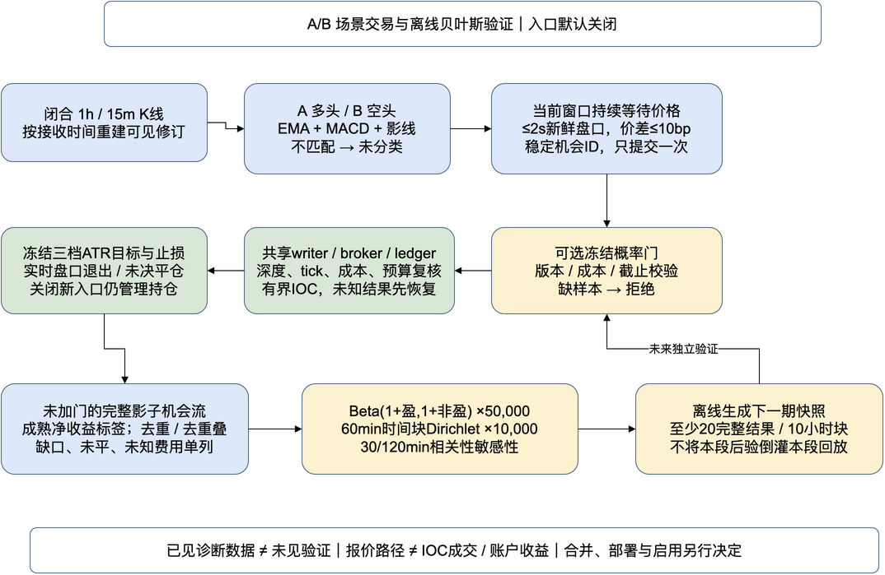

# A/B场景交易与贝叶斯验证交付

作者：Codex；日期：2026-11-05。独立分支 `codex/regime-bayesian-entry`，实际基线 `3d793d6de6f82fdd0d993da1a97a03a32049d29c`。完成代码链路与离线验证；入口默认关闭，收益准入仍为 **NOT_ELIGIBLE**。未合并、推送、部署或启用LIVE。

## 实现与明确边界

新增 `REGIME_AB_V1 / RT_REGIME_AB`，按已闭合1h/15m的EMA、MACD、影线识别A多头与B空头，持续等待当前窗口中的新鲜盘口确认。B不经过旧空头MACD负值过滤。采用实际broker的IOC限价、唯一writer、现有计划状态表和compact-v2；不新增业务SQL迁移。

三档ATR退出分别验证，目标/止损提交前冻结；已开仓不受之后场景、快照或入口开关变化影响。旧持仓归属通过精确前驱源码向量验证，不覆盖旧哈希。资金、杠杆和风险额度不在研究中新增固定前提；真实账户回放需要显式配置。

贝叶斯门是单独的可选开仓门。先验Beta(1,1)，完整净收益大于零为盈利；按场景、时序版本、退出档位和成本身份分别更新。胜率抽样50,000次；平均净收益使用同步60分钟块的10,000组Dirichlet权重，30/120分钟作敏感性检查。市场块不足时不计算支持度。仅有高胜率或正均值不能获得实盘准入。

运行时只读冻结快照；缺失、篡改、版本/成本不符、未来截止或不足20完整结果/10小时块均拒绝。LIVE拒绝假设成本快照。规则、执行或标签源码变化后旧快照失效，不能将旧样本重复加到旧后验上。

可编辑图源：[flow.drawio](evidence/regime-bayesian-20261105/flow.drawio)。

## 真实回放结果与数据解释

完整夜间表和全部逐笔记录见[冻结数据结果](regime-bayesian-night-20261105.md)。输入为11月4日18:00—23:00:05.884的本地COS冻结投影；源清单含311个gzip文件。处理6,532,405条事件，其中BBO 6,516,090、FRAME 1,092、FUNDING 15,102、GAP 120、SOURCE_ERROR 1。

| 规则（ATR_1_1） | 独立机会 | 报价入场 | 完整盈/亏 | 未完成 | 完整收益率 |
|---|---:|---:|---:|---:|---:|
| 既有五模式并集 | 122 | 95 | 0/0 | 122 | 无完整结果 |
| A/B首次有效报价 | 6 | 6 | 0/1 | 5 | −0.4628% |
| A/B持续等待 | 63（A35/B28） | 50 | 0/1 | 62 | −0.4628% |

两种A/B规则的唯一完整结果来自同一LTC行情机会，不能累计为两份独立盈利证据。ATR_2_1与ATR_2_2没有完整退出结果。持续等待A组后验Beta(1,2)，均值33.33%、95%区间约1.36%—84.37%；这是仅一笔亏损标签后的概率分布，不是可信未来胜率。仅1完整样本、1小时块，远少于20/10要求，正平均净收益支持度不可计算；所有概率门保持不放行。

本投影不包含足以还原IOC的完整深度/成交数据。250ms延迟、每边4bp手续费仅为命名的假设，资金费和额外滑点未知；报告使用无杠杆报价路径净收益率，不给账户U金额、组合回撤或真实成交率。正式账户入口已接入真实worker/broker/ledger/management，但本轮未提供真实账户配置。

完整标签较少时，历史胜率和后验仍如实保留小分母，不能把未知填零。未加概率门的全部影子机会保留，概率门并非训练数据筛选器。本段后验只用于之后的研究，未倒灌本段；80/90/95%没有合法先验快照时均拒绝，不据此声称过滤策略获利。

前段5分钟采样研究 `indicator-regime-characteristics-20261105/states.json` 是已见假设来源，与新实时事件链口径不同，未混入训练标签。既有受保护留出未读取。FRAME条件匹配率、完成子集历史胜率、后验概率和净收益在报告中分列。

## 修复与数据审计

本轮开发审查修复了三项会污染研究的缺陷：

1. 延迟入场当条已触及止损仍等待下一条报价：新成交立即检查同条可执行盘口，防止反弹后伪报盈利。
2. 后验封印遗漏标签生成/执行代码：改为完整Python源码封印，逐标签保存源码与协议身份，代码变化拒绝旧标签。
3. K线发布延迟误判为报价断线：报价连续性独立于特征history保存。真实ADA片段中新FRAME前5ms仍有报价，旧版却按14.96秒历史特征间隔丢掉首次机会；修复后真实258条事件片段成功触发一次。

源审计逐条找到v2中53个QUOTE_COVERAGE_GAP的相邻有效报价间隔确实超过2秒；120条GAP均是连接级记录，57个BBO连接代次时间范围不重叠。这能证明冻结覆盖标准未满足，不能证明一定发生丢包。证据：[source-quality-audit.json](evidence/regime-bayesian-20261105/source-quality-audit.json)。

v1中断、v2完成但含首次报价缺陷的旧目录均保留，最终结果仅采用v3。既有五模式UNION基线原样保留；其新bar类路径也受K线发布时间影响，此项作为独立问题记录，不能把本轮UNION结果视为修正后的理想五模式策略。

## 验证与验收矩阵

| 验收项 | 结果与证据 |
|---|---|
| A/B方向、零值、缺失、窗口等待、过期、同bar/重启 | 专项通过；B独立条件、真实K线发布延迟回归通过 |
| 三档多空止盈止损、IOC部分成交、未决平仓 | 真实PAPER broker及management专项；LIVE manager取消/未知/部分/完成平仓复用测试通过 |
| 冻结快照开仓与拒绝 | 独立只读复核四个真实账户fixture：有效A组开平仓2笔fill，缺快照/错误成本/未训练档均0成交 |
| 贝叶斯可手算与重算 | Beta参数、种子复现、重复/重叠/未来/费用未知排除及快照篡改测试通过 |
| 增量和锁 | 子研究严格追加、旧结果不变、锁互斥测试通过；真实470,713事件分段恢复与全量同前缀记录/报告完全一致 |
| Python全量 | 1,295通过、0失败、0跳过；89条已有SQLite datetime弃用警告 |
| 隔离MySQL | localhost:23319测试实例，10通过；计划恢复与实例隔离，无生产访问 |
| 实际公共API | ETH规格、15m/1h K线和盘口读取成功，无私有API调用 |
| 包与归属 | 三档PAPER/LIVE关闭入口包的最终构建与校验结果单列在packages.json；不含部署授权 |
| 代码关系 | 当前没有codegraph工具；使用明确标注python_ast的引用/调用证据与动态fixture核验，未冒充codegraph输出；治理TD-054记录环境豁免 |

具体命令、日志和源码签名见[evidence目录](evidence/regime-bayesian-20261105/)。本次启动的本地MySQL容器及Colima测试VM已停止，数据保留，Docker默认context恢复为default。

## 复现、配置与后续

1. 查看[配置和复现命令](../../htx-trend-python/release/REGIME-BAYESIAN.md)，使用Python `regime_replay freeze/run/fit`。源码、数据、成本和后验快照先冻结。
2. 使用 `tools/regime_report.py` 从结果JSON生成正文；不在报告脚本中重选参数。新增已封口数据通过 `extend` 创建子研究，原研究保留。
3. 如需账户净权益/回撤，提供显式账户tape，运行 `account --matrix`；18组独立调度，完整记录机会、拒绝、费用和门控后新增计划，不用事后删除原成交代替重新回放。
4. 后续独立未见验证仍由冻结规则执行；任何新版本重选条件都使当前测试段转为已见。合并、生产部署和启用另行决定。

回滚只关闭新计划生成；继续用认识RT_REGIME_AB的包管理已成交新仓，不能切回旧包漏管。现有4H、LIVE、采集配额及旧evidence均未修改。
