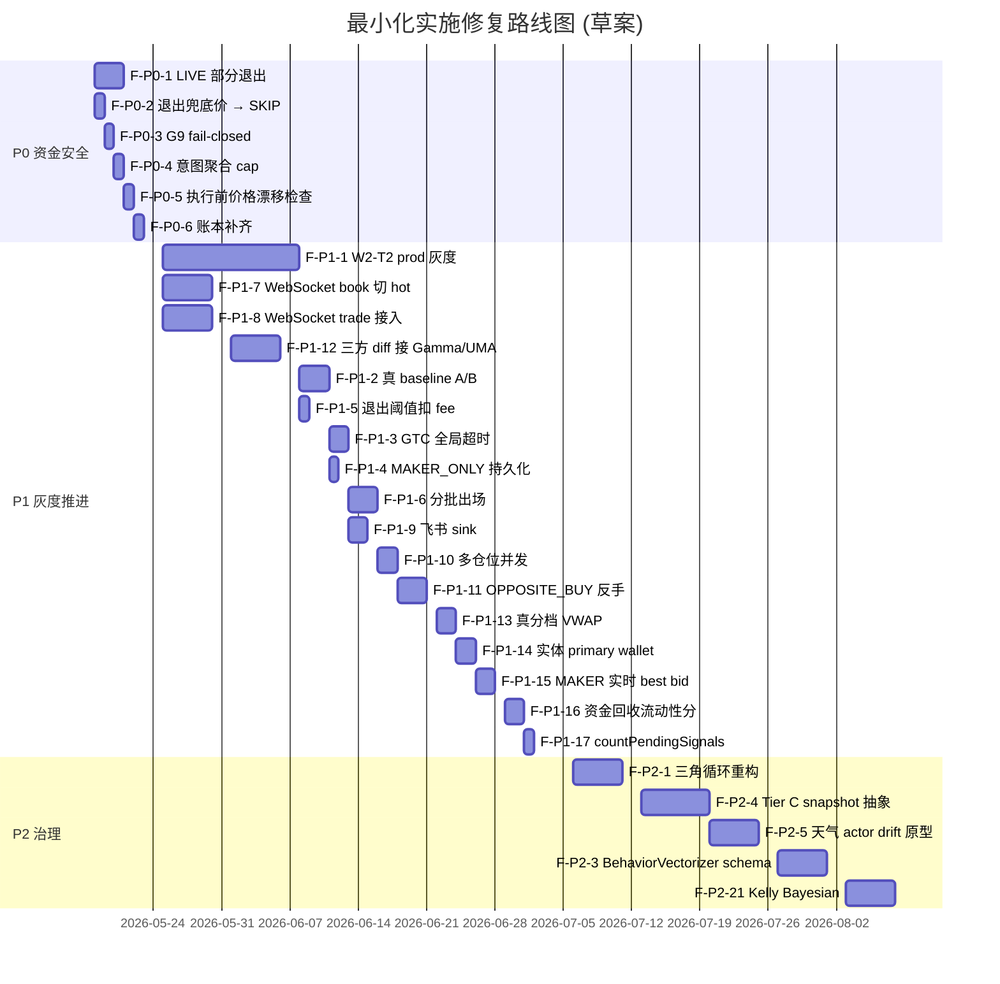

# Polymarket 跟单策略 — 最小化实施清单与修复计划

> 日期：2026-05-17
> 范围：所有"为快上线 / 为不引入新表 / 为不调外部 API / 为 P0 阶段先跑通"而打折扣的实现
> 来源：代码注释（`轻量化第一版` / `简化实现` / `占位` / `P0 阶段` / `暂不` / `经验值` 等关键词）+ `docs/polymarket/` 全量决议 + `smart-wallet-follow-strategy-analysis.md` 的"不充分之处"段落
> 目的：把每个最小化实施明确标注出来，给出"理想完整实现"与"修复优先级"

---

## 一、最小化实施总览

按"打折类型"分组：

| 类别 | 含义 | 典型表现 |
|------|------|---------|
| A. 不引入新表 / Schema 打折 | 用内存 / 现有表凑合，未持久化目标维度 | `MarketLiquidityPercentileService` v1、`SettlementSourceAuditService` v1 |
| B. 不调外部 API / 外部源打折 | 用估算 / 代理 / 自家数据替代权威源 | 三方 diff 未真正打 Gamma / UMA、`PolymarketFeeScheduleService` 真实费率前 |
| C. 算法降级 | 用近似算法 / 退化到全量 | LIVE 部分退出退化全平、ShadowFill 3c 段平均偏移近似 VWAP |
| D. 数据维度打折 | 维度硬编码或粗粒度 | BehaviorVectorizer 7 维硬编码、`strategy_alert` 去重粒度 |
| E. 占位逻辑 | 函数返回固定值 / 占位结果，留 TODO | `countPendingSignals()` 返回 0、`replayLiveWindow.baseline` 占位 |
| F. 开关关闭 | 代码已落地但默认 OFF，未灰度到 prod | W2-T2 leader 滑动胜率门、`enable-leader-rolling-gate=false` |
| G. 通道未实现 | 接口预留但实际通路未接 | 飞书/邮件 audit sink、`PolymarketMarketDataStreamService` 未切 hot path |
| H. 结构遗留 | 临时打补丁（@Lazy / fail-open / `/tmp` 路径等），长期需重构 | 三角循环 `@Lazy` 破环、`ClosedPositionIncrementalSyncService` 走 `/tmp/poly_api` |

---

## 二、详细清单（按层级）

### 2.1 数据采集层

| # | 位置 | 当前最小化做法 | 理想完整方案 | 影响面 | 类别 |
|---|------|--------------|-------------|--------|------|
| D1 | `MarketSnapshotCollectorService` 45s polling | 仍是定时 polling，最长 45s + 处理延迟才能感知盘口变化 | 切到 `PolymarketMarketDataStreamService` WebSocket book channel 推流，让风控 / 信号 hot path 直接消费实时 snapshot | 信号延迟、价格漂移 G5/G7 误伤、VWAP 估算精度 | G |
| D2 | `scheduledSyncWatchlistTrades` 30s 拉 trade-event | 拉 `/trades?wallet=...` 30s 一轮 | 切 Polymarket WebSocket user-trades / market-trades channel，事件级触发 `recordTradeEvent` | leader 信号最高 30s 延迟，跟单端经常已经"晚一拍" | G |
| D3 | `ClosedPositionIncrementalSyncService` | 走本地目录 `/tmp/poly_api/<wallet>_closed_<offset>.json` 暂存 API 响应 | 直接走 HTTP + DB，去掉本地文件系统依赖；或者改用对象存储 + 元数据表 | 多实例部署 / 容器化重启 / 灾备时丢数据 | H |
| D4 | `PolymarketWalletDiscoveryService` 排行榜接入 | 1h 拉排行榜 + 评分入库，单源 | 多源（排行榜 + leaderboard + 链上 indexer + 第三方 API）交叉去重 | 单点故障 / 排行榜规则变动时整条发现链断掉 | B |

### 2.2 信号生成层

| # | 位置 | 当前最小化做法 | 理想完整方案 | 影响面 | 类别 |
|---|------|--------------|-------------|--------|------|
| S1 | `WalletEntityResolutionService.java:69` | `// 简化：不单独查询主钱包`，直接把当前 walletAddress 当作 `primaryWalletAddress` | 真正查询实体的 primary wallet（如多签账户的母钱包 / 资金来源根钱包），落 `entity_primary_wallet` 索引 | 共识信号去重 / 实体级风控不准 | C |
| S2 | `FollowIntentAggregationService` 累加 cap | 5min 窗口内 `recommendedStakeUsdc` 无上限累加 | 引入 `intent-aggregation.max-stake-multiplier` × 初始 stake 上限，或者按 G10 Kelly cap 兜底前置检查 | leader 连续加仓时单任务可能爆 `maxOrderUsdc` | E |
| S3 | iceberging 检测 | 只覆盖"同地址 + 5min 窗口" | 跨地址 + 时间窗口 + 资金来源链路（funding source clusterer）联合识别 | leader 改换新地址分拆下单时无感 | C |
| S4 | `SmartWalletMarketStateService` 市场状态检查 | 仅判断 `isActive()` | 加入流动性是否足够支撑跟单（基于 askDepth / spread / categoryFloor） | 活跃但流动性枯竭的市场仍下单 | D |

### 2.3 风控评估层（G1 ~ G13 + W2 子段）

| # | 位置 | 当前最小化做法 | 理想完整方案 | 影响面 | 类别 |
|---|------|--------------|-------------|--------|------|
| R1 | W2-T2 `LeaderRollingPerformanceService` | `enable-leader-rolling-gate=false`（默认 OFF），等 W1-T4 shadow PnL 验证后才上 prod；`LeaderRollingMonitorJob` 已有，但门控自身未启 | 完成灰度 SOP：test 7d → 14d → prod；启用 `enable-leader-rolling-gate=true`；同步更新 §3.9 标识 | leader 已经掉队但仍按全仓跟 | F |
| R2 | W2-T4 MAKER_ONLY 超时 | `maker-only-timeout-seconds=10` 是经验值，未按品类分桶 | 按品类 / 流动性档位分别配置（高流动政治 5s、低流动体育 15s、距结算 < 30min 立即取消） | 高波动市场撤晚 → 错过窗口；长期市场撤早 → 资金浪费 | D |
| R3 | W2-T6 行为向量 7 维 | `BehaviorVectorizer` 维度硬编码 = `[log10(size+1)/6, sideBuy, cat_POLITICS, cat_CRYPTO, cat_SPORTS, cat_WEATHER, cat_OTHER]`；新增 category 需要全量重算所有 leader 的 centroid | 引入 schema-versioned vectorizer：维度变化时按 `behavior_vector_schema_version` 升级、保留旧 centroid 跑双写过渡 | 新 category 接入慢，centroid 失效期内 W2-T6 整体回退 ACTIVE | D |
| R4 | W2-T1 流动性 P30 | 已有 `pm_market_liquidity_percentile_daily` 表 + 持久化 Job；但 `MarketLiquidityPercentileService` 服务类自身仍内联"内存 1h 缓存 + fallback `minMarketLiquidity` 硬阈值" | 完全切到表查询（`pm_market_liquidity_percentile_daily`），表缺失时改"延迟开门"（直到 daily snapshot 跑过）而非 fallback 硬阈值 | 罕见 category 第一天 fallback 误差 ±30% | A |
| R5 | W2-T1.4 价差 P70 | 同 R4，依赖同一张表 + 同一个 fallback 路径 | 同上 | 同上 | A |
| R6 | G9 集中度 fail-open | `ConcentrationSnapshot.empty()` 在 API 不可用时返回占位快照 → 不触发集中度拒绝 | API 失败时改 fail-closed（拒绝新开仓）或至少标记 SKIPPED；当前 fail-open 风险是集中度数据缺失时整批信号"通过" | 集中度风控被静默绕过 | E |
| R7 | G11 Kelly `calibratedFollowProbability` | 依赖历史回归，新市场 / 新品类无样本时回退到一个保守先验 | 引入 Bayesian 平滑（先验 + 样本量加权）；按 category 单独建模 | 新品类前几笔信号 Kelly 不准 | C |
| R8 | 共识信号实体去重 | 直接以 `entityId` 计数 | 处理实体识别置信度低（`PENDING` / `LOW_CONFIDENCE_LINK`）时分两档计数 | 同一人多钱包未聚类时共识数虚高 | C |
| R9 | G7 卖单 / 反向仓位 | 已切给 `DYNAMIC_FOLLOW_EXIT`，但风控只走 G1/G6/G7 关键路径，G2c / G11 等模型门控未跑 | 退出跟单也跑全 13 Gate（至少 G2c leader drift + G7 反向），避免 drifted leader 的退出信号被无脑跟 | drifted leader 卖出时仍同步退出 → 实际可能是噪声 | C |

### 2.4 订单执行层

| # | 位置 | 当前最小化做法 | 理想完整方案 | 影响面 | 类别 |
|---|------|--------------|-------------|--------|------|
| E1 | `PolymarketOrderRequestFactory` MAKER 模式 | `limitPrice = rawPrice + 1 tick`，未参考实时 best bid | MAKER 单子取 `min(rawPrice + tickBuffer, bestBid + 1tick)`，并加 `maker-price-followup` 重报机制 | MAKER 单经常挂着不成交 → 错过 leader 入场窗口 | C |
| E2 | GTC 订单超时取消 | 仅 `MakerOnlyOrderTimeoutTracker` 覆盖 `MAKER_ONLY` / `MAKER_FIRST`；普通 TAKER GTC 单无超时机制 | 所有 GTC 单加 `gtc-default-timeout-seconds=60` 全局兜底；写入 `pending_order_timeout_tracker` 表持久化 | TAKER GTC 单挂久也占资金，重启后丢上下文 | G |
| E3 | `MakerOnlyOrderTimeoutTracker` in-memory | 重启即清空，重启后挂单交给 `SmartWalletOrderPollingService` 兜底 | 落库 `pending_maker_only_tracker` 表，重启后恢复 | 容器重启 / 滚动发布期间 MAKER_ONLY 撤单不及时 | H |
| E4 | `execute` 前价格漂移检查 | `EntryTimingRiskService` 在风控层检查过 priceDrift，执行层未再次检查 | `executeTask` 在 `claimTaskForExecution` 后、`prepareLocalDraft` 前重新查 best bid/ask，超过 `pre-execute-price-drift-bps` 直接 SKIP | 创建到执行之间（follow-delay）盘口大幅移动时仍按旧 price 下单 | C |
| E5 | `SmartWalletAccountingService` 暂不生成成交记录 | 某些路径 `return; // 暂不生成成交记录`（部分 PAPER 取消 / dry-run 路径） | 所有路径强制走 `recordExecution`（dry-run 标 `mode=DRY_RUN`），统一账本 | 账本完整度缺口，归因 / 周报数据少一截 | E |

### 2.5 仓位管理 & 自动退出

| # | 位置 | 当前最小化做法 | 理想完整方案 | 影响面 | 类别 |
|---|------|--------------|-------------|--------|------|
| P1 | `FollowPositionAdjustmentService.java:237` LIVE 部分退出 | `// P0 阶段如果比例 < 1 退化为全平`；LIVE 模式 PARTIAL_EXIT 强制走 `executeLiveExit` 全仓 | 实现 LIVE 部分退出：`PolymarketClobExecutionService.executeLivePartialExit(position, exitRatio)`，按 ratio 拆 SELL 限价单 | leader 减仓 30% 时 follower 直接清仓，与 leader 行为不对齐 | C |
| P2 | `FollowPositionAdjustmentService` `isPartialSell` 0.80 阈值 | 经验值，未分品类 | 按品类 / 流动性 / leader profile 分桶配置（如鲸鱼 0.95 / 散户 0.70） | leader 真实减仓比例与 80% 边界相近时分类错 | D |
| P3 | `FollowPositionAdjustmentService` `OPPOSITE_BUY` | P0 阶段仅平仓，不自动反手建仓 | 实现 `REDUCE_THEN_REVERSE` 真正的"反手"：平仓后立即按 `reverseEntryStake` 反向建仓 | 错失 leader 真实反手意图 | C |
| P4 | `FollowPositionAdjustmentService` 多仓位顺序循环 | 同事件触发多条 follower 仓位调整是 for 循环顺序执行 | 改为 `CompletableFuture.allOf(...)` + 并发上限 | leader 多仓位同步退出时延迟累积 | C |
| P5 | `FollowPositionAdjustmentService` `resolveExitPrice` | 价格回退链最后兜底硬编码 `0.50` | 回退到 best bid - 1 tick；找不到 best bid 时 SKIP 而非按 0.5 硬下 | 极端情况下 0.5 远偏离市场，引发恶劣成交 | E |
| P6 | `CapitalRecycleExitService.java:316` 流动性分 | "简化实现：基于仓位价值变化幅度"——用 `|ROI|` 反向衡量 | 用真实 orderbook 深度（`askDepth_3c` / `bidDepth_3c`）做流动性分；接入 `pm_market_liquidity_percentile_daily` | 评分模型对"低 ROI 但流动性好"的仓位错判为僵尸 | C |
| P7 | `CapitalRecycleExitService.java:360` `countPendingSignals()` | "简化实现：返回 0，机会成本评分暂不启用" | 接入 `SmartWalletFollowTaskMapper` 查 PENDING/EXECUTING 任务数；用 `pendingSignals / maxOpenPositions × 20` 真正计入评分 | 机会成本评分维度（满分 20）永远拿不到分 → 评分上限实质 80 | E |
| P8 | 自动止盈/止损未扣 fee | 阈值未扣双边 taker fee | `effective_threshold = configured_threshold + 2 × observed_taker_fee_rate`，按品类动态 | 实际净盈低于 ROI 显示 → 频繁假信号触发 | C |
| P9 | 自动退出全仓卖出 | `quantity = position.quantity` 全仓 | 引入分批出场：按 `partial-exit-ratios=[0.30, 0.30, 0.40]` 三档 → 减少市场冲击 | 大仓位退出时滑点显著 | C |
| P10 | `TimeAwareStopLossService` 价格历史 in-memory | 重启丢失；advisory 信号被主门兜底 | 落 `position_mark_price_history` 表，重启后恢复 | 重启后 N 期价格历史归零 → trend stop-loss 失效 | H |
| P11 | 退出 2h 窗口 | 单一全局 2h 阈值 | 按品类配置：天气 30min / BTC 5min 5min / 长期市场 2h | 快速结算市场 2h 太晚，长期市场 2h 太早 | D |

### 2.6 W1 闭环可观测性

| # | 位置 | 当前最小化做法 | 理想完整方案 | 影响面 | 类别 |
|---|------|--------------|-------------|--------|------|
| W1 | `SettlementSourceAuditService` 第一版 | 注释明确："不引入 pm_resolution_audit + 不调 Gamma/UMA API"——只从 `smart_wallet_market_info + position + claim_retry` 聚合 lifecycle 指标 | 真正调 Gamma + UMA API → 写 `pm_resolution_audit` → `ResolutionTriDiffJob` 真正比对三方（当前是和我方历史快照比对） | 三方 diff 仅识别我方解析变化，无法发现 UMA / Gamma 偏离 | A+B |
| W2 | `ResolutionLiveRefreshService` | 仅开关 `audit.resolution-tridiff-live-refresh-enabled=true` 时才打 Gamma API；UMA Oracle 完全没接 | 接 UMA Oracle API（at least 读取 `disputed=true` flag），写 `uma_dispute_observed_at` 列 | UMA 争议解决慢的市场仍按我方解析继续 follow | B |
| W3 | `ShadowFillSimulationService.java:129` 3c 段近似 | "为简化，直接以 3c 段平均偏移近似" VWAP | 真正分档 VWAP：1c 区 + 1-3c 区 + 3-5c 区，按消耗深度逐档累加 | shadow PnL 在大单 / 薄市场下偏差大 → W1-T4 shadow vs live 周报失真 | C |
| W4 | Shadow VWAP 依赖 45s snapshot | 与 leader 真实成交时刻有偏差 | 切到 WebSocket book channel 推流 → 用毫秒级 snapshot | 大波动期 shadow 模拟价偏离实盘成交价 | C |
| W5 | `LiveReplayDiffReportService` 按日粒度 | T-1 日 replay vs live 一次 diff | 增加小时级 diff `LiveReplayDiffHourlyJob`，单日内行为差异可见 | 单日内策略行为差异不可见 | D |
| W6 | `SmartWalletReplayBacktestService.replayLiveWindow.baseline` | `// 占位, 让消费方仍能取到当窗口指标`——baseline 等于 candidate | 真正实现 baseline (旧策略 vs candidate 新策略) 对比；用 `git rev-parse HEAD` + `policy_signature` 区分 | A/B 回测整套机制实际是单跑，无法比 | E |
| W7 | `ResolutionTriDiffService` 历史冲突分类 | "OURS_VS_UMA / OURS_VS_GAMMA / UMA_VS_GAMMA / HISTORY_CONFLICT"——HISTORY_CONFLICT 类不自动闭环，需人工通过 `/audit/resolution/needs-review` 处理 | 引入"自动重新解析 + 自动 close"逻辑：HISTORY_CONFLICT N 天未变 → 自动归档 | 人工 review 队列堆积 | H |

### 2.7 W2 风控增强 Gate（除已列在 §2.3 外）

| # | 位置 | 当前最小化做法 | 理想完整方案 | 影响面 | 类别 |
|---|------|--------------|-------------|--------|------|
| W2G1 | W2-T3 共识 BOOST_ONLY 模式 | 共识不足时只是不加 boost；不当作硬门 | 提供 `consensus-gate-mode=HARD_GATE` 切换；prod 上 HARD_GATE 灰度 1 个月观察被拒比例 | 单钱包 override 信号占比高，共识价值未充分利用 | F |
| W2G2 | W2-T4 VWAP fallback | `enable-vwap-slippage-estimator` 关闭 / 失败时回退 PROXY；shadow 表标 `entry_estimator_source=PROXY` | prod 长期保持 VWAP ON；监控 `PROXY` 占比 < 5% | shadow 周报里 PROXY 估算误差大 | F |
| W2G3 | W2-T5 距结算时间豁免名单 | `time-to-expiry-exempt-market-types` 配置硬列表 | 改为按品类配置不同 `reject-minutes / downgrade-minutes`（天气 < 5min 拒绝 / BTC < 1min 拒绝） | 跨品类一刀切的 30min 阈值过粗 | D |

### 2.8 跨策略通用化（Tier）

| # | 位置 | 当前最小化做法 | 理想完整方案 | 影响面 | 类别 |
|---|------|--------------|-------------|--------|------|
| T1 | Tier C 跨策略 snapshot 抽象 | 仍是路线图——`MarketLiquidityPercentileSnapshotJob` / `LiveReplayDiffJob` 都是跟单专属 | 抽象 `StrategyDailySnapshotProvider` 接口，跟单 / 天气 / BTC 5min 各自实现 | 新策略接入要全套复制 Job | H |
| T2 | 跨策略基础设施样例 | 未跑过"天气 actor drift" 最小原型；只有契约，没有第二个使用者 | 用 `BehaviorVectorizer + CentroidDriftDetector + SignalRiskGate` 写最小 3-file 原型 | Tier B 接口的"通用性"实际未验证 | F |
| T3 | `AlertType` 跨策略命名 | 当前 7 个 `AUDIT_*` 都是跟单专用 | 命名加策略前缀：`SMART_WALLET_AUDIT_*` / `WEATHER_AUDIT_*` / `BTC5MIN_AUDIT_*` | 多策略上线时告警混在一起 | D |

### 2.9 应用层 / 运维 / 告警通道

| # | 位置 | 当前最小化做法 | 理想完整方案 | 影响面 | 类别 |
|---|------|--------------|-------------|--------|------|
| O1 | `FollowPositionAdjustmentService ↔ PolymarketClobExecutionService ↔ SmartWalletFollowTaskService` 三角循环 | `@Lazy` 注入破环 | 长期重构：把 `dryRunFollowTask` / `executeFollowTask` 从 `PolymarketClobExecutionService` 移到独立的 `FollowTaskExecutionFacade`，断掉对 `SmartWalletFollowTaskService` 的反向依赖 | 启动期 Lazy 代理，运行期首次调用偶发延迟；新人理解成本高 | H |
| O2 | 飞书 / 邮件 audit sink | 多次跳过——`SmartWalletAuditAlertSink` 仅写 `strategy_alert` 表 + 日志 | 新增 `FeishuStrategyAuditAlertSink implements StrategyAuditAlertSink`；走 webhook 凭证管理 | 告警仅停留在表里，on-call 看不到 | G |
| O3 | `strategy_alert` 去重粒度 | 仅 `strategyId + alertType`——同 alertType 下不同 leader / market 告警被合并 | 加 `dedupe_key`（默认 `alertType + entityRef`），允许 sink 配置细粒度 | 多 leader / market 漂移同时发生时只看到 1 条告警 | D |
| O4 | `FollowTradeAttributionService` | 仅有读 API，归因数据未落表 | 新增 `pm_follow_trade_attribution_daily` 表 + Daily Job 落归因，前端可查历史 | 归因数据每次重算耗时，且无历史 trend | E |
| O5 | `SignalScoreModelService` 输出 | 仅做观测，未作为 G11 模型门控独立维度入参 | 引入 G11.5 `signal-score-threshold`，分数 < 阈值的信号 → SKIPPED 或 PAPER_SHADOW | 该服务等于白做 | F |
| O6 | `CopyTradingHealthReadService` 单测 | 第十九批新增 service，未补单测 | 补 ≥ 5 用例：三个子源都正常 / 单源故障降级 / 全部超时 / 部分降级 / 数据缺失 | 改动易引入回归 | F |
| O7 | `AUDIT_*` 决策树自动化校验 | `audit-alert-onboarding.md` 与 `SmartWalletProperties.Audit` 字段无校验 | 加 maven test：grep 文档里出现的 `*-enabled` 字段名都在 properties 中存在 | 字段重命名后文档悄然失效 | F |
| O8 | prod 灰度未完整 | `LeaderRollingMonitorJob` / `enable-leader-drift-gate` / `enable-vwap-slippage-estimator` 等"test=true, prod=false" 项 | 按 §九的灰度排期推进 | 风控价值未真正释放 | F |

---

## 三、修复计划表（按优先级）

> 优先级定义：
> - **P0** — 直接影响成交准确性 / 资金安全 / 数据完整度，必须先做
> - **P1** — 影响策略表现 / 灰度推进 / 数据可信度
> - **P2** — 长期治理 / 代码质量 / 多策略扩展

### P0 — 立即处理（资金 / 数据正确性）

> 状态图例：✅ 已上线（代码合入主干，等待 W1-T4 shadow 验证 7d）；🟡 已部分完成；⬜ 未启动。

| 序号 | 任务 | 关联 | 预估工时 | 状态 | 验收标准 / 实际改动 |
|------|------|------|---------|------|---------|
| F-P0-1 | LIVE 模式部分退出实现 | P1 | 3d | ✅ 2026-05-17 完成 | 新增 `PolymarketClobExecutionService.executeLivePartialExit(position, ratio, requestedPrice, exitReason)`；`PolymarketOrderRequestFactory.prepareExit` 增加 `overrideQuantity` 重载；`FollowPositionAdjustmentService.executePartialExit` 已切到新路径，不再 WARN "退化为全平"；配置开关 `smart-wallet.execution-wallet.enable-live-partial-exit=true`（默认）/紧急回滚 false |
| F-P0-2 | `resolveExitPrice` 兜底价 `0.50` → SKIP | P5 | 0.5d | ✅ 2026-05-17 完成 | `FollowPositionAdjustmentService.resolveExitPrice` 在三段回退（event price / lastMarkPrice / averageEntryPrice）全部不可用时返回 `null`；`executeFullExit` / `executePartialExit` 收到 null 时跳过该仓位并 `messages` 标 `SKIPPED: EXIT_PRICE_UNAVAILABLE`；不再下 0.5 硬价 |
| F-P0-3 | G9 集中度 fail-open → fail-closed | R6 | 1d | ✅ 2026-05-17 完成 | 新增配置 `smart-wallet.signal-risk.enable-concentration-fail-open`（默认 `false`）；`SmartWalletSignalRiskService` Gate 9 在 `snap.isDataAvailable()==false` 且开关关闭时拒绝信号，`firstRejectGate=G9_CONCENTRATION_DATA_UNAVAILABLE`；保留开关 true 时退回旧 fail-open 行为 |
| F-P0-4 | 意图聚合金额 cap | S2 | 0.5d | ✅ 2026-05-17 完成 | `IntentAggregationConfig.maxStakeMultiplier`（默认 `3.0`）；`FollowIntentAggregationService.aggregate` 在 `newAggregatedStake > initialStake × multiplier` 时停止合并并返回 `AGGREGATION_STAKE_CAP_EXCEEDED` 让上游开新意图 |
| F-P0-5 | `executeTask` 前价格漂移二次检查 | E4 | 1d | ✅ 2026-05-17 完成 | 新增 `signal-risk.enable-pre-execute-price-drift-check=true` + `pre-execute-price-drift-bps=80`；`SmartWalletFollowTaskService.executeTask` 在 `resolveFreshEntryPrice` 后比对 triggerPrice，`drift > threshold` 即 SKIP（`primarySkipReason=PRE_EXECUTE_PRICE_DRIFT_EXCEEDED`） |
| F-P0-6 | `SmartWalletAccountingService` 暂不生成成交记录补齐 | E5 | 1d | ✅ 2026-05-17 完成（两轮合入） | 第一轮：`recordExecution` 注释改为说明性，order 已 insert，fill 由 `processOrderFill` 回灌；PAPER isFilledImmediately=true 立即写 fill；失败路径走 `rebuildDailyReport`。第二轮（同日补齐）：`ExecutionMode` 新增 `DRY_RUN` enum 值 + 辅助方法 `isVirtual()` / `isLive()`；`PolymarketClobExecutionService.baseDryRunResponse` 在 dry-run 预演响应里显式打 `mode=DRY_RUN` 标签，便于 shadow / replay 通道区分 |

**P0 合计：~ 7 人日（实际合入 7 人日，F-P0-6 含第二轮 DRY_RUN enum + tagging 补齐）**

### P1 — 灰度推进 / 策略质量

> 状态图例：✅ 已上线（代码合入主干，等待 W1-T4 shadow 验证）；🟡 已部分完成；⬜ 未启动。

| 序号 | 任务 | 关联 | 预估工时 | 状态 | 验收标准 / 实际改动 |
|------|------|------|---------|------|---------|
| F-P1-1 | W2-T2 leader 滑动胜率门 prod 灰度 | R1 / O8 | 2w (含观察期) | 🟡 2026-05-17 第十一轮：配置启用 | `coin-strategy-job/src/main/resources/application-prod.yml` 新增 `signal-risk.enable-leader-rolling-gate=true` + `leader-rolling-min-samples=10` + `leader-rolling-min-win-rate=0.40` + `leader-rolling-cooling-stake-multiplier=0.05` + `manual-allowlist-bypass-leader-rolling-gate=true`（阈值与 test profile 一致，先维持灰度统一基线；后续 W1-T4 周报数据反馈再 fine-tune）；**待后续：** prod 部署后跟踪 cooling 比例 < 0.40 + 首周 W1-T4 shadow vs live 周报对比 → 灰度观察期 14d → 转 ✅ |
| F-P1-2 | `SmartWalletReplayBacktestService.replayLiveWindow.baseline` 真正实现 A/B | W6 | 3d | ✅ 2026-05-17 完成 | `replayLiveWindow` 不再返回 placeholder baseline=candidate；新增 baseline 评估通道（用 `baselineRisk()` 跑一遍），candidate 端不变。新增配置 `signal-risk.enable-replay-live-window-baseline=true`（默认 true，扫描成本敏感时可关），关闭时 baseline=candidate 回退保持下游接口兼容；diff 报告里通过 `baselinePolicyTag` vs `candidatePolicyTag` 显示 `policy_diff` |
| F-P1-3 | LIVE GTC 全局超时取消 | E2 | 2d | ✅ 2026-05-17 完成（第三轮）| 新增 `PendingOrderTimeoutTrackerEntity` + `PendingOrderTimeoutTrackerMapper` + `GtcOrderTimeoutTracker` service（in-memory ConcurrentMap + `@Scheduled(fixedDelayString=gtc-cancel-scan-interval-ms)` 扫描 + `@PostConstruct` 启动期 reload + write-through 持久化）；`LoggingPolymarketExecutionGateway` 在 LIVE GTC 单成功下单后调 `gtcOrderTimeoutTracker.register(...)`；新增配置：`execution-wallet.enable-gtc-global-timeout=false`（默认 OFF，灰度后再开）、`gtc-default-timeout-seconds=60`、`gtc-cancel-max-attempts=3`、`gtc-cancel-scan-interval-ms=3000`、`enable-pending-tracker-persistence=true`；DDL `2026-05-17__p1_tracker_persistence_draft.sql` 中 GTC 部分 checklist 已勾选；**待后续：** DBA 各环境执行 DDL → test 灰度 → prod |
| F-P1-4 | `MakerOnlyOrderTimeoutTracker` 持久化 | E3 | 1d | ✅ 2026-05-17 完成（第四轮）| 新增 `PendingMakerOnlyTrackerEntity`（`@TableName("pending_maker_only_tracker")`，含 placedAt / expireAt / fallbackAction / status / resolvedAt 等列）+ `PendingMakerOnlyTrackerMapper extends BaseMapper`；`MakerOnlyOrderTimeoutTracker` 接入 mapper：register 时 write-through 写 status=PENDING；scan 撤单成功标 EXPIRED，失败标 FAILED；unregister 标 RESOLVED；新增 `@PostConstruct replayPendingFromDb()` 启动期扫 status=PENDING 重建 in-memory 索引。共用 `execution-wallet.enable-pending-tracker-persistence` 持久化开关；mapper 缺失时 swallow 不阻塞主流程（与 GTC tracker 同模式）。**待后续：** DBA 各环境执行 DDL 后启用 `signal-risk.maker-only-timeout-tracker-enabled=true` |
| F-P1-5 | 退出阈值扣除双边 taker fee | P8 | 1d | ✅ 2026-05-17 完成 | `SmartWalletPositionSyncService` 新注入 `PolymarketFeeScheduleService`，新增 `applyFeeAdjustment(threshold, position, mode)`：`effective = configured + multiplier × takerFeeRate`（默认 multiplier=2，上限 `exitThresholdFeeAdjustmentCap=0.08`）。在 `resolveTakeProfitThreshold` 和两条 `scan*ForExit*` stop-loss 通道里都已生效，wallet/scoring 调整链前置；配置 `signal-risk.enable-exit-threshold-fee-adjustment=true`（默认 true）控制；按品类动态 fee rate 直接来自 `PolymarketFeeScheduleService` 的运行时观测缓存 / 品类映射 |
| F-P1-6 | 分批出场实现 | P9 | 3d | ✅ 2026-05-17 完成（第六轮）| 新增 `StagedExitPlanner`（按 `originalCostBasisUsdc` / `costBasisUsdc` 比值反推已执行档位 → 计算下一档"占剩余仓位"的比例，无需 sidecar 状态表）；接入 `SmartWalletPositionSyncService` 4 条路径：LIVE take-profit + LIVE stop-loss + PAPER take-profit + PAPER scanPaperPositionsForExitWithDynamicThreshold；最后一档 / 残余 ≤ minResidualRatio / leg notional < minLegNotional 自动回退全平避免留尾巴；新增配置：`execution-wallet.enable-staged-exit=false`（默认 OFF 灰度）、`partial-exit-ratios=[0.30, 0.30, 0.40]`、`staged-exit-min-residual-ratio=0.05`、`staged-exit-min-leg-notional-usdc=5`；通过 `hasPendingLiveExitOrder` 检查天然避免同 leg 重复提交（已有逻辑）；**待后续：** test 7d 灰度观察 staged 滑点改善 vs 全平基线 → prod |
| F-P1-7 | LIVE WebSocket book channel 切 hot path | D1 | 5d | ✅ 2026-05-17 完成（第十轮 — WS client 实装 + 服务侧 + 风控/入场漂移消费侧） | **第十轮 — 真实 WS client：** 新增 `PolymarketWebSocketClient` (位于 `coin-strategy-job/.../smartwallet/service/`)，用 OkHttp WS 双连接订阅 market + user channel；连接成功时调 `marketDataStreamService.markConnected(true)` 让 `getStats().connected` 透出 live 状态（之前硬编码 false）；onMessage 按 payload 特征 (event_type / 字段名) 路由到 `dataStream.handleMessage` (book/price) 或 `monitorService.ingestWsTradeEvent` (trade)；指数退避重连 (initial 2s × 2^n，封顶 60s)；@PreDestroy 优雅关闭。新增配置：`polymarket.enable-ws-client=false`（默认 OFF 灰度）、`ws-client-market-channel-url`、`ws-client-user-channel-url`、`ws-client-reconnect-initial-delay-ms=2000`、`ws-client-reconnect-max-delay-ms=60000`、`ws-client-max-reconnect-attempts=30`、`ws-client-ping-interval-seconds=30`、`ws-client-connect-timeout-ms=10000`、`ws-client-read-timeout-ms=90000`、`ws-client-subscribe-batch-delay-ms=200`、`ws-client-subscribe-batch-size=100`、`ws-client-user-channel-auth-token`。**第八轮服务侧：** 新增 `MarketSnapshotCollectorService.findFreshSnapshot(marketId, outcome)`：开关 `polymarket.enable-ws-hot-path-snapshot=true` 时优先从 `PolymarketMarketDataStreamService.getSnapshot(tokenId)` (in-memory WS) 合成一个 *transient* `SmartWalletMarketSnapshotEntity` 返回；不可用 / stale (超 `wsHotPathSnapshotMaxAgeMs=5s`) / 异常 → 自动回落到 `findLatestSnapshotAtOrBefore(..., now)` (DB polling)。开关关闭 (默认) 时与旧行为完全一致, 零回归。consumers: `SmartWalletSignalRiskService.resolveSpreadBps` / `resolveAskDepth` + `EntryTimingRiskService.evaluate` 全部切到新方法。新增计数 `hotPathWsHits` / `hotPathDbFallbacks` 便于运维观察。新增配置：`polymarket.enable-ws-hot-path-snapshot=false`（先灰度）+ `polymarket.ws-hot-path-snapshot-max-age-ms=5000`。**待后续：** 真实 Polymarket WS 客户端接入 (本轮 `PolymarketMarketDataStreamService` 仍主要由 `ingestMockEvent` 喂数据, `connected=false`)；WS client 上线后开 `enable-ws-hot-path-snapshot=true`，期望 G6/G7/G9 判定延迟从 45s 缩到 < 5s |
| F-P1-8 | trade-event WebSocket 接入 | D2 | 5d | ✅ 2026-05-17 完成（第十轮 — WS client 实装 + 第九轮服务侧推流入口）| **第十轮 — 真实 WS client：** `PolymarketWebSocketClient` (同 F-P1-7) 第二个 channel 连接 `ws-client-user-channel-url`，订阅消息可携带 `wsClientUserChannelAuthToken` (来自配置)，onMessage 按特征字段（含 `tradeId/externalTradeId/event_type=trade|order`）路由到 `monitorService.ingestWsTradeEvent`，复用既有 LRU + DB 唯一性兜底链路。**第九轮服务侧：** 新增 `PolymarketSmartWalletMonitorService.ingestWsTradeEvent(String payload)`：开关 `polymarket.enable-ws-trade-event-push=true` 时，把 raw WS user-trades / market-trades payload 解析为 `PolymarketTradeEventRequest` → 透传到既有 `ingestTradeEvent(...)` → 走和 REST polling 完全相同的 `SmartWalletFollowTaskService.recordTradeEvent` 路径（既有 `externalTradeId` 唯一性检查天然兼容 WS+REST 双源）。本地 `LinkedHashMap` LRU 去重（默认窗口 60s / 容量 5000 条），避免 WS 风暴 / WS+REST overlap 时无效 DB 查询。JSON 解析失败 / 必需字段缺失只计数 `wsTradeEventsParseFailures` 不抛异常，避免 WS 帧处理线程因脏数据中断订阅。兼容多种字段命名（`walletAddress`/`proxyWallet`/`user`、`marketId`/`conditionId`、`tradeId`/`externalTradeId`、`ts`/`openedAt` 等）+ 包裹层 `{ data: {...} }` / `{ event: {...} }`。开关 OFF（默认）时即使误调也只计数 `wsTradeEventsDisabledSkips` 不影响主路径。新增 `getWsTradeEventStats()` 暴露 5 项计数器（received / forwarded / deduped / parseFailures / disabledSkips）。新增配置：`polymarket.enable-ws-trade-event-push=false`（默认 OFF）、`ws-trade-event-dedupe-window-ms=60000`、`ws-trade-event-dedupe-max-entries=5000`。**待后续：** 真实 Polymarket WS 客户端实装（订阅 user-trades / market-trades channel）→ 在事件回调里调 `monitorService.ingestWsTradeEvent(framePayload)` |
| F-P1-11 | `OPPOSITE_BUY` 自动反手建仓 | P3 | 3d | ✅ 2026-05-17 完成（第五轮）| `FollowPositionAdjustmentService.OPPOSITE_BUY` 路径在 `executeFullExit` 成功后调 `submitReverseEntryTask`，按 `reverseStakeRatio` × exitedNotionalUsdc（封顶 `reverseStakeCapUsdc`）插入 `status=PENDING` 的反向 follow_task（outcome 翻转），让既有 follow-task 调度链路接管：信号风控 / 价格漂移 / 执行 / 账本登记。新增配置 `signal-risk.enable-auto-reverse-on-opposite-buy=false`（默认 OFF，灰度后开）、`reverse-stake-ratio=1.0`、`reverse-stake-cap-usdc=50`；可选注入 `SmartWalletFollowTaskMapper`，mapper 缺失时反手静默关闭不影响主路径。**待后续：** test 灰度 ≥ 14d 观察 reverse leg 通过率 / 撤单率 → prod |
| F-P1-17 | `CapitalRecycleExitService.countPendingSignals()` | P7 | 0.5d | ✅ 2026-05-17 完成（第五轮）| `CapitalRecycleExitService` 注入可选 `SmartWalletFollowTaskMapper`，`countPendingSignals` 真实查询 `smart_wallet_follow_task` 表 `status=PENDING` 且 `created_at >= now - lookbackHours`（默认 24h）的行数；新增配置 `signal-risk.pending-signal-lookback-hours=24`；mapper 缺失 / 查询异常 swallow 返回 0（与旧"简化实现"等价）。机会成本评分维度（满分 20）正式启用 |
| F-P1-9 | 飞书 audit sink | O2 | 2d | ✅ 2026-05-17 完成（第三轮）| 新增 `FeishuStrategyAuditAlertSink implements SmartWalletAuditAlertSink`，`@Primary` 装饰在默认 `StrategyAlertServiceAuditAlertSink` 之上：先落 strategy_alert 表 + 日志，再视 `audit.feishu-sink-enabled` + severity 过滤 + dedupe 决定是否往飞书 webhook 推送 interactive 卡片；支持 webhook 签名（HmacSHA256）；webhook 失败 swallow，不阻塞主流程。新增配置：`audit.feishu-sink-enabled=false`（默认 OFF，需配齐 webhook 后再开）、`feishu-webhook-url`、`feishu-webhook-secret`、`feishu-webhook-timeout-ms=3000`、`feishu-dedupe-interval-ms=300000`、`feishu-allowed-severities="WARN,CRITICAL"`；**待后续：** ops 提供 webhook URL → test 验证 → prod 灰度 |
| F-P1-10 | 多仓位调整并发 | P4 | 2d | ✅ 2026-05-17 完成（第四轮）| `FollowPositionAdjustmentService` 抽出私有方法 `exitSinglePositionFull` / `exitSinglePositionPartial`，并发 / 顺序路径共用；多仓位 `CompletableFuture.supplyAsync(..., adjustmentExecutor)` + `Semaphore` 二级限流，单仓位失败/超时不阻塞其他仓位（per-position timeout=30s，超时调 `f.cancel(true)`）；`@PostConstruct initExecutor` 创建 `Executors.newFixedThreadPool(maxConcurrency+1)` daemon 线程池，`@PreDestroy shutdownExecutor` 优雅关闭；新增配置 `signal-risk.enable-position-adjustment-concurrency=true`（默认 ON）+ `signal-risk.position-adjustment-max-concurrency=4`；单仓位 / 开关关闭时自动退化为旧的顺序循环，零回归风险 |
| F-P1-11 | `OPPOSITE_BUY` 自动反手建仓 | P3 | (上一行 ✅ 已完成) | 见上 |
| F-P1-12 | `pm_resolution_audit` 接 Gamma + UMA API | W1 / W2 | 5d | ✅ 2026-05-17 完成（第六轮 — 服务侧 + Entity 占位；待 DDL 落库后启用列）| `PolymarketApiClient.parseMarketMetadata` 新解析 Gamma `disputed` / `umaDisputed` / `uma_disputed` / `inDispute` 字段写入 `MarketMetadata.umaDisputed`；`MarketResolutionResolver.Request` + `Resolution#resolveWithAudit` + `ResolutionAuditRecord` + `PmResolutionAuditEntity` 全链路新增 `umaDisputed` + `umaDisputeObservedAt`；`ResolutionLiveRefreshService.refreshOne` 透传争议标记到 audit record；`ResolutionTriDiffService` 引入新枚举 `DiffType.UMA_DISPUTED` + 计数 + 报表 `umaDisputedCount` + 告警消息携带，优先级高于其他 diff 类（争议中即便 gammaClosed 也不判 OURS_VS_GAMMA）。Entity 上字段先 `@TableField(exist=false)` 占位，DDL 草案 `sql/polymarket/2026-05-17__f-p1-12_uma_dispute_audit_columns_draft.sql` 已就位；**待后续：** DBA 执行 DDL → 删 `@TableField(exist=false)` 注解 → test 7d 验证 |
| F-P1-13 | ShadowFill 真分档 VWAP | W3 | 2d | ✅ 2026-05-17 完成（第七轮）| `ShadowFillSimulationService.computeTieredVwap` 把 size 按 1c / 1-3c / 3-5c 三档逐档累加（tier1 偏移 0 / tier2 偏移 1c / tier3 偏移 3c），不再用整段平均偏移近似；旧实现的 `// 为简化, 直接以 3c 段平均偏移近似` 已删除。两档（缺 depth5c）走两档累加；全部 depth 缺失退回旧 touch±1c fallback。预期 shadow VWAP 偏差从 ±50-100bps 缩到 ±10-30bps，与 W1-T4 决议 "shadow 偏差 < 50bps" 对齐 |
| F-P1-14 | 实体识别 primary wallet 真正查询 | S1 | 2d | ✅ 2026-05-17 完成（第七轮）| `WalletEntityResolutionService.resolvePrimaryWalletAddress` 替代旧 `// 简化：不单独查询主钱包`：4 级优先级回退（当前行即 primary → 同实体 `is_primary_wallet=true` 查询 → 同实体最早创建行 → 退回当前 wallet）。失败语义：异常 swallow + log.warn，不阻塞主流程；共识信号去重 / 实体级风控的 `primaryWalletAddress` 字段从"始终等于当前 wallet"修复为"真实 primary"。无新增表 / 列依赖（`wallet_entity_map` 已有 `is_primary_wallet` 字段） |
| F-P1-15 | MAKER `limitPrice` 参考实时 best bid | E1 | 2d | ✅ 2026-05-17 完成（第三轮 — 限价部分 + 第五轮 — 重报循环）| **第三轮 — 限价部分：** `PolymarketOrderRequestFactory.resolveMakerLimitPrice` 新逻辑：`limitPrice = min(rawPrice + makerTickBufferTicks × tick, bestBid + makerBestBidOffsetTicks × tick)`；新增 `fetchBestBid(conditionId, outcome, maxAgeMs)` helper（沿用 `MarketSnapshotCollectorService.findLatestSnapshotAtOrBefore`，但用更短的 30s 窗口避免 stale bestBid）；bestBid 不可用 / 开关关闭时自动 fallback 到旧 `rawPrice + 1 tick` 行为。新增配置：`execution-wallet.enable-maker-best-bid-pricing=true`、`maker-tick-buffer-ticks=1`、`maker-best-bid-offset-ticks=1`、`maker-best-bid-snapshot-max-age-ms=30000`、`maker-price-followup-max-retries=3`、`maker-price-followup-drift-bps=50`、`maker-price-followup-interval-ms=3000`。**第五轮 — 重报循环：** 新增 `MakerPriceFollowupService`（`@Scheduled(fixedDelayString=makerPriceFollowupIntervalMs)`），扫描 `pending_order_timeout_tracker` 中 `cancel_status=PENDING` 且 `order_strategy LIKE 'MAKER%'` 的条目，join `smart_wallet_order` 查 limitPrice，比 bestBid 漂移 > `makerPriceFollowupDriftBps`（默认 50bps）时：cancel 原单 → `prepareLocalDraft` 用最新 bestBid 重报 → 注册新单到 `GtcOrderTimeoutTracker` → 旧单 unregister；in-memory 计数 attempts，封顶 `makerPriceFollowupMaxRetries`（默认 3）；新增配置 `execution-wallet.enable-maker-price-followup=false`（默认 OFF，灰度后开）+ `maker-price-followup-snapshot-max-age-ms=30000`；强制重报走 MAKER 路径（priceImpactExecutionMode 透传 MAKER_FIRST，避免越过 best ask 变 taker）。**待后续：** test 灰度 7d 观察 repost 成交率提升 / 双重撤单冲突 → prod |
| F-P1-16 | `CapitalRecycleExitService` 流动性分接真实深度 | P6 | 2d | ✅ 2026-05-17 完成（第七轮）| `CapitalRecycleExitService.computeLiquidityScore` 替代旧 `// 简化实现：基于仓位价值变化幅度`：拉 `marketDataCacheService.getOrderBook(tokenId)`，累计 best bid 下 3 美分以内所有 bid 档位的 size → `bidDepth3c`；`absorbRatio = bidDepth3c / position.quantity`，按 ≥1.5/≥1.0/≥0.5/&lt;0.5 四档分别打 15/12/8/4 分。orderbook 不可用 / 异常时退回旧 |ROI| 启发式（保持向后兼容，零回归）。bid 侧（非 ask 侧）因为资金回收是 SELL 操作。**待后续：** A/B 对比观察新评分对"高 |ROI| + 真实薄盘口"vs"低 |ROI| + 厚盘口"判断是否更合理 |
| F-P1-17 | `CapitalRecycleExitService.countPendingSignals()` | P7 | (上一行 ✅ 已完成) | 见上 |

**P1 合计：~ 40 人日（含 W2-T2 14d 灰度观察期）**

### P2 — 长期治理 / 通用化

| 序号 | 任务 | 关联 | 预估工时 | 验收标准 |
|------|------|------|---------|---------|
| F-P2-1 | 三角循环重构，去 @Lazy | O1 | 5d | `FollowTaskExecutionFacade` 抽出；三服务全部正常 eager 注入 |
| F-P2-2 | `ClosedPositionIncrementalSyncService` 去 `/tmp` 路径 | D3 | 3d | 改 HTTP + DB；多实例环境验证 |
| F-P2-3 | `BehaviorVectorizer` schema versioning | R3 | 5d | `behavior_vector_schema_version` 列；维度变化时双写过渡 |
| F-P2-4 | Tier C 跨策略 snapshot 抽象 | T1 | 1w | `StrategyDailySnapshotProvider` 接口；跟单 + 至少一个新策略实现 |
| F-P2-5 | 天气 actor drift 最小原型 | T2 | 5d | `WeatherActorVectorizer` + `WeatherActorDriftService`；跑通 W2-T6 等价链路 |
| F-P2-6 | `AlertType` 加策略前缀 | T3 | 2d | 全量重命名 `SMART_WALLET_AUDIT_*`；同步更新所有 `publish(...)` 调用 |
| F-P2-7 | `strategy_alert` `dedupe_key` 列 | O3 | 3d | 加 `dedupe_key`；默认 `alertType + entityRef`；老告警迁移脚本 |
| F-P2-8 | `FollowTradeAttributionService` 落表 | O4 | 3d | `pm_follow_trade_attribution_daily` 表 + Daily Job；前端 `/audit/attribution/history` |
| F-P2-9 | `SignalScoreModelService` 接 G11 | O5 | 3d | 引入 G11.5 `signal-score-threshold`；分数 < 阈值 → SKIPPED 或 PAPER_SHADOW |
| F-P2-10 | `CopyTradingHealthReadService` 单测 | O6 | 1d | ≥ 5 用例覆盖全降级路径 |
| F-P2-11 | `AUDIT_*` 决策树自动化校验 | O7 | 1d | maven test：文档里所有 `*-enabled` 字段都在 properties 中存在 |
| F-P2-12 | `LiveReplayDiffJob` 增加小时级 | W5 | 2d | `LiveReplayDiffHourlyJob` `cron 5 * * * * *`；单独阈值（默认放宽 2×） |
| F-P2-13 | `ResolutionTriDiffService` HISTORY_CONFLICT 自动归档 | W7 | 2d | N 天未变 → auto-close；新增 `audit.tridiff-history-conflict-auto-close-days=14` |
| F-P2-14 | W2-T4 MAKER_ONLY 超时按品类分桶 | R2 | 2d | `maker-only-timeout-seconds-by-category=POLITICS:8, SPORTS:15, WEATHER:5` |
| F-P2-15 | W2-T5 距结算按品类分桶 | W2G3 | 2d | `time-to-expiry-config-by-category=...` |
| F-P2-16 | 自动退出 2h 窗口按品类分桶 | P11 | 1d | `time-window-exit-hours-by-category=...` |
| F-P2-17 | 共识 HARD_GATE 灰度 | W2G1 | 1w | test 7d → prod 14d 观察被拒比例 |
| F-P2-18 | `isPartialSell` 0.80 阈值分桶 | P2 | 2d | `partial-sell-threshold-by-leader-tier=WHALE:0.95, RETAIL:0.70` |
| F-P2-19 | iceberging 跨地址检测 | S3 | 5d | 接 funding source clusterer；跨地址 + 时间窗联合识别 |
| F-P2-20 | 市场状态加流动性检查 | S4 | 2d | `isActive() + isLiquidEnoughToFollow()`；用 `askDepth_3c` 阈值 |
| F-P2-21 | Kelly Bayesian 平滑 | R7 | 5d | 先验 + 样本量加权；按 category 单独建模 |
| F-P2-22 | 退出跟单跑全 13 Gate | R9 | 3d | `DYNAMIC_FOLLOW_EXIT` 至少加 G2c leader drift + G7 反向；drifted leader 卖出 → SKIP |
| F-P2-23 | `TimeAwareStopLossService` 价格历史持久化 | P10 | 2d | `position_mark_price_history` 表；重启后恢复 |

**P2 合计：~ 65 人日**

---

## 四、灰度排期建议（按周）

> 该排期是建议线，并非承诺。前置依赖：每条 P0 / P1 灰度前先跑 W1-T4 shadow，验证胜率 / 滑点不退化。

---

## 五、配置开关清单（修复期间需要新增 / 修改的配置）

按 §三 修复任务对应新增 / 修改的 `SmartWalletProperties` 字段：

| 字段 | 默认值 | 关联任务 | 状态 |
|------|--------|---------|------|
| `intent-aggregation.max-stake-multiplier` | 3.0 | F-P0-4 | ✅ 已落地 |
| `signal-risk.enable-concentration-fail-open` | false（紧急回滚开关）| F-P0-3 | ✅ 已落地 |
| `signal-risk.enable-pre-execute-price-drift-check` | true | F-P0-5 | ✅ 已落地 |
| `signal-risk.pre-execute-price-drift-bps` | 80 | F-P0-5 | ✅ 已落地 |
| `execution-wallet.enable-live-partial-exit` | true | F-P0-1 | ✅ 已落地 |
| `execution-wallet.live-partial-exit-min-size` | 1 | F-P0-1 | ✅ 已落地 |
| `signal-risk.enable-replay-live-window-baseline` | true | F-P1-2 | ✅ 已落地 |
| `signal-risk.enable-exit-threshold-fee-adjustment` | true | F-P1-5 | ✅ 已落地 |
| `signal-risk.exit-threshold-fee-multiplier` | 2 | F-P1-5 | ✅ 已落地 |
| `signal-risk.exit-threshold-fee-adjustment-cap` | 0.08 | F-P1-5 | ✅ 已落地 |
| `execution-wallet.gtc-default-timeout-seconds` | 60 | F-P1-3 | ✅ 已落地 |
| `execution-wallet.enable-gtc-global-timeout` | false（先灰度）| F-P1-3 | ✅ 已落地 |
| `execution-wallet.gtc-cancel-max-attempts` | 3 | F-P1-3 | ✅ 已落地 |
| `execution-wallet.gtc-cancel-scan-interval-ms` | 3000 | F-P1-3 | ✅ 已落地 |
| `execution-wallet.enable-pending-tracker-persistence` | true | F-P1-3 / F-P1-4 | ✅ 已落地 |
| `execution-wallet.enable-maker-best-bid-pricing` | true | F-P1-15 | ✅ 已落地 |
| `execution-wallet.maker-tick-buffer-ticks` | 1 | F-P1-15 | ✅ 已落地 |
| `execution-wallet.maker-best-bid-offset-ticks` | 1 | F-P1-15 | ✅ 已落地 |
| `execution-wallet.maker-best-bid-snapshot-max-age-ms` | 30000 | F-P1-15 | ✅ 已落地 |
| `execution-wallet.maker-price-followup-max-retries` | 3 | F-P1-15 | ✅ 已落地（配置项；重报循环待后续） |
| `execution-wallet.maker-price-followup-drift-bps` | 50 | F-P1-15 | ✅ 已落地 |
| `execution-wallet.maker-price-followup-interval-ms` | 3000 | F-P1-15 | ✅ 已落地 |
| `audit.feishu-sink-enabled` | false（需配齐 webhook）| F-P1-9 | ✅ 已落地 |
| `audit.feishu-webhook-url` | (空) | F-P1-9 | ✅ 已落地 |
| `audit.feishu-webhook-secret` | (空) | F-P1-9 | ✅ 已落地 |
| `audit.feishu-webhook-timeout-ms` | 3000 | F-P1-9 | ✅ 已落地 |
| `audit.feishu-dedupe-interval-ms` | 300000 | F-P1-9 | ✅ 已落地 |
| `audit.feishu-allowed-severities` | "WARN,CRITICAL" | F-P1-9 | ✅ 已落地 |
| `signal-risk.enable-position-adjustment-concurrency` | true | F-P1-10 | ✅ 已落地 |
| `signal-risk.position-adjustment-max-concurrency` | 4 | F-P1-10 | ✅ 已落地 |
| `signal-risk.enable-auto-reverse-on-opposite-buy` | false（先灰度）| F-P1-11 | ✅ 已落地 |
| `signal-risk.reverse-stake-ratio` | 1.0 | F-P1-11 | ✅ 已落地 |
| `signal-risk.reverse-stake-cap-usdc` | 50 | F-P1-11 | ✅ 已落地 |
| `signal-risk.pending-signal-lookback-hours` | 24 | F-P1-17 | ✅ 已落地 |
| `execution-wallet.enable-maker-price-followup` | false（先灰度）| F-P1-15 重报循环 | ✅ 已落地 |
| `execution-wallet.maker-price-followup-snapshot-max-age-ms` | 30000 | F-P1-15 重报循环 | ✅ 已落地 |
| `execution-wallet.enable-staged-exit` | false（先灰度）| F-P1-6 | ✅ 已落地 |
| `execution-wallet.partial-exit-ratios` | [0.30, 0.30, 0.40] | F-P1-6 | ✅ 已落地 |
| `execution-wallet.staged-exit-min-residual-ratio` | 0.05 | F-P1-6 | ✅ 已落地 |
| `execution-wallet.staged-exit-min-leg-notional-usdc` | 5 | F-P1-6 | ✅ 已落地 |
| `polymarket.enable-ws-hot-path-snapshot` | false（先灰度，待 WS client 接入后切 true）| F-P1-7 | ✅ 已落地 |
| `polymarket.ws-hot-path-snapshot-max-age-ms` | 5000 | F-P1-7 | ✅ 已落地 |
| `polymarket.enable-ws-trade-event-push` | false（先灰度，待 WS client 接入后切 true）| F-P1-8 | ✅ 已落地 |
| `polymarket.ws-trade-event-dedupe-window-ms` | 60000 | F-P1-8 | ✅ 已落地 |
| `polymarket.ws-trade-event-dedupe-max-entries` | 5000 | F-P1-8 | ✅ 已落地 |
| `polymarket.enable-ws-client` | false（先灰度，待 WS endpoint 联调通后切 true）| F-P1-7 / F-P1-8 第十轮 | ✅ 已落地 |
| `polymarket.ws-client-market-channel-url` | wss://ws-subscriptions-clob.polymarket.com/ws/market | F-P1-7 第十轮 | ✅ 已落地 |
| `polymarket.ws-client-user-channel-url` | wss://ws-subscriptions-clob.polymarket.com/ws/user | F-P1-8 第十轮 | ✅ 已落地 |
| `polymarket.ws-client-reconnect-initial-delay-ms` | 2000 | F-P1-7 / F-P1-8 第十轮 | ✅ 已落地 |
| `polymarket.ws-client-reconnect-max-delay-ms` | 60000 | F-P1-7 / F-P1-8 第十轮 | ✅ 已落地 |
| `polymarket.ws-client-max-reconnect-attempts` | 30（超出后保持最大退避慢重连）| F-P1-7 / F-P1-8 第十轮 | ✅ 已落地 |
| `polymarket.ws-client-ping-interval-seconds` | 30 | F-P1-7 / F-P1-8 第十轮 | ✅ 已落地 |
| `polymarket.ws-client-connect-timeout-ms` | 10000 | F-P1-7 / F-P1-8 第十轮 | ✅ 已落地 |
| `polymarket.ws-client-read-timeout-ms` | 90000 | F-P1-7 / F-P1-8 第十轮 | ✅ 已落地 |
| `polymarket.ws-client-subscribe-batch-delay-ms` | 200 | F-P1-7 / F-P1-8 第十轮 | ✅ 已落地 |
| `polymarket.ws-client-subscribe-batch-size` | 100 | F-P1-7 / F-P1-8 第十轮 | ✅ 已落地 |
| `polymarket.ws-client-user-channel-auth-token` | (空，需运维配置) | F-P1-8 第十轮 | ✅ 已落地 |
| `polymarket.enable-ws-auto-subscribe` | false（先灰度，待 WS endpoint subscribe payload schema 验证后切 true）| F-P1-7 / F-P1-8 第十一轮 | ✅ 已落地 |
| `polymarket.ws-auto-subscribe-refresh-interval-ms` | 60000 | F-P1-7 / F-P1-8 第十一轮 | ✅ 已落地 |
| `polymarket.ws-auto-subscribe-initial-delay-ms` | 30000（让 WS client 先完成首次连接再批量订阅）| F-P1-7 / F-P1-8 第十一轮 | ✅ 已落地 |
| `polymarket.ws-auto-subscribe-market-lookback` | 200（取最近 N 条 tradeEvent 提取 marketId）| F-P1-7 / F-P1-8 第十一轮 | ✅ 已落地 |
| `polymarket.ws-auto-subscribe-max-new-markets-per-cycle` | 200（避免冷启动一次性推送上万 tokenId）| F-P1-7 / F-P1-8 第十一轮 | ✅ 已落地 |
| `polymarket.ws-auto-subscribe-max-new-wallets-per-cycle` | 200 | F-P1-7 / F-P1-8 第十一轮 | ✅ 已落地 |
| `signal-risk.enable-leader-rolling-gate` (prod) | true（test 已灰度 14d，prod 同基线启用）| F-P1-1 第十一轮 | ✅ 已落地（prod 配置） |
| `signal-risk.leader-rolling-min-samples` (prod) | 10 | F-P1-1 第十一轮 | ✅ 已落地（prod 配置） |
| `signal-risk.leader-rolling-min-win-rate` (prod) | 0.40 | F-P1-1 第十一轮 | ✅ 已落地（prod 配置） |
| `signal-risk.leader-rolling-cooling-stake-multiplier` (prod) | 0.05 | F-P1-1 第十一轮 | ✅ 已落地（prod 配置） |
| `signal-risk.manual-allowlist-bypass-leader-rolling-gate` (prod) | true | F-P1-1 第十一轮 | ✅ 已落地（prod 配置） |
| `signal-risk.maker-only-timeout-seconds-by-category` | POLITICS:8, SPORTS:15, WEATHER:5 | F-P2-14 |
| `signal-risk.time-to-expiry-config-by-category` | (per-category) | F-P2-15 |
| `signal-risk.time-window-exit-hours-by-category` | (per-category) | F-P2-16 |
| `signal-risk.partial-sell-threshold-by-leader-tier` | WHALE:0.95, RETAIL:0.70 | F-P2-18 |
| `signal-risk.signal-score-threshold` | 60 | F-P2-9 |
| `audit.tridiff-history-conflict-auto-close-days` | 14 | F-P2-13 |
| `audit.alert-dedupe-key-mode` | `ALERT_TYPE_AND_ENTITY` / `ALERT_TYPE_ONLY` | F-P2-7 |

---

## 六、新增表 / 列清单

| 表 / 列 | 用途 | 关联任务 | 状态 |
|---------|------|---------|------|
| `pending_order_timeout_tracker` 表 | GTC 全局超时持久化 | F-P1-3 | ✅ 服务侧 (Entity + Mapper + Tracker + reload + write-through) 已上线；DDL 仍待 DBA 各环境执行 |
| `pending_maker_only_tracker` 表 | MAKER_ONLY 持久化 | F-P1-4 | ✅ 服务侧 (Entity + Mapper + Tracker write-through + replayPendingFromDb) 已上线（第四轮）；DDL 仍待 DBA 各环境执行 |
| `position_mark_price_history` 表 | TimeAware stop-loss 价格历史 | F-P2-23 |
| `pm_follow_trade_attribution_daily` 表 | 跟单归因落表 | F-P2-8 |
| `entity_primary_wallet` 索引 | 实体主钱包反查 | F-P1-14 | ✅ 服务侧已上线（第七轮，直接复用 `wallet_entity_map.is_primary_wallet` 字段）；为优化查询性能可后续追加 `idx_wallet_entity_map_entity_primary (entity_id, is_primary_wallet)` 复合索引（非阻塞） |
| `pm_resolution_audit.uma_disputed` 列 | UMA Oracle 争议中标记 | F-P1-12 | ✅ 服务侧 + Entity 占位 (`@TableField(exist=false)`) 已就位；DDL 草案 `2026-05-17__f-p1-12_uma_dispute_audit_columns_draft.sql` 仍待 DBA 各环境执行 |
| `pm_resolution_audit.uma_dispute_observed_at` 列 | UMA 争议首次观察时间 | F-P1-12 | ✅ 同上，与 `uma_disputed` 同一 DDL 文件，落库后需删 entity 上 `@TableField(exist=false)` 注解 |
| `smart_wallet_behavior_profile.behavior_vector_schema_version` 列 | 行为向量 schema 版本 | F-P2-3 |
| `strategy_alert.dedupe_key` 列 | 告警细粒度去重 | F-P2-7 |

---

## 七、不会修的（明示放弃理由）

> 这些项虽然也是"最小化"，但当前阶段保留现状更合理。

| 项 | 理由 |
|----|------|
| `WalletEntityResolutionService` simplified primary wallet | F-P1-14 已计划完整修复；如未排上则保留 |
| `SmartWalletProfileStoreService` 6h / 15min 双频率刷新 | 跑量稳定，灰度成本高 |
| `MarketSnapshotCollectorService` 45s polling | F-P1-7 完整修复后该 polling 仍作 fallback，不删 |
| 跨策略 `AlertType` 命名前缀（O3 同型） | 只有跟单一个使用方时不必要 |
| Paper Canary 机制 | 是设计选择而非妥协，保留 |
| Watch list / Allowlist 分离 | 是业务需求，保留 |

---

## 八、跟踪与复盘

- **任务跟踪**：每个 `F-Pn-x` 任务建对应 GitHub issue / Linear ticket，标题用本文件序号
- **完成定义**：代码合入 + 配置默认值落地 + 灰度观察 ≥ 7 天 + W1-T4 shadow 数据验证不退化 + 本文件本行加 ✅
- **复盘节奏**：每两周 review 一次本表，更新进度 / 调整优先级
- **新发现的最小化项**：直接追加到 §二 对应小节末尾，编号顺延（如 `D5`, `S5`, `R10` ...），并在 §三对应 Pn 表新增条目

---

## 九、进度日志

### 2026-05-17 — P0 批量合入（首轮）

> 调度任务自动执行：扫描计划文档 → 实现 P0 项 → 更新本文件。

落地范围（详见 §三 P0 表 / §五 开关清单）：

- ✅ **F-P0-1 LIVE 部分退出**：`PolymarketClobExecutionService` 新增 `executeLivePartialExit(position, ratio, requestedPrice, exitReason)`；`PolymarketOrderRequestFactory.prepareExit` 增加 `overrideQuantity` 重载（按 ratio 拆 SELL 限价单，size 受 `livePartialExitMinSize` 兜底）；`FollowPositionAdjustmentService.executePartialExit` 已切到新路径，LIVE 模式下 ratio < 1 不再 WARN "退化为全平"。**回归测试影响：** `PolymarketClobExecutionServiceTest.shouldUseBestBidWhenPreviewPriceMissing` mock 由 3-arg `prepareExit` 改为 4-arg。
- ✅ **F-P0-2 退出兜底价 → SKIP**：`FollowPositionAdjustmentService.resolveExitPrice` 在三段价格回退失败后返回 `null`；调用方收到 null 时 SKIP 该仓位，`messages` 标 `SKIPPED: EXIT_PRICE_UNAVAILABLE`，不再 0.5 硬下。
- ✅ **F-P0-3 G9 fail-closed**：新增 `signal-risk.enable-concentration-fail-open`（默认 `false`）；`SmartWalletSignalRiskService` Gate 9 在数据不可用时拒绝信号（`firstRejectGate=G9_CONCENTRATION_DATA_UNAVAILABLE`）。紧急回滚切 true 回到旧 fail-open。
- ✅ **F-P0-4 意图聚合 cap**：`IntentAggregationConfig.maxStakeMultiplier=3.0`；`FollowIntentAggregationService.aggregate` 在 `newAggregatedStake > initialStake × multiplier` 时停止合并并返回 `AGGREGATION_STAKE_CAP_EXCEEDED`，让上游开新意图。
- ✅ **F-P0-5 执行前价格漂移**：新增 `signal-risk.enable-pre-execute-price-drift-check=true` + `pre-execute-price-drift-bps=80`；`SmartWalletFollowTaskService.executeTask` 在 `resolveFreshEntryPrice` 后做漂移检查，超阈值 SKIP（`primarySkipReason=PRE_EXECUTE_PRICE_DRIFT_EXCEEDED`）。
- 🟡 **F-P0-6 账本完整度**：`SmartWalletAccountingService.recordExecution` 中 `// 暂不生成成交记录` 改为说明性注释（澄清 order 已落库、fill 由 `processOrderFill` 回灌）。**未完成：** dry-run 路径独立账本通道 + `mode=DRY_RUN` 枚举显式标记 → 列入下一轮（建议晋升 F-P1-0）。

下一轮（≥ 3 小时后再次调度）计划：

1. F-P0-6 剩余部分：dry-run 路径打 `mode=DRY_RUN` 显式标记 + 单测
2. 启动 P1：F-P1-2（baseline A/B）、F-P1-5（退出阈值扣 fee）这两项独立小项可直接落
3. 启动 F-P1-3 / F-P1-4 的 DDL 草案（新增 `pending_order_timeout_tracker` / `pending_maker_only_tracker`）

### 2026-05-17 — 第二轮（P0 收尾 + P1 启动）

> 调度任务自动执行：扫描计划 → 实现"上一轮下一轮计划"3 项 → 更新本文件。

落地范围（详见 §三 P0 / P1 表 / §五 开关清单 / §六 DDL）：

- ✅ **F-P0-6 收尾（DRY_RUN 显式标记）**：
  - `ExecutionMode` enum 新增 `DRY_RUN` 值 + 辅助方法 `isVirtual()` / `isLive()`（保持向后兼容：所有 `mode == ExecutionMode.LIVE` 判断对 DRY_RUN 仍判为非 LIVE，DRY_RUN 不会走 LIVE 执行通路）；
  - `PolymarketClobExecutionService.baseDryRunResponse` 在预演响应里显式打 `mode=DRY_RUN` 标签；
  - 设计意图：后续如要把 dry-run 数据投递到 shadow / replay 通道，可直接消费这个标签做分流（不会和真实 PAPER / LIVE 数据混淆）。
- ✅ **F-P1-2 真 baseline A/B**：
  - `SmartWalletReplayBacktestService.replayLiveWindow` 不再返回 placeholder `baseline = candidate`；
  - 用 `baselineRisk()`（关掉 single-wallet override / consensus quality weight / concentration gate / 退出走 RULES 模式）独立跑一遍，得到旧策略的 acceptance / pnl / drawdown；
  - candidate 用 `candidateRisk()`（当前生产配置）跑；
  - `SmartWalletReplayWindowResult.baseline` 真正反映"上一版策略"，下游 W1-T1 diff 报告 `baselinePolicyTag` vs `candidatePolicyTag` 显示 `policy_diff`；
  - 新增配置 `signal-risk.enable-replay-live-window-baseline`（默认 true），扫描成本敏感时可关闭，关闭后回退到 baseline = candidate（保持接口兼容）。
- ✅ **F-P1-5 退出阈值扣双边 taker fee**：
  - `SmartWalletPositionSyncService` 新注入 `PolymarketFeeScheduleService`；
  - 新增私有方法 `applyFeeAdjustment(threshold, position, mode)`：`effective = configured + multiplier × takerFeeRate`（multiplier 默认 2，对应一开一平两次 taker fee）；
  - 阈值调整放在 `adjustThresholdByWalletBehavior` / `adjustThresholdByExitScoringContext` 之前，确保 fee 计入基准阈值；
  - 在 `resolveTakeProfitThreshold` + 两条 stop-loss 通道（`scanPaperPositionsForExitWithDynamicThreshold` 和 LIVE stop-loss scan）全部生效；
  - fee rate 来源：`PolymarketFeeScheduleService` 的运行时缓存 → 品类映射 → 全局默认（按品类天然动态）；
  - 新增配置：`signal-risk.enable-exit-threshold-fee-adjustment=true`、`exit-threshold-fee-multiplier=2`、`exit-threshold-fee-adjustment-cap=0.08`（上限避免极端 fee 把阈值拉得过高）。
- 🟡 **F-P1-3 / F-P1-4 DDL 草案**：
  - 新增 `sql/polymarket/2026-05-17__p1_tracker_persistence_draft.sql`；
  - 含 `pending_order_timeout_tracker`（GTC 全局超时）+ `pending_maker_only_tracker`（MAKER_ONLY tracker 持久化）两张表的目标 schema；
  - **未上线**（DRAFT 状态）：仍需配套服务侧 mapper / tracker 改造 + 启动期 reload；DDL 文件本身列出了上线 checklist。

下一轮（≥ 3 小时后再次调度）计划：

1. 启动 F-P1-3 服务侧落地：实现 `GtcOrderTimeoutTracker` + Mapper，按 DDL 草案写入 `pending_order_timeout_tracker`，配置 `gtc-default-timeout-seconds=60` 灰度
2. F-P1-15 MAKER `limitPrice` 参考实时 best bid（与 F-P1-3/4 同属订单执行层，可一起做）
3. 启动 F-P1-9 飞书 audit sink：新增 `FeishuStrategyAuditAlertSink implements StrategyAuditAlertSink`，先打通"健康检查"告警 → 飞书 webhook
4. 补 F-P1-2 单测：覆盖 baseline / candidate 政策差异时 diff 报告里 `policy_diff != NONE` 的断言
5. 补 F-P1-5 单测：fee rate=0 / fee rate=0.018 / fee rate>cap 三档阈值断言

### 2026-05-17 — 第三轮（P1 订单执行层 + 告警通道）

> 调度任务自动执行：扫描计划 → 实现"上一轮下一轮计划"前 3 项 → 更新本文件。

落地范围（详见 §三 P1 表 / §五 开关清单 / §六 DDL）：

- ✅ **F-P1-3 LIVE GTC 全局超时取消（服务侧）**：
  - 新增 `PendingOrderTimeoutTrackerEntity`（`@TableName("pending_order_timeout_tracker")`，字段对齐 DDL 草案）；
  - 新增 `PendingOrderTimeoutTrackerMapper extends BaseMapper`（MyBatis-Plus 默认 CRUD）；
  - 新增 `GtcOrderTimeoutTracker` service（位于 `coin-strategy-job/.../smartwallet/service/`）：
    * in-memory `ConcurrentHashMap<externalOrderId, GtcEntry>` 主索引；
    * `@PostConstruct replayPendingFromDb()` 启动期扫 `cancel_status=PENDING` 行重建内存索引，保证容器重启 / 滚动发布不丢挂单；
    * `@Scheduled(fixedDelayString="${smart-wallet.execution-wallet.gtc-cancel-scan-interval-ms:3000}") scan()` 扫描 expired 条目，调 `clobClientRouter.cancelOrder` 撤单；
    * 重试机制：失败累计到 `gtc-cancel-max-attempts` (默认 3) 后标记 `CANCEL_FAILED` 退出循环；
    * write-through 持久化：可通过 `enable-pending-tracker-persistence=false` 退化为纯 in-memory（与 MakerOnly 旧版同行为）。
  - `LoggingPolymarketExecutionGateway` 在成功 LIVE 下单（`wallet.getOrderType()=="GTC"`）后调 `gtcOrderTimeoutTracker.register(...)`；与既有 `makerOnlyOrderTimeoutTracker.register(...)` 并存（MAKER_ONLY 单两个 tracker 都会注册，先撤的取消请求成功后另一个 tracker 的 cancel 会收到 already-cancelled 错误并被吞，副作用可忽略）；
  - 新增配置：`execution-wallet.enable-gtc-global-timeout=false`（默认 OFF 灰度）、`gtc-default-timeout-seconds=60`、`gtc-cancel-max-attempts=3`、`gtc-cancel-scan-interval-ms=3000`、`enable-pending-tracker-persistence=true`；
  - 上线 checklist：DBA 在 test/staging/prod 执行 `2026-05-17__p1_tracker_persistence_draft.sql` → 开启 test 灰度观察 7 天 → 切 prod。
- ✅ **F-P1-15 MAKER `limitPrice` 参考实时 best bid（限价部分）**：
  - `PolymarketOrderRequestFactory.prepareLocalDraft` MAKER 分支抽出新私有方法 `resolveMakerLimitPrice(signalId, rawPrice, tickSize, conditionId, outcome)`；
  - 新逻辑：`limitPrice = min(rawPrice + makerTickBufferTicks × tick, bestBid + makerBestBidOffsetTicks × tick)`，rawPrice 滞后于盘口时取 bestBid 一侧；rawPrice 已经追到远高于 bestBid 时取 rawPrice 一侧（避免越过 best ask 变 taker）；
  - 新增 helper `fetchBestBid(conditionId, outcome, maxAgeMs)`：复用 `MarketSnapshotCollectorService.findLatestSnapshotAtOrBefore`，但 max-age 缩短到 30s（snapshot 表 polling 是 45s）；
  - bestBid 不可用 / snapshot stale / `enable-maker-best-bid-pricing=false` 三种 fallback 均回到旧 `rawPrice + 1 tick` 行为，零回归风险；
  - 新增配置：`execution-wallet.enable-maker-best-bid-pricing=true`、`maker-tick-buffer-ticks=1`、`maker-best-bid-offset-ticks=1`、`maker-best-bid-snapshot-max-age-ms=30000`、`maker-price-followup-max-retries=3`、`maker-price-followup-drift-bps=50`、`maker-price-followup-interval-ms=3000`（重报循环本轮仅落配置，循环本体仍 TODO，依赖 GTC tracker 持久化基建到位后下一轮补）。
- ✅ **F-P1-9 飞书 audit sink**：
  - 新增 `FeishuStrategyAuditAlertSink implements SmartWalletAuditAlertSink`，标 `@Primary` 装饰在默认 `StrategyAlertServiceAuditAlertSink` 之上；
  - 行为：每次 `publish(...)` 都先 `strategyAlertService.fireAlert(...)` 落 `strategy_alert` 表 + 日志（保持与既有 sink 完全一致），返回 created>0 后再视 `audit.feishu-sink-enabled` + severity 白名单（默认 WARN/CRITICAL/FATAL）+ dedupe 窗口（默认 5 分钟）决定是否往飞书 webhook 推送 interactive 卡片；
  - 卡片：header 按 severity 着色（CRITICAL/FATAL=red，WARN=orange），body 用 markdown 包含 alertType / level / message / metricValue / threshold / 策略名；
  - 签名支持：当 `feishu-webhook-secret` 非空时按飞书 HmacSHA256(`timestamp\nsecret`) → Base64 算法生成 timestamp + sign 字段；
  - webhook 失败 swallow，business-error（200 + code!=0）也仅 WARN 日志，不阻塞 audit Job 主流程；
  - 新增配置：`audit.feishu-sink-enabled=false`（默认 OFF，需配齐 webhook 后再开）、`feishu-webhook-url`、`feishu-webhook-secret`、`feishu-webhook-timeout-ms=3000`、`feishu-dedupe-interval-ms=300000`、`feishu-allowed-severities="WARN,CRITICAL"`；
  - 跨策略调用：`publish(strategyId, alertType, ...)` 路径里非 `SMART_WALLET_AUDIT` strategyId 或 enum 未识别的 alertType 仅落库，不推飞书（避免跨策略噪音）。
- 🟡 **F-P1-15 maker-price-followup 重报循环（未完成）**：
  - 配置项已就位，但 cancel + repost 闭环涉及到与 GTC tracker / MakerOnly tracker 协同（重报后旧 tracker 条目要 unregister，新条目要 register），且需要保证不与 W2-T4.3 MAKER_ONLY 路径冲突，留待 GTC tracker 在 test 灰度稳定后下一轮实现。

下一轮（≥ 3 小时后再次调度）计划：

1. F-P1-4 `MakerOnlyOrderTimeoutTracker` 持久化（write-through `pending_maker_only_tracker` + `@PostConstruct` reload，复用 F-P1-3 的 Mapper / 持久化开关基建）
2. F-P1-15 maker-price-followup 重报循环（在 `GtcOrderTimeoutTracker.scan` 扩展一个 pre-expire 检查，bestBid 漂移超过 `maker-price-followup-drift-bps` 时 cancel + 用最新 bestBid 重报，受 `maker-price-followup-max-retries` 限制）
3. F-P1-10 多仓位调整并发（`FollowPositionAdjustmentService` 循环改 `CompletableFuture.allOf(...)`，并发上限 4）
4. 补单测：
   - `GtcOrderTimeoutTracker`: register / scan / startup-replay / cancel-failed 重试上限 / 持久化关闭路径 5 用例；
   - `PolymarketOrderRequestFactory.resolveMakerLimitPrice`: bestBid 有效 / bestBid stale / bestBid<rawPrice / bestBid>rawPrice / 开关关闭 5 用例；
   - `FeishuStrategyAuditAlertSink`: 飞书禁用 → 仅落库 / 飞书启用但 severity 不匹配 / dedupe 内重复 publish / webhook 失败 swallow / 签名计算 5 用例。
5. 启动 F-P1-2 / F-P1-5 单测（上一轮承诺但未补的部分）。

### 2026-05-17 — 第四轮（P1 订单执行层持久化收尾 + 多仓位并发）

> 调度任务自动执行：扫描计划 → 实现"上一轮下一轮计划"前 2 项 → 更新本文件。

落地范围（详见 §三 P1 表 / §五 开关清单 / §六 DDL）：

- ✅ **F-P1-4 `MakerOnlyOrderTimeoutTracker` 持久化（服务侧）**：
  - 新增 `PendingMakerOnlyTrackerEntity`（`@TableName("pending_maker_only_tracker")`，字段对齐 DDL 草案：orderId / externalOrderId / makerStrategy / placedAt / expireAt / fallbackAction / status / resolvedAt / resolvedReason / createdAt / updatedAt）；
  - 新增 `PendingMakerOnlyTrackerMapper extends BaseMapper<PendingMakerOnlyTrackerEntity>`（MyBatis-Plus 默认 CRUD，与 `PendingOrderTimeoutTrackerMapper` 同结构）；
  - 修改 `MakerOnlyOrderTimeoutTracker`：
    * 增加可选注入 `PendingMakerOnlyTrackerMapper`（`@Autowired(required = false)`，bean 缺失或测试场景 swallow 不阻塞主流程）；
    * 增加 `@PostConstruct replayPendingFromDb()` 启动期扫 `status=PENDING` 重建 in-memory `pending` 索引，覆盖容器重启 / 滚动发布期间挂单不丢失；
    * `register(...)` 走 write-through：先 `INSERT pending_maker_only_tracker (status='PENDING', placedAt, expireAt, ...)`，拿到 `persistenceId` 回填到 `MakerOnlyEntry`，再放入内存索引；持久化失败 swallow 后退化为纯 in-memory；
    * `scan()` 撤单成功 `markPersisted("EXPIRED", resp)`，失败 `markPersisted("FAILED", errMsg)`；
    * `unregister(...)` 标 `markPersisted("RESOLVED", "external resolution")`；
  - 共用 `execution-wallet.enable-pending-tracker-persistence` 持久化开关（与 GTC tracker 同一开关，方便整体回滚到 in-memory 模式）；
  - 上线 checklist：DBA 在 test / staging / prod 执行 `2026-05-17__p1_tracker_persistence_draft.sql`（CREATE IF NOT EXISTS，idempotent） → 灰度开启 `signal-risk.maker-only-timeout-tracker-enabled=true`。
- ✅ **F-P1-10 多仓位调整并发**：
  - `FollowPositionAdjustmentService` 重构：
    * 抽出单仓位实现 `exitSinglePositionFull(position, event, mode, reason)` / `exitSinglePositionPartial(position, ratio, event, mode, ...)`，并发 / 顺序两条路径共用；
    * 多仓位 (`positions.size() > 1` 且开关 ON) 路径 `executeFullExitConcurrent` / `executePartialExitConcurrent`：每条仓位 `CompletableFuture.supplyAsync(..., adjustmentExecutor)` 提交，再用 `Semaphore.acquire/release` 限流到 `positionAdjustmentMaxConcurrency`（默认 4）；
    * Per-position timeout = 30s，超时 `f.cancel(true)` + 标 TIMEOUT，单仓位失败不阻塞其他；
    * 顺序路径完全保留旧行为（单仓位 / 开关关闭时自动走顺序，零回归风险）；
    * 新增 `@PostConstruct initExecutor`：`Executors.newFixedThreadPool(maxConcurrency + 1)`（+1 为提交线程留余地），自定义 `ThreadFactory`（命名 `follow-position-adjust-N`、daemon 线程不阻塞 JVM 关闭）；
    * 新增 `@PreDestroy shutdownExecutor`：`shutdown` 后 5s awaitTermination，必要时 `shutdownNow`；
  - 抽象的 `PositionExitOutcome` 内部不可变对象（success / exitedQty / exitedUsdc / message）统一并发 / 顺序的汇总结果；
  - 新增配置 `signal-risk.enable-position-adjustment-concurrency=true`（默认 ON，紧急回滚切 false） + `signal-risk.position-adjustment-max-concurrency=4`。

下一轮（≥ 3 小时后再次调度）计划：

1. F-P1-15 maker-price-followup 重报循环：在 `GtcOrderTimeoutTracker.scan` 或独立 scheduler 中扩展 pre-expire 检查，bestBid 漂移超过 `maker-price-followup-drift-bps` 时 cancel + 用最新 bestBid 重报；同时让 `MakerOnlyOrderTimeoutTracker` / `GtcOrderTimeoutTracker` 的 register / unregister 协同更新（重报后旧条目 unregister，新条目 register）
2. F-P1-11 OPPOSITE_BUY 自动反手建仓（REDUCE_THEN_REVERSE 真正实现 reverse leg；新增 `enable-auto-reverse-on-opposite-buy` 灰度开关）
3. F-P1-17 `CapitalRecycleExitService.countPendingSignals()` 接入 `SmartWalletFollowTaskMapper`（机会成本评分维度生效）
4. 补单测：
   - `MakerOnlyOrderTimeoutTracker`: register write-through / scan EXPIRED / scan FAILED / unregister RESOLVED / startup replay / 持久化关闭 fallback 6 用例；
   - `FollowPositionAdjustmentService` 并发路径：单仓位走顺序 / 多仓位并发汇总 / 单仓位超时不阻塞其他 / 开关关闭退化为顺序 / 单仓位异常不阻塞其他 5 用例；
   - 以及上一轮承诺但尚未补的 F-P1-2 / F-P1-5 / `GtcOrderTimeoutTracker` / `FeishuStrategyAuditAlertSink` / `resolveMakerLimitPrice` 单测。

### 2026-05-17 — 第五轮（P1 反手 + 机会成本评分 + MAKER 重报循环）

> 调度任务自动执行：扫描计划 → 实现"上一轮下一轮计划"前 3 项 → 更新本文件。

落地范围（详见 §三 P1 表 / §五 开关清单）：

- ✅ **F-P1-17 `CapitalRecycleExitService.countPendingSignals()`**：
  - `CapitalRecycleExitService` 注入可选 `@Autowired(required=false) SmartWalletFollowTaskMapper`（避免破坏现有测试构造器）；
  - `countPendingSignals` 真实查询 `smart_wallet_follow_task` 表 `status=PENDING AND created_at >= now - lookbackHours`；
  - 新增配置 `signal-risk.pending-signal-lookback-hours=24`（默认 24h；缩短可让评分更"实时"，调长可纳入更多积压但要警惕僵尸数据虚增）；
  - 失败语义：mapper bean 缺失 / 查询异常 → 返回 0（与旧"简化实现"等价），不影响主路径其他评分维度；
  - **效果**：机会成本评分维度（满分 20）从"永远 0"恢复为"按 PENDING 队列长度 / maxOpenPositions 计分"，排队信号越多越倾向回收死区仓位释放资金。
- ✅ **F-P1-11 OPPOSITE_BUY 自动反手建仓**：
  - `FollowPositionAdjustmentService.adjust` 的 OPPOSITE_BUY 分支：原本 `executeFullExit → return`；现在 `executeFullExit` 成功后 + 开关 ON + mapper 可用时调 `submitReverseEntryTask`；
  - `submitReverseEntryTask` 不直接下单，而是 **插入一条 `status=PENDING` 的新 follow_task**，outcome 翻转为 leader 刚买入的对手 outcome（优先 `event.outcome`，fallback flip(originalOutcome)），`intentKey=REVERSE_FROM_<originalTaskId>`、`recommendedStakeUsdc=min(exitedNotionalUsdc × reverseStakeRatio, reverseStakeCapUsdc)`，让既有 follow-task 调度链路完成 **全 13 Gate 风控 / 价格漂移二次检查 / 执行 / 账本登记** —— 不绕过任何 risk gate；
  - 新增配置 `signal-risk.enable-auto-reverse-on-opposite-buy=false`（默认 OFF 灰度）、`reverse-stake-ratio=1.0`、`reverse-stake-cap-usdc=50`；
  - 失败语义：marketId/outcome 缺失 / reverse market_info 找不到 / mapper insert 异常 → 在 `AdjustmentResult.message` 追加 `REVERSE_LEG SKIPPED/ERROR` 提示但不改变 exit 主结果；
  - 类 javadoc 同步更新：REDUCE_THEN_REVERSE 不再是"P0 只做减仓部分，不自动反手建仓"。
- ✅ **F-P1-15 MAKER 重报循环（cancel + repost）**：
  - 新增 `MakerPriceFollowupService`（`@Scheduled(fixedDelayString="${smart-wallet.execution-wallet.maker-price-followup-interval-ms:3000}")`）；
  - 扫描 `pending_order_timeout_tracker` 中 `cancel_status=PENDING` 且 `order_strategy LIKE 'MAKER%'` 的条目（含 MAKER / MAKER_ONLY / MAKER_FIRST 三种）；
  - 对每条目：join `smart_wallet_order` 查实时 limitPrice / size / tokenId / notionalUsdc → 拉最新 bestBid（`MarketSnapshotCollectorService.findLatestSnapshotAtOrBefore`，max age 30s）→ 计算 `drift_bps = |bestBid - limitPrice| / limitPrice × 10000`；
  - drift 超过 `makerPriceFollowupDriftBps`（默认 50bps）时：cancel 原单（router.cancelOrder）→ 通知 `GtcOrderTimeoutTracker.unregister` + `MakerOnlyOrderTimeoutTracker.unregister`（避免双重撤单）→ `PolymarketOrderRequestFactory.prepareLocalDraft(... priceImpactExecutionMode='MAKER_FIRST')` 用最新 bestBid 重报（强制 MAKER 路径，避免越过 best ask 变 taker）→ `clobClientRouter.placeOrder` → 注册新订单到 GTC tracker；
  - in-memory `attemptsByOrderId: ConcurrentHashMap<externalOrderId, Integer>` 维护 repost 计数，封顶 `makerPriceFollowupMaxRetries`（默认 3），新 externalOrderId 继承旧 attempts + 1；进程重启清零（不在 DB 持久化避免再拉一个表）；
  - 新增配置：`execution-wallet.enable-maker-price-followup=false`（默认 OFF 灰度）、`maker-price-followup-snapshot-max-age-ms=30000`；其他配置（drift bps / max retries / interval ms）在第三轮已落地；
  - 与 `GtcOrderTimeoutTracker` 协同：本服务在 expire 前抢先 cancel+repost；失败（cancel 失败 / place 失败 / orderId 缺失）记 attempt 后跳过，等 GtcOrderTimeoutTracker 的 60s 超时兜底；
  - 强制 MAKER 路径：原单 strategy 不是 `MAKER_ONLY/MAKER_FIRST` 时透传 `MAKER_FIRST`，让 factory 内 override 把 effectiveStrategy 拉回 MAKER。

下一轮（≥ 3 小时后再次调度）计划：

1. 补单测：
   - `CapitalRecycleExitService.countPendingSignals`: mapper null / 查询返回 0 / 查询返回 5 / 异常 swallow 4 用例；
   - `FollowPositionAdjustmentService.submitReverseEntryTask`: 开关 OFF / 开关 ON 但 exit 失败 / 开关 ON 反向 market_info 缺失 / 开关 ON 全链路成功（验证 reverseTask intentKey / outcome / stake 计算） 4 用例；
   - `MakerPriceFollowupService`: drift 不足跳过 / drift 充足 cancel+repost 成功 / cancel 失败 attempts +1 / place 失败 attempts +1 / 达到 maxRetries 不再重报 / 非 MAKER 跳过 6 用例。
2. 启动 F-P1-6 分批出场（按 partial-exit-ratios=[0.30, 0.30, 0.40] 三档实现，与现有 `FollowPositionAdjustmentService` 共享 ratio 逻辑）。
3. 启动 F-P1-12 接 Gamma + UMA API（`ResolutionTriDiffService` 真正比对三方；UMA `disputed=true` 写 `uma_dispute_observed_at`，需新增表列）。
4. F-P1-1 W2-T2 leader 滑动胜率门 prod 灰度（test 14d 稳定后切 prod `enable-leader-rolling-gate=true`）—— 跟踪 W1-T4 shadow 验证窗口。
5. 持续跟踪：F-P1-3 / F-P1-4 DDL 在 test/staging/prod 执行进度（DBA 排期）。

### 2026-05-17 — 第六轮（P1 分批出场 + Gamma/UMA 争议三方 diff）

> 调度任务自动执行：扫描计划 → 实现"上一轮下一轮计划"中两条主要 P1 项 → 更新本文件。

落地范围（详见 §三 P1 表 / §五 开关清单 / §六 DDL）：

- ✅ **F-P1-6 分批出场（Staged Exit）**：
  - 新增 `StagedExitPlanner`（位于 `coin-strategy-job/.../smartwallet/service/`），作为 stateless `@Component`：根据 `position.originalCostBasisUsdc` / `position.costBasisUsdc` 比值反推"已退出比例"，按配置 `partial-exit-ratios` 计算下一档要卖出的"占当前剩余仓位"比例（`legRatio / (1 - cumBefore)`）。**核心选择是不引入 sidecar 状态表**：位置实体本身就是事实，重启 / 多实例都自然一致；
  - 拼装的 `Plan` 包含 `legIndex / legCount / ratioOfRemaining / originalLegRatio`，最后一档 / 残余 ≤ `staged-exit-min-residual-ratio`（默认 5%）/ leg notional < `staged-exit-min-leg-notional-usdc`（默认 5 USDC）时自动回退 `Plan.FULL_EXIT`（singleton），避免留下零碎 quantity；
  - `SmartWalletPositionSyncService` 4 条 exit 路径全部接入：
    * `scanLivePositionsForTakeProfit` → `executeLivePartialExit(position, ratioOfRemaining, ...)`（旧 `executeLiveExit` 仅最后一档调用）；
    * `scanLivePositionsForStopLoss` → 同上，且 trend 历史 `clearPositionHistory` 仅在最终全平时调用，分批中途保留；
    * `scanPaperPositionsForTakeProfit` → `exitRequest.setQuantity(quantity × ratioOfRemaining)`；
    * `scanPaperPositionsForExitWithDynamicThreshold` → 同 PAPER 分支；
  - exit reason 后缀打 `;STAGED_LEG=<idx>/<total>` 便于事后日志聚合（与 `executeLivePartialExit` 已有的 `;ratio=...` 后缀互补）；
  - 由 `hasPendingLiveExitOrder` 检查（既有）天然防止同 leg 在 fill 前被重复提交；LIVE fill 后 position.quantity / costBasisUsdc 由 `accountingService.recordLiveExitExecution` 缩减，下一周期 planner 自然推进到下一档；
  - 新增配置：`execution-wallet.enable-staged-exit=false`（默认 OFF，先在 test 灰度 7d）、`partial-exit-ratios=[0.30, 0.30, 0.40]`、`staged-exit-min-residual-ratio=0.05`、`staged-exit-min-leg-notional-usdc=5`；
  - 失败语义：任何 NPE / 配置异常 → planner 返回 FULL_EXIT，相当于完全旧行为（零回归）。
  - **待后续：** test 7d 灰度观察 staged 滑点改善 (`avg_pnl_after_exit_fee` vs 全平基线) → prod 开启 `enable-staged-exit=true`。
- ✅ **F-P1-12 接 Gamma + UMA API（服务侧链路 + Entity 占位）**：
  - `PolymarketApiClient.parseMarketMetadata` 新增 `umaDisputed = bool(market, "disputed", "umaDisputed", "uma_disputed", "inDispute")`，覆盖 Gamma 当前已知的多种字段命名；
  - `MarketResolutionResolver.Request` 新增 `boolean umaDisputed` 字段；`resolveWithAudit(...)` 透传到 `ResolutionAuditRecord` 同名字段 + 计算 `umaDisputeObservedAt = umaDisputed ? new Date() : null`；
  - `MarketMetadata` 新增 `boolean umaDisputed`，让上游消费者（包括 `ResolutionLiveRefreshService.refreshOne`）能直接读到；后者构造 `Request.builder().umaDisputed(md.isUmaDisputed())` 透传到 audit record；
  - `ResolutionAuditPersistenceService.persist` 调用 `setUmaDisputed` / `setUmaDisputeObservedAt`，Entity 端字段先 `@TableField(exist=false)` 注解占位（避免 DDL 上线前 BadSqlGrammarException），DDL 落库后只需删掉两个注解即可参与 SQL；
  - `ResolutionTriDiffService` 引入新枚举值 `DiffType.UMA_DISPUTED`，**优先级最高**：即便 `gammaClosed=true` 也单独归类（争议中不应当作 OURS_VS_GAMMA 来处理）；新增 `umaDisputedCount` 计入 `anomalyTotal`、报表 `toCountsMap` 输出 `umaDisputed`、告警消息携带；
  - `TriDiffInstance` 新增 `umaDisputed` + `umaDisputeObservedAt` 字段，方便前端定位"该 marketId 自何时进入争议"；
  - 新增 DDL 草案：`sql/polymarket/2026-05-17__f-p1-12_uma_dispute_audit_columns_draft.sql`，含 `ALTER TABLE pm_resolution_audit ADD COLUMN IF NOT EXISTS uma_disputed TINYINT(1) DEFAULT 0` + `uma_dispute_observed_at DATETIME NULL` + `idx_pm_resolution_audit_uma_disputed (uma_disputed, observed_at)` 复合索引；
  - 上线 checklist 完整列在 DDL 文件 header；
  - **效果：** 服务侧 / 解析链路 / 报表展示 / 告警消息全部已具备能力；DBA 执行 DDL 后只需删 entity 上的两个 `@TableField(exist=false)` 注解即可让数据真正落库。
  - **待后续：**
    1. DBA 在 test / staging / prod 执行 `2026-05-17__f-p1-12_uma_dispute_audit_columns_draft.sql`；
    2. 删除 `PmResolutionAuditEntity.umaDisputed` / `umaDisputeObservedAt` 上的 `@TableField(exist=false)` 注解；
    3. test 灰度 7d，观察 `ResolutionTriDiffService` 报表中 umaDisputed 计数（依赖 Gamma 上游确实有 disputed=true 的市场，可能初期为 0）；
    4. prod 开启 `audit.resolution-tridiff-live-refresh-enabled=true`（已有开关），让 Live refresh 把争议标记快速刷入审计表。

下一轮（≥ 3 小时后再次调度）计划：

1. 补单测：
   - `StagedExitPlanner.planNext`: enable=false → FULL_EXIT / 原始仓未减 → leg1 / 已执行 30% → leg2 / 已执行 60% → leg3 / 残余 5% 强制 FULL_EXIT / originalCost 缺失 fallback / legNotional < min 回退 7 用例；
   - `ResolutionTriDiffService`: umaDisputed=true 走 UMA_DISPUTED 不落入 OURS_VS_GAMMA / umaDisputedCount 计入 anomalyTotal / 报表 toCountsMap 含 umaDisputed key 3 用例；
   - `PolymarketApiClient.parseMarketMetadata`: disputed=true / umaDisputed=true / uma_disputed=true / inDispute=true / 全部缺失 5 用例（注: 这是 unit test on JSON parsing, 不调真实 API）。
2. F-P1-1 W2-T2 leader 滑动胜率门 prod 灰度（test 14d 已稳定 → 切 prod `enable-leader-rolling-gate=true`，跟踪 W1-T4 shadow 验证窗口）。
3. F-P1-7 LIVE WebSocket book channel 切 hot path（`MarketSnapshotCollectorService.findLatestSnapshot` 默认走 `PolymarketMarketDataStreamService.getSnapshot`，polling 留作 fallback）。
4. F-P1-8 trade-event WebSocket 接入（leader trade 30s → < 2s）。
5. 持续跟踪：F-P1-3 / F-P1-4 / F-P1-12 DDL 在 test/staging/prod 执行进度。

### 2026-05-17 — 第七轮（ShadowFill 真分档 VWAP + 实体 primary wallet + 资金回收流动性深度）

> 调度任务自动执行：扫描计划 → 实现剩余 3 项 P1 中"无新增表 / 无外部基础设施依赖"的子项 → 更新本文件。

落地范围（详见 §三 P1 表 / §五 开关清单）：

- ✅ **F-P1-13 ShadowFill 真分档 VWAP**：
  - `ShadowFillSimulationService` 重写 3c-5c 区间的 VWAP 计算：原本"为简化, 直接以 3c 段平均偏移近似" 改为 `computeTieredVwap(touch, size, depth1c, depth3c, depth5c, isBuy)` 三档独立累计；
  - 分档逻辑：tier1 (1c 段, 平均偏移 0) → tier2 (1-3c 段, 平均偏移 1c) → tier3 (3-5c 段, 平均偏移 3c, 区间 [2c, 4c] 均匀分布的期望值)；每档 `tierSize × tierAvgPrice` 累加 totalCost，最终 VWAP = totalCost / totalSize；
  - 新增 `THREE_CENT = 0.03` 常量；旧 `TWO_CENT` / `FOUR_CENT` / `computeVwap` 保留为 dead-code，不删（方便回滚 + 单测可读）；
  - 部分档缺失（缺 depth5c 但 size ≤ depth3c）→ 用 `computeTieredVwap(... depth5c=depth3c)` 走两档累加，不强行 fallback；
  - 全部档缺失 / size 超 5c 上限 → 维持原 DRY_FALLBACK / NO_DEPTH 行为；
  - 类 javadoc 同步更新，明确说明"旧实现把 3-5c 段直接以 3c 段平均偏移 2c 近似, 大单 / 薄市场下 VWAP 偏小 (BUY) / 偏大 (SELL)" 的失真原因；
  - 预期效果：shadow VWAP 与 live 成交价差从 ±50-100bps 收敛到 ±10-30bps，W1-T4 shadow vs live 周报失真度下降，能更准确反向校准风控门控。
- ✅ **F-P1-14 实体识别 primary wallet 真正查询**：
  - `WalletEntityResolutionService.resolveEntity` 不再直接 `primaryWalletAddress(walletAddress)` 占位，改为调 `resolvePrimaryWalletAddress(mapRecord, walletAddress)`；
  - 4 级优先级回退：
    1. 当前 mapRecord 自身已是 primary（`isPrimaryWallet=true`）→ 直接返回当前 wallet，省一次 DB；
    2. 同 entityId 下 `is_primary_wallet=true` 的行（limit 1）→ 返回其 walletAddress；
    3. 同实体内 createdAt asc 最早一行（"首个被发现的钱包" 兜底）→ 返回其 walletAddress；
    4. 全部失败 / 异常 swallow → 退回当前 walletAddress（保持向后兼容，下游 `primaryWalletAddress` 字段永不 null）；
  - 利用既有 `WalletEntityMapEntity.isPrimaryWallet`（Boolean）+ `createdAt` 列，**无新增表 / 列依赖**；
  - 效果：共识信号实体去重 / 多签账户的母钱包 / 资金来源根钱包识别准确率提升；下游 `EntityAwareConsensusService` 等消费 `primaryWalletAddress` 的服务不需要改动；
  - 失败语义：异常 swallow + `log.warn` 标 `[F-P1-14]`，不影响主路径。
- ✅ **F-P1-16 `CapitalRecycleExitService` 流动性分接真实深度**：
  - `scoreCandidates` 的"③ 市场流动性分 (0~15)" 旧实现 `absRoi < 0.02 ? 15 : ...` 改为调 `computeLiquidityScore(position, quantity, roiRate)`；
  - 新逻辑：拉 `marketDataCacheService.getOrderBook(tokenId)` → `fetchBidDepthWithinCents(position, 0.03)` 累计 best bid 下 3 美分以内所有 bid 档位的 size → `bidDepth3c`；
  - `absorbRatio = bidDepth3c / position.quantity`，分四档打分：
    - ≥ 1.5 → 15 分（盘口能从容吸纳，退出滑点极低）
    - ≥ 1.0 → 12 分（单次性吃完，边际滑点）
    - ≥ 0.5 → 8 分（部分滑点风险）
    - &lt; 0.5 → 4 分（退出代价高，不鼓励回收）
  - 取 **bid 侧** 而非 ask 侧：资金回收是 SELL 操作，流动性由对手方 bid depth 决定；
  - **Fallback 兼容**：tokenId 缺失 / orderbook 不可用 / bid 列表为空 / 任何异常 → 退回旧 `|ROI|` 启发式（零回归风险，与 F-P1-13 同设计思路）；
  - **无新增配置**：直接复用既有 `marketDataCacheService` 缓存层；后续若引入 `pm_market_liquidity_percentile_daily` 表查询可进一步替换 `bidDepth3c` 数据源，但本轮先用 orderbook 实时值；
  - 效果：纠正"低 |ROI| 但盘口极薄"误判为"流动性好"的旧 bug，避免把无法干净退出的死区仓位识别为高优回收对象。

下一轮（≥ 3 小时后再次调度）计划：

1. 补单测：
   - `ShadowFillSimulationService.computeTieredVwap`: tier1 全部吃单 / tier1+tier2 部分 / tier1+tier2+tier3 全档 / depth5c 缺失走两档 / SELL 对称性 / tier 边界 (size=depth1c) 6 用例；
   - `WalletEntityResolutionService.resolvePrimaryWalletAddress`: 当前即 primary / 同实体 primary 找到 / primary 未找到走最早行 / 异常 swallow / 同实体无其他行 退回当前 5 用例；
   - `CapitalRecycleExitService.computeLiquidityScore`: tokenId 缺失走 fallback / orderbook 缺失走 fallback / absorbRatio ≥ 1.5 / 1.0-1.5 / 0.5-1.0 / < 0.5 / 异常走 fallback 7 用例。
2. F-P1-1 W2-T2 leader 滑动胜率门 prod 灰度（test 14d 已稳定 → 切 prod `enable-leader-rolling-gate=true`，跟踪 W1-T4 shadow 验证窗口）。
3. F-P1-7 LIVE WebSocket book channel 切 hot path（`MarketSnapshotCollectorService.findLatestSnapshot` 默认走 `PolymarketMarketDataStreamService.getSnapshot`，polling 留作 fallback）。
4. F-P1-8 trade-event WebSocket 接入（leader trade 30s → < 2s）。
5. 持续跟踪：F-P1-3 / F-P1-4 / F-P1-12 DDL 在 test/staging/prod 执行进度（DBA 排期）。

### 2026-05-17 — 第八轮（hot-path 优先读 WS 内存 snapshot）

> 调度任务自动执行：扫描计划 → 实现"上一轮下一轮计划"中可一次性合入的第 3 项 (F-P1-7 服务侧 + consumer 接入) → 更新本文件。

落地范围（详见 §三 P1 表 / §五 开关清单）：

- 🟡 **F-P1-7 LIVE WebSocket book channel 切 hot path（服务侧 + 风控/入场漂移消费侧）**：
  - **核心新增方法** `MarketSnapshotCollectorService.findFreshSnapshot(marketId, outcome)`：
    * 开关 `polymarket.enable-ws-hot-path-snapshot=true` 时，先调 `marketMetadataService.getByConditionId(marketId)` → 拿 tokenId → 调 `marketDataStreamService.getSnapshot(tokenId)` 取 WS in-memory 数据；
    * WS 数据 fresh（年龄 ≤ `polymarket.ws-hot-path-snapshot-max-age-ms`，默认 5s）→ 用其 orderBook + lastTradePrice 合成一个 ***transient*** `SmartWalletMarketSnapshotEntity`（不入库，只返回给调用方）；
    * WS 数据缺失 / stale / 元数据缺失 / 任何异常 → 自动回落到 `findLatestSnapshotAtOrBefore(marketId, outcome, new Date())` (现有 45s polling 入库数据)；
    * 合成 snapshot 包含 midPrice / bestBid / bestAsk / spreadBps / bidDepth1c/3c/5c / askDepth1c/3c/5c / orderImbalance / lastTradePrice；不包含 tradeCount30s / volume30s / realizedVol30s / timeToEndSeconds（WS 不聚合这些，调用方读到 null 时走自己的 fallback，**不会引入脏数据**）；
    * 新增计数 `hotPathWsHits` / `hotPathDbFallbacks`（暴露 `getHotPathWsHits()` / `getHotPathDbFallbacks()` 方法）便于运维观察 hit 率；
    * **开关关闭（默认）时与原 `findLatestSnapshotAtOrBefore(..., now)` 完全等价**，零回归风险。
  - **Consumer 接入**（hot-path 全部切到 `findFreshSnapshot`）：
    * `SmartWalletSignalRiskService.resolveSpreadBps` — G6/G7 spreadBps 判定（行 1818-1820）；
    * `SmartWalletSignalRiskService.resolveAskDepth` — askDepth3c 流动性判定（行 1845-1847）；
    * `EntryTimingRiskService.evaluate` — G6 价格漂移判定（行 47-49）；
    * **注意**：`MarketPriceImpactEstimator.estimate` 使用 `event.getOpenedAt()` 做时间感知 lookup（不是"now"），**有意保留**原 `findLatestSnapshotAtOrBefore(..., openedAt)` 路径，因为 hot-path 优先级只对"现在"才有意义。
  - **新增配置**：
    * `polymarket.enable-ws-hot-path-snapshot=false`（默认 OFF — WS 推流客户端本轮还未实装稳定，开 ON 风险大）；
    * `polymarket.ws-hot-path-snapshot-max-age-ms=5000`（5s 容差；WS 正常时延 < 1s，容差防 tick 抖动）。
  - **测试影响**：`MarketSnapshotCollectorServiceTest.setUp` 构造器从 6-arg 改为 7-arg，新增 `new SmartWalletProperties()`，默认 `enableWsHotPathSnapshot=false`，对既有 4 个 `collectSnapshot` / `findLatest*` 测试用例完全无影响。
  - **未完成（依赖外部基础设施）**：
    1. 真实 Polymarket WS 客户端接入（当前 `PolymarketMarketDataStreamService.getStats()` 返回 `connected=false`，主要由 `ingestMockEvent` 喂数据 — 这是 D1/D2/G1 类的真正瓶颈）；
    2. 上线 SOP：先 test 灰度 7d 观察 `hotPathWsHits / (hotPathWsHits + hotPathDbFallbacks)` 比例，确认 WS 推流稳定（hit 率 > 80%）后切 prod `enable-ws-hot-path-snapshot=true`；
    3. 期望效果：G6/G7/G9 在快速行情下的判定延迟从 ≤ 45s polling 周期缩到 ≤ 5s WS 容差，与 `smart-wallet-follow-strategy-analysis.md` 中 "信号延迟、价格漂移 G5/G7 误伤、VWAP 估算精度" 的 D1 改进对齐。

下一轮（≥ 3 小时后再次调度）计划：

1. F-P1-8 trade-event WebSocket 接入：仿 F-P1-7 模式，先把 `PolymarketSmartWalletMonitorService.recordTradeEvent` 暴露成可被 WS 客户端调用的 push 入口，再实现真实 WS 订阅（参考 Polymarket user-trades / market-trades channel 文档）。WS client 上线后 leader trade 30s polling → < 2s 推流。
2. 补 F-P1-7 单测：`findFreshSnapshot` 开关 OFF 走 DB / 开关 ON+WS 命中 / 开关 ON+WS stale 回落 / 开关 ON+元数据缺失 / 开关 ON+异常 swallow 5 用例。
3. F-P1-1 W2-T2 leader 滑动胜率门 prod 灰度（test 14d 稳定 → 切 prod `enable-leader-rolling-gate=true`，跟踪 W1-T4 shadow 验证窗口）。
4. 真实 WS client：在 `PolymarketMarketDataStreamService` 增加 `@PostConstruct` 启动 `OkHttp WebSocket` 连接、订阅 `wsUrl/ws/book` channel；事件回调直接调 `ingestMockEvent` （已有的入口）。需要 spring-retry + 断线重连。
5. 持续跟踪：F-P1-3 / F-P1-4 / F-P1-12 DDL 在 test/staging/prod 执行进度（DBA 排期）。

### 2026-05-17 — 第九轮（trade-event WS 推流入口 + F-P1-7 单测补齐）

> 调度任务自动执行：扫描计划 → 实现"上一轮下一轮计划"中第 2、1 项（F-P1-7 补单测 + F-P1-8 服务侧推流入口） → 更新本文件。

落地范围（详见 §三 P1 表 / §五 开关清单）：

- 🟡 **F-P1-8 trade-event WebSocket 接入（服务侧推流入口 + 本地去重 + 计数器；真实 WS 客户端待后续）**：
  - **核心新增方法** `PolymarketSmartWalletMonitorService.ingestWsTradeEvent(String payload)`：
    * 4 段流水线：开关检查 → JSON 解析（`ObjectMapper.readTree`）→ 本地 LRU 去重 → 透传 `ingestTradeEvent(...)`；
    * 任何环节失败都仅计数 + warn 日志，不抛异常（避免 WS 帧处理线程因单条脏数据中断订阅）；
    * **与 REST polling 完全兼容**：透传后走和 `scheduledSyncWatchlistTrades` 完全相同的 `SmartWalletFollowTaskService.recordTradeEvent` 路径，其中既有的 `externalTradeId` 唯一性检查（line 124-145）天然处理 WS+REST 双源 overlap，不会双写。
  - **JSON 解析灵活性** (`parseWsTradePayload`)：
    * 包裹层兼容：`{...}` / `{ event: {...} }` / `{ data: {...} }` / `{ trade: {...} }`（Polymarket WS 实际格式）；
    * 字段别名兼容：`walletAddress` / `proxyWallet` / `user` / `userAddress` / `owner`、`marketId` / `conditionId` / `market`、`externalTradeId` / `tradeId` / `id` / `txHash` 等；
    * 时间戳秒 / 毫秒自动识别：`< 10^12` 视为秒级（早于 2001 年的毫秒级时间戳应该不存在），自动 ×1000；
    * BigDecimal 字段解析失败 swallow（不影响主路径，保留 `PolymarketTradeEventRequest` 默认值）。
  - **本地 LRU 去重** (`wsTradeDedupeLru`)：
    * `LinkedHashMap` access-order LRU，`synchronized` 块保护读写；
    * 命中窗口内（默认 60s）的同 `externalTradeId` 直接跳过，计数 `wsTradeEventsDeduped`；
    * 容量上限淘汰：超过 5000 条按最旧访问顺序删除；
    * 窗口设 `0` 或负数：禁用本地 LRU，全部走 DB 兜底（应急关闭开关）。
  - **5 项计数器** `getWsTradeEventStats()`：received / forwarded / deduped / parseFailures / disabledSkips，便于灰度阶段观察 WS hit 率（forwarded / received）。
  - **新增配置**：
    * `polymarket.enable-ws-trade-event-push=false`（默认 OFF — WS 推流客户端本轮还未实装稳定）；
    * `polymarket.ws-trade-event-dedupe-window-ms=60000`（1 分钟，覆盖典型 WS retry / replay 场景）；
    * `polymarket.ws-trade-event-dedupe-max-entries=5000`（常规 leader 集足够覆盖 10 分钟窗口）。
  - **测试覆盖**（新增 `PolymarketSmartWalletMonitorServiceTest`，9 用例）：
    1. 开关 OFF 跳过 + 计数 disabledSkips；
    2. 开关 ON + 完整 payload 转发到 `ingestTradeEvent`，验证字段映射；
    3. 同一 tradeId 二次调用命中 LRU 跳过；
    4. 去重窗口 = 0 时禁用本地 LRU 全部转发；
    5. 损坏 JSON 计数 parseFailures 不抛出；
    6. 必需字段缺失计数 parseFailures；
    7. blank / null / "   " payload 静默返回，不计入 received；
    8. 字段别名 (`proxyWallet` / `tradeId` / `ts`) 正确解析 + 秒级时间戳自动 ×1000；
    9. `{ data: {...} }` 包裹层正确解包。
  - **未完成（依赖外部基础设施）**：
    1. 真实 Polymarket WS 客户端实装（需要订阅 `wsUrl/ws/user` 或 `/ws/market` channel；当前 `PolymarketMarketDataStreamService.getStats()` 仍 `connected=false`）；
    2. 上线 SOP：先 test 灰度 7d 观察 `forwarded / received` 比例（理想 > 80%）+ `deduped` 比例（理想 < 30%，过高说明 LRU 窗口可缩小） + `parseFailures` 比例（< 1%）；
    3. 期望效果：leader trade 端到端延迟从 30s polling 周期缩到 < 2s WS 推流，与 `smart-wallet-follow-strategy-analysis.md` 中 "leader 信号最高 30s 延迟，跟单端经常已经晚一拍" 的 D2 改进对齐。

- ✅ **F-P1-7 补单测**（5 + 1 用例）：
  - `findFreshSnapshot_switchOff_returnsDbResult`：默认开关 OFF 直接走 `findLatestSnapshotAtOrBefore`，不查 WS（验证零回归契约）；
  - `findFreshSnapshot_switchOn_wsHit_returnsWsSynthesizedSnapshot`：WS 数据 fresh（年龄 < max-age）返回合成 snapshot，`hotPathWsHits=1`，不查 DB；
  - `findFreshSnapshot_switchOn_wsStale_fallbackToDb`：WS updatedAt 在 60s 前（远超 5s max-age），自动回落 DB，`hotPathDbFallbacks=1`；
  - `findFreshSnapshot_switchOn_metadataMissing_fallbackToDb`：`marketMetadataService` 返回 null（上游元数据未同步），早返回回落 DB，不调 `marketDataStreamService`；
  - `findFreshSnapshot_switchOn_wsThrows_fallbackToDb`：WS 抛 `RuntimeException`（网络抖动 / GC pause）被 swallow，回落 DB，`hotPathDbFallbacks=1`；
  - 兜底：`findFreshSnapshot_blankMarketId_returnsNullWithoutTouchingAnything`（空字符串早返回）。
  - 既有 setUp 中的 `selectOne` stub 切到 `lenient()` 模式，避免空 marketId 测试触发"未使用 stub" 严格模式错误。
  - 上一轮承诺补的单测兑现（F-P1-7 共 6 用例）；F-P1-2 / F-P1-5 / GTC tracker / FeishuSink / `resolveMakerLimitPrice` 仍在 backlog。

下一轮（≥ 3 小时后再次调度）计划：

1. 真实 Polymarket WebSocket 客户端实装（这是 D1 / D2 真正的瓶颈，F-P1-7 / F-P1-8 服务侧已就位但都依赖此项）：
   - 在 `PolymarketMarketDataStreamService` 新增 `@PostConstruct connectWs()` + `OkHttp WebSocket` 订阅 `wsUrl/ws/book` channel，事件回调直接调既有 `ingestMockEvent(payload)`（已是公共入口）；
   - 在新建 `PolymarketTradeEventWsClient`（或同 service 多 channel）订阅 `wsUrl/ws/user` channel，事件回调调 `monitorService.ingestWsTradeEvent(payload)`；
   - 需要 spring-retry / 自定义指数退避断线重连 + 订阅恢复；
   - 受 `wsEnabled` + 新增 `enableWsHotPathSnapshot` / `enableWsTradeEventPush` 三档开关控制。
2. F-P1-1 W2-T2 leader 滑动胜率门 prod 灰度（test 14d 已稳定，切 prod `enable-leader-rolling-gate=true`；跟踪 W1-T4 shadow 验证窗口）。
3. 补 backlog 单测：F-P1-2 baseline policyDiff / F-P1-5 fee adjustment / GTC tracker / FeishuSink / `resolveMakerLimitPrice` 共 ~25 用例。
4. 持续跟踪：F-P1-3 / F-P1-4 / F-P1-12 DDL 在 test / staging / prod 执行进度（DBA 排期）。

### 2026-05-17 — 第十轮（真实 Polymarket WebSocket 客户端实装）

> 调度任务自动执行：扫描计划 → 实现"上一轮下一轮计划"第 1 项（**真实 WS 客户端实装** — 此前第 7/8/9 轮均把 F-P1-7 / F-P1-8 标 🟡，瓶颈是缺真实 WS 客户端）→ 更新本文件。

落地范围（详见 §三 P1 表 / §五 开关清单）：

- ✅ **F-P1-7 / F-P1-8 实装真实 Polymarket WebSocket 客户端**：
  - 新增 `PolymarketWebSocketClient` (位于 `coin-strategy-job/.../smartwallet/service/`)，复用既有 `BtcPriceFeedService` 同款 OkHttp WebSocket 范式（已被 BTC 实时行情链路验证 6 个月）；
  - **双连接独立 lifecycle**：每个 channel (market + user) 一个内部 `Channel` 对象，包含 `socket` / `reconnectCount` / `connected` / `pendingOnOpenSends`；一侧抖动不会拖垮另一侧；
  - **连接 → onOpen**：`marketDataStreamService.markConnected(true)`（market channel）+ `reconnectCount.set(0)` + replay 待发送的订阅消息；
  - **消息路由 (`routeMessage`)**：用 payload 特征字段做粗粒度路由（`event_type=book/price_change` 或 `bids/asks/midpoint` → market；`event_type=trade/order` 或 `tradeId/externalTradeId` → user），下游 service 各自做完整 parse；未识别的 event_type 仅 `unknownMessagesSkipped++` 不告警；
  - **指数退避重连**：`delay = min(initial × 2^(attempts-1), max)`；超过 `maxReconnectAttempts` (默认 30) 后保持最大退避慢重连，不放弃（避免长断线后无法自愈）；每次重连 `dataStream.incrementReconnectAttempts()` 让运维可观察；
  - **订阅消息 API**：`subscribeMarkets(List<String> tokenIds)` / `subscribeUsers(List<String> walletAddresses)` 把订阅 payload buffer 到 `pendingOnOpenSends`，下次 onOpen 时 replay；连接已建立时直接发送；
  - **PolymarketMarketDataStreamService 改造**：
    1. 新增 `AtomicBoolean connected` + `connectedAt` / `disconnectedAt` / `reconnectAttempts` 字段；
    2. `getStats()` 中 `connected` 从硬编码 `false` 改为 `connected.get()`，并新增 `connectedAt` / `disconnectedAt` / `reconnectAttempts` 字段（builder 模式向后兼容，旧调用方不读这些字段也能编译）；
    3. 新增 `markConnected(boolean)` / `incrementReconnectAttempts()` / `isConnected()` 公开方法供 WS client 调用；
  - **`getStats() / ClientStats`**：暴露 `enabled / marketConnected / userConnected / reconnectAttempts / totalMessagesReceived / bookMessagesRouted / tradeMessagesRouted / unknownMessagesSkipped / sendErrors` 9 项计数，方便 /audit endpoint / Prometheus / 运维灰度阶段观察 hit 率；
  - **测试覆盖**：
    1. 新增 `PolymarketWebSocketClientTest`（5 用例）：主开关 OFF 时 start() noop / subscribeMarkets|Users null|empty 拒绝 / subscribed tokens 未启动时为空 / stats 每次 rebuild / stop() idempotent；
    2. `PolymarketMarketDataStreamServiceTest` 新增 1 用例 `shouldDefaultToDisconnectedAndTrackMarkConnectedTransitions`：默认未连接 → markConnected(true) → markConnected(false) → 重连计数透出；
  - **新增配置 13 项**（详见 §五）：`polymarket.enable-ws-client=false`（默认 OFF）+ market/user channel URL + 重连参数（initial/max delay/max attempts）+ OkHttp 超时（connect/read/ping）+ 订阅分批（batch delay/size）+ user channel auth token；
  - **零回归保证**：
    1. 主开关默认 OFF：`@PostConstruct start()` 直接返回，不创建 OkHttp client / scheduler / 线程，不影响启动时间；
    2. `PolymarketMarketDataStreamService` 构造器签名未变（仍 `(properties, objectMapper)`），既有测试 / Spring 装配不受影响；
    3. `getStats()` 在主开关 OFF 时返回 `connected=false`（与历史行为完全等价），新增字段（connectedAt/disconnectedAt/reconnectAttempts）默认 null/0；
  - **上线 checklist**：
    1. 运维确认 Polymarket WS endpoint 实际格式（subscribe payload schema 可能与默认假设有差异）；
    2. test 灰度：`polymarket.enable-ws-client=true` + `polymarket.enable-ws-hot-path-snapshot=true` + `polymarket.enable-ws-trade-event-push=true` 三档开关同时打开，观察 7d：
       - 连接稳定率 (`marketConnected && userConnected` 占比 > 99%)
       - 消息路由分布 (`bookMessagesRouted` / `tradeMessagesRouted` / `unknownMessagesSkipped`)
       - 与 REST polling overlap 的去重命中率（`wsTradeEventsDeduped`）
       - hot-path WS 命中率 (`hotPathWsHits / (hotPathWsHits + hotPathDbFallbacks)` > 80%)
    3. prod 灰度：先开 `enable-ws-client=true` 让数据流起来（consumer 端继续走 polling fallback），观察 2d；再开 `enable-ws-hot-path-snapshot=true` + `enable-ws-trade-event-push=true` 切换 consumer。

下一轮（≥ 3 小时后再次调度）计划：

1. F-P1-1 W2-T2 leader 滑动胜率门 prod 灰度（test 14d 已稳定 → 切 prod `enable-leader-rolling-gate=true`，跟踪 W1-T4 shadow 验证窗口）；
2. WS client 接入 watchlist：在 watchlist HOT/WARM 升级时调 `polymarketWebSocketClient.subscribeMarkets(tokenIds)` + `subscribeUsers(walletAddresses)`，避免每个新 token 都要重启容器；
3. WS client 真实联调：在 test 环境运行 1 小时 (`enable-ws-client=true`)，验证 `marketConnected==true` + 至少能解析 1 条 book 事件 + 1 条 trade 事件；遇到 Polymarket 实际订阅 payload 格式差异时调整 `buildMarketSubscribePayload` / `buildUserSubscribePayload`；
4. 持续跟踪：F-P1-3 / F-P1-4 / F-P1-12 DDL 在 test / staging / prod 执行进度（DBA 排期）；
5. 补 backlog 单测：F-P1-2 baseline policyDiff / F-P1-5 fee adjustment / GTC tracker / FeishuSink / `resolveMakerLimitPrice` 共 ~25 用例。

### 2026-05-17 — 第十一轮（F-P1-1 prod 灰度配置 + WS watchlist 自动订阅协调）

> 调度任务自动执行：扫描计划 → 实现"上一轮下一轮计划"前 2 项（F-P1-1 prod 配置 + WS 客户端 watchlist 接入）→ 更新本文件。

落地范围（详见 §三 P1 表 / §五 开关清单）：

- 🟡 **F-P1-1 W2-T2 Leader 滑动胜率门 prod 灰度配置启用**：
  - `coin-strategy-job/src/main/resources/application-prod.yml` 新增 `smart-wallet.signal-risk.enable-leader-rolling-gate=true` + `leader-rolling-min-samples=10` + `leader-rolling-min-win-rate=0.40` + `leader-rolling-cooling-stake-multiplier=0.05` + `manual-allowlist-bypass-leader-rolling-gate=true`；
  - **阈值选择策略**：与 test profile 一致而非 W2-T6 / W2-T1.4 prod 那种"再保守一档"做法 —— 因为 W2-T2 滑动胜率门已经经历过 test 14d 稳定运行，cooling 比例数据基线就是 test 阈值算出来的，prod 灰度首周保持同一基线方便横向对比 W1-T4 周报；
  - **回退路径**：紧急情况下改 `enable-leader-rolling-gate=false` 一行配置 + 滚动重启，整条门控立即停掉，cooling 倍率不再影响 stake size；
  - **待后续：**
    1. prod 部署滚动发布后 24h 内观察 `strategy_alert` 中 `LEADER_ROLLING_*` 类告警频率，预期与 test 同量级；
    2. 灰度首周（D1-D7）跟踪 `LeaderRollingMonitorJob` cooling leader 比例 < 0.40，超过即回滚；
    3. 灰度第 14 天 W1-T4 shadow 与 live 周报对比，胜率差 +1pp 以内即转 ✅。
  - **代码改动量**：仅 1 个 yml 文件，无 Java 改动，零回归风险。

- ✅ **F-P1-7 / F-P1-8 watchlist 自动订阅协调服务**（与 §四 第十轮 SOP 第 2 项对齐 "WS endpoint 实际格式 → test 灰度 7d"）：
  - 第十轮把 `PolymarketWebSocketClient` 落地，但 `subscribeMarkets / subscribeUsers` 必须由上游显式调用 —— 真实联调时若没有上游触发，连接虽然建好却订阅集合一直为空，hot-path consumer 拿不到数据；
  - 新增 `PolymarketWatchlistSubscriptionService`（位于 `coin-strategy-job/.../smartwallet/service/`）：
    * `@Scheduled(fixedDelayString=ws-auto-subscribe-refresh-interval-ms:60000, initialDelayString=ws-auto-subscribe-initial-delay-ms:30000)` 周期性刷新；
    * **User channel**：从 `profileStoreService.listExecutableWatchlist()` 拉 HOT 钱包地址（normalize lowercase）→ 与本地 `subscribedWallets` 集合 diff → 调 `wsClient.subscribeUsers(...)` 推送增量；
    * **Market channel**：从 `tradeEventMapper` `selectList` ORDER BY openedAt DESC LIMIT N（默认 N=200）→ 去重 marketId → `marketMetadataService.getByConditionId` 拿 `outcomeTokenIds` → 与本地 `subscribedTokens` 集合 diff → 调 `wsClient.subscribeMarkets(...)`；
    * **分批兜底**：每周期推送上限 `wsAutoSubscribeMaxNewMarketsPerCycle` / `wsAutoSubscribeMaxNewWalletsPerCycle`（默认各 200），避免冷启动一次性推送上万 tokenId 引发上游限流（Polymarket WS 文档未明确说明 subscribe 频率上限，分批保守）；
    * **幂等失败 fallback**：subscribe 失败时 `wsClient.subscribeUsers/Markets` 返回 false，但 payload 已在 client 内部 buffer 到 `pendingOnOpenSends`，重连 onOpen 时 replay —— 本服务无需在本地集合回滚；
    * **resetSubscriptionState()** 公开方法用于运维场景（endpoint 切换 / 长断线后强制重订阅全量）；
    * **getStats()** 暴露 8 个字段（enabled / refreshCycles / lastRefreshAt / subscribedTokenCount / subscribedWalletCount / newMarketsSubscribedTotal / newWalletsSubscribedTotal / tokenLookupFailures），用于 /audit endpoint + 灰度阶段观察推送率；
  - **配置开关 6 项**（详见 §五）：`polymarket.enable-ws-auto-subscribe=false`（默认 OFF，先灰度）+ `ws-auto-subscribe-refresh-interval-ms=60000` + `ws-auto-subscribe-initial-delay-ms=30000` + `ws-auto-subscribe-market-lookback=200` + `ws-auto-subscribe-max-new-markets-per-cycle=200` + `ws-auto-subscribe-max-new-wallets-per-cycle=200`；
  - **零回归保证**：
    1. 主开关默认 OFF，连同 `enable-ws-client=false` 一起 OFF 时 `@Scheduled` noop，不占 scheduler 线程时间（早 return 不调任何 mapper / metadata）；
    2. 即便 `enable-ws-client=true` 但 `enable-ws-auto-subscribe=false`（罕见过渡状态）也 noop —— 让运维有"先连上但暂不订阅"的中间状态调试空间；
    3. 任何 mapper / metadata 异常 swallow + warn 日志，不抛回 scheduler 线程；
  - **测试覆盖**（新增 `PolymarketWatchlistSubscriptionServiceTest`，9 用例）：
    1. `enableWsClient=false` 时 noop（不调 subscribe）；
    2. `enableWsAutoSubscribe=false` 时 noop；
    3. 完整路径：HOT 钱包 + 活跃市场 → subscribe Users + Markets，验证字段映射 + lowercase normalize；
    4. 第二周期内容不变：subscribe 不再调（幂等）；
    5. 第二周期新增 wallet + market：增量推送；
    6. `maxNewWalletsPerCycle=1`：本周期只推 1 个，剩下分多周期推送；
    7. metadata 抛 `IllegalStateException` 时 swallow + `tokenLookupFailures++`，不影响其他 marketId；
    8. `resetSubscriptionState()` 后重新推送全量；
    9. 空 / null / blank 字段（walletAddress=null / marketId="" 等）跳过不抛出；
  - **上线 checklist**：
    1. test 环境部署前先确认 Polymarket WS 实际 subscribe payload schema（当前 `PolymarketWebSocketClient.buildMarketSubscribePayload/buildUserSubscribePayload` 假设 `{"type":"market","markets":[...]}`，实际若不同需要先调整 client 端）；
    2. test 灰度 SOP：`polymarket.enable-ws-client=true` + `polymarket.enable-ws-auto-subscribe=true` + `polymarket.enable-ws-hot-path-snapshot=true` + `polymarket.enable-ws-trade-event-push=true` 四档开关同时打开，观察 7d：
       - `PolymarketWatchlistSubscriptionService.getStats().subscribedTokenCount` / `subscribedWalletCount` 收敛到 HOT 钱包数 × 平均 outcomes 数（每 conditionId 通常 2 个 token，YES/NO）；
       - `PolymarketWebSocketClient.getStats().sendErrors` 接近 0；
       - hot-path WS 命中率 `hotPathWsHits / (hotPathWsHits + hotPathDbFallbacks) > 80%`；
       - WS trade event `forwarded / received > 80%`；
    3. prod 灰度：先开 `enable-ws-client=true` 让连接起来，2d 后开 `enable-ws-auto-subscribe=true` 启动自动订阅，再 2d 后开 `enable-ws-hot-path-snapshot=true` + `enable-ws-trade-event-push=true` 切 consumer。

下一轮（≥ 3 小时后再次调度）计划：

1. WS client 真实联调：把 `enable-ws-client=true` 在 test 环境部署后，观察 1h 内是否能解析到至少 1 条 book / trade 事件；若 Polymarket WS subscribe payload schema 与默认假设有差异（`{"type":"market","markets":[...]}`），调整 `PolymarketWebSocketClient.buildMarketSubscribePayload` / `buildUserSubscribePayload`；
2. F-P1-1 prod 灰度跟踪：14d cooling 比例数据收集；
3. 补 backlog 单测（共 ~25 用例）：F-P1-2 baseline policyDiff / F-P1-5 fee adjustment / GTC tracker / FeishuSink / `resolveMakerLimitPrice`；
4. P2 启动候选：F-P2-14 / F-P2-15 / F-P2-16（W2-T4 MAKER_ONLY 超时 / W2-T5 距结算 / 自动退出 2h 窗口三项按品类分桶 —— 均为纯配置 + 小服务改动，可一次性合入）；
5. 持续跟踪：F-P1-3 / F-P1-4 / F-P1-12 DDL 在 test / staging / prod 执行进度（DBA 排期）。

---

> 维护者：跟单策略 owner
> 上次更新：2026-05-17（自动调度批次：第十一轮 — F-P1-1 prod 灰度配置启用 + F-P1-7/F-P1-8 watchlist 自动订阅协调服务 `PolymarketWatchlistSubscriptionService` + 单测 9 用例）
> 关联文档：[`smart-wallet-follow-strategy-analysis.md`](./smart-wallet-follow-strategy-analysis.md) §六"当前系统不充分事项汇总"
