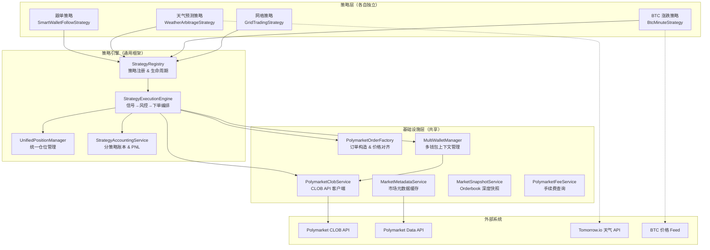
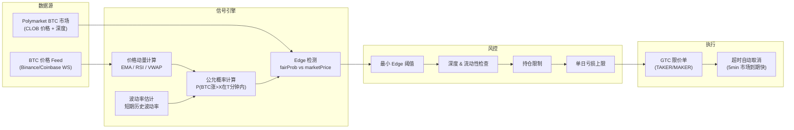
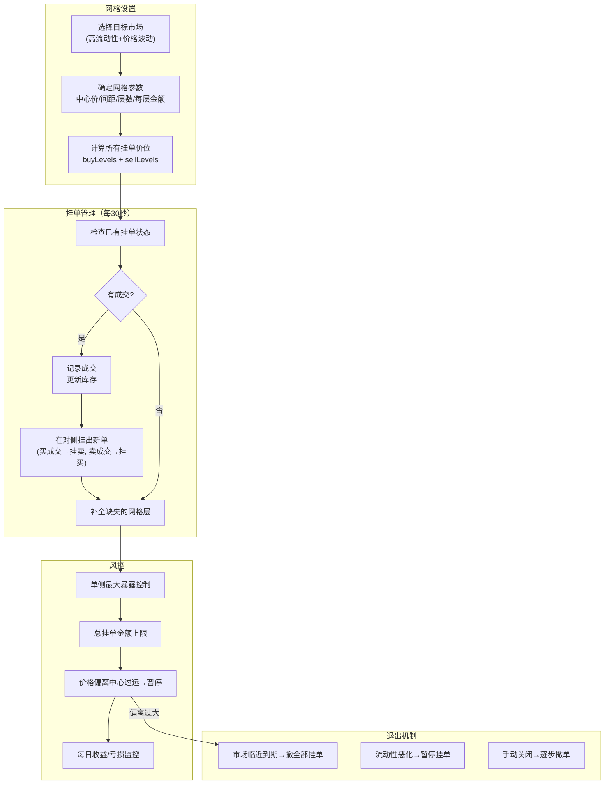
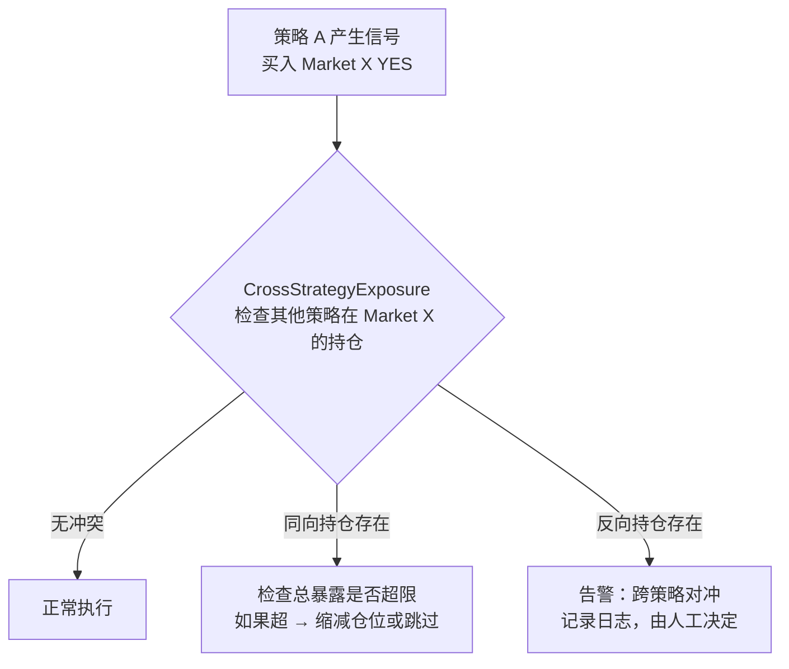
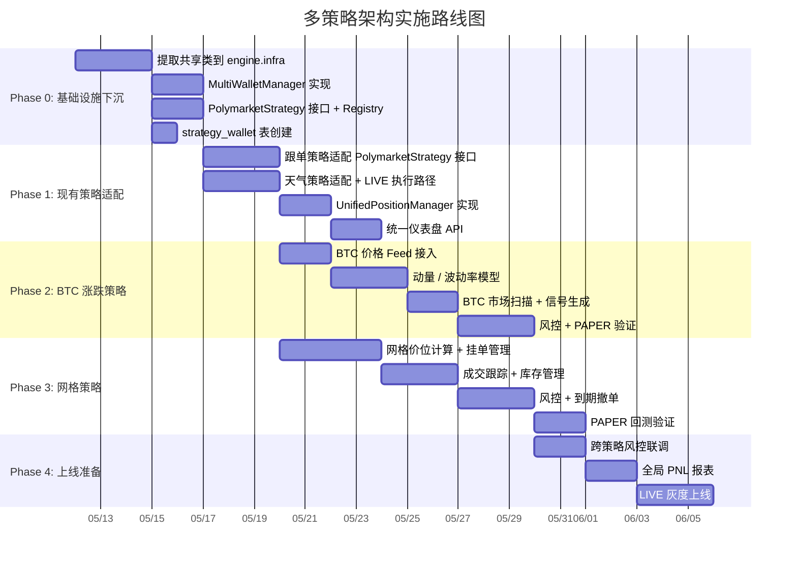

# Polymarket 多策略架构设计文档

> 日期：2026-05-11
> 目标：在现有跟单策略和天气策略基础上，设计支持 N 种策略并行运行的通用框架
> 策略列表：跟单（已有）、天气预测（已有）、BTC 5 分钟涨跌、网格策略
> 约束：每个策略使用独立钱包

---

## 一、现状分析

### 1.1 当前代码结构

```
coin-strategy-job/src/main/java/.../job/
├── smartwallet/           ← 跟单策略（功能最完整）
│   ├── config/            SmartWalletProperties
│   ├── model/             Signal, Decision, Task DTO
│   ├── service/           30+ 服务类
│   └── intelligence/      实体识别
├── weather/               ← 天气策略（已有独立模块）
│   ├── config/            WeatherArbitrageProperties
│   ├── model/             Signal, Forecast, Spec DTO
│   ├── service/           10 服务类
│   └── WeatherArbitrageJob.java
├── strategy/              ← 通用策略基础（当前较薄）
├── execution/             ← 执行层
├── risk/                  ← 风控
└── ...
```

### 1.2 两个策略的共同模式

| 维度 | 跟单策略 (smartwallet) | 天气策略 (weather) |
|------|----------------------|-------------------|
| 信号来源 | leader 钱包交易事件 | 气象 API 预测 vs 市场价格偏差 |
| 风控 | 13 Gate Pipeline | edge / EV / 流动性阈值 |
| 仓位计算 | Kelly 公式 | edge × capitalPool × 0.25 |
| 下单 | CLOB GTC 限价单 | Paper 模拟 (LIVE 未启用) |
| 仓位管理 | 止损/止盈/到期退出 | 简单 mark-to-market |
| 执行钱包 | `SmartWalletProperties.ExecutionWallet` | 独立 `capitalPoolUsdc` 配置 |
| 数据表 | `smart_wallet_*` (10+张) | `weather_*` (3张) |
| 共享依赖 | — | 使用 `PolymarketApiClient` |

### 1.3 关键发现

1. **`PolymarketApiClient` 已经是事实上的共享基础设施**：天气策略直接引用 `smartwallet.service.PolymarketApiClient`，这不合理——跟单策略不应该"拥有"CLOB API 客户端
2. **执行层紧耦合**：`PolymarketClobClientRouter`、`PolymarketOrderRequestFactory`、`ExecutionWalletContextLoader` 全部在 `smartwallet.service` 包内，其他策略无法复用
3. **数据模型各自独立**：跟单用 `smart_wallet_position`，天气用 `weather_paper_position`，没有统一的仓位视图
4. **配置互相独立**：各策略有自己的 `@ConfigurationProperties`，这是正确的设计

---

## 二、目标架构

### 2.1 核心设计原则

1. **策略自治**：每个策略拥有独立的信号生成、风控、仓位计算逻辑，不互相干扰
2. **钱包隔离**：每个策略绑定独立的 Polymarket 钱包地址，资金不混用
3. **基础设施共享**：CLOB API 客户端、订单工厂、市场元数据等下沉为公共服务
4. **统一可观测性**：所有策略的仓位、订单、PNL 汇总到统一仪表盘

### 2.2 架构总览



---

## 三、核心接口设计

### 3.1 策略接口（Strategy SPI）

每个策略实现以下接口，由策略引擎统一编排：

```java
package com.metaverse.coin.strategy.job.engine;

/**
 * 所有 Polymarket 策略的顶层接口。
 * 策略引擎通过此接口发现、注册、调度策略。
 */
public interface PolymarketStrategy {

    /** 策略唯一标识，如 "SMART_WALLET_FOLLOW", "WEATHER_ARB", "BTC_MINUTE", "GRID" */
    String getStrategyId();

    /** 策略显示名称 */
    String getDisplayName();

    /** 策略是否启用 */
    boolean isEnabled();

    /** 策略绑定的钱包 ID（对应 MultiWalletManager 中的 walletId） */
    String getWalletId();

    /** 策略运行模式 */
    StrategyMode getMode(); // SHADOW, PAPER, LIVE

    /** 执行一轮信号扫描 + 下单（由 Scheduler 或手动触发） */
    StrategyCycleResult runCycle();

    /** 执行一轮仓位检查 + 退出扫描 */
    StrategyExitResult runExitScan();

    /** 策略健康检查 */
    StrategyHealthSnapshot health();
}
```

### 3.2 信号接口

```java
/**
 * 策略产生的交易信号，统一格式。
 * 不同策略的信号来源不同，但最终都规范为此结构。
 */
public interface TradingSignal {

    String getStrategyId();
    String getMarketId();        // Polymarket conditionId
    String getOutcome();         // YES / NO
    String getSide();            // BUY / SELL
    BigDecimal getTargetPrice(); // 信号价格
    BigDecimal getStakeUsdc();   // 建议仓位
    BigDecimal getConfidence();  // 信号置信度 [0, 1]
    String getSignalReason();    // 信号来源描述
    Instant getSignalTime();     // 信号产生时间
    Map<String, Object> getMetadata(); // 策略特有的附加信息
}
```

### 3.3 多钱包管理

```java
/**
 * 管理 N 个策略的独立钱包。
 * 每个 walletId 对应一个 Polymarket 执行地址 + 私钥。
 */
public interface MultiWalletManager {

    /** 获取指定策略的钱包上下文 */
    WalletContext getWalletContext(String walletId);

    /** 查询指定钱包的 USDC 余额 */
    BigDecimal getBalance(String walletId);

    /** 列出所有已注册钱包的状态 */
    List<WalletStatusView> listWallets();
}
```

### 3.4 统一仓位接口

```java
/**
 * 跨策略统一仓位视图。
 * 底层可能仍然存储在各策略自己的表中，但查询时汇聚。
 */
public interface UnifiedPositionManager {

    /** 按策略查询持仓 */
    List<UnifiedPosition> getPositions(String strategyId);

    /** 全局持仓汇总 */
    List<UnifiedPosition> getAllPositions();

    /** 全局 PNL 汇总 */
    PortfolioSummary getPortfolioSummary();

    /** 检查某个 market 上是否有跨策略的对冲仓位 */
    CrossStrategyExposure checkExposure(String marketId);
}
```

---

## 四、四大策略详细设计

### 4.1 跟单策略（已有，重构适配）

**改动范围**：将 `smartwallet.service` 中的基础设施类下沉到 `engine` 包，策略逻辑保持原地。

```
现在：smartwallet.service.PolymarketApiClient
目标：engine.infra.PolymarketClobService（共享）

现在：smartwallet.service.PolymarketOrderRequestFactory
目标：engine.infra.PolymarketOrderFactory（共享）

现在：smartwallet.service.ExecutionWalletContextLoader
目标：engine.wallet.MultiWalletManager（共享，支持多钱包）

跟单特有逻辑保留在 smartwallet/ 包中：
- SmartWalletFollowTaskService（信号生成 + 编排）
- SmartWalletSignalRiskService（13 Gate 风控）
- PolymarketConsensusSignalService（共识信号）
- WalletEntityResolutionService（实体识别）
```

**适配工作量**：3-5 天（主要是依赖解耦，逻辑不变）

---

### 4.2 天气预测策略（已有，重构适配）

**现状**：已有完整的信号生成 pipeline（气象API → 公允价值计算 → edge 检测 → 下单），但仅支持 PAPER 模式。

**改动范围**：

```
保留：weather/ 包内的所有业务逻辑
改动：
1. WeatherArbitrageJob 实现 PolymarketStrategy 接口
2. WeatherCapitalPoolService 对接 MultiWalletManager
3. 新增 LIVE 执行路径（复用共享 PolymarketOrderFactory）
4. WeatherPaperTradeService → 统一 Position 表或保留独立表 + UnifiedPositionManager adapter
```

**适配工作量**：2-3 天

---

### 4.3 BTC 5 分钟涨跌策略（新建）

**策略原理**：Polymarket 有 "BTC 价格在未来 5 分钟内上涨/下跌" 类型的市场。通过分析 BTC 实时价格动量、成交量、波动率等指标，预测短期方向。



**模块结构**：

```
btcminute/
├── config/
│   └── BtcMinuteStrategyProperties.java
├── model/
│   ├── BtcPriceSnapshot.java
│   ├── BtcMinuteSignal.java
│   └── BtcMinuteMarketSpec.java
├── service/
│   ├── BtcPriceFeedService.java          ← BTC 实时价格采集（WS/REST）
│   ├── BtcMomentumCalculator.java        ← 动量 / RSI / EMA
│   ├── BtcVolatilityEstimator.java       ← 短期波动率
│   ├── BtcFairProbabilityService.java    ← 公允概率计算
│   ├── BtcMinuteMarketScanService.java   ← 扫描 Polymarket BTC 短期市场
│   ├── BtcMinuteRiskService.java         ← 风控（Edge/深度/持仓/日亏损）
│   ├── BtcMinuteCapitalPoolService.java  ← 仓位计算
│   └── BtcMinutePositionSyncService.java ← 仓位同步 & 到期结算
└── BtcMinuteStrategyJob.java             ← 实现 PolymarketStrategy
```

**关键配置**：

```yaml
btc-minute:
  enabled: false
  mode: SHADOW            # OFF / SHADOW / PAPER / LIVE
  wallet-id: btc-minute-1
  capital-pool-usdc: 200
  max-single-stake-usdc: 20
  max-open-positions: 3
  min-edge-threshold: 0.08    # 至少 8% 的定价偏差
  price-feed-source: BINANCE  # BINANCE / COINBASE / COINGECKO
  momentum-window-seconds: 300
  scan-interval-ms: 30000     # 30s 扫描一次
  max-daily-loss-usdc: 50     # 每日最大亏损
```

**特殊考虑**：
- 这类市场到期极快（5-15 分钟），必须有订单超时取消机制
- 需要毫秒级 BTC 价格数据，建议用 WebSocket 接入 Binance
- 市场流动性可能很薄，深度检查尤其重要
- 考虑 maker 策略减少 taker fee 对超短线利润的侵蚀

**工作量**：5-8 天

---

### 4.4 网格策略（新建）

**策略原理**：在 Polymarket CLOB 上按等间距价格挂 maker 限价单（买单在下方、卖单在上方），当价格波动时自动成交赚取价差。本质是做市策略。



**模块结构**：

```
grid/
├── config/
│   └── GridTradingProperties.java
├── model/
│   ├── GridLevel.java              ← 单个网格层（价位、数量、方向、状态）
│   ├── GridInstance.java           ← 一个市场的完整网格实例
│   ├── GridFill.java              ← 成交记录
│   └── GridPerformanceSnapshot.java
├── service/
│   ├── GridMarketSelectorService.java    ← 选择适合做网格的市场
│   ├── GridLevelCalculator.java          ← 计算网格价位
│   ├── GridOrderManager.java            ← 挂单/撤单/补单管理
│   ├── GridFillTracker.java             ← 成交跟踪
│   ├── GridInventoryManager.java        ← 库存 (net YES/NO shares) 管理
│   ├── GridRiskService.java             ← 风控（单侧暴露/总金额/偏离）
│   └── GridPerformanceService.java      ← 网格收益统计
└── GridTradingStrategyJob.java          ← 实现 PolymarketStrategy
```

**关键配置**：

```yaml
grid-trading:
  enabled: false
  mode: SHADOW
  wallet-id: grid-1
  capital-pool-usdc: 500
  instances:
    - market-id: "0x..."
      center-price: 0.50
      grid-spacing: 0.02        # 每层间距 2 美分
      grid-levels: 5            # 中心价上下各 5 层
      amount-per-level-usdc: 10
      max-one-side-exposure-usdc: 100
  global:
    max-total-grid-exposure-usdc: 500
    min-market-daily-volume-usdc: 5000
    min-ask-depth-3c-usdc: 200
    max-spread-bps: 300
    cancel-before-settlement-hours: 4
    order-refresh-interval-ms: 30000
```

**特殊考虑**：
- 网格策略需要频繁挂单/撤单，CLOB API 的 rate limit 需要注意
- 所有挂单走 maker（fee=0），这是网格盈利的前提
- 需要跟踪每个挂单的 orderId，在成交后自动补单
- 库存管理（net position）需要精确，避免单侧过度暴露
- 市场到期前必须撤掉所有挂单，避免 oracle 结算风险

**工作量**：8-12 天

---

## 五、数据模型设计

### 5.1 多钱包配置表

```sql
CREATE TABLE strategy_wallet (
    id              BIGINT AUTO_INCREMENT PRIMARY KEY,
    wallet_id       VARCHAR(64)  NOT NULL UNIQUE,     -- 如 "follow-main", "weather-1", "btc-minute-1", "grid-1"
    strategy_id     VARCHAR(64)  NOT NULL,             -- 绑定的策略 ID
    chain           VARCHAR(20)  DEFAULT 'polygon',
    chain_id        INT          DEFAULT 137,
    address         VARCHAR(128) NOT NULL,             -- Polymarket 钱包地址
    private_key     TEXT,                              -- 加密存储
    funder_address  VARCHAR(128),
    api_key         VARCHAR(256),
    api_secret      TEXT,
    api_passphrase  VARCHAR(256),
    enabled         TINYINT(1)   DEFAULT 0,
    capital_pool_usdc DECIMAL(18,2) DEFAULT 0,         -- 该钱包的资金预算上限
    notes           VARCHAR(512),
    created_at      DATETIME     DEFAULT CURRENT_TIMESTAMP,
    updated_at      DATETIME     DEFAULT CURRENT_TIMESTAMP ON UPDATE CURRENT_TIMESTAMP,
    INDEX idx_strategy_id (strategy_id)
);
```

### 5.2 统一策略运行日志

```sql
CREATE TABLE strategy_run_log (
    id              BIGINT AUTO_INCREMENT PRIMARY KEY,
    strategy_id     VARCHAR(64)  NOT NULL,
    wallet_id       VARCHAR(64)  NOT NULL,
    run_type        VARCHAR(32)  NOT NULL,             -- SIGNAL_SCAN / EXIT_SCAN / HEALTH_CHECK
    run_mode        VARCHAR(16)  NOT NULL,             -- SHADOW / PAPER / LIVE
    started_at      DATETIME     NOT NULL,
    finished_at     DATETIME,
    signals_found   INT          DEFAULT 0,
    orders_placed   INT          DEFAULT 0,
    errors          INT          DEFAULT 0,
    summary_json    TEXT,                              -- 策略特有的运行摘要
    INDEX idx_strategy_time (strategy_id, started_at)
);
```

### 5.3 统一订单表（可选，或继续用各策略独立表）

```sql
CREATE TABLE strategy_order (
    id               BIGINT AUTO_INCREMENT PRIMARY KEY,
    strategy_id      VARCHAR(64)   NOT NULL,
    wallet_id        VARCHAR(64)   NOT NULL,
    market_id        VARCHAR(256)  NOT NULL,            -- conditionId
    token_id         VARCHAR(256),
    outcome          VARCHAR(32),
    side             VARCHAR(8)    NOT NULL,             -- BUY / SELL
    order_strategy   VARCHAR(16)   DEFAULT 'TAKER',     -- TAKER / MAKER
    limit_price      DECIMAL(18,8),
    size             DECIMAL(18,8),
    stake_usdc       DECIMAL(18,4),
    external_order_id VARCHAR(256),
    status           VARCHAR(32)   NOT NULL,             -- PENDING / LIVE / FILLED / CANCELLED / FAILED
    execution_mode   VARCHAR(16)   NOT NULL,             -- PAPER / LIVE
    signal_reason    VARCHAR(512),
    trading_fee_usdc DECIMAL(18,8) DEFAULT 0,
    created_at       DATETIME      DEFAULT CURRENT_TIMESTAMP,
    updated_at       DATETIME      DEFAULT CURRENT_TIMESTAMP ON UPDATE CURRENT_TIMESTAMP,
    INDEX idx_strategy_status (strategy_id, status),
    INDEX idx_wallet_market (wallet_id, market_id)
);
```

---

## 六、多策略之间的互斥与协调

### 6.1 同市场冲突检测

多个策略可能同时关注同一个市场。例如：跟单策略因为 leader 买入而建仓 YES，同时网格策略在同一市场两侧挂单。



**规则**：
- 同向持仓：检查总暴露（所有策略在该 market 的 net position），不超过全局上限
- 反向持仓：记录告警日志，不自动干预（网格策略本身就是两边挂单，属于正常行为）
- 单纯告警，不阻断（避免策略之间互相 block）

### 6.2 全局资金监控

虽然每个策略有独立钱包，但仍需要全局视图：

```yaml
strategy-engine:
  global-risk:
    max-total-exposure-usdc: 2000    # 所有策略的总持仓上限
    max-total-daily-loss-usdc: 200   # 所有策略的每日总亏损上限
    enable-cross-strategy-exposure-check: true
```

---

## 七、包结构重组方案

### 7.1 目标结构

```
coin-strategy-job/src/main/java/.../job/
├── engine/                             ← 【新建】策略引擎 & 共享基础设施
│   ├── PolymarketStrategy.java         ← 策略 SPI 接口
│   ├── StrategyRegistry.java           ← 策略注册 & 发现
│   ├── StrategyExecutionEngine.java    ← 信号→下单编排
│   ├── infra/                          ← 从 smartwallet 下沉的共享服务
│   │   ├── PolymarketClobService.java  ← 原 PolymarketApiClient
│   │   ├── PolymarketOrderFactory.java ← 原 PolymarketOrderRequestFactory
│   │   ├── PolymarketFeeService.java   ← 原 PolymarketFeeScheduleService
│   │   ├── MarketMetadataService.java  ← 原 PolymarketMarketMetadataService
│   │   └── MarketSnapshotService.java  ← 原 MarketSnapshotCollectorService
│   ├── wallet/
│   │   └── MultiWalletManager.java     ← 多钱包管理
│   ├── position/
│   │   └── UnifiedPositionManager.java ← 统一仓位视图
│   └── risk/
│       └── CrossStrategyRiskService.java ← 跨策略风控
│
├── smartwallet/                        ← 跟单策略（保持，但基础设施依赖改为 engine.infra）
├── weather/                            ← 天气策略（保持，适配 PolymarketStrategy 接口）
├── btcminute/                          ← 【新建】BTC 5 分钟策略
└── grid/                               ← 【新建】网格策略
```

### 7.2 迁移策略

采用**渐进式迁移**，不一次性重写：

**Phase 1**：将共享类从 `smartwallet.service` 提取到 `engine.infra`，原位置保留 `@Deprecated` 的代理类（转发调用），所有现有代码不需要改动。

```java
// 原位置保留向后兼容的代理
@Deprecated // use engine.infra.PolymarketClobService
@Service
public class PolymarketApiClient extends com.metaverse.coin.strategy.job.engine.infra.PolymarketClobService {
    // 继承即可，所有现有引用继续工作
}
```

**Phase 2**：新策略（BTC、Grid）直接依赖 `engine.infra`，不引用 `smartwallet`。

**Phase 3**：逐步将 `smartwallet` 和 `weather` 中的引用切换到 `engine.infra`，最后删除代理类。

---

## 八、实施路线图



### 预估时间表

| Phase | 内容 | 预估工作量 | 前置依赖 |
|-------|------|-----------|---------|
| Phase 0 | 基础设施下沉 + 多钱包 + 策略接口 | 5-7 天 | 无 |
| Phase 1 | 现有策略适配 + 统一仓位 + 仪表盘 | 5-7 天 | Phase 0 |
| Phase 2 | BTC 5 分钟涨跌策略 | 5-8 天 | Phase 0 |
| Phase 3 | 网格策略 | 8-12 天 | Phase 0 |
| Phase 4 | 跨策略联调 + 上线 | 5-7 天 | Phase 1-3 |
| **总计** | | **28-41 天** | |

Phase 2 和 Phase 3 可并行开发。Phase 0 是所有后续工作的前置条件。

---

## 九、风险 & 决策点

| # | 风险 | 应对方案 |
|---|------|---------|
| 1 | 基础设施下沉时破坏现有跟单逻辑 | Phase 0 使用继承代理保持向后兼容，不改现有引用 |
| 2 | BTC 短期市场流动性极差 | 上线前做 2 周 PAPER 验证，设置严格的深度门槛 |
| 3 | 网格策略的 CLOB rate limit | 每个网格实例控制挂单频率，做 batch order 合并 |
| 4 | 多策略同市场冲突 | Phase 4 的 CrossStrategyRiskService 做告警，不阻断 |
| 5 | 独立钱包的 gas 成本 | Polymarket 在 Polygon 上，gas 极低（< $0.01/tx），可忽略 |
| 6 | 策略接口设计过度/不足 | 先做最小接口（runCycle + runExitScan），按需扩展 |

---

## 十、建议启动顺序

**推荐**：Phase 0 → Phase 1 → Phase 2 和 Phase 3 并行 → Phase 4

理由：

1. Phase 0 是必须先做的地基，不做就无法让新策略复用 CLOB 基础设施
2. Phase 1 让现有策略先跑通统一框架，验证接口设计是否合理
3. BTC 策略比网格策略简单（无需挂单管理），适合先做验证框架可行性
4. 网格策略最复杂但利润潜力最大（maker fee=0 + 价差收益），适合作为压轴
