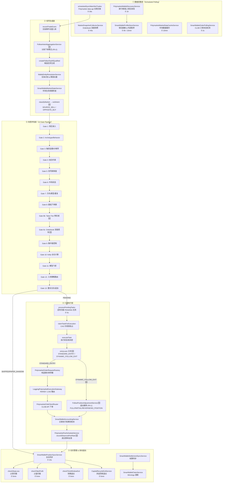
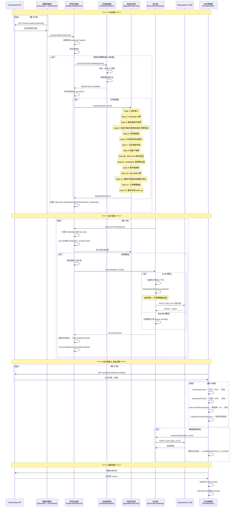
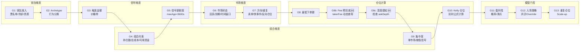
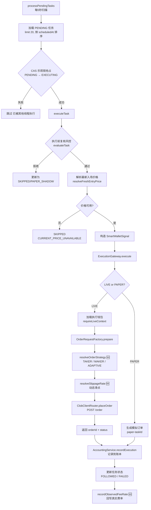
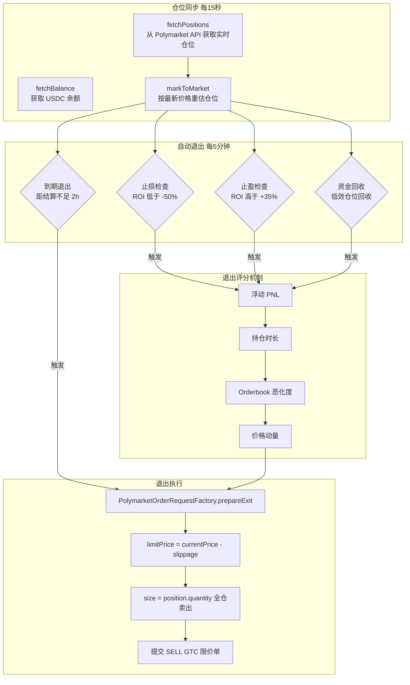
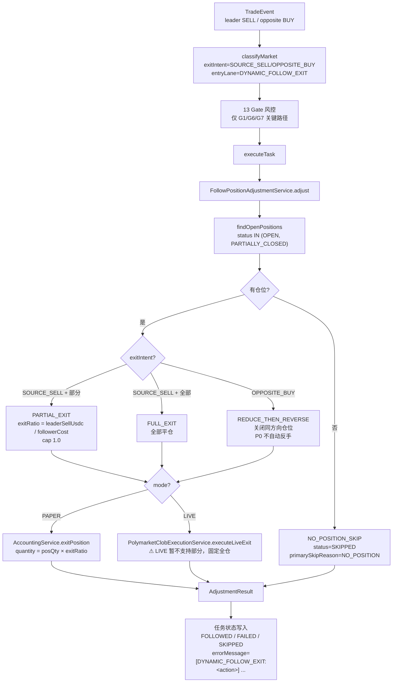
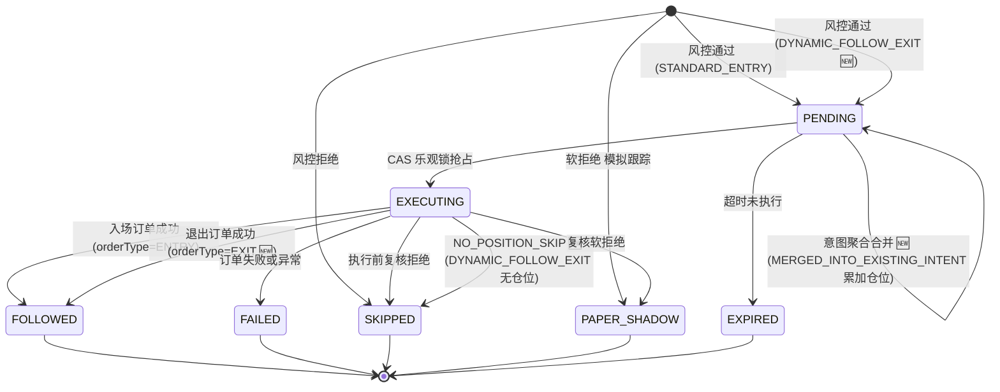
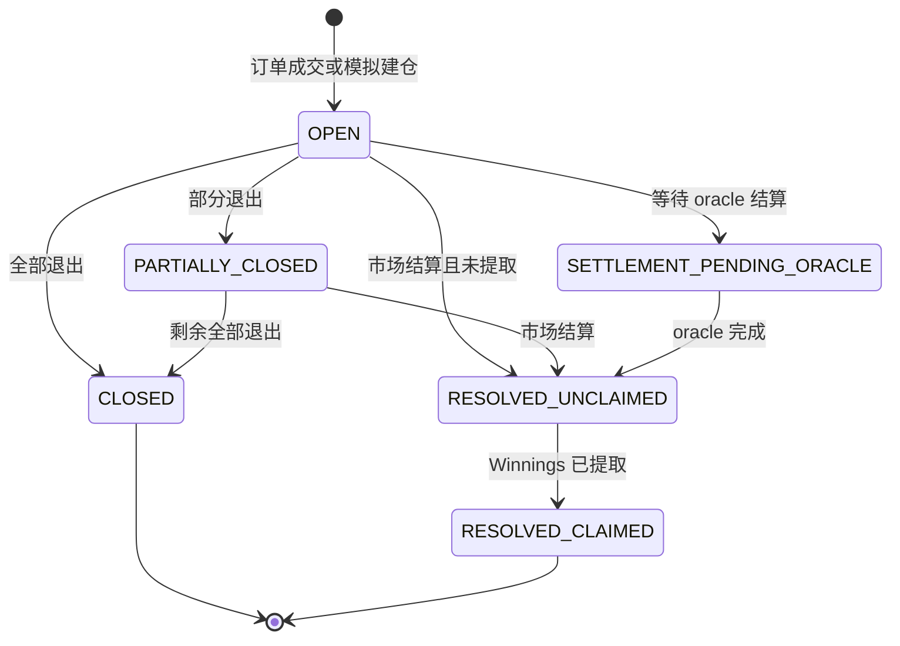

# Polymarket 跟单策略全流程分析

> 日期：2026-05-12
> 版本：v2.1（在 v2.0 基础上补全：退出跟单 / 意图聚合 / 应用层与运维入口 / 费率反馈 / 调度任务全量）
> 替代原 v1.0 回溯分析文档

---

## 一、系统全景流程图



---

## 二、泳道图：从信号到成交的完整生命周期

> 下图描绘的是 **STANDARD_ENTRY** 主路径（普通入场）。leader 退出信号触发的 **DYNAMIC_FOLLOW_EXIT** 跨 lane 分支由 `FollowPositionAdjustmentService` 接管，详见 §3.6 的专用流程图。



---

## 三、各层详细分析

### 3.1 数据采集层

系统采用纯 API 轮询架构（非链上监听），通过多个定时任务从 Polymarket data-api 和 CLOB API 采集数据。

| 定时任务 | 服务 | 频率 | 职责 |
|---------|------|------|------|
| 排行榜钱包发现 | `PolymarketWalletDiscoveryService` | 1h | 从排行榜发现高胜率钱包，评估并加入观察名单 |
| 交易事件同步 | `scheduledSyncWatchlistTrades` | 30s | 拉取观察名单钱包的最新交易，写入 `trade_event` 表 |
| Orderbook 深度快照 | `MarketSnapshotCollectorService` | 45s | 采集 bidDepth/askDepth (1c/3c/5c)、spreadBps、orderImbalance |
| 钱包画像更新 | `SmartWalletProfileStoreService` | 6h/15min | 刷新钱包评分、胜率、总交易数等画像指标 |
| 市场数据缓存 | `PolymarketMarketDataCacheService` | 10min | 缓存市场元数据（question、outcomes、tokenIds）|
| CLOB 订单状态 | `SmartWalletOrderPollingService` | 2s | 轮询已提交订单的成交状态 |
| 仓位同步 | `SmartWalletPositionSyncService` | 15s | 同步执行钱包的实时仓位和余额 |
| WARM 指标刷新 | `scheduledRefreshWarmWalletMetrics` | 10min | 刷新处于 WARM 观察期钱包的交易指标 |

**不充分之处：**
- 交易事件同步 30s 间隔对高频交易钱包可能存在延迟，极端情况下信号到达时市场已经移动
- Orderbook 快照 45s 间隔意味着深度数据最多可能已过期 45 秒+处理延迟，代码中已设置 5 分钟过期阈值作为兜底
- 无 WebSocket 实时推送通道用于交易事件，完全依赖 polling

---

### 3.2 信号生成层

交易事件进入系统后经过以下处理链路：

```
recordTradeEvent → 去重 → 黑名单检查 → 钱包准入 → 意图聚合 (P0-2 🆕) → 实体智能增强
  → 市场状态检查 → 退出意图分类 (🆕) → 风控评估 → 创建 FollowTask
```

**关键设计决策：**

1. **去重机制**：基于 `source + externalTradeId` 唯一键，同一笔链上交易不会产生重复任务
2. **黑名单前置**：`manualBlocklistService` 在任何处理之前拦截，被封禁的钱包直接创建 SKIPPED 任务；该服务同时承担"35 天不活跃 → 自动入黑"职责（`blockForInactivityIfNeeded()`，依据 `SmartWalletLeaderTradeOutcomeEntity` 在置信度 ≥ 0.55 的可信关闭样本下判断）
3. **双轨准入**：钱包可通过自动观察名单（`watchEnabled=true` + `monitorTier=HOT`）或手动白名单（`manualAllowlist`）进入
4. **意图聚合（P0-2 🆕，`FollowIntentAggregationService`）**：解决 leader 分拆下单（试探、冰山、scale-in）被切成多条独立任务、或被"重复任务"门挡掉的问题。按 `walletAddress:marketId:outcome:side:windowBucket`（默认 5 分钟窗口，`SmartWalletProperties.IntentAggregation.windowMinutes`）聚合：
   - `FIRST_FRAGMENT` / `NEW_WINDOW` — 窗口内首条事件，正常创建新任务
   - `MERGED_INTO_EXISTING_INTENT` — 已有 PENDING/PAPER_SHADOW 任务时，把累计的 `recommendedStakeUsdc` / `triggerSizeUsdc` 直接累加到已有任务，并在 `skipReasonTags` 上盖 `INTENT_FRAGMENTS=N,INTENT_EVENT_IDS=...`
   - `SCALE_UP_SUPPLEMENT` — 窗口仍在但前置任务已被消费，交给下游 Scale-up 处理
   - 同时通过 `isWithinActiveIntentWindow(...)` 被 `SmartWalletSignalRiskService` 的 G7（重复任务门）反向调用，避免合法的 scale-in 被误判为重复
5. **实体智能增强**：`WalletEntityResolutionService` 将地址解析为实体 ID（同一个人/机构的多个地址聚合），避免同一实体的多钱包信号被重复跟单
6. **延迟增强**：当实体解析置信度不足（`PENDING` / `LOW_CONFIDENCE_LINK`）时，任务暂存为 SKIPPED，定时重评（每 2 分钟）
7. **退出意图分类（🆕）**：`SmartWalletSignalRiskService.classifyMarket()` 将事件分为两类——
   - `entryLane = STANDARD_ENTRY` — 普通入场，走 G1~G13 风控并最终走 `OrderRequestFactory.prepareLocalDraft` 路径
   - `entryLane = DYNAMIC_FOLLOW_EXIT` + `exitIntent ∈ {SOURCE_SELL, OPPOSITE_BUY}` — leader 卖出 / leader 买入反向 outcome 且 follower 已持反方向仓位。该 lane 在执行层会跳过下单工厂，直接交给 `FollowPositionAdjustmentService`（详见 §3.6）

**不充分之处：**
- 实体解析依赖地址聚类算法，对 iceberging（分拆下单到多个新地址）的检测能力有限；意图聚合只能覆盖"同一地址"的分拆，对"换地址再拆"无效
- 市场状态检查仅判断 `isActive()`，未检查市场流动性是否足够支撑跟单
- 意图聚合的累加金额没有上限保护，理论上 leader 极端连续加仓可能把单任务 `recommendedStakeUsdc` 推到 `maxOrderUsdc` 之上，后续靠 G8/G10 的 cap 兜底

---

### 3.3 风控评估层（13 Gate Pipeline）

`SmartWalletSignalRiskService.evaluate()` 是系统的核心风控引擎，包含 13+ 个门控（Gate），信号必须通过所有 Gate 才能创建 PENDING 任务。



**各 Gate 详细说明：**

| Gate | 名称 | 检查内容 | 拒绝标记 |
|------|------|---------|---------|
| G1 | 钱包准入 | 黑名单（含 35d 不活跃自动入黑）、手动观察禁用、观察冷却期、白名单资质 | `G1_MANUAL_BLOCKLIST` / `G1_WATCHLIST_UNQUALIFIED` |
| G2 | Archetype/Behavior | 钱包行为模式分类（如快进快出 → OBSERVE_ONLY）| `G2_ARCHETYPE_OBSERVE_ONLY` / `G2_BEHAVIOR_FAST_EXIT` |
| G3 | 触发金额/价格带 | 最小触发金额 $5、价格在 [0.02, 0.98] 范围 | `G3_TRIGGER_SIZE_TOO_SMALL` / `G3_PRICE_OUT_OF_RANGE` |
| G4 | 组合约束 | 最大持仓数、最大总开仓成本、可用资金检查 | `G4_MAX_OPEN_POSITIONS` / `G4_CAPITAL_DEPLETED` |
| G5 | 信号新鲜度 | 交易事件年龄 < maxSignalAgeSeconds (3600s) | `G5_SIGNAL_STALE` |
| G6 | 市场状态 | 市场是否活跃、是否即将到期、时间窗口 | `G6_MARKET_NOT_ACTIVE` / `G6_MARKET_EXPIRED` |
| G7 | 方向/类型/重复 | 禁卖单（已被 `DYNAMIC_FOLLOW_EXIT` 接管，详见 §3.6）、快事件阻断、反向/重复持仓；重复检查会调用 `FollowIntentAggregationService.isWithinActiveIntentWindow` 放行同窗口聚合 🆕 | `G7_SELL_DISABLED` / `G7_DUPLICATE_PENDING_TASK` |
| G8 | 最低下单额 | 初步仓位 >= minOrderUsdc ($1) | (internal check) |
| G8b 🆕 | Taker Fee 预扣减 | 按品类动态 taker fee 预扣减有效仓位 | `[FEE_ADJUSTED]` (仅调整，不拒绝) |
| G8c 🆕 | 深度感知仓位调整 | 检查 askDepth，深度不足拒绝或缩减仓位 | `G8c_DEPTH_INSUFFICIENT` / `G8c_DEPTH_DOWNSIZE_BELOW_MIN` |
| G9 | 集中度控制 | 单市场集中度、鲸鱼信号控制 | `G9_EXTREME_CONCENTRATION_BLOCK` / `G9_WHALE_SIGNAL_BLOCK` |
| G10 | Kelly 仓位计算 | 基于 Kelly 公式计算最优仓位，负 EV 拒绝 | `G10_KELLY_NEGATIVE_EV` |
| G11 | 模型门控 | 盈利性评分、校准概率、滑点预测 | `G11_PROFITABILITY_TOO_LOW` / `G11_SLIPPAGE_COST_TOO_HIGH` |
| G12 | 入场策略路由 | 共识信号 / 单钱包 Override / Paper Canary | `G12_ENTRY_STRATEGY_REJECTED` |
| G13 | 重复仓位/追加 | 已持有同方向仓位时检查是否允许 Scale-up | `G13_DUPLICATE_POSITION_SCALEUP_DISABLED` |

**Paper Canary 机制**：当某些 Gate 被"软化"（如单钱包得分够但不满足共识），系统不直接拒绝，而是创建 `PAPER_SHADOW` 任务进行模拟跟踪，观察该信号的效果。

**不充分之处：**
- Gate 之间存在顺序依赖，早期 Gate 拒绝后不会到达后续 Gate，这意味着如果用户调整了 G7 的参数使其通过，G10 的 Kelly 可能仍会拒绝——但调试时只能看到 G7 的拒绝原因
- 共识信号的实体去重依赖于实体识别准确性，如果同一人的两个地址未被聚类，共识计数会偏高
- Kelly 公式中使用的 `calibratedFollowProbability` 依赖历史数据回归，新市场或新品类可能不准确

---

### 3.4 订单执行层



**关键设计：**

1. **双重风控**：`createFollowTaskIfQualified` 时做一次风控评估，`executeTask` 时再做一次复核。因为从创建到执行之间有 `followDelaySeconds` 的延迟，市场条件可能已变化。
2. **CAS 并发控制**：通过 `UPDATE ... WHERE status='PENDING'` 乐观锁防止多线程重复执行同一任务。
3. **GTC 限价单**：所有订单使用 Good-Till-Cancelled 限价单，非市价单，有明确的 limitPrice 上限。
4. **价格对齐**：`snapToTick()` 将价格对齐到 Polymarket 最小精度（minimumTickSize）。
5. **LIVE/PAPER 分流**：根据任务的 `executionMode` 决定走真实下单还是模拟。
6. **入场 / 退出 Lane 分流 🆕**：在 `executeTask` 内取 `decision.getEntryLane()`：
   - `STANDARD_ENTRY` → 走原有 `OrderRequestFactory.prepareLocalDraft` + `ExecutionGateway.execute` 路径
   - `DYNAMIC_FOLLOW_EXIT` → 跳过 entry pricing，直接调用 `followPositionAdjustmentService.adjust(task, exitEvent, exitIntent, mode)`，状态写入逻辑见 §3.6
7. **观察费率反馈 🆕（`PolymarketFeeScheduleService.recordObservedFeeRate`）**：LIVE 订单成交后，`SmartWalletAccountingService` 在 `isFilledImmediately && tradingFeeUsdc > 0 && notional > 0` 三个条件成立时回写 `actualFeeUsdc / notionalUsdc` 到 `observedFeeRates` 缓存（key = `lower(conditionId)`），后续 `getTakerFeeRate(conditionId, category)` 会优先返回观察值，影响 Gate 8b 的预扣减与 Kelly 的 EV 计算。该回写包在 try/catch 里，永远不会阻塞主账本写入。

**订单参数构造流程（`prepareLocalDraft`）：**

```
1. cappedStake = min(max(recommendedStake, minOrderUsdc), maxOrderUsdc)
2. 选择订单策略: resolveOrderStrategy() → TAKER / MAKER
3. TAKER: limitPrice = rawPrice + slippage (动态/固定)
   MAKER: limitPrice = rawPrice + 1 tick
4. normalizedLimitPrice = snapToTick(limitPrice, tickSize)
5. size = cappedStake / normalizedLimitPrice
```

**不充分之处：**
- `resolveFreshEntryPrice` 获取的价格可能与 30 秒前的信号价格有偏差，但目前未做价格漂移二次检查（EntryTimingRiskService 在风控层已检查过一次 priceDrift，但执行层未再次验证）
- MAKER 模式的 limitPrice = rawPrice + 1 tick 较简单，未考虑当前 best bid 的实际位置——如果 rawPrice 与实时 best bid 偏差较大，挂单可能长时间无法成交
- 订单提交后没有超时取消机制（GTC 订单可能永远挂着）

---

### 3.5 仓位管理 & 自动退出层



**退出策略详解：**

| 退出类型 | 触发条件 | 默认阈值 | 行为 |
|---------|---------|---------|------|
| 止损 | 浮亏超过阈值 | ROI < -50% | 动态阈值 + Orderbook 恶化加权 |
| 止盈 | 浮盈超过阈值 | ROI > +35% | Paper 和 LIVE 分别扫描 |
| 到期退出 | 距市场结算时间不足 | < 2 小时 | 最低 ROI 门槛 -100% (即只要能卖就卖) |
| 资金回收 | 低效占用资金的仓位 | 由 CapitalRecycle 配置 | 每日预算控制，冷却防抖 |

**动态止损（`scanPaperPositionsForExitWithDynamicThreshold`）：**
- 不是简单的固定阈值止损
- 综合考虑 `resolveOrderbookDeterioration()`（Orderbook 深度恶化程度）
- 如果 Orderbook 深度大幅下降（挂单撤走），止损阈值会提前触发
- 白名单钱包的仓位不参与自动退出 (`filterOutAllowlistPositions`)

**资金回收退出（`CapitalRecycleExitService`，⏱ 5min）🆕**

针对长期持有、ROI 接近零、占用大量资金的"僵尸仓位"，定期评分后强制退出，把资金腾给新机会。同时对 PAPER 和 LIVE 模式生效，受 `paperEnabled` / `liveEnabled` 独立开关控制。

**评分组成（满分 100）：**

| 维度 | 上限 | 计算 |
|------|------|------|
| 持仓时长 | 40 | `min(holdingHours / 24, 1) × 40`，1 天以上拿满 |
| 资金占比 | 25 | 该仓位 `costBasisUsdc` / 全部开仓 `costBasisUsdc` 之和，在 40% 集中度处饱和 |
| 流动性代理 | 15 | 用 `\|ROI\|` 反向衡量——ROI 越接近 0，"卡在僵尸市场"的可能越高 |
| 机会成本 | 20 | `pendingSignals / maxOpenPositions × 20`，目前 `countPendingSignals()` 暂硬编码为 0（TODO 占位）|

**资格 / 安全保护：**
- 候选必须 `holdingHours ≥ holdingPeriodHours` 且 `ROI ∈ [deadZoneLowRate, deadZoneHighRate]`
- 单仓位 `cooldownMap`（默认 30 分钟）防抖，无论成功失败都重置
- `candidates.size()` 上限 = `openPositions.size() - minRetainPositions`，确保不会清空账户
- **白名单仓位**通过 `SmartWalletManualAllowlistService.filterOutAllowlistPositions` 排除
- `DailyBudgetTracker`（UTC 日切）按累计已退出的 `costBasisUsdc` 限额，超出 `dailyRecycleBudgetUsdc` 当轮即停
- 退出价：优先实时 best-bid，依次回退 midpoint → `markToMarket`
- PAPER 走 `accountingService.exitPosition` reason=`CAPITAL_RECYCLE_AUTO_EXIT`；LIVE 走 `clobExecutionService.executeLiveExit` + `accountingService.recordLiveExitExecution`

**不充分之处：**
- 止盈/止损阈值未扣除双边 taker fee（入场 + 出场），实际盈利低于 ROI 显示值
- 退出时全仓卖出，未考虑部分退出策略（分批出场减少市场冲击）
- 到期退出的 2 小时窗口可能对某些快速结算的市场太晚，对长期市场则太早
- ~~没有跟踪 leader 钱包的退出行为作为退出信号（leader 卖出时跟随退出）~~ ✅ 已由 §3.6 退出跟单 (DYNAMIC_FOLLOW_EXIT) 覆盖

---

### 3.6 退出跟单（DYNAMIC_FOLLOW_EXIT / P0-1）🆕

当 leader 钱包发出 SELL 或 OPPOSITE_BUY 事件时，过去版本直接 SKIP 任务，无法把 follower 已经持有的同方向仓位同步退出。新引入的 `FollowPositionAdjustmentService` 把这条链路补齐：在风控阶段把事件分类为 `entryLane=DYNAMIC_FOLLOW_EXIT`，执行阶段绕过下单工厂，直接根据 follower 现有仓位生成减仓 / 平仓动作。



**四种动作（`AdjustmentAction` 枚举）：**

| 动作 | 触发条件 | 行为 | 备注 |
|------|---------|------|------|
| `FULL_EXIT` | `SOURCE_SELL` 且非部分卖出 | follower 全部平仓 | 默认动作 |
| `PARTIAL_EXIT` | `SOURCE_SELL` 且 `leader.sizeUsdc / Σfollower.costBasisUsdc < 0.80` | 按 `exitRatio` 比例减仓 | LIVE 模式当前仅 PAPER 支持 |
| `REDUCE_THEN_REVERSE` | `OPPOSITE_BUY`（leader 买入反向 outcome 且 follower 持反方向仓位） | 关闭 follower 同方向仓位 | P0 阶段仅平仓，不自动反手建仓 |
| `NO_POSITION_SKIP` | follower 无 OPEN/PARTIALLY_CLOSED 仓位 | 安全跳过 | 写 `primarySkipReason=NO_POSITION` |

**实现细节：**

- **价格回退链**：`resolveExitPrice` 优先 `event.price`，回退 `position.lastMarkPrice` → `position.averageEntryPrice` → 硬编码 `0.50`
- **PAPER 部分退出**：`SmartWalletAccountingService.exitPosition` 接受 `quantity = posQty × exitRatio`，余量保留为 PARTIALLY_CLOSED
- **LIVE 部分退出限制**：当前 LIVE 模式不支持部分退出，遇到 PARTIAL_EXIT 路径会强制走全仓 `executeLiveExit` 并 WARN 日志
- **错误隔离**：每个仓位独立 try/catch，任一仓位失败仅把 `AdjustmentResult.success` 翻为 false，不中断后续仓位
- **任务状态回写**：成功 → `status=FOLLOWED`、`orderType=EXIT`、`notionalUsdc=adjustResult.getExitedNotionalUsdc()`；失败 → `status=FAILED`、`errorMessage=[DYNAMIC_FOLLOW_EXIT:<action>] <message>`

**不充分之处：**
- LIVE 模式的部分退出尚未实现，触发时会被强制升级到全仓，可能与 leader 实际减仓比例不一致
- `isPartialSell` 的 0.80 阈值是经验值，未按品类/流动性分桶
- `OPPOSITE_BUY` 后不自动反手建仓，错过 leader 的真实反手意图——P1 路线图项
- 没有针对"同事件触发多条 follower 仓位"做并行执行，目前是顺序循环，仓位多时延迟会累积

---

### 3.7 应用层 & 运维入口 🆕

跟单代码原先全部塞在 `smartwallet.service` 包内，应用层（controller / 调度脚本）直接持有 `SmartWalletFollowTaskService` 这个胖编排服务，包结构层次不清晰。新近抽出了一个轻应用层 facade，同时 `PolymarketClobExecutionService` 也补充了大量运维入口。

**`FollowTaskApplicationService`**（`coin-strategy-job/src/main/java/.../job/follow/application/FollowTaskApplicationService.java`）

一个只依赖 `SmartWalletFollowTaskService` 的薄 facade，目前 6 个方法均为 1:1 委托：

| 方法 | 委托去向 | 用途 |
|------|---------|------|
| `listTasks(...)` | `listTasks` | 任务列表查询（运维 / 报表）|
| `listExecutableTasks(...)` ×2 | `listExecutableTasks` | 可执行任务清单（含两种入参重载）|
| `simulateRisk(...)` | `runRiskSimulation` | 给定参数下的风控模拟，输出每个 Gate 的判定 |
| `blockerStats()` | `collectBlockerStats` | 各 Gate 拒绝原因聚合统计 |
| `processPendingTasksNow()` | `processPendingTasks` | 运维强制立即扫描 PENDING |

> 设计意图：把 `follow.application` 包打造成稳定可调用面，重型逻辑保留在 `smartwallet.service`；同时也是上一轮 Spring 循环依赖修复时形成的边界——参见 §五依赖图与 P0 阶段的 `@Lazy` 注入。

**`PolymarketClobExecutionService` 运维入口**（`.../smartwallet/service/PolymarketClobExecutionService.java`）

除了 §3.4 / §3.5 提到的 LIVE 下单 / 退出主路径外，对外暴露多个运维方法：

| 方法 | 作用 |
|------|------|
| `deriveApiCreds()` | 用执行钱包私钥派生 Polymarket CLOB API key/secret/passphrase |
| `getOrder(orderId)` / `cancelOrder(orderId)` | 直查 / 取消 CLOB 订单 |
| `marketMetadata(conditionId)` | 取市场元数据（best-effort，按需触发刷新）|
| `marketPriceReference(conditionId, outcome, tokenId, fallbackPrice, questionHint)` | 返回该市场的 best bid/ask/midpoint 和 token 解析结果——下单前的定价输入 |
| `liveWalletState(conditionId)` | 返回 `{walletAddress, balanceUsdc, positions}`，仓位由 `PolymarketApiClient.fetchPositions` 实时取 |
| `dryRunOrder(PolymarketOrderDryRunRequest)` | 不绑定 follow task 的自由 dry-run，返回与 `dryRunFollowTask` 同结构的 `marketSelection / localPositionDraft / settlementSimulation` |
| `dryRunFollowTask(followTaskId)` | 按已有 PENDING 任务预演 LIVE 下单（含风控复核结果）|
| `executeFollowTask(followTaskId)` | 立即触发某 PENDING 任务的 LIVE 执行（绕过常规 5s 扫描）|
| `executeLiveExit(position, price, reason)` | 给定仓位的 LIVE 平仓（被 `FollowPositionAdjustmentService` 与 `CapitalRecycleExitService` 调用）|

**运维操作类服务：**

| 服务 | 关键方法 | 行为 |
|------|---------|------|
| `SmartWalletDataResetService` | `reset(includeProfiles, includeRiskArtifacts, includeRuntimeSeeds, includeMetadataCache)` | TRUNCATE 一组核心表（claim/settlement retries+runs、daily_report、cash_ledger、fill、order、position、follow_task、trade_event、profile），可选擦除风控样本（treatment_control_sample、trade_effect_label、wallet_feature_daily、market_snapshot），并清空 `walletRegistryService` / `opportunityService` / `marketMetadataService` 的内存缓存。返回每张表的 before/after 行数。`FOREIGN_KEY_CHECKS=0` 包裹，失败回退 DELETE。**仅运维使用**。|
| `SmartWalletRecoveryService` | `recoverState(reason)` | 7 步串行恢复管线，每步独立 try/catch（步骤失败仅记入 `notes`，不中断）：① 清 metadata 缓存 ② 刷新排行榜 ③ `SmartWalletSelectionService.refreshQualifiedWallets` ④ 观察名单交易同步 ⑤ `replayRecentIntelligenceCandidates(200, true)` ⑥ `settlementResync(100, 50, true)` ⑦ `backfillMarketEndAt(200, true)` ⑧ `rebuildRecentReports(7)`。`AtomicBoolean` 守护并发，重入返回 `RECOVERY_ALREADY_RUNNING`。`status()` 暴露 `recovering / lastRecoveredAt / lastSummary`。|

---

## 四、数据流与状态机

### 4.1 FollowTask 状态机



**补充字段说明：**
- `entryLane` — `STANDARD_ENTRY` / `DYNAMIC_FOLLOW_EXIT`
- `exitIntent` — 仅 `DYNAMIC_FOLLOW_EXIT` 任务有值，取 `SOURCE_SELL` / `OPPOSITE_BUY`
- `orderType` — `ENTRY` / `EXIT`，退出跟单走 `EXIT`
- `primarySkipReason` — `NO_POSITION` 专用于退出跟单无仓位场景
- `skipReasonTags` — 意图聚合时盖 `INTENT_FRAGMENTS=N,INTENT_EVENT_IDS=...`

### 4.2 Position 状态机



---

## 五、关键服务依赖关系

```mermaid
flowchart TB
    AppLayer["FollowTaskApplicationService 🆕\nfollow.application 包薄 facade"]
    FollowTaskService["SmartWalletFollowTaskService\n核心编排"]
    RiskService["SmartWalletSignalRiskService\n13 Gate 风控"]
    ExecutionGateway["LoggingPolymarketExecutionGateway\nLIVE/PAPER 路由"]
    OrderFactory["PolymarketOrderRequestFactory\n限价单构造"]
    AccountingService["SmartWalletAccountingService\n账本 + 费率回写 🆕"]
    FeeService["PolymarketFeeScheduleService\n动态费率 + observedFeeRates 🆕"]
    SnapshotService["MarketSnapshotCollectorService\nOrderbook 快照"]
    PositionSync["SmartWalletPositionSyncService\n仓位同步 + 退出"]
    ProfileStore["SmartWalletProfileStoreService\n钱包画像"]
    EntityResolution["WalletEntityResolutionService\n实体识别"]
    IntentAgg["FollowIntentAggregationService 🆕\n分拆下单聚合 (P0-2)"]
    AdjustService["FollowPositionAdjustmentService 🆕\n退出跟单 (P0-1)"]
    ConsensusService["PolymarketConsensusSignalService\n共识信号"]
    KellyCalc["KellyStakeCalculator\n仓位计算"]
    EntryTiming["EntryTimingRiskService\n入场时机"]
    ProfitScoring["TradeProfitabilityScoringService\n盈利性评估"]
    ConcentrationService["MarketConcentrationService\n集中度"]
    DiscoveryService["PolymarketWalletDiscoveryService\n钱包发现"]
    MarketState["SmartWalletMarketStateService\n市场状态"]
    ClobClient["PolymarketClobClientRouter\nCLOB 下单"]
    ClobExec["PolymarketClobExecutionService\nLIVE 退出 + 运维入口 🆕"]
    Allowlist["SmartWalletManualAllowlistService\n白名单"]
    Blocklist["SmartWalletManualBlocklistService\n黑名单 + 35d 自动入黑"]
    DataReset["SmartWalletDataResetService 🆕\n运维数据重置"]
    Recovery["SmartWalletRecoveryService 🆕\n7 步恢复管线"]
    CapRecycle["CapitalRecycleExitService 🆕\n资金回收退出"]

    AppLayer --> FollowTaskService

    FollowTaskService --> RiskService
    FollowTaskService --> ExecutionGateway
    FollowTaskService --> AccountingService
    FollowTaskService --> EntityResolution
    FollowTaskService --> MarketState
    FollowTaskService --> IntentAgg
    FollowTaskService --> AdjustService
    FollowTaskService --> Allowlist
    FollowTaskService --> Blocklist

    AdjustService --> AccountingService
    AdjustService -.@Lazy.-> ClobExec
    ClobExec -.@Lazy.-> FollowTaskService

    RiskService --> FeeService
    RiskService --> SnapshotService
    RiskService --> ConsensusService
    RiskService --> KellyCalc
    RiskService --> EntryTiming
    RiskService --> ProfitScoring
    RiskService --> ConcentrationService
    RiskService --> IntentAgg
    RiskService --> Allowlist
    RiskService --> Blocklist

    ExecutionGateway --> OrderFactory
    ExecutionGateway --> ClobClient
    OrderFactory --> SnapshotService

    PositionSync --> AccountingService
    PositionSync --> OrderFactory

    DiscoveryService --> ProfileStore

    AccountingService --> FeeService

    CapRecycle --> AccountingService
    CapRecycle --> ClobExec
    CapRecycle --> Allowlist

    Recovery --> DiscoveryService
    Recovery --> AccountingService
    Recovery --> EntityResolution
```



**循环依赖修复**：`FollowPositionAdjustmentService → PolymarketClobExecutionService → SmartWalletFollowTaskService → FollowPositionAdjustmentService` 是 P0 阶段引入的三角循环。当前破环方式：`PolymarketClobExecutionService` 上对 `SmartWalletFollowTaskService` 用 `@Lazy` 注入，把启动期的构造图变成 Lazy 代理，运行期首次调用 `executeFollowTask` / `dryRunFollowTask` 时再解析真实 bean。

---

## 六、当前系统不充分事项汇总

### 已修复

| # | 问题 | 修复方案 | 状态 |
|---|------|---------|------|
| 1 | 手续费静态 0.15%，实际最高 1.8% | `PolymarketFeeScheduleService` + Gate 8b 预扣减 | ✅ P0 |
| 2 | 入场仓位不检查 Orderbook 深度 | Gate 8c 深度感知仓位调整 | ✅ P0 |
| 3 | 滑点容忍固定 2%，不分市场 | `resolveSlippageRate()` 3 级动态滑点 | ✅ P1 |
| 4 | 所有订单走 Taker，支付全额手续费 | `resolveOrderStrategy()` MAKER/ADAPTIVE | ✅ P1 |
| 11 | 未跟踪 leader 退出行为作为退出信号 | `FollowPositionAdjustmentService` + `DYNAMIC_FOLLOW_EXIT` lane (§3.6) | ✅ P0-1 🆕 |
| 14 | leader 分拆下单（试探 / iceberg / scale-in）被切成多条任务或被重复任务门挡掉 | `FollowIntentAggregationService` 5min 窗口聚合 (§3.2) | ✅ P0-2 🆕 |
| 15 | 手续费 / 滑点配置值是静态估算，真实成交后未反馈 | `PolymarketFeeScheduleService.recordObservedFeeRate` 真实费率回写 (§3.4) | ✅ P1 🆕 |
| 16 | 长期不活跃钱包仍占用观察名单与风控算力 | `SmartWalletManualBlocklistService.blockForInactivityIfNeeded`（35 天自动入黑） | ✅ P2 🆕 |
| 17 | 跟单代码全部塞在 `smartwallet.service`，应用层缺独立 facade | `follow.application.FollowTaskApplicationService`（§3.7） | ✅ P2 🆕 |
| 18 | 缺乏运维侧的"一键擦库 + 一键恢复"能力 | `SmartWalletDataResetService` + `SmartWalletRecoveryService`（§3.7） | ✅ P2 🆕 |

### 仍待改进

| # | 层级 | 问题描述 | 建议优先级 |
|---|------|---------|-----------|
| 5 | 数据采集 | 无 WebSocket 实时事件推送，信号延迟 30s+ | P2 |
| 6 | 信号生成 | Iceberging 检测能力弱（分拆下单到新地址，意图聚合只覆盖同地址）| P2 |
| 7 | 风控 | 止盈/止损阈值未扣除双边 taker fee | P1 |
| 8 | 执行 | MAKER 模式未参考实时 best bid 定价 | P2 |
| 9 | 执行 | GTC 订单无超时取消机制 | P1 |
| 10 | 仓位管理 | 入场退出时全仓卖出（自动止盈/止损），无分批出场 | P2 |
| 12 | 仓位管理 | 动态止损的 Orderbook 恶化加权尚未考虑 taker fee | P2 |
| 13 | 执行 | 执行前复核与创建时的风控是同一套参数，市场条件变化（如深度消失）未被额外检查 | P2 |
| 19 | 退出跟单 | `FollowPositionAdjustmentService` 的 LIVE 模式不支持部分退出，强制升级为全仓 | P1 🆕 |
| 20 | 退出跟单 | `OPPOSITE_BUY` 后不自动反手建仓，错过 leader 的真实反手意图 | P2 🆕 |
| 21 | 退出跟单 | 同事件触发多条 follower 仓位调整是顺序循环，仓位多时延迟累积 | P2 🆕 |
| 22 | 意图聚合 | 累加金额没有上限保护，极端连续加仓后单任务 `recommendedStakeUsdc` 可能爆掉 `maxOrderUsdc`，依赖 G8/G10 兜底 | P2 🆕 |
| 23 | 循环依赖 | `FollowPositionAdjustmentService ↔ PolymarketClobExecutionService ↔ SmartWalletFollowTaskService` 三角靠 `@Lazy` 破环，长期应做结构拆分（把 `dryRunFollowTask`/`executeFollowTask` 从执行服务移出） | P2 🆕 |

---

## 七、配置参数速查表

| 模块 | 参数 | 默认值 | 说明 |
|------|------|--------|------|
| 全局 | `smart-wallet.enabled` | false | 系统总开关 |
| 全局 | `smart-wallet.scan-enabled` | false | 定时扫描开关 |
| 全局 | `smart-wallet.follow-delay-seconds` | — | 创建到执行的延迟 |
| 事件同步 | `event-sync-fixed-delay-ms` | 30000 | 交易同步间隔 |
| 深度快照 | `market-snapshot-fixed-delay-ms` | 45000 | Orderbook 采集间隔 |
| 执行钱包 | `execution-wallet.enabled` | false | LIVE 执行开关 |
| 执行钱包 | `execution-wallet.min-order-usdc` | 1 | 最小下单额 |
| 执行钱包 | `execution-wallet.max-order-usdc` | 150 | 最大下单额 |
| 执行钱包 | `execution-wallet.price-slippage-rate` | 0.02 | 固定滑点率 (2%) |
| 执行钱包 | `execution-wallet.order-strategy` | TAKER | 订单策略 🆕 |
| 执行钱包 | `execution-wallet.enable-dynamic-slippage` | false | 动态滑点开关 🆕 |
| 执行钱包 | `execution-wallet.high-liquidity-slippage-rate` | 0.01 | 高流动性滑点 🆕 |
| 执行钱包 | `execution-wallet.medium-liquidity-slippage-rate` | 0.02 | 中等流动性滑点 🆕 |
| 执行钱包 | `execution-wallet.low-liquidity-slippage-rate` | 0.03 | 低流动性滑点 🆕 |
| 执行钱包 | `execution-wallet.high-liquidity-threshold-usdc` | 5000 | 高流动性阈值 🆕 |
| 执行钱包 | `execution-wallet.low-liquidity-threshold-usdc` | 1000 | 低流动性阈值 🆕 |
| 执行钱包 | `execution-wallet.maker-strategy-min-depth-usdc` | 5000 | MAKER 最低深度 🆕 |
| 执行钱包 | `execution-wallet.maker-strategy-max-spread-bps` | 200 | MAKER 最大价差 🆕 |
| 费率 | `fee-schedule.default-taker-fee-rate` | 0.02 | 默认 taker fee 🆕 |
| 费率 | `fee-schedule.enable-pre-trade-fee-deduction` | true | 开单前预扣减 🆕 |
| 风控 | `signal-risk.max-signal-age-seconds` | 3600 | 信号最大年龄 |
| 风控 | `signal-risk.min-trigger-size-usdc` | 5 | 最小触发金额 |
| 风控 | `signal-risk.min-follow-price` | 0.02 | 最低跟单价格 |
| 风控 | `signal-risk.max-follow-price` | 0.98 | 最高跟单价格 |
| 风控 | `signal-risk.enable-depth-aware-sizing` | true | 深度感知开关 🆕 |
| 风控 | `signal-risk.depth-consumption-max-rate` | 0.50 | 深度消耗上限 🆕 |
| 风控 | `signal-risk.depth-check-range` | 3c | 深度检查范围 🆕 |
| 风控 | `signal-risk.min-acceptable-depth-usdc` | 100 | 最低可接受深度 🆕 |
| 止损 | `signal-risk.enable-auto-stop-loss` | false | 止损开关 |
| 止损 | `signal-risk.auto-stop-loss-threshold-rate` | 0.50 | 止损阈值 (-50%) |
| 止盈 | `signal-risk.enable-auto-take-profit` | false | 止盈开关 |
| 止盈 | `signal-risk.auto-take-profit-threshold-rate` | 0.35 | 止盈阈值 (+35%) |
| 到期退出 | `signal-risk.enable-auto-time-window-exit` | false | 到期退出开关 |
| 到期退出 | `signal-risk.auto-time-window-exit-hours-before-end` | 2 | 到期前退出小时数 |
| 资金回收 🆕 | `signal-risk.capital-recycle.enabled` | false | 资金回收总开关 |
| 资金回收 🆕 | `signal-risk.capital-recycle.paper-enabled` / `live-enabled` | true/false | 分模式开关 |
| 资金回收 🆕 | `signal-risk.capital-recycle.holding-period-hours` | — | 进入候选的最低持仓时长 |
| 资金回收 🆕 | `signal-risk.capital-recycle.dead-zone-low-rate` / `dead-zone-high-rate` | — | ROI 死区上下界 |
| 资金回收 🆕 | `signal-risk.capital-recycle.recycle-threshold` | — | 评分阈值（0~100） |
| 资金回收 🆕 | `signal-risk.capital-recycle.max-recycle-per-round` | — | 每轮最大回收数 |
| 资金回收 🆕 | `signal-risk.capital-recycle.min-retain-positions` | — | 至少保留的开仓数 |
| 资金回收 🆕 | `signal-risk.capital-recycle.cooldown-minutes` | 30 | 单仓位冷却分钟数 |
| 资金回收 🆕 | `signal-risk.capital-recycle.daily-recycle-budget-usdc` | — | UTC 日预算上限 |
| 意图聚合 🆕 | `intent-aggregation.window-minutes` | 5 | 同地址 + 市场 + outcome + side 聚合窗口 |
| 白名单 🆕 | `manual-allowlist` 实体字段 | — | `allowedExecutionModes` (PAPER/LIVE/BOTH)、`stakeMultiplier` (默认 0.50，上限 1.0)、`maxLiveOrdersPerDay` (默认 5)、`maxLiveOrdersPerRun` (默认 2)、`expiresAt` (默认 +30 天) |
| 黑名单 🆕 | 自动入黑规则 | — | 35 天无可信关闭样本（`sourceConfidence >= 0.55`）→ 自动写入 `INACTIVE_GT_35D_BLOCKLIST` |

---

## 八、定时任务总览

系统共运行 25+ 个 `@Scheduled` 定时任务，以下按频率分组：

| 频率 | 任务 | 服务 / 方法 |
|------|------|------|
| 2s | CLOB 订单状态轮询 | `SmartWalletOrderPollingService.pollPendingOrders` |
| 5s | PENDING 任务扫描执行 | `SmartWalletFollowTaskService.processPendingTasks` |
| 15s | 仓位同步 | `SmartWalletPositionSyncService.syncPositions` |
| 30s | 观察名单交易同步 | `PolymarketWalletDiscoveryService.scheduledSyncWatchlistTrades` |
| 45s | Orderbook 深度快照 | `MarketSnapshotCollectorService` |
| 45s | PAPER→LIVE 验证扫描 🆕 | `SmartWalletLiveValidationService.scheduledProcess` |
| 60s | 市场数据缓存刷新 🆕 | `PolymarketMarketDataCacheService.refreshActiveMarkets` |
| 60s | 链上 Claim 处理 🆕 | `SmartWalletClaimService.scheduledProcessClaims` |
| 60s | 交易效果标签构建 🆕 | `TradeEffectLabelService.scheduledBuildRecentLabels` |
| 2min | 延迟候选重评 | `SmartWalletFollowTaskService.scheduledReevaluateDeferredCandidates` |
| 3min | 集中度快照刷新 🆕 | `MarketConcentrationSnapshotRefreshJob.refreshSnapshots` |
| 5min | 自动止损扫描 | `SmartWalletPositionSyncService.checkStopLoss` |
| 5min | 自动止盈扫描 | `SmartWalletPositionSyncService.checkTakeProfit` |
| 5min | 到期退出 / 资金回收 | `SmartWalletPositionSyncService` + `CapitalRecycleExitService.checkCapitalRecycle` |
| 5min | PENDING 任务过期清理 | `SmartWalletFollowTaskService.expireStalePendingTasks` |
| 5min | 排行榜刷新 | `PolymarketWalletDiscoveryService.scheduledRefreshLeaderboardWatchlist` |
| 5min | 市场元数据刷新 🆕 | `MarketMetadataRefreshJob.refreshMetadata` |
| 5min | 过期 Orderbook 淘汰 🆕 | `PolymarketMarketDataCacheService.evictStaleOrderBooks` |
| 5min | 结算同步 🆕 | `SmartWalletSettlementSyncService.scheduledSyncSettlements` |
| 5min | 关闭仓位增量同步（HOT） 🆕 | `ClosedPositionIncrementalSyncJob.incrementalHot` |
| 5min | 集中度监控 🆕 | `MarketConcentrationMonitorJob.scanOpenPositions` |
| 5min | 钱包特征日度构建 🆕 | `WalletFeatureDailyService.scheduledBuildRecentFeatures` |
| 10min | WARM 指标刷新 | `PolymarketWalletDiscoveryService.scheduledRefreshWarmWalletMetrics` |
| 15min | 内部胜率刷新 | `SmartWalletProfileStoreService.refreshInternalWinRate` |
| 15min | Leader 真相 / 画像维护 🆕 | `SmartWalletLeaderTruthMaintenanceJob.refreshLeaderTruthAndProfiles` |
| 15min | 关闭仓位增量同步（WARM）🆕 | `ClosedPositionIncrementalSyncJob.incrementalWarm` |
| 1h | 新钱包发现 | `PolymarketWalletDiscoveryService.scheduledDiscoverWallets` |
| 1h | 仓位健康监控 🆕 | `StrategyHealthMonitorJob.checkPositionHealth` |
| 1h | 实体聚类（未解析观察名单） 🆕 | `WalletEntityIntelligenceJob.clusterUnresolvedWatchlistWallets` |
| 6h | 钱包画像活跃度衰减 🆕 | `SmartWalletProfileStoreService.applyActivityDecay` |
| 6h | 实体特征快照刷新 🆕 | `EntityFeatureSnapshotService.refreshAllEntitySnapshots` |
| 24h | 关闭仓位全量重同步 🆕 | `ClosedPositionFullResyncJob.runFullResync` |

> 注：意图聚合（`FollowIntentAggregationService`）与退出跟单（`FollowPositionAdjustmentService`）本身不是 `@Scheduled`，而是被 `recordTradeEvent` / `executeTask` 同步驱动。
