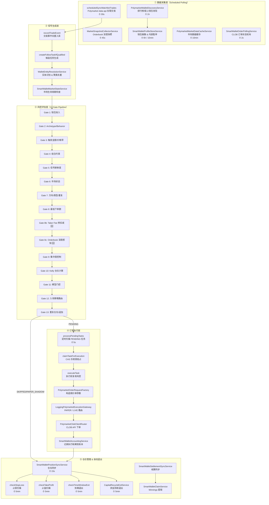
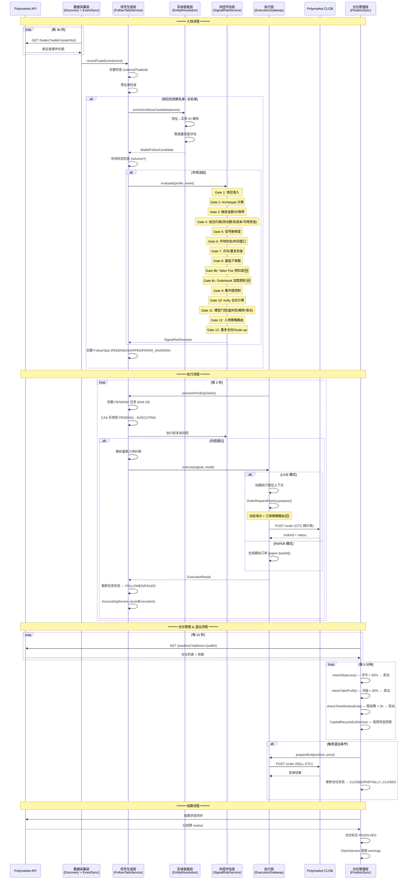
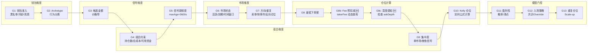
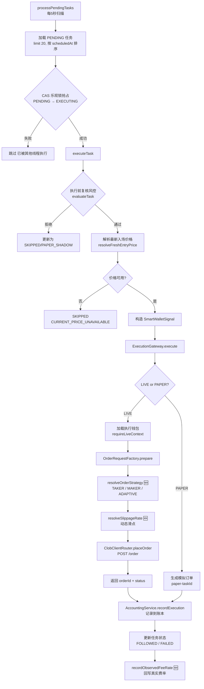
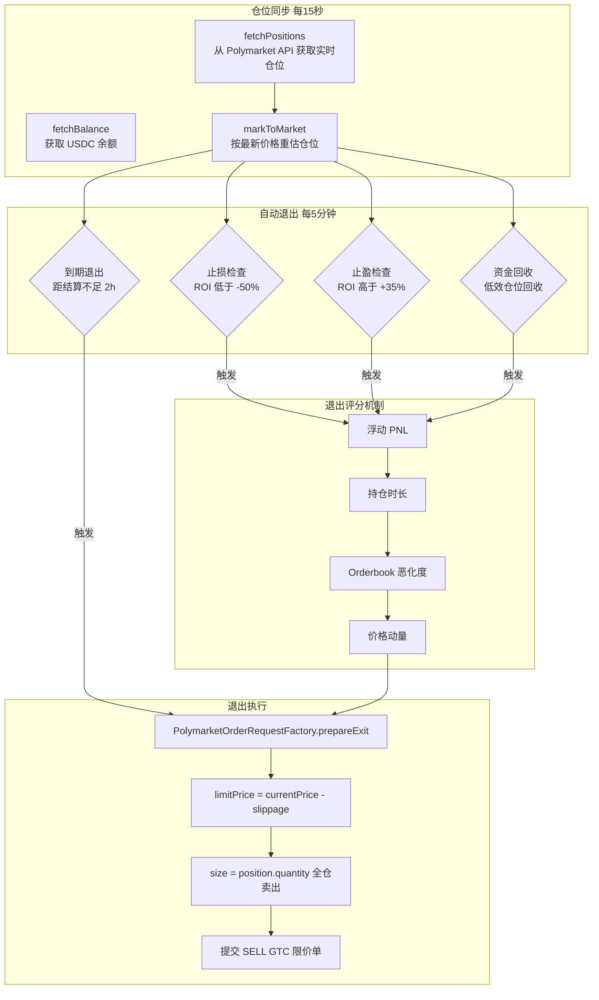
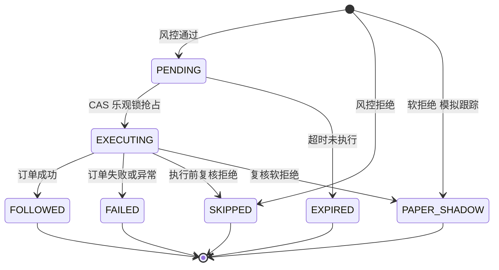
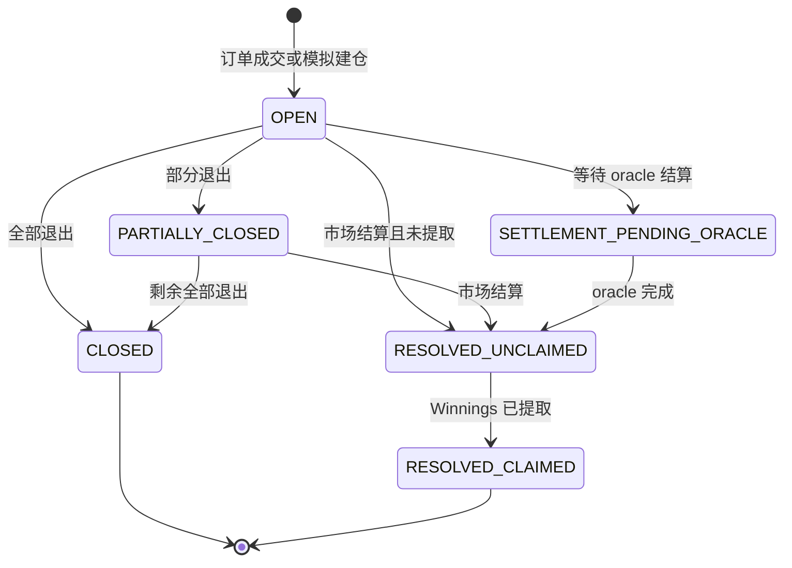

# Polymarket 跟单策略全流程分析

> 日期：2026-05-11
> 版本：v2.0（基于代码库实际实现全面重梳理）
> 替代原 v1.0 回溯分析文档

---

## 一、系统全景流程图



---

## 二、泳道图：从信号到成交的完整生命周期



---

## 三、各层详细分析

### 3.1 数据采集层

系统采用纯 API 轮询架构（非链上监听），通过多个定时任务从 Polymarket data-api 和 CLOB API 采集数据。

| 定时任务 | 服务 | 频率 | 职责 |
|---------|------|------|------|
| 排行榜钱包发现 | `PolymarketWalletDiscoveryService` | 1h | 从排行榜发现高胜率钱包，评估并加入观察名单 |
| 交易事件同步 | `scheduledSyncWatchlistTrades` | 30s | 拉取观察名单钱包的最新交易，写入 `trade_event` 表 |
| Orderbook 深度快照 | `MarketSnapshotCollectorService` | 45s | 采集 bidDepth/askDepth (1c/3c/5c)、spreadBps、orderImbalance |
| 钱包画像更新 | `SmartWalletProfileStoreService` | 6h/15min | 刷新钱包评分、胜率、总交易数等画像指标 |
| 市场数据缓存 | `PolymarketMarketDataCacheService` | 10min | 缓存市场元数据（question、outcomes、tokenIds）|
| CLOB 订单状态 | `SmartWalletOrderPollingService` | 2s | 轮询已提交订单的成交状态 |
| 仓位同步 | `SmartWalletPositionSyncService` | 15s | 同步执行钱包的实时仓位和余额 |
| WARM 指标刷新 | `scheduledRefreshWarmWalletMetrics` | 10min | 刷新处于 WARM 观察期钱包的交易指标 |

**不充分之处：**
- 交易事件同步 30s 间隔对高频交易钱包可能存在延迟，极端情况下信号到达时市场已经移动
- Orderbook 快照 45s 间隔意味着深度数据最多可能已过期 45 秒+处理延迟，代码中已设置 5 分钟过期阈值作为兜底
- 无 WebSocket 实时推送通道用于交易事件，完全依赖 polling

---

### 3.2 信号生成层

交易事件进入系统后经过以下处理链路：

```
recordTradeEvent → 去重 → 黑名单检查 → 钱包准入 → 实体智能增强 → 市场状态检查 → 风控评估 → 创建 FollowTask
```

**关键设计决策：**

1. **去重机制**：基于 `source + externalTradeId` 唯一键，同一笔链上交易不会产生重复任务
2. **黑名单前置**：`manualBlocklistService` 在任何处理之前拦截，被封禁的钱包直接创建 SKIPPED 任务
3. **双轨准入**：钱包可通过自动观察名单（`watchEnabled=true` + `monitorTier=HOT`）或手动白名单（`manualAllowlist`）进入
4. **实体智能增强**：`WalletEntityResolutionService` 将地址解析为实体 ID（同一个人/机构的多个地址聚合），避免同一实体的多钱包信号被重复跟单
5. **延迟增强**：当实体解析置信度不足（`PENDING` / `LOW_CONFIDENCE_LINK`）时，任务暂存为 SKIPPED，定时重评（每 2 分钟）

**不充分之处：**
- 实体解析依赖地址聚类算法，对 iceberging（分拆下单到多个新地址）的检测能力有限
- 市场状态检查仅判断 `isActive()`，未检查市场流动性是否足够支撑跟单

---

### 3.3 风控评估层（13 Gate Pipeline）

`SmartWalletSignalRiskService.evaluate()` 是系统的核心风控引擎，包含 13+ 个门控（Gate），信号必须通过所有 Gate 才能创建 PENDING 任务。



**各 Gate 详细说明：**

| Gate | 名称 | 检查内容 | 拒绝标记 |
|------|------|---------|---------|
| G1 | 钱包准入 | 黑名单、手动观察禁用、观察冷却期、白名单资质 | `G1_MANUAL_BLOCKLIST` / `G1_WATCHLIST_UNQUALIFIED` |
| G2 | Archetype/Behavior | 钱包行为模式分类（如快进快出 → OBSERVE_ONLY）| `G2_ARCHETYPE_OBSERVE_ONLY` / `G2_BEHAVIOR_FAST_EXIT` |
| G3 | 触发金额/价格带 | 最小触发金额 $5、价格在 [0.02, 0.98] 范围 | `G3_TRIGGER_SIZE_TOO_SMALL` / `G3_PRICE_OUT_OF_RANGE` |
| G4 | 组合约束 | 最大持仓数、最大总开仓成本、可用资金检查 | `G4_MAX_OPEN_POSITIONS` / `G4_CAPITAL_DEPLETED` |
| G5 | 信号新鲜度 | 交易事件年龄 < maxSignalAgeSeconds (3600s) | `G5_SIGNAL_STALE` |
| G6 | 市场状态 | 市场是否活跃、是否即将到期、时间窗口 | `G6_MARKET_NOT_ACTIVE` / `G6_MARKET_EXPIRED` |
| G7 | 方向/类型/重复 | 禁卖单、快事件阻断、反向/重复持仓检查 | `G7_SELL_DISABLED` / `G7_DUPLICATE_PENDING_TASK` |
| G8 | 最低下单额 | 初步仓位 >= minOrderUsdc ($1) | (internal check) |
| G8b 🆕 | Taker Fee 预扣减 | 按品类动态 taker fee 预扣减有效仓位 | `[FEE_ADJUSTED]` (仅调整，不拒绝) |
| G8c 🆕 | 深度感知仓位调整 | 检查 askDepth，深度不足拒绝或缩减仓位 | `G8c_DEPTH_INSUFFICIENT` / `G8c_DEPTH_DOWNSIZE_BELOW_MIN` |
| G9 | 集中度控制 | 单市场集中度、鲸鱼信号控制 | `G9_EXTREME_CONCENTRATION_BLOCK` / `G9_WHALE_SIGNAL_BLOCK` |
| G10 | Kelly 仓位计算 | 基于 Kelly 公式计算最优仓位，负 EV 拒绝 | `G10_KELLY_NEGATIVE_EV` |
| G11 | 模型门控 | 盈利性评分、校准概率、滑点预测 | `G11_PROFITABILITY_TOO_LOW` / `G11_SLIPPAGE_COST_TOO_HIGH` |
| G12 | 入场策略路由 | 共识信号 / 单钱包 Override / Paper Canary | `G12_ENTRY_STRATEGY_REJECTED` |
| G13 | 重复仓位/追加 | 已持有同方向仓位时检查是否允许 Scale-up | `G13_DUPLICATE_POSITION_SCALEUP_DISABLED` |

**Paper Canary 机制**：当某些 Gate 被"软化"（如单钱包得分够但不满足共识），系统不直接拒绝，而是创建 `PAPER_SHADOW` 任务进行模拟跟踪，观察该信号的效果。

**不充分之处：**
- Gate 之间存在顺序依赖，早期 Gate 拒绝后不会到达后续 Gate，这意味着如果用户调整了 G7 的参数使其通过，G10 的 Kelly 可能仍会拒绝——但调试时只能看到 G7 的拒绝原因
- 共识信号的实体去重依赖于实体识别准确性，如果同一人的两个地址未被聚类，共识计数会偏高
- Kelly 公式中使用的 `calibratedFollowProbability` 依赖历史数据回归，新市场或新品类可能不准确

---

### 3.4 订单执行层



**关键设计：**

1. **双重风控**：`createFollowTaskIfQualified` 时做一次风控评估，`executeTask` 时再做一次复核。因为从创建到执行之间有 `followDelaySeconds` 的延迟，市场条件可能已变化。
2. **CAS 并发控制**：通过 `UPDATE ... WHERE status='PENDING'` 乐观锁防止多线程重复执行同一任务。
3. **GTC 限价单**：所有订单使用 Good-Till-Cancelled 限价单，非市价单，有明确的 limitPrice 上限。
4. **价格对齐**：`snapToTick()` 将价格对齐到 Polymarket 最小精度（minimumTickSize）。
5. **LIVE/PAPER 分流**：根据任务的 `executionMode` 决定走真实下单还是模拟。

**订单参数构造流程（`prepareLocalDraft`）：**

```
1. cappedStake = min(max(recommendedStake, minOrderUsdc), maxOrderUsdc)
2. 选择订单策略: resolveOrderStrategy() → TAKER / MAKER
3. TAKER: limitPrice = rawPrice + slippage (动态/固定)
   MAKER: limitPrice = rawPrice + 1 tick
4. normalizedLimitPrice = snapToTick(limitPrice, tickSize)
5. size = cappedStake / normalizedLimitPrice
```

**不充分之处：**
- `resolveFreshEntryPrice` 获取的价格可能与 30 秒前的信号价格有偏差，但目前未做价格漂移二次检查（EntryTimingRiskService 在风控层已检查过一次 priceDrift，但执行层未再次验证）
- MAKER 模式的 limitPrice = rawPrice + 1 tick 较简单，未考虑当前 best bid 的实际位置——如果 rawPrice 与实时 best bid 偏差较大，挂单可能长时间无法成交
- 订单提交后没有超时取消机制（GTC 订单可能永远挂着）

---

### 3.5 仓位管理 & 自动退出层



**退出策略详解：**

| 退出类型 | 触发条件 | 默认阈值 | 行为 |
|---------|---------|---------|------|
| 止损 | 浮亏超过阈值 | ROI < -50% | 动态阈值 + Orderbook 恶化加权 |
| 止盈 | 浮盈超过阈值 | ROI > +35% | Paper 和 LIVE 分别扫描 |
| 到期退出 | 距市场结算时间不足 | < 2 小时 | 最低 ROI 门槛 -100% (即只要能卖就卖) |
| 资金回收 | 低效占用资金的仓位 | 由 CapitalRecycle 配置 | 每日预算控制，冷却防抖 |

**动态止损（`scanPaperPositionsForExitWithDynamicThreshold`）：**
- 不是简单的固定阈值止损
- 综合考虑 `resolveOrderbookDeterioration()`（Orderbook 深度恶化程度）
- 如果 Orderbook 深度大幅下降（挂单撤走），止损阈值会提前触发
- 白名单钱包的仓位不参与自动退出 (`filterOutAllowlistPositions`)

**不充分之处：**
- 止盈/止损阈值未扣除双边 taker fee（入场 + 出场），实际盈利低于 ROI 显示值
- 退出时全仓卖出，未考虑部分退出策略（分批出场减少市场冲击）
- 到期退出的 2 小时窗口可能对某些快速结算的市场太晚，对长期市场则太早
- 没有跟踪 leader 钱包的退出行为作为退出信号（leader 卖出时跟随退出）

---

## 四、数据流与状态机

### 4.1 FollowTask 状态机



### 4.2 Position 状态机



---

## 五、关键服务依赖关系

```mermaid
flowchart TB
    FollowTaskService["SmartWalletFollowTaskService\n核心编排"]
    RiskService["SmartWalletSignalRiskService\n13 Gate 风控"]
    ExecutionGateway["LoggingPolymarketExecutionGateway\nLIVE/PAPER 路由"]
    OrderFactory["PolymarketOrderRequestFactory\n限价单构造"]
    AccountingService["SmartWalletAccountingService\n账本"]
    FeeService["PolymarketFeeScheduleService\n动态费率 🆕"]
    SnapshotService["MarketSnapshotCollectorService\nOrderbook 快照"]
    PositionSync["SmartWalletPositionSyncService\n仓位同步 + 退出"]
    ProfileStore["SmartWalletProfileStoreService\n钱包画像"]
    EntityResolution["WalletEntityResolutionService\n实体识别"]
    ConsensusService["PolymarketConsensusSignalService\n共识信号"]
    KellyCalc["KellyStakeCalculator\n仓位计算"]
    EntryTiming["EntryTimingRiskService\n入场时机"]
    ProfitScoring["TradeProfitabilityScoringService\n盈利性评估"]
    ConcentrationService["MarketConcentrationService\n集中度"]
    DiscoveryService["PolymarketWalletDiscoveryService\n钱包发现"]
    MarketState["SmartWalletMarketStateService\n市场状态"]
    ClobClient["PolymarketClobClientRouter\nCLOB 下单"]

    FollowTaskService --> RiskService
    FollowTaskService --> ExecutionGateway
    FollowTaskService --> AccountingService
    FollowTaskService --> EntityResolution
    FollowTaskService --> MarketState

    RiskService --> FeeService
    RiskService --> SnapshotService
    RiskService --> ConsensusService
    RiskService --> KellyCalc
    RiskService --> EntryTiming
    RiskService --> ProfitScoring
    RiskService --> ConcentrationService

    ExecutionGateway --> OrderFactory
    ExecutionGateway --> ClobClient
    OrderFactory --> SnapshotService

    PositionSync --> AccountingService
    PositionSync --> OrderFactory

    DiscoveryService --> ProfileStore

    AccountingService --> FeeService
```



---

## 六、当前系统不充分事项汇总

### 已修复（本轮）

| # | 问题 | 修复方案 | 状态 |
|---|------|---------|------|
| 1 | 手续费静态 0.15%，实际最高 1.8% | `PolymarketFeeScheduleService` + Gate 8b 预扣减 | ✅ P0 |
| 2 | 入场仓位不检查 Orderbook 深度 | Gate 8c 深度感知仓位调整 | ✅ P0 |
| 3 | 滑点容忍固定 2%，不分市场 | `resolveSlippageRate()` 3 级动态滑点 | ✅ P1 |
| 4 | 所有订单走 Taker，支付全额手续费 | `resolveOrderStrategy()` MAKER/ADAPTIVE | ✅ P1 |

### 仍待改进

| # | 层级 | 问题描述 | 建议优先级 |
|---|------|---------|-----------|
| 5 | 数据采集 | 无 WebSocket 实时事件推送，信号延迟 30s+ | P2 |
| 6 | 信号生成 | Iceberging 检测能力弱（分拆下单到新地址）| P2 |
| 7 | 风控 | 止盈/止损阈值未扣除双边 taker fee | P1 |
| 8 | 执行 | MAKER 模式未参考实时 best bid 定价 | P2 |
| 9 | 执行 | GTC 订单无超时取消机制 | P1 |
| 10 | 仓位管理 | 退出时全仓卖出，无分批出场 | P2 |
| 11 | 仓位管理 | 未跟踪 leader 退出行为作为退出信号 | P1 |
| 12 | 仓位管理 | 动态止损的 Orderbook 恶化加权尚未考虑 taker fee | P2 |
| 13 | 执行 | 执行前复核与创建时的风控是同一套参数，市场条件变化（如深度消失）未被额外检查 | P2 |

---

## 七、配置参数速查表

| 模块 | 参数 | 默认值 | 说明 |
|------|------|--------|------|
| 全局 | `smart-wallet.enabled` | false | 系统总开关 |
| 全局 | `smart-wallet.scan-enabled` | false | 定时扫描开关 |
| 全局 | `smart-wallet.follow-delay-seconds` | — | 创建到执行的延迟 |
| 事件同步 | `event-sync-fixed-delay-ms` | 30000 | 交易同步间隔 |
| 深度快照 | `market-snapshot-fixed-delay-ms` | 45000 | Orderbook 采集间隔 |
| 执行钱包 | `execution-wallet.enabled` | false | LIVE 执行开关 |
| 执行钱包 | `execution-wallet.min-order-usdc` | 1 | 最小下单额 |
| 执行钱包 | `execution-wallet.max-order-usdc` | 150 | 最大下单额 |
| 执行钱包 | `execution-wallet.price-slippage-rate` | 0.02 | 固定滑点率 (2%) |
| 执行钱包 | `execution-wallet.order-strategy` | TAKER | 订单策略 🆕 |
| 执行钱包 | `execution-wallet.enable-dynamic-slippage` | false | 动态滑点开关 🆕 |
| 执行钱包 | `execution-wallet.high-liquidity-slippage-rate` | 0.01 | 高流动性滑点 🆕 |
| 执行钱包 | `execution-wallet.medium-liquidity-slippage-rate` | 0.02 | 中等流动性滑点 🆕 |
| 执行钱包 | `execution-wallet.low-liquidity-slippage-rate` | 0.03 | 低流动性滑点 🆕 |
| 执行钱包 | `execution-wallet.high-liquidity-threshold-usdc` | 5000 | 高流动性阈值 🆕 |
| 执行钱包 | `execution-wallet.low-liquidity-threshold-usdc` | 1000 | 低流动性阈值 🆕 |
| 执行钱包 | `execution-wallet.maker-strategy-min-depth-usdc` | 5000 | MAKER 最低深度 🆕 |
| 执行钱包 | `execution-wallet.maker-strategy-max-spread-bps` | 200 | MAKER 最大价差 🆕 |
| 费率 | `fee-schedule.default-taker-fee-rate` | 0.02 | 默认 taker fee 🆕 |
| 费率 | `fee-schedule.enable-pre-trade-fee-deduction` | true | 开单前预扣减 🆕 |
| 风控 | `signal-risk.max-signal-age-seconds` | 3600 | 信号最大年龄 |
| 风控 | `signal-risk.min-trigger-size-usdc` | 5 | 最小触发金额 |
| 风控 | `signal-risk.min-follow-price` | 0.02 | 最低跟单价格 |
| 风控 | `signal-risk.max-follow-price` | 0.98 | 最高跟单价格 |
| 风控 | `signal-risk.enable-depth-aware-sizing` | true | 深度感知开关 🆕 |
| 风控 | `signal-risk.depth-consumption-max-rate` | 0.50 | 深度消耗上限 🆕 |
| 风控 | `signal-risk.depth-check-range` | 3c | 深度检查范围 🆕 |
| 风控 | `signal-risk.min-acceptable-depth-usdc` | 100 | 最低可接受深度 🆕 |
| 止损 | `signal-risk.enable-auto-stop-loss` | false | 止损开关 |
| 止损 | `signal-risk.auto-stop-loss-threshold-rate` | 0.50 | 止损阈值 (-50%) |
| 止盈 | `signal-risk.enable-auto-take-profit` | false | 止盈开关 |
| 止盈 | `signal-risk.auto-take-profit-threshold-rate` | 0.35 | 止盈阈值 (+35%) |
| 到期退出 | `signal-risk.enable-auto-time-window-exit` | false | 到期退出开关 |
| 到期退出 | `signal-risk.auto-time-window-exit-hours-before-end` | 2 | 到期前退出小时数 |

---

## 八、定时任务总览

系统共运行 20+ 个 `@Scheduled` 定时任务，以下按频率分组：

| 频率 | 任务 | 服务 |
|------|------|------|
| 2s | CLOB 订单状态轮询 | `SmartWalletOrderPollingService` |
| 5s | PENDING 任务扫描执行 | `SmartWalletFollowTaskService` |
| 15s | 仓位同步 | `SmartWalletPositionSyncService` |
| 30s | 观察名单交易同步 | `PolymarketWalletDiscoveryService` |
| 45s | Orderbook 深度快照 | `MarketSnapshotCollectorService` |
| 2min | 延迟候选重评 | `SmartWalletFollowTaskService` |
| 5min | 止损/止盈/到期退出/资金回收 | `SmartWalletPositionSyncService` + `CapitalRecycleExitService` |
| 5min | PENDING 任务过期清理 | `SmartWalletFollowTaskService` |
| 5min | 排行榜刷新 | `PolymarketWalletDiscoveryService` |
| 10min | 市场数据缓存 / WARM 指标 | `PolymarketMarketDataCacheService` + `DiscoveryService` |
| 15min | 内部胜率刷新 | `SmartWalletProfileStoreService` |
| 1h | 新钱包发现 | `PolymarketWalletDiscoveryService` |
| 6h | 钱包画像全量刷新 | `SmartWalletProfileStoreService` |
