# Polymarket 跟单策略全流程分析

> 日期：2026-05-17
> 版本：v2.2（在 v2.1 基础上补全：W1 闭环可观测性 / W2 风控增强 Gate 群 / Tier A·B·C 通用化基础设施 / 新增辅助服务 / 审计告警通道 / Web BFF 端点 / MAKER 路由与价格冲击三段式 / 真值刷新与回测回放）
> 替代原 v1.0 回溯分析文档

---

## 〇、现行实现总览（2026-06-05 更新 · 权威，先读本节）

> 下文 v2.2（一~）为历史全景分析，仍可参考；**当前代码的端到端真实行为以本节 + 链路文档为准**。
> 完整链路/表/调度/风控门详见 → [smart-wallet 交易流程链路与架构](../smart-wallet-交易流程链路与架构-2026-06-03.md)；
> 风险与修复状态详见 → [全盘风险审计-量化产品视角](全盘风险审计-量化产品视角-2026-06-03.md)（路径见 `docs/problem/`）。

### 0.1 端到端链路（S1–S9，现行）
1. **S1 事件摄取**：`PolymarketWalletDiscoveryService.scheduledSyncWatchlistTrades`（@Scheduled 30s，节拍在共享池；真正抓取跑在专用单线程 `smartWalletEventSyncExecutor`，`eventSyncRunning` 防重入）。按 HOT 钱包批 `fetchUserTrades`（游标=`smart_wallet_profile.last_event_sync_at`）→ `ingestTradeEvent` → `smart_wallet_trade_event(processed=false)`。
2. **S2 候选/实体聚类**：`wallet_follow_candidate`、`wallet_entity_map`。
3. **S3 风控评估**：`SmartWalletFollowTaskService.recordTradeEvent → createFollowTaskIfQualified → SmartWalletSignalRiskService.evaluate`，过 G0–G13 门（见 0.2），输出 `FOLLOWED/PAPER_SHADOW/SKIPPED/PENDING`，入场取价 `resolveFreshEntryPrice`（实时 best-ask→mid→leader 价兜底）。
4. **S4 定仓**：`KellyCalculator`（折扣 Kelly）+ `FollowExposureLimitService`（per-market/per-leader）+ 资金上下文 `min(策略可用资金, 链上钱包余额)`。
5. **S5 执行**：`SmartWalletFollowTaskService.processPendingTasks`（@Scheduled 5s，`claimTaskForExecution` 乐观锁）→ `LoggingPolymarketExecutionGateway`（PAPER 记账 / LIVE 经 `PolymarketOrderRequestFactory`+`PolymarketClobExecutionService` 下单）。
6. **S6 记账**：`SmartWalletAccountingService.recordExecution→applyFillToPosition`，写 `smart_wallet_position`(@Version) + `smart_wallet_cash_ledger`。
7. **S7 盯市**：`markToMarket` 优先实时盘口 bestBid→mid，再 trade_event 价（带跳变防污染）；`GtcOrderTimeoutTracker` 挂单超时撤销。
8. **S8 出场**：`SmartWalletPositionSyncService`（止盈止损分层 0.35/0.25/0.15/0.05、趋势止损）、`CapitalRecycleExitService`（持仓>8h 死区回收）、`FollowPositionAdjustmentService`（leader SELL→`DYNAMIC_FOLLOW_EXIT` 全/部分平、对手 BUY 先平后反手）。
9. **S9 结算/认领**：`SmartWalletSettlementSyncService→syncSettlements→resolvePosition`（settlementPrice 1/0）+ **本地权威兜底结算** + **坍塌即亏损结算**；`OPEN→RESOLVED_UNCLAIMED→CLAIMED`，未决落 `SETTLEMENT_PENDING_ORACLE`/retry；`SmartWalletClaimService` 链上认领。

### 0.2 风控门顺序（现行 G0–G13）
G0 组合级熔断(R1) → G1 名单/资格/冷却 → G2 画像/滚动/漂移 → G3 触发额/价带 → G4 总成本/可用资金/**持仓数上限/单品类上限(R6)** → G5 信号新鲜度 → G6 品类黑名单/市场状态/到期 → G6c 空盘口 → G7 卖出/临尾低赔率 → G8 深度/费用 → G10 Kelly EV → G10a/b/c 缓冲/最小单/敞口 → G11 概率/净EV/滑点/价差/打分/价格冲击 → G12 入场策略路由 → G13 加仓/重复仓。

### 0.3 2026-06 现行变更（相对 v2.2 的关键差异）
- **成交真实化**：纸面开仓套滑点、止盈止损按真实盘口 bid、跟随 leader 平仓按本账户 bid（不再用阈值价/leader 价记账）。
- **风控底线**：新增 G0 组合级熔断（人工 kill-switch + 当日亏损停开新仓，fail-safe 只拦新仓）；G4 新增持仓数(默认50)与单品类成本(默认200 USDC)硬上限；在途 PENDING 资金计入"已占用"防超额；allowlist 绕过冷却/leader 不盈利门改为追加 0.5 降仓；手动执行端点 LIVE 收口到 `allow-manual-live-execution`（默认 false）。
- **稳定性**：`PolymarketApiClient` OkHttp 加 `callTimeout`（根治卡死请求占线程→事件同步停摆）；调度池核感知（下限24）。
- **可观测/对账**：健康监控新增"盘口快照管道停滞/为空""结算积压"告警；新增 LIVE 现金对账作业（链上 USDC vs 本地可用资金漂移告警）。
- **leader 质量**：胜率分母剔除 breakeven 平局。
- **结算**：修复"已 resolved 却卡 OPEN"（本地权威兜底 + 坍塌即亏损）。

### 0.4 关键代码入口
`SmartWalletSignalRiskService`(门) · `KellyCalculator`(定仓) · `LoggingPolymarketExecutionGateway`/`PolymarketOrderRequestFactory`/`PolymarketClobExecutionService`(执行) · `SmartWalletAccountingService`(记账/资金/结算) · `SmartWalletPositionSyncService`/`CapitalRecycleExitService`/`FollowPositionAdjustmentService`(出场) · `SmartWalletSettlementSyncService`/`SmartWalletClaimService`(结算认领) · `PolymarketWalletDiscoveryService`(摄取) · `StrategyHealthMonitorJob`/`SmartWalletReconciliationJob`(监控对账)。

---

## 一、系统全景流程图

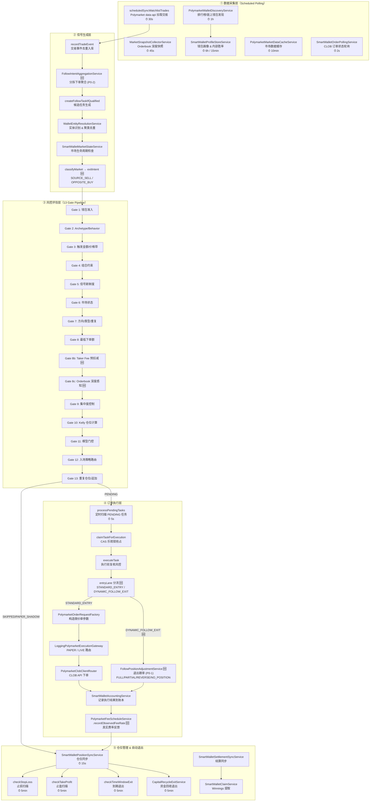

---

## 二、泳道图：从信号到成交的完整生命周期

> 下图描绘的是 **STANDARD_ENTRY** 主路径（普通入场）。leader 退出信号触发的 **DYNAMIC_FOLLOW_EXIT** 跨 lane 分支由 `FollowPositionAdjustmentService` 接管，详见 §3.6 的专用流程图。

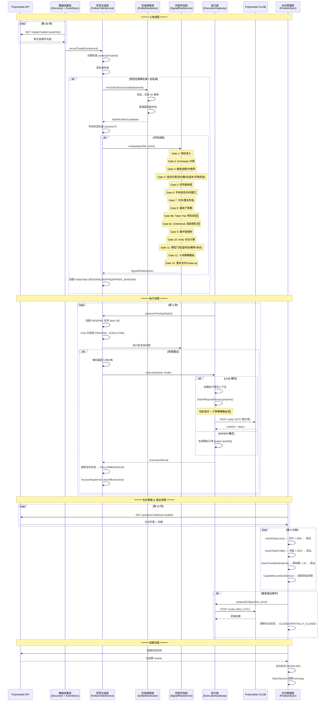

---

## 三、各层详细分析

### 3.1 数据采集层

系统采用纯 API 轮询架构（非链上监听），通过多个定时任务从 Polymarket data-api 和 CLOB API 采集数据。

| 定时任务 | 服务 | 频率 | 职责 |
|---------|------|------|------|
| 排行榜钱包发现 | `PolymarketWalletDiscoveryService` | 1h | 从排行榜发现高胜率钱包，评估并加入观察名单 |
| 交易事件同步 | `scheduledSyncWatchlistTrades` | 30s | 拉取观察名单钱包的最新交易，写入 `trade_event` 表 |
| Orderbook 深度快照 | `MarketSnapshotCollectorService` | 45s | 采集 bidDepth/askDepth (1c/3c/5c)、spreadBps、orderImbalance |
| 钱包画像更新 | `SmartWalletProfileStoreService` | 6h/15min | 刷新钱包评分、胜率、总交易数等画像指标 |
| 市场数据缓存 | `PolymarketMarketDataCacheService` | 10min | 缓存市场元数据（question、outcomes、tokenIds）|
| CLOB 订单状态 | `SmartWalletOrderPollingService` | 2s | 轮询已提交订单的成交状态 |
| 仓位同步 | `SmartWalletPositionSyncService` | 15s | 同步执行钱包的实时仓位和余额 |
| WARM 指标刷新 | `scheduledRefreshWarmWalletMetrics` | 10min | 刷新处于 WARM 观察期钱包的交易指标 |

**不充分之处：**
- 交易事件同步 30s 间隔对高频交易钱包可能存在延迟，极端情况下信号到达时市场已经移动
- Orderbook 快照 45s 间隔意味着深度数据最多可能已过期 45 秒+处理延迟，代码中已设置 5 分钟过期阈值作为兜底
- 无 WebSocket 实时推送通道用于交易事件，完全依赖 polling

---

### 3.2 信号生成层

交易事件进入系统后经过以下处理链路：

```text
recordTradeEvent → 去重 → 黑名单检查 → 钱包准入 → 意图聚合 (P0-2 🆕) → 实体智能增强
  → 市场状态检查 → 退出意图分类 (🆕) → 风控评估 → 创建 FollowTask
```

**关键设计决策：**

1. **去重机制**：基于 `source + externalTradeId` 唯一键，同一笔链上交易不会产生重复任务
2. **黑名单前置**：`manualBlocklistService` 在任何处理之前拦截，被封禁的钱包直接创建 SKIPPED 任务；该服务同时承担"35 天不活跃 → 自动入黑"职责（`blockForInactivityIfNeeded()`，依据 `SmartWalletLeaderTradeOutcomeEntity` 在置信度 ≥ 0.55 的可信关闭样本下判断）
3. **双轨准入**：钱包可通过自动观察名单（`watchEnabled=true` + `monitorTier=HOT`）或手动白名单（`manualAllowlist`）进入
4. **意图聚合（P0-2 🆕，`FollowIntentAggregationService`）**：解决 leader 分拆下单（试探、冰山、scale-in）被切成多条独立任务、或被"重复任务"门挡掉的问题。按 `walletAddress:marketId:outcome:side:windowBucket`（默认 5 分钟窗口，`SmartWalletProperties.IntentAggregation.windowMinutes`）聚合：
   - `FIRST_FRAGMENT` / `NEW_WINDOW` — 窗口内首条事件，正常创建新任务
   - `MERGED_INTO_EXISTING_INTENT` — 已有 PENDING/PAPER_SHADOW 任务时，把累计的 `recommendedStakeUsdc` / `triggerSizeUsdc` 直接累加到已有任务，并在 `skipReasonTags` 上盖 `INTENT_FRAGMENTS=N,INTENT_EVENT_IDS=...`
   - `SCALE_UP_SUPPLEMENT` — 窗口仍在但前置任务已被消费，交给下游 Scale-up 处理
   - 同时通过 `isWithinActiveIntentWindow(...)` 被 `SmartWalletSignalRiskService` 的 G7（重复任务门）反向调用，避免合法的 scale-in 被误判为重复
5. **实体智能增强**：`WalletEntityResolutionService` 将地址解析为实体 ID（同一个人/机构的多个地址聚合），避免同一实体的多钱包信号被重复跟单
6. **延迟增强**：当实体解析置信度不足（`PENDING` / `LOW_CONFIDENCE_LINK`）时，任务暂存为 SKIPPED，定时重评（每 2 分钟）
7. **退出意图分类（🆕）**：`SmartWalletSignalRiskService.classifyMarket()` 将事件分为两类——
   - `entryLane = STANDARD_ENTRY` — 普通入场，走 G1~G13 风控并最终走 `OrderRequestFactory.prepareLocalDraft` 路径
   - `entryLane = DYNAMIC_FOLLOW_EXIT` + `exitIntent ∈ {SOURCE_SELL, OPPOSITE_BUY}` — leader 卖出 / leader 买入反向 outcome 且 follower 已持反方向仓位。该 lane 在执行层会跳过下单工厂，直接交给 `FollowPositionAdjustmentService`（详见 §3.6）

**不充分之处：**
- 实体解析依赖地址聚类算法，对 iceberging（分拆下单到多个新地址）的检测能力有限；意图聚合只能覆盖"同一地址"的分拆，对"换地址再拆"无效
- 市场状态检查仅判断 `isActive()`，未检查市场流动性是否足够支撑跟单
- 意图聚合的累加金额没有上限保护，理论上 leader 极端连续加仓可能把单任务 `recommendedStakeUsdc` 推到 `maxOrderUsdc` 之上，后续靠 G8/G10 的 cap 兜底

---

### 3.3 风控评估层（13 Gate Pipeline）

`SmartWalletSignalRiskService.evaluate()` 是系统的核心风控引擎，包含 13+ 个门控（Gate），信号必须通过所有 Gate 才能创建 PENDING 任务。

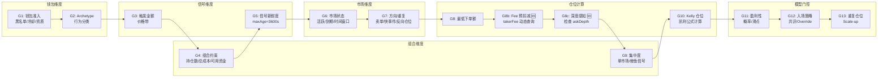

**各 Gate 详细说明：**

| Gate | 名称 | 检查内容 | 拒绝标记 |
|------|------|---------|---------|
| G1 | 钱包准入 | 黑名单（含 35d 不活跃自动入黑）、手动观察禁用、观察冷却期、白名单资质 | `G1_MANUAL_BLOCKLIST` / `G1_WATCHLIST_UNQUALIFIED` |
| G2 | Archetype/Behavior | 钱包行为模式分类（如快进快出 → OBSERVE_ONLY）| `G2_ARCHETYPE_OBSERVE_ONLY` / `G2_BEHAVIOR_FAST_EXIT` |
| G3 | 触发金额/价格带 | 最小触发金额 $5、价格在 [0.02, 0.98] 范围 | `G3_TRIGGER_SIZE_TOO_SMALL` / `G3_PRICE_OUT_OF_RANGE` |
| G4 | 组合约束 | 最大持仓数、最大总开仓成本、可用资金检查 | `G4_MAX_OPEN_POSITIONS` / `G4_CAPITAL_DEPLETED` |
| G5 | 信号新鲜度 | 交易事件年龄 < maxSignalAgeSeconds (3600s) | `G5_SIGNAL_STALE` |
| G6 | 市场状态 | 市场是否活跃、是否即将到期、时间窗口 | `G6_MARKET_NOT_ACTIVE` / `G6_MARKET_EXPIRED` |
| G7 | 方向/类型/重复 | 禁卖单（已被 `DYNAMIC_FOLLOW_EXIT` 接管，详见 §3.6）、快事件阻断、反向/重复持仓；重复检查会调用 `FollowIntentAggregationService.isWithinActiveIntentWindow` 放行同窗口聚合 🆕 | `G7_SELL_DISABLED` / `G7_DUPLICATE_PENDING_TASK` |
| G8 | 最低下单额 | 初步仓位 >= minOrderUsdc ($1) | (internal check) |
| G8b 🆕 | Taker Fee 预扣减 | 按品类动态 taker fee 预扣减有效仓位 | `[FEE_ADJUSTED]` (仅调整，不拒绝) |
| G8c 🆕 | 深度感知仓位调整 | 检查 askDepth，深度不足拒绝或缩减仓位 | `G8c_DEPTH_INSUFFICIENT` / `G8c_DEPTH_DOWNSIZE_BELOW_MIN` |
| G9 | 集中度控制 | 单市场集中度、鲸鱼信号控制 | `G9_EXTREME_CONCENTRATION_BLOCK` / `G9_WHALE_SIGNAL_BLOCK` |
| G10 | Kelly 仓位计算 | 基于 Kelly 公式计算最优仓位，负 EV 拒绝 | `G10_KELLY_NEGATIVE_EV` |
| G11 | 模型门控 | 盈利性评分、校准概率、滑点预测 | `G11_PROFITABILITY_TOO_LOW` / `G11_SLIPPAGE_COST_TOO_HIGH` |
| G12 | 入场策略路由 | 共识信号 / 单钱包 Override / Paper Canary | `G12_ENTRY_STRATEGY_REJECTED` |
| G13 | 重复仓位/追加 | 已持有同方向仓位时检查是否允许 Scale-up | `G13_DUPLICATE_POSITION_SCALEUP_DISABLED` |

**Paper Canary 机制**：当某些 Gate 被"软化"（如单钱包得分够但不满足共识），系统不直接拒绝，而是创建 `PAPER_SHADOW` 任务进行模拟跟踪，观察该信号的效果。

**不充分之处：**
- Gate 之间存在顺序依赖，早期 Gate 拒绝后不会到达后续 Gate，这意味着如果用户调整了 G7 的参数使其通过，G10 的 Kelly 可能仍会拒绝——但调试时只能看到 G7 的拒绝原因
- 共识信号的实体去重依赖于实体识别准确性，如果同一人的两个地址未被聚类，共识计数会偏高
- Kelly 公式中使用的 `calibratedFollowProbability` 依赖历史数据回归，新市场或新品类可能不准确

---

### 3.4 订单执行层

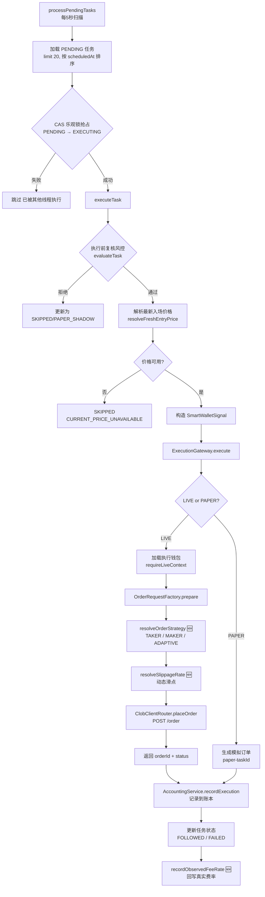

**关键设计：**

1. **双重风控**：`createFollowTaskIfQualified` 时做一次风控评估，`executeTask` 时再做一次复核。因为从创建到执行之间有 `followDelaySeconds` 的延迟，市场条件可能已变化。
2. **CAS 并发控制**：通过 `UPDATE ... WHERE status='PENDING'` 乐观锁防止多线程重复执行同一任务。
3. **GTC 限价单**：所有订单使用 Good-Till-Cancelled 限价单，非市价单，有明确的 limitPrice 上限。
4. **价格对齐**：`snapToTick()` 将价格对齐到 Polymarket 最小精度（minimumTickSize）。
5. **LIVE/PAPER 分流**：根据任务的 `executionMode` 决定走真实下单还是模拟。
6. **入场 / 退出 Lane 分流 🆕**：在 `executeTask` 内取 `decision.getEntryLane()`：
   - `STANDARD_ENTRY` → 走原有 `OrderRequestFactory.prepareLocalDraft` + `ExecutionGateway.execute` 路径
   - `DYNAMIC_FOLLOW_EXIT` → 跳过 entry pricing，直接调用 `followPositionAdjustmentService.adjust(task, exitEvent, exitIntent, mode)`，状态写入逻辑见 §3.6
7. **观察费率反馈 🆕（`PolymarketFeeScheduleService.recordObservedFeeRate`）**：LIVE 订单成交后，`SmartWalletAccountingService` 在 `isFilledImmediately && tradingFeeUsdc > 0 && notional > 0` 三个条件成立时回写 `actualFeeUsdc / notionalUsdc` 到 `observedFeeRates` 缓存（key = `lower(conditionId)`），后续 `getTakerFeeRate(conditionId, category)` 会优先返回观察值，影响 Gate 8b 的预扣减与 Kelly 的 EV 计算。该回写包在 try/catch 里，永远不会阻塞主账本写入。

**订单参数构造流程（`prepareLocalDraft`）：**

```text
1. cappedStake = min(max(recommendedStake, minOrderUsdc), maxOrderUsdc)
2. 选择订单策略: resolveOrderStrategy() → TAKER / MAKER
3. TAKER: limitPrice = rawPrice + slippage (动态/固定)
   MAKER: limitPrice = rawPrice + 1 tick
4. normalizedLimitPrice = snapToTick(limitPrice, tickSize)
5. size = cappedStake / normalizedLimitPrice
```

**不充分之处：**
- `resolveFreshEntryPrice` 获取的价格可能与 30 秒前的信号价格有偏差，但目前未做价格漂移二次检查（EntryTimingRiskService 在风控层已检查过一次 priceDrift，但执行层未再次验证）
- MAKER 模式的 limitPrice = rawPrice + 1 tick 较简单，未考虑当前 best bid 的实际位置——如果 rawPrice 与实时 best bid 偏差较大，挂单可能长时间无法成交
- 订单提交后没有超时取消机制（GTC 订单可能永远挂着）

---

### 3.5 仓位管理 & 自动退出层

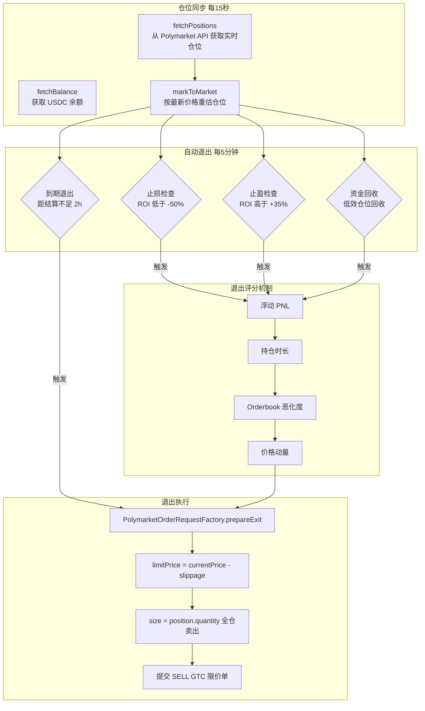

**退出策略详解：**

| 退出类型 | 触发条件 | 默认阈值 | 行为 |
|---------|---------|---------|------|
| 止损 | 浮亏超过阈值 | ROI < -50% | 动态阈值 + Orderbook 恶化加权 |
| 止盈 | 浮盈超过阈值 | ROI > +35% | Paper 和 LIVE 分别扫描 |
| 到期退出 | 距市场结算时间不足 | < 2 小时 | 最低 ROI 门槛 -100% (即只要能卖就卖) |
| 资金回收 | 低效占用资金的仓位 | 由 CapitalRecycle 配置 | 每日预算控制，冷却防抖 |

**动态止损（`scanPaperPositionsForExitWithDynamicThreshold`）：**
- 不是简单的固定阈值止损
- 综合考虑 `resolveOrderbookDeterioration()`（Orderbook 深度恶化程度）
- 如果 Orderbook 深度大幅下降（挂单撤走），止损阈值会提前触发
- 白名单钱包的仓位不参与自动退出 (`filterOutAllowlistPositions`)

**资金回收退出（`CapitalRecycleExitService`，⏱ 5min）🆕**

针对长期持有、ROI 接近零、占用大量资金的"僵尸仓位"，定期评分后强制退出，把资金腾给新机会。同时对 PAPER 和 LIVE 模式生效，受 `paperEnabled` / `liveEnabled` 独立开关控制。

**评分组成（满分 100）：**

| 维度 | 上限 | 计算 |
|------|------|------|
| 持仓时长 | 40 | `min(holdingHours / 24, 1) × 40`，1 天以上拿满 |
| 资金占比 | 25 | 该仓位 `costBasisUsdc` / 全部开仓 `costBasisUsdc` 之和，在 40% 集中度处饱和 |
| 流动性代理 | 15 | 用 `\|ROI\|` 反向衡量——ROI 越接近 0，"卡在僵尸市场"的可能越高 |
| 机会成本 | 20 | `pendingSignals / maxOpenPositions × 20`；`countPendingSignals()` 已是真实查询（查 `smart_wallet_follow_task` 中 `status=PENDING` 且 `created_at >= now - lookbackHours` 的行数，`lookbackHours` 默认 24），仅 mapper 缺失或查询异常时 fallback 0 |

**资格 / 安全保护：**
- 候选必须 `holdingHours ≥ holdingPeriodHours` 且 `ROI ∈ [deadZoneLowRate, deadZoneHighRate]`
- 单仓位 `cooldownMap`（默认 30 分钟）防抖，无论成功失败都重置
- `candidates.size()` 上限 = `openPositions.size() - minRetainPositions`，确保不会清空账户
- **白名单仓位**通过 `SmartWalletManualAllowlistService.filterOutAllowlistPositions` 排除
- `DailyBudgetTracker`（UTC 日切）按累计已退出的 `costBasisUsdc` 限额，超出 `dailyRecycleBudgetUsdc` 当轮即停
- 退出价：优先实时 best-bid，依次回退 midpoint → `markToMarket`
- PAPER 走 `accountingService.exitPosition` reason=`CAPITAL_RECYCLE_AUTO_EXIT`；LIVE 走 `clobExecutionService.executeLiveExit` + `accountingService.recordLiveExitExecution`

**不充分之处：**
- 止盈/止损阈值未扣除双边 taker fee（入场 + 出场），实际盈利低于 ROI 显示值
- 退出时全仓卖出，未考虑部分退出策略（分批出场减少市场冲击）
- 到期退出的 2 小时窗口可能对某些快速结算的市场太晚，对长期市场则太早
- ~~没有跟踪 leader 钱包的退出行为作为退出信号（leader 卖出时跟随退出）~~ ✅ 已由 §3.6 退出跟单 (DYNAMIC_FOLLOW_EXIT) 覆盖

---

### 3.6 退出跟单（DYNAMIC_FOLLOW_EXIT / P0-1）🆕

当 leader 钱包发出 SELL 或 OPPOSITE_BUY 事件时，过去版本直接 SKIP 任务，无法把 follower 已经持有的同方向仓位同步退出。新引入的 `FollowPositionAdjustmentService` 把这条链路补齐：在风控阶段把事件分类为 `entryLane=DYNAMIC_FOLLOW_EXIT`，执行阶段绕过下单工厂，直接根据 follower 现有仓位生成减仓 / 平仓动作。

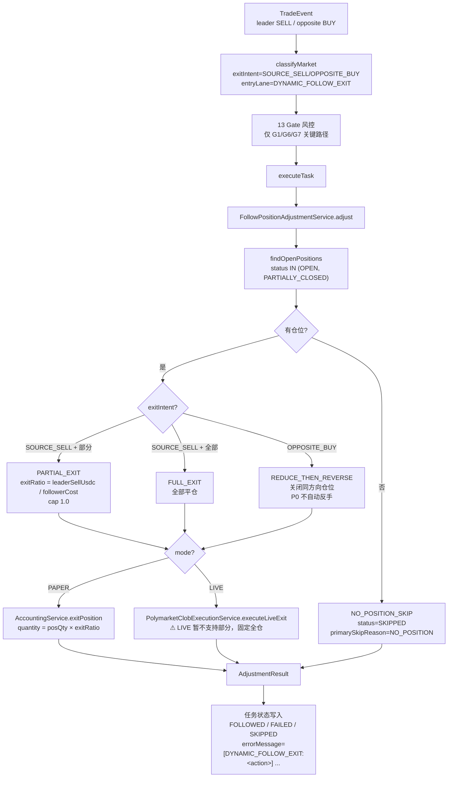

**四种动作（`AdjustmentAction` 枚举）：**

| 动作 | 触发条件 | 行为 | 备注 |
|------|---------|------|------|
| `FULL_EXIT` | `SOURCE_SELL` 且非部分卖出 | follower 全部平仓 | 默认动作 |
| `PARTIAL_EXIT` | `SOURCE_SELL` 且 `leader.sizeUsdc / Σfollower.costBasisUsdc < 0.80` | 按 `exitRatio` 比例减仓 | LIVE 模式当前仅 PAPER 支持 |
| `REDUCE_THEN_REVERSE` | `OPPOSITE_BUY`（leader 买入反向 outcome 且 follower 持反方向仓位） | 关闭 follower 同方向仓位 | P0 阶段仅平仓，不自动反手建仓 |
| `NO_POSITION_SKIP` | follower 无 OPEN/PARTIALLY_CLOSED 仓位 | 安全跳过 | 写 `primarySkipReason=NO_POSITION` |

**实现细节：**

- **价格回退链**：`resolveExitPrice` 优先 `event.price`，回退 `position.lastMarkPrice` → `position.averageEntryPrice` → 硬编码 `0.50`
- **PAPER 部分退出**：`SmartWalletAccountingService.exitPosition` 接受 `quantity = posQty × exitRatio`，余量保留为 PARTIALLY_CLOSED
- **LIVE 部分退出限制**：当前 LIVE 模式不支持部分退出，遇到 PARTIAL_EXIT 路径会强制走全仓 `executeLiveExit` 并 WARN 日志
- **错误隔离**：每个仓位独立 try/catch，任一仓位失败仅把 `AdjustmentResult.success` 翻为 false，不中断后续仓位
- **任务状态回写**：成功 → `status=FOLLOWED`、`orderType=EXIT`、`notionalUsdc=adjustResult.getExitedNotionalUsdc()`；失败 → `status=FAILED`、`errorMessage=[DYNAMIC_FOLLOW_EXIT:<action>] <message>`

**不充分之处：**
- LIVE 模式的部分退出尚未实现，触发时会被强制升级到全仓，可能与 leader 实际减仓比例不一致
- `isPartialSell` 的 0.80 阈值是经验值，未按品类/流动性分桶
- `OPPOSITE_BUY` 后不自动反手建仓，错过 leader 的真实反手意图——P1 路线图项
- 没有针对"同事件触发多条 follower 仓位"做并行执行，目前是顺序循环，仓位多时延迟会累积

---

### 3.7 应用层 & 运维入口 🆕

跟单代码原先全部塞在 `smartwallet.service` 包内，应用层（controller / 调度脚本）直接持有 `SmartWalletFollowTaskService` 这个胖编排服务，包结构层次不清晰。新近抽出了一个轻应用层 facade，同时 `PolymarketClobExecutionService` 也补充了大量运维入口。

**`FollowTaskApplicationService`**（`coin-strategy-job/src/main/java/.../job/follow/application/FollowTaskApplicationService.java`）

一个只依赖 `SmartWalletFollowTaskService` 的薄 facade，目前 6 个方法均为 1:1 委托：

| 方法 | 委托去向 | 用途 |
|------|---------|------|
| `listTasks(...)` | `listTasks` | 任务列表查询（运维 / 报表）|
| `listExecutableTasks(...)` ×2 | `listExecutableTasks` | 可执行任务清单（含两种入参重载）|
| `simulateRisk(...)` | `runRiskSimulation` | 给定参数下的风控模拟，输出每个 Gate 的判定 |
| `blockerStats()` | `collectBlockerStats` | 各 Gate 拒绝原因聚合统计 |
| `processPendingTasksNow()` | `processPendingTasks` | 运维强制立即扫描 PENDING |

> 设计意图：把 `follow.application` 包打造成稳定可调用面，重型逻辑保留在 `smartwallet.service`；同时也是上一轮 Spring 循环依赖修复时形成的边界——参见 §五依赖图与 P0 阶段的 `@Lazy` 注入。

**`PolymarketClobExecutionService` 运维入口**（`.../smartwallet/service/PolymarketClobExecutionService.java`）

除了 §3.4 / §3.5 提到的 LIVE 下单 / 退出主路径外，对外暴露多个运维方法：

| 方法 | 作用 |
|------|------|
| `deriveApiCreds()` | 用执行钱包私钥派生 Polymarket CLOB API key/secret/passphrase |
| `getOrder(orderId)` / `cancelOrder(orderId)` | 直查 / 取消 CLOB 订单 |
| `marketMetadata(conditionId)` | 取市场元数据（best-effort，按需触发刷新）|
| `marketPriceReference(conditionId, outcome, tokenId, fallbackPrice, questionHint)` | 返回该市场的 best bid/ask/midpoint 和 token 解析结果——下单前的定价输入 |
| `liveWalletState(conditionId)` | 返回 `{walletAddress, balanceUsdc, positions}`，仓位由 `PolymarketApiClient.fetchPositions` 实时取 |
| `dryRunOrder(PolymarketOrderDryRunRequest)` | 不绑定 follow task 的自由 dry-run，返回与 `dryRunFollowTask` 同结构的 `marketSelection / localPositionDraft / settlementSimulation` |
| `dryRunFollowTask(followTaskId)` | 按已有 PENDING 任务预演 LIVE 下单（含风控复核结果）|
| `executeFollowTask(followTaskId)` | 立即触发某 PENDING 任务的 LIVE 执行（绕过常规 5s 扫描）|
| `executeLiveExit(position, price, reason)` | 给定仓位的 LIVE 平仓（被 `FollowPositionAdjustmentService` 与 `CapitalRecycleExitService` 调用）|

**运维操作类服务：**

| 服务 | 关键方法 | 行为 |
|------|---------|------|
| `SmartWalletDataResetService` | `reset(includeProfiles, includeRiskArtifacts, includeRuntimeSeeds, includeMetadataCache)` | TRUNCATE 一组核心表（claim/settlement retries+runs、daily_report、cash_ledger、fill、order、position、follow_task、trade_event、profile），可选擦除风控样本（treatment_control_sample、trade_effect_label、wallet_feature_daily、market_snapshot），并清空 `walletRegistryService` / `opportunityService` / `marketMetadataService` 的内存缓存。返回每张表的 before/after 行数。`FOREIGN_KEY_CHECKS=0` 包裹，失败回退 DELETE。**仅运维使用**。|
| `SmartWalletRecoveryService` | `recoverState(reason)` | 7 步串行恢复管线，每步独立 try/catch（步骤失败仅记入 `notes`，不中断）：① 清 metadata 缓存 ② 刷新排行榜 ③ `SmartWalletSelectionService.refreshQualifiedWallets` ④ 观察名单交易同步 ⑤ `replayRecentIntelligenceCandidates(200, true)` ⑥ `settlementResync(100, 50, true)` ⑦ `backfillMarketEndAt(200, true)` ⑧ `rebuildRecentReports(7)`。`AtomicBoolean` 守护并发，重入返回 `RECOVERY_ALREADY_RUNNING`。`status()` 暴露 `recovering / lastRecoveredAt / lastSummary`。|

---

### 3.8 W1 闭环可观测性（trace_id / Shadow / Live-Replay diff / Settlement audit）🆕

跟单系统过去存在三个"黑盒"——被风控拒绝的信号若放行会赚还是亏？回测和实盘的差异在哪？UMA Oracle 解析失败的市场卡在哪一步？W1 系列把这些链路全部闭环成可查、可对比、可告警的产物。所有数据通过同一 `trace_id` 串联。

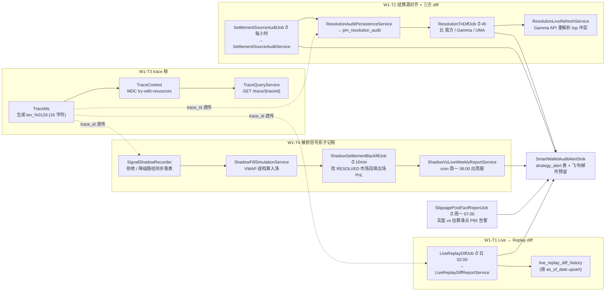

**W1-T3 全链路 trace_id：**
- `TraceIds` / `TraceContext` 现已下沉到 `common-service`，供天气 / BTC 5min 复用（Tier A 通用化，详见 §3.10）
- 五张关键表都带 `trace_id` 列：`smart_wallet_trade_event` / `smart_wallet_follow_task` / `smart_wallet_order` / `smart_wallet_trade_order` / `smart_wallet_position`（position 用 `origin_trace_id` 语义：首次开仓的 trace）
- logback pattern `[trace=%X{traceId:-}]` 让所有日志自动带 trace_id
- `TraceQueryService` 提供 `GET /smart-wallet/trace/{traceId}` 反查全链路时间线（事件 → 任务 → 订单 → 成交 → 仓位 → 结算）

**W1-T4 影子记账（`SignalShadowRecorder` + `ShadowFillSimulationService`）：**
- 在 `SmartWalletFollowTaskService.createFollowTaskIfQualified` 的拒绝 / 降级路径（REJECTED / PAPER_SHADOW / DOWNGRADED）同步调用 `SignalShadowRecorder.record(event, decision, ...)`
- `ShadowFillSimulationService.simulate(side, stake, snapshot)` 基于 `market_snapshot` 订单簿做 VWAP 逐档算入场价；失败时落表状态 `NO_DEPTH` / `DRY_FALLBACK`，便于事后分析门控误伤
- 表 `smart_wallet_signal_shadow` 携带 `decision_status / reject_layer / entry_estimator_source / shadow_entry_slippage_bps / shadow_pnl_usdc / status` 等字段
- `ShadowSettlementBackfillJob` ⏱ `fixedDelay 600000ms (10min)`：找 RESOLVED 市场 → 算 exit_price / pnl → 更新 status=SETTLED
- `ShadowVsLiveWeeklyReportService` `cron 0 0 6 * * MON`：按 `reject_layer + entry_estimator_source` 分桶对比 shadow vs live PnL，生成 `estimatorSourceBreakdown`（VWAP-rejected vs PROXY-rejected）
- 失败永远只 warn，不阻塞主链路

**W1-T1 Live ↔ Replay diff（`LiveReplayDiffReportService` + `LiveReplayDiffJob`）：**
- `cron 0 0 2 * * *` Asia/Shanghai：跑 T-1 日 replay backtest（由 `SmartWalletReplayBacktestService.replayLiveWindow(date)` 提供 candidate 政策回放），与 `smart_wallet_follow_task` + `position` 实盘窗口对比
- 输出 `signal_accepted_diff / pnl_diff_usdc / pnl_diff_bps`，超阈值（默认 `pnl-diff-bps=100`、`signal-miss-pct=0.05`）→ `SmartWalletAuditAlertSink.publish(AUDIT_LIVE_REPLAY_DIFF)`
- 历史落 `live_replay_diff_history` 表（按 `as_of_date` upsert）

**W1-T2 结算源对齐 + 三方 diff：**
- `SettlementSourceAuditJob` `cron 0 0 * * * *`（每小时）扫描 `smart_wallet_market_info + position + claim_retry`，计算 lifecycle 分布 / parseFailure / resolutionDelayed / pendingSettlementOverdue / claimFailureMax
- `MarketResolutionResolver.resolveWithAudit` 每次解析快照通过 `ResolutionAuditPersistenceService` 写入 `pm_resolution_audit`
- `ResolutionTriDiffJob` `cron 0 15 */4 * * *`（每 4h）比对 我方 / Gamma / UMA 三方判定，输出 4 类不一致（`OURS_VS_UMA` / `OURS_VS_GAMMA` / `UMA_VS_GAMMA` / `HISTORY_CONFLICT`），异常超阈值 → `AUDIT_RESOLUTION_TRIDIFF` 告警
- `ResolutionLiveRefreshService` 开启时（`audit.resolution-tridiff-live-refresh-enabled=true`）对 top 冲突调 Gamma API 重新解析并落新 audit 记录

**W2-T4.5 滑点事后统计（`SlippagePostFactReportJob` + `SlippagePostFactReportService`）：**
- `cron 0 0 7 * * MON`（周一 07:00）周度跑实盘 vs 估算滑点对比
- P95 超阈值 → `AUDIT_SLIPPAGE_POSTFACT` 告警

**关键 SQL 验证：**

```sql
-- trace_id 覆盖率
SELECT COUNT(*) total, COUNT(trace_id) with_trace
  FROM smart_wallet_follow_task
 WHERE created_at >= NOW() - INTERVAL 1 DAY;

-- shadow 命中率
SELECT decision_status, status, COUNT(*) cnt
  FROM smart_wallet_signal_shadow
 WHERE created_at >= NOW() - INTERVAL 7 DAY
 GROUP BY decision_status, status;

-- VWAP vs PROXY 估算源对比（第十四批新增维度）
SELECT entry_estimator_source, COUNT(*) cnt,
       AVG(ABS(shadow_entry_slippage_bps)) avg_abs_bps,
       SUM(shadow_pnl_usdc) total_pnl
  FROM smart_wallet_signal_shadow
 WHERE status='SETTLED' AND shadow_settled_at >= NOW() - INTERVAL 30 DAY
 GROUP BY entry_estimator_source;
```

**不充分之处：**
- Shadow 模拟的 VWAP 依赖 `market_snapshot` 的深度，45s 采集间隔下深度可能与 leader 真实成交时刻有偏差
- Live ↔ Replay diff 仅按"日"粒度对比，单日内的策略行为差异不可见
- `ResolutionTriDiffService` 的"历史冲突"分类不会自动闭环，需要人工通过 `/audit/resolution/needs-review` 入口处理
- 周报类（shadow weekly / slippage post-fact）只在周一发，灰度切换后最迟需要 7 天才能看到首份对比

---

### 3.9 W2 风控增强 Gate 群（T1 ~ T6 + MAKER 路由）🆕

§3.3 的 13 Gate 流水线在 W2 阶段被进一步细化——多个原本只是"hard threshold"的 Gate 被拆出可独立灰度的子段，并补入新维度（leader 滑动胜率、行为漂移、距结算时间、价格冲击三段式、流动性 / 价差分位）。所有新子段通过 `enable-*` 配置独立灰度，默认 OFF，逐项放行。

```text
G1   Manual blocklist                                  ← 旧
G2   Wallet archetype                                  ← 旧 (OBSERVE_ONLY → 拒绝)
G2a  Wallet score / 流动性 / 价差            🆕         ← 基础硬阈值
G2b  Leader 滑动窗口胜率 (W2-T2)            🆕         ← LeaderRollingPerformanceService
G2c  Leader 行为漂移 (W2-T6)                🆕         ← LeaderBehaviorDriftService
G3-G5 仓位 / 暴露 / 集中度                  ← 旧
G6   Market lifecycle + maxHoursToMarketEnd
G7-G9 EV / profitability / consensus (W2-T3) 🆕        ← EntityAwareConsensusService BOOST_ONLY
G10  Stake (Kelly + 共识倍率)
G11  价格冲击三段式 (W2-T4)                  🆕         ← VWAP / PROXY → MAKER_FIRST / MAKER_ONLY / REJECT
G11  价差 P70 (W2-T1.4)                       🆕         ← pm_market_liquidity_percentile_daily
G11  距结算时间 (W2-T5)                      🆕         ← 三档：< 30min 拒绝 / [30,120) 降级 / ≥ 120 全仓
G11  流动性 P30 滚动门 (W2-T1)               🆕         ← MarketLiquidityPercentileService
G11  其它 slippage 兜底                       ← 旧
```

**各新子段详解：**

| 子段 | 服务 / 数据源 | 行为 | 配置开关 |
|------|----------|------|---------|
| W2-T1 流动性 P30 滚动 | `MarketLiquidityPercentileService` + `pm_market_liquidity_percentile_daily` | category 滚动 P30 已计算时门槛 = P30，否则 fallback `minMarketLiquidity` 硬阈值 | `enable-liquidity-rolling-percentile` (prod=true) |
| W2-T1.4 价差 P70 | 同表 `spread_bps_p70` | 三档：`≤ P70` 全仓 / `(P70, P70 × downgradeFactor]` ×0.5 / `> P70 × rejectFactor` 拒绝 | `enable-spread-p70-gate` (prod=true) |
| W2-T2 Leader 滑动窗口胜率 | `LeaderRollingPerformanceService` + `smart_wallet_order(BUY+ENTRY) ⨝ position(已关闭)` 最近 N 笔 | 三态 ACTIVE / COOLING（仓位 ×0.05）/ SUSPENDED | `enable-leader-rolling-gate` (默认 OFF，等待 W1-T4 数据验证) |
| W2-T3 共识强度 BOOST_ONLY | `EntityAwareConsensusService` 多实体共识 | 2 实体 ×1.20 / 3+ 实体 ×1.50 加分；HARD_GATE 模式可切换为门控 | `consensus-gate-mode=BOOST_ONLY` |
| W2-T4 价格冲击三段式 | `MarketPriceImpactEstimator`（VWAP）/ `profitabilityEstimate.estimatedSlippageUsdc/stake`（PROXY） | `< 100 bps` 全仓 NORMAL / `[100,300) bps` ×0.5 + MAKER_FIRST / `[300,500) bps` ×0.25 + MAKER_ONLY (10s 超时撤单) / `≥ 500 bps` 拒绝 | `enable-price-impact-gate` (默认 true) + `enable-vwap-slippage-estimator` (prod=true) |
| W2-T5 距结算时间 | `event_end_at - now()` | 三档：`< 30 min` 拒绝 / `[30, 120) min` 仓位 ×0.5 / `≥ 120 min` 全仓；不影响已有仓位退出；豁免名单 `time-to-expiry-exempt-market-types`（天气 / BTC 5min） | `enable-time-to-expiry-gate` (默认 true) |
| W2-T6 Leader 行为漂移 | `LeaderBehaviorDriftService` + `smart_wallet_behavior_profile.behavior_vector_json`（方案 B 首选，fallback 实时聚合） | 7 维特征 = `[log10(size+1)/6, sideBuy, cat_POLITICS, cat_CRYPTO, cat_SPORTS, cat_WEATHER, cat_OTHER]`；cosine 距离三态：ACTIVE / DRIFTED（×0.25）/ DRIFTED_SEVERE（拒绝） | `enable-leader-drift-gate` (prod=true) |

**W2-T4 价格冲击三段式 + MAKER 路由细节（`SmartWalletSignalRiskService` 内联）：**

```text
priceImpactExecutionMode:
  NORMAL       — TAKER 全仓，限价 = rawPrice + slippage
  MAKER_FIRST  — 优先 MAKER 挂单，未成交允许后续重试 TAKER
  MAKER_ONLY   — 仅挂 MAKER，10s 超时强制 cancel；由 MakerOnlyOrderTimeoutTracker 兜底
  REJECTED     — 直接拒绝
```

- VWAP estimator（`MarketPriceImpactEstimator`）：基于最近一笔 `market_snapshot` 跑逐档 VWAP，返回 `PriceImpactEstimate.ok` + bps；估算失败回退 PROXY，标记 `priceImpactBpsSource=PROXY` 落入 shadow 表
- MAKER_ONLY 超时撤单（`MakerOnlyOrderTimeoutTracker`）：`@Scheduled fixedDelay 2000ms` 扫描内存 cache，调用 `PolymarketClobClientRouter.cancelOrder` 释放挂单占用的资金给下一笔；重启即清空（重启后由 `SmartWalletOrderPollingService` 兜底）
- 估算源回写 `SmartWalletSignalShadowEntity.entryEstimatorSource`，使 `ShadowVsLiveWeeklyReportService` 能按 `VWAP(OK) / VWAP(DRY_FALLBACK) / PROXY` 分桶对比胜率

**Leader 维度的额外控制：**

- **`LeaderRollingPerformanceService`**：滑动窗口取最近 N 笔已关闭 ENTRY+BUY 配对（order ⨝ position），按 ROI 命中率打三态。`LeaderRollingMonitorJob` `cron 0 30 9 * * *` 每日聚合一次，结果落 `pm_leader_rolling_aggregation`，触发 `WARN_HIGH_COOLING / WARN_LOW_WIN_RATE / AUDIT_LEADER_ROLLING_HEALTH` 告警
- **`LeaderBehaviorDriftService`**：单 leader 行为向量与历史 centroid 的 cosine 距离判定；`LeaderDriftAggregationJob` `cron 0 0 8 * * *` 每日把所有 leader 的 drift 状态打到 `pm_leader_drift_aggregation`，并 push `AUDIT_LEADER_DRIFT`
- **`LeaderBehaviorDriftService.stakeMultiplier(state)`** — DRIFTED → ×0.25，DRIFTED_SEVERE → 拒绝；ACTIVE → ×1.0

**不充分之处：**
- W2-T4 的 MAKER_ONLY 10s 超时是经验值，未按品类（高波动 vs 长期市场）分桶
- W2-T6 行为向量目前 7 维硬编码，新增 category 需要全量重算 centroid
- W2-T1 / W2-T1.4 都依赖 daily snapshot，刚开市 / 罕见 category 在第一天没有分位数据时会回退到 fallback 硬阈值
- W2-T2 默认仍关闭（OFF），等待 W1-T4 shadow PnL 验证

---

### 3.10 跨策略通用化基础设施（Tier A / B / C）🆕

W2 系列在沉淀的同时识别出三段可复用基础设施，已下沉到 `common-service` 模块，跟单 / 天气 / BTC 5min 等多策略共用。

| Tier | 组件 | 位置 | 复用语义 |
|------|------|------|---------|
| Tier A | `TraceIds` / `TraceContext` | `common-service.trace` | 任意策略 generate / parse / MDC 注入 trace_id |
| Tier A | `StrategyAuditAlertSink` 接口 + `StrategyAlertService` 默认实现 | `common-service.alert` | 任意策略 publish 审计告警；跟单专用强类型重载是 `SmartWalletAuditAlertSink extends StrategyAuditAlertSink` |
| Tier B | `BehaviorVectorizer<E>` 接口 | `common-service.behavior` | 单事件 → N 维向量；各策略实现自己的 vectorizer（跟单 7 维、天气城市 one-hot、BTC 价差档位） |
| Tier B | `CentroidDriftDetector` 静态工具 | 同上 | `cosineDistance(centroid, current)` + `classify(distance, threshold, severeThreshold)` 三态 |
| Tier B | `SignalRiskGate` / `SignalRiskPipeline` 契约 | `common-service.risk` | 复用 Gate 责任链结构 |
| Tier C | （路线图）跨策略 daily snapshot 流水线 / 跨策略 Replay backtest | 规划中 | 把 `MarketLiquidityPercentileSnapshotJob` / `LiveReplayDiffJob` 改造为接口驱动 |

**Tier A 的关键约束：**
- `TraceIds.generate(eventId)` 必须确定性（同一 trade_event 永远派生同一 trace_id），便于跨表 JOIN
- `StrategyAuditAlertSink.publish(...)` 实现必须 swallow exception，不能阻塞 Job 主流程
- `STRATEGY_ID` 隔离不同策略空间，跟单专用 `STRATEGY_ID="SMART_WALLET_AUDIT"`

**Tier B 的关键约束：**
- `BehaviorVectorizer.dimension()` 必须恒定——一旦实现，维度跨版本不能变化，否则历史 centroid 失效
- `BehaviorVectorizer.vectorize(event)` 必须确定性
- `CentroidDriftDetector.classify` 对 NaN/Infinity 按 ACTIVE 处理（放行 + 上层 cold-start 兜底）

**不充分之处：**
- Tier C 还在路线图，跨策略 snapshot Job 当前仍是跟单专属
- `BehaviorVectorizer` 7 维硬编码限制 leader 行为可解释性扩展
- `StrategyAuditAlertSink` 默认实现仅写 `strategy_alert` 表 + 日志，飞书 / 邮件投递通道仍为预留注入点

---

### 3.11 新增辅助服务一览 🆕

下表覆盖 v2.1 → v2.2 之间新增 / 重构的辅助服务，便于全局检索（按职责分组）。已在 §3.6 / §3.7 / §3.8 / §3.9 详述的组件不再重复展开。

**入场 / 退出辅助：**

| 服务 | 关键方法 / 调度 | 职责 |
|------|---------------|------|
| `TimeAwareStopLossService` (implements `ExitSignalProvider`) | `resolveStopLossThreshold(position)` / `isTrendStopLossTriggered(...)` | 距结算越近止损阈值越紧；连续下行 N 期触发 trend stop-loss（in-memory price history）|
| `MakerOnlyOrderTimeoutTracker` | `@Scheduled fixedDelay 2s` | MAKER_ONLY / MAKER_FIRST 单超时撤单（W2-T4）|
| `FollowExposureLimitService` | `evaluate(...)` 三层 cap | 单市场 / 单白名单 / 全局 TVL 上限——避免白名单地址连续高频开仓打满账户 |
| `AllowlistSignalAggregationService` | `peekBuffer / accumulate / purgeExpired` | 白名单地址同窗口同方向的信号聚合（与意图聚合 §3.2 互补，专门给白名单用）|
| `AbnormalMarketReviewService` | `diagnoseOrders / diagnosePositions / review` | 异常市场人工 review 流程入口 |

**Leader 行为 / 评分：**

| 服务 | 关键方法 / 调度 | 职责 |
|------|---------------|------|
| `WalletArchetypeClassifierService` | `classify(profile, recentEvents)` | Wallet archetype 分类（如 FAST_EXIT / SCALPER / OBSERVE_ONLY），G2 引用 |
| `WalletBehaviorProfileService` | `BehaviorProfileSnapshotJob` ⏱ 10min | 维护 `smart_wallet_behavior_profile.behavior_vector_json`（方案 B 给 W2-T6 复用）|
| `LeaderBehaviorDriftService` | `evaluate(leader, event) / stakeMultiplier(state) / computeProfileVectorJson(...)` | W2-T6 漂移判定，详见 §3.9 |
| `LeaderRollingPerformanceService` | `LeaderRollingMonitorJob` `cron 0 30 9 * * *` | W2-T2 leader 滑动胜率 |
| `LeaderDriftAggregationService` | `LeaderDriftAggregationJob` `cron 0 0 8 * * *` | 全 leader drift 状态日聚合 |
| `SignalScoreModelService` | `score(profile, event, consensus, profitability, entryTiming, ...) → SignalScoreModelResult` | 综合 leader 画像 / 共识 / 盈利性 / 入场时机的统一信号评分 |
| `EntityAwareConsensusService` | 共识聚合（包内服务）| W2-T3 实体感知共识，2/3+ 实体加分倍率 |

**钱包真值 / 回测 / 归因：**

| 服务 | 关键方法 / 调度 | 职责 |
|------|---------------|------|
| `SmartWalletProfileTruthRefreshService` | `refreshProfile(addr) / refreshProfiles(limit) / audit(addr)` | 全量重算钱包真值（胜率 / 平均 ROI / 持仓时长等），与 `SmartWalletLeaderTruthMaintenanceJob` 协同 |
| `SmartWalletReplayBacktestService` | `replay(req) / replayLiveWindow(date) / replayConcentrationSummary(req)` | 历史 candidate 政策回放，被 `LiveReplayDiffJob` 使用 |
| `FollowTradeAttributionService` | `buildAttribution(groupBy, limit)` | 按 leader / market / category / outcome 维度做跟单收益归因 |
| `LeaderTradeOutcomeRebuildService` | 手动入口 | 重建 `smart_wallet_leader_trade_outcome` 真值表 |

**市场数据：**

| 服务 | 关键方法 / 调度 | 职责 |
|------|---------------|------|
| `PolymarketMarketDataStreamService` 🆕 | `getSnapshot(tokenId) / handleMessage(payload) / getStats()` | WebSocket 实时市场数据流（首次补齐 §3.1 的"无 WebSocket"缺口；缓存最新 snapshot 供 hot path 取用）|
| `MarketPriceImpactEstimator` | `estimate(event, stakeUsdc) → PriceImpactEstimate` | W2-T4 VWAP 估算器，详见 §3.9 |
| `ShadowFillSimulationService` | `simulate(side, stake, snapshot)` | VWAP 逐档算入场，被 SignalShadowRecorder 与 PriceImpactEstimator 共用 |
| `MarketLiquidityPercentileService` | 内存聚合（1h 缓存）+ `pm_market_liquidity_percentile_daily` 持久化 | W2-T1 / W2-T1.4 流动性 & 价差分位 |
| `MarketConcentrationSnapshotService` | `MarketConcentrationSnapshotRefreshJob` ⏱ 3min | 集中度快照刷新，给 G9 提速 |

**审计 / 报表：**

| 服务 | 关键方法 / 调度 | 职责 |
|------|---------------|------|
| `SignalShadowRecorder` | `record(event, decision, ...)` | W1-T4 入口（§3.8）|
| `ShadowSettlementBackfillService` | `ShadowSettlementBackfillJob` ⏱ 10min | shadow 出场回填 |
| `ShadowVsLiveWeeklyReportService` | `cron 0 0 6 * * MON` | 周报，按 reject_layer × estimator_source 分桶 |
| `LiveReplayDiffReportService` | `LiveReplayDiffJob` `cron 0 0 2 * * *` | Live ↔ Replay 一致性日报 |
| `SettlementSourceAuditService` | `SettlementSourceAuditJob` `cron 0 0 * * * *` | 结算源对齐审计 |
| `ResolutionAuditPersistenceService` / `ResolutionTriDiffService` / `ResolutionLiveRefreshService` | `ResolutionTriDiffJob` `cron 0 15 */4 * * *` | 我方 / Gamma / UMA 三方 diff |
| `SlippagePostFactReportService` | `SlippagePostFactReportJob` `cron 0 0 7 * * MON` | 滑点事后周报，P95 告警 |
| `SmartWalletAuditAlertSink` | `publish(alertType, title, message, metricValue, threshold)` | 7 种 `AUDIT_*` AlertType 统一收口（§3.12）|
| `TraceQueryService` | `GET /smart-wallet/trace/{traceId}` | 全链路反查 |

**画像快照 Job：**

| Job | cron / fixedDelay | 职责 |
|-----|------|------|
| `BehaviorProfileSnapshotJob` | fixedDelay 10min | 写 `behavior_vector_json` |
| `ProfileOrderStatsSnapshotJob` | 定时 | 钱包订单统计快照 |
| `ProfileDiagnosisSnapshotJob` | 定时 | 钱包诊断快照（与 `SmartWalletProfileDiagnosisReadService` 配套）|

**不充分之处：**
- `PolymarketMarketDataStreamService` 已具备 WebSocket 入口，但风控 / 信号路径默认仍走 polling；切换需要点对点替换 `MarketSnapshotCollectorService` 的调用点
- `SignalScoreModelService` 输出当前未作为 G11 模型门控的独立维度入参，仅做观测
- `FollowTradeAttributionService` 仅有读 API，没有归因数据落表

---

### 3.12 审计告警通道与 Web BFF 端点 🆕

**审计告警统一通道（`SmartWalletAuditAlertSink`）：**

将 5+ 个审计 Job 的 WARN 日志收口到 `strategy_alert` 表，同时为飞书 / 邮件投递预留唯一注入点。

| AlertType | 来源 Job / Service | 触发条件 |
|-----------|-------------------|---------|
| `AUDIT_LIVE_REPLAY_DIFF` | `LiveReplayDiffReportService` | T-1 日 replay vs live PnL 差异 / 信号数差异超阈值 |
| `AUDIT_SHADOW_VS_LIVE` | `ShadowVsLiveWeeklyReportService` | shadow PnL vs live PnL 周差异超阈值 |
| `AUDIT_SETTLEMENT_SOURCE` | `SettlementSourceAuditService` | resolutionDelayed / pendingSettlementOverdue / claimFailureMax 异常 |
| `AUDIT_SLIPPAGE_POSTFACT` | `SlippagePostFactReportService` | 实盘 vs 估算滑点 P95 超阈值 |
| `AUDIT_LEADER_DRIFT` | `LeaderBehaviorDriftService` / `LeaderDriftAggregationJob` | leader 行为漂移 SEVERE 或漂移率超阈值 |
| `AUDIT_RESOLUTION_TRIDIFF` | `ResolutionTriDiffJob` | 三方 diff 不一致数超阈值 |
| `AUDIT_LEADER_ROLLING_HEALTH` | `LeaderRollingMonitorJob` | cooling 比例 > 0.40 或 overall_win_rate < 0.48 |

**实现保证：**
- 全局开关 `audit.alert-sink-enabled=true` 一键关停
- 同 `strategyId + alertType` 已存在未恢复告警时去重（复用 `StrategyAlertService` 默认行为）
- `publish(...)` 必须 swallow exception，失败仅 warn 不阻塞主流程

**Web BFF 端点（20+ 个，前缀 `/smart-wallet`）：**

| 主题 | 端点 |
|------|------|
| 任务 / 风控 | `GET /follow-tasks`、`POST /follow-tasks/{id}/dry-run`、`POST /follow-tasks/{id}/execute`、`POST /risk/simulate`、`GET /risk/blocker-stats` |
| trace 反查 | `GET /trace/{traceId}` 🆕、`GET /traces/by-leader/{wallet}` 🆕 |
| Shadow 记账 | `GET /shadow/records`、`GET /shadow/records/{id}` 🆕 |
| 告警 | `GET /audit/alerts` 🆕 |
| 结算审计 | `GET /audit/settlement-source` 🆕、`GET /audit/resolution/{marketId}` 🆕、`GET /audit/resolution/needs-review` 🆕、`GET /audit/resolution/uma-inconsistent` 🆕、`GET /audit/resolution-tridiff?lookbackHours=24` 🆕 |
| 滑点 / Live diff | `GET /audit/slippage-postfact` 🆕、`GET /audit/live-replay-diff/latest` 🆕、`GET /audit/live-replay-diff/history?limitDays=30` 🆕 |
| Leader 诊断 | `GET /leader-rolling/{wallet}` 🆕、`GET /leader-drift/{wallet}` 🆕、`GET /audit/leader-drift-aggregation` 🆕 |
| 流动性 / 价差分位 | `GET /market-liquidity/percentile`、`GET /market-liquidity/percentile/{category}` 🆕 |
| 运维 | `POST /admin/data-reset`、`POST /admin/recover`、`GET /admin/recover/status`、`POST /clob/dry-run`（详见 §3.7）|

入口：`coin-strategy-web/.../controller/smartwallet/SmartWalletAuditController.java` + `SmartWalletAdminController.java` + `SmartWalletReadController.java`

**不充分之处：**
- `strategy_alert` 表的去重粒度是 `strategyId + alertType`，同一 alertType 内不同 leader/market 的告警仍会被合并
- 飞书 / 邮件实际投递通道未实现，需要替换 sink bean
- 没有审计告警的"自动恢复"机制，告警状态翻回 OK 仍需人工或定时清理

---

## 四、数据流与状态机

### 4.1 FollowTask 状态机

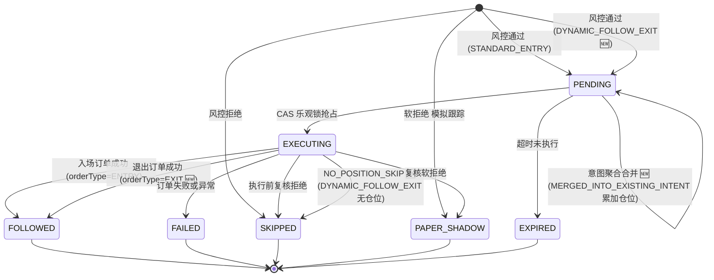

**补充字段说明：**
- `entryLane` — `STANDARD_ENTRY` / `DYNAMIC_FOLLOW_EXIT`
- `exitIntent` — 仅 `DYNAMIC_FOLLOW_EXIT` 任务有值，取 `SOURCE_SELL` / `OPPOSITE_BUY`
- `orderType` — `ENTRY` / `EXIT`，退出跟单走 `EXIT`
- `primarySkipReason` — `NO_POSITION` 专用于退出跟单无仓位场景
- `skipReasonTags` — 意图聚合时盖 `INTENT_FRAGMENTS=N,INTENT_EVENT_IDS=...`

### 4.2 Position 状态机

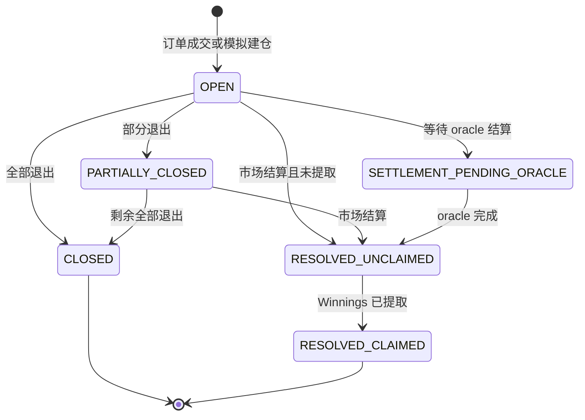

---

## 五、关键服务依赖关系

```mermaid
flowchart TB
    AppLayer["FollowTaskApplicationService 🆕\nfollow.application 包薄 facade"]
    FollowTaskService["SmartWalletFollowTaskService\n核心编排"]
    RiskService["SmartWalletSignalRiskService\n13 Gate 风控"]
    ExecutionGateway["LoggingPolymarketExecutionGateway\nLIVE/PAPER 路由"]
    OrderFactory["PolymarketOrderRequestFactory\n限价单构造"]
    AccountingService["SmartWalletAccountingService\n账本 + 费率回写 🆕"]
    FeeService["PolymarketFeeScheduleService\n动态费率 + observedFeeRates 🆕"]
    SnapshotService["MarketSnapshotCollectorService\nOrderbook 快照"]
    PositionSync["SmartWalletPositionSyncService\n仓位同步 + 退出"]
    ProfileStore["SmartWalletProfileStoreService\n钱包画像"]
    EntityResolution["WalletEntityResolutionService\n实体识别"]
    IntentAgg["FollowIntentAggregationService 🆕\n分拆下单聚合 (P0-2)"]
    AdjustService["FollowPositionAdjustmentService 🆕\n退出跟单 (P0-1)"]
    ConsensusService["PolymarketConsensusSignalService\n共识信号"]
    KellyCalc["KellyStakeCalculator\n仓位计算"]
    EntryTiming["EntryTimingRiskService\n入场时机"]
    ProfitScoring["TradeProfitabilityScoringService\n盈利性评估"]
    ConcentrationService["MarketConcentrationService\n集中度"]
    DiscoveryService["PolymarketWalletDiscoveryService\n钱包发现"]
    MarketState["SmartWalletMarketStateService\n市场状态"]
    ClobClient["PolymarketClobClientRouter\nCLOB 下单"]
    ClobExec["PolymarketClobExecutionService\nLIVE 退出 + 运维入口 🆕"]
    Allowlist["SmartWalletManualAllowlistService\n白名单"]
    Blocklist["SmartWalletManualBlocklistService\n黑名单 + 35d 自动入黑"]
    DataReset["SmartWalletDataResetService 🆕\n运维数据重置"]
    Recovery["SmartWalletRecoveryService 🆕\n7 步恢复管线"]
    CapRecycle["CapitalRecycleExitService 🆕\n资金回收退出"]

    AppLayer --> FollowTaskService

    FollowTaskService --> RiskService
    FollowTaskService --> ExecutionGateway
    FollowTaskService --> AccountingService
    FollowTaskService --> EntityResolution
    FollowTaskService --> MarketState
    FollowTaskService --> IntentAgg
    FollowTaskService --> AdjustService
    FollowTaskService --> Allowlist
    FollowTaskService --> Blocklist

    AdjustService --> AccountingService
    AdjustService -.@Lazy.-> ClobExec
    ClobExec -.@Lazy.-> FollowTaskService

    RiskService --> FeeService
    RiskService --> SnapshotService
    RiskService --> ConsensusService
    RiskService --> KellyCalc
    RiskService --> EntryTiming
    RiskService --> ProfitScoring
    RiskService --> ConcentrationService
    RiskService --> IntentAgg
    RiskService --> Allowlist
    RiskService --> Blocklist

    ExecutionGateway --> OrderFactory
    ExecutionGateway --> ClobClient
    OrderFactory --> SnapshotService

    PositionSync --> AccountingService
    PositionSync --> OrderFactory

    DiscoveryService --> ProfileStore

    AccountingService --> FeeService

    CapRecycle --> AccountingService
    CapRecycle --> ClobExec
    CapRecycle --> Allowlist

    Recovery --> DiscoveryService
    Recovery --> AccountingService
    Recovery --> EntityResolution
```

**W1 闭环可观测性扩展依赖图 🆕**

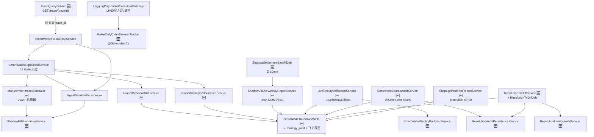

**循环依赖修复**：`FollowPositionAdjustmentService → PolymarketClobExecutionService → SmartWalletFollowTaskService → FollowPositionAdjustmentService` 是 P0 阶段引入的三角循环。当前破环方式：`PolymarketClobExecutionService` 上对 `SmartWalletFollowTaskService` 用 `@Lazy` 注入，把启动期的构造图变成 Lazy 代理，运行期首次调用 `executeFollowTask` / `dryRunFollowTask` 时再解析真实 bean。

---

## 六、当前系统不充分事项汇总

### 已修复

| # | 问题 | 修复方案 | 状态 |
|---|------|---------|------|
| 1 | 手续费静态 0.15%，实际最高 1.8% | `PolymarketFeeScheduleService` + Gate 8b 预扣减 | ✅ P0 |
| 2 | 入场仓位不检查 Orderbook 深度 | Gate 8c 深度感知仓位调整 | ✅ P0 |
| 3 | 滑点容忍固定 2%，不分市场 | `resolveSlippageRate()` 3 级动态滑点 | ✅ P1 |
| 4 | 所有订单走 Taker，支付全额手续费 | `resolveOrderStrategy()` MAKER/ADAPTIVE | ✅ P1 |
| 11 | 未跟踪 leader 退出行为作为退出信号 | `FollowPositionAdjustmentService` + `DYNAMIC_FOLLOW_EXIT` lane (§3.6) | ✅ P0-1 🆕 |
| 14 | leader 分拆下单（试探 / iceberg / scale-in）被切成多条任务或被重复任务门挡掉 | `FollowIntentAggregationService` 5min 窗口聚合 (§3.2) | ✅ P0-2 🆕 |
| 15 | 手续费 / 滑点配置值是静态估算，真实成交后未反馈 | `PolymarketFeeScheduleService.recordObservedFeeRate` 真实费率回写 (§3.4) | ✅ P1 🆕 |
| 16 | 长期不活跃钱包仍占用观察名单与风控算力 | `SmartWalletManualBlocklistService.blockForInactivityIfNeeded`（35 天自动入黑） | ✅ P2 🆕 |
| 17 | 跟单代码全部塞在 `smartwallet.service`，应用层缺独立 facade | `follow.application.FollowTaskApplicationService`（§3.7） | ✅ P2 🆕 |
| 18 | 缺乏运维侧的"一键擦库 + 一键恢复"能力 | `SmartWalletDataResetService` + `SmartWalletRecoveryService`（§3.7） | ✅ P2 🆕 |
| 24 | 被拒信号没有"若放行会赚还是亏"的对比数据 | `SignalShadowRecorder` + `ShadowFillSimulationService` + `ShadowSettlementBackfillJob` + `ShadowVsLiveWeeklyReportService`（§3.8）| ✅ W1-T4 🆕 |
| 25 | 回测和实盘 PnL 差异无人值守 | `LiveReplayDiffReportService` + `LiveReplayDiffJob` + `live_replay_diff_history` 表 + `AUDIT_LIVE_REPLAY_DIFF` 告警（§3.8）| ✅ W1-T1 🆕 |
| 26 | UMA Oracle 争议 / Polymarket 解析延迟黑盒 | `SettlementSourceAuditService` + `ResolutionAuditPersistenceService` + `ResolutionTriDiffService` + `ResolutionLiveRefreshService`（§3.8）| ✅ W1-T2 🆕 |
| 27 | 跟单链路无法跨表反查（leader → 任务 → 订单 → 仓位 → 结算）| `TraceIds` / `TraceContext` + 5 表 `trace_id` 列 + `TraceQueryService` + logback `[trace=%X{traceId:-}]`（§3.8）| ✅ W1-T3 🆕 |
| 28 | 入场价格冲击采用代理估算，不准 | `MarketPriceImpactEstimator` VWAP 逐档估算 + 三段式 + MAKER 路由（§3.9）| ✅ W2-T4 🆕 |
| 29 | MAKER_ONLY 单挂着不成交占用资金 | `MakerOnlyOrderTimeoutTracker` 10s 超时撤单（§3.9）| ✅ W2-T4 🆕 |
| 30 | 距结算时间近时仍开新仓 | W2-T5 三档：< 30min 拒绝 / [30,120) 降级 / ≥ 120 全仓（§3.9）| ✅ W2-T5 🆕 |
| 31 | Leader 行为可能阶段性漂移而风控无感 | `LeaderBehaviorDriftService` + `behavior_vector_json` 方案 B + `LeaderDriftAggregationJob` + `AUDIT_LEADER_DRIFT`（§3.9）| ✅ W2-T6 🆕 |
| 32 | 流动性 / 价差只看硬阈值，未按品类滚动分位 | `MarketLiquidityPercentileService` + `pm_market_liquidity_percentile_daily` + W2-T1 P30 + W2-T1.4 P70 三档（§3.9）| ✅ W2-T1 / W2-T1.4 🆕 |
| 33 | Leader 滑动窗口胜率无法实时降级 | `LeaderRollingPerformanceService` + Gate 2b（默认仍 OFF，待 shadow 数据验证）+ `LeaderRollingMonitorJob` + `AUDIT_LEADER_ROLLING_HEALTH`（§3.9）| ✅ W2-T2 🆕（灰度中）|
| 34 | 共识强度只能 HARD_GATE 拒绝，错失加分场景 | `EntityAwareConsensusService` + `consensus-gate-mode=BOOST_ONLY` 2/3+ 实体倍率（§3.9）| ✅ W2-T3 🆕 |
| 35 | 审计 WARN 日志散落各 Job，无统一告警面板 | `SmartWalletAuditAlertSink` 收口 7 种 `AUDIT_*` AlertType（§3.12）| ✅ W1-T1.5 / T4.5 🆕 |
| 36 | 跨策略 trace / 告警 / 行为漂移代码无法复用 | Tier A (`TraceIds` / `StrategyAuditAlertSink`) + Tier B (`BehaviorVectorizer` / `CentroidDriftDetector` / `SignalRiskGate`) 下沉 `common-service`（§3.10）| ✅ Tier A/B 🆕 |
| 37 | 距结算时间越近止损越激进的需求 | `TimeAwareStopLossService`（implements `ExitSignalProvider`，trend stop-loss + 紧缩阈值）（§3.11）| ✅ P1 🆕 |
| 38 | 白名单地址高频开仓打满账户 TVL | `FollowExposureLimitService` 三层 cap（单市场 / 单白名单 / 全局）（§3.11）| ✅ P1 🆕 |
| 39 | 白名单同地址 / 同方向信号被切成多条任务 | `AllowlistSignalAggregationService` 窗口聚合（与意图聚合互补，§3.2 / §3.11）| ✅ P1 🆕 |
| 40 | 无 WebSocket 实时市场数据 | `PolymarketMarketDataStreamService` 落地 WebSocket 入口 + 内存 snapshot 缓存（§3.11，default polling 仍为主路径）| ✅ P2 🆕（hot path 待切换）|

### 仍待改进

| # | 层级 | 问题描述 | 建议优先级 |
|---|------|---------|-----------|
| 5 | 数据采集 | WebSocket 入口已落地（`PolymarketMarketDataStreamService`），但 hot path 默认仍走 30s polling，需点对点切换；交易事件流（trade-event channel）尚未接入 | P1 🆕（部分进行） |
| 6 | 信号生成 | Iceberging 检测能力弱（分拆下单到新地址，意图聚合只覆盖同地址）| P2 |
| 7 | 风控 | 止盈/止损阈值未扣除双边 taker fee | P1 |
| 8 | 执行 | MAKER 模式未参考实时 best bid 定价 | P2 |
| 9 | 执行 | GTC 订单无超时取消机制 | P1 |
| 10 | 仓位管理 | 入场退出时全仓卖出（自动止盈/止损），无分批出场 | P2 |
| 12 | 仓位管理 | 动态止损的 Orderbook 恶化加权尚未考虑 taker fee | P2 |
| 13 | 执行 | 执行前复核与创建时的风控是同一套参数，市场条件变化（如深度消失）未被额外检查 | P2 |
| 19 | 退出跟单 | `FollowPositionAdjustmentService` 的 LIVE 模式不支持部分退出，强制升级为全仓 | P1 🆕 |
| 20 | 退出跟单 | `OPPOSITE_BUY` 后不自动反手建仓，错过 leader 的真实反手意图 | P2 🆕 |
| 21 | 退出跟单 | 同事件触发多条 follower 仓位调整是顺序循环，仓位多时延迟累积 | P2 🆕 |
| 22 | 意图聚合 | 累加金额没有上限保护，极端连续加仓后单任务 `recommendedStakeUsdc` 可能爆掉 `maxOrderUsdc`，依赖 G8/G10 兜底 | P2 🆕 |
| 23 | 循环依赖 | `FollowPositionAdjustmentService ↔ PolymarketClobExecutionService ↔ SmartWalletFollowTaskService` 三角靠 `@Lazy` 破环，长期应做结构拆分（把 `dryRunFollowTask`/`executeFollowTask` 从执行服务移出） | P2 🆕 |
| 41 | W1 闭环 | Shadow VWAP 依赖 45s `market_snapshot`，可能与 leader 真实成交时刻有偏差 | P2 🆕 |
| 42 | W1 闭环 | Live ↔ Replay diff 仅按日粒度，单日内行为差异不可见 | P2 🆕 |
| 43 | W1 闭环 | `ResolutionTriDiffService` 的"历史冲突"分类不自动闭环，需人工 review | P2 🆕 |
| 44 | W2 风控 | W2-T2 leader 滑动胜率门默认 OFF，等待 shadow 数据验证；prod 灰度尚未启动 | P1 🆕 |
| 45 | W2 风控 | W2-T4 MAKER_ONLY 10s 超时为经验值，未按品类（高波动 vs 长期市场）分桶 | P2 🆕 |
| 46 | W2 风控 | W2-T6 行为向量 7 维硬编码，新增 category 需要全量重算 centroid 与历史 profile | P2 🆕 |
| 47 | W2 风控 | W2-T1 / W2-T1.4 在 daily snapshot 缺失时回退硬阈值，刚开市 / 罕见 category 第一天无分位数据 | P2 🆕 |
| 48 | Tier 通用化 | Tier C 跨策略 daily snapshot / Replay backtest 抽象仍在路线图，跟单专属 | P2 🆕 |
| 49 | 告警通道 | `strategy_alert` 表去重粒度仅 `strategyId + alertType`，同 alertType 下多 leader/market 告警被合并；飞书 / 邮件实际投递通道未实现 | P2 🆕 |
| 50 | 信号评分 | `SignalScoreModelService` 输出未作为 G11 模型门控独立维度入参，目前仅做观测 | P2 🆕 |
| 51 | 归因 | `FollowTradeAttributionService` 仅有读 API，归因数据未落表 | P2 🆕 |
| 52 | 实时数据 | `PolymarketMarketDataStreamService` 已落地 WebSocket，但风控 / 信号 hot path 默认仍走 polling，切换需点对点替换 `MarketSnapshotCollectorService` 调用点 | P1 🆕 |
| 53 | 仓位管理 | `TimeAwareStopLossService` 价格历史 in-memory，重启即丢失（advisory 信号，已被主门兜底） | P3 🆕 |

---

## 七、配置参数速查表

> **【待补充】** 下表多处「默认值」列为「—」，需补真实默认值；对确无默认值的参数请标注「无默认 / 必填」。

| 模块 | 参数 | 默认值 | 说明 |
|------|------|--------|------|
| 全局 | `smart-wallet.enabled` | false | 系统总开关 |
| 全局 | `smart-wallet.scan-enabled` | false | 定时扫描开关 |
| 全局 | `smart-wallet.follow-delay-seconds` | — | 创建到执行的延迟 |
| 事件同步 | `event-sync-fixed-delay-ms` | 30000 | 交易同步间隔 |
| 深度快照 | `market-snapshot-fixed-delay-ms` | 45000 | Orderbook 采集间隔 |
| 执行钱包 | `execution-wallet.enabled` | false | LIVE 执行开关 |
| 执行钱包 | `execution-wallet.min-order-usdc` | 1 | 最小下单额 |
| 执行钱包 | `execution-wallet.max-order-usdc` | 150 | 最大下单额 |
| 执行钱包 | `execution-wallet.price-slippage-rate` | 0.02 | 固定滑点率 (2%) |
| 执行钱包 | `execution-wallet.order-strategy` | TAKER | 订单策略 🆕 |
| 执行钱包 | `execution-wallet.enable-dynamic-slippage` | false | 动态滑点开关 🆕 |
| 执行钱包 | `execution-wallet.high-liquidity-slippage-rate` | 0.01 | 高流动性滑点 🆕 |
| 执行钱包 | `execution-wallet.medium-liquidity-slippage-rate` | 0.02 | 中等流动性滑点 🆕 |
| 执行钱包 | `execution-wallet.low-liquidity-slippage-rate` | 0.03 | 低流动性滑点 🆕 |
| 执行钱包 | `execution-wallet.high-liquidity-threshold-usdc` | 5000 | 高流动性阈值 🆕 |
| 执行钱包 | `execution-wallet.low-liquidity-threshold-usdc` | 1000 | 低流动性阈值 🆕 |
| 执行钱包 | `execution-wallet.maker-strategy-min-depth-usdc` | 5000 | MAKER 最低深度 🆕 |
| 执行钱包 | `execution-wallet.maker-strategy-max-spread-bps` | 200 | MAKER 最大价差 🆕 |
| 费率 | `fee-schedule.default-taker-fee-rate` | 0.02 | 默认 taker fee 🆕 |
| 费率 | `fee-schedule.enable-pre-trade-fee-deduction` | true | 开单前预扣减 🆕 |
| 风控 | `signal-risk.max-signal-age-seconds` | 3600 | 信号最大年龄 |
| 风控 | `signal-risk.min-trigger-size-usdc` | 5 | 最小触发金额 |
| 风控 | `signal-risk.min-follow-price` | 0.02 | 最低跟单价格 |
| 风控 | `signal-risk.max-follow-price` | 0.98 | 最高跟单价格 |
| 风控 | `signal-risk.enable-depth-aware-sizing` | true | 深度感知开关 🆕 |
| 风控 | `signal-risk.depth-consumption-max-rate` | 0.50 | 深度消耗上限 🆕 |
| 风控 | `signal-risk.depth-check-range` | 3c | 深度检查范围 🆕 |
| 风控 | `signal-risk.min-acceptable-depth-usdc` | 100 | 最低可接受深度 🆕 |
| 止损 | `signal-risk.enable-auto-stop-loss` | false | 止损开关 |
| 止损 | `signal-risk.auto-stop-loss-threshold-rate` | 0.50 | 止损阈值 (-50%) |
| 止盈 | `signal-risk.enable-auto-take-profit` | false | 止盈开关 |
| 止盈 | `signal-risk.auto-take-profit-threshold-rate` | 0.35 | 止盈阈值 (+35%) |
| 到期退出 | `signal-risk.enable-auto-time-window-exit` | false | 到期退出开关 |
| 到期退出 | `signal-risk.auto-time-window-exit-hours-before-end` | 2 | 到期前退出小时数 |
| 资金回收 🆕 | `signal-risk.capital-recycle.enabled` | false | 资金回收总开关 |
| 资金回收 🆕 | `signal-risk.capital-recycle.paper-enabled` / `live-enabled` | false/true | 分模式开关 |
| 资金回收 🆕 | `signal-risk.capital-recycle.holding-period-hours` | 8 | 进入候选的最低持仓时长 |
| 资金回收 🆕 | `signal-risk.capital-recycle.dead-zone-low-rate` / `dead-zone-high-rate` | -0.05 / 0.08 | ROI 死区上下界 |
| 资金回收 🆕 | `signal-risk.capital-recycle.recycle-threshold` | 60 | 评分阈值（0~100） |
| 资金回收 🆕 | `signal-risk.capital-recycle.max-recycle-per-round` | 3 | 每轮最大回收数 |
| 资金回收 🆕 | `signal-risk.capital-recycle.min-retain-positions` | 3 | 至少保留的开仓数 |
| 资金回收 🆕 | `signal-risk.capital-recycle.cooldown-minutes` | 30 | 单仓位冷却分钟数 |
| 资金回收 🆕 | `signal-risk.capital-recycle.daily-recycle-budget-usdc` | 100 | UTC 日预算上限 |
| 意图聚合 🆕 | `intent-aggregation.window-minutes` | 5 | 同地址 + 市场 + outcome + side 聚合窗口 |
| 白名单 🆕 | `manual-allowlist` 实体字段 | （见说明） | `allowedExecutionModes` (PAPER/LIVE/BOTH)、`stakeMultiplier` (默认 0.50，上限 1.0)、`maxLiveOrdersPerDay` (默认 5)、`maxLiveOrdersPerRun` (默认 2)、`expiresAt` (默认 +30 天) |
| 黑名单 🆕 | 自动入黑规则 | （见说明） | 35 天无可信关闭样本（`sourceConfidence >= 0.55`）→ 自动写入 `INACTIVE_GT_35D_BLOCKLIST` |
| W2-T1 流动性 🆕 | `signal-risk.enable-liquidity-rolling-percentile` | false (prod=true) | 启用 P30 滚动门 |
| W2-T1.4 价差 🆕 | `signal-risk.enable-spread-p70-gate` | false (prod=true) | 启用 P70 价差门 |
| W2-T1.4 价差 🆕 | `signal-risk.spread-p70-downgrade-factor` / `spread-p70-reject-factor` | 1.5 / 2.0 | P70 倍率档位 |
| W2-T1.4 价差 🆕 | `signal-risk.spread-p70-downgrade-multiplier` | 0.5 | 中档降级仓位倍率 |
| W2-T2 滑动胜率 🆕 | `signal-risk.enable-leader-rolling-gate` | false | 启用 leader 滑动窗口胜率门 |
| W2-T2 滑动胜率 🆕 | `signal-risk.leader-rolling-window-size` | 20 | N 笔滑动窗口大小 |
| W2-T3 共识 🆕 | `signal-risk.consensus-gate-mode` | BOOST_ONLY | `BOOST_ONLY` / `HARD_GATE` |
| W2-T3 共识 🆕 | `signal-risk.consensus-boost-multipliers` | 2:1.20, 3+:1.50 | 实体数 → 倍率 |
| W2-T4 价格冲击 🆕 | `signal-risk.enable-price-impact-gate` | true | 启用三段式 |
| W2-T4 价格冲击 🆕 | `signal-risk.enable-vwap-slippage-estimator` | false (prod=true / test=true) | bps source: VWAP vs PROXY |
| W2-T4 价格冲击 🆕 | `signal-risk.price-impact-downgrade-bps` / `severe-bps` / `reject-bps` | 100 / 300 / 500 | 三档分界 |
| W2-T4 价格冲击 🆕 | `signal-risk.maker-only-timeout-tracker-enabled` | false (prod=true / test=true) | MAKER_ONLY 撤单 |
| W2-T4 价格冲击 🆕 | `signal-risk.maker-only-scan-interval-ms` | 2000 | 撤单扫描间隔 |
| W2-T4 价格冲击 🆕 | `signal-risk.maker-only-timeout-seconds` | 10 | 单子超时秒数 |
| W2-T5 距结算 🆕 | `signal-risk.enable-time-to-expiry-gate` | true | 启用距结算门 |
| W2-T5 距结算 🆕 | `signal-risk.time-to-expiry-reject-minutes` / `downgrade-minutes` | 30 / 120 | 三档边界 |
| W2-T5 距结算 🆕 | `signal-risk.time-to-expiry-downgrade-multiplier` | 0.5 | 中档仓位倍率 |
| W2-T5 距结算 🆕 | `signal-risk.time-to-expiry-exempt-market-types` | 空列表 | 豁免品类（天气 / BTC 5min）|
| W2-T6 行为漂移 🆕 | `signal-risk.enable-leader-drift-gate` | false (prod=true / test=true) | 启用行为漂移门 |
| W2-T6 行为漂移 🆕 | `signal-risk.leader-drift-threshold` / `severe-threshold` | 0.40 / 0.60 | cosine 距离阈值 |
| W2-T6 行为漂移 🆕 | `signal-risk.leader-drift-stake-multiplier` | 0.25 | DRIFTED 仓位倍率 |
| W2-T6 行为漂移 🆕 | `signal-risk.leader-drift-min-samples` | 10 | cold-start 最小样本数 |
| W1-T1 LiveDiff 🆕 | `audit.live-replay-diff-enabled` | true | LiveReplayDiff 总开关 |
| W1-T1 LiveDiff 🆕 | `audit.live-replay-diff-cron` | `0 0 2 * * *` | 日 02:00 Asia/Shanghai |
| W1-T1 LiveDiff 🆕 | `audit.live-replay-pnl-diff-bps` | 100 | PnL 差异 bps 阈值 |
| W1-T1 LiveDiff 🆕 | `audit.live-replay-signal-miss-pct` | 0.05 | 信号缺失比例阈值 |
| W1-T2 SettlementAudit 🆕 | `audit.settlement-source-audit-enabled` | true | 结算源审计开关 |
| W1-T2 SettlementAudit 🆕 | `audit.settlement-source-audit-cron` | `0 0 * * * *` | 每小时整点 |
| W1-T2 SettlementAudit 🆕 | `audit.resolution-tridiff-enabled` | true | 三方 diff Job 开关 |
| W1-T2 SettlementAudit 🆕 | `audit.resolution-tridiff-cron` | `0 15 */4 * * *` | 4h |
| W1-T2 SettlementAudit 🆕 | `audit.resolution-tridiff-live-refresh-enabled` | false (test=true) | Gamma API 重解析 |
| W1-T4 Shadow 🆕 | `audit.shadow-backfill-enabled` | true | shadow 结算回填总开关 |
| W1-T4 Shadow 🆕 | `audit.shadow-backfill-fixed-delay-ms` | 600000 (10min) | 回填间隔 |
| W1-T4 Shadow 🆕 | `audit.shadow-weekly-report-enabled` | true | 周报开关 |
| W1-T4 Shadow 🆕 | `audit.shadow-weekly-report-cron` | `0 0 6 * * MON` | 周一 06:00 |
| W2-T4.5 滑点 🆕 | `audit.slippage-post-fact-enabled` | true | 滑点事后统计 |
| W2-T4.5 滑点 🆕 | `audit.slippage-post-fact-cron` | `0 0 7 * * MON` | 周一 07:00 |
| W2-T1.2 流动性 snapshot 🆕 | `audit.liquidity-percentile-snapshot-enabled` | true | daily 表持久化 |
| W2-T1.2 流动性 snapshot 🆕 | `audit.liquidity-percentile-snapshot-cron` | `0 30 2 * * *` | 日 02:30 |
| W2-T6 LeaderDrift 聚合 🆕 | `audit.leader-drift-aggregation-enabled` | true | 全 leader drift 聚合 |
| W2-T6 LeaderDrift 聚合 🆕 | `audit.leader-drift-aggregation-cron` | `0 0 8 * * *` | 日 08:00 |
| W2-T6 LeaderDrift 聚合 🆕 | `audit.leader-drift-alert-enabled` | true | LeaderDrift 告警 publish |
| W2-T2 LeaderRolling 监控 🆕 | `audit.leader-rolling-aggregation-enabled` | true | 滑动胜率监控自动化 |
| W2-T2 LeaderRolling 监控 🆕 | `audit.leader-rolling-aggregation-cron` | `0 30 9 * * *` | 日 09:30 |
| W2-T2 LeaderRolling 监控 🆕 | `audit.leader-rolling-aggregation-warn-cooling-ratio` | 0.40 | health 触发 WARN_HIGH_COOLING |
| W2-T2 LeaderRolling 监控 🆕 | `audit.leader-rolling-aggregation-warn-min-overall-win-rate` | 0.48 | health 触发 WARN_LOW_WIN_RATE |
| 告警通道 🆕 | `audit.alert-sink-enabled` | true | 全局审计告警 sink |
| Live Validation 🆕 | `smart-wallet.live-validation.enabled` | false | PAPER → LIVE 验证 lane |
| Live Validation 🆕 | `smart-wallet.live-validation.fixed-delay-ms` | 45000 | 验证扫描间隔 |
| Live Validation 🆕 | `smart-wallet.live-validation.preset` | — | 验证 preset（保守 / 激进） |
| 暴露上限 🆕 | `signal-risk.exposure-limit.max-per-market-usdc` | — | 单市场 cap |
| 暴露上限 🆕 | `signal-risk.exposure-limit.max-per-allowlist-usdc` | — | 单白名单 cap |
| 暴露上限 🆕 | `signal-risk.exposure-limit.max-global-usdc` | — | 全局 cap |
| 白名单聚合 🆕 | `signal-risk.allowlist-aggregation.window-ms` | — | 白名单同方向信号聚合窗口 |
| 行为画像 🆕 | `behavior-profile.snapshot-fixed-delay-ms` | 600000 (10min) | `BehaviorProfileSnapshotJob` 写 `behavior_vector_json` |
| Trace 🆕 | logback pattern | `[trace=%X{traceId:-}]` | 所有日志自动带 trace_id |

---

## 八、定时任务总览

系统共运行 25+ 个 `@Scheduled` 定时任务，以下按频率分组：

| 频率 | 任务 | 服务 / 方法 |
|------|------|------|
| 2s | CLOB 订单状态轮询 | `SmartWalletOrderPollingService.pollPendingOrders` |
| 5s | PENDING 任务扫描执行 | `SmartWalletFollowTaskService.processPendingTasks` |
| 15s | 仓位同步 | `SmartWalletPositionSyncService.syncPositions` |
| 30s | 观察名单交易同步 | `PolymarketWalletDiscoveryService.scheduledSyncWatchlistTrades` |
| 45s | Orderbook 深度快照 | `MarketSnapshotCollectorService` |
| 45s | PAPER→LIVE 验证扫描 🆕 | `SmartWalletLiveValidationService.scheduledProcess` |
| 60s | 市场数据缓存刷新 🆕 | `PolymarketMarketDataCacheService.refreshActiveMarkets` |
| 60s | 链上 Claim 处理 🆕 | `SmartWalletClaimService.scheduledProcessClaims` |
| 60s | 交易效果标签构建 🆕 | `TradeEffectLabelService.scheduledBuildRecentLabels` |
| 2min | 延迟候选重评 | `SmartWalletFollowTaskService.scheduledReevaluateDeferredCandidates` |
| 3min | 集中度快照刷新 🆕 | `MarketConcentrationSnapshotRefreshJob.refreshSnapshots` |
| 5min | 自动止损扫描 | `SmartWalletPositionSyncService.checkStopLoss` |
| 5min | 自动止盈扫描 | `SmartWalletPositionSyncService.checkTakeProfit` |
| 5min | 到期退出 / 资金回收 | `SmartWalletPositionSyncService` + `CapitalRecycleExitService.checkCapitalRecycle` |
| 5min | PENDING 任务过期清理 | `SmartWalletFollowTaskService.expireStalePendingTasks` |
| 5min | 排行榜刷新 | `PolymarketWalletDiscoveryService.scheduledRefreshLeaderboardWatchlist` |
| 5min | 市场元数据刷新 🆕 | `MarketMetadataRefreshJob.refreshMetadata` |
| 5min | 过期 Orderbook 淘汰 🆕 | `PolymarketMarketDataCacheService.evictStaleOrderBooks` |
| 5min | 结算同步 🆕 | `SmartWalletSettlementSyncService.scheduledSyncSettlements` |
| 5min | 关闭仓位增量同步（HOT） 🆕 | `ClosedPositionIncrementalSyncJob.incrementalHot` |
| 5min | 集中度监控 🆕 | `MarketConcentrationMonitorJob.scanOpenPositions` |
| 5min | 钱包特征日度构建 🆕 | `WalletFeatureDailyService.scheduledBuildRecentFeatures` |
| 10min | WARM 指标刷新 | `PolymarketWalletDiscoveryService.scheduledRefreshWarmWalletMetrics` |
| 15min | 内部胜率刷新 | `SmartWalletProfileStoreService.refreshInternalWinRate` |
| 15min | Leader 真相 / 画像维护 🆕 | `SmartWalletLeaderTruthMaintenanceJob.refreshLeaderTruthAndProfiles` |
| 15min | 关闭仓位增量同步（WARM）🆕 | `ClosedPositionIncrementalSyncJob.incrementalWarm` |
| 1h | 新钱包发现 | `PolymarketWalletDiscoveryService.scheduledDiscoverWallets` |
| 1h | 仓位健康监控 🆕 | `StrategyHealthMonitorJob.checkPositionHealth` |
| 1h | 实体聚类（未解析观察名单） 🆕 | `WalletEntityIntelligenceJob.clusterUnresolvedWatchlistWallets` |
| 6h | 钱包画像活跃度衰减 🆕 | `SmartWalletProfileStoreService.applyActivityDecay` |
| 6h | 实体特征快照刷新 🆕 | `EntityFeatureSnapshotService.refreshAllEntitySnapshots` |
| 24h | 关闭仓位全量重同步 🆕 | `ClosedPositionFullResyncJob.runFullResync` |
| 2s 🆕 | MAKER_ONLY 超时撤单 (W2-T4) | `MakerOnlyOrderTimeoutTracker.scan`（开关 `signal-risk.maker-only-timeout-tracker-enabled`） |
| 10min 🆕 | W1-T4 Shadow 结算回填 | `ShadowSettlementBackfillJob.scheduledBackfill`（开关 `audit.shadow-backfill-enabled`，`fixedDelay 600000`） |
| 10min 🆕 | 行为向量画像快照（方案 B 给 W2-T6 复用） | `BehaviorProfileSnapshotJob.snapshot` |
| 日 02:00 🆕 | W1-T1 Live ↔ Replay 一致性日报 | `LiveReplayDiffJob.runDaily` → `LiveReplayDiffReportService.runDailyDiff`（`cron 0 0 2 * * *` Asia/Shanghai） |
| 日 02:30 🆕 | W2-T1 流动性 P30 / 价差 P70 daily snapshot | `MarketLiquidityPercentileSnapshotJob.snapshot`（`cron 0 30 2 * * *` Asia/Shanghai，写 `pm_market_liquidity_percentile_daily`） |
| 日 08:00 🆕 | W2-T6 LeaderDrift 全 leader 聚合 | `LeaderDriftAggregationJob.runDaily`（`cron 0 0 8 * * *` Asia/Shanghai） |
| 日 09:30 🆕 | W2-T2 LeaderRolling 健康监控 | `LeaderRollingMonitorJob.runDaily`（`cron 0 30 9 * * *` Asia/Shanghai） |
| 每小时 🆕 | W1-T2 结算源对齐审计 | `SettlementSourceAuditJob.scheduledRun`（`cron 0 0 * * * *`） |
| 4h 🆕 | W1-T2 我方 / Gamma / UMA 三方 diff | `ResolutionTriDiffJob.scheduledRun`（`cron 0 15 */4 * * *` Asia/Shanghai） |
| 周一 06:00 🆕 | W1-T4 Shadow vs Live 周报 | `ShadowVsLiveWeeklyReportService.scheduledRun`（`cron 0 0 6 * * MON`） |
| 周一 07:00 🆕 | W2-T4.5 滑点事后统计 | `SlippagePostFactReportJob.scheduledRun`（`cron 0 0 7 * * MON`） |

> 注：意图聚合（`FollowIntentAggregationService`）与退出跟单（`FollowPositionAdjustmentService`）本身不是 `@Scheduled`，而是被 `recordTradeEvent` / `executeTask` 同步驱动。`SignalShadowRecorder` / `MarketPriceImpactEstimator` / `LeaderBehaviorDriftService` / `LeaderRollingPerformanceService` / `AllowlistSignalAggregationService` / `FollowExposureLimitService` / `TimeAwareStopLossService` / `SignalScoreModelService` 均为同步内联组件，本表只列出 `@Scheduled` 任务。`PolymarketMarketDataStreamService` 通过 WebSocket 推流被动接收事件，亦不在此表。

---

<!-- kb-backlink -->
> 本文归属：[Polymarket 知识地图](../MOC-Polymarket.md) ｜ [知识库首页](../知识库首页.md)
