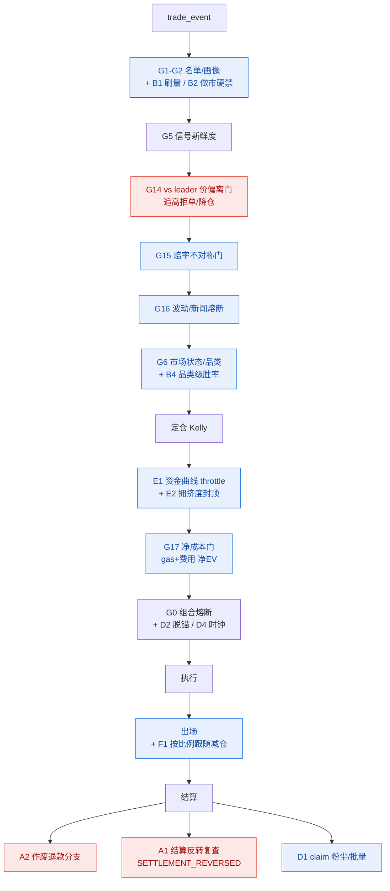

# Polymarket 跟单策略：补充场景库（自主设计，2026-06-05）

> 区别于前两份文档（基于现有 R1–R20 与代码自检），本文**跳出已有文档**，以量化交易产品负责人视角，主动补充**尚未被现有 audit/代码覆盖**的场景，并给出「触发 → 为何影响跟单正确 → 检测 → 处理 → 接入点 → 优先级」。
> 已逐项 grep 核验确为缺失或仅部分覆盖（核验命令见文末）。已有的：archetype（HF_SCALPER/SWING/arbitrage/medianHold）、G13 加仓门、flip、现金对账、G0 熔断、在途资金预留——本文**不重复**，只补缺。

---

## 0. 新增场景总览（按优先级）

| # | 场景 | 类别 | 现状 | 优先级 | 建议新门/状态 |
|---|---|---|---|---|---|
| A1 | 预言机争议后**重结算/结算反转** | 结算完整性 | ❌ 无回滚 | **P0** | 状态 `SETTLEMENT_REVERSED` + 冲正 ledger |
| A2 | 市场**作废/无解/退款**（void / 50-50） | 结算完整性 | ❌ 仅标 INVALID | **P0** | 结算分支 `VOID_REFUND_AT_COST` |
| C1 | 价格已**显著跑过 leader 入场价**（chase） | 微观结构 | ⚠️ 仅 G5 时间门 | **P0** | 门 `G14_LEADER_PRICE_DRIFT` |
| C2 | 临近结算的**赔率不对称**（买 0.95@1天） | 微观结构 | ❌ | **P1** | 门 `G15_RISK_REWARD` |
| C3 | **异常波动/新闻冲击**自动熔断 | 微观结构 | ⚠️ 仅人工 review | **P1** | 门 `G16_MARKET_VOLATILITY_HALT` |
| B1 | 刷量/女巫 leader（farming copiers） | Leader 信任 | ❌ | **P1** | 画像 `SUSPECTED_WASH` → observe |
| B2 | leader 在**做市/对冲**（净敞口≈0 双向高频） | Leader 信任 | ⚠️ 有 arb 画像 | **P1** | 强化为不可方向性跟随 |
| F1 | **按比例跟随减仓**（leader 减 50% 我们减 50%） | 出场精度 | ❌ | **P1** | `PRO_RATA_FOLLOW_EXIT` |
| D1 | **gas/手续费尖峰 + claim 粉尘**净利门 | 资金/执行 | ❌ | **P1** | 门 `G17_NET_OF_COST` + claim dust 阈值 |
| C4 | 单源行情**坏 tick / 投毒** | 数据完整 | ⚠️ 仅 clamp | **P1** | 多源/离群剔除 sanity |
| E1 | **资金曲线回撤自适应仓位** | 组合 | ❌ | **P2** | equity-curve throttle |
| E2 | 跨 leader **拥挤交易**度 | 组合 | ⚠️ 仅相关性软降 | **P2** | 拥挤度封顶 |
| B3 | leader 与我们**反身性**（跟单者镜像） | Leader 信任 | ❌ | **P2** | 反身性标记 |
| B4 | leader **能力跨品类漂移** | Leader 信任 | ⚠️ 漂移门粗 | **P2** | 品类级胜率门 |
| D2 | **USDC/抵押品脱锚** | 资金 | ❌ | **P2** | 脱锚熔断 |
| D3 | **部分降级运行**矩阵 | 运维 | ⚠️ 隐式 | **P2** | 显式降级状态机 |

---

## 1. 结算完整性（最易被忽视、直接错算盈亏）

### A1【P0】预言机争议后重结算 / 结算反转
- **触发**：市场 resolve→我们按 1.0/0.0 结算甚至已 CLAIMED，随后 UMA 进入 dispute 并**反转 outcome**（YES 翻 NO）。
- **为何影响正确**：本地已把盈利计入 `availableCapital` 并复利放单，链上实际归零→**账面资金虚增、超额开仓**；CLAIMED 的赢利可能根本领不到。代码核验：仅有 `UNSETTLED`/premature-repair，**无「已结算后再反转」的冲正路径**。
- **检测**：结算后对 `RESOLVED/CLAIMED` 持仓继续低频复查 oracle 终态（T+24h 内），发现 `resolved_outcome` 变化或 `disputed=true`。
- **处理**：新增状态 `SETTLEMENT_REVERSED`；写**冲正 ledger**（反向 `REALIZED_PNL`），从 `availableCapital` 扣回；告警人工复核。fail-closed：争议期内该市场所有同源持仓**暂不认领**。
- **接入点**：`SmartWalletSettlementSyncService` 加「终态复查」子任务；`SmartWalletAccountingService.resolvePosition` 支持反向冲正。

### A2【P0】市场作废 / 无解 / 退款（void、50-50、UMA "no resolution"）
- **触发**：Polymarket 偶发把市场判为**无效/平局/退款**（按成本返还抵押品），而非 1/0。
- **为何影响正确**：当前结算只有 1.0/0.0 两分支 + 坍塌归零按 0。把**应退款**的仓按 0 结算 = 凭空记一笔满亏，胜率/PnL 全错。代码核验：只有 `MARKET_METADATA_INVALID` 标记，**无退款结算分支**。
- **检测**：oracle/Gamma 返回 `umaResolutionStatus=No Resolution` 或 outcome 全为 0.5 / `neg_risk` 全输等。
- **处理**：结算分支 `VOID_REFUND_AT_COST`——`settlementPrice = entryAvgPrice`（PnL≈0，仅扣已付费用），资金原额回收。
- **接入点**：`classifySettlementRetryType` 增加 VOID 识别 + `resolvePosition` 退款价分支。

### A3【P1】结算超长滞留 → 资金锁死的主动处置
- **触发**：`SETTLEMENT_PENDING_ORACLE` 持仓滞留 > N 天（oracle 长期未决）。
- **为何影响正确**：资金被无限期锁住，挤占 `maxTotalOpenCost` → 误判 CAPACITY 停开单（历史已发生）。
- **处理**：超 N 天的 pending 在**可用资金口径里按市价折算释放**（不等链上），并告警；区分「锁定额」与「可用额」。
- **接入点**：`availableCapitalUsdc()` 对超龄 pending 计入可释放估值。

---

## 2. 行情微观结构（跟单时点的 EV 真伪）

### C1【P0】价格已显著跑过 leader 入场价（追高门）
- **触发**：leader 在 0.30 买入，我们因延迟到下单时 best-ask 已 0.45。
- **为何影响正确**：跟单的 alpha 来自「以接近 leader 的价位进场」；价格跑远后我们承接的是**被 leader 自己推动后的差价**，EV 已被吃掉甚至为负。现仅 G5 时间新鲜度（1h），**无价格偏离硬门**。
- **检测**：`drift = (entryAsk − leaderFillPrice) / leaderFillPrice`（买入方向）。
- **处理**：门 `G14_LEADER_PRICE_DRIFT`——`drift > maxFavMove`（如 8%）**拒单**；`[3%,8%]` **降仓**（线性衰减 stake）；`<3%` 正常。
- **接入点**：`SmartWalletSignalRiskService` G5 之后、定仓之前。

### C2【P1】临近结算的赔率不对称（尾部低赔率追单）
- **触发**：买 YES@0.95、距结算 1 天——上行 +5%、下行 −100%。
- **为何影响正确**：跟单者延迟进场放大了这种不对称；leader 可能是赚最后几个点的 scalper，复制者承担尾部。现有 `LATE_POOR_ODDS` 偏经验。
- **检测**：`riskReward = (1−price)/price` 与 `hoursToExpiry` 联合。
- **处理**：门 `G15_RISK_REWARD`——价格 > `maxEntryPrice(由到期时间动态，如近端 0.90 / 远端 0.97)` 拒单。
- **接入点**：G6/G7 价带门附近。

### C3【P1】异常波动 / 新闻冲击自动熔断
- **触发**：某市场短时成交量/价格 Z-score 突变（真实世界事件被提前定价）。
- **为何影响正确**：剧烈重定价时复制延迟最致命，leader 已撤我们还在追。`AbnormalMarketReviewService` 是**人工** review，无自动门。
- **检测**：滚动窗口价格变动 |Δ| 或成交量较基线的 Z-score 超阈。
- **处理**：门 `G16_MARKET_VOLATILITY_HALT`——该市场**冷却 T 分钟**暂停新跟随（可保留出场）；告警。
- **接入点**：行情快照管道计算指标，写市场级 flag，G6 读取。

### C4【P1】单源行情坏 tick / 投毒
- **触发**：快照偶发返回 0 / 1 / 极端价，触发误止损或误结算。
- **为何影响正确**：单一价源 + 仅 clamp[0.001,0.999] 不足以挡「合法区间内的坏值」。
- **检测**：与上一 mark、trade_event 价、深度加权中价做**多源一致性**；偏离过大且无量支撑→判离群。
- **处理**：离群 tick **丢弃不入账/不触发动作**，连续 N 次异常→标记数据源降级告警。
- **接入点**：`PositionPriceMonitorService` / `MarketSnapshotCollectorService` 入口 sanity。

---

## 3. Leader 信任与 alpha 真伪

### B1【P1】刷量 / 女巫 leader（farming copiers）
- **触发**：某地址用自成交/对敲制造高胜率高 PnL 的假象，吸引跟单后在我们承接时离场。
- **为何影响正确**：我们的 leader 选择是「选过去赢家」，刷量者正是为此设计的陷阱；跟它=给它退出流动性。
- **检测**：counterparty 集中度（高比例对手是关联地址）、成交对敲特征（同 size 双向、整数价、低真实滑点）、资金回流环路。
- **处理**：画像 `SUSPECTED_WASH` → 强制 observe-only，不入 allowlist。
- **接入点**：`WalletArchetypeClassifierService` / 实体聚类增加对敲检测特征。

### B2【P1】leader 在做市 / 对冲（方向性不可跟）
- **触发**：leader 双向高频、净敞口≈0、靠价差/返佣盈利。
- **为何影响正确**：复制其单边 BUY = 复制了它对冲腿的一半，承担了它已对冲掉的方向风险。已有 `arbitrage` 画像与 `HF_SCALPER`，但**是否硬性禁止方向性跟随**需确认。
- **检测**：净敞口/换手比、买卖对称度、持仓时长分布（medianHold 已有）。
- **处理**：MM/arb 画像 → `OBSERVE_ONLY`（已有 archetype 门，建议默认开启并校准阈值）。
- **接入点**：G2 archetype 门强化。

### B3/B4【P2】反身性 & 能力跨品类漂移
- **B3 反身性**：被跟地址本身是跟单 bot（与我们镜像）→ alpha 早已被稀释，且形成正反馈拥挤。检测：行为与已知 bot 模式相似、总在他人之后行动。处理：降权。
- **B4 跨品类漂移**：体育盘高手突然重仓政治盘——历史胜率不可迁移。检测：**品类级胜率**而非全局胜率；新品类样本不足→按新手处理。处理：品类级 `winRate` 门 + 新品类降仓。

---

## 4. 资金 / 执行 / 运维

### D1【P1】gas 尖峰净利门 + claim 粉尘阈值
- **触发**：Polygon gas 飙升；或赢利持仓金额过小，claim 的 gas > 赢利。
- **为何影响正确**：小额跟单在 gas 高时**净 EV 为负**仍下单；粉尘仓 claim 后净亏。核验：`gasSpike/maxGas`、`claim dust` 均 **0 命中**。
- **处理**：门 `G17_NET_OF_COST`——`预期净利 − 预估gas − 手续费 ≤ 0` 拒单；`SmartWalletClaimService` 加 `minClaimProceedsUsdc`（< 阈值不认领，批量合并认领摊薄 gas）。
- **接入点**：定仓后净利门；claim 作业过滤。

### D2【P2】USDC / 抵押品脱锚
- **触发**：USDC 显著脱锚（如 < 0.97）。
- **处理**：脱锚熔断——暂停新开仓（抵押品计价失真），告警；恢复后解除。可复用 G0 熔断框架。

### D3【P2】部分降级运行矩阵（显式化）
- **触发**：可读不可写 / 快照陈旧但事件正常 / web 在但 job 停（历史 P0-0 服务器不可达即此类）。
- **为何影响正确**：当前降级是隐式的（盘口缺失回退、调度饿死），易「静默失效」。
- **处理**：定义显式降级状态机——
  - 快照陈旧 → 只出场不入场；
  - 写通道故障 → 全部 PAPER 影子，不下 LIVE；
  - 心跳缺失 → 带外告警（解决 P0-0「巡检失明」）。
- **接入点**：`StrategyEngineFlag` + 健康监控作业。

### D4【P2】时钟 / 时区可信度校验
- **触发**：沙箱/服务器时钟漂移（巡检文档已暴露时区混用）。
- **处理**：结算时间守卫前先校验本地时钟 vs NTP/链上区块时间；偏差超阈则**暂停时间相关判定**（结算、时间感知止损）。

---

## 5. 组合 / 资金曲线

### E1【P2】资金曲线回撤自适应仓位（equity-curve throttle）
- **触发**：账户净值进入回撤（与单笔 Kelly 无关的组合层信号）。
- **为何影响正确**：Kelly 是逐笔最优，但连败 streak 中应整体收量（anti-martingale）；现无组合层仓位调节。
- **处理**：`sizeMultiplier = f(近 N 日 equity 回撤)`，回撤越深倍率越低；与 G0 熔断分层衔接（软收量 → 硬停手）。

### E2【P2】跨 leader 拥挤交易度
- **触发**：同一市场被 ≥K 个 leader 同时跟 → 既是强共识，也是拥挤/反身性风险，且我们在该市场的聚合敞口被多信号顶高。
- **为何影响正确**：拥挤交易反转时同时踩踏；现有相关性只「共享 token 词」软降 stake，**不封事件聚合敞口**。
- **处理**：拥挤度 = 该市场/事件的独立 leader 数；超阈后**封顶聚合敞口**并对存量按比例减仓（与 F1 复用）。

---

## 6. 出场镜像精度

### F1【P1】按比例跟随减仓（pro-rata exit）
- **触发**：leader 卖出**部分**仓位（如 50%），当前 `DYNAMIC_FOLLOW_EXIT` 偏「全平/对手先平」。
- **为何影响正确**：leader 减仓是降低信心的信号，全平过激、不平则背离 leader；应**按 leader 减仓比例镜像**。核验：`proRata/proportional exit` **0 命中**。
- **检测**：`reduceRatio = leaderSellQty / leaderPriorPositionQty`。
- **处理**：`PRO_RATA_FOLLOW_EXIT`——本仓按相同比例减仓（按本账户 bid 真实成交）。
- **接入点**：`FollowPositionAdjustmentService.adjust` 增加比例镜像分支。

---

## 7. 新增门 / 状态接入示意

---

## 8. 落地建议（最小风险路径）

1. **先上「不改成交、只加保护」的 fail-closed 门**：G14 追高门、G15 赔率门、G17 净成本门、A2 退款分支、A1 结算复查——纯拦截/纠错，PAPER 即可验证，零执行风险。
2. **再上数据/画像类**：C4 多源 sanity、B1 刷量检测、C3 波动熔断——影响选池与触发，需回放验证不误杀。
3. **最后上组合层与出场精度**：E1 资金曲线 throttle、E2 拥挤度、F1 按比例减仓——改变仓位/出场行为，须充分回测。
4. 所有新门**默认 fail-safe（缺数据时保守拒单/降仓）**，并各自独立、可热切、可回滚；先 PAPER 跑影子对照（沿用 `signal_shadow` 机制）再决定是否硬拦截。

> 核验命令（节选）：`grep -rniE "dust|minClaim|gasSpike|proRata|settlementReversal|refund|volatil|depeg" coin-strategy-job/.../smartwallet`；archetype 枚举见 `WalletArchetypeClassifierService`。本文为设计建议，未改动任何代码。可按 §8 顺序逐项落为代码（每项独立 PR、可灰度）。
