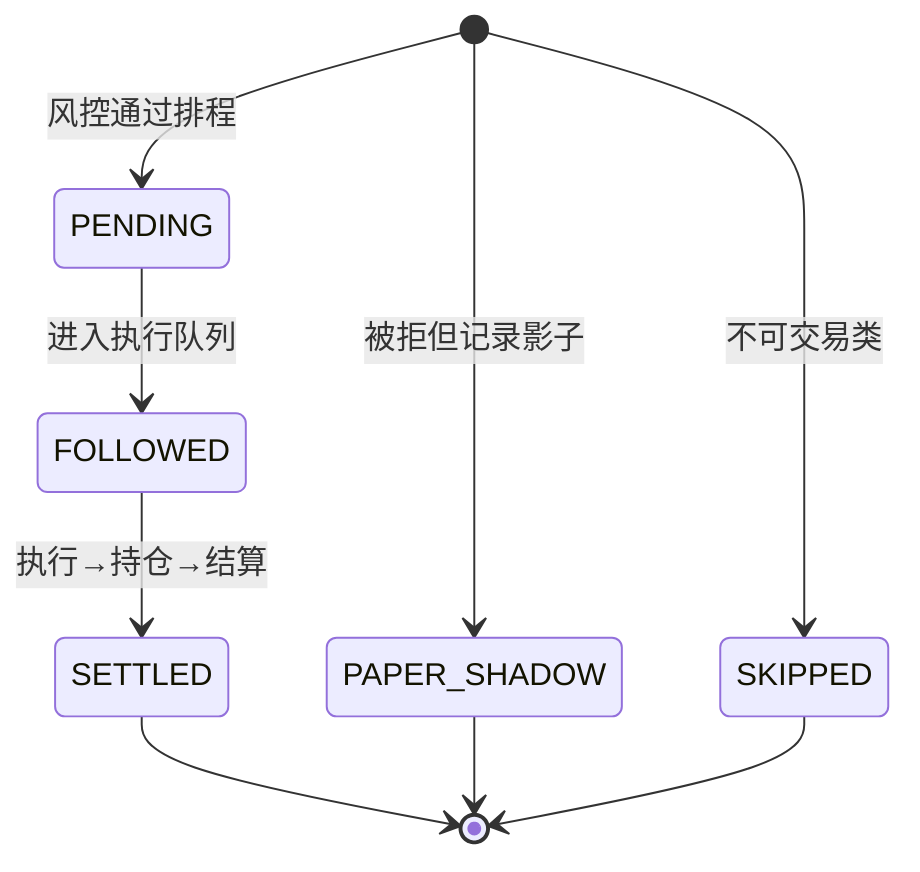

# Polymarket 跟单逻辑：主链路流程图与泳道图（2026-06-05）

> 本文基于 `docs/smart-wallet-交易流程链路与架构-2026-06-03.md` 与 `coin-strategy-job/smartwallet` 源码梳理，按 **S1–S9 九阶段主链路**还原跟单逻辑。
> 一句话定位：**基于「聪明钱」链上成交的跟单型量化策略** —— 发现优质 leader → 实时抓取其 Polymarket 成交 → 经多道风控/EV/仓位门 → 以 PAPER/LIVE 复制开仓 → 盯市并按止盈止损/资金回收/跟随 leader 出场 → 市场结算后入账并链上认领。`smart-wallet.auto-execution-enabled` 是 PAPER/LIVE 总开关。

---

## 一、主链路流程图（S1–S9 端到端）

```mermaid
flowchart TD
    Start([链上 Leader 在 Polymarket 成交]) --> S1

    subgraph S1["S1 事件摄取（30s）"]
        S1a[PolymarketWalletDiscoveryService<br/>scheduledSyncWatchlistTrades] --> S1b[fetchUserTrades 增量抓取<br/>游标=last_event_sync_at]
        S1b --> S1c[(smart_wallet_trade_event<br/>processed=false 去重)]
    end

    S1c --> S2{S2 候选增强/实体聚类<br/>wallet_entity_map 共识去重}
    S2 --> S3

    subgraph S3["S3 信号风控评估"]
        S3a[recordTradeEvent →<br/>createFollowTaskIfQualified] --> S3b[SmartWalletSignalRiskService.evaluate<br/>风控门 G1–G13 自上而下]
        S3b --> S3c{accepted?}
    end

    S3c -->|拒绝| Rej[firstRejectGate 记录]
    Rej --> RejT{拒因类型}
    RejT -->|被拒可记录| Shadow[(status=PAPER_SHADOW<br/>影子信号)]
    RejT -->|不可交易 NON_TRADABLE| Skip[(status=SKIPPED)]

    S3c -->|通过| S4

    subgraph S4["S4 定仓 Sizing"]
        S4a[KellyStakeCalculator<br/>f*=（p·b−（1−p））/b] --> S4b[资金上下文 resolveCapitalContext<br/>min（策略可用资金, 链上余额）]
        S4b --> S4c[FollowExposureLimitService<br/>per-market/per-leader 敞口上限]
        S4c --> S4d[recommendedStakeUsdc<br/>钳 minOrder, maxStake]
    end

    S4d --> Task[(smart_wallet_follow_task<br/>status=FOLLOWED/PENDING)]
    Task --> S5

    subgraph S5["S5 执行（poll 5s）"]
        S5a[processPendingTasks<br/>claimTaskForExecution 乐观锁] --> S5b{执行模式}
        S5b -->|PAPER| S5p[按 signal.price 含滑点<br/>即时 FILLED 记账]
        S5b -->|LIVE| S5l[PolymarketOrderRequestFactory 算限价<br/>→ ClobExecutionService 下单]
    end

    S5p --> S6
    S5l --> S6

    subgraph S6["S6 记账"]
        S6a[SmartWalletAccountingService<br/>recordExecution → applyFillToPosition] --> S6b[(smart_wallet_position 乐观锁<br/>smart_wallet_cash_ledger)]
    end

    S6b --> S7

    subgraph S7["S7 盯市 mark-to-market"]
        S7a[PositionPriceMonitorService<br/>标记价 bestBid→midpoint→trade 价] --> S7b[GtcOrderTimeoutTracker<br/>挂单超时撤销]
    end

    S7b --> S8{S8 出场触发}
    S8 -->|止盈/时间感知止损/趋势止损| E1[SmartWalletPositionSyncService]
    S8 -->|持仓超 8h 且评分够| E2[CapitalRecycleExitService<br/>按盘口 bid 回收]
    S8 -->|Leader SELL| E3[DYNAMIC_FOLLOW_EXIT<br/>FollowPositionAdjustmentService.adjust]
    S8 -->|未触发| S7

    E1 --> S9
    E2 --> S9
    E3 --> S9

    subgraph S9["S9 结算与认领（5min）"]
        S9a[SmartWalletSettlementSyncService<br/>→ syncSettlements] --> S9b{市场已 resolve?}
        S9b -->|是| S9c[resolvePosition<br/>settlementPrice=1/0]
        S9b -->|坍塌即亏损 报价≤0.05 过龄| S9d[tryExpiredWorthlessSettle 按 0]
        S9b -->|未决| S9e[(SETTLEMENT_PENDING_ORACLE<br/>进 settlement_retry)]
        S9c --> S9f[SmartWalletClaimService<br/>链上认领赢利]
        S9d --> S9f
    end

    S9f --> End([OPEN → RESOLVED_UNCLAIMED → CLAIMED])

    classDef store fill:#e8f0fe,stroke:#4285f4,color:#174ea6;
    classDef gate fill:#fce8e6,stroke:#ea4335,color:#a50e0e;
    classDef ok fill:#e6f4ea,stroke:#34a853,color:#0d652d;
    class S1c,S6b,Task,Shadow,Skip,S9e store;
    class S3b,RejT gate;
    class End ok;
```

> 关键节拍：摄取 30s · 执行 poll 5s · 候选重评 120s · stale 排水 120s · 回收 5min · 结算 5min。

---

## 二、泳道图（按服务/角色分职责）

> Mermaid 不原生支持泳道，这里用 **subgraph 作为泳道**，每条泳道代表一个责任主体（角色/服务集群），箭头表示跨泳道的数据/控制流转。

```mermaid
flowchart LR
    subgraph L0["🟣 链上 Leader / 数据源"]
        direction TB
        A0[Leader 钱包成交]
        A1[Polymarket Data/CLOB API]
    end

    subgraph L1["🔵 摄取层<br/>WalletDiscoveryService"]
        direction TB
        B1[定时抓取 watchlist 成交]
        B2[ingestTradeEvent 落表去重]
    end

    subgraph L2["🟠 信号风控层<br/>SignalRiskService"]
        direction TB
        C1[recordTradeEvent]
        C2[风控门 G1–G13 评估]
        C3{accepted?}
        C4[firstRejectGate → SHADOW/SKIPPED]
    end

    subgraph L3["🟢 定仓层<br/>KellyCalculator / ExposureLimit"]
        direction TB
        D1[Kelly 计算建议仓位]
        D2[资金上下文 + 敞口上限]
        D3[生成 FOLLOWED 任务]
    end

    subgraph L4["🔴 执行层<br/>FollowTaskService / ClobExecutionGateway"]
        direction TB
        E1[processPendingTasks 乐观锁领取]
        E2{PAPER / LIVE}
        E3[纸面即时 FILLED]
        E4[实盘算限价下单]
    end

    subgraph L5["🟡 记账+盯市层<br/>AccountingService / PriceMonitor"]
        direction TB
        F1[applyFillToPosition 建/加仓]
        F2[现金流水 cash_ledger]
        F3[mark-to-market 标记价]
    end

    subgraph L6["🟤 出场层<br/>PositionSync / CapitalRecycle / FollowAdjustment"]
        direction TB
        G1[止盈/时间感知止损]
        G2[超时资金回收]
        G3[跟随 Leader 出场]
    end

    subgraph L7["⚫ 结算认领层<br/>SettlementSync / ClaimService"]
        direction TB
        H1[syncSettlements 判定 resolve]
        H2[resolvePosition 1/0]
        H3[链上认领 CLAIMED]
    end

    A0 --> A1 --> B1 --> B2 --> C1 --> C2 --> C3
    C3 -->|否| C4
    C3 -->|是| D1 --> D2 --> D3 --> E1 --> E2
    E2 -->|PAPER| E3
    E2 -->|LIVE| E4
    E3 --> F1
    E4 --> F1
    F1 --> F2 --> F3
    F3 --> G1
    F3 --> G2
    F3 --> G3
    G1 --> H1
    G2 --> H1
    G3 --> H1
    H1 --> H2 --> H3
    A1 -.实时盘口快照.-> F3
    A1 -.market resolve.-> H1

    classDef leader fill:#f3e8fd,stroke:#9334e6,color:#6a1b9a;
    classDef risk fill:#fef0e3,stroke:#f9a825,color:#8a5800;
    classDef exec fill:#fce8e6,stroke:#ea4335,color:#a50e0e;
    classDef settle fill:#e8eaed,stroke:#5f6368,color:#3c4043;
    class A0,A1 leader;
    class C1,C2,C3,C4 risk;
    class E1,E2,E3,E4 exec;
    class H1,H2,H3 settle;
```

---

## 三、风控门顺序（S3 内部，命中即拒）

`SmartWalletSignalRiskService.evaluate` 自上而下逐门校验，命中即拒并记录 `firstRejectGate`：

| 阶段 | 门 | 作用 |
|---|---|---|
| G1 | MANUAL_BLOCKLIST / WATCH_DISABLED / OBSERVE_COOLDOWN / ALLOWLIST_PROFILE_MISSING / WATCHLIST_UNQUALIFIED | 名单与 leader 资格/冷却 |
| G2 | ARCHETYPE_OBSERVE_ONLY / BEHAVIOR_FAST_EXIT / LEADER_ROLLING_SUSPENDED / LEADER_DRIFT_SEVERE | 行为画像 / 滚动 / 漂移 |
| G3 | TRIGGER_SIZE_TOO_SMALL / PRICE_OUT_OF_RANGE | 触发额与价带 |
| G4 | MAX_TOTAL_OPEN_COST / CAPITAL_DEPLETED | 组合资金（非原子，已知风险 R5） |
| G5 | SIGNAL_STALE | 信号新鲜度（max-signal-age=3600s） |
| G6 | CATEGORY_DISABLED / MARKET_NOT_ACTIVE / MARKET_EXPIRED / END_TOO_FAR / END_DATA_QUALITY | 品类与市场状态 / 时间窗 |
| G6c | ENTRY_EMPTY_ASK / ASK_SNAPSHOT_STALE | 入口空盘口护栏 |
| G7 | 卖出门 / LATE_POOR_ODDS | 卖出信号 / 临尾低赔率 |
| G8 | 深度门 minAcceptableDepthUsdc / 取价手续费门 | 流动性 / 费用 |
| G10 | KELLY_NEGATIVE_EV | EV / Kelly |
| G10a/b/c | ALLOWLIST_SIGNAL_BUFFERED / FINAL_STAKE_BELOW_MIN / EXPOSURE_LIMIT | 缓冲 / 最小单 / 敞口 |
| G11 | PROBABILITY / PROFITABILITY / SLIPPAGE / SPREAD / SIGNAL_SCORE / PRICE_IMPACT / TIME_TO_EXPIRY | 概率 / 净EV / 滑点 / 价差 / 打分 / 冲击 |
| G12 | ENTRY_STRATEGY_REJECTED | 入场策略路由 |
| G13 | SCALE_UP_* / DUPLICATE_POSITION_* | 加仓 / 重复仓 |

---

## 四、任务状态机

持仓侧状态：`OPEN → RESOLVED_UNCLAIMED → CLAIMED`；未决 → `SETTLEMENT_PENDING_ORACLE`（进 `smart_wallet_settlement_retry`）。

---

## 五、leader 选择闭环（alpha 来源，旁路）

- **资格门槛**：`SmartWalletProfileStoreService.evaluateQualification`（winRate≥0.62、score≥0.70、trades≥25、PnL≥1000、回撤≤0.25）→ `qualified / watchEnabled / monitorTier=HOT`。
- **真值刷新**：`SmartWalletProfileTruthRefreshService`（从 `smart_wallet_leader_trade_outcome` 重算，胜率分母剔除平局）。
- **冷却**：`recentWinRate7d<0.45` → 7 天 observe 冷却（G1）。
- **自动选池**：`WeeklyTopLeaderAutoAllowlistJob`（每日提名活跃+高 PnL+高胜率入 allowlist，PAPER、30 天过期、0.5 倍仓）。

---

*参考来源：`docs/smart-wallet-交易流程链路与架构-2026-06-03.md`、`coin-strategy-job/src/main/java/.../smartwallet/service/*`*
