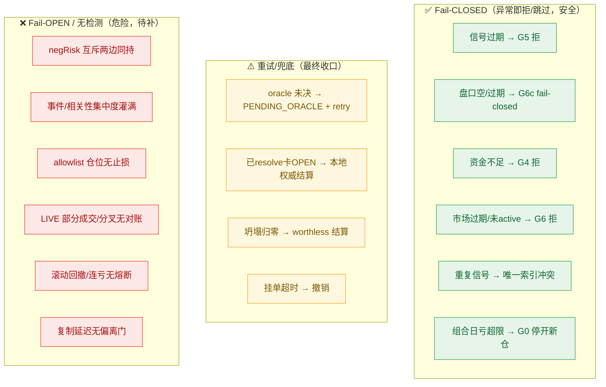

# Polymarket 跟单：闭环完整性 / 场景适配检测 / 异常处理分析（2026-06-05）

> 目标：以「**跟单正确**」为终极标准，检查 S1–S9 主链路是否真正闭环、检查点是否有遗漏，并逐场景判定检测是否正常、异常如何处理。
> 依据：源码 `coin-strategy-job/.../smartwallet/*`（已读到当前 HEAD）+ 风险审计 `docs/problem/全盘风险审计-2026-06-03.md`、`策略代码自检-2026-06-03.md`、最新巡检 `问题记录事项-待解决-2026-06-05.md`。
> **重要前提**：审计文档定稿于 06-03，但当前代码已领先——G0 熔断、在途资金预留、去重唯一索引、品类上限、现金对账作业均已落地。本文按**当前代码状态**重新判定，并标注「已修待部署 / 仍缺失」。

---

## 0. 结论先行

1. **主链路（happy path）闭环成立**：正常买入跟单从 `trade_event → follow_task → order/fill → position → mark → exit → settlement → claim` 有完整的状态机终态（`OPEN→RESOLVED_UNCLAIMED→CLAIMED`，或未决进 `SETTLEMENT_PENDING_ORACLE` 重试队列）。
2. **闭环存在三类「断点」**：①**结算回写**曾让赢面持仓卡 OPEN（已加本地权威兜底+坍塌归零结算，已部署）；②**LIVE 订单生命周期**（部分成交、DB↔链上分叉、挂单超时撤销后资金释放）对账仍不完整（R20 待复核）；③**持仓级对账**（链上 CTF token 余额 vs 本地 OPEN）尚无（R19 只做了现金口径）。
3. **检测遗漏中仍未闭合的关键项**：**negRisk 多结果互斥**完全不设防（同一事件互斥两边可同时持有，必有一输）、**事件/相关性硬上限**缺失、**复制延迟无「vs leader 价最大偏离」硬门**、**Kelly 的 p_win 语义错**导致 EV 门退化为「价格<0.5」。
4. **当前第一风险是运维而非逻辑**：巡检连续 3 期、>48h 无法连通生产服务器（P0-0），**无法确认策略是否在开单/结算**，上述「已修」项也**未部署复核**。在恢复可观测前，任何「跟单正常」判断都不成立。

---

## 1. 逐阶段闭环判定

| 阶段 | 闭环？ | 终态 / 回收路径 | 断点风险 |
|---|---|---|---|
| S1 摄取 | ✅ | `trade_event.processed=true` | 游标卡旧→重放被 STALE 跳过；摄取滞后→零开单（已加 callTimeout+核感知池） |
| S2 实体聚类 | ✅ | entity 归并 | 旁路增强，不阻塞 |
| S3 风控 | ✅ | `FOLLOWED/PAPER_SHADOW/SKIPPED` 三终态 | 拒因有记录，闭环好 |
| S4 定仓 | ✅ | 写 `recommendedStakeUsdc` | 在途资金预留已加（`inFlightReservedUsdc`），但 G4「读-判-开」仍非原子（R5） |
| S5 执行 | ⚠️ | PAPER 即时 FILLED；LIVE 下单 | **LIVE 部分成交/挂单超时撤销后资金释放、DB↔链上分叉无对账**（R20） |
| S6 记账 | ✅ | position + cash_ledger（乐观锁） | 闭环好 |
| S7 盯市 | ✅ | 实时 bid 标记 | 盘口缺失回退路径需 fail-closed |
| S8 出场 | ⚠️ | 止盈止损/回收/跟随退出 | **allowlist 仓位被排除在所有自动出场外**（无止损）；leader SELL 漏抓则只能扛到结算 |
| S9 结算认领 | ⚠️→✅ | `CLAIMED` / `PENDING_ORACLE`重试 | 曾卡 OPEN（已修兜底）；**未认领资金核算 + 持仓级对账仍缺**（R19 仅现金口径） |

> 一句话：**纸面 happy path 闭环；缺口集中在「LIVE 订单生命周期」「持仓级对账」「特定出场豁免」三处。**

---

## 2. 场景适配检测矩阵（核心）

> 图例：✅ 检测正常 ｜ ⚠️ 部分/有缺陷 ｜ ❌ 未检测/裸奔 ｜ 「已修待部署」= 代码已落地但生产未验证

| # | 场景 | 检测点 | 是否正常 | 异常处理 | 缺口 / 风险 |
|---|---|---|---|---|---|
| 1 | **正常买入跟单** | G1–G13 全门 + Kelly 定仓 + 盘口取价 | ✅ | 命中任一门→记 `firstRejectGate`→SHADOW/SKIPPED | Kelly `p_win` 语义错→EV 门退化为「价格<0.5」(P0-2) |
| 2 | **leader 卖出→跟随退出** | leader SELL 事件→`DYNAMIC_FOLLOW_EXIT` | ⚠️ | `FollowPositionAdjustmentService.adjust` 全平/部分平 | 依赖事件抓取，**SELL 漏抓则不退出**；纸面退出价仍按 leader 价虚高(R8剩余) |
| 3 | **LIVE 部分成交 (partial fill)** | fill 回填 position/cost | ⚠️ 待复核 | 按 fill 累加 | **是否按实际成交回填 vs 假设全成、孤儿单清理未确认**(R20) |
| 4 | **挂单超时未成交** | `GtcOrderTimeoutTracker` 超时撤销 | ⚠️ | 撤单 | **撤单后预留资金是否释放未确认**(R20+R4) |
| 5 | **二元同市场对立 (YES/NO)** | 对立持仓/挂单检查 + 对手BUY先平 | ⚠️ | 默认阻止同持；对手BUY→`DYNAMIC_FOLLOW_EXIT`先平 | 检查**无锁**(`selectList`)，两个相反信号近同时到达可双开(R5/竞态) |
| 6 | **negRisk 多结果互斥**（如大选 Trump-YES vs Biden-YES） | —— | ❌ | —— | **实体无 `eventId/negRiskMarketId` 分组键**，不同 conditionId→所有冲突门不触发→**同时持互斥两边，必有一输**(P0-3) |
| 7 | **信号过期 (stale)** | G5 `max-signal-age=3600s` | ⚠️ | 拒单 `SIGNAL_STALE` | 阈值 1h **太宽**，复制延迟下逆向选择；**无「vs leader 成交价最大偏离」硬门**(R14) |
| 8 | **盘口缺失 / 快照过期** | G6c `ENTRY_EMPTY_ASK / ASK_SNAPSHOT_STALE` | ✅ 已修 | fail-open/fail-closed 分类计数（`G6cAskCheckOutcome`） | 历史曾回退「现价/leader 价」兜底；现已有 fail-closed 分支，需确认对**平仓**双向生效 |
| 9 | **资金不足 / 在途超额** | G4 `MAX_TOTAL_OPEN_COST / CAPITAL_DEPLETED` + `inFlightReservedUsdc` | ⚠️ 已修待部署 | 拒单 | 在途预留已计入(R4已修)；但**G4 仍非原子**，多入口/多实例可并发突破(R5) |
| 10 | **并发双开（重放/多实例）** | 唯一索引 `uk_trade_source_id`/`uk_follow_source_event` + `claimTaskForExecution`乐观锁 | ✅ 已修 | 插入冲突 | 事件/任务去重已靠 DB 唯一约束(R7已修)；跨任务**资金不变量仍无锁** |
| 11 | **市场过期未 resolve / oracle 未决** | `SettlementGuard` + `settlementTerminalCheck` | ✅ | 落 `SETTLEMENT_PENDING_ORACLE`→`settlement_retry` | 闭环好；曾有「既不结算也不入重试」卡 OPEN，已收口 |
| 12 | **市场已 resolve 卡 OPEN** | `tryLocalAuthoritativeSettle` 本地权威兜底 | ✅ 已修部署 | 本地 `resolved_outcome` 确认即结算 1/0 | 已把 17 笔卡死清零（OPEN 39→22） |
| 13 | **坍塌归零（报价≤0.05 过龄）** | `tryExpiredWorthlessSettle` | ✅ 已修部署 | 按 0 结算 | 防「已坍塌却卡 OPEN」 |
| 14 | **leader 转坏 / 行为漂移** | G1冷却 + G2 drift/archetype/rolling | ⚠️ | 拒单/冷却 | rolling 门默认关；**allowlist 绕过冷却/盈利门**只打日志不降权(R11) |
| 15 | **allowlist「最信任」仓位** | —— | ❌ | —— | **被 `filterOutAllowlistPositions` 排除在止损/止盈/回收外**，无任何止损，扛到结算(R16) |
| 16 | **组合级亏损 / 连亏熔断** | G0 `RISK_HALT`（手动开关 + `maxDailyLossUsdc`） | ⚠️ 已修待部署 | 命中→停开新仓+告警 | 已加日亏+手动 kill（R1）；**滚动回撤/连亏/错误率熔断仍缺**；当日PnL靠日报缓存，口径需复核 |

---

## 3. 检查遗漏清单（按当前代码状态）

**已落地（代码修复，待生产部署复核）**

- G0 组合级熔断：手动 kill switch + 当日已实现亏损上限（`resolveRiskHaltReason`）。
- 在途资金预留：`inFlightReservedUsdc()` 扣减 PENDING/EXECUTING 任务 stake。
- 去重唯一索引：`uk_trade_source_id(source,external_trade_id)`、`uk_follow_source_event(source_event_id)`、`uk_order_external`。
- 品类敞口上限：`maxPerCategoryOpenCostUsdc`。
- 现金对账作业：`SmartWalletReconciliationJob`（LIVE 本地现金 vs 链上余额，只读+告警，阈值 20 USDC / 20%）。
- 盘口空 ask / 过期门 fail-closed 分类（`G6cAskCheckOutcome`）。

**仍缺失（需补检测）**

1. **negRisk / 事件分组键**（P0-3）：实体加 `eventId/negRiskMarketId`，冲突检测扩展到「同事件互斥结果」，杜绝必输对冲。
2. **事件级 / 相关性硬上限**（R6）：现仅 per-market / per-leader / per-category；缺同事件多市场、相关性簇硬封顶（现 `countCorrelatedOpenPositions` 只软性降 stake）。
3. **G4 原子资金预留**（R5）：把「读-判-开」改为 `UPDATE ... WHERE budget-reserved>=?` 原子预留或组合级锁。
4. **滚动回撤 / 连亏 / 错误率熔断**（R1 剩余）：G0 目前只有日亏+手动开关。
5. **复制延迟门**（R14）：收紧 `max-signal-age`（→数分钟）+ 加「vs leader 成交价最大偏离」拒单门。
6. **LIVE 订单—链上对账 + 孤儿单清理**（R20）：部分成交回填、DB↔链上分叉、撤单资金释放。
7. **持仓级对账 + 未认领资金核算**（R19 剩余）：链上 CTF token 余额 vs 本地 OPEN；`RESOLVED_UNCLAIMED` 计入资金口径。
8. **allowlist 仓位尾部止损**（R16）：当前完全无自动出场保护。
9. **Kelly p_win 语义 + 净 EV 硬门**（P0-2）：用公允/隐含概率而非压缩后的「跟单值得度」；开启含手续费+滑点的 `enableProfitabilityGate`。
10. **交易健康分钟级告警**（R3）：摄取延迟>5min、连续零开单、结算 backlog、资金利用率、错误率——避免「静默失效无人知」。

---

## 4. 异常处理总览（fail-open vs fail-closed）

**原则差距**：大多数「**入场前**」异常已做到 fail-closed（拒单/跳过），结算异常有兜底+重试；但「**组合级 / 持仓级 / LIVE 生命周期**」的异常仍偏 fail-open（无检测继续运行），这正是从「能跟单」到「**跟单正确**」要补齐的部分。

---

## 5. 行动优先级（面向「跟单正确」）

1. **恢复可观测（P0-0，最紧迫）**：服务器 >48h 不可达，先确认 `coin-strategy-job`/MySQL 存活、把上述「已修」项部署并复核；否则一切结论悬空。
2. **部署复核已修 P0**：G0 熔断、在途资金预留、去重唯一索引、结算兜底——在 PAPER 验证不变量（可用资金不为负、无双开、无卡 OPEN）。
3. **补 negRisk 互斥 + 事件/相关性硬上限**（P0-3/R6）：消除「必有一输」与尾部集中度。
4. **修 Kelly p_win + 开净 EV 硬门**（P0-2）：否则负 EV 单照下，纸面胜率不可信。
5. **LIVE 上线前**：补订单—链上对账/孤儿单清理(R20)、持仓级对账(R19)、复制延迟偏离门(R14)、allowlist 尾部止损(R16)、滚动回撤/连亏熔断(R1剩余)、交易健康告警(R3)。

> 注：当前生产 `auto-execution-enabled=false`（纯 PAPER）。上述 LIVE 相关缺口在转实盘前必须闭合；PAPER 阶段最影响判断的是「纸面成交真实性 + Kelly/EV + 胜率口径」，因为它们会把用于标定门槛的指标带偏。

---

*源码核验：`SmartWalletSignalRiskService`（G0/G4/G6c）、`SmartWalletAccountingService`（inFlightReserved/结算）、`SmartWalletReconciliationJob`、`sql/polymarket/arbitrage_schema.sql`（唯一索引）、`SmartWalletMarketInfoEntity`（无 negRisk 字段）。审计来源见文首。*
