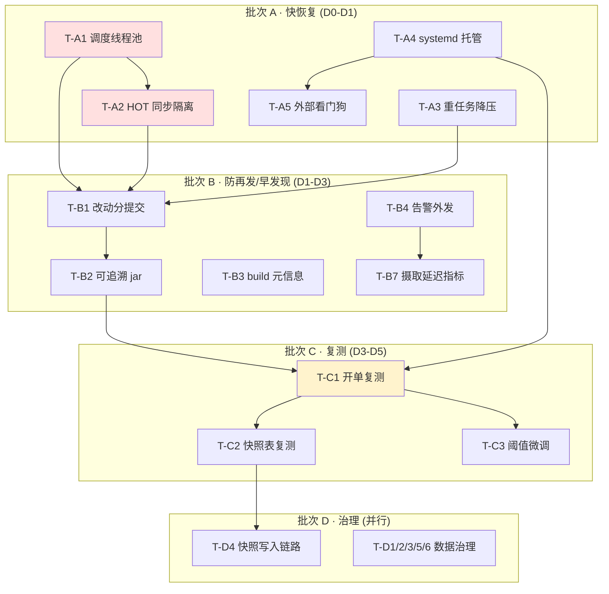

# 排查修复任务拆解 — 分批执行计划（2026-05-24）

> 状态：**待评审 / 待排期** ｜ 类型：定期巡检 · 任务拆解与分批执行计划 ｜ 作者：自动分析（scheduled task `2-1`）｜ 日期：2026-05-24
> 编制时段：2026-05-24 11:03 CST（对仓库 `CoinStrategy` 只读核验）
> 适用技能：`troubleshooting`（先定位后修复、最小改动）+ `doc-writing`（文档结构、命名）+ `git-commit-convention`（修复落地规范）
> 上游文档：
> - [问题记录事项-待解决-2026-05-24.md](问题记录事项-待解决-2026-05-24.md)（`1-job` 巡检：13 个待解决问题的现象 / 证据 / 根因）
> - [问题排查修复方案-2026-05-24.md](问题排查修复方案-2026-05-24.md)（`2-1` 分析：逐问题「如何排查、如何修」与 4 批划分）
>
> 说明：本文是 scheduled task `2-1` 在 2026-05-24 的运行产出。`2-1` 早先一轮已产出《问题排查修复方案》（分析层）；本文承接该分析，**把修复进一步「拆分任务细节、分布（分批）执行」**——将 13 个问题的修复落成 **25 张可独立排期、可独立验收的执行任务卡**，给出按天排期、依赖 DAG、每批退出标准与复测验收清单。本文**只产出执行计划，不对线上代码 / 服务器 / 数据库做任何写操作**；所有代码锚点经本次对仓库的**独立只读核验**确认（核验记录见第九节）。

---

## 一、执行摘要（结论先行）

`1-job` 定位了「37 小时以上零开单」的根因，`2-1` 分析给出了「怎么修、先修哪个」。本文回答最后一个问题：**这些修复具体怎么排期、谁先谁后、每步做完算什么标准、复测怎么验收。**

**三条最重要的结论：**

1. **关键路径只有一条，约 5 个工作日。** `批次A(D0–D1) → 批次B(D1–D3) → 批次C(D3–D5)`。开单恢复的硬前置是 **T-A1 调度线程池 + T-A2 HOT 事件同步隔离 + T-A4 systemd 托管**，三者做完并部署可追溯 jar 后，批次 C 复测才有意义。批次 D（数据治理）不在关键路径上，数据类任务 D0 即可与 A/B 并行启动。

2. **本次独立核验全部通过——修复材料确实半数现成。** 对仓库重新做了只读核验：`@EnableScheduling` 在 `CoinStrategyJobApplication.java:15`、全仓**无** `spring.task.scheduling.pool.size`、**无**自定义 `TaskScheduler`，单线程调度确凿；`@Scheduled` 实测 **78 处（54 个文件）**；systemd 模板已含 `Restart=always`、安装脚本已就绪、飞书告警 Sink 已存在。即 P0-2 与 P1-4 的「轮子」可直接装配，无需新造。

3. **「先复测、再调阈值」是硬纪律。** P1-1 的教训是上一轮把力气花在「收紧新鲜度门」而非「降摄取延迟」。本计划据此设两条硬约束：(a) **T-C3 微调新鲜度阈值必须排在 T-C1 复测之后**；(b) **T-D4 排查快照表写入链路必须排在 T-C2 复测之后**——三张空表高度疑为 P0-1 的下游表现，复测可能直接自愈。

### 批次与任务总览

| 批次 | 主题 | 排期窗口 | 任务卡 | 关键路径 |
|---|---|---|---|---|
| A | 快恢复（恢复开单） | D0 – D1 | T-A1 ~ T-A5（5） | ✅ 是 |
| B | 防再发 + 早发现 | D1 – D3 | T-B1 ~ T-B8（8） | 部分（T-B1/B2 是 C 的前置） |
| C | 部署后复测 | D3 – D5 | T-C1 ~ T-C3（3） | ✅ 是 |
| D | 质量与数据治理 | D0 起并行 ~ D5+ | T-D1 ~ T-D9（9） | ❌ 否（可并行） |

> 工时口径：S ≈ 半天内；M ≈ 0.5–1 人日；L ≈ 1–3 人日（均含测试）。排期 `D0` = 修复启动日，`D1/D2…` 为其后第 N 个工作日，供排期参考、非绝对日期。

---

## 二、批次总览与时间线

```
D0 ───────── D1 ───────── D2 ───────── D3 ───────── D4 ───────── D5 ──────►
│  批次A 快恢复            │
│  ■ T-A1 线程池(S)        │
│  ■ T-A3 重任务降压(M)    │
│      ■ T-A2 HOT隔离(M)   │
│  ■ T-A4 systemd(S) ■ T-A5 看门狗(S)                                       
              │  批次B 防再发/早发现                    │
              │  ■ T-B1 分提交(M) ■ T-B2 可追溯jar(S)   │
              │  ■ T-B3 build元信息 ■ T-B4 告警外发(M)  │
              │  ■ T-B5/B6 ■ T-B7 摄取延迟指标 ■ T-B8 看板
                                          │ 批次C 复测      │
                                          │ ■ T-C1 开单复测 │
                                          │ ■ T-C2 快照表   │
                                          │ ■ T-C3 阈值微调 │
D0 ════════════ 批次D 数据治理（与 A/B/C 并行，不占关键路径）══════════════►
   ■ T-D1 allowlist  ■ T-D2 余额回填  ■ T-D3 结算时间  ■ T-D5 LOW_CONFIDENCE
   ■ T-D6 告警闭环   ■ T-D7 内存观察  ■ T-D8 SSH兜底
                                          ■ T-D4 快照链路(依赖 T-C2)
                                          ──── T-D9 HOT改事件驱动(二期,L)────►
```

关键路径（开单恢复的最短链）：**T-A1 → T-A2 → T-B1 → T-B2 →（部署）→ T-C1**。其余任务均可并行或挂在非关键支路。

---

## 三、依赖关系图



---

## 四、任务卡（逐批）

每张任务卡含：承接编号 · 批次/排期 · 类型/工时 · 前置 · 范围与执行步骤 · 验收标准 · 验证方法 · 回滚。代码锚点均经第九节核验。

### 批次 A — 快恢复（目标：恢复开单）

> 退出标准见第五节。A 批的本质是「让 HOT 钱包事件同步不再被重任务饿死」+「让服务崩溃能自愈」。

#### T-A1 · 引入调度线程池 ★关键路径起点

| 字段 | 内容 |
|---|---|
| 承接 | P0-1-a |
| 批次 / 排期 | A / D0 |
| 类型 / 工时 | 代码 / **S** |
| 前置 | 无 |

- **范围**：消除单线程 `scheduling-1` 垄断。`CoinStrategyJobApplication.java:15` 有 `@EnableScheduling` 但全仓无线程池配置，Spring 默认单线程串行执行全部 78 处 `@Scheduled`。
- **执行步骤**：
  1. **最小改动**：在 `coin-strategy-job/src/main/resources/application.yml` 增 `spring.task.scheduling.pool.size: 8`（本项目无自定义 `TaskScheduler`，该键由 Spring Boot 直接生效）。
  2. **推荐改动**：新增 `coin-strategy-job/.../job/config/SchedulingConfig.java`，提供 `ThreadPoolTaskScheduler` Bean（`poolSize=8~12`、`threadNamePrefix="sched-"`、`setRemoveOnCancelPolicy(true)`），便于后续按池隔离。
- **验收标准**：本地启动后日志出现 ≥2 个 `sched-*` / `scheduling-*` 线程并发执行 `@Scheduled`；不再出现单线程串行。
- **验证方法**：本地起服务，`grep -oE '\[sched-[0-9]+\]' job.log | sort -u` 多于 1 个；新增单测验证 `TaskScheduler` Bean 装配。
- **回滚**：纯配置项，`pool.size` 调回 1 即恢复，无数据副作用。

#### T-A2 · 隔离 HOT 事件同步 ★关键路径

| 字段 | 内容 |
|---|---|
| 承接 | P0-1-b |
| 批次 / 排期 | A / D0–D1 |
| 类型 / 工时 | 代码 / **M** |
| 前置 | T-A1 |

- **范围**：保证 HOT 钱包 leader 成交事件同步拿得到执行片，不被闭仓同步 / 钱包发现等重任务阻塞。
- **执行步骤**：把 `PolymarketWalletDiscoveryService.scheduledSyncWatchlistTrades`（2-1 分析锚点 `:376`，`event-sync-fixed-delay-ms` 默认 30000）提交到**专用 `ThreadPoolTaskExecutor` 或独立单线程调度池**，与 `ClosedPositionIncrementalSyncJob.incrementalHot`（`:34`）/ `incrementalWarm`（`:57`）分到不同池。保守落地：HOT 同步先用「独立单线程池」隔离——不被阻塞、又不引入并发风险。
- **验收标准**：HOT 事件同步实测间隔回到配置值（≈30s）±容差；不再被重任务串行挤压到 20–70 分钟。
- **验证方法**：复测时看 `smart_wallet_trade_event` 的 `opened_at → created_at` 摄取延迟（见 T-C1）。
- **回滚**：还原为共用默认池；若仅做「独立单线程池」隔离，回滚无并发风险。

#### T-A3 · 重任务降压

| 字段 | 内容 |
|---|---|
| 承接 | P0-1-c |
| 批次 / 排期 | A / D0–D1（可与 T-A2 并行） |
| 类型 / 工时 | 代码 / 配置 / **M** |
| 前置 | 无 |

- **范围**：把非实时重任务移出关键节拍或降频 / 错峰，减少线程争用总量。
- **执行步骤**：复核 `ClosedPositionSync` 单次运行的钱包批量与频率（2-1 巡检：今日已执行 2,879 次钱包同步）；评估 `closed-position-sync.*`、`discovery-fixed-delay-ms` 等配置键是否可降频或错峰。
- **验收标准**：`job-current.log` 中重任务占调度线程的日志行占比明显下降。
- **验证方法**：复测时统计 `grep -c "ClosedPositionIncrementalSync" job-current.log` 同窗口对比。
- **回滚**：配置项还原。

#### T-A4 · systemd 托管服务 ★关键路径（部署侧）

| 字段 | 内容 |
|---|---|
| 承接 | P0-2-a / b / c |
| 批次 / 排期 | A / D0 |
| 类型 / 工时 | 运维 / **S** |
| 前置 | 无 |

- **范围**：把裸 `nohup java -jar` 改为 systemd 托管，崩溃自愈。仓库已具备全部材料（`deploy/linux/systemd/smart-wallet-backend.service.template` 已含 `Restart=always` / `RestartSec=5` / `LimitNOFILE=65535` 及安全加固；`scripts/install-smart-wallet-linux-service.sh` 已就绪）。
- **执行步骤**：
  1. 在 `49.51.250.174` 以 root 执行 `SMART_WALLET_INSTALL_NGINX=false bash scripts/install-smart-wallet-linux-service.sh`（job 机不装 nginx，脚本注释明确要求传该参数）。
  2. 停裸 `nohup` 进程（巡检时 PID 802211），改 `systemctl start smart-wallet-backend`；`systemctl enable` 开机自启。
  3. 把模板 `RestartSec` 由 5 调到 10，避免崩溃风暴下紧密重启。
- **验收标准**：`systemctl status smart-wallet-backend` 为 `active (running)`；`systemctl is-enabled` 为 `enabled`。
- **验证方法**：`kill` 进程后观察 systemd 自动拉起。
- **回滚**：`systemctl disable --now smart-wallet-backend`，回退裸启动。
- **注意**：切换瞬间有秒级停服，选开单低峰执行。

#### T-A5 · 外部健康看门狗

| 字段 | 内容 |
|---|---|
| 承接 | P0-2-d |
| 批次 / 排期 | A / D1 |
| 类型 / 工时 | 运维 / **S** |
| 前置 | T-A4 |

- **范围**：在 systemd 之外叠加一层基于业务健康端点的探活。
- **执行步骤**：写探活脚本（systemd timer / cron）周期请求应用 8081 健康端点，连续失败则 `systemctl restart` 并发告警。
- **验收标准**：模拟 8081 不可达，看门狗在阈值次数内触发重启与通知。
- **验证方法**：手动阻断 8081，观察看门狗动作。
- **回滚**：移除 timer / cron 项。

### 批次 B — 防再发 + 早发现

> 退出标准见第五节。B 批让「修复可追溯」「问题能在数小时内被通知到人」。

#### T-B1 · 工作区改动按主题分提交 ★关键路径

| 字段 | 内容 |
|---|---|
| 承接 | P1-1-b |
| 批次 / 排期 | B / D1–D2 |
| 类型 / 工时 | 代码治理 / **M** |
| 前置 | T-A1、T-A2、T-A3（代码定稿后一并提交） |

- **范围**：当前 6 个主代码文件 + 8 个测试类为未提交工作区改动，线上 01:19 部署的 jar 无法由任何 commit 复现。把 A 批的调度改动与既有工作区改动一起、按主题分提交落库。
- **执行步骤**：按 `git-commit-convention` 分主题提交，建议拆为：①调度线程池 / HOT 隔离（A 批新增）②新鲜度窗口分级 ③市场状态前移；主类与对应测试类**同批提交**。最近一次策略提交为 `618888fb`「1. 市场修复」。
- **验收标准**：`git status --short` 干净；每个 commit 可独立 `mvn compile` 通过。
- **验证方法**：逐 commit `git stash` 后验证编译。
- **回滚**：提交前 `git stash` 备份；分提交勿漏文件。

#### T-B2 · 重建可追溯 jar ★关键路径

| 字段 | 内容 |
|---|---|
| 承接 | P1-1-c |
| 批次 / 排期 | B / D2 |
| 类型 / 工时 | 构建 / **S** |
| 前置 | T-B1 |

- **范围**：从干净 commit 重新构建 `app.jar`，使线上版本可复现。
- **执行步骤**：干净工作区 `mvn package`；记录 `git rev-parse HEAD` 与产出 jar 的对应关系，写入部署记录。
- **验收标准**：存在一条 `commit hash ↔ jar` 的明确记录。
- **验证方法**：异机用同 commit 重建，比对 jar 行为一致。
- **回滚**：保留上一个可用 jar 备份。

#### T-B3 · 构建注入 build 元信息

| 字段 | 内容 |
|---|---|
| 承接 | P1-1-d |
| 批次 / 排期 | B / D2（可与 T-B2 并行） |
| 类型 / 工时 | 构建 / **S** |
| 前置 | 无 |

- **范围**：让线上 jar 可反查构建 commit。
- **执行步骤**：构建脚本注入 commit hash 到 jar `MANIFEST` 或 Spring Boot `/actuator/info`（可用 `git-commit-id-maven-plugin`）。
- **验收标准**：运行中的服务可查询到构建 commit。
- **验证方法**：访问 `/actuator/info` 或读 `MANIFEST.MF`。
- **回滚**：移除插件配置。

#### T-B4 · 健康告警接入飞书 Sink

| 字段 | 内容 |
|---|---|
| 承接 | P1-4-a |
| 批次 / 排期 | B / D1–D2 |
| 类型 / 工时 | 代码 / **M** |
| 前置 | 无 |

- **范围**：`StrategyHealthMonitorJob` 已能检测「零开仓」并打日志，但不外发。仓库已有 `FeishuStrategyAuditAlertSink` 等告警 Sink，只需接线。
- **执行步骤**：向 `StrategyHealthMonitorJob` 注入已有告警 Sink，在 `:91`（24h `CRITICAL`）、`:120`（4h `WARNING`）分支调用外发；建议同时覆盖 `:62`（资本枯竭）/`:71`（低资本）两个 log-only 分支。
- **验收标准**：本地 mock「24h 零开仓」，飞书群收到告警。
- **验证方法**：单测 + 本地 mock 触发。
- **回滚**：移除注入调用。
- **注意**：webhook 凭据走 env、不进 git；外发失败须降级为日志、不可抛断 HealthMonitor。

#### T-B5 · 告警去重与限频

| 字段 | 内容 |
|---|---|
| 承接 | P1-4-b ｜ 批次/排期 B / D2 ｜ 类型/工时 代码 / **S** ｜ 前置 T-B4 |

- **范围**：避免每小时重复轰炸（巡检见 02:47/05:20/07:37/10:06 连续 4 次 CRITICAL）。
- **执行步骤**：复用 / 对齐 `smartwallet/audit/` 包既有去重与限频逻辑。
- **验收标准**：同一问题在限频窗口内只发一次。
- **验证方法**：连续触发，观察只发一条。
- **回滚**：还原为不限频。

#### T-B6 · 校验飞书 webhook 在 job 机可达

| 字段 | 内容 |
|---|---|
| 承接 | P1-4-c ｜ 批次/排期 B / D1 ｜ 类型/工时 运维 / **S** ｜ 前置 无 |

- **范围**：确认 `49.51.250.174` 出网可达飞书 webhook、env / yml 配置正确。
- **执行步骤**：在 job 机实测 webhook 连通性（只读 `curl` 探测）；核对 env 中 webhook 配置。
- **验收标准**：job 机能成功投递一条测试消息。
- **验证方法**：发送测试消息，确认飞书收到。
- **回滚**：无（只读探测 + 配置核对）。

#### T-B7 · 新增「事件摄取延迟」指标与告警

| 字段 | 内容 |
|---|---|
| 承接 | 2-1 补充建议 2 ｜ 批次/排期 B / D2–D3 ｜ 类型/工时 代码 / **M** ｜ 前置 T-B4 |

- **范围**：本期「事件滞后 70 分钟」在 DB 里清晰可见却无指标盯它。
- **执行步骤**：新增指标 `AVG / P90(TIMESTAMPDIFF(SECOND, opened_at, created_at))`（数据源 `smart_wallet_trade_event`），P90 > 600s 即告警，复用 T-B4 的 IM 通道。
- **验收标准**：指标可查询，越界能告警。
- **验证方法**：构造超限数据触发告警。
- **回滚**：下线指标采集任务。

#### T-B8 · 跳过原因看板

| 字段 | 内容 |
|---|---|
| 承接 | 2-1 补充建议 5 ｜ 批次/排期 B / D2–D3 ｜ 类型/工时 代码 / **M** ｜ 前置 无 |

- **范围**：把 `follow_task.primary_skip_reason` / `topRejections` 做成按日看板，便于一眼看出卡点迁移（本期从 `NON_TRADABLE` 迁到 `STALE`）。
- **执行步骤**：按日聚合跳过 / 拒绝原因，输出看板（复用现有前端或日报）。
- **验收标准**：能按日查看各跳过原因占比趋势。
- **验证方法**：核对看板数与 DB 聚合一致。
- **回滚**：下线看板。

### 批次 C — 部署后复测

> **强依赖：批次 C 全部任务必须在 T-A1 / T-A2 / T-A4 完成、T-B1 / T-B2 落库、且可追溯 jar 部署上线之后执行**，否则复测结论无法归因、无法复现。

#### T-C1 · 复测开单恢复 ★关键路径终点

| 字段 | 内容 |
|---|---|
| 承接 | P0-1 / P1-2 验证 |
| 批次 / 排期 | C / D3–D4 |
| 类型 / 工时 | 验证 / **S** |
| 前置 | T-A1、T-A2、T-A4、T-B1、T-B2 完成且新 jar 已部署 |

- **范围**：验证 P0-1 修复是否真正恢复开单。
- **执行步骤**：部署后观察 ≥ 2–4 小时，复跑 SQL：
  ```sql
  -- 摄取延迟
  SELECT COUNT(*) n,
         ROUND(AVG(TIMESTAMPDIFF(SECOND, opened_at, created_at))) avg_lag_s,
         SUM(TIMESTAMPDIFF(SECOND, opened_at, created_at) <= 600) within_600s
  FROM smart_wallet_trade_event WHERE created_at >= NOW() - INTERVAL 4 HOUR;
  -- 开单转化
  SELECT status, COUNT(*) FROM smart_wallet_follow_task
  WHERE create_time >= NOW() - INTERVAL 4 HOUR GROUP BY status;
  ```
- **验收标准**：摄取延迟 **P90 ≤ 600s**；`G5_SIGNAL_STALE_INGEST` 拒绝占比降到**个位数百分比**；出现真实 `FOLLOWED` 开单；`StrategyHealthMonitorJob` 不再打 `CRITICAL: Zero positions`。
- **验证方法**：上述 SQL + `job-error-current.log` 复查。
- **回滚**：若开单未恢复，回 T-A2 排查 HOT 同步隔离是否生效；不动新鲜度阈值。

#### T-C2 · 复测三张快照表

| 字段 | 内容 |
|---|---|
| 承接 | P2-3-a ｜ 批次/排期 C / D4 ｜ 类型/工时 验证 / **S** ｜ 前置 T-C1 |

- **范围**：判断 `strategy_run_log` / `strategy_health_snapshot` / `smart_wallet_market_snapshot` 三表 0 行是否为 P0-1 下游表现（45–60s 的快照任务被单线程饿死）。
- **执行步骤**：P0-1 上线复测后 `SELECT COUNT(*)` 三表。
- **验收标准**：三表出现新行 → P2-3 自愈，关闭；仍 0 行 → 触发 T-D4。
- **验证方法**：SQL 计数。
- **回滚**：无（纯观察）。

#### T-C3 · 复测后微调新鲜度阈值

| 字段 | 内容 |
|---|---|
| 承接 | P0-1-e ｜ 批次/排期 C / D4–D5 ｜ 类型/工时 配置 / **S** ｜ 前置 T-C1 |

- **范围**：摄取延迟压回 600s 内之后，再回看新鲜度门是否需要动。
- **执行步骤**：据 T-C1 结果决定是否调 `risk.maxIngestSignalAgeByCategory`（`SmartWalletProperties.java:471`）/ `risk.maxIngestSignalAgeSeconds`（`:462`，默认 10800s）。**摄取已快则大概率不需要动**。
- **验收标准**：阈值改动（如有）有复测数据支撑，非拍脑袋。
- **验证方法**：调整后再观察 STALE 占比。
- **回滚**：配置项还原。
- **纪律**：**严禁在 T-C1 之前调阈值**——这正是 P1-1 走过的弯路。

### 批次 D — 质量与数据治理（与 A/B/C 并行）

> 批次 D 不在关键路径上。其中纯数据 / 运维类任务（T-D1/2/3/5/6/7/8）D0 即可与 A/B 并行启动；**仅 T-D4 依赖 T-C2 复测结果**。

| 任务 | 承接 | 类型 / 工时 | 前置 | 范围与执行要点 | 验收标准 |
|---|---|---|---|---|---|
| **T-D1** allowlist 提质 | P1-3 | 数据+轻代码 / M | 无 | 复核 23 条 `manual_allowlist`，剔除 / 停用 `archetype=NOISE_OR_INSUFFICIENT` 与 `OBSERVE_COOLDOWN` 钱包；明确语义：allowlist 仅绕过准入门，**不绕过信号质量门 / Kelly EV 门**（特判在 `SmartWalletFollowTaskService.java:855–857`）；写入 allowlist 时校验当前 `archetype` / `lane` | 影子单 `negative EV` 占比下降；低质量钱包不再被强行纳入 |
| **T-D2** 余额回填 | P2-1 | 数据+代码 / M | 无 | `SmartWalletAccountingService` 账本写入处计算并回填 `balance_after`；对历史 2,339 行写一次性回算脚本（按 `created_at` 顺序滚加） | `SELECT COUNT(*) ... WHERE balance_after IS NULL` = 0；抽样与逐笔累加一致 |
| **T-D3** 结算时间修正 | P2-2 | 数据+代码 / M | 无 | 结算逻辑 `settled_at` 改用真实结算时刻（非市场名义到期时间）；清理 9 条未来日期 `trade_order` 与 4 行 `daily_report` | `SELECT COUNT(*) FROM smart_wallet_trade_order WHERE settled_at > NOW()` = 0 |
| **T-D4** 快照写入链路 | P2-3-b | 排查+代码 / M | **T-C2** | 仅当 T-C2 复测后三表仍 0 行才执行：排查 `strategy_run_log` / `strategy_health_snapshot` 写入链路是否接通，或确认废弃并从监控口径移除 | 三表有行，或显式标注废弃 |
| **T-D5** LOW_CONFIDENCE 排查 | P2-4 | 数据+代码 / M | 无 | 定位 `leader_trade_outcome.outcome_status` 判定逻辑，排查 `LOW_CONFIDENCE`（92,923 行中 59%）判定口径与数据源置信度 | `LOW_CONFIDENCE` 占比下降，钱包画像口径更可信 |
| **T-D6** 告警闭环 | P3-1 | 排查+数据 / M | 无 | 逐条核实 `AUDIT_LIVE_REPLAY_DIFF`（偏差 10000 ≫ 阈值 100）与 `AUDIT_SETTLEMENT_SOURCE`（delayed=819），修复或显式 `acknowledged` / `resolved` | 2 条 `strategy_alert` `resolved=1` 或已确认 |
| **T-D7** 内存观察 | P1-5 | 运维 / S | 无 | 把 JVM GC 暂停 / 系统内存纳入指标（并入 T-B7 通道）；必要时升配或 MySQL 与应用分机部署 | 监控曲线无持续 swap 增长、无 GC 长暂停 |
| **T-D8** SSH 兜底 | P3-2 | 运维 / S | 无 | 巡检脚本已内置重试；若后续频繁整次失败，在服务器侧落地「只读巡检导出」作为兜底 | 巡检连续多次成功，或兜底导出可用 |
| **T-D9** HOT 改事件驱动（二期） | P0-1-d | 代码 / **L** | T-C1 稳定后 | 治本：HOT 事件同步从轮询改事件驱动，复用已存在的 `PolymarketWatchlistSubscriptionService`（WS 订阅）推流入库 | 摄取延迟稳定 P90 ≪ 600s，调度线程压力进一步下降 |

---

## 五、每批退出标准（Definition of Done）

每批必须全部满足才视为完成、可进入下一批。

| 批次 | 退出标准 |
|---|---|
| **A 快恢复** | ① 调度不再单线程串行（日志见多 `sched-*` 线程）；② HOT 事件同步已隔离、本地验证不被重任务阻塞；③ job 服务由 systemd 托管，`kill` 测试自动拉起；④ 外部看门狗就位。**注意：A 批完成 ≠ 开单已恢复**，开单恢复以 C 批 T-C1 为准。 |
| **B 防再发/早发现** | ① `git status` 干净，存在 `commit ↔ jar` 可追溯记录；② `StrategyHealthMonitorJob` 告警能外发到飞书并已限频；③ 摄取延迟指标上线、可告警；④ 跳过原因看板可用。 |
| **C 复测** | ① 摄取延迟 P90 ≤ 600s；② `G5_SIGNAL_STALE_INGEST` 占比降到个位数；③ 出现真实 `FOLLOWED` 开单、HealthMonitor 不再 `CRITICAL`；④ 三张快照表复测结论明确（自愈 / 转 T-D4）。 |
| **D 治理** | 各任务卡按其「验收标准」逐条关闭；未达标项保留 `待解决` 并记录原因，不强行标完成。 |

---

## 六、关键路径与排期建议

- **关键路径（约 5 个工作日）**：`T-A1(D0) → T-A2(D0–D1) → T-B1(D1–D2) → T-B2(D2) →（部署 D2–D3）→ T-C1(D3–D4)`。任何一环延期即整体顺延。
- **可立即并行启动（D0 即可，不占关键路径）**：T-A3、T-A4、T-B3、T-B4、T-B6、T-D1、T-D2、T-D3、T-D5、T-D6、T-D7、T-D8。
- **建议人力分配**：1 名后端主攻关键路径（A1/A2/B1/B2）；1 名后端 / 运维并行 A4/A5/B4 与 D 批数据治理；复测（C 批）由提交人 + 巡检方共同核验。
- **排期硬约束**：
  1. T-C1 复测**必须**在关键路径部署完成之后——否则结论不可归因。
  2. T-C3 调阈值**必须**在 T-C1 之后——先治摄取、再谈阈值。
  3. T-D4 排查快照链路**必须**在 T-C2 之后——避免在错误层级预先修复。
- **窗口选择**：T-A4（systemd 切换）与可追溯 jar 部署都有秒级停服，选开单低峰执行。

---

## 七、风险登记册

| 风险 | 关联任务 | 等级 | 缓解措施 |
|---|---|---|---|
| 调度多线程化后，原隐式串行的高频任务出现并发不安全（共享可变状态） | T-A1 / T-A2 | **高** | 上线前逐个 review 高频 `@Scheduled`（2s/3s 级）；保守落地：HOT 同步先用「独立单线程池」隔离，既不阻塞又不引入并发 |
| 分提交漏文件导致某 commit 编译失败 | T-B1 | 中 | 逐 commit `git stash` 验证编译；主类与测试类同批提交 |
| job 机 `49.51.250.174` 出网不可达飞书 webhook | T-B4 / T-B6 | 中 | T-B6 先实测连通性；外发失败降级为日志，不阻断 HealthMonitor |
| 数据回算 / 清理脚本误伤生产数据 | T-D2 / T-D3 | 中 | 先在备份 / 影子表演练；保留回算前快照；回滚可从备份恢复 |
| 复测窗口太短，开单恢复结论不稳 | T-C1 | 中 | 观察 ≥ 2–4 小时再下结论；必要时跨多个市场活跃时段复测 |
| `LOW_CONFIDENCE` 口径调整影响钱包画像分布 | T-D5 | 中 | 灰度并对比修改前后画像分布 |
| systemd 切换 / jar 部署的秒级停服叠加在开单时段 | T-A4 / 部署 | 低 | 选开单低峰执行 |

---

## 八、复测验收清单（批次 C 用）

部署可追溯 jar 后，按此清单逐项打勾，全绿才算「开单恢复」：

- [ ] `smart_wallet_trade_event` 摄取延迟 **P90 ≤ 600s**（近 4h 窗口）
- [ ] `G5_SIGNAL_STALE_INGEST` 在 `firstRejectGate` 中占比降到**个位数百分比**
- [ ] `smart_wallet_follow_task` 近 4h 出现 **`FOLLOWED` ≥ 1**（真实开单，非 `PAPER_SHADOW`）
- [ ] `job-error-current.log` 自部署后**不再出现** `CRITICAL: Zero positions opened`
- [ ] 调度日志可见多个 `sched-*` 线程并发，HOT 同步间隔 ≈ 配置值
- [ ] 三张快照表 `SELECT COUNT(*)` 结论明确（有行 → P2-3 自愈 ／ 0 行 → 转 T-D4）
- [ ] 飞书告警通道在 mock「零开仓」时确认可收到
- [ ] 线上 jar 可反查构建 commit（`/actuator/info` 或 `MANIFEST`）

---

## 九、附录：独立只读核验记录

本文对仓库 `CoinStrategy` 重新做了一轮**独立只读核验**（`grep` / `sed` / `cat` / `git`，未做任何写操作），用于确认承接的 `2-1` 分析锚点准确、可直接据以排期：

| 核验项 | 命令要点 | 结果 |
|---|---|---|
| 单线程调度（P0-1） | `grep -rn "EnableScheduling\|ThreadPoolTaskScheduler\|SchedulingConfigurer"` | `CoinStrategyJobApplication.java:15` 有 `@EnableScheduling`；全仓**无**线程池配置、**无**自定义 `TaskScheduler` Bean —— 单线程确凿 ✅ |
| `@Scheduled` 规模 | `grep -rn "@Scheduled" coin-strategy-common coin-strategy-job` | **78 处 / 54 个文件**（2-1 分析记「50+」，实测更多）✅ |
| G5 闸门（P0-1） | `sed -n '884,906p' SmartWalletFollowTaskService.java` | S2.5 入口硬新鲜度门、`G5_SIGNAL_STALE_INGEST`（emit 在 `:901`）、`maxIngestSignalAgeMsFor(category)` —— 与分析一致 ✅ |
| 新鲜度阈值键 | `grep maxIngestSignalAge SmartWalletProperties.java` | `maxIngestSignalAgeSeconds=10800`（`:462`）、`maxIngestSignalAgeByCategory`（`:471`）✅ |
| allowlist 特判（P1-3） | `sed -n '850,872p' SmartWalletFollowTaskService.java` | `:855` `manualAllowlistService.findActive(...)`，`:856` allowlist 钱包 `profile==null` 仍放行 —— 分析锚点 `855` 精确 ✅ |
| 健康告警（P1-4） | `grep -n "log.error\|log.warn" StrategyHealthMonitorJob.java` | `:91` `CRITICAL`（log.error）、`:120` `WARNING`（log.warn）仅写日志；`:62/:71` 资本告警同为 log-only ✅ |
| 告警 Sink（P1-4） | `find -name "*AlertSink*.java"` | `FeishuStrategyAuditAlertSink` / `SmartWalletAuditAlertSink` / `StrategyAlertServiceAuditAlertSink` + 接口 `StrategyAuditAlertSink` 均已存在 ✅ |
| systemd 材料（P0-2） | `cat smart-wallet-backend.service.template` | 已含 `Restart=always` / `RestartSec=5` / `LimitNOFILE=65535` 及安全加固项 ✅ |
| 安装脚本（P0-2） | `grep SMART_WALLET_INSTALL_NGINX install-smart-wallet-linux-service.sh` | `:15` 注释明确 job 机需传 `SMART_WALLET_INSTALL_NGINX=false`；`:132` `daemon-reload`、`:133` `systemctl enable` ✅ |
| 部署可追溯（P1-1） | `git status --short` / `git log --oneline` | **6 个主代码文件 + 8 个测试类**未提交；最近策略提交 `618888fb`「1. 市场修复」✅ |
| 数据治理锚点（P2） | `grep -rln "balance_after"` / `find StrategyRunLog*` | `SmartWalletAccountingService` / `SmartWalletCashLedgerEntity`、`StrategyRunLogMapper` / `StrategyRunLogEntity` 均存在 ✅ |

> 核验结论：`2-1` 分析文档的全部关键代码锚点**经独立核验成立、行号准确**，本执行计划可直接据此排期。
> 仍需在「执行时」进一步落地确认的项（不确定即标注）：(1) T-A1/T-A2 多线程并发安全须逐高频任务 review；(2) `PolymarketWalletDiscoveryService.scheduledSyncWatchlistTrades:376`、`ClosedPositionIncrementalSyncJob:34/57` 行号承接自 `2-1` 分析，未在本轮逐行复核；(3) T-C2 三张空表是否纯由 P0-1 饿死，须复测确认；(4) job 机直连飞书 webhook 须实测（T-B6）。

---

## 自检（依据 `doc-writing` 技能完成前清单）

- [x] 开头点明「这是什么 / 给谁看」：`2-1` 承接 `1-job` 与 `2-1` 分析的**任务拆解与分批执行计划**，供 Ray 与工程侧排期执行。
- [x] 重要结论前置：执行摘要（关键路径、核验通过、硬纪律）+ 批次总览表。
- [x] 承接而不重复：不复述 `1-job` 的定位与 `2-1` 的分析，只新增「任务卡 / 排期 / 依赖 / 退出标准 / 复测清单」。
- [x] 编号可对照：25 张任务卡均标「承接」编号（P0-1-a ~ P3-2-b 及补充建议），可与上游文档逐条对照。
- [x] 用图表代替大段文字：时间线、依赖 DAG（Mermaid）、任务卡表、风险登记册、复测清单。
- [x] 标注状态、作者、日期、编制时段。
- [x] 术语、单位、口径清晰（工时 S/M/L、批次 A–D、`Dn` 排期口径、严重度沿用 1-job）。
- [x] 放入正确目录并规范命名：`docs/problem/排查修复任务拆解-分批执行计划-2026-05-24.md`。
- [x] 与上游两份文档建立链接。

> 自动运行说明：本次为 scheduled task `2-1` 的无人值守运行。本文承接 `1-job` 巡检文档与 `2-1` 早先一轮的《问题排查修复方案》，把修复**拆分为 25 张可分批执行的任务卡并给出排期与依赖**。本轮对仓库做了**独立只读核验**（`grep` / `sed` / `cat` / `git`），**未修改任何线上代码、服务器或数据库**；所有修复动作均留待人工评审后执行。文档结构遵循项目 `troubleshooting` 与 `doc-writing` 技能。
