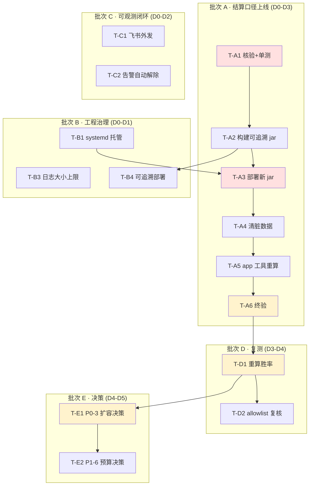

# 排查修复任务拆解 — 分批执行计划（2026-05-25）

> 状态：**待评审 / 待排期** ｜ 类型：定期巡检 · 任务拆解与分批执行计划 ｜ 作者：自动分析（scheduled task `2-1`）｜ 日期：2026-05-25
> 编制时段：2026-05-25 11:03 CST（对仓库 `CoinStrategy` 独立只读核验）
> 适用技能：`troubleshooting`（先定位后修复、最小改动）+ `doc-writing`（文档结构、命名）+ `git-commit-convention`（修复落地规范）
> 上游文档：
> - [问题记录事项-待解决-2026-05-25.md](问题记录事项-待解决-2026-05-25.md)（`1-job` 巡检：15 个待解决问题的现象 / 证据 / 根因）
> - [问题排查修复方案-2026-05-25.md](问题排查修复方案-2026-05-25.md)（`2-1` 分析：逐问题「根因 → 修复方案」与 6 批划分）
> - [跟单ROI虚高根因分析与修复方案-2026-05-24.md](跟单ROI虚高根因分析与修复方案-2026-05-24.md)（ROI 虚高根因立项）
> - [排查修复任务拆解-分批执行计划-2026-05-24.md](排查修复任务拆解-分批执行计划-2026-05-24.md)（上一版任务拆解，本文承接其方法）
>
> 说明：本文是 scheduled task `2-1` 在 2026-05-25 的运行产出。`2-1` 早先一轮已产出《问题排查修复方案-2026-05-25》（分析层，逐问题给出根因与修复方案）；本文承接该分析，**把修复进一步「拆分任务细节、分批执行」**——将 15 个待解决问题（含 ROI 虚高跨文档立项）的修复落成 **22 张可独立排期、可独立验收的执行任务卡**，给出按天排期、依赖 DAG、每批退出标准与复测验收清单。本文**只产出执行计划，不对线上代码 / 服务器 / 数据库做任何写操作**；所有代码锚点经本次对仓库 `CoinStrategy` 的**独立只读核验**确认（核验记录见第九节）。

---

## 一、执行摘要（结论先行）

`1-job` 巡检定位了「开单已恢复、卡点迁移到持仓上限、胜率偏低且账面盈利不可信」；`2-1` 分析给出了「这 15 个问题各自怎么修、先修哪个」。本文回答最后一个问题：**这些修复具体怎么排期、谁先谁后、每步做完算什么标准、复测怎么验收。**

**三条最重要的结论：**

1. **本期重心从「写代码」转为「构建 · 部署 · 清数据 · 复测」。** 本次独立只读核验有一个关键发现：**结算口径修复的代码已在上一轮提交入库** —— 提交 `0a37a143`「结算时刻 clamp 到 [openedAt, now]」（含单测）、`e5361aac` 加入 `SETTLEMENT_GUARD` 与 markPrice 防污染常量。但 `1-job` 巡检记录的运行 jar 构建于 **05-25 01:04**，早于这两个提交（提交时间 01:28 / 02:15），故**线上跑的仍是旧逻辑——结算 bug 仍在持续产生新脏数据**。本期关键路径因此不是「写代码」而是 `核验已提交修复 → 构建可追溯 jar → 部署 → 清脏数据 → app 工具重算 → 终验`，约 **4–5 个工作日**。

2. **独立核验全部通过，且半数修复轮子现成。** systemd 单元模板（已含 `Restart=always` / `RestartSec=5` / `LimitNOFILE=65535`）、安装脚本 `install-smart-wallet-linux-service.sh`、飞书告警 Sink、jar `MANIFEST` 注入 commit 元信息均已就绪，可直接装配。**一处对修复方案的修正**：`logback-spring.xml` 实际**已有**按天滚动（`maxHistory=30` / `totalSizeCap=2GB`），巡检「单个 `job-2026-05-22.log` 达 92 MB」的真因是**缺单文件大小上限**——P1-4 应修正为「补 `maxFileSize`」而非「新增滚动策略」。

3. **依赖纪律：先部署再清数据、先治本再决策。** 两条硬约束：(a) **清脏数据（T-A4）必须排在新 jar 部署（T-A3）之后**——否则旧 jar 会持续产出新脏数据，清理白做；(b) **P0-3 扩容 / P1-6 放预算（批次 E）必须排在可信胜率重算（T-D1）之后**——胜率仅 20.8% 时贸然调高 `max-open-positions` 会放大真实亏损敞口。

### 批次与任务总览

| 批次 | 主题 | 排期窗口 | 任务卡 | 关键路径 |
|---|---|---|---|---|
| A | 治本 · 结算口径上线 | D0 – D3 | T-A1 ~ T-A6（6） | ✅ 是（串行） |
| B | 工程治理 | D0 – D1 | T-B1 ~ T-B4（4） | 部分（T-B1 是 A 批部署前置） |
| C | 可观测闭环 | D0 – D2 | T-C1 ~ T-C3（3） | ❌ 否（可并行） |
| D | 复测与胜率重评 | D3 – D4 | T-D1 ~ T-D2（2） | ✅ 是 |
| E | 扩容决策 | D4 – D5 | T-E1 ~ T-E2（2） | ✅ 是 |
| F | 数据治理与可观测补全 | D0 起并行 ~ D5+ | T-F1 ~ T-F5（5） | ❌ 否（可并行） |

> 工时口径：S ≈ 半天内；M ≈ 0.5–1 人日；L ≈ 1–3 人日（均含测试）。排期 `D0` = 修复启动日，`D1/D2…` 为其后第 N 个工作日，供排期参考、非绝对日期。严重度沿用 `1-job` 口径（P0 安全/资金/可用性，P1 策略核心目标，P2 数据治理，P3 可观测性）。

### 较上一版（2026-05-24 任务拆解）的进展

| 上一版任务 | 对应提交 | 本期状态 |
|---|---|---|
| T-A1 调度线程池 | `35c2229d` 调度多线程化 | ✅ 已提交（巡检显示开单已恢复，已生效） |
| T-A2 HOT 事件同步隔离 | `842586f0` HOT 同步隔离到专用执行器 | ✅ 已提交 |
| T-A3 重任务降压 | `fe20f91b` 闭仓同步线程池改 AbortPolicy | ✅ 已提交 |
| T-B3 build 元信息 | `8f9264cc` jar MANIFEST 注入 commit | ✅ 已提交 |
| T-B4 告警外发 | `e4f4567b` 健康监控告警接入飞书 | ✅ 已提交（待开配置开关，见 T-C1） |
| P2-2 结算时间 / ROI 虚高 | `e5361aac` + `0a37a143` | ⚠️ 已提交**未部署**（运行 jar 早于这两个提交）→ 本期 A 批核心 |

> 即上一版「批次 A 快恢复」「批次 B 部分」已落地代码，开单已恢复；本期未闭环的是**把已提交的结算修复构建部署上线**，以及巡检新增的 P0-3 / P1-2 / P1-6 等问题。

---

## 二、批次总览与时间线

```
D0 ───────── D1 ───────── D2 ───────── D3 ───────── D4 ───────── D5 ──────►
│ 批次A 治本·结算口径上线（串行·关键路径）                         │
│ ■ T-A1 核验+单测(S)                                              │
│        ■ T-A2 构建可追溯jar(S)                                   │
│               ■ T-A3 部署(S) ■ T-A4 清脏数据(M)                  │
│                          ■ T-A5 app工具重算(M) ■ T-A6 终验(S)    │
│ 批次B 工程治理（可并行）         │
│ ■ T-B1 systemd托管(S) ←A批部署前置                               │
│ ■ T-B2 看门狗(S) ■ T-B3 日志大小上限(S) ■ T-B4 可追溯部署(S)      │
│ 批次C 可观测闭环（可并行）              │
│ ■ T-C1 飞书外发(S) ■ T-C3 告警确认(S)                            │
│        ■ T-C2 告警自动解除(M)                                    │
│                                          │ 批次D 复测/胜率 │
│                                          │ ■ T-D1 重算胜率 │
│                                          │ ■ T-D2 allowlist复核
│                                                       │ 批次E 决策 │
│                                                       │ ■ T-E1 P0-3 │
│                                                       │ ■ T-E2 P1-6 │
D0 ═══════ 批次F 数据治理（与 A/B/C 并行，不占关键路径）═══════════════►
   ■ T-F1 余额回填  ■ T-F2 快照表排查  ■ T-F4 摄取时延  ■ T-F5 巡检兜底
                                          ■ T-F3 LOW_CONFIDENCE(A批后)
```

关键路径（结算口径上线的最短链）：**T-A1 → T-A2 →（T-B1 systemd 就绪）→ T-A3 → T-A4 → T-A5 → T-A6 → T-D1 → T-E1**。任何一环延期即整体顺延。

---

## 三、依赖关系图



---

## 四、任务卡（逐批）

每张任务卡含：承接编号 · 批次/排期 · 类型/工时 · 前置 · 范围与执行步骤 · 验收标准 · 验证方法 · 回滚。代码锚点均经第九节核验。

### 批次 A — 治本 · 结算口径上线（目标：把已提交的结算修复构建部署，并清干净历史脏数据）

> 退出标准见第五节。A 批的本质是「让已写好但没上线的结算口径修复真正生效」+「清掉它产生的存量脏数据」。**全批串行，是关键路径。**

#### T-A1 · 核验已提交的结算口径修复并跑通单测 ★关键路径起点

| 字段 | 内容 |
|---|---|
| 承接 | P2-2 / ROI 虚高 |
| 批次 / 排期 | A / D0 |
| 类型 / 工时 | 代码核验 + 测试 / **S** |
| 前置 | 无 |

- **范围**：上一轮已把结算口径修复提交入库（`0a37a143`「结算时刻 clamp 到 [openedAt, now]」、`e5361aac` `SETTLEMENT_GUARD` + markPrice 防污染常量），但《问题排查修复方案-2026-05-25》仍按「待写代码」口径描述。本任务先核验已提交修复的完整性，确认本期是否只需「构建 + 部署」。
- **执行步骤**：
  1. review `settlementAt()`（`SmartWalletAccountingService.java:3217`）双向 clamp 实现、调用点（`:3148`，已传入 `position.getOpenedAt()`）、`closed_at` / `last_filled_at` 写入（`:3195-3196`）。
  2. review `[SETTLEMENT_GUARD]` 拒绝结算仍在交易的市场（约 `:3142-3146`）、`settlementPrice()`（约 `:3236`，按 `isWinning` 返回 1/0）、`markToMarket()` markPrice 防污染（常量 `:136`、方法 `:3277`），核对是否覆盖 ROI 虚高文档的 P0+P1。
  3. 跑 `SmartWalletAccountingServiceTest`，确认 `0a37a143` 新增的 clamp 用例（endAt 早于 openedAt / 晚于 now / 落在区间内）通过；如 ROI 估值缺用例则补。
- **验收标准**：单测全绿；结算时间、估值价两类修复在代码层确认完整；若有缺口列成补丁清单并入 T-A2 前修完。
- **验证方法**：`mvn -pl coin-strategy-job test -Dtest=SmartWalletAccountingServiceTest`。
- **回滚**：纯核验，无副作用。

#### T-A2 · 构建可追溯 jar（含全部结算修复）★关键路径

| 字段 | 内容 |
|---|---|
| 承接 | P2-2 / P1-5 |
| 批次 / 排期 | A / D0–D1 |
| 类型 / 工时 | 构建 / **S** |
| 前置 | T-A1 |

- **范围**：当前运行 jar 构建于 05-25 01:04，早于 `e5361aac`（01:28）/ `0a37a143`（02:15），**不含 `SETTLEMENT_GUARD`、markPrice 防污染、`settlementAt` clamp 三项关键结算修复**——这正是巡检「结算 bug 仍在持续产生脏数据」的原因。须从干净 commit 重新构建。
- **执行步骤**：
  1. 确认干净工作区（`git status --short` 仅余 `.DS_Store`），`git rev-parse HEAD` 记录 commit（核验时为 `57235930`）。
  2. `mvn -pl coin-strategy-job -am clean package`；`8f9264cc` 已让 jar `MANIFEST` 注入构建 commit，构建后核对。
  3. 写入部署记录：`commit ↔ jar ↔ 构建时间` 一一对应。
- **验收标准**：产出 jar，`MANIFEST` 的构建 commit = 构建时 HEAD；存在一条可追溯记录。
- **验证方法**：`unzip -p app.jar META-INF/MANIFEST.MF | grep -i commit`。
- **回滚**：保留上一个可用 jar 备份。

#### T-A3 · 低峰窗口部署新 jar ★关键路径

| 字段 | 内容 |
|---|---|
| 承接 | P2-2 / ROI 虚高 |
| 批次 / 排期 | A / D1 |
| 类型 / 工时 | 运维 / **S** |
| 前置 | T-A2、**T-B1**（先 systemd 托管再部署，避免裸 `nohup` 二次返工） |

- **范围**：把含结算修复的新 jar 部署到 `49.51.250.174`。
- **执行步骤**：
  1. 选开单低峰窗口；备份当前运行 jar。
  2. 经 systemd（T-B1 完成后）`systemctl stop` → 替换 jar → `systemctl start`。
  3. 部署后立即核对运行进程 + jar `MANIFEST` commit = T-A2 构建 commit；确认 `-Dspring.profiles.active=test`。
- **验收标准**：运行 jar 的 `MANIFEST` commit = T-A2 构建 commit；`systemctl status` 为 `active (running)`。
- **验证方法**：SSH 读运行 jar `MANIFEST`；复查 `job-error-current.log` 无启动异常。
- **回滚**：回滚到备份 jar，`systemctl restart`。
- **注意**：部署有秒级停服，选开单低峰执行。

#### T-A4 · 部署后清理历史脏数据 ★关键路径

| 字段 | 内容 |
|---|---|
| 承接 | P2-2 |
| 批次 / 排期 | A / D1–D2 |
| 类型 / 工时 | 数据 / **M** |
| 前置 | **T-A3（必须先部署）** |

- **范围**：清理《问题排查修复方案-2026-05-25》第五节的脏数据——`trade_order` `settled_at` 异常（实测约 29 行）、`smart_wallet_position` `closed_at` 异常（约 44 行）、`smart_wallet_daily_report` 未来日期报告（4 行）。数量随实时变化，以执行时 `SELECT` 为准。
- **执行步骤**：严格按修复方案第五节 5.1 / 5.2 / 5.3 SQL——**每步先 `SELECT` 预览 → `CREATE TABLE ..._bak_20260525` 备份 → 再 `UPDATE` / `DELETE`**；校正口径统一为该行 `updated_at`（真实结算处理时刻）。在 **test 库**执行。
- **验收标准**：`settled_at > NOW() OR settled_at < opened_at` 计数 = 0；`position.closed_at` 异常 = 0；`report_date > CURDATE()` = 0。
- **验证方法**：重跑第五节各「④ 校验」SQL。
- **回滚**：从 `_bak_20260525` 备份表恢复。
- **注意**：**严禁在 T-A3 之前执行**——旧 jar 仍在产脏数据，清理会被立即污染。

#### T-A5 · 触发 app 内置修复工具重算结算与日报

| 字段 | 内容 |
|---|---|
| 承接 | ROI 虚高 / P2-2 |
| 批次 / 排期 | A / D2 |
| 类型 / 工时 | 运维 + 验证 / **M** |
| 前置 | T-A3、T-A4 |

- **范围**：用 app 内置 `repairPrematureResolvedPaperPositions()`（`SmartWalletAccountingService:1789`）逐仓位重新核对市场是否真 `resolved`，按 fill 链重算并回滚账本——这是区分「真实低价赢单」与「幻影结算」的唯一正确途径。裸 SQL 改 `roi_rate` 会造成持仓 / 账本 / 派生表三者不一致。
- **执行步骤**：按修复方案第五节 5.6 B 步——
  1. `POST /strategy/api/smart-wallet/accounting/repair-premature-settlements?limit=500&refreshCache=true` → 取 `triggerId`。
  2. `GET …/repair-premature-settlements/{triggerId}` 查执行结果。
  3. `POST /strategy/api/smart-wallet/trade-orders/backfill` 重建派生表 `trade_order`，并触发受影响日期 `rebuildDailyReport`。
- **验收标准**：重跑 5.6 A1，`settlement_price >= 0.999 AND roi_rate >= 1.0` 仅剩「真实低价赢单」（如 id=7 / 12 / 23 这类 `CLAIMED` 仓位）；当日 `daily_report.net_pnl` 收敛到剔除幻影后的口径。
- **验证方法**：5.6 A1 / A2 `SELECT` + `daily_report` 交叉核对。
- **回滚**：app 工具自带账本回滚；必要时从 T-A4 备份恢复。

#### T-A6 · 结算口径修复终验

| 字段 | 内容 |
|---|---|
| 承接 | P2-2 / ROI 虚高 验证 |
| 批次 / 排期 | A / D2–D3 |
| 类型 / 工时 | 验证 / **S** |
| 前置 | T-A4、T-A5 |

- **范围**：确认部署后**不再产生新脏数据**（区别于 T-A4 的「清存量」）。
- **执行步骤**：部署后观察 ≥ 6–12h，按窗口复跑脏数据计数 SQL，确认增量为 0；抽查新结算订单 `settled_at ∈ [opened_at, NOW()]`。
- **验收标准**：观察窗口内无新增 `settled_at` / `closed_at` 异常行；新结算订单时间合法。
- **验证方法**：定时 SQL 计数对比（部署后 T0 / T+6h / T+12h）。
- **回滚**：若仍产脏数据，回 T-A1 排查修复完整性（可能 `repairPrematureSettlement` 旁路或 fill 链仍带脏值）。

### 批次 B — 工程治理（可与 A/C 并行）

> 退出标准见第五节。B 批让「服务崩溃能自愈」「磁盘不再单调增长」「部署可追溯」。其中 T-B1 须早于 A 批部署（T-A3）。

#### T-B1 · systemd 托管 job 服务 ★（A 批部署前置）

| 字段 | 内容 |
|---|---|
| 承接 | P0-2 |
| 批次 / 排期 | B / D0–D1 |
| 类型 / 工时 | 运维 / **S** |
| 前置 | 无（但须早于 T-A3，使后续部署直接走 systemd） |

- **范围**：把裸 `nohup java -jar` 改为 systemd 托管，崩溃自愈。仓库材料现成：`deploy/linux/systemd/smart-wallet-backend.service.template` 已含 `Restart=always`（`:20`）/ `RestartSec=5`（`:21`）/ `LimitNOFILE=65535`（`:22`）；`scripts/install-smart-wallet-linux-service.sh` 已就绪。
- **执行步骤**：
  1. 在 `49.51.250.174` 以 root 执行 `SMART_WALLET_INSTALL_NGINX=false bash scripts/install-smart-wallet-linux-service.sh`（job 机不装 nginx）。
  2. 停巡检时的裸进程（巡检记 PID 1132468），`systemctl start` + `systemctl enable smart-wallet-backend`。
  3. 模板 `RestartSec` 由 5 调到 10，避免崩溃风暴下紧密重启。
- **验收标准**：`systemctl status smart-wallet-backend` 为 `active (running)`；`systemctl is-enabled` 为 `enabled`。
- **验证方法**：`kill` 进程后观察 systemd 自动拉起。
- **回滚**：`systemctl disable --now smart-wallet-backend`，回退裸启动。
- **注意**：切换瞬间有秒级停服，选开单低峰，可与 T-A3 部署合并到同一个窗口。

#### T-B2 · 外部健康看门狗

| 字段 | 内容 |
|---|---|
| 承接 | P0-2 ｜ 批次/排期 B / D1 ｜ 类型/工时 运维 / **S** ｜ 前置 T-B1 |

- **范围**：在 systemd 之外叠加一层基于业务健康端点（8081）的探活。
- **执行步骤**：写探活脚本（systemd timer / cron）周期请求 8081 健康端点，连续失败 `systemctl restart` 并发告警。
- **验收标准**：模拟 8081 不可达，看门狗在阈值次数内触发重启与通知。
- **验证方法**：手动阻断 8081 观察看门狗动作。
- **回滚**：移除 timer / cron。

#### T-B3 · logback 增加单文件大小上限

| 字段 | 内容 |
|---|---|
| 承接 | P1-4 ｜ 批次/排期 B / D1 ｜ 类型/工时 代码 + 运维 / **S** ｜ 前置 无 |

- **范围**：核验发现 `coin-strategy-job/src/main/resources/logback-spring.xml` **已有**按天滚动（`TimeBasedRollingPolicy`，`:30` / `:53`，`maxHistory=30`、`totalSizeCap=2GB` / `500MB`），但**无单文件大小上限**——这正是巡检「单个 `job-2026-05-22.log` 达 92 MB」的真因（按天滚动但单天日志无大小上限）。**对修复方案的修正**：P1-4 是「补单文件大小上限」而非「新增滚动策略」。
- **执行步骤**：把业务 / 错误 appender 的 `TimeBasedRollingPolicy` 改为 `SizeAndTimeBasedRollingPolicy`，增加 `<maxFileSize>100MB</maxFileSize>`；服务器侧清理历史超大日志（先确认无需归档）。
- **验收标准**：单个日志文件不超过 `maxFileSize`；服务器磁盘用量回落。
- **验证方法**：构造大量日志触发滚动；`df -h /` 复查。
- **回滚**：配置还原为 `TimeBasedRollingPolicy`。

#### T-B4 · 可追溯部署 + 清理直传痕迹

| 字段 | 内容 |
|---|---|
| 承接 | P1-5 ｜ 批次/排期 B / D1 ｜ 类型/工时 工程治理 / **S** ｜ 前置 T-A2 |

- **范围**：`8f9264cc` 已让 jar `MANIFEST` 注入 commit；本任务把「服务器记录运行 commit + 清理 `._*` 直传痕迹」落地。
- **执行步骤**：
  1. T-A3 部署时在服务器记录运行 jar 的 commit（部署记录文件或 `/actuator/info`）。
  2. 清理 `backend/` 下 `._app.jar` 等 macOS AppleDouble 痕迹与冗余历史备份（保留 1–2 个可回滚版本）。
  3. 后续部署统一走「干净 commit 构建 → systemd 部署」。
- **验收标准**：服务器可反查运行 jar 的构建 commit；`backend/` 目录无 `._*` 文件。
- **验证方法**：SSH `ls -la backend/`；查 `/actuator/info`。
- **回滚**：无（治理动作）。

### 批次 C — 可观测闭环（可与 A/B 并行）

> 退出标准见第五节。C 批让「告警检测到 + 落库」进一步「通知到人 + 恢复后自动清除」。

#### T-C1 · 开启飞书告警外发

| 字段 | 内容 |
|---|---|
| 承接 | P1-3 ｜ 批次/排期 C / D0–D1 ｜ 类型/工时 配置 / **S** ｜ 前置 无 |

- **范围**：核验确认外发能力**已存在**——`FeishuStrategyAuditAlertSink` 的 `shouldPushToFeishu()`（`:142`）依赖 `smart-wallet.audit.feishu-sink-enabled=true` + `feishu-webhook-url` 非空 + severity 在 `feishu-allowed-severities`（默认 WARN,CRITICAL,FATAL）+ dedupe 窗口。未外发的真因是**配置未开**。
- **执行步骤**：
  1. test profile 配 `smart-wallet.audit.feishu-sink-enabled=true` + 有效 `feishu-webhook-url`（webhook 凭据走 env，不进 git）。
  2. 确认 `feishu-allowed-severities` 含 WARN / CRITICAL。
  3. 在 job 机实测出网可达飞书 webhook。
- **验收标准**：mock 一条 WARN / CRITICAL 告警，飞书群收到卡片消息。
- **验证方法**：触发测试告警，确认飞书收到。
- **回滚**：`feishu-sink-enabled=false`。
- **注意**：外发失败须 swallow、不阻断 `HealthMonitor`（现有实现已 swallow）。

#### T-C2 · 健康告警「条件恢复 → 自动 resolved」闭环

| 字段 | 内容 |
|---|---|
| 承接 | P1-3 ｜ 批次/排期 C / D1–D2 ｜ 类型/工时 代码 / **M** ｜ 前置 无 |

- **范围**：核验确认全仓**无任何**把 `strategy_alert.resolved` 置 1 的代码——`StrategyHealthMonitorJob`（`@Scheduled` 每 1h，`:49`）只「检测 + `safePublish`」（`alertSink.publish()` 在 `:185`）。id=3 CRITICAL 在开单 17:32 恢复 16h 后仍 `resolved=0` 即直接证据。
- **执行步骤**：`StrategyHealthMonitorJob` 每轮检测时，对「当前已不满足触发条件」的同 `alert_type` 未解决告警执行 `resolved=1, resolved_at=NOW()`。覆盖 `HEALTH_NO_OPEN_24H`（`:135`）/ `HEALTH_NO_OPEN_4H`（`:158`）/ `HEALTH_CAPITAL_LOW`（`:89`）/ `HEALTH_CAPITAL_DEPLETED`（`:74`）。
- **验收标准**：单测 mock「条件恢复」，对应 `alert` 被自动 `resolved`。
- **验证方法**：单测 + 本地 mock 触发。
- **回滚**：移除 resolve 逻辑。

#### T-C3 · strategy_alert 历史 4 条确认 / 解除

| 字段 | 内容 |
|---|---|
| 承接 | P3-1 ｜ 批次/排期 C / D0 ｜ 类型/工时 数据 / **S** ｜ 前置 无 |

- **范围**：4 条 `strategy_alert` 全部 `acknowledged=0` 且 `resolved=0`。
- **执行步骤**：按修复方案第五节 5.4 SQL——id=3（`HEALTH_NO_OPEN_24H`，开单已 05-24 17:32 恢复）立即 `resolved=1`；id=1（`AUDIT_SETTLEMENT_SOURCE`）/ id=2（`AUDIT_LIVE_REPLAY_DIFF`）/ id=4（`HEALTH_CAPITAL_LOW`）核实后 `acknowledged=1`，`resolved` 待对应问题真正解决后再置。
- **验收标准**：id=3 `resolved=1`；id=1/2/4 `acknowledged=1`。
- **验证方法**：SQL 复查。
- **回滚**：执行前备份该表，可恢复。

### 批次 D — 复测与胜率重评（A 批完成后）

> **强依赖：批次 D 必须在批次 A 全部完成（结算修复部署 + 脏数据清理 + app 工具重算）之后执行**，否则胜率口径仍被幻影结算污染。

#### T-D1 · 以可信口径重算当前版本胜率 ★关键路径

| 字段 | 内容 |
|---|---|
| 承接 | P1-2 ｜ 批次/排期 D / D3+ ｜ 类型/工时 验证 / **M** ｜ 前置 批次 A 全部完成 |

- **范围**：A 批前当前版本胜率 20.8%、账面 +93.97 USDC 被 id=610（+122.01，未来日期结算）等幻影订单污染，剔除后实际约 −28 USDC。A 批后以「真实结算价 + 真实结算时刻」重算。
- **执行步骤**：A 批完成后重算当前版本（开仓 ≥ 05-24 17:32 已了结订单）胜负与 `total_pnl`；继续积累 ≥ 50–100 笔可信样本后再对策略真实盈利能力下结论。
- **验收标准**：得到剔除幻影后的可信胜率与盈亏；样本量、口径、时间窗标注清楚。
- **验证方法**：SQL 重算 + 与 `daily_report` 交叉核对。
- **回滚**：无（纯验证）。

#### T-D2 · 复核 24 条 manual_allowlist

| 字段 | 内容 |
|---|---|
| 承接 | P1-1 ｜ 批次/排期 D / D3（可与 T-D1 并行）｜ 类型/工时 数据 + 轻代码 / **M** ｜ 前置 无 |

- **范围**：`smart_wallet_manual_allowlist` 24 条含 `archetype=NOISE_OR_INSUFFICIENT` / `OBSERVE_COOLDOWN` 钱包，靠 allowlist 强行绕过准入门。
- **执行步骤**：
  1. 复核 24 条，剔除 / 停用低质量、冷却期钱包（`SmartWalletFollowTaskService` allowlist 锚点：`findActive` `:265` / `:671`、`enforceManualAllowlistLiveLimits` `:677`）。
  2. 代码上明确 allowlist 语义——仅「绕过准入门」，不「绕过信号质量 / Kelly EV 门」；写入 allowlist 时校验当前 `archetype` / `lane`。
- **验收标准**：影子单 `negative EV` 占比下降；低质量钱包不再被强行纳入跟单。
- **验证方法**：复测影子单 skip reason 分布。
- **回滚**：allowlist 数据复核前备份，可恢复。

### 批次 E — 扩容决策（D 批完成后）

> **强依赖：批次 E 必须在 T-D1 得到可信胜率之后执行。** 胜率不可信时扩容会放大真实亏损敞口。

#### T-E1 · 决策 P0-3 持仓上限 ★关键路径终点

| 字段 | 内容 |
|---|---|
| 承接 | P0-3 ｜ 批次/排期 E / D4+ ｜ 类型/工时 决策（+可能配置）/ **S** ｜ 前置 T-D1 |

- **范围**：`max-open-positions=20` 被打满，`G4_MAX_OPEN_POSITIONS` 今日占 ~82% 拒单。
- **执行步骤**：据 T-D1 可信胜率三选一——(a) 胜率达标 → 适度上调 `max-open-positions`，同步核对 `max-total-open-cost-usdc=500` 资金预算；(b) 胜率不达标 → **不扩容**，优先优化出场 / 结算加快仓位周转；(c) 维持现状先提升入场信号质量（T-D2）。
- **验收标准**：有数据支撑的明确决策记录（含理由与后续观察指标）。
- **验证方法**：决策落地后观察 `G4` 拒单占比与胜率变化。
- **回滚**：配置项（如调整）可还原。
- **纪律**：**严禁在 T-D1 之前扩容。**

#### T-E2 · 决策 P1-6 资金预算

| 字段 | 内容 |
|---|---|
| 承接 | P1-6 ｜ 批次/排期 E / D4+ ｜ 类型/工时 决策 / **S** ｜ 前置 T-D1、T-E1 |

- **范围**：available≈99.25 / budget 500 USDC（剩余 19.9%），`HEALTH_CAPITAL_LOW` 告警。
- **执行步骤**：确认占用资金对应的是否高质量仓位；若多为低质量持仓，靠提升信号质量（T-D2）+ 加快亏损仓位出清回收额度，而非简单调高 `budget`。
- **验收标准**：明确决策；若调 `budget` 须有依据。
- **回滚**：配置还原。

### 批次 F — 数据治理与可观测补全（与 A/B/C 并行，不占关键路径）

> 批次 F 不在关键路径上。纯数据 / 运维类任务（T-F1/F2/F4/F5）D0 即可与 A/B 并行启动；**T-F3 建议排在 A 批后**（结算数据修好后部分 `LOW_CONFIDENCE` 可自动转可定论）。

| 任务 | 承接 | 类型 / 工时 | 前置 | 范围与执行要点 | 验收标准 |
|---|---|---|---|---|---|
| **T-F1** `cash_ledger` 余额回填 | P2-1 | 代码 + 数据 / M | 无 | `appendCashLedger()`（`SmartWalletAccountingService:2990`）插入 `ORDER_NOTIONAL` / `FEE` / `NETWORK_FEE` / `REALIZED_PNL` 四类流水均未调 `setBalanceAfter()`；写入处按 `execution_address` 取上一条 `balance_after` 累加回填；历史约 2,485 行用窗口函数按账户 + `occurred_at` 排序一次性回算（先定初始余额口径，参考修复方案 5.5） | `SELECT COUNT(*) WHERE balance_after IS NULL` = 0；抽样与逐笔累加一致 |
| **T-F2** 三张快照表 0 行排查 | P2-3 | 排查 + 代码 / S→M | 无 | 核验确认三个写入器**均存在**且带 `@Scheduled`——`HealthSnapshotScheduler`（`:42` 每 60s、`:84` `snapshotMapper.insert`）、`MarketSnapshotCollectorService`（`:137` 每 45s、`:54` `marketSnapshotMapper.insert`）、`StrategyRunLogService`。表却 0 行——在服务器 grep 三个写入器日志，确认调度是否触发 / 是否静默抛异常 / 开关 `strategy-monitor.*` 是否开；跑通则修，确认废弃则移出监控口径 | 三表有新行，或显式标注废弃 |
| **T-F3** `LOW_CONFIDENCE` 排查 | P2-4 | 数据 + 代码 / M | 建议 A 批后 | `smart_wallet_leader_trade_outcome` 98,577 行中 56% 为 `LOW_CONFIDENCE`；排查置信度判定口径与数据源（结果回填依赖的市场结算 / 价格数据质量）；与 P2-2 结算口径修复有协同 | `LOW_CONFIDENCE` 占比下降，钱包画像口径更可信 |
| **T-F4** HOT 摄取时延 / 新鲜度门 | P0-1 | 代码 + 配置 / M | 无 | `G5_SIGNAL_STALE_INGEST` 今日 185 次拒单；`trade_event` 摄取时延 `opened_at→created_at` 多在 500–660s、约半数越过 SPORTS 类约 600s 上限；缩短 HOT 钱包同步轮询间隔 / 改近实时推流，**先压时延再谈阈值**（勿单纯调阈值掩盖问题） | 摄取时延 P90 ≤ 600s；STALE 拒单占比下降 |
| **T-F5** 巡检连通性兜底 | P3-2 | 运维 / S | 无 | 巡检对 22 / 3306 端口间歇可达；脚本已内置重试（本次成功）；若后续频繁整次失败，在服务器侧落地只读巡检导出作为兜底 | 巡检连续多次成功，或兜底导出可用 |

---

## 五、每批退出标准（Definition of Done）

每批必须全部满足才视为完成、可进入下一批。

| 批次 | 退出标准 |
|---|---|
| **A 结算口径上线** | ① 已提交的结算修复经核验完整、单测全绿；② 含全部结算修复的可追溯 jar 已构建并部署，运行 jar `MANIFEST` commit = 构建 commit；③ 历史脏数据（`trade_order` / `position` / `daily_report`）清理后校验计数归零；④ app 内置修复工具重算完成，幻影结算行归零；⑤ 部署后观察窗口内无新增脏数据。 |
| **B 工程治理** | ① job 服务由 systemd 托管，`kill` 测试自动拉起、`is-enabled`；② 外部看门狗就位；③ 日志单文件不超 `maxFileSize`、磁盘用量回落；④ 服务器可反查运行 commit、目录无 `._*`。 |
| **C 可观测闭环** | ① 飞书外发开关已配，mock 告警飞书可收到；② 健康告警「条件恢复 → 自动 resolved」逻辑上线并有单测；③ `strategy_alert` 历史 4 条确认 / 解除完成（id=3 `resolved`）。 |
| **D 复测/胜率** | ① A 批完成后以可信口径重算出当前版本胜率与盈亏，口径与样本量标注清楚；② 24 条 `manual_allowlist` 复核完成，低质量钱包已剔除。 |
| **E 决策** | ① P0-3 是否扩容有数据支撑的明确决策；② P1-6 是否放预算有明确决策。**注意：E 批是决策不是开发，但决策必须基于 D 批可信胜率。** |
| **F 治理** | 各任务卡按其「验收标准」逐条关闭；未达标项保留 `待解决` 并记录原因，不强行标完成。 |

---

## 六、关键路径与排期建议

- **关键路径（约 4–5 个工作日）**：`T-A1(D0) → T-A2(D0–D1) →（T-B1 就绪）→ T-A3(D1) → T-A4(D1–D2) → T-A5(D2) → T-A6(D2–D3) → T-D1(D3+) → T-E1(D4+)`。任何一环延期即整体顺延。
- **可立即并行启动（D0 即可，不占关键路径）**：T-B1、T-B3、T-C1、T-C3、T-D2（数据复核部分）、T-F1、T-F2、T-F4、T-F5。
- **建议人力分配**：1 名后端 + 1 名运维主攻关键路径 A 批（核验 / 构建 / 部署 / 清数据 / 重算）；1 名后端并行 B（systemd / 日志）与 C（告警闭环）；F 批数据治理可由数据侧并行；D 批复测由提交人 + 巡检方共同核验。
- **排期硬约束**：
  1. **T-A4 清脏数据必须在 T-A3 部署之后**——否则旧 jar 持续产脏数据，清理被即时污染。
  2. **T-B1 systemd 托管须早于 T-A3**——使新 jar 直接走 systemd 部署，避免裸 `nohup` 二次返工。
  3. **T-D1 重算胜率必须在 A 批全部完成之后**——否则口径仍被幻影结算污染。
  4. **T-E1 / T-E2 扩容决策必须在 T-D1 之后**——胜率不可信时扩容放大亏损敞口。
- **窗口选择**：T-B1（systemd 切换）与 T-A3（jar 部署）都有秒级停服，建议合并到同一个开单低峰窗口执行。

---

## 七、风险登记册

| 风险 | 关联任务 | 等级 | 缓解措施 |
|---|---|---|---|
| 已提交的结算修复存在未覆盖的旁路（如 `repairPrematureSettlement` 仍带脏 fill），部署后仍产脏数据 | T-A1 / T-A6 | **高** | T-A1 核验时把 `repairPrematureSettlement`（`:3476`）等旁路一并 review；T-A6 设观察窗口验证增量为 0，未归零即回 T-A1 |
| 清脏数据 / 历史回算 SQL 误伤生产数据 | T-A4 / T-F1 | 中 | 每步先 `SELECT` 预览 + `CREATE TABLE ..._bak_20260525` 备份；在 test 库执行；回滚可从备份恢复 |
| `repair-premature-settlements` 工具把「真实低价赢单」误判为幻影并订正 | T-A5 | 中 | 工具按市场真实 `resolved` 状态逐仓位核对；执行后重跑 5.6 A1 抽查 id=7/12/23 等 `CLAIMED` 仓位未被误改 |
| jar 部署 / systemd 切换的秒级停服叠加在开单时段 | T-A3 / T-B1 | 低 | 合并到同一开单低峰窗口；部署前备份旧 jar |
| job 机 `49.51.250.174` 出网不可达飞书 webhook | T-C1 | 中 | T-C1 内置 job 机连通性实测；外发失败 swallow、不阻断 HealthMonitor |
| 重算胜率样本量不足（A 批后可信样本 < 50），结论不稳 | T-D1 | 中 | 明确标注样本量；不足 50–100 笔时只给「方向性」结论，不据此做 E 批扩容决策 |
| 在胜率不可信时提前扩容 P0-3，放大亏损敞口 | T-E1 | **高** | 硬约束：T-E1 前置 T-D1；退出标准明确「决策须基于可信胜率」 |
| `logback` 改 `SizeAndTimeBasedRollingPolicy` 配置错误导致日志丢失 | T-B3 | 低 | 改动后本地构造日志验证滚动；保留 `maxHistory` / `totalSizeCap` 不变 |

---

## 八、复测验收清单（批次 A / D 用）

部署含结算修复的可追溯 jar 后，按此清单逐项打勾，全绿才算「结算口径已治本」：

- [ ] 运行 jar `MANIFEST` 的构建 commit = T-A2 构建 commit（线上跑的是含结算修复的版本）
- [ ] `smart_wallet_trade_order` `settled_at > NOW() OR settled_at < opened_at` 计数 = **0**
- [ ] `smart_wallet_position` `closed_at` 异常计数 = **0**
- [ ] `smart_wallet_daily_report` `report_date > CURDATE()` 计数 = **0**
- [ ] 5.6 A1 重跑：`settlement_price>=0.999 AND roi_rate>=1.0` 仅剩真实低价赢单，无未来日期 / 早于开仓行
- [ ] 部署后观察窗口（≥ 6–12h）内**无新增** `settled_at` / `closed_at` 异常行
- [ ] 当日 `smart_wallet_daily_report.net_pnl` 收敛到剔除幻影后的口径
- [ ] 以可信口径重算的当前版本胜率已产出，样本量与口径标注清楚
- [ ] job 服务由 systemd 托管，`kill` 测试自动拉起
- [ ] mock 一条 WARN / CRITICAL，飞书群确认可收到

---

## 九、附录：独立只读核验记录

本文对仓库 `CoinStrategy` 重新做了一轮**独立只读核验**（`git` / `grep` / `sed` / `find`，未做任何写操作），用于确认承接的 `2-1` 分析锚点准确、可直接据以排期：

| 核验项 | 命令要点 | 结果 |
|---|---|---|
| 结算修复已提交（P2-2） | `git log --oneline` | `0a37a143`「结算时刻 clamp 到 [openedAt, now]」(05-25 02:15:18，改 `SmartWalletAccountingService` 41 行 + 单测 33 行)；`e5361aac` 含 `SETTLEMENT_GUARD` + markPrice 防污染 (05-25 01:28:56) ✅ |
| `settlementAt()` 双向 clamp | `sed -n '3217,3233p' SmartWalletAccountingService.java` | `settlementAt(metadata, now, openedAt)` 已实现 `[lower=openedAt, upper=now]` clamp；调用点 `:3148` 已传 `position.getOpenedAt()` ✅ |
| 结算写入 / GUARD | `sed -n '3140,3200p'` | `[SETTLEMENT_GUARD]` 拒绝结算 `acceptingOrders` 市场（约 `:3142-3146`）；`closed_at` / `last_filled_at` 写入 `:3195-3196` ✅ |
| 运行 jar 落后于修复 | 巡检文档 + `git log --date` | 运行 jar 构建 05-25 01:04，早于 `e5361aac`(01:28) / `0a37a143`(02:15) —— **运行 jar 不含三项结算修复**，与「结算 bug 仍在产脏数据」一致 ⚠️ |
| `appendCashLedger`（P2-1） | `sed -n '2990,3035p'` | 插入 `ORDER_NOTIONAL`/`FEE`/`NETWORK_FEE`/`REALIZED_PNL` 四类流水均**未调** `setBalanceAfter()` —— 缺陷确凿 ✅ |
| 健康告警（P1-3） | `grep -n "@Scheduled\|publish\|resolved" StrategyHealthMonitorJob.java` | `@Scheduled` 每 1h（`:49`）；`alertSink.publish()`（`:185`）；`HEALTH_NO_OPEN_24H`(`:135`)/`4H`(`:158`)/`CAPITAL_LOW`(`:89`)/`DEPLETED`(`:74`)；**全仓无 `resolved=1` 写回逻辑** ✅ |
| 飞书 Sink 开关（P1-3） | `grep -n "feishu\|enabled" FeishuStrategyAuditAlertSink.java` | `shouldPushToFeishu()`(`:142`) 依赖 `feishu-sink-enabled=true` + `feishu-webhook-url` 非空 + severity 在白名单 —— 未外发真因「配置未开」确认 ✅ |
| 快照写入器（P2-3） | `grep -n "@Scheduled\|insert" HealthSnapshotScheduler.java / MarketSnapshotCollectorService.java` | `HealthSnapshotScheduler` `:42` 每 60s、`:84` `insert`；`MarketSnapshotCollectorService` `:137` 每 45s、`:54` `insert` —— 写入器存在，0 行须运行态确认 ✅ |
| systemd 材料（P0-2） | `grep Restart deploy/linux/systemd/*.template` | `smart-wallet-backend.service.template` 含 `Restart=always`(`:20`)/`RestartSec=5`(`:21`)/`LimitNOFILE=65535`(`:22`)；`install-smart-wallet-linux-service.sh` 就绪 ✅ |
| 日志滚动（P1-4） | `grep RollingPolicy coin-strategy-job/.../logback-spring.xml` | **已有** `TimeBasedRollingPolicy`(`:30`/`:53`)、`maxHistory=30`、`totalSizeCap=2GB`/`500MB`，**但无 `maxFileSize`** —— 修复方案「新增滚动」修正为「补单文件大小上限」⚠️ |
| 部署可追溯（P1-5） | `git log --oneline` / `git status` | `8f9264cc` 已让 jar `MANIFEST` 注入 commit；工作区干净（仅 `.DS_Store`），HEAD `57235930`，分支 `polymarket-5-min-weather` ✅ |
| allowlist 锚点（P1-1） | `grep manualAllowlist SmartWalletFollowTaskService.java` | `findActive` `:265`/`:671`、`enforceManualAllowlistLiveLimits` `:677` ✅ |

> 核验结论：`2-1` 分析文档《问题排查修复方案-2026-05-25》的关键代码锚点**经独立核验成立、行号准确**，本执行计划可直接据此排期。**两处对修复方案口径的修正已并入对应任务卡**：(1) P2-2 / ROI 结算修复实为「已提交未部署」而非「待写代码」，本期重心是构建部署（见 T-A1/A2/A3）；(2) P1-4 日志问题真因是「缺单文件大小上限」而非「缺滚动策略」（见 T-B3）。
> 仍需在「执行时」进一步落地确认的项（不确定即标注）：(1) 运行 jar 实际 commit 须读 `MANIFEST` 确认（T-A3）；(2) 已提交的结算修复是否覆盖全部旁路须 T-A1 review；(3) 三张空表是否纯由调度 / 开关问题导致须运行态确认（T-F2）；(4) 脏数据精确数量随实时变化，以执行时 `SELECT` 为准。

---

## 自检（依据 `doc-writing` 技能完成前清单）

- [x] 开头点明「这是什么 / 给谁看」：`2-1` 承接 `1-job` 巡检与 `2-1` 分析的**任务拆解与分批执行计划**，供 Ray 与工程侧排期执行。
- [x] 重要结论前置：执行摘要（重心转移、核验通过、依赖纪律）+ 批次总览表 + 较上一版进展表。
- [x] 承接而不重复：不复述 `1-job` 的定位与 `2-1` 分析的逐条方案，只新增「任务卡 / 排期 / 依赖 / 退出标准 / 复测清单 / 独立核验」。
- [x] 编号可对照：22 张任务卡均标「承接」编号（P0-1 ~ P3-2 及 ROI 虚高），可与上游文档逐条对照。
- [x] 用图表代替大段文字：时间线、依赖 DAG（Mermaid）、任务卡表、风险登记册、复测清单。
- [x] 标注状态、作者、日期、编制时段。
- [x] 术语、单位、口径清晰（工时 S/M/L、批次 A–F、`Dn` 排期口径、严重度沿用 1-job）。
- [x] 放入正确目录并规范命名：`docs/problem/排查修复任务拆解-分批执行计划-2026-05-25.md`。
- [x] 与上游四份文档建立链接。
- [x] 不确定内容已标注（运行 jar 实际 commit、修复旁路覆盖度、三空表根因、脏数据实时数量）。

> 自动运行说明：本次为 scheduled task `2-1` 的无人值守运行。本文承接 `1-job` 巡检文档与 `2-1` 早先一轮的《问题排查修复方案-2026-05-25》，把修复**拆分为 22 张可分批执行的任务卡并给出排期与依赖**。本轮对仓库 `CoinStrategy` 做了**独立只读核验**（`git` / `grep` / `sed` / `find`），**未修改任何线上代码、服务器或数据库**；所有修复动作均留待人工评审后执行。文档结构遵循项目 `troubleshooting`、`doc-writing` 与 `git-commit-convention` 技能，未自定义格式。
