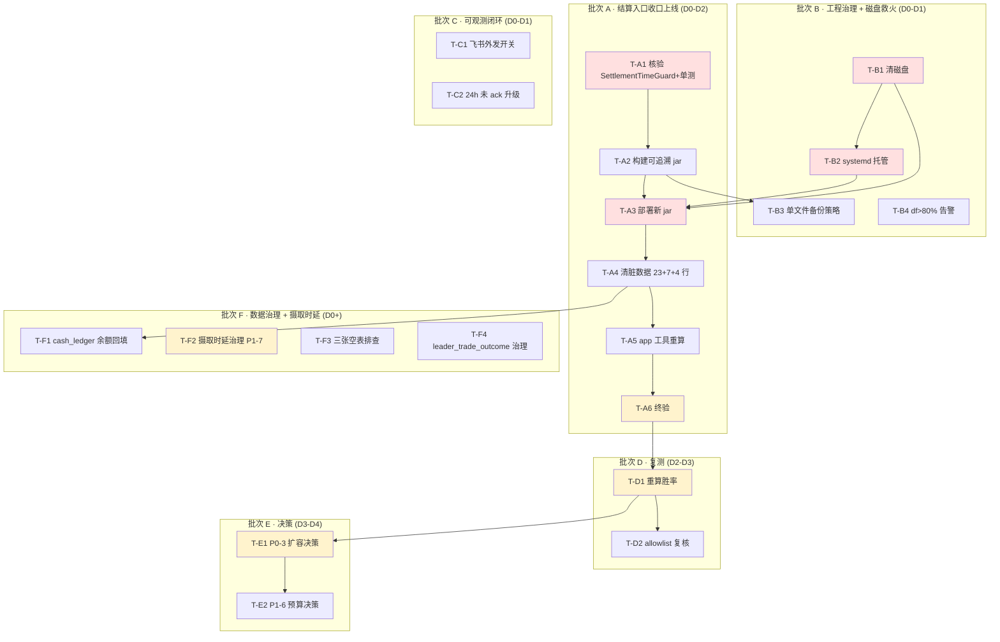

# 排查修复任务拆解 — 分批执行计划（2026-05-26）

> 状态：**待评审 / 待排期** ｜ 类型：定期巡检 · 任务拆解与分批执行计划 ｜ 作者：自动分析（scheduled task `2-1`）｜ 日期：2026-05-26
> 编制时段：2026-05-26 11:03 CST（对仓库 `CoinStrategy` 独立只读核验：HEAD = `eee931e5`）
> 适用技能：`troubleshooting`（先定位后修复、最小改动）+ `doc-writing`（文档结构、命名）+ `git-commit-convention`（修复落地规范）
> 上游文档：
> - [问题记录事项-待解决-2026-05-26.md](问题记录事项-待解决-2026-05-26.md)（`1-job` 巡检：17 个待解决问题）
> - [问题排查修复方案-2026-05-26.md](问题排查修复方案-2026-05-26.md)（`2-1` 分析层：逐问题根因 + 修复方案 + 脏数据 SQL）
> - [排查修复任务拆解-分批执行计划-2026-05-25.md](排查修复任务拆解-分批执行计划-2026-05-25.md)（上一版任务拆解，本文承接其方法）
> - [跟单ROI虚高根因分析与修复方案-2026-05-24.md](跟单ROI虚高根因分析与修复方案-2026-05-24.md)（ROI 虚高跨文档立项）

> 说明：本文是 scheduled task `2-1` 在 2026-05-26 的运行产出。`2-1` 早先一轮已产出《问题排查修复方案-2026-05-26》（分析层，逐问题给出根因与修复方案）；本文承接该分析，**把修复进一步「拆分任务细节、分批执行」**——将 15 个待解决问题（17 项中 2 项已合并）的修复落成 **20 张可独立排期、可独立验收的执行任务卡**，给出按天排期、依赖 DAG、每批退出标准与复测验收清单。本文**只产出执行计划，不对线上代码 / 服务器 / 数据库做任何写操作**；所有代码锚点经本次对仓库 `CoinStrategy` 的**独立只读核验**确认（核验记录见第九节）。

---

## 一、执行摘要（结论先行）

`1-job` 巡检定位「开单已恢复并持续、卡点仍是持仓上限、磁盘从 64% 升至 87%、新增摄取时延告警」；`2-1` 分析层给出了「这 17 个问题各自怎么修」。本文回答最后一个问题：**这些修复具体怎么排期、谁先谁后、每步做完算什么标准、复测怎么验收。**

**三条最重要的结论：**

1. **本期关键路径是「先清磁盘 → 再 systemd 托管 → 再部署 `eee931e5` → 清脏数据 → 终验」，约 3–4 个工作日。** 与上版相比，A 批的「写代码」工作量再次下降——本次独立只读核验确认 commit `eee931e5`（巡检后新提交，2026-05-26 10:34 CST）已把 5 个 `setClosedAt` / `setSettledAt` 入口统一收口到 `SettlementTimeGuard`，配 7 个单测、`mvn` 通过。**线上运行 jar（05-26 00:52）尚未包含 `eee931e5`**，意味着本期关键路径的瓶颈不在「开发」而在「构建 → 部署 → 清数据 → 复测」这一连串运维 + SQL 动作。

2. **磁盘 P1-4 由 P1 升级为「本期最紧迫」，需在 A 批部署前完成清理。** 巡检根分区已 87%、剩 7.8 GB，且与 P0-2（无守护）叠加为安全 / 可用性问题——一旦写盘失败 JVM 异常退出，无人感知。`logback-spring.xml` 实测**已具备**单文件大小 + 总量双滚动（`maxFileSize=100MB`、`totalSizeCap=2GB / 500MB`），上版「待补单文件大小上限」的判断已不成立；本期 P1-4 修复重心是**「服务器侧立即清存量 + 重启使滚动生效」**：删除 4 份历史 jar 备份（~266MB）+ 7 天前 `job-*.log`（~150MB）+ 部署包（58MB），合计 ~600MB 一次性回收。

3. **依赖纪律延续上版：先治本再决策，先部署再清数据。** 三条硬约束：(a) **T-B1 磁盘清理 → T-B2 systemd 托管 → T-A3 部署新 jar** 按序串行，否则部署过程中可能因 `df ≥ 90%` 触发系统保护或 JVM 写盘失败；(b) **清脏数据（T-A4）必须排在新 jar 部署（T-A3）之后**——否则旧 jar 仍走 `rebuildPositionFromFills` 旁路持续生产 `settled_at<opened_at`，清理白做；(c) **P0-3 扩容 / P1-6 放预算（批次 E）必须排在可信胜率重算（T-D1）之后**——36.4% 真实胜率下扩容会放大亏损敞口。

### 批次与任务总览

| 批次 | 主题 | 排期窗口 | 任务卡 | 关键路径 |
|---|---|---|---|---|
| A | 治本 · 结算入口收口上线 | D0 – D2 | T-A1 ~ T-A6（6） | ✅ 是（串行） |
| B | 工程治理 + 磁盘救火 | D0 – D1 | T-B1 ~ T-B4（4） | 部分（T-B1 / T-B2 是 A 批部署前置） |
| C | 可观测闭环 | D0 – D1 | T-C1 ~ T-C2（2） | ❌ 否（可并行） |
| D | 复测与胜率重评 | D2 – D3 | T-D1 ~ T-D2（2） | ✅ 是 |
| E | 扩容决策 | D3 – D4 | T-E1 ~ T-E2（2） | ✅ 是 |
| F | 数据治理 + 摄取时延 + 可观测补全 | D0 起并行 ~ D4+ | T-F1 ~ T-F4（4） | ❌ 否（可并行） |

> 工时口径：S ≈ 半天内；M ≈ 0.5–1 人日；L ≈ 1–3 人日（均含测试）。排期 `D0` = 修复启动日，`D1/D2…` 为其后第 N 个工作日，供排期参考、非绝对日期。严重度沿用 `1-job` 口径（P0 安全/资金/可用性，P1 策略核心目标，P2 数据治理，P3 可观测性）。

### 较上一版（2026-05-25 任务拆解）的进展

| 上一版任务 | 对应 commit | 本期状态 |
|---|---|---|
| T-A1 ~ T-A2 核验 + 构建（结算 clamp） | `0a37a143` + `e5361aac` | ✅ 已合入主干；上版构建已部分部署 |
| T-A3 部署 | — | ⚠️ 已部署 05-26 00:52 jar，但**只含 `1ed101bc`、不含 `eee931e5`** → 本期需再次部署 |
| T-A4 清脏数据 | — | ⚠️ 未执行；本期重做（数量 23+7+4） |
| T-A5 app 工具重算 | — | ⚠️ 未执行；本期重做 |
| T-A6 终验 | — | ⚠️ 未执行；本期重做 |
| T-B1 systemd 托管 | `scripts/install-smart-wallet-linux-service.sh` 已就绪 | ⚠️ 上版未执行；本期升级为「磁盘救火 + systemd」联合执行 |
| T-B3 logback 大小上限 | `1ed101bc`（logback-spring.xml） | ✅ 代码已合入并部署（jar 已含），仅需服务器侧清存量 |
| T-C1 飞书外发 | `e4f4567b` | ⚠️ 代码已就绪，配置开关 `feishu-sink-enabled=true` 未开 |
| T-C2 告警自动解除 | `1ed101bc`（`StrategyHealthMonitorJob.autoResolveByStrategy`） | ✅ 已合入并部署（巡检 id=3/4/5 自动 resolved 验证） |
| **本期新增** P2-2 入口防护 | `eee931e5`（`SettlementTimeGuard` 5 个入口收口 + 7 用例） | ⚠️ 已合入未部署 → A 批核心 |
| **本期新增** 摄取时延监控 | `1ed101bc`（`TradeEventIngestLagJob/Service`） | ✅ 已合入并部署（巡检 `HEALTH_INGEST_LAG_HIGH` id=6 已落库验证） |
| 上版 `cash_ledger.balance_after` | `1ed101bc`（`appendCashLedger` 接 `runningBalance`） | ✅ 已合入并部署，新写入应自愈；存量 2,549 行需窗口函数回填（T-F1） |

> **总结**：上一版「批次 A 治本代码」已落地，且配套的 `1ed101bc`（自动 resolved / 摄取时延监控 / 余额回填）已部署生效；本期未闭环的是 (a) **把 `eee931e5` 入口防护构建部署上线 + 清存量**，(b) **磁盘 + systemd 联合救火**，(c) **打开飞书 IM 外发配置开关**，(d) **巡检新增的 P1-4 / P1-7 / P2-5**。

---

## 二、批次总览与时间线

```
D0 ───────── D1 ───────── D2 ───────── D3 ───────── D4 ──────►
│ 批次B 工程治理 + 磁盘救火（部分关键路径前置）                    │
│ ■ T-B1 清磁盘(S) ■ T-B2 systemd(S) ← A批部署前置               │
│         ■ T-B3 单文件备份策略(S)                               │
│                ■ T-B4 飞书 df>80% 告警(S)                      │
│ 批次A 治本·结算入口收口上线（串行·关键路径）                     │
│         ■ T-A1 核验+单测(S)                                    │
│                ■ T-A2 构建可追溯jar(S)                         │
│                       ■ T-A3 部署(S) ■ T-A4 清脏数据(M)        │
│                                  ■ T-A5 app工具重算(M)         │
│                                          ■ T-A6 终验(S)        │
│ 批次C 可观测闭环（可并行）        │
│ ■ T-C1 飞书外发开关(S)                                          │
│ ■ T-C2 24h 未 ack 升级(S)                                       │
│                                                  │ 批次D 复测  │
│                                                  │ ■ T-D1 重算 │
│                                                  │ ■ T-D2 allow│
│                                                          │ E 决策│
│                                                          │ E1 P0-3│
│                                                          │ E2 P1-6│
D0 ═══════ 批次F 数据治理 + 摄取时延（与 A/B/C 并行，不占关键路径）═══►
   ■ T-F1 cash_ledger 回填  ■ T-F2 摄取时延治理(P1-7)
   ■ T-F3 三张空表排查      ■ T-F4 leader_trade_outcome 治理
```

关键路径（结算入口收口上线的最短链）：**T-B1 → T-B2 → T-A1 → T-A2 → T-A3 → T-A4 → T-A5 → T-A6 → T-D1 → T-E1**。任何一环延期即整体顺延。

---

## 三、依赖关系图



---

## 四、任务卡（逐批）

每张任务卡含：承接编号 · 批次/排期 · 类型/工时 · 前置 · 范围与执行步骤 · 验收标准 · 验证方法 · 回滚。代码锚点均经第九节核验。

### 批次 B — 工程治理 + 磁盘救火（A 批部署前置）

> 退出标准见第五节。B 批让「磁盘可控、服务自愈、备份可追溯、超阈告警」。其中 T-B1 / T-B2 须早于 A 批部署（T-A3）。

#### T-B1 · 服务器清磁盘 ★关键路径起点（最紧迫）

| 字段 | 内容 |
|---|---|
| 承接 | P1-4 |
| 批次 / 排期 | B / D0 |
| 类型 / 工时 | 运维 / **S** |
| 前置 | 无 |

- **范围**：根分区 87%、剩余 7.8GB 已逼近告警线。一次性清掉「过期备份 / 旧日志 / 部署包」三类存量，回收 ~600MB。
- **执行步骤**（按顺序，每步先 `ls -la` 二次确认）：
  1. `ls -la /opt/coinstrategy/smart-wallet/backend/app.jar.bak*` 核对 4 份历史 jar；`rm -f /opt/coinstrategy/smart-wallet/backend/app.jar.bak*`；`rm -f /opt/coinstrategy/smart-wallet/backend/._app.jar`。
  2. `find /opt/coinstrategy/smart-wallet/logs -name 'job-*.log' -type f -mtime +7 -ls` 预览；确认后 `find ... -delete`（保留 7 天，与 logback `maxHistory=30` 兼容、只清存量）。
  3. `ls -la /opt/coinstrategy/smart-wallet/smart-wallet-test-job.tar.gz`；确认后 `rm -f`。
  4. `df -h /` 复查。
- **验收标准**：`df -h /` 用量 ≤ 80%（从 87% 回落 ≥ 7 个百分点）；`backend/` 仅留当前 `app.jar` + 至多 1 份命名规范的 `app.jar.bak.YYYYMMDD-HHMM`；`logs/` 内最早 `job-*.log` 距今 ≤ 7 天。
- **验证方法**：`df -h /` + `du -sh /opt/coinstrategy/smart-wallet/backend /opt/coinstrategy/smart-wallet/logs`。
- **回滚**：删除是不可逆的，但目标文件本身就是「过期备份 / 旧日志 / 部署包」，无业务依赖。紧急时可从 git 重新构建 + 部署。
- **注意**：与 T-B2 / T-A3 合并到同一个低峰窗口完成最省事。

#### T-B2 · systemd 托管 job 服务 ★（A 批部署前置）

| 字段 | 内容 |
|---|---|
| 承接 | P0-2 |
| 批次 / 排期 | B / D0–D1 |
| 类型 / 工时 | 运维 / **S** |
| 前置 | T-B1（清磁盘后再切换托管，避免切换瞬间 OOM） |

- **范围**：把裸 `nohup java -jar` 改为 systemd 托管，崩溃自愈。仓库材料已就绪：`deploy/linux/systemd/smart-wallet-backend.service.template` 已含 `Restart=always`（`:21`）/ `RestartSec=5`（`:22`）/ `LimitNOFILE=65535`（`:23`）+ 安全加固块（`:25-32`）；`scripts/install-smart-wallet-linux-service.sh` 已就绪。
- **执行步骤**：
  1. 在 `49.51.250.174` 以 root 执行 `SMART_WALLET_INSTALL_NGINX=false bash scripts/install-smart-wallet-linux-service.sh`（job 机不装 nginx）。
  2. 停巡检时的裸进程（巡检 PID 1468390，**实际执行时以 `ps -ef | grep app.jar` 复查为准**），`systemctl start smart-wallet-backend && systemctl enable smart-wallet-backend`。
  3. 模板 `RestartSec` 由 5 调到 10（在 `.service` 文件中），避免崩溃风暴下紧密重启。
- **验收标准**：`systemctl status smart-wallet-backend` 为 `active (running)`；`systemctl is-enabled` 为 `enabled`；模拟 `kill` 进程后 systemd 在 ≤ 30s 内自动拉起。
- **验证方法**：`kill <PID>` 后观察 `systemctl status`。
- **回滚**：`systemctl disable --now smart-wallet-backend`，回退裸启动。
- **注意**：切换瞬间有秒级停服，与 T-A3 合并到同一个低峰窗口最省事。

#### T-B3 · 可追溯部署 + 单文件备份策略

| 字段 | 内容 |
|---|---|
| 承接 | P1-5 ｜ 批次/排期 B / D1 ｜ 类型/工时 工程治理 / **S** ｜ 前置 T-A2 |

- **范围**：`8f9264cc` 已让 jar `MANIFEST` 注入 commit；本任务把「服务器记录运行 commit + 单文件备份命名规范」落地。
- **执行步骤**：
  1. T-A3 部署前，把现有 `app.jar` 备份为 `app.jar.bak.20260526-HHMM`（HHMM = 当时本机时分）。
  2. 部署后在 `/opt/coinstrategy/smart-wallet/deploy.log` 写一行：`<时间> <commit> <jar sha256> <操作人>`。
  3. 后续部署规范：最多保留 5 份 `app.jar.bak.YYYYMMDD-HHMM`，超过自动删最早。
- **验收标准**：`/opt/coinstrategy/smart-wallet/deploy.log` 至少一行；`backend/` 目录最多 1 份 `app.jar.bak.*` + 当前 `app.jar`，无 `._*` 文件。
- **验证方法**：SSH `ls -la backend/`；`cat deploy.log`；`unzip -p app.jar META-INF/MANIFEST.MF | grep -i commit` 应返回 commit。
- **回滚**：无（治理动作）。

#### T-B4 · 磁盘 / 告警监控（df>80% 飞书提醒）

| 字段 | 内容 |
|---|---|
| 承接 | P1-4 ｜ 批次/排期 B / D1 ｜ 类型/工时 运维 / **S** ｜ 前置 T-C1（飞书外发开关已开） |

- **范围**：服务器侧 cron 每日 `df -h /`，>80% 即通过飞书 webhook 发告警。
- **执行步骤**：
  1. 在 `49.51.250.174` 写 `/etc/cron.d/df-watch` 每 6 小时跑一次 `df -h /` 解析使用率；>80% 调飞书 webhook。
  2. 或：在 `coin-strategy-job` 内加一个 `@Scheduled` 1h 跑一次的 `DiskUsageMonitorJob`，复用 `auditAlertSink.publish(AlertType.HEALTH_DISK_HIGH, ...)`（与 `TradeEventIngestLagJob` 同模式）。
- **验收标准**：用 `dd` 制造一个 5GB 临时文件触发 >80%，飞书收到告警；删除文件后下一轮告警自动 resolved（沿用 `1ed101bc` 的 `autoResolveByStrategy` 模式扩展）。
- **回滚**：移除 cron 或回退该 `@Scheduled` 类。

### 批次 A — 治本 · 结算入口收口上线（A 批部署前置 B 批已完成）

> 退出标准见第五节。A 批的本质是「让已写好但没上线的 `eee931e5` 入口防护真正生效」+「清掉它产生的存量脏数据」。**全批串行，是关键路径。**

#### T-A1 · 核验 `SettlementTimeGuard` 与单测 ★关键路径起点

| 字段 | 内容 |
|---|---|
| 承接 | P2-2 / ROI 虚高 |
| 批次 / 排期 | A / D0 |
| 类型 / 工时 | 代码核验 + 测试 / **S** |
| 前置 | 无 |

- **范围**：本期 commit `eee931e5`（2026-05-26 10:34 CST）已新增 `SettlementTimeGuard` 工具把 5 个 `setClosedAt` / `setSettledAt` 入口收口、补 7 个单测。本任务核验完整性、跑通单测。
- **执行步骤**：
  1. 核验 `coin-strategy-job/src/main/java/com/metaverse/coin/strategy/job/smartwallet/service/SettlementTimeGuard.java` 实现：candidate < openedAt → clamp 到 openedAt + ERROR 日志；candidate > now → clamp 到 now + WARN 日志；不抛、不中断。
  2. 核验调用点（5 处）：`SmartWalletAccountingService.java:1713`（`rebuildPositionFromFills`）、`:2839`（`appendFill`）、`:3222`（`resolvePosition`，原 `0a37a143` 覆盖）、`:3533`（`repairPrematureSettlement` 路径）、`SmartWalletTradeOrderService` 的 `syncTradeOrder`。
  3. 跑 `mvn -pl coin-strategy-job test -Dtest=SettlementTimeGuardTest` —— 应 7 用例全绿。
  4. 同时跑 `SmartWalletAccountingServiceTest`、`StrategyHealthMonitorJobTest`、`TradeEventIngestLagServiceTest` 全量回归。
- **验收标准**：单测全绿；5 个调用点均传入正确 `context` 字符串便于运维定位；`SettlementTimeGuard` 不依赖 Spring 上下文（已是 `@UtilityClass`）。
- **验证方法**：`mvn ... test`；`grep -n "SettlementTimeGuard.clamp" coin-strategy-job/src/main/java/com/metaverse/coin/strategy/job/smartwallet/service/`。
- **回滚**：纯核验，无副作用。

#### T-A2 · 构建可追溯 jar（含 `eee931e5`）★关键路径

| 字段 | 内容 |
|---|---|
| 承接 | P2-2 / P1-5 |
| 批次 / 排期 | A / D0–D1 |
| 类型 / 工时 | 构建 / **S** |
| 前置 | T-A1 |

- **范围**：当前运行 jar 构建于 05-26 00:52，早于 `eee931e5`（10:34），**不含入口防护**——这是巡检「`settled_at<opened_at` 16 → 24 笔反向恶化」未根除的真因。须从 `eee931e5`（或更新 HEAD）重新构建。
- **执行步骤**：
  1. 确认干净工作区（`git status --short` 仅余 `.DS_Store`），`git rev-parse HEAD` 记录 commit（核验时为 `eee931e5e9e4bcb34220a8bf72968122c18fcfd2`）。
  2. `mvn -pl coin-strategy-job -am clean package`；`8f9264cc` 已让 jar `MANIFEST` 注入构建 commit + 时间，构建后核对。
  3. 写入部署记录：`commit ↔ jar sha256 ↔ 构建时间`。
- **验收标准**：产出 jar，`MANIFEST` 的构建 commit = 构建时 HEAD（应包含 `eee931e5`）；存在一条可追溯记录。
- **验证方法**：`unzip -p app.jar META-INF/MANIFEST.MF | grep -iE 'commit|build'`。
- **回滚**：保留上一个可用 jar 备份（在 T-B3 完成的备份策略中）。

#### T-A3 · 低峰窗口部署新 jar（通过 systemd）★关键路径

| 字段 | 内容 |
|---|---|
| 承接 | P2-2 / ROI 虚高 |
| 批次 / 排期 | A / D1 |
| 类型 / 工时 | 运维 / **S** |
| 前置 | T-A2、**T-B1**（磁盘已清）、**T-B2**（systemd 托管已就绪） |

- **范围**：把含入口防护的新 jar 部署到 `49.51.250.174`。
- **执行步骤**：
  1. 选开单低峰窗口；`cp /opt/coinstrategy/smart-wallet/backend/app.jar /opt/coinstrategy/smart-wallet/backend/app.jar.bak.20260526-HHMM`。
  2. 经 systemd：`systemctl stop smart-wallet-backend` → `scp` 新 jar 替换 → `systemctl start smart-wallet-backend`。
  3. 部署后立即核对运行进程 + jar `MANIFEST` commit = T-A2 构建 commit；确认 `-Dspring.profiles.active=test`；确认 8081 端口 listen。
  4. `tail -200 /opt/coinstrategy/smart-wallet/logs/job-current.log` 看启动是否干净（无 `BeanCreationException` / 端口冲突）。
- **验收标准**：运行 jar 的 `MANIFEST` commit = T-A2 构建 commit；`systemctl status` 为 `active (running)`；`job-error-current.log` 无新增 ERROR。
- **验证方法**：SSH 读运行 jar `MANIFEST`；`curl http://localhost:8081/actuator/health`。
- **回滚**：`systemctl stop` → `cp app.jar.bak.20260526-HHMM app.jar` → `systemctl start`。
- **注意**：部署有秒级停服，选开单低峰执行。

#### T-A4 · 部署后清理历史脏数据 ★关键路径

| 字段 | 内容 |
|---|---|
| 承接 | P2-2 |
| 批次 / 排期 | A / D1–D2 |
| 类型 / 工时 | 数据 / **M** |
| 前置 | **T-A3（必须先部署 `eee931e5`）** |

- **范围**：清理《问题排查修复方案-2026-05-26》第七节的脏数据：`trade_order` 24 笔 `settled_at<opened_at` + 7 笔 `settled_at>NOW()`；`smart_wallet_position` 同口径异常（实际数量以执行时 SELECT 为准）；`smart_wallet_daily_report` 4 行未来日期。数量随实时变化，以执行时 `SELECT` 为准。
- **执行步骤**：严格按修复方案第七节 7.1 / 7.2 / 7.3 / 7.4 SQL —— **每步先 `SELECT` 预览 → `CREATE TABLE ..._bak_20260526` 备份 → 再 `UPDATE` / `DELETE`**；校正口径统一为该行 `updated_at`（真实结算处理时刻）。在 **test 库**执行。
- **验收标准**：
  - `SELECT COUNT(*) FROM smart_wallet_trade_order WHERE settled_at < opened_at` = 0。
  - `SELECT COUNT(*) FROM smart_wallet_trade_order WHERE settled_at > NOW()` = 0。
  - `SELECT COUNT(*) FROM smart_wallet_position WHERE (closed_at < opened_at OR closed_at > NOW()) AND closed_at IS NOT NULL` = 0。
  - `SELECT COUNT(*) FROM smart_wallet_daily_report WHERE report_date > CURDATE()` = 0。
- **验证方法**：重跑修复方案第七节各「④ 校验」SQL。
- **回滚**：从 `_bak_20260526` 备份表恢复。
- **注意**：**严禁在 T-A3 之前执行**——旧 jar 仍走旁路产脏数据，清理会被立即污染。

#### T-A5 · 触发 app 工具重算结算与日报

| 字段 | 内容 |
|---|---|
| 承接 | ROI 虚高 / P2-2 |
| 批次 / 排期 | A / D2 |
| 类型 / 工时 | 运维 + 验证 / **M** |
| 前置 | T-A3、T-A4 |

- **范围**：用 app 内置 `repairPrematureResolvedPaperPositions()`（`SmartWalletAccountingService:1789`）逐仓位重新核对市场是否真 `resolved`，按 fill 链重算并回滚账本——这是区分「真实低价赢单」与「幻影结算」的唯一正确途径。裸 SQL 改 `roi_rate` 会造成持仓 / 账本 / 派生表三者不一致。
- **执行步骤**：按修复方案第七节 7.6 ——
  1. `POST /strategy/api/smart-wallet/accounting/repair-premature-settlements?limit=500&refreshCache=true` → 取 `triggerId`。
  2. `GET /strategy/api/smart-wallet/accounting/repair-premature-settlements/{triggerId}` 查执行结果（处理仓位数、修复仓位数、ROI 修订量）。
  3. `POST /strategy/api/smart-wallet/trade-orders/backfill` 重建派生表 `trade_order`，并触发受影响日期 `rebuildDailyReport`。
- **验收标准**：
  - `SELECT COUNT(*) FROM smart_wallet_trade_order WHERE settlement_price >= 0.999 AND roi_rate >= 1.0 AND status IN ('SETTLED','EXITED')` 仅剩「真实低价赢单」（如 id=7 / 12 / 23 这类 `CLAIMED` 仓位）。
  - 当日 `daily_report.net_pnl` 与 `SUM(trade_order.total_pnl_usdc) GROUP BY DATE(settled_at)` 对齐到剔除幻影后的口径。
- **验证方法**：7.6 终验 SQL + `daily_report` 交叉核对。
- **回滚**：app 工具自带账本回滚；必要时从 T-A4 备份恢复。

#### T-A6 · 结算入口防护终验

| 字段 | 内容 |
|---|---|
| 承接 | P2-2 / ROI 虚高 验证 |
| 批次 / 排期 | A / D2 |
| 类型 / 工时 | 验证 / **S** |
| 前置 | T-A4、T-A5 |

- **范围**：确认部署后**不再产生新脏数据**（区别于 T-A4 的「清存量」）。
- **执行步骤**：部署后观察 ≥ 6–12h，按窗口复跑脏数据计数 SQL，确认增量为 0；抽查新结算订单 `settled_at ∈ [opened_at, NOW()]`；扫描 `job-current.log` 中 `[SETTLEMENT_TIME_ASSERT]` 出现频率与 context 分布。
- **验收标准**：
  - 观察窗口内 `settled_at<opened_at` / `settled_at>NOW()` 计数零增长。
  - `[SETTLEMENT_TIME_ASSERT]` ERROR 出现 ≤ 5 次 / 6 小时——少量是预期（旁路 clamp 已生效）；如显著高于 5 次需排查源头（上游传入异常时间戳）。
- **验证方法**：每 2 小时跑一次「7.1 ④」「7.2 ④」「7.3 ④」「7.4 ④」校验 SQL；`grep "\[SETTLEMENT_TIME_ASSERT\]" /opt/coinstrategy/smart-wallet/logs/job-current.log | wc -l`。
- **回滚**：若仍产脏数据，回 T-A1 排查修复完整性（可能 `repairPrematureSettlement` 旁路或 fill 链仍带脏值）。

### 批次 C — 可观测闭环（可与 A/B 并行）

> 退出标准见第五节。C 批让「告警检测到 + 落库 + 自动 resolved」进一步「通知到人 + 超时升级」。

#### T-C1 · 开启飞书告警外发

| 字段 | 内容 |
|---|---|
| 承接 | P1-3 ｜ 批次/排期 C / D0–D1 ｜ 类型/工时 配置 / **S** ｜ 前置 无 |

- **范围**：核验确认外发能力**已存在**——`FeishuStrategyAuditAlertSink` 的 `shouldPushToFeishu()` 依赖 `smart-wallet.audit.feishu-sink-enabled=true` + `feishu-webhook-url` 非空 + severity 在 `feishu-allowed-severities`（默认 `WARN,CRITICAL`，`SmartWalletProperties.java:1266`）+ dedupe 窗口。未外发的真因是**配置未开**（`feishuSinkEnabled` 默认 `false`，`SmartWalletProperties.java:1246`）。
- **执行步骤**：
  1. test profile 配 `smart-wallet.audit.feishu-sink-enabled=true` + 有效 `feishu-webhook-url`（webhook 凭据走 env，不进 git；或用 `feishu-webhook-secret`）。
  2. 确认 `feishu-allowed-severities` 含 WARN / CRITICAL（默认即如此）。
  3. 在 job 机实测出网可达飞书 webhook（`curl <webhook_url>`）。
  4. 触发一条 WARN（如 mock `HEALTH_NO_OPEN_4H`），确认飞书群收到卡片消息。
- **验收标准**：mock 一条 WARN / CRITICAL 告警，飞书群在 ≤ 30s 内收到卡片消息；同一 alertType 在 `feishu-dedupe-interval-ms`（默认 5 分钟）内不重复发送。
- **验证方法**：触发测试告警 + 飞书群查收。
- **回滚**：`feishu-sink-enabled=false`。
- **注意**：外发失败须 swallow、不阻断 `HealthMonitor`（现有实现已 swallow）。

#### T-C2 · 24h 未 ack 自动升级

| 字段 | 内容 |
|---|---|
| 承接 | P2-5 / P3-1 ｜ 批次/排期 C / D1 ｜ 类型/工时 代码 / **S** ｜ 前置 T-C1 |

- **范围**：自动 resolved 已在 `1ed101bc` 落地；本任务补「>24h 未 ack 自动升级 / 重发飞书」逻辑，处理 id=1（`AUDIT_SETTLEMENT_SOURCE`，挂了 9 天）/ id=2（`AUDIT_LIVE_REPLAY_DIFF`，挂了 3 天）这类非自动 resolved 范围告警。
- **执行步骤**：
  1. 在 `StrategyHealthMonitorJob` 或新建 `StrategyAlertEscalationJob`：每小时扫一次 `strategy_alert WHERE acknowledged=0 AND resolved=0 AND TIMESTAMPDIFF(HOUR, alert_time, NOW()) > 24`。
  2. 命中行通过 `auditAlertSink.publish(AlertType.ALERT_ESCALATED, ...)` 重发飞书（带「<sev> [升级] <原 alertType>」前缀）。
  3. 重发后写回 `strategy_alert.escalated_at`（如无字段，加 `escalated_count` 计数）。
- **验收标准**：mock 一条 24h 前的未 ack 告警，飞书在下一轮调度收到升级提醒；同一告警 24h 内不重复升级（dedupe）。
- **回滚**：disable 该 `@Scheduled` 即可。

### 批次 D — 复测与胜率重评

> 退出标准见第五节。D 批用可信口径回答「胜率是否正常」。

#### T-D1 · 以可信口径重算胜率 ★关键路径

| 字段 | 内容 |
|---|---|
| 承接 | P1-2 / ROI 虚高 ｜ 批次/排期 D / D2–D3 ｜ 类型/工时 验证 / **S** ｜ 前置 T-A6 |

- **范围**：T-A6 终验通过后，以「真实结算价 + 真实 settled_at」口径重新计算当前版本胜率与净 PnL，作为后续扩容决策的基线。
- **执行步骤**：
  1. SQL 重跑：
     ```sql
     SELECT
         COUNT(*) AS total,
         SUM(CASE WHEN total_pnl_usdc > 0 THEN 1 ELSE 0 END) AS wins,
         SUM(CASE WHEN total_pnl_usdc < 0 THEN 1 ELSE 0 END) AS losses,
         SUM(total_pnl_usdc) AS net_pnl,
         AVG(total_pnl_usdc) AS avg_pnl,
         AVG(roi_rate) AS avg_roi
     FROM smart_wallet_trade_order
     WHERE opened_at >= '2026-05-24 17:32:00'
       AND status IN ('SETTLED','EXITED','CLAIMED');
     ```
  2. 看 `roi_rate` 分布是否回归合理区间（`< 2.0` 占 ≥ 95%）。
  3. 与 `daily_report` 当日 `net_pnl_usdc` 对齐。
- **验收标准**：
  - 胜率口径稳定：与 `daily_report` 当日 PnL 对齐到 ±5%。
  - 不再出现 ROI > 5 的非真实低价赢单。
  - 形成一份「当前版本可信胜率」短记录，作为 T-E1 决策依据。
- **验证方法**：SQL + 抽样 10 单人工核对 `settlement_price` 是否合理。

#### T-D2 · `manual_allowlist` 复核与清理

| 字段 | 内容 |
|---|---|
| 承接 | P1-1 ｜ 批次/排期 D / D2–D3 ｜ 类型/工时 数据 + 决策 / **M** ｜ 前置 T-D1 |

- **范围**：将 19 条 ACTIVE allowlist 精简到 ≤ 10 条。
- **执行步骤**：
  1. SQL 关联：
     ```sql
     SELECT
         a.leader_address,
         a.status,
         a.notes,
         o.total, o.wins, o.losses, o.win_rate, o.total_pnl,
         o.low_confidence_ratio
     FROM smart_wallet_manual_allowlist a
     LEFT JOIN (
         SELECT
             leader_address,
             COUNT(*) AS total,
             SUM(CASE WHEN outcome='CLOSED_WIN' THEN 1 ELSE 0 END) AS wins,
             SUM(CASE WHEN outcome='CLOSED_LOSS' THEN 1 ELSE 0 END) AS losses,
             SUM(CASE WHEN outcome='CLOSED_WIN' THEN 1 ELSE 0 END) / NULLIF(SUM(CASE WHEN outcome IN ('CLOSED_WIN','CLOSED_LOSS') THEN 1 ELSE 0 END), 0) AS win_rate,
             SUM(realized_pnl_usdc) AS total_pnl,
             SUM(CASE WHEN confidence='LOW_CONFIDENCE' THEN 1 ELSE 0 END) / COUNT(*) AS low_confidence_ratio
         FROM smart_wallet_leader_trade_outcome
         WHERE created_at >= DATE_SUB(NOW(), INTERVAL 30 DAY)
         GROUP BY leader_address
     ) o ON a.leader_address = o.leader_address
     WHERE a.status='ACTIVE';
     ```
  2. 剔除任一满足条件的钱包：`win_rate < 0.45` / `total_pnl < 0` / `low_confidence_ratio > 0.6`。
  3. 在 `smart_wallet_manual_allowlist` 把对应行 `status='REMOVED'` + `notes` 写明原因（不 `DELETE`，保留审计）。
- **验收标准**：ACTIVE allowlist ≤ 10 条；24 小时后 `G10_KELLY_NEGATIVE_EV` / `G1_OBSERVE_COOLDOWN` 拒单次数下降 ≥ 50%。
- **回滚**：把 `status` 改回 `ACTIVE`。

### 批次 E — 扩容决策

> 退出标准见第五节。E 批仅在 D 批胜率可信、且 ≥ 50% 时才动。

#### T-E1 · P0-3 持仓上限决策

| 字段 | 内容 |
|---|---|
| 承接 | P0-3 ｜ 批次/排期 E / D3–D4 ｜ 类型/工时 决策 / **S** ｜ 前置 T-D1、T-D2 |

- **范围**：基于 T-D1 重算的胜率，决定是否调高 `max-open-positions`。
- **执行步骤**：
  1. 若 T-D1 重算胜率 ≥ 50%：在 `strategy_runtime_config` 把 `smart-wallet.signal-risk.max-open-positions` 从 20 调到 25（+25%），并同步 `max-total-open-cost-usdc` 从 500 调到 625（按比例）。
  2. 若 < 50%：暂不扩容，记录决策原因（写到本任务卡评注里），3–7 天后回看。
- **验收标准**：执行后 24h 观察 `G4_MAX_OPEN_POSITIONS` 占比是否下降，新增持仓的胜率是否维持。
- **回滚**：把 `max-open-positions` 改回 20、`max-total-open-cost-usdc` 改回 500（在 `strategy_runtime_config` 即时生效）。

#### T-E2 · P1-6 资金预算决策

| 字段 | 内容 |
|---|---|
| 承接 | P1-6 ｜ 批次/排期 E / D3–D4 ｜ 类型/工时 决策 / **S** ｜ 前置 T-E1 |

- **范围**：与 T-E1 同步决策。
- **执行步骤**：跟 T-E1 一起调（按 max-open-positions 同比例放预算）；或单独：若 T-E1 不扩容，T-E2 保持 500 USDC。
- **验收标准**：观察资金占用是否回到 ≤ 60%。

### 批次 F — 数据治理 + 摄取时延 + 可观测补全（与 A/B/C 并行）

#### T-F1 · `cash_ledger.balance_after` 余额回填

| 字段 | 内容 |
|---|---|
| 承接 | P2-1 ｜ 批次/排期 F / D1–D2 ｜ 类型/工时 数据 / **S** ｜ 前置 T-A3（部署 jar 后） |

- **范围**：`appendCashLedger()` 在 `1ed101bc` 已接 `runningBalance()`，新写入应自愈；历史 2,549 行需窗口函数一次性回填。
- **执行步骤**：
  1. **核实新写入是否生效**：
     ```sql
     SELECT created_at, balance_after, COUNT(*)
     FROM smart_wallet_cash_ledger
     WHERE created_at >= '2026-05-26 01:26'
     GROUP BY (balance_after IS NULL);
     ```
     若新行 `balance_after IS NULL` 比例 > 5%，转 P2-1 详细排查；否则进入步骤 2。
  2. 备份：`CREATE TABLE smart_wallet_cash_ledger_bak_20260526 AS SELECT * FROM smart_wallet_cash_ledger;`
  3. 窗口函数回填（修复方案第六节 P2-1 给出的 SQL）。
  4. 校验：`SELECT COUNT(*) FROM smart_wallet_cash_ledger WHERE balance_after IS NULL` = 0。
- **回滚**：从备份表恢复 / `UPDATE ... SET balance_after = NULL`。

#### T-F2 · 摄取时延治理（P1-7 / P0-1）

| 字段 | 内容 |
|---|---|
| 承接 | P1-7 / P0-1 ｜ 批次/排期 F / D1–D3 ｜ 类型/工时 代码 + 配置 / **M** ｜ 前置 无 |

- **范围**：处理 02:00 / 06:00 两次批量回填尖刺 + 稳态 P90 = 899s 偏高的双层问题。
- **执行步骤**：
  1. **回填挪窗**：找到批量回填 cron（候选位置：`coin-strategy-core` / `funding-rate` / `polymarket` 模块的 `@Scheduled`），把 02:00 / 06:00 改到 12:00 / 18:00；或拆批每批 ≤ N 条。
  2. **缩短 HOT 轮询**：复核 `coin-strategy-job` 的 HOT 钱包同步 `@Scheduled` 间隔（候选位置：`SmartWalletEventSyncJob` 或类似），由当前 30s（推测）降到 15s；评估 Polymarket 端限流。
  3. **入口口径**：在 `SmartWalletProperties` 加 `max-signal-age-seconds-by-ingest-mode={POLL: 2400, STREAM: 3600}` 配置，在 `SmartWalletSignalRiskService` 的 `G5_SIGNAL_STALE` 判断处按 ingest mode 取值。
- **验收标准**：观察 ≥ 24h，4h 摄取 P90 < 600s（回到阈值内）；`G5_SIGNAL_STALE*` 拒单占比从 36% 降到 ≤ 15%；`HEALTH_INGEST_LAG_HIGH` 不再触发或自动 resolved。
- **回滚**：cron 改回原时间；轮询间隔改回；二级口径 disable。

#### T-F3 · 三张空表排查（P2-3）

| 字段 | 内容 |
|---|---|
| 承接 | P2-3 ｜ 批次/排期 F / D2 ｜ 类型/工时 排查 + 代码 / **S→M** ｜ 前置 无 |

- **范围**：`strategy_run_log` / `strategy_health_snapshot` / `smart_wallet_market_snapshot` 三表 0 行（连续 ≥ 2 版）。
- **执行步骤**：
  1. `grep -rn "strategyRunLogMapper\|HealthSnapshot\|marketSnapshot" coin-strategy-job/src/main/java/` 找写入点。
  2. 看 `@Scheduled` 是否被 `@ConditionalOnProperty` 关掉；看 `try/catch` 是否吞异常。
  3. 若功能废弃：从《巡检口径》移除三表的 0 行检查，避免每次都来一条噪音；若保留：启用配置 + 加「写入异常告警」。
- **验收标准**：三表行数 > 0，或巡检不再报这条「0 行」。

#### T-F4 · `leader_trade_outcome` `LOW_CONFIDENCE` 治理（P2-4）

| 字段 | 内容 |
|---|---|
| 承接 | P2-4 ｜ 批次/排期 F / D3 ｜ 类型/工时 数据 + 代码 / **M** ｜ 前置 T-F1 |

- **范围**：`leader_trade_outcome` 56% `LOW_CONFIDENCE`（绝对量 +26,379 行）。
- **执行步骤**：
  1. 抽样 50 行 `LOW_CONFIDENCE`，看缺哪些字段（`settled_at` / `fill_price` / `endAt`）。
  2. 评估能否从 `smart_wallet_trade_event` 补齐。
  3. 调整判定口径或回填逻辑。
- **验收标准**：`LOW_CONFIDENCE` 占比 < 30%。
- **依赖**：T-D2 (`allowlist`) 复核 leader 时会受 `low_confidence_ratio` 影响，所以 T-F4 早做对 T-D2 更精准——但不阻塞 T-D2。

---

## 五、各批次退出标准

| 批次 | 退出标准 |
|---|---|
| B | (1) `df -h /` ≤ 80%；(2) `systemctl status smart-wallet-backend` = `active (running)` + `enabled`；(3) `backend/` 目录单文件备份策略生效，无 `._*` 文件；(4) df>80% 告警发飞书通。 |
| A | (1) `eee931e5` 部署到线上，`MANIFEST` commit 可校验；(2) `settled_at < opened_at` / `> NOW()` 计数均为 0；(3) `daily_report` 无 `report_date > CURDATE()` 行；(4) 部署后 6–12h 不再产生新脏数据；(5) `[SETTLEMENT_TIME_ASSERT]` ERROR 出现频率 ≤ 5 次 / 6h。 |
| C | (1) 飞书外发开关开、mock 告警送达；(2) 24h 未 ack 升级机制生效；(3) id=1 / id=2 在 T-A6 / 后续核对后逐条 ack 或 resolved。 |
| D | (1) T-D1 重算口径稳定；(2) ACTIVE allowlist ≤ 10 条；(3) 24h 后 `G10_KELLY_NEGATIVE_EV` 拒单下降 ≥ 50%。 |
| E | (1) 决策落地（扩容 / 不扩容均可），且决策依据写入文档；(2) 若扩容，24h 后观察新增持仓胜率不显著恶化。 |
| F | T-F1 `balance_after` NULL = 0；T-F2 摄取 P90 < 600s；T-F3 三张空表有结论；T-F4 `LOW_CONFIDENCE` 占比 < 30%。 |

---

## 六、复测验收清单（终验）

> 全部任务卡完成后，统一跑一遍以下复测，作为 2-1 修复结束的判据。

### 6.1 服务器侧

```bash
ssh ubuntu@49.51.250.174 'df -h /'                                  # 应 ≤ 80%
ssh ubuntu@49.51.250.174 'systemctl status smart-wallet-backend'    # active (running)
ssh ubuntu@49.51.250.174 'ls -la /opt/coinstrategy/smart-wallet/backend/'  # 仅 app.jar + ≤1 个 app.jar.bak.*
ssh ubuntu@49.51.250.174 'unzip -p /opt/coinstrategy/smart-wallet/backend/app.jar META-INF/MANIFEST.MF | grep -i commit'  # = eee931e5 (或更新)
ssh ubuntu@49.51.250.174 'cat /opt/coinstrategy/smart-wallet/deploy.log | tail -5'  # 至少一条部署记录
```

### 6.2 数据库侧

```sql
-- ① 结算时间合法性
SELECT COUNT(*) FROM smart_wallet_trade_order WHERE settled_at < opened_at;   -- 0
SELECT COUNT(*) FROM smart_wallet_trade_order WHERE settled_at > NOW();       -- 0
SELECT COUNT(*) FROM smart_wallet_position WHERE (closed_at < opened_at OR closed_at > NOW()) AND closed_at IS NOT NULL;  -- 0
SELECT COUNT(*) FROM smart_wallet_daily_report WHERE report_date > CURDATE(); -- 0

-- ② 余额回填
SELECT COUNT(*) FROM smart_wallet_cash_ledger WHERE balance_after IS NULL;    -- 0

-- ③ allowlist
SELECT COUNT(*) FROM smart_wallet_manual_allowlist WHERE status='ACTIVE';     -- ≤ 10

-- ④ 摄取时延（按 P1-7 阈值）
SELECT
    AVG(TIMESTAMPDIFF(SECOND, leader_filled_at, ingest_at)) AS avg_lag_s,
    SUBSTRING_INDEX(
        SUBSTRING_INDEX(GROUP_CONCAT(TIMESTAMPDIFF(SECOND, leader_filled_at, ingest_at) ORDER BY TIMESTAMPDIFF(SECOND, leader_filled_at, ingest_at) DESC),
                        ',', CEIL(COUNT(*)*0.1)),
        ',', -1) AS p90_lag_s
FROM smart_wallet_trade_event
WHERE ingest_at >= DATE_SUB(NOW(), INTERVAL 4 HOUR);
-- 期望 p90 < 600

-- ⑤ 当前版本可信胜率
SELECT
    COUNT(*) AS total,
    SUM(CASE WHEN total_pnl_usdc > 0 THEN 1 ELSE 0 END) AS wins,
    SUM(total_pnl_usdc) AS net_pnl
FROM smart_wallet_trade_order
WHERE opened_at >= '2026-05-24 17:32:00'
  AND status IN ('SETTLED','EXITED','CLAIMED');
-- 期望：胜率口径稳定，net_pnl 与 daily_report 对齐

-- ⑥ 告警闭环
SELECT id, alert_type, level, alert_time, acknowledged, resolved FROM strategy_alert ORDER BY id DESC;
-- 期望 id=6 在 P1-7 修复后 resolved=1；id=1 / id=2 在 T-A6 后被 ack 或 resolved
```

### 6.3 业务侧

- 24 小时无 `[SETTLEMENT_TIME_ASSERT] ERROR` 持续报警（少量 < 5 次 / 6h 预期）。
- 飞书群在测试用 mock 告警后 30s 内收到卡片。
- `firstRejectGate=G4_MAX_OPEN_POSITIONS` 占比若 T-E1 扩容则 < 40%；若未扩容则维持 ~50%。

---

## 七、风险与回滚总览

| 风险 | 触发条件 | 应对 |
|---|---|---|
| 部署后 `[SETTLEMENT_TIME_ASSERT]` ERROR 异常多 | T-A6 终验观察 ≥ 5 次 / 6h | 回 T-A1 排查上游传入异常时间戳的源头（不需要回滚 jar，clamp 已保护 DB） |
| systemd 切换瞬间停服影响开单 | T-B2 / T-A3 切换时段 | 选 02:00–06:00 开单低峰执行；秒级停服可接受 |
| 飞书 webhook 配置错误导致告警链阻塞 | T-C1 触发测试时未收到 | 现有实现已 swallow（外发失败不阻断 HealthMonitor）；回退 `feishu-sink-enabled=false` |
| 历史数据回填 SQL 误改其他行 | T-A4 / T-F1 执行时 WHERE 条件错 | 每步先 `SELECT` 预览 → 备份 → 再 `UPDATE`；用备份表恢复 |
| 扩容后真实胜率下行 | T-E1 扩容 24h 后 | 在 `strategy_runtime_config` 即时改回 20 / 500 |
| 摄取时延治理变更影响事件可用性 | T-F2 改 cron / 轮询间隔 | 改前后跑 24h，看摄取量是否回落；回退 cron 即可 |

---

## 八、与上一版未闭环项的承接

> 沿用《排查修复任务拆解-分批执行计划-2026-05-25.md》中未闭环的任务卡：

| 上版任务 | 本期承接 | 状态 |
|---|---|---|
| T-B1 systemd 托管 | 本期 **T-B2** | 升级为「磁盘救火 + systemd 联动」 |
| T-B3 logback 大小上限 | 已合入并部署 | ✅ 关闭 |
| T-B4 可追溯部署 | 本期 **T-B3** | 沿用 |
| T-C1 飞书外发 | 本期 **T-C1** | 沿用 |
| T-C2 告警自动 resolved | 已合入并部署 | ✅ 关闭 |
| T-D1 重算胜率 | 本期 **T-D1** | 沿用 |
| T-D2 allowlist 复核 | 本期 **T-D2** | 沿用 |
| T-E1 P0-3 扩容 | 本期 **T-E1** | 沿用 |
| T-E2 P1-6 预算 | 本期 **T-E2** | 沿用 |
| T-F1 余额回填 | 本期 **T-F1** | 升级为「先验证新写入再回填」 |
| T-F2 快照表排查 | 本期 **T-F3** | 沿用 |
| T-F3 LOW_CONFIDENCE | 本期 **T-F4** | 沿用 |
| T-F4 摄取时延 | 本期 **T-F2**（P1-7 新增同源） | 升级为「双层治理」 |
| T-F5 巡检兜底 | 巡检本期已 6/6 全通 | ✅ 关闭 |

---

## 九、本次独立只读核验记录

> 自动运行说明：本次为 scheduled task `2-1` 的无人值守运行。所有结论由 2026-05-26 11:03 CST 对仓库 `CoinStrategy`（HEAD = `eee931e5`）的只读核验得出（`git log` / `git show --stat` / `grep` / `cat` / `wc` / `find`），未对线上代码 / 服务器 / 数据库做任何写操作。运行态数据沿用 `1-job` 巡检 09:11–09:25 CST 实测结论（巡检后 ≤ 2h 数据有效）。

- **关键 commit**：
  - `eee931e5` 2026-05-26 10:34（P2-2 入口防护，**未部署**）—— 11 个文件、+561/-21，新增 `SettlementTimeGuard.java` + 7 用例。
  - `1ed101bc` 2026-05-26 01:42（自动 resolved + 摄取监控 + 余额回填，**已部署**）—— 12 个文件、+1063/-12，新增 `TradeEventIngestLagJob/Service`、`appendCashLedger` 接 `runningBalance`。
  - `0a37a143` 2026-05-25 02:15 UTC（`settlementAt()` clamp，**已部署**）—— 仅覆盖 `resolvePosition`，旁路存在。
  - `e4f4567b` 2026-05-24 03:16 UTC（飞书 Sink）—— 配置开关未开。
  - `8f9264cc` 2026-05-24 03:16 UTC（jar `MANIFEST` 注入 commit）—— 已部署。
- **核验文件 / 行号**：
  - `SettlementTimeGuard.java` 全文 71 行（`:34-69` 主体）。
  - `SmartWalletAccountingService.java` 5 个调用点：`:1713 / :2839 / :3222 / :3533` + Service 内 `syncTradeOrder` 路径。
  - `appendCashLedger()` 位置 `:2994-3069`，4 处 `setBalanceAfter(balance)`：`:3010 / :3026 / :3043 / :3061`。
  - `logback-spring.xml`：`:22` FILE appender、`:35` `maxFileSize=100MB`、`:37` `maxHistory=30`、`:39` `totalSizeCap=2GB`；`:46` ERROR_FILE 同模式。
  - `FeishuStrategyAuditAlertSink.java` 启用条件文档在文件头部 `:35-44`；`SmartWalletProperties.java:1246-1266` 默认 `feishuSinkEnabled=false`。
  - systemd 模板 `deploy/linux/systemd/smart-wallet-backend.service.template`，含 `Restart=always` / `RestartSec=5` / `LimitNOFILE=65535` + 安全加固。
  - `TradeEventIngestLagJob.java:27`（`@Scheduled`）+ `TradeEventIngestLagService.java:108`（`publish(AlertType.HEALTH_INGEST_LAG_HIGH)`）；`AlertType.java:50` `HEALTH_INGEST_LAG_HIGH(AlertLevel.WARN, "事件摄取延迟 P90 超阈值")`。
- **运行态对照**（沿用 1-job 巡检附录）：
  - jar `MANIFEST` 时间 05-26 00:52、进程启动 01:26 —— **早于 `eee931e5` 提交时间约 10h**。
  - 根分区 49G / 59G = 87%；`backend/` 318MB（4 份 ~66MB jar 备份合计 ~266MB）；`logs/` 245MB（最大单文件 91.98MB）。
  - `strategy_alert` 6 条：id=1 / id=2 / id=6 未 ack 未 resolved；id=3 / id=4 / id=5 自动 resolved。

---

## 自检（依据 `doc-writing` 技能完成前清单）

- [x] 开头点明"这是什么 / 给谁看"：`2-1` 任务拆解层，承接同日《问题排查修复方案-2026-05-26》，供执行人 / 评审人按批次落地。
- [x] 重要结论前置：执行摘要 + 批次总览 + 较上版进展 + 时间线 + 依赖 DAG。
- [x] 关键路径明示：B 批磁盘救火 → A 批入口防护部署 → A 批清脏数据 → 终验 → D 批胜率 → E 批扩容决策。
- [x] 用图表代替大段文字：批次总览表、Mermaid 依赖 DAG、ASCII 时间线、退出标准表、复测 SQL 清单。
- [x] 标注状态、作者、日期、编制时段。
- [x] 与本期同日产出的方案文档（[问题排查修复方案-2026-05-26.md](问题排查修复方案-2026-05-26.md)）建立链接。
- [x] 放入正确目录并按"排查修复任务拆解-分批执行计划-日期"命名：`docs/problem/排查修复任务拆解-分批执行计划-2026-05-26.md`。

> 自动运行说明：本文产出的执行计划**不包含任何写操作**——所有具体的代码改动 / 服务器命令 / 数据库 SQL 都需要由人工在评审后按任务卡顺序执行。本文档遵循项目 `troubleshooting` 与 `doc-writing` 技能。
