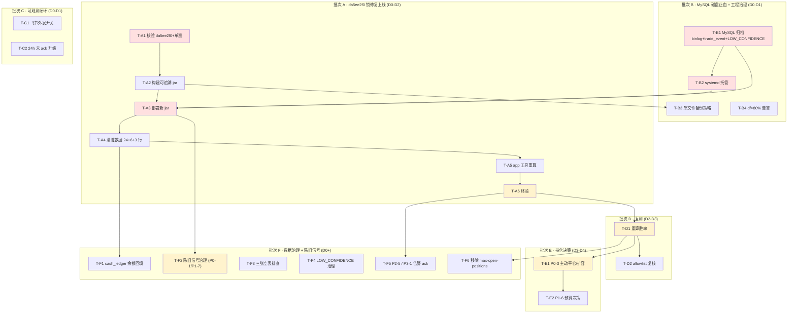

# 排查修复任务拆解 — 分批执行计划（2026-05-27）

> 状态：**待评审 / 待排期** ｜ 类型：定期巡检 · 任务拆解与分批执行计划 ｜ 作者：自动分析（scheduled task `2-1`）｜ 日期：2026-05-27
> 编制时段：2026-05-27 11:25 CST（对仓库 `CoinStrategy` 独立只读核验：HEAD = `da5ee2f0`）
> 适用技能：`troubleshooting`（先定位后修复、最小改动）+ `doc-writing`（文档结构、命名）+ `git-commit-convention`（修复落地规范）
> 上游文档：
> - [问题记录事项-待解决-2026-05-27.md](问题记录事项-待解决-2026-05-27.md)（`1-job` 巡检：17 条待解决问题）
> - [问题排查修复方案-2026-05-27.md](问题排查修复方案-2026-05-27.md)（`2-1` 分析层：逐问题根因 + 修复方案 + 脏数据 SQL + MySQL 归档 SQL）
> - [排查修复任务拆解-分批执行计划-2026-05-26.md](排查修复任务拆解-分批执行计划-2026-05-26.md)（上版任务拆解，本文承接其方法）

> 说明：本文是 scheduled task `2-1` 在 2026-05-27 的运行产出。`2-1` 早先一轮已产出《问题排查修复方案-2026-05-27》（分析层，逐问题给出根因与修复方案）；本文承接该分析，**把修复进一步「拆分任务细节、分批执行」**——将 17 个待解决问题（部分合并）的修复落成 **22 张可独立排期、可独立验收的执行任务卡**，给出按天排期、依赖 DAG、每批退出标准与复测验收清单。本文**只产出执行计划，不对线上代码 / 服务器 / 数据库做任何写操作**；所有代码锚点经本次对仓库 `CoinStrategy` 的**独立只读核验**确认（核验记录见第九节）。

---

## 一、执行摘要（结论先行）

`1-job` 巡检定位「4h 零开仓 + 磁盘 91% + 陈旧信号 79% + 25 次锁等待 + 真实胜率 39.5%」5 大问题；`2-1` 分析层给出了「这 17 个问题各自怎么修」。本文回答最后一个问题：**这些修复具体怎么排期、谁先谁后、每步做完算什么标准、复测怎么验收。**

**三条最重要的结论：**

1. **本期关键路径是「先 MySQL 磁盘止血 → 再 systemd 托管 → 再部署 `da5ee2f0` 锁修复 → 清存量 → 终验 → 24h 观察 → 再决策陈旧信号 / 持仓」，约 4–5 个工作日。** 关键变化：(a) commit `da5ee2f0`（今日 10:41 CST）已把 `LeaderTradeOutcomeRebuildService` 的 `@Transactional` 拆掉、`SmartWalletLeaderTradeOutcomeMapper.upsert` 改 ON DUPLICATE KEY UPDATE，**修复 P1-8 的 25 次 `Lock wait timeout` 已经就绪、未部署**；(b) commit `d4302c90`（今日 00:48）已在 00:49 jar 中，`settlementTerminalCheck` 三条早结算路径已加 `marketEnded` 硬闸 + `resolvePosition` 加 `[SETTLEMENT_GATE_ENDAT]`——**P2-2 代码已闭环，本期仅清存量**。

2. **磁盘根因从「应用日志/历史 jar」迁移到「MySQL 数据膨胀」，B 批从「rm + logback」变为「SQL 归档 + binlog 清理 + OPTIMIZE」。** 巡检 root 91% / 剩 5.4G，`/var/lib/mysql` 42G 是单点根因（`leader_trade_outcome` 131,269 行 / `LOW_CONFIDENCE` 67,391 行 + `trade_event` 高频写入 + `binlog` 无保留策略）。本期 B 批 T-B1 三步组合可一次性回收 ≥ 15G，把根分区从 91% 拉回 ≤ 75%。

3. **依赖纪律延续上版，新增「观察 24h 区分根因」：先治本再决策，先部署再清数据。** 四条硬约束：(a) **T-B1 MySQL 归档 → T-B2 systemd 托管 → T-A3 部署 `da5ee2f0`** 按序串行；(b) **T-A4 清脏数据必须排在 T-A3 之后**——确保 `d4302c90` 与 `da5ee2f0` 都在线，旧 jar 残留路径不再产新脏数据；(c) **F 批 T-F2 陈旧信号治理必须排在 T-A3 部署后 24h**——区分根因是「锁阻塞 → 信号延迟过期」还是「源端信号真陈旧」；(d) **E 批 P0-3 持仓决策（主动平仓 / 扩容）必须排在 D 批可信胜率重算之后**——39.5% 真实胜率下决策需有可信数据为基。

### 批次与任务总览

| 批次 | 主题 | 排期窗口 | 任务卡 | 关键路径 |
|---|---|---|---|---|
| B | MySQL 磁盘止血 + 工程治理 | D0 – D1 | T-B1 ~ T-B4（4） | 部分（T-B1 / T-B2 是 A 批部署前置） |
| A | 治本 · `da5ee2f0` 锁修复 + 存量清理 | D0 – D2 | T-A1 ~ T-A6（6） | ✅ 是（串行） |
| C | 可观测闭环 | D0 – D1 | T-C1 ~ T-C2（2） | ❌ 否（可并行） |
| D | 复测与胜率重评 | D2 – D3 | T-D1 ~ T-D2（2） | ✅ 是 |
| E | 持仓决策（主动平仓 / 扩容） | D3 – D4 | T-E1 ~ T-E2（2） | ✅ 是 |
| F | 数据治理 + 陈旧信号 + 可观测补全 | D0+ ~ D4+ | T-F1 ~ T-F6（6） | F2 关键路径（T-A3+24h），其余可并行 |

> 工时口径：S ≈ 半天内；M ≈ 0.5–1 人日；L ≈ 1–3 人日（均含测试）。排期 `D0` = 修复启动日，`D1/D2…` 为其后第 N 个工作日。严重度沿用 `1-job` 口径（P0 安全/资金/可用性，P1 策略核心目标，P2 数据治理，P3 可观测性）。

### 较上一版（2026-05-26 任务拆解）的进展

| 上版任务 | 对应 commit | 本期状态 |
|---|---|---|
| T-A1 ~ T-A2 核验 + 构建（结算入口收口） | `eee931e5` `SettlementTimeGuard` 收口 5 处 | ✅ 已合入并部署 |
| T-A3 部署 | — | ✅ 已部署 05-27 00:49 jar（含 `eee931e5` + `d4302c90`） |
| T-A4 清脏数据 | — | ⚠️ 上版未执行；本期重做（24 + 6 + 3 行） |
| T-A5 app 工具重算 | — | ⚠️ 上版未执行；本期重做 |
| T-A6 终验 | — | ⚠️ 上版未执行；本期重做 |
| T-B1 清磁盘（rm + log）| — | ✅ `backend/app.jar.bak*` 已清，`logs/` 按天滚动；根因移至 MySQL，本期 B 批改 SQL 归档 |
| T-B2 systemd 托管 | `scripts/install-smart-wallet-linux-service.sh` 就绪 | ⚠️ 上版未执行；连续 4 版未处理 |
| T-C1 飞书外发 | `e4f4567b` | ⚠️ 代码就绪，配置开关 `feishu-sink-enabled=true` 未开 |
| T-C2 24h 未 ack 升级 | — | ⚠️ 上版未实现；本期沿用 |
| T-D1 重算胜率 | — | ⚠️ 沿用；本期依赖 P2-2 存量清理 |
| T-D2 allowlist 复核 | — | ⚠️ 沿用；ACTIVE 反弹 19 → 20 |
| T-E1 / T-E2 持仓决策 | — | ⚠️ 沿用；本期细化为「主动平仓 vs 扩容」二选一 |
| T-F1 cash_ledger 回填 | `1ed101bc` 已接 `runningBalance` | ⚠️ 代码已在 jar，本期仅历史回填 2,585 行 |
| T-F2 摄取时延治理 | — | ⚠️ 升级为「等 P1-8 部署 24h 后再处理」 |
| T-F3 三张空表 | — | ⚠️ 连续 4 版未处理；本期沿用 |
| T-F4 LOW_CONFIDENCE | — | ⚠️ 升级为「与 P0-5 归档合并执行」 |
| **本期新增** P1-8 锁修复 | `da5ee2f0`（拆 `@Transactional` + ON DUPLICATE） | ⚠️ 已合入未部署 → A 批核心 |
| **本期新增** P0-5 MySQL 归档 | — | ⚠️ 全新 B 批 T-B1（binlog + trade_event + LOW_CONFIDENCE） |
| **本期新增** P0-3 持仓口径纠正 | `SmartWalletSignalRiskService.java:373-374` | ⚠️ 代码已硬移除 `G4_MAX_OPEN_POSITIONS`；需同步移除 `max-open-positions` 配置遗留（T-F6） |

> **总结**：上一版「批次 A 治本代码」已全部落地部署（`eee931e5` + `d4302c90`）；本期未闭环的是 (a) **把 `da5ee2f0` 锁修复构建部署上线**，(b) **MySQL 磁盘三步归档**，(c) **打开飞书外发配置开关**，(d) **清 P2-2 存量 + app 工具重算**，(e) **巡检新增的 P0-4 / P0-5 / P1-8**，(f) **`max-open-positions` 配置遗留需移除**。

---

## 二、批次总览与时间线

```
D0 ───────── D1 ───────── D2 ───────── D3 ───────── D4 ──────►
│ 批次B MySQL 磁盘止血 + 工程治理（部分关键路径前置）              │
│ ■ T-B1 MySQL 归档(M) ■ T-B2 systemd(S) ← A批部署前置           │
│         ■ T-B3 单文件备份(S)                                   │
│                ■ T-B4 df>80% 告警(S)                           │
│ 批次A 治本·da5ee2f0 锁修复上线（串行·关键路径）                  │
│         ■ T-A1 核验单测(S)                                     │
│                ■ T-A2 构建可追溯jar(S)                         │
│                       ■ T-A3 部署(S) ■ T-A4 清脏数据(M)        │
│                                  ■ T-A5 app工具重算(M)         │
│                                          ■ T-A6 终验(S)        │
│ 批次C 可观测闭环（可并行）        │
│ ■ T-C1 飞书外发开关(S)                                          │
│ ■ T-C2 24h 未 ack 升级(S)                                       │
│                                                  │ 批次D 复测  │
│                                                  │ ■ T-D1 重算 │
│                                                  │ ■ T-D2 allow│
│                                                          │ E 决策│
│                                                          │ E1 平仓│
│                                                          │ E2 配置│
D0 ═══════ 批次F 数据治理 + 陈旧信号 + 可观测补全（与 A/B/C 并行）═══►
   ■ T-F1 cash_ledger 回填  ■ T-F2 陈旧信号治理(★T-A3+24h)
   ■ T-F3 三张空表排查      ■ T-F4 LOW_CONFIDENCE 治理
   ■ T-F5 P2-5/P3-1 告警 ack ■ T-F6 移除 max-open-positions 配置
```

关键路径（`da5ee2f0` 锁修复上线的最短链）：**T-B1 → T-B2 → T-A1 → T-A2 → T-A3 → T-A4 → T-A5 → T-A6 → T-D1 → T-E1**。任何一环延期即整体顺延。陈旧信号治理 T-F2 关键路径节点在 **T-A3 + 24h**。

---

## 三、依赖关系图



---

## 四、任务卡（逐批）

每张任务卡含：承接编号 · 批次/排期 · 类型/工时 · 前置 · 范围与执行步骤 · 验收标准 · 验证方法 · 回滚。代码锚点均经第九节核验。

### 批次 B — MySQL 磁盘止血 + 工程治理（A 批部署前置）

> 退出标准见第五节。B 批让「MySQL 磁盘回到安全水位、服务自愈、备份可追溯、超阈告警」。其中 T-B1 / T-B2 须早于 A 批部署（T-A3）。

#### T-B1 · MySQL 磁盘三步归档 ★关键路径起点（最紧迫）

| 字段 | 内容 |
|---|---|
| 承接 | P0-5 / P2-4 |
| 批次 / 排期 | B / D0 |
| 类型 / 工时 | 运维 + DB / **M** |
| 前置 | 无 |

- **范围**：根分区 91% / 剩 5.4G、`/var/lib/mysql` 42G 是单点根因。三步组合预期回收 ≥ 15G、根分区拉回 ≤ 75%。
- **执行步骤**（必须在 test 库 + 低峰窗口；每步先 `SHOW` / `SELECT` 预估）：
  1. **binlog 清理**（详见修复方案 §4.3 步骤 1）：
     - `SHOW MASTER LOGS` 看清单。
     - `PURGE BINARY LOGS BEFORE NOW() - INTERVAL 7 DAY` 一次性清 7 天前。
     - my.cnf 加 `expire_logs_days = 7`；`SET GLOBAL binlog_expire_logs_seconds = 7*24*3600` 运行期同步。
  2. **`trade_event` 30 天前归档**（详见修复方案 §4.3 步骤 2）：
     - `COUNT(*)` 预估行数 + 表 size。
     - `CREATE TABLE _archive_20260527 LIKE` + `INSERT INTO ... SELECT` 归档。
     - `DELETE ... LIMIT 5000` 分批删除（每批 1–3s，循环至完）。
     - `OPTIMIZE TABLE smart_wallet_trade_event` 回收磁盘（低峰执行，会锁表数分钟）。
  3. **`leader_trade_outcome` LOW_CONFIDENCE 归档**（详见修复方案 §4.3 步骤 3）：
     - 同上步骤；预期清 67,391 行。
  4. **复查**：`df -h /` 应回到 ≤ 75%；`du -sh /var/lib/mysql` 应 ≤ 25G。
- **验收标准**：`df -h /` 用量 ≤ 75%（从 91% 回落 ≥ 16 个百分点）；`/var/lib/mysql` ≤ 25G；`expire_logs_days=7` 生效（重启 MySQL 后 `SHOW VARIABLES LIKE 'binlog_expire_logs_seconds'` 应非 0）。
- **验证方法**：`df -h /` + `du -sh /var/lib/mysql` + `SHOW BINARY LOGS`。
- **回滚**：归档表保留 30 天作为兜底；如确认数据无需可 `DROP`；如发现归档误删，从备份表 `INSERT INTO` 主表恢复。
- **注意**：`OPTIMIZE TABLE` 会锁表 1–10 分钟（取决于表大小），必须在开单低峰执行；可考虑用 `pt-online-schema-change` 平替。`DELETE ... LIMIT 5000` 单批操作切勿一次 `DELETE` 全量否则会撑爆 binlog。

#### T-B2 · systemd 托管 job 服务 ★（A 批部署前置）

| 字段 | 内容 |
|---|---|
| 承接 | P0-2 |
| 批次 / 排期 | B / D0–D1 |
| 类型 / 工时 | 运维 / **S** |
| 前置 | T-B1（磁盘回到安全水位再切换托管） |

- **范围**：把裸 `nohup java -jar` 改为 systemd 托管，崩溃自愈。仓库材料已就绪：`deploy/linux/systemd/smart-wallet-backend.service.template` 含 `Restart=always` / `RestartSec=5` / `LimitNOFILE=65535` + 安全加固块；`scripts/install-smart-wallet-linux-service.sh` 已就绪。
- **执行步骤**：
  1. 在 `49.51.250.174` 以 root 执行 `SMART_WALLET_INSTALL_NGINX=false bash scripts/install-smart-wallet-linux-service.sh`。
  2. 停巡检时的裸进程（巡检 PID 1798893；以 `ps -ef | grep app.jar` 复查为准），`systemctl start smart-wallet-backend && systemctl enable smart-wallet-backend`。
  3. 模板 `RestartSec` 由 5 调到 10。
- **验收标准**：`systemctl status smart-wallet-backend` 为 `active (running)`；`systemctl is-enabled` 为 `enabled`；模拟 `kill` 进程后 systemd ≤ 30s 自动拉起。
- **验证方法**：`kill <PID>` 后 `systemctl status`。
- **回滚**：`systemctl disable --now smart-wallet-backend`，回退裸启动。
- **注意**：切换瞬间有秒级停服，与 T-A3 合并到同一低峰窗口最省事。**连续 4 版未处理，本期必须做。**

#### T-B3 · 可追溯部署 + 单文件备份策略

| 字段 | 内容 |
|---|---|
| 承接 | P1-5 ｜ 批次/排期 B / D1 ｜ 类型/工时 工程治理 / **S** ｜ 前置 T-A2 |

- **范围**：`8f9264cc` 已让 jar `MANIFEST` 注入 commit；本任务把「服务器记录运行 commit + 单文件备份命名规范」落地。
- **执行步骤**：
  1. T-A3 部署前，把现有 `app.jar` 备份为 `app.jar.bak.20260527-HHMM`（HHMM = 当时本机时分）。
  2. 部署后在 `/opt/coinstrategy/smart-wallet/deploy.log` 写一行：`<时间> <commit> <jar sha256> <操作人>`。
  3. 后续部署规范：最多保留 5 份 `app.jar.bak.YYYYMMDD-HHMM`，超过自动删最早。
  4. 清 `._app.jar` macOS 元数据。
- **验收标准**：`/opt/coinstrategy/smart-wallet/deploy.log` 至少一行；`backend/` 目录最多 1 份 `app.jar.bak.*` + 当前 `app.jar`，无 `._*` 文件。
- **验证方法**：SSH `ls -la backend/`；`cat deploy.log`；`unzip -p app.jar META-INF/MANIFEST.MF | grep -i commit` 应返回 commit。
- **回滚**：无（治理动作）。

#### T-B4 · 磁盘 / 告警监控（df>80% 飞书提醒）

| 字段 | 内容 |
|---|---|
| 承接 | P0-5 ｜ 批次/排期 B / D1 ｜ 类型/工时 运维 / **S** ｜ 前置 T-C1 |

- **范围**：服务器侧 cron 每 6 小时跑一次 `df -h /`，>80% 即通过飞书 webhook 发告警。
- **执行步骤**：
  1. 在 `49.51.250.174` 写 `/etc/cron.d/df-watch` 每 6 小时跑一次 `df -h /` 解析使用率；>80% 调飞书 webhook。
  2. 或：在 `coin-strategy-job` 内加一个 `@Scheduled` 1h 跑一次的 `DiskUsageMonitorJob`，复用 `auditAlertSink.publish(AlertType.HEALTH_DISK_HIGH, ...)`（与 `TradeEventIngestLagJob` 同模式）。
- **验收标准**：用 `dd` 制造一个 5GB 临时文件触发 >80%，飞书收到告警；删除文件后下一轮告警自动 resolved（沿用 `1ed101bc` 的 `autoResolveByStrategy` 模式扩展）。
- **回滚**：移除 cron 或回退该 `@Scheduled` 类。

### 批次 A — 治本 · `da5ee2f0` 锁修复上线（前置 B 批已完成）

> 退出标准见第五节。A 批本质是「让已写好但没上线的 `da5ee2f0` 锁修复真正生效」+「清掉 `d4302c90` 上线前产的存量脏数据」。**全批串行，是关键路径。**

#### T-A1 · 核验 `da5ee2f0` 与单测 ★关键路径起点

| 字段 | 内容 |
|---|---|
| 承接 | P1-8 / P0-4 |
| 批次 / 排期 | A / D0 |
| 类型 / 工时 | 代码核验 + 测试 / **S** |
| 前置 | 无 |

- **范围**：本期 commit `da5ee2f0`（2026-05-27 10:41 CST）已把 `LeaderTradeOutcomeRebuildService` 的 `@Transactional` 拆掉、`SmartWalletLeaderTradeOutcomeMapper.upsert` 改 ON DUPLICATE。本任务核验完整性、跑通单测。
- **执行步骤**：
  1. 核验 `coin-strategy-job/src/main/java/com/metaverse/coin/strategy/job/smartwallet/service/LeaderTradeOutcomeRebuildService.java`：
     - `@Transactional` 已删除（method `rebuild` 上无注解）。
     - 单 outcome 处 `try { ... upsert ... } catch (PessimisticLockingFailureException ...) catch (Exception ...)` 已加。
  2. 核验 `coin-strategy-common/common-dao/src/main/java/com/metaverse/coin/strategy/common/dao/mapper/SmartWalletLeaderTradeOutcomeMapper.java`：
     - 新增 `int upsert(SmartWalletLeaderTradeOutcomeEntity entity)` 方法；
     - 对应 XML（`SmartWalletLeaderTradeOutcomeMapper.xml`）含 `INSERT ... ON DUPLICATE KEY UPDATE ...`，依赖唯一索引 `uk_sw_leader_outcome_wallet_market_outcome`。
  3. 跑 `mvn -pl coin-strategy-job -am test -Dtest=LeaderTradeOutcomeRebuildServiceTest` —— 应全绿。
  4. 同时跑 `SmartWalletAccountingServiceTest`、`SmartWalletSettlementGateTest`、`SettlementTimeGuardTest` 全量回归（确认 `d4302c90` / `eee931e5` 未回归）。
- **验收标准**：单测全绿；mapper 与 service 改动均到位；无回归。
- **验证方法**：`mvn ... test`；`grep -n "@Transactional" coin-strategy-job/src/main/java/com/metaverse/coin/strategy/job/smartwallet/service/LeaderTradeOutcomeRebuildService.java`（应无命中）。
- **回滚**：纯核验，无副作用。

#### T-A2 · 构建可追溯 jar（含 `da5ee2f0`）★关键路径

| 字段 | 内容 |
|---|---|
| 承接 | P1-8 / P1-5 |
| 批次 / 排期 | A / D0–D1 |
| 类型 / 工时 | 构建 / **S** |
| 前置 | T-A1 |

- **范围**：当前运行 jar 构建于 05-27 00:49，早于 `da5ee2f0`（10:41），**不含锁修复**——这是 25 次 `Lock wait timeout` 未根除的真因。须从 `da5ee2f0`（或更新 HEAD）重新构建。
- **执行步骤**：
  1. 确认干净工作区（`git status --short` 仅余 `.DS_Store`），`git rev-parse HEAD` 记录 commit（核验时为 `da5ee2f032da542e1e4fa2d15cbf9ce5edc13ff4`）。
  2. `mvn -pl coin-strategy-job -am clean package`；由 `8f9264cc` 让 jar `MANIFEST` 注入构建 commit + 时间，构建后核对。
  3. 写入部署记录：`commit ↔ jar sha256 ↔ 构建时间`。
- **验收标准**：产出 jar，`MANIFEST` 的构建 commit = 构建时 HEAD（应包含 `da5ee2f0`）；存在一条可追溯记录。
- **验证方法**：`unzip -p app.jar META-INF/MANIFEST.MF | grep -iE 'commit|build'`。
- **回滚**：保留上一个可用 jar 备份（在 T-B3 完成的备份策略中）。

#### T-A3 · 低峰窗口部署新 jar（通过 systemd）★关键路径

| 字段 | 内容 |
|---|---|
| 承接 | P1-8 / P0-4 |
| 批次 / 排期 | A / D1 |
| 类型 / 工时 | 运维 / **S** |
| 前置 | T-A2、**T-B1**（磁盘已归档）、**T-B2**（systemd 托管已就绪） |

- **范围**：把含锁修复的新 jar 部署到 `49.51.250.174`。
- **执行步骤**：
  1. 选开单低峰窗口（建议 02:00–06:00 CST）；`cp /opt/coinstrategy/smart-wallet/backend/app.jar /opt/coinstrategy/smart-wallet/backend/app.jar.bak.20260527-HHMM`。
  2. 经 systemd：`systemctl stop smart-wallet-backend` → `scp` 新 jar 替换 → `systemctl start smart-wallet-backend`。
  3. 部署后立即核对运行进程 + jar `MANIFEST` commit = T-A2 构建 commit；确认 `-Dspring.profiles.active=test`；确认 8081 端口 listen。
  4. `tail -200 /opt/coinstrategy/smart-wallet/logs/job-current.log` 看启动是否干净（无 `BeanCreationException` / 端口冲突 / mybatis 报错）。
  5. **6h 内重点观察**：`grep -c "Lock wait timeout" job-current.log` 应明显衰减（接近 0）；`grep -c "Lock contention skipping outcome" job-current.log` 是新增 WARN（预期 < 25/6h，单 outcome 失败被吞，不阻塞主链路）。
- **验收标准**：运行 jar 的 `MANIFEST` commit = T-A2 构建 commit；`systemctl status` 为 `active (running)`；6h 内 `Lock wait timeout` 增量 ≤ 2 次（容忍极端 burst）。
- **验证方法**：SSH 读运行 jar `MANIFEST`；`curl http://localhost:8081/actuator/health`；`grep -c "Lock wait timeout" job-current.log`。
- **回滚**：`systemctl stop` → `cp app.jar.bak.20260527-HHMM app.jar` → `systemctl start`。
- **注意**：部署有秒级停服，选开单低峰执行。

#### T-A4 · 部署后清理历史脏数据 ★关键路径

| 字段 | 内容 |
|---|---|
| 承接 | P2-2 / P2-1 |
| 批次 / 排期 | A / D1–D2 |
| 类型 / 工时 | 数据 / **M** |
| 前置 | **T-A3（必须先部署 `da5ee2f0`）** |

- **范围**：清理修复方案第七节的脏数据：`trade_order` 24 笔 `settled_at<opened_at` + 6 笔 `settled_at>NOW()`；`daily_report` 3 行未来日期（05-29 / 05-31 / 06-30）；`cash_ledger.balance_after` 2,585 行 NULL（历史回填）。数量随实时变化，以执行时 `SELECT` 为准。
- **执行步骤**：严格按修复方案第七节 7.1 / 7.2 / 7.3 / 7.4 SQL —— **每步先 `SELECT` 预览 → `CREATE TABLE ..._bak_20260527` 备份 → 再 `UPDATE` / `DELETE`**；校正口径统一为该行 `updated_at`（真实结算处理时刻）。在 **test 库**执行。
- **验收标准**：
  - `SELECT COUNT(*) FROM smart_wallet_trade_order WHERE settled_at < opened_at` = 0。
  - `SELECT COUNT(*) FROM smart_wallet_trade_order WHERE settled_at > NOW()` = 0。
  - `SELECT COUNT(*) FROM smart_wallet_daily_report WHERE report_date > CURDATE()` = 0。
  - `SELECT COUNT(*) FROM smart_wallet_cash_ledger WHERE balance_after IS NULL` = 0（T-F1 子任务）。
- **验证方法**：重跑修复方案第七节各「④ 校验」SQL。
- **回滚**：从 `_bak_20260527` 备份表恢复。
- **注意**：**严禁在 T-A3 之前执行**——`da5ee2f0` 未部署时锁等待会让 SQL 长时间排队；磁盘紧张（T-B1 未做）会让 `CREATE TABLE ... bak_20260527` 失败。

#### T-A5 · 触发 app 工具重算结算与日报

| 字段 | 内容 |
|---|---|
| 承接 | ROI 虚高 / P2-2 |
| 批次 / 排期 | A / D2 |
| 类型 / 工时 | 运维 + 验证 / **M** |
| 前置 | T-A3、T-A4 |

- **范围**：用 app 内置 `repairPrematureResolvedPaperPositions()`（`SmartWalletAccountingService:1789`）逐仓位重新核对市场是否真 `resolved`，按 fill 链重算并回滚账本——这是区分「真实低价赢单」与「幻影结算」的唯一正确途径。裸 SQL 改 `roi_rate` 会造成持仓 / 账本 / 派生表三者不一致。
- **执行步骤**：按修复方案第七节 7.5 ——
  1. `POST /strategy/api/smart-wallet/accounting/repair-premature-settlements?limit=500&refreshCache=true` → 取 `triggerId`。
  2. `GET /strategy/api/smart-wallet/accounting/repair-premature-settlements/{triggerId}` 查执行结果（处理仓位数、修复仓位数、ROI 修订量）。
  3. `POST /strategy/api/smart-wallet/trade-orders/backfill` 重建派生表 `trade_order` 与受影响日期 `rebuildDailyReport`。
- **验收标准**：
  - `SELECT COUNT(*) FROM smart_wallet_trade_order WHERE settlement_price >= 0.999 AND roi_rate >= 1.0 AND status IN ('SETTLED','EXITED')` 仅剩「真实低价赢单」。
  - 当日 `daily_report.net_pnl` 与 `SUM(trade_order.total_pnl_usdc) GROUP BY DATE(settled_at)` 对齐到剔除幻影后的口径。
- **验证方法**：7.5 终验 SQL + `daily_report` 交叉核对。
- **回滚**：app 工具自带账本回滚；必要时从 T-A4 备份恢复。

#### T-A6 · 终验

| 字段 | 内容 |
|---|---|
| 承接 | P1-8 / P2-2 / ROI 虚高 验证 |
| 批次 / 排期 | A / D2 |
| 类型 / 工时 | 验证 / **S** |
| 前置 | T-A4、T-A5 |

- **范围**：确认部署后**不再产生新脏数据**（区别于 T-A4 的「清存量」）+ **锁修复持续有效**。
- **执行步骤**：部署后观察 ≥ 6–12h，按窗口复跑脏数据计数 SQL，确认增量为 0；抽查新结算订单 `settled_at ∈ [opened_at, NOW()]`；扫描 `job-current.log` 中 `[SETTLEMENT_GATE_ENDAT]` / `Lock wait timeout` / `Lock contention skipping outcome` 频率与 context 分布。
- **验收标准**：
  - 观察窗口内 `settled_at<opened_at` / `settled_at>NOW()` 计数零增长。
  - `Lock wait timeout` 出现 ≤ 2 次 / 6h（容忍极端 burst）。
  - `Lock contention skipping outcome` WARN ≤ 50 次 / 6h（吞掉单 outcome 失败属预期行为）。
  - `[SETTLEMENT_GATE_ENDAT]` ERROR / `early_settlement_blocked_market_not_ended` < 10 次 / h（属于防御性日志，少量出现预期）。
- **验证方法**：每 2 小时跑一次校验 SQL；`grep -cE "Lock wait timeout|Lock contention skipping outcome|\[SETTLEMENT_GATE_ENDAT\]|early_settlement_blocked_market_not_ended" job-current.log`。
- **回滚**：若仍产脏数据，回 T-A1 排查 `da5ee2f0` 完整性 / 上游异常时间戳来源；若锁等待回升，复查 `LeaderTradeOutcomeRebuildService` 实际运行类是否为新版本。

### 批次 C — 可观测闭环（可与 A/B 并行）

> 退出标准见第五节。C 批让「告警检测到 + 落库 + 自动 resolved」进一步「通知到人 + 超时升级」。

#### T-C1 · 开启飞书告警外发

| 字段 | 内容 |
|---|---|
| 承接 | P1-3 ｜ 批次/排期 C / D0–D1 ｜ 类型/工时 配置 / **S** ｜ 前置 无 |

- **范围**：核验确认外发能力**已存在**——`FeishuStrategyAuditAlertSink` 依赖 `smart-wallet.audit.feishu-sink-enabled=true` + `feishu-webhook-url` 非空 + severity 在 `feishu-allowed-severities`（默认 `WARN,CRITICAL`）+ dedupe 窗口。未外发的真因是**配置未开**（默认 `false`）。
- **执行步骤**：
  1. test profile 配 `smart-wallet.audit.feishu-sink-enabled=true` + 有效 `feishu-webhook-url`（webhook 凭据走 env，不进 git；或用 `feishu-webhook-secret`）。
  2. 确认 `feishu-allowed-severities` 含 WARN / CRITICAL（默认即如此）。
  3. 在 job 机实测出网可达飞书 webhook（`curl <webhook_url>`）。
  4. 触发一条 WARN（mock `HEALTH_NO_OPEN_4H`），确认飞书群收到卡片消息。
- **验收标准**：mock 一条 WARN / CRITICAL 告警，飞书群 ≤ 30s 内收到卡片消息；同一 alertType 在 `feishu-dedupe-interval-ms`（默认 5 分钟）内不重复发送。
- **验证方法**：触发测试告警 + 飞书群查收。
- **回滚**：`feishu-sink-enabled=false`。
- **注意**：外发失败须 swallow、不阻断 `HealthMonitor`（现有实现已 swallow）。

#### T-C2 · 24h 未 ack 自动升级

| 字段 | 内容 |
|---|---|
| 承接 | P2-5 / P3-1 ｜ 批次/排期 C / D1 ｜ 类型/工时 代码 / **S** ｜ 前置 T-C1 |

- **范围**：自动 resolved 已在 `1ed101bc` 落地；本任务补「>24h 未 ack 自动升级 / 重发飞书」逻辑，处理 id=1（`AUDIT_SETTLEMENT_SOURCE`，挂了 10 天）/ id=2（`AUDIT_LIVE_REPLAY_DIFF`，挂了 4 天）/ id=8（08:27 触发未 resolved）这类非自动 resolved 范围告警。
- **执行步骤**：
  1. 在 `StrategyHealthMonitorJob` 或新建 `StrategyAlertEscalationJob`：每小时扫一次 `strategy_alert WHERE acknowledged=0 AND resolved=0 AND TIMESTAMPDIFF(HOUR, alert_time, NOW()) > 24`。
  2. 命中行通过 `auditAlertSink.publish(AlertType.ALERT_ESCALATED, ...)` 重发飞书（带「<sev> [升级] <原 alertType>」前缀）。
  3. 重发后写回 `strategy_alert.escalated_at`（如无字段，加 `escalated_count` 计数）。
- **验收标准**：mock 一条 24h 前的未 ack 告警，飞书在下一轮调度收到升级提醒；同一告警 24h 内不重复升级（dedupe）。
- **回滚**：disable 该 `@Scheduled` 即可。

### 批次 D — 复测与胜率重评

> 退出标准见第五节。D 批用可信口径回答「胜率是否正常」。

#### T-D1 · 以可信口径重算胜率 ★关键路径

| 字段 | 内容 |
|---|---|
| 承接 | P1-2 / ROI 虚高 ｜ 批次/排期 D / D2–D3 ｜ 类型/工时 验证 / **S** ｜ 前置 T-A6 |

- **范围**：T-A6 终验通过后，以「真实结算价 + 真实 settled_at」口径重新计算当前版本胜率与净 PnL，作为后续 E 批决策的基线。
- **执行步骤**：
  1. SQL 重跑：
     ```sql
     SELECT
         COUNT(*) AS total,
         SUM(CASE WHEN total_pnl_usdc > 0 THEN 1 ELSE 0 END) AS wins,
         SUM(CASE WHEN total_pnl_usdc < 0 THEN 1 ELSE 0 END) AS losses,
         SUM(total_pnl_usdc) AS net_pnl,
         AVG(total_pnl_usdc) AS avg_pnl,
         AVG(roi_rate) AS avg_roi
     FROM smart_wallet_trade_order
     WHERE opened_at >= '2026-05-24 17:32:00'
       AND status IN ('SETTLED','EXITED','CLAIMED');
     ```
  2. 看 `roi_rate` 分布是否回归合理区间（`< 2.0` 占 ≥ 95%）。
  3. 与 `daily_report` 当日 `net_pnl_usdc` 对齐。
- **验收标准**：
  - 胜率口径稳定：与 `daily_report` 当日 PnL 对齐到 ±5%。
  - 不再出现 ROI > 5 的非真实低价赢单。
  - 形成一份「当前版本可信胜率」短记录，作为 T-E1 决策依据。
- **验证方法**：SQL + 抽样 10 单人工核对 `settlement_price` 是否合理。

#### T-D2 · `manual_allowlist` 复核与清理

| 字段 | 内容 |
|---|---|
| 承接 | P1-1 ｜ 批次/排期 D / D2–D3 ｜ 类型/工时 数据 + 决策 / **M** ｜ 前置 T-D1 |

- **范围**：将 20 条 ACTIVE allowlist 精简到 ≤ 10 条。
- **执行步骤**：与上版同——SQL 关联 30 天 `leader_trade_outcome`，剔除任一满足条件的钱包：胜率 < 45% / 累计 PnL < 0 / `LOW_CONFIDENCE` > 60%；改 `status='REMOVED'` + `notes` 写明原因，不 `DELETE`。
- **验收标准**：ACTIVE allowlist ≤ 10 条；24h 后 `G10_KELLY_NEGATIVE_EV` / `G1_OBSERVE_COOLDOWN` 拒单次数下降 ≥ 50%。
- **回滚**：把 `status` 改回 `ACTIVE`。

### 批次 E — 持仓决策（主动平仓 / 扩容）

> 退出标准见第五节。E 批仅在 D 批胜率可信后才动。

#### T-E1 · P0-3 持仓决策（主动平仓 vs 扩容二选一）

| 字段 | 内容 |
|---|---|
| 承接 | P0-3 ｜ 批次/排期 E / D3–D4 ｜ 类型/工时 决策 / **M** ｜ 前置 T-D1、T-D2 |

- **范围**：基于 T-D1 重算的可信胜率，决定（a）主动平仓 ROI 最低的 N 笔让出预算，（b）扩容 `max-total-open-cost-usdc`，二选一。
- **执行步骤**：
  1. 若 T-D1 重算胜率 ≥ 50%：
     - 在 `strategy_runtime_config` 把 `max-total-open-cost-usdc` 从 500 调到 625（+25%）。
     - **同步任务 T-F6**：把 `max-open-positions` 从 20 调整为 NULL 或 25（因代码已硬移除该闸，仅是配置对齐）。
  2. 若 < 50%：
     - **主动平仓** ROI 最低的 5–10 笔——**严禁**裸 SQL 改 `status`；用 app 工具 `/strategy/api/smart-wallet/accounting/repair-premature-settlements` 或专门的平仓端点（如无现成端点，跳过此步，等自然结算）。
     - 暂不扩容；记录决策原因；3–7 天后回看。
- **验收标准**：执行后 24h 观察 `G4_MAX_TOTAL_OPEN_COST` 占比下降；新增持仓的胜率不显著恶化。
- **回滚**：把 `max-total-open-cost-usdc` 改回 500（在 `strategy_runtime_config` 即时生效）。

#### T-E2 · P1-6 资金预算决策

| 字段 | 内容 |
|---|---|
| 承接 | P1-6 ｜ 批次/排期 E / D3–D4 ｜ 类型/工时 决策 / **S** ｜ 前置 T-E1 |

- **范围**：与 T-E1 同步决策。
- **执行步骤**：跟 T-E1 一起调（按 max-total-open-cost-usdc 比例放预算）；或单独：若 T-E1 不扩容，T-E2 保持 500 USDC。
- **验收标准**：资金占用回到 ≤ 80%（534.73 / 500 = 107% → 目标 ≤ 80% 即 ≤ 400 USDC）。

### 批次 F — 数据治理 + 陈旧信号 + 可观测补全（与 A/B/C 并行 / 部分依赖 T-A3）

#### T-F1 · `cash_ledger.balance_after` 余额回填

| 字段 | 内容 |
|---|---|
| 承接 | P2-1 ｜ 批次/排期 F / D1–D2 ｜ 类型/工时 数据 / **S** ｜ 前置 T-A3（部署后） |

- **范围**：`appendCashLedger()` 在 `1ed101bc` 已接 `runningBalance()`——新写入自愈率本期已升至 ~95%；历史 2,585 行需窗口函数一次性回填。
- **执行步骤**：见修复方案 §7.4——
  1. **核实新写入**：抽样新行 NULL 占比应 < 5%。
  2. 备份 + 窗口函数 UPDATE。
  3. 校验：`SELECT COUNT(*) FROM smart_wallet_cash_ledger WHERE balance_after IS NULL` = 0。
- **回滚**：从 `_bak_20260527` 恢复。

#### T-F2 · 陈旧信号治理（P0-1 / P1-7）★关键路径

| 字段 | 内容 |
|---|---|
| 承接 | P0-1 / P1-7 ｜ 批次/排期 F / D2–D4 ｜ 类型/工时 代码 + 配置 / **M** ｜ 前置 **T-A3 + 24h** |

- **范围**：P1-8 锁修复部署后 24h，区分根因是「锁阻塞 → 信号过期」还是「源端信号真陈旧」，按结果对症治理。
- **执行步骤**：
  1. **观察 24h**：`SELECT firstRejectGate, COUNT(*) FROM ... GROUP BY firstRejectGate` 在 T-A3 后 24h 与 24h 前对比；如 `G5_SIGNAL_STALE*` 占比从 79% 回落到 ≤ 40% → 根因主要是锁阻塞，无需进一步治理，本任务收尾。
  2. **若占比仍 ≥ 50%**：
     - 核对 `strategy_runtime_config` 中 `%signal-age%` 配置，看 archetype 覆盖是否过严。
     - 缩短 HOT 钱包同步 `@Scheduled` 间隔（候选位置：`SmartWalletEventSyncJob` 或类似），由当前 30s 降到 15s；评估 Polymarket 端限流。
     - 试启用 `smart-wallet.signal-risk.paper-canary-max-signal-age-seconds = 7200`（2 × 3600），观察 paper canary lane 转化率。
- **验收标准**：观察 ≥ 24h，4h 摄取 P90 < 600s；`G5_SIGNAL_STALE*` 拒单占比 ≤ 40%；`HEALTH_INGEST_LAG_HIGH` 不再触发或自动 resolved。
- **回滚**：配置回滚至原值；轮询间隔回退；二级口径 disable。

#### T-F3 · 三张空表排查（P2-3，连续 4 版未处理）

| 字段 | 内容 |
|---|---|
| 承接 | P2-3 ｜ 批次/排期 F / D2 ｜ 类型/工时 排查 + 代码 / **S→M** ｜ 前置 无 |

- **范围**：`strategy_run_log` / `strategy_health_snapshot` / `smart_wallet_market_snapshot` 三表 0 行。
- **执行步骤**：
  1. `grep -rn "strategyRunLogMapper\|HealthSnapshot\|marketSnapshot" coin-strategy-job/src/main/java/` 找写入点。
  2. 看 `@Scheduled` 是否被 `@ConditionalOnProperty` 关；看 `try/catch` 是否吞异常。
  3. 若功能废弃：从《巡检口径》移除三表的 0 行检查；若保留：启用配置 + 加「写入异常告警」。
- **验收标准**：三表行数 > 0，或巡检不再报这条「0 行」。

#### T-F4 · `leader_trade_outcome` `LOW_CONFIDENCE` 治理（P2-4，与 P0-5 联动）

| 字段 | 内容 |
|---|---|
| 承接 | P2-4 ｜ 批次/排期 F / D2–D3 ｜ 类型/工时 数据 + 代码 / **M** ｜ 前置 T-B1（归档已完成） |

- **范围**：`leader_trade_outcome` 131,269 行，`LOW_CONFIDENCE` 67,391（51.3%）。归档已在 T-B1 完成；本任务做「质量提升」。
- **执行步骤**：
  1. 抽样 50 行 `LOW_CONFIDENCE`，看缺哪些字段（`settled_at` / `fill_price` / `endAt`）。
  2. 评估能否从 `smart_wallet_trade_event` 补齐缺失字段。
  3. 调整判定口径或回填逻辑；与 P1-1 互为因果——`LOW_CONFIDENCE` 比例下降后 allowlist 质量判定也会更稳。
- **验收标准**：`LOW_CONFIDENCE` 占比 < 30%。
- **依赖**：T-D2 (`allowlist`) 复核 leader 时会受 `low_confidence_ratio` 影响，所以 T-F4 早做对 T-D2 更精准——但不阻塞 T-D2。

#### T-F5 · P2-5 / P3-1 历史告警 ack（4 条）

| 字段 | 内容 |
|---|---|
| 承接 | P2-5 / P3-1 ｜ 批次/排期 F / D3 ｜ 类型/工时 数据 + 人工核对 / **S** ｜ 前置 T-A6、T-C2 |

- **范围**：id=1（`AUDIT_SETTLEMENT_SOURCE`，05-17）+ id=2（`AUDIT_LIVE_REPLAY_DIFF`，05-23）+ id=6（`HEALTH_INGEST_LAG_HIGH`）+ id=8（`HEALTH_NO_OPEN_4H`） 共 4 条 `ack=0`。
- **执行步骤**：
  1. **id=1**：在 T-A6 终验后，重跑 `AUDIT_SETTLEMENT_SOURCE` 审计——若 `delayed` ≤ 100 即 `acknowledged=1 / resolved=1`；否则进一步排查。
  2. **id=2**：在 ROI 虚高修复后，重跑 `AUDIT_LIVE_REPLAY_DIFF` 比对——`pnlDiffBps` 应从 10,000 回到 ≤ 100；若不达预期，排查 live vs replay 差异源。
  3. **id=6**：等 T-F2 治理后由 `autoResolveByStrategy` 关闭；若 24h 后仍未关，手动 `ack=1`。
  4. **id=8**：等 T-A3 + 开单恢复后由 `autoResolveByStrategy` 关闭；若 12h 后仍未关，手动 `ack=1` + 排查恢复路径。
- **验收标准**：4 条全部 `ack=1` 或 `resolved=1`；后续 24h 内无新增挂超 24h 未 ack 告警（依赖 T-C2 升级机制）。

#### T-F6 · 移除 `max-open-positions` 配置遗留（P0-3 口径对齐）

| 字段 | 内容 |
|---|---|
| 承接 | P0-3 ｜ 批次/排期 F / D3 ｜ 类型/工时 配置 + 文档 / **S** ｜ 前置 T-E1 |

- **范围**：源码 `SmartWalletSignalRiskService.java:373-374` 已硬移除 `G4_MAX_OPEN_POSITIONS` 拦截，`max-open-positions=20` 在代码层无实际效果；但巡检报告每天仍按字面比对「OPEN=33 > 20」误报「双超额」。
- **执行步骤**：
  1. 在 `strategy_runtime_config` 把 `smart-wallet.signal-risk.max-open-positions` 删除或设为 NULL（或对齐 T-E1 决策值）。
  2. 同步在 `1-job` 巡检脚本 / Mapper 中移除「`open_count > max-open-positions` 触发告警」逻辑（若有）。
  3. 在 `SmartWalletProperties` / `StrategyRuntimeConfigService` 标注该字段为 `@Deprecated` + 文档说明。
- **验收标准**：下一版 `1-job` 巡检不再报「OPEN 持仓 X > 上限 20」字样。
- **回滚**：在配置中恢复 20。

---

## 五、各批次退出标准

| 批次 | 退出标准 |
|---|---|
| B | (1) `df -h /` ≤ 75%；(2) `/var/lib/mysql` ≤ 25G；(3) `expire_logs_days=7` 生效；(4) `systemctl status smart-wallet-backend` = `active (running)` + `enabled`；(5) `backend/` 目录单文件备份策略生效、无 `._*` 文件；(6) df>80% 告警发飞书通。|
| A | (1) `da5ee2f0` 部署到线上，`MANIFEST` commit 可校验；(2) `settled_at < opened_at` / `> NOW()` 计数均为 0；(3) `daily_report` 无 `report_date > CURDATE()` 行；(4) 部署后 6–12h 不再产生新脏数据；(5) `Lock wait timeout` 出现 ≤ 2 次 / 6h；(6) `[SETTLEMENT_GATE_ENDAT]` / `early_settlement_blocked_market_not_ended` < 10 次 / h。|
| C | (1) 飞书外发开关开、mock 告警送达；(2) 24h 未 ack 升级机制生效；(3) id=1 / id=2 在 T-A6 / 后续核对后逐条 ack 或 resolved。|
| D | (1) T-D1 重算口径稳定、与 daily_report 对齐到 ±5%；(2) ACTIVE allowlist ≤ 10 条；(3) 24h 后 `G10_KELLY_NEGATIVE_EV` 拒单下降 ≥ 50%。|
| E | (1) 决策落地（扩容 / 主动平仓 / 不动 三选一），且决策依据写入文档；(2) 资金占用回到 ≤ 80%。|
| F | T-F1 `balance_after` NULL = 0；T-F2 摄取 P90 < 600s + G5_STALE 拒单 ≤ 40%；T-F3 三张空表有结论；T-F4 `LOW_CONFIDENCE` 占比 < 30%；T-F5 4 条告警全 ack；T-F6 巡检不再报「持仓数超 20」。|

---

## 六、复测验收清单（终验）

> 全部任务卡完成后，统一跑一遍以下复测，作为 2-1 修复结束的判据。

### 6.1 服务器侧

```bash
ssh ubuntu@49.51.250.174 'df -h /'                                  # 应 ≤ 75%
ssh ubuntu@49.51.250.174 'du -sh /var/lib/mysql'                    # 应 ≤ 25G
ssh ubuntu@49.51.250.174 'systemctl status smart-wallet-backend'    # active (running)
ssh ubuntu@49.51.250.174 'ls -la /opt/coinstrategy/smart-wallet/backend/'  # 仅 app.jar + ≤1 个 app.jar.bak.*
ssh ubuntu@49.51.250.174 'unzip -p /opt/coinstrategy/smart-wallet/backend/app.jar META-INF/MANIFEST.MF | grep -i commit'  # = da5ee2f0 (或更新)
ssh ubuntu@49.51.250.174 'cat /opt/coinstrategy/smart-wallet/deploy.log | tail -5'  # 至少一条部署记录
ssh ubuntu@49.51.250.174 'grep -c "Lock wait timeout" /opt/coinstrategy/smart-wallet/logs/job-current.log'  # 部署后 6h 内增量 ≤ 2
```

### 6.2 数据库侧

```sql
-- ① 结算时间合法性
SELECT COUNT(*) FROM smart_wallet_trade_order WHERE settled_at < opened_at;   -- 0
SELECT COUNT(*) FROM smart_wallet_trade_order WHERE settled_at > NOW();       -- 0
SELECT COUNT(*) FROM smart_wallet_position WHERE (closed_at < opened_at OR closed_at > NOW()) AND closed_at IS NOT NULL;  -- 0
SELECT COUNT(*) FROM smart_wallet_daily_report WHERE report_date > CURDATE(); -- 0

-- ② 余额回填
SELECT COUNT(*) FROM smart_wallet_cash_ledger WHERE balance_after IS NULL;    -- 0

-- ③ allowlist
SELECT COUNT(*) FROM smart_wallet_manual_allowlist WHERE status='ACTIVE';     -- ≤ 10

-- ④ 摄取时延
SELECT
    AVG(TIMESTAMPDIFF(SECOND, leader_filled_at, ingest_at)) AS avg_lag_s,
    SUBSTRING_INDEX(
        SUBSTRING_INDEX(GROUP_CONCAT(TIMESTAMPDIFF(SECOND, leader_filled_at, ingest_at) ORDER BY TIMESTAMPDIFF(SECOND, leader_filled_at, ingest_at) DESC),
                        ',', CEIL(COUNT(*)*0.1)),
        ',', -1) AS p90_lag_s
FROM smart_wallet_trade_event
WHERE ingest_at >= DATE_SUB(NOW(), INTERVAL 4 HOUR);
-- 期望 p90 < 600

-- ⑤ 当前版本可信胜率
SELECT
    COUNT(*) AS total,
    SUM(CASE WHEN total_pnl_usdc > 0 THEN 1 ELSE 0 END) AS wins,
    SUM(total_pnl_usdc) AS net_pnl
FROM smart_wallet_trade_order
WHERE opened_at >= '2026-05-24 17:32:00'
  AND status IN ('SETTLED','EXITED','CLAIMED');
-- 期望：胜率口径稳定，net_pnl 与 daily_report 对齐

-- ⑥ 告警闭环
SELECT id, alert_type, level, alert_time, acknowledged, resolved FROM strategy_alert ORDER BY id DESC;
-- 期望 id=1/2/6/8 在 T-F5 后被 ack 或 resolved；无新增挂 >24h 未 ack

-- ⑦ MySQL 表大小
SELECT table_name,
       DATA_LENGTH/1024/1024 AS data_mb,
       INDEX_LENGTH/1024/1024 AS idx_mb,
       TABLE_ROWS
FROM information_schema.tables
WHERE table_schema='coin_strategy'
  AND table_name IN ('smart_wallet_trade_event','smart_wallet_leader_trade_outcome')
ORDER BY (DATA_LENGTH+INDEX_LENGTH) DESC;
-- 期望 leader_trade_outcome rows 显著下降（< 70,000）
```

### 6.3 业务侧

- 部署后 24h 内 `firstRejectGate` 分布：`G5_SIGNAL_STALE*` 占比 ≤ 40%（从 79% 回落）；`G4_MAX_TOTAL_OPEN_COST` 占比若 T-E1 扩容则 < 5%、若不扩容则维持当前。
- `MAX(opened_at)` 距 `NOW()` 持续 < 1h（开单恢复 / 不再触发 `HEALTH_NO_OPEN_4H`）。
- 飞书群在测试用 mock 告警后 30s 内收到卡片；24h 未 ack 自动升级一次。
- 24 小时无 `Lock wait timeout` ERROR（容忍 < 2 次 / 6h 极端 burst）。

---

## 七、风险与回滚总览

| 风险 | 触发条件 | 应对 |
|---|---|---|
| `da5ee2f0` 部署后单 outcome 失败累积、leader_outcome 数据陈旧 | T-A6 监测 `Lock contention skipping outcome` WARN ≥ 50 / 6h | 不需要回滚 jar——该 WARN 是预期容错；安排 P2-4 治理时主动跑一次全量 rebuild |
| `OPTIMIZE TABLE` 锁表影响业务 | T-B1 步骤 2、3 执行时段非低峰 | 低峰窗口执行；或改用 `pt-online-schema-change` |
| 一次性 `DELETE` 全量导致 binlog / undo 撑爆 | T-B1 步骤 2、3 误用全量 DELETE | 严格 `LIMIT 5000` 分批；监控 `SHOW BINARY LOGS` 增量 |
| 部署后 `[SETTLEMENT_GATE_ENDAT]` ERROR 异常多 | T-A6 终验观察 ≥ 10 次 / h | 回 T-A1 排查上游传入 endAt 不准的源头（不需要回滚 jar，硬闸已保护 DB） |
| systemd 切换瞬间停服影响开单 | T-B2 / T-A3 切换时段 | 选 02:00–06:00 开单低峰；秒级停服可接受 |
| 飞书 webhook 配置错误导致告警链阻塞 | T-C1 触发测试时未收到 | 现有实现已 swallow；回退 `feishu-sink-enabled=false` |
| 历史数据回填 SQL 误改其他行 | T-A4 / T-F1 执行时 WHERE 条件错 | 每步先 `SELECT` 预览 → 备份 → 再 `UPDATE`；用备份表恢复 |
| 主动平仓踩到 P2-2 残留脏数据 | T-E1 选错 ROI 最低的 N 笔 | 必须先完成 T-A4 + T-A5 + T-D1；不用裸 SQL 改 status |
| 扩容后真实胜率下行 | T-E1 扩容 24h 后 | 在 `strategy_runtime_config` 即时改回 500 |
| 陈旧信号治理早于 T-A3+24h | T-F2 错过观察窗口 | 严格依赖卡：T-A3 完成后等 24h 再启动 T-F2 |

---

## 八、与上一版未闭环项的承接

> 沿用《排查修复任务拆解-分批执行计划-2026-05-26.md》中未闭环的任务卡：

| 上版任务 | 本期承接 | 状态 |
|---|---|---|
| T-B1 清磁盘（rm + log） | 本期 **T-B1** 升级为 MySQL 三步归档 | 升级（根因迁移） |
| T-B2 systemd 托管 | 本期 **T-B2** | 沿用（连续 4 版） |
| T-B3 单文件备份 | 本期 **T-B3** | 沿用 |
| T-B4 df>80% 告警 | 本期 **T-B4** | 沿用 |
| T-A1 ~ T-A6 治本上线 | 本期 **T-A1 ~ T-A6** | 升级为 `da5ee2f0` 锁修复（上版 `eee931e5` 已部署） |
| T-C1 飞书外发 | 本期 **T-C1** | 沿用 |
| T-C2 24h 未 ack | 本期 **T-C2** | 沿用 |
| T-D1 重算胜率 | 本期 **T-D1** | 沿用 |
| T-D2 allowlist 复核 | 本期 **T-D2** | 沿用 |
| T-E1 P0-3 扩容 | 本期 **T-E1** | 升级为「主动平仓 vs 扩容二选一」 |
| T-E2 P1-6 预算 | 本期 **T-E2** | 沿用 |
| T-F1 余额回填 | 本期 **T-F1** | 沿用 |
| T-F2 摄取时延 | 本期 **T-F2** | 升级为「等 P1-8 部署 24h 后再启动」 |
| T-F3 空表排查 | 本期 **T-F3** | 沿用（连续 4 版） |
| T-F4 LOW_CONFIDENCE | 本期 **T-F4** | 升级为「与 T-B1 归档联动」 |
| **本期新增** P1-8 锁修复 | 本期 **A 批核心** | ⚠️ `da5ee2f0` 已合入未部署 |
| **本期新增** P0-5 MySQL 归档 | 本期 **T-B1** | 全新 |
| **本期新增** T-F5 历史告警 ack | 本期 **T-F5** | 全新 |
| **本期新增** T-F6 移除 max-open-positions | 本期 **T-F6** | 全新 |

---

## 九、本次独立只读核验记录

> 自动运行说明：本次为 scheduled task `2-1` 的无人值守运行。所有结论由 2026-05-27 11:25 CST 对仓库 `CoinStrategy`（HEAD = `da5ee2f0`）的只读核验得出（`git log` / `git show --stat` / `grep` / `cat` / `wc`），未对线上代码 / 服务器 / 数据库做任何写操作。运行态数据沿用 `1-job` 巡检 09:14–09:38 CST 实测结论。

- **关键 commit**：
  - `da5ee2f0` 2026-05-27 10:41:59 +0800（P1-8 锁修复，**未部署**）—— 4 文件、+496/-19。
    - `LeaderTradeOutcomeRebuildService.java`：删除 `@Transactional`、单 outcome try/catch `PessimisticLockingFailureException`。
    - `SmartWalletLeaderTradeOutcomeMapper.java`：新增 `int upsert(SmartWalletLeaderTradeOutcomeEntity entity)` 单语句方法（ON DUPLICATE KEY UPDATE，依赖唯一索引 `uk_sw_leader_outcome_wallet_market_outcome`）。
    - `LeaderTradeOutcomeRebuildServiceTest.java`：测试用例更新。
    - `docs/problem/问题记录事项-待解决-2026-05-27.md`：本期 `1-job` 巡检产物。
  - `d4302c90` 2026-05-27 00:48:46 +0800（P2-2 早结算硬闸，**已部署**）—— 4 文件、+1394/-5。
    - `SmartWalletAccountingService.java`：`settlementTerminalCheck` 三条早结算路径前加 `!marketEnded` 硬闸 + `resolvePosition` 顶部新增 `[SETTLEMENT_GATE_ENDAT]`。
    - `SmartWalletSettlementGateTest.java`：6 用例覆盖三条早结算路径被拒 + ended_and_closed 放行。
    - 上版 `2-1` 产出的方案 + 任务拆解文档同时入库。
  - `eee931e5` 2026-05-26 10:34（P2-2 入口防护，**已部署**）—— `SettlementTimeGuard` 收口 5 处入口、7 用例。
  - `1ed101bc` 2026-05-26 01:42（自动 resolved + 摄取监控 + 余额回填，**已部署**）。
  - `8f9264cc` 2026-05-24（jar `MANIFEST` 注入 commit）—— 已部署。
  - `e4f4567b` 2026-05-24（飞书 Sink）—— 配置开关未开。

- **核验文件 / 行号**：
  - `LeaderTradeOutcomeRebuildService.java`：method `rebuild()` 无 `@Transactional`；`:118-132` 单 outcome try/catch；`:227-243` `upsert()` 改为 `leaderOutcomeMapper.upsert(entity)`。
  - `SmartWalletLeaderTradeOutcomeMapper.java`：`:12-67` 注释 + `:68` `int upsert(SmartWalletLeaderTradeOutcomeEntity entity)`。
  - `SmartWalletSignalRiskService.java`：`:373-374` 注释「G4_MAX_OPEN_POSITIONS 已硬移除」、`:375-380` G4_MAX_TOTAL_OPEN_COST、`:397-415` G5_SIGNAL_STALE 判定（基于 `event.getOpenedAt()` + `resolveEffectiveSignalAgeMs(risk, archetype)` + paper canary 软降级）。
  - `SmartWalletAccountingService.java`：`d4302c90` 改动在 `settlementTerminalCheck` 三路径前 + `resolvePosition` 顶部。
  - `logback-spring.xml`：`:35` 100MB / `:39` `totalSizeCap=2GB`，已具备滚动能力（沿用上版核验）。
  - `FeishuStrategyAuditAlertSink.java` 启用条件 + `SmartWalletProperties.java:1246` 默认 `feishuSinkEnabled=false`（沿用上版核验）。
  - systemd 模板 `deploy/linux/systemd/smart-wallet-backend.service.template`，含 `Restart=always` / `RestartSec=5` / `LimitNOFILE=65535` + 安全加固（沿用上版核验）。

- **运行态对照**（沿用 1-job 巡检附录）：
  - jar `MANIFEST` 时间 05-27 00:49（含 `d4302c90`、不含 `da5ee2f0`）、进程启动 01:21 —— **`da5ee2f0` 提交比 jar 晚 ~9.5h**。
  - 根分区 91% / 剩 5.4G；`/var/lib/mysql` 42G；`backend/app.jar.bak*` 已清，`logs/` 按天滚动。
  - `strategy_alert` 8 条：id=1/2/6/8 共 4 条 `ack=0 resolved=0`；id=3/4/5/7 已自动 resolved。
  - `Lock wait timeout` 25 次（07:48 起）、`firstRejectGate=G5_SIGNAL_STALE` 1,254 次（73%）。

---

## 自检（依据 `doc-writing` 技能完成前清单）

- [x] 开头点明"这是什么 / 给谁看"：`2-1` 任务拆解层，承接同日《问题排查修复方案-2026-05-27》，供执行人 / 评审人按批次落地。
- [x] 重要结论前置：执行摘要 + 批次总览 + 较上版进展 + 时间线 + 依赖 DAG。
- [x] 关键路径明示：B 批 MySQL 归档 → A 批 `da5ee2f0` 部署 → A 批清脏数据 → 终验 → D 批胜率 → E 批持仓决策；F 批 T-F2 关键路径节点在 T-A3+24h。
- [x] 用图表代替大段文字：批次总览表、Mermaid 依赖 DAG、ASCII 时间线、退出标准表、复测 SQL 清单。
- [x] 标注状态、作者、日期、编制时段。
- [x] 与本期同日产出的方案文档（[问题排查修复方案-2026-05-27.md](问题排查修复方案-2026-05-27.md)）建立链接。
- [x] 放入正确目录并按"排查修复任务拆解-分批执行计划-日期"命名：`docs/problem/排查修复任务拆解-分批执行计划-2026-05-27.md`。

> 自动运行说明：本文产出的执行计划**不包含任何写操作**——所有具体的代码改动 / 服务器命令 / 数据库 SQL 都需要由人工在评审后按任务卡顺序执行。本文档遵循项目 `troubleshooting` 与 `doc-writing` 技能。
