# 排查修复任务拆解 — 分批执行计划（2026-05-29）

> 状态：**待评审 / 待排期** ｜ 类型：定期巡检 · 任务拆解与分批执行计划 ｜ 作者：自动分析（scheduled task `2-1`）｜ 日期：2026-05-29
> 编制时段：2026-05-29 11:03 CST（承接 `1-job` 09:10–09:14 CST 巡检产出）
> 适用技能：`troubleshooting`（先定位后修复、最小改动）+ `doc-writing`（结构、命名、存放）+ `obsidian-knowledge-base`（frontmatter / tags / 链接）
> 上游文档：
> - [问题记录事项-待解决-2026-05-29.md](问题记录事项-待解决-2026-05-29.md)（`1-job` 巡检：本期 15 条待解决问题；★ 新增 P0-5 止损链路 PAPER 未生效）
> - [排查修复任务拆解-分批执行计划-2026-05-27.md](排查修复任务拆解-分批执行计划-2026-05-27.md)（上版任务拆解，本文承接其方法）

> 说明：本文是 scheduled task `2-1` 在 2026-05-29 的运行产出。承接昨日《问题记录事项-待解决-2026-05-29》中 §三、四、六（Action Items 0–10）所列的根因与修复方向，**把这些动作拆分成可独立排期、可独立验收的执行任务卡，并分批组织成关键路径 + 并行支线**。本文**只产出执行计划，不对线上代码 / 服务器 / 数据库做任何写操作**；所有 SQL / 命令样本均为「待评审草稿」，需人工在 test 库低峰窗口逐条执行。

---

## 一、执行摘要（结论先行）

`1-job` 2026-05-29 巡检的中心矛盾是：服务在 2026-05-28 23:55 滚动重启后**开单节奏恢复正常**（46 笔/9h，转化率 20%，G4 卡点清零），但**结算口径胜率断崖式恶化**（7d 14.3%，2W/12L，净 -74.95 USDC，avg ROI -59.49%）。`1-job` 在 §3.4 后补审查中给出了直接因果链：**`CapitalRecycleExitService` / `PositionPriceMonitorService` / `TimeAwareStopLossService` 三条出场服务对 PAPER 仓位完全未生效**——24h SELL 单 = 0、`exit_reason` 全表 0 行、`CAPITAL_RECYCLE` 日志 0 次——策略只 BUY 进场、从不 SELL 出场，胜率坍缩为 leader 钱包 oracle 命中率（押对 +100% / 押错 -100% 的二项分布）。

**三条最重要的结论：**

1. **本期关键路径是「先打开 PAPER 止损（3 条 SQL）→ 灰度 1h 验 SELL 行 → 24h 验 `exit_reason` 分布 → 再核实 P0-1 是否随之恢复」，约 1–2 个工作日完成 P0-5 闭环。** 这是**当日最高优先级**、且修复动作极轻（DB 配置项追加，零代码改动），但能直接解决 P0-1 胜率回撤、P0-3 OPEN 超上限、P1-2 CAPITAL_LOW 连发 三个 P0/P1 问题。任何"扩仓 / 上调预算 / 新增 allowlist"在本路径闭环前一律禁止。

2. **P0-2 `Duplicate entry … uk_market_outcome` 风暴（422 次/日，+38×）代码已修复但未发布——本期 B 批与 A 批同步发布即可清零。** 代码修复点已在 `1-job` §四 P0-2 落到具体类与 SQL（`SmartWalletMarketInfoMapper.upsertByMarketOutcome` + `SmartWalletMarketInfoService.getOrCreate` 降级），构建 + 部署 + 24h 复核三步可关。**与 P0-5 SQL 配置同窗口落地**，避免一日两次重启。

3. **关键依赖纪律**：(a) **T-A1 三条 PAPER 止损 SQL 必须先在 test 库低峰执行**，写操作仅 `INSERT … ON DUPLICATE KEY UPDATE strategy_runtime_config`；(b) **T-A2 灰度 1h 验 SELL 行**——这是判断 P0-5 是否真的打开的「快验」节点，若 SELL 行仍为 0，必须立刻回滚配置并排查 `ScoredExitSignalProvider → SmartWalletAccountingService.exitPosition` 链路；(c) **T-A4 P0-1 胜率根因定位与 T-A1 / T-A2 并行**——胜率回撤可能是「止损未生效」+「真实结算价更悲观」+「allowlist 质量下降」三重叠加，需对照 Polymarket Gamma API 真实结算价区分；(d) **T-D2 allowlist 27 条质量审查必须排在 P0-5 闭环之后**——否则会用错误数据下结论。

### 批次与任务总览

| 批次 | 主题 | 排期窗口 | 任务卡 | 关键路径 |
|---|---|---|---|---|
| A | ★ 止损链路打开 + Duplicate 修复发布 + 胜率根因定位 + MySQL 数据核实 | D0（当日） | T-A1 ~ T-A7（7） | ✅ 是（A1→A2→A3→A4 串行） |
| B | 工程治理（systemd + 可追溯部署） | D0 – D1 | T-B1 ~ T-B2（2） | 部分（B1 不阻塞，但与 A3 同窗口发布最稳） |
| C | 持仓决策（OPEN 超上限 + 集中度硬限 + CAPITAL_LOW 抑制） | D1 – D2 | T-C1 ~ T-C3（3） | ✅ 是（依赖 T-A7 P0-5 闭环） |
| D | Allowlist 质量闭环 | D1 – D2 | T-D1 ~ T-D3（3） | ✅ 是（依赖 T-A4 胜率根因结论） |
| E | 入口侧时延治理（HOT 同步 / 回填分流） | D2 – D3 | T-E1 ~ T-E2（2） | ✅ 是（依赖 T-A3 部署后 24h 数据） |
| F | 可观测闭环 + 数据治理 + 流程沉淀（并行） | D0+ – D4+ | T-F1 ~ T-F8（8） | ❌ 否（绝大多数可并行） |

> 工时口径：S ≈ 半天内；M ≈ 0.5–1 人日；L ≈ 1–3 人日（均含测试）。排期 `D0` = 修复启动日，`D1/D2…` 为其后第 N 个工作日。严重度沿用 `1-job` 口径（P0 安全/资金/可用性，P1 策略核心目标，P2 数据治理，P3 可观测性）。

### 较上一版（2026-05-27 任务拆解）的进展

| 上版任务 | 对应 commit / 配置 | 本期状态 |
|---|---|---|
| T-A1 ~ T-A3 `da5ee2f0` 锁修复部署 | `da5ee2f0` `LeaderTradeOutcomeRebuildService` 拆 `@Transactional` + ON DUPLICATE | ✅ 已部署（jar 2026-05-28 23:48；`Lock wait timeout` 0 次/日） |
| T-A4 ~ T-A6 清脏数据 / 终验 | — | ✅ 已执行（Phase 2 已清 20 笔等重订单，需复核回写） |
| T-B1 MySQL 三步归档 | `PURGE BINARY LOGS` + `_archive_20260527` | ⚠️ 异常缓解：`/var/lib/mysql` 从 42 GB → **24 KB**，需立刻核实是否真迁移（**P2-3 / 本期 T-A6**） |
| T-B2 systemd 托管 | `scripts/install-smart-wallet-linux-service.sh` | ⚠️ **连续 5 版未处理**，本期沿用 T-B1 |
| T-C1 飞书外发开关 | `e4f4567b` 代码就绪 | ⚠️ `feishu-sink-enabled=true` 仍未开（沿用 T-F2） |
| T-D1 重算胜率 | — | ⚠️ 结算口径回撤至 14.3%，本期升级为 P0-1 根因专项（T-A4） |
| T-D2 allowlist 复核 | — | ⚠️ ACTIVE 由 23 反弹至 27（连续 4 版反弹），本期 T-D1/T-D2 |
| T-F2 陈旧信号治理 | — | ⚠️ STALE 比例 57%，沿用至本期 T-E |
| T-F3 三张空表 | — | ⚠️ 连续 6 版未处理，沿用至本期 T-F4 |
| **本期新增** P0-5 止损链路 PAPER 未生效 | `signal-risk.capital-recycle.paper-enabled` 未配置 | ⚠️ **全新 A 批 T-A1（3 条 SQL 草稿见 §3.4-E2）** |
| **本期新增** P0-2 Duplicate entry 风暴 | `SmartWalletMarketInfoMapper.upsertByMarketOutcome` | ⚠️ 代码已修，未发布 → A 批 T-A3 |
| **本期新增** P2-3 `/var/lib/mysql` 24K + daily_report 仅 2 行 | — | ⚠️ 全新 A 批 T-A6 核实 |

> **总结**：上一版「批次 A `da5ee2f0` 锁修复部署 + 脏数据清理」已闭环（`Lock wait timeout` 0 次/日）；上版 B 批「MySQL 三步归档」异常超额完成（42 GB → 24 KB）需立刻核实是否合规；上版 T-B2（systemd）连续 5 版未处理；本期新增 3 个 P0 任务（止损链路 / Duplicate / MySQL 数据核实）。

---

## 二、批次总览与时间线

```
D0 ───────── D1 ───────── D2 ───────── D3 ───────── D4 ──────►
│ 批次A · 止损链路 + Duplicate + 胜率根因（串行·关键路径）        │
│ ■ T-A1 3条SQL开止损(S) ■ T-A2 灰度1h验SELL行(S)                │
│   ■ T-A3 Duplicate修复构建+部署(M)                              │
│       ■ T-A4 P0-1胜率根因定位(M·与A1并行)                       │
│           ■ T-A5 抽5笔SETTLED对照Gamma(S)                      │
│             ■ T-A6 MySQL 24K数据核实(S)                        │
│                          ■ T-A7 24h复核exit_reason分布(S)      │
│                                                                │
│ 批次B · 工程治理（与A批同窗口发布最稳）                          │
│ ■ T-B1 systemd托管(M)  ■ T-B2 可追溯部署(S)                    │
│                                                                │
│         D1 ──────────── D2 ───────►                            │
│         │ 批次C · 持仓决策（依赖 T-A7 P0-5 闭环）  │            │
│         │ ■ T-C1 OPEN>上限主动结算软限(M)         │            │
│         │ ■ T-C2 max-single-wallet-open-ratio(S)  │            │
│         │ ■ T-C3 CAPITAL_LOW 阈值/抑制(S)         │            │
│                                                                │
│         D1 ──────────── D2 ───────►                            │
│         │ 批次D · Allowlist 质量闭环（依赖 T-A4 结论）│         │
│         │ ■ T-D1 暂停 manual_allowlist 新增(S)         │       │
│         │ ■ T-D2 27条 ACTIVE × leader_trade_outcome ROI 审查(M)│
│         │ ■ T-D3 G10 拒单×allowlist 交集(S)              │     │
│                                                                │
│                          D2 ──────────── D3 ──────►            │
│                          │ 批次E · 入口侧时延（依赖 T-A3+24h）  │
│                          │ ■ T-E1 HOT 钱包同步轮询/push(M)      │
│                          │ ■ T-E2 回填数据分流通道(M)           │
│                                                                │
D0 ═══════ 批次F · 可观测 + 数据治理 + 流程沉淀（与 A/B/C/D 并行）═══►
   ■ T-F1 HealthMonitor 冷启动 24h 跳过 NO_OPEN_24H
   ■ T-F2 飞书外发 feishu-sink-enabled 开关 + CRITICAL 强制人工 ack
   ■ T-F3 `2026-05-28 23:55 重启 + 数据治理记录`修复说明沉淀
   ■ T-F4 三张快照表 0 行排查（连续 6 版未处理）
   ■ T-F5 cash_ledger.balance_after 回填（沿用上版）
   ■ T-F6 daily_report 历史日报补齐（与 T-A6 同源）
   ■ T-F7 G7_OPPOSITE_PENDING_TASK 抽 5 笔具体冲突
   ■ T-F8 5 条 strategy_alert 历史 ack 清理
```

**关键路径**（P0-5 + P0-1 闭环的最短链）：

> **T-A1 → T-A2 → T-A7 → T-C1 / T-D2** （PAPER 止损打开 → SELL 行验证 → 24h exit_reason 覆盖率 → 启动持仓与 allowlist 治理）

任何一环延期即整体顺延。其中 **T-A4 P0-1 胜率根因定位与 T-A1/T-A2 并行**，目的是区分「胜率回撤 = 止损未生效」还是「胜率回撤 = 真实结算价更悲观 / allowlist 质量下降」三者叠加。**T-E（入口侧时延）的关键路径节点在 T-A3 + 24h**——等 Duplicate 修复部署 24h 后再判断 STALE 57% 是被 Duplicate 风暴放大还是真的入口慢。

---

## 三、依赖关系图

```mermaid
flowchart TD
    subgraph A["批次 A · 止损链路 + Duplicate + 胜率根因 (D0)"]
        A1["T-A1 3条SQL开止损<br/>capital-recycle.paper-enabled 等"]
        A2["T-A2 灰度1h验 SELL行<br/>smart_wallet_order side=SELL"]
        A3["T-A3 P0-2 Duplicate 修复构建+部署<br/>upsertByMarketOutcome"]
        A4["T-A4 P0-1 胜率根因定位<br/>假设 A/B/C 三路并行"]
        A5["T-A5 抽5笔 SETTLED 对照 Gamma API"]
        A6["T-A6 MySQL 24K 数据核实<br/>datadir + binlog + master status"]
        A7["T-A7 24h 复核 last_exit_at + exit_reason"]
    end
    subgraph B["批次 B · 工程治理 (D0-D1)"]
        B1["T-B1 systemd 托管<br/>install-smart-wallet-linux-service.sh"]
        B2["T-B2 可追溯部署<br/>清 ._app.jar + commit 化构建"]
    end
    subgraph C["批次 C · 持仓决策 (D1-D2)"]
        C1["T-C1 OPEN>上限主动结算软限"]
        C2["T-C2 max-single-wallet-open-ratio=25%"]
        C3["T-C3 CAPITAL_LOW 阈值或抑制"]
    end
    subgraph D["批次 D · Allowlist 质量闭环 (D1-D2)"]
        D1["T-D1 暂停 manual_allowlist 新增"]
        D2["T-D2 27条 ACTIVE × leader ROI 审查"]
        D3["T-D3 G10 拒单 walletId × allowlist 交集"]
    end
    subgraph E["批次 E · 入口侧时延 (D2-D3)"]
        E1["T-E1 HOT 钱包同步 push/缩短轮询"]
        E2["T-E2 回填数据分流通道"]
    end
    subgraph F["批次 F · 可观测 + 数据治理 + 流程 (D0+)"]
        F1["T-F1 HealthMonitor 冷启动 24h 跳过 NO_OPEN_24H"]
        F2["T-F2 飞书外发开关 + CRITICAL 强制人工 ack"]
        F3["T-F3 重启 + 数据治理修复说明沉淀"]
        F4["T-F4 三张快照表 0 行排查"]
        F5["T-F5 cash_ledger.balance_after 回填"]
        F6["T-F6 daily_report 历史日报补齐"]
        F7["T-F7 G7_OPPOSITE_PENDING_TASK 抽 5 笔"]
        F8["T-F8 5 条 strategy_alert 历史 ack 清理"]
    end
    A1 --> A2
    A2 --> A7
    A3 --> A7
    A1 -.-> A4
    A4 --> A5
    A4 --> A6
    A7 --> C1
    A7 --> C2
    A7 --> D2
    A4 --> D2
    A3 --> E1
    A6 --> F6
    D1 -.-> D2
    style A1 fill:#ffe0e0
    style A2 fill:#ffe0e0
    style A3 fill:#ffe0e0
    style A4 fill:#ffe0e0
    style A7 fill:#fff3cd
    style C1 fill:#fff3cd
    style D2 fill:#fff3cd
    style E1 fill:#fff3cd
```



---

## 四、任务卡（逐批）

每张任务卡含：**承接编号 · 批次/排期 · 类型/工时 · 前置 · 范围与执行步骤 · 验收标准 · 验证方法 · 回滚**。

### 批次 A — ★ 止损链路 + Duplicate 修复 + 胜率根因（当日 D0 紧急）

> 退出标准见第五节。A 批让「PAPER 模式止损链路打开 → 24h 内出现 SELL / `exit_reason` → P0-1 胜率回撤被定位（要么"止损打开后好转"要么"真实结算价/allowlist 质量是主因"）」。**A 批所有写动作均在 test 库低峰执行；A1/A3 涉及配置与部署需在巡检窗口外（避开 00 时 / 06 时回填高峰）。**

#### T-A1 · ★★★ 三条 SQL 打开 PAPER 止损链路（最紧迫）

| 字段 | 内容 |
|---|---|
| 承接 | P0-5 / P0-1 / P0-3 / P1-2 |
| 批次 / 排期 | A / D0 |
| 类型 / 工时 | DB 配置 / **S** |
| 前置 | 无（独立可执行） |

- **范围**：把 `strategy_runtime_config` 三个开关写为 `true`，让 `CapitalRecycleExitService` 与 `PositionPriceMonitorService` 在 PAPER 模式下进入扫描分支。**零代码改动、零部署、零重启**。
- **执行步骤**（test 库低峰；先 `SELECT` 看是否已被人工补过）：
  1. `SELECT config_key, config_value FROM strategy_runtime_config WHERE strategy_code='POLYMARKET_COPY' AND config_key IN ('smart-wallet.signal-risk.capital-recycle.paper-enabled','smart-wallet.position-price-monitor.auto-exit-enabled','smart-wallet.position-price-monitor.auto-exit-paper-enabled');` — 应返回 0 行。
  2. 执行 §九-A1 SQL（INSERT … ON DUPLICATE KEY UPDATE 三条配置）。
  3. 服务进程**无需重启**：`@RefreshScope` / `ConfigurationProperties` Bean 在下一个 `@Scheduled` tick 自动加载（`CapitalRecycleExitService` 5min、`PositionPriceMonitorService` 30s）。若实际依赖 boot-time 注入则需联动 T-A3 同窗口重启一次。
  4. 立刻在 `job-current.log` 监控 `tail -F | grep -E 'CAPITAL_RECYCLE|PositionPriceMonitorService|maybeTriggerAutoExit'` —— 30s–5min 内应有日志输出。
- **验收标准**：30s 内 `PositionPriceMonitorService` 出日志；5min 内 `CapitalRecycleExitService` 出日志；1h 内 `smart_wallet_order` 出现 `side='SELL'` 至少 1 行（验证由 T-A2 完成）。
- **验证方法**：日志 + DB 双侧（见 §九-A1）。
- **回滚**：`UPDATE strategy_runtime_config SET config_value='false' WHERE config_key IN (上述三个);` —— 配置即刻生效，下个 tick 即停。

#### T-A2 · 灰度 1h 核对 `smart_wallet_order` 出现 SELL 行（T-A1 快验）

| 字段 | 内容 |
|---|---|
| 承接 | P0-5 |
| 批次 / 排期 | A / D0（T-A1 后 1h） |
| 类型 / 工时 | DB 校验 / **S** |
| 前置 | T-A1 |

- **范围**：用 §九-A2 SQL 校验「SELL 行 / `exit_reason` 非空 / `CAPITAL_RECYCLE` 日志计数」三项指标是否非零。
- **执行步骤**：
  1. 等 T-A1 完成 1h。
  2. 执行 §九-A2 三条 SQL + 一条 `grep`。
  3. 若 SELL 行为 0：立刻按 `回滚` 路径核查 `ScoredExitSignalProvider` → `SmartWalletAccountingService.exitPosition(...)` 链路是否真正被消费（`1-job` §3.4-E 步骤 3 已警示该链路可能未被调用）。
  4. 若 SELL 行 ≥ 1：填入"实际取值"列，标记 T-A1 临时成功；继续观察至 T-A7（24h 终验）。
- **验收标准**：1h 内 SELL 行 ≥ 1；`CAPITAL_RECYCLE` 日志 ≥ 1。**任一为 0 → 进入回滚路径并新建专题**。
- **验证方法**：见 §九-A2。
- **回滚**：若 1h 后仍全 0，先 `UPDATE` 回 false，再排查 `ScoredExitSignalProvider` 注册与 `EventBus` 订阅是否被 PAPER 模式短路。

#### T-A3 · 发布 P0-2 Duplicate entry 修复 jar（`SmartWalletMarketInfoMapper.upsertByMarketOutcome`）

| 字段 | 内容 |
|---|---|
| 承接 | P0-2 |
| 批次 / 排期 | A / D0 |
| 类型 / 工时 | 构建 + 部署 / **M** |
| 前置 | 无 |

- **范围**：把 `1-job` §四 P0-2「✅ 代码已修复，待构建发布」从 `commit` 走完最后一公里——构建 jar、灰度部署 test、24h 后核对 `Duplicate entry` 应归零。
- **执行步骤**：
  1. 本地核对：`SmartWalletMarketInfoMapper.upsertByMarketOutcome(...)` 已合入；`SmartWalletMarketInfoService.getOrCreate` 已切到该方法；`DuplicateKeyException` 已降级 WARN。
  2. 构建：`mvn -pl coin-strategy-job -am -DskipTests package`。
  3. 部署：与 T-A1 同窗口（避免一日两次重启）；上传 `app.jar` 到 `/opt/coinstrategy/smart-wallet/backend/`，**先 `mv app.jar app.jar.bak.$(date +%F)` 再覆盖**（避免 P1-6 AppleDouble 痕迹）；按 T-B1 systemd 启动（若 T-B1 当日已落地）或继续 `nohup` 临时启动。
  4. **本期 jar 命名建议**：`app-${GIT_COMMIT:0:8}-$(date +%Y%m%d).jar`，软链 `app.jar -> app-xxxxx.jar`（沉淀至 T-B2）。
- **验收标准**：服务起来后 1h 内 `grep -ac 'Duplicate entry' /opt/coinstrategy/smart-wallet/logs/job-current.log` ≤ 5（理论应 0）；24h 内 ≤ 10。
- **验证方法**：见 §九-A3。
- **回滚**：保留 `app.jar.bak.YYYY-MM-DD`，回退 jar + 重启即可。

#### T-A4 · ★ P0-1 胜率根因定位（与 T-A1 并行）

| 字段 | 内容 |
|---|---|
| 承接 | P0-1 |
| 批次 / 排期 | A / D0 |
| 类型 / 工时 | 排查 + 报告 / **M** |
| 前置 | 无（与 T-A1 并行） |

- **范围**：按 `1-job` §四 P0-1 的「假设 A / B / C」三路并行核查 7d 14 笔 SETTLED 的胜率坍缩根因。**与 T-A1 并行**——即便 T-A1 修好了未来胜率，本任务负责回答"过去这 14 笔为什么是 2W/12L"。
- **执行步骤**：
  1. **假设 A**（重启前后归因）：按 `opened_at` 分桶看「重启前订单（< 2026-05-28 23:55）」与「重启后订单（≥ 2026-05-28 23:55）」各自胜率与 PnL 分布；如重启前订单亏损更重，说明 Phase 2 清零的 20 笔确实被真实价格回写为亏损。SQL 见 §九-A4-1。
  2. **假设 B**（新开订单结构）：05-29 新开 46 笔中已结算的 12 笔的 `entry_price` / `settlement_price` 分布；如 `settlement_price` 全为 0.0000，则 100% 命中"输方"，需进入 T-A5 抽样核实。
  3. **假设 C**（auto-time-window-exit-min-roi-rate 过松）：核查 `strategy_runtime_config` 该配置（当前 `-1.00`）；准备 A/B 试验把其上调至 `-0.50`，但**等 T-A7 闭环后再决定是否动**——避免与 T-A1 止损链路打开混淆归因。
  4. 输出一份**专题排查文档** `docs/problem/胜率回撤根因分析-2026-05-29.md`（约 400 行），按"现象→证据→根因→影响→修复建议"五段式。
- **验收标准**：12 笔损单中**至少 10 笔**能映射到三假设之一；专题文档归档；**结论清晰前禁止 T-D 批 allowlist 动作**。
- **验证方法**：见 §九-A4。
- **回滚**：无（只读分析）。

#### T-A5 · 抽 5 笔 SETTLED 对照 Polymarket Gamma API（T-A4 子任务）

| 字段 | 内容 |
|---|---|
| 承接 | P0-1（假设 B 验证） |
| 批次 / 排期 | A / D0 |
| 类型 / 工时 | 外部 API 核对 / **S** |
| 前置 | T-A4 假设 B |

- **范围**：从 `smart_wallet_trade_order` id ∈ [36, 50] 区间抽 5 笔已 SETTLED 订单，对照 Polymarket Gamma API（`https://gamma-api.polymarket.com/markets/{id}`）真实结算价，验证 `settlement_price` 是否被正确回写。
- **执行步骤**：
  1. `SELECT id, leader_wallet_id, market_id, outcome, entry_avg_price, exit_avg_price, settlement_price, total_pnl_usdc FROM smart_wallet_trade_order WHERE status='SETTLED' AND id BETWEEN 36 AND 50 ORDER BY id LIMIT 5;`
  2. 对每一行：`curl https://gamma-api.polymarket.com/markets?id={market_id}` 取 `outcomePrices` 与 `outcomeReportedAt`。
  3. 比对 `settlement_price` 与 Gamma 报价：差 ≤ 0.01 视为一致。
  4. 表格写入 T-A4 专题文档。
- **验收标准**：5 笔中 ≥ 4 笔与 Gamma 一致——则 `settlement_price` 回写正确，亏损是真实的；否则 `SettlementJob` 存在回写 bug，需另开 P0。
- **验证方法**：手动 + 文档。
- **回滚**：无（只读）。

#### T-A6 · 核实 `/var/lib/mysql` 24K 是否真迁移（P2-3）

| 字段 | 内容 |
|---|---|
| 承接 | P2-3 |
| 批次 / 排期 | A / D0 |
| 类型 / 工时 | 运维核对 / **S** |
| 前置 | 无 |

- **范围**：`/var/lib/mysql` 从昨日 42 GB → 本期 24 KB 是异常超额"缓解"。需立刻确认 MySQL 数据是否真的迁出本机数据目录，还是被人工误删 / Phase 2 误删过度。
- **执行步骤**（SSH `49.51.250.174`，只读命令）：
  1. `mysql -uroot -h127.0.0.1 -P3306 -e "SHOW VARIABLES LIKE 'datadir'"` —— 看真实数据目录。
  2. `mysql -e "SHOW VARIABLES LIKE '%log_bin%'"` —— `log_bin_basename` 决定 binlog 写在哪。
  3. `mysql -e "SHOW MASTER STATUS"` —— 当前 binlog 文件名与 position。
  4. `du -sh {datadir}` —— 看真实占用。
  5. `mysql -e "SELECT table_schema, ROUND(SUM(data_length+index_length)/1024/1024,2) AS MB FROM information_schema.tables WHERE table_schema='coin_strategy' GROUP BY table_schema"` —— 应 ≥ 几百 MB（与 `smart_wallet_*` 行数匹配）。
  6. 综合判断：(a) 若 `datadir` ≠ `/var/lib/mysql`（已迁），则关闭 P2-3 告警、写入 T-F3 修复说明；(b) 若 `datadir = /var/lib/mysql` 但 `du` 与 `information_schema` 大小不一致，则数据丢失 → 紧急开 P0 走 binlog 恢复。
- **验收标准**：得到明确结论（迁移 / 误删 / 其他）+ 写入 T-F3 文档。
- **验证方法**：见 §九-A6。
- **回滚**：无（只读）；若发现误删启用 binlog point-in-time 恢复。

#### T-A7 · 24h 复核 `last_exit_at` + `exit_reason` 分布（T-A1 终验）

| 字段 | 内容 |
|---|---|
| 承接 | P0-5 / P0-1 |
| 批次 / 排期 | A / D1（T-A1 后 24h） |
| 类型 / 工时 | DB 校验 / **S** |
| 前置 | T-A1, T-A2, T-A3 |

- **范围**：T-A1 后 24h，核对（a）`smart_wallet_trade_order` `last_exit_at IS NOT NULL` 的笔数（应 > 0）；（b）`smart_wallet_order.exit_reason` 按 `CAPITAL_RECYCLE` / `TIME_AWARE_STOP_LOSS` / `TREND_STOP_LOSS` / `EMPTY_BID_AUTO_EXIT` 拆分；（c）24h 新 SETTLED 订单的胜率与 PnL 与 §3.2 14.3% 对比。
- **执行步骤**：
  1. 24h 后执行 §九-A7 五条 SQL。
  2. **验收口径**：`last_exit_at IS NOT NULL` 笔数占新 SETTLED ≥ 30%；至少 2 类 `exit_reason` 各 ≥ 1 行；24h 胜率应 ≥ 25%（即比 14.3% 改善 ≥ 10 个百分点）。
  3. 若三项任一未达标：保留 T-A1 配置，新增 P0 专项排查 `ExitSignalProvider` 链路。
- **验收标准**：见上"验收口径"。
- **验证方法**：见 §九-A7。
- **回滚**：若 24h 后发现 SELL 行集中爆发导致 OPEN 池被异常清空，可临时 `UPDATE … capital-recycle.paper-enabled = false` 暂停 1 个 tick 观察。

---

### 批次 B — 工程治理（与 A 批同窗口最稳）

#### T-B1 · systemd 托管（P0-4，连续 5 版未处理）

| 字段 | 内容 |
|---|---|
| 承接 | P0-4 |
| 批次 / 排期 | B / D0 |
| 类型 / 工时 | 运维 / **M** |
| 前置 | 无 |

- **范围**：把 jar 进程从裸 `nohup` 切换为 `systemd` 单元，加 `Restart=always`、`StartLimitBurst`、`Wants=mysql.service`。
- **执行步骤**：
  1. 检查 `scripts/install-smart-wallet-linux-service.sh` 是否仍有效（依赖路径、user、jar 文件名）。
  2. 在 test 环境跑 `bash scripts/install-smart-wallet-linux-service.sh` → 检查 `systemctl status coin-strategy-smart-wallet`。
  3. 若 T-A1 / T-A3 同窗口落地，可直接 `systemctl restart coin-strategy-smart-wallet` 替代 `nohup`。
  4. 加 `Restart=always`、`RestartSec=10`、`StartLimitBurst=5`、`StartLimitIntervalSec=600` 防"无限重启风暴"。
- **验收标准**：`systemctl status` Active=running；`kill -9 $PID` 后 10s 自动重启一次；CPU/内存稳态与 nohup 一致。
- **验证方法**：`systemctl status` + 人为 kill 测试。
- **回滚**：`systemctl disable coin-strategy-smart-wallet` + `nohup` 启动。

#### T-B2 · 可追溯部署（P1-6，连续 6 版未处理）

| 字段 | 内容 |
|---|---|
| 承接 | P1-6 |
| 批次 / 排期 | B / D0 – D1 |
| 类型 / 工时 | 工程流程 / **S** |
| 前置 | 无 |

- **范围**：消除 `._app.jar` AppleDouble 元数据，建立"jar 由明确 commit 构建 + 命名带 commit hash + 服务器只放软链"的部署流程。
- **执行步骤**：
  1. 服务器删除 `._app.jar`（163 B macOS 元数据）：`rm /opt/coinstrategy/smart-wallet/backend/._app.jar`。
  2. 调整本地传输：`scp app-${HASH}.jar 49.51.250.174:/opt/coinstrategy/smart-wallet/backend/`（不 scp `app.jar` 同名覆盖）。
  3. 服务器侧建软链：`ln -sfn app-${HASH}.jar app.jar`。
  4. systemd 单元里读 `app.jar` 软链，自动跟随。
  5. 在 `docs/architecture/` 加 1 页"jar 命名 / 部署 / 回滚约定"。
- **验收标准**：`ls -la backend/` 无 `._*` 文件；`readlink app.jar` 返回带 commit hash 的实体；部署文档归档。
- **验证方法**：人工核对。
- **回滚**：无需回滚（流程改动）。

---

### 批次 C — 持仓决策（依赖 T-A7 P0-5 闭环）

> 退出标准见第五节。C 批让「OPEN > 上限被软限主动结算 + 集中度被硬限约束 + CAPITAL_LOW 告警频率降下来」。**C 批必须在 T-A7 之后**——T-A1 打开 PAPER 止损后，OPEN 池会被 capital recycle 自然消化一部分，C 批阈值需基于"止损后稳态"重定。

#### T-C1 · OPEN > 上限主动结算 ROI 最低 N 笔（P0-3）

| 字段 | 内容 |
|---|---|
| 承接 | P0-3 |
| 批次 / 排期 | C / D1 – D2 |
| 类型 / 工时 | 代码 / **M** |
| 前置 | T-A7 |

- **范围**：在 `SmartWalletPositionLimitGuard`（或类似）增加"OPEN 笔数 > 上限 × 1.2 时，主动按当前 mark price 结算 ROI 最低 N 笔"的软限。
- **执行步骤**：
  1. 定位 `max-open-positions=20` 校验代码（`SmartWalletSignalRiskService`）。
  2. 新增 `OpenPositionRecycleService.maybeRecycleLowestRoi(...)`：阈值 N = `currentOpenCount - maxOpen`，调用现有 `exitPosition(...)` 链路。
  3. 单测：mock 25 笔 OPEN，期望调用 `exitPosition` 5 次。
  4. 灰度部署。
- **验收标准**：触发后 5min 内 OPEN 数 ≤ 上限 × 1.05；不与 T-A1 capital recycle 重复结算同一仓位。
- **验证方法**：DB + 日志。
- **回滚**：配置开关关闭即停。

#### T-C2 · `max-single-wallet-open-ratio = 25%` 硬限（P0-3 / P1-3）

| 字段 | 内容 |
|---|---|
| 承接 | P0-3 / P1-3 |
| 批次 / 排期 | C / D1 |
| 类型 / 工时 | 配置 / **S** |
| 前置 | 无 |

- **范围**：在 `SmartWalletSignalRiskService` 新建 `G4_MAX_SINGLE_WALLET_RATIO` 拒单门：单一 leader 钱包 OPEN 笔数 > 总 OPEN × 25% 即拒绝该钱包新单。
- **执行步骤**：
  1. 在 `strategy_runtime_config` 加 `smart-wallet.signal-risk.max-single-wallet-open-ratio = 0.25`。
  2. 代码新增门：`computeWalletOpenRatio(walletId, openSnapshot)`。
  3. 单测 + 灰度。
- **验收标准**：触发后前三大钱包占比 ≤ 25%（当前 28% / 17% / 14%）；首位下降到 ≤ 25%。
- **验证方法**：DB 集中度查询（§九-C2）。
- **回滚**：阈值改 1.0（关）。

#### T-C3 · `HEALTH_CAPITAL_LOW` 阈值或抑制（P1-2）

| 字段 | 内容 |
|---|---|
| 承接 | P1-2 |
| 批次 / 排期 | C / D2 |
| 类型 / 工时 | 配置 / **S** |
| 前置 | T-A7 |

- **范围**：(a) 把 WARN 阈值从 20% 降至 15%；(b) 同一类告警 1h 内只外发 1 次（"暴风雨抑制"）。
- **执行步骤**：
  1. 改 `strategy_runtime_config` 阈值。
  2. 在 `HealthMonitorService` 加 `LoadingCache<AlertType, Instant> lastFiredAt`，去重 1h。
- **验收标准**：24h 内 `HEALTH_CAPITAL_LOW` 告警次数 ≤ 1。
- **验证方法**：`strategy_alert` count。
- **回滚**：去掉去重逻辑。

---

### 批次 D — Allowlist 质量闭环（依赖 T-A4 胜率结论）

#### T-D1 · 暂停 `manual_allowlist` 新增（P1-3）

| 字段 | 内容 |
|---|---|
| 承接 | P1-3 |
| 批次 / 排期 | D / D0 |
| 类型 / 工时 | 流程 / **S** |
| 前置 | 无（立刻执行） |

- **范围**：今日起冻结 `smart_wallet_manual_allowlist` 新增动作（管理后台/SQL 双侧）。
- **执行步骤**：
  1. 后台权限把"新增 allowlist"按钮置灰；改动评审 ≥ 2 人。
  2. 在 `strategy_runtime_config` 加 `smart-wallet.manual-allowlist.frozen = true`，service 层入口检查该值。
- **验收标准**：D0 起 `ACTIVE` count 不再上涨。
- **验证方法**：`SELECT COUNT(*) FROM smart_wallet_manual_allowlist WHERE status='ACTIVE'` 日比。
- **回滚**：`frozen = false`。

#### T-D2 · 27 条 ACTIVE × `leader_trade_outcome` ROI 质量审查（P1-3）

| 字段 | 内容 |
|---|---|
| 承接 | P1-3 / P0-1 |
| 批次 / 排期 | D / D1 |
| 类型 / 工时 | 数据审查 / **M** |
| 前置 | T-A4 / T-D1 |

- **范围**：对 27 条 ACTIVE allowlist，关联 `smart_wallet_leader_trade_outcome` 近 7 日 ROI 与 win-rate，对 ROI < 0 或 win-rate < 30% 的自动 DISABLE。
- **执行步骤**：
  1. SQL 关联（见 §九-D2）。
  2. 输出审查清单 Markdown 表（27 行）。
  3. 评审通过后 SQL `UPDATE smart_wallet_manual_allowlist SET status='DISABLED' WHERE wallet_id IN (...)`。
- **验收标准**：ACTIVE 由 27 降至 ≤ 18；DISABLED 增 ≥ 9。
- **验证方法**：DB count。
- **回滚**：`UPDATE … status='ACTIVE'` 还原。

#### T-D3 · G10 拒单 walletId × allowlist 交集（P1-3 / 优先级输入）

| 字段 | 内容 |
|---|---|
| 承接 | P1-3 |
| 批次 / 排期 | D / D1 |
| 类型 / 工时 | 数据分析 / **S** |
| 前置 | 无 |

- **范围**：把今日 `G10_KELLY_NEGATIVE_EV` 57 次拒单的 walletId 与 ACTIVE allowlist 27 条做交集，作为 T-D2 优先 DISABLE 候选。
- **执行步骤**：
  1. 从 `job-current.log` 提取 G10 拒单的 `walletId`（`grep -oE 'walletId=[0-9x]+'` 类）。
  2. 与 allowlist 关联（SQL 见 §九-D3）。
  3. 写入 T-D2 审查清单的 "优先 DISABLE" 标签列。
- **验收标准**：得到 walletId 交集表；交集 ≥ 5 条则提交 T-D2 优先处理。
- **验证方法**：DB + 日志。
- **回滚**：无（只读分析）。

---

### 批次 E — 入口侧时延治理（依赖 T-A3 + 24h）

#### T-E1 · HOT 钱包同步轮询缩短 / 改 push（P1-1 / P1-4）

| 字段 | 内容 |
|---|---|
| 承接 | P1-1 / P1-4 |
| 批次 / 排期 | E / D2 – D3 |
| 类型 / 工时 | 代码 + 配置 / **M** |
| 前置 | T-A3 + 24h |

- **范围**：HOT 钱包（`smart_wallet_manual_allowlist`）的事件同步从当前轮询缩至 30s 或改 push（Polymarket WebSocket）。
- **执行步骤**：
  1. 先观察 T-A3 部署 24h 后 `HEALTH_INGEST_LAG_HIGH` P90 是否仍 > 600s（可能 Duplicate 修复后 metadata 刷新更顺畅、时延自然下降）。
  2. 若仍 > 600s，对 HOT 钱包子集启用 30s 轮询。
  3. 长期接入 Polymarket WebSocket push。
- **验收标准**：HOT 钱包 P90 ≤ 300s；STALE 拒单占比 ≤ 30%。
- **验证方法**：DB + 日志。
- **回滚**：恢复原轮询间隔。

#### T-E2 · 回填数据分流通道（P1-4）

| 字段 | 内容 |
|---|---|
| 承接 | P1-4 |
| 批次 / 排期 | E / D2 – D3 |
| 类型 / 工时 | 代码 / **M** |
| 前置 | T-A3 + 24h |

- **范围**：00 时 / 06 时回填的历史 trade_event 不应进入开单链路新鲜度门，单独写入"回填表"或加 `is_backfill=1` 标记。
- **执行步骤**：
  1. 在 `trade_event` 入口处用"事件时间 vs 入库时间差 > 1h"判定 backfill。
  2. `is_backfill=1` 的事件不进入 `firstRejectGate=G5_*` 统计、不算 `HEALTH_INGEST_LAG_HIGH`。
- **验收标准**：00 时 / 06 时 STALE 集中爆发消失；P90 计算不受回填影响。
- **验证方法**：DB + 告警。
- **回滚**：`is_backfill` 字段忽略即可。

---

### 批次 F — 可观测 + 数据治理 + 流程沉淀（并行）

> 退出标准见第五节。F 批不阻塞关键路径，但是连续多版未处理的"低风险一次性动作"集合，建议本轮一次性清掉。

#### T-F1 · HealthMonitor 冷启动 24h 跳过 `HEALTH_NO_OPEN_24H`（P1-5）

| 承接 | P1-5 / 批次 | F / D1 / 类型 | 代码 / **S** / 前置 | 无 |
| --- |
| 范围 | HealthMonitor 在服务 uptime < 24h 时跳过 `HEALTH_NO_OPEN_24H` 评估，避免昨夜 23:43 CRITICAL 自愈式假警情。 |
| 执行步骤 | (1) `HealthMonitorService.evaluateNoOpen24h(...)` 开头 `if (ManagementFactory.getRuntimeMXBean().getUptime() < 24h) return`；(2) 单测。 |
| 验收 | 重启后 24h 内不出现 `HEALTH_NO_OPEN_24H`。 |
| 回滚 | 删除该 if 块。 |

#### T-F2 · 飞书外发开关 + CRITICAL 强制人工 ack（P3-1 / P1-5）

| 承接 | P3-1 / P1-5 / 批次 | F / D1 / 类型 | 配置 + 代码 / **S** / 前置 | 无 |
| --- |
| 范围 | (a) 配置 `feishu-sink-enabled = true`（上版 T-C1 沿用至本期未开）；(b) CRITICAL 等级告警不允许 `resolved_at` 自动写入，必须 `acknowledged=1` 后才能 resolve。 |
| 执行步骤 | (1) `strategy_runtime_config` 改 `feishu-sink-enabled=true` 并验证 webhook；(2) `StrategyAlertService.tryAutoResolve(...)` 增加 `if (alert.level=='CRITICAL' && !alert.acknowledged) return`。 |
| 验收 | (a) 1h 内有飞书消息；(b) id=1 CRITICAL `HEALTH_NO_OPEN_24H` 类告警必须人工 ack 才能 resolve。 |
| 回滚 | 配置改回 false；移除 if。 |

#### T-F3 · 沉淀「2026-05-28 23:55 重启 + 数据治理记录」修复说明（流程缺口）

| 承接 | 流程 / 批次 | F / D1 / 类型 | 文档 / **S** / 前置 | T-A6 |
| --- |
| 范围 | 把昨夜 23:55 重启（jar 来源 commit）、磁盘从 91% → 85%、`/var/lib/mysql` 42 GB → 24 KB、`Lock wait timeout` 0 次的"修复来源 + 操作步骤"沉淀为一篇 `docs/problem/2026-05-28-数据治理与重启复盘.md`。 |
| 执行步骤 | (1) 找出 23:48 jar 对应的 commit hash；(2) 写明 binlog purge 时间 / `OPTIMIZE` 表 / 数据目录变更（来自 T-A6）；(3) 归档。 |
| 验收 | 文档落地 ≥ 200 行，含证据。 |
| 回滚 | 无。 |

#### T-F4 · 三张快照表 0 行排查（P2-1，连续 6 版未处理）

| 承接 | P2-1 / 批次 | F / D2 / 类型 | 代码 + DB / **M** / 前置 | 无 |
| --- |
| 范围 | `strategy_run_log` / `strategy_health_snapshot` / `smart_wallet_market_snapshot` 三表 0 行 —— 决定是接通写入还是从巡检口径移除。 |
| 执行步骤 | (1) `grep -nr 'strategyRunLogMapper' coin-strategy-*/src/main` 看写入入口；(2) 若有写入但被异常吞掉，定位异常；(3) 否则在 ADR 中标记"废弃"并从巡检脚本删除。 |
| 验收 | 二选一：接通后 1h 内非 0 行；或 ADR 写明废弃。 |
| 回滚 | 无。 |

#### T-F5 · `cash_ledger.balance_after` NULL 回填（P2-2，沿用上版）

| 承接 | P2-2 / 批次 | F / D2 – D3 / 类型 | DB + app 工具 / **M** / 前置 | 无 |
| --- |
| 范围 | 用 `runningBalance` 计算每行历史 `balance_after`，分批回填。 |
| 执行步骤 | 沿用上版 T-F1（已合入代码 `1ed101bc`）；本期仅历史回填。 |
| 验收 | `balance_after IS NULL` 率 < 5%。 |
| 回滚 | `UPDATE smart_wallet_cash_ledger SET balance_after = NULL`（不建议）。 |

#### T-F6 · `daily_report` 历史日报补齐（P2-3 二阶，与 T-A6 同源）

| 承接 | P2-3 / 批次 | F / D2 / 类型 | DB + 脚本 / **M** / 前置 | T-A6 |
| --- |
| 范围 | 当前 `smart_wallet_daily_report` 仅 05-28 / 05-29 两行；按 `smart_wallet_trade_order.settled_at` 重算 05-22 ~ 05-29 共 8 天历史日报。 |
| 执行步骤 | (1) 等 T-A6 确认 MySQL 数据是否完整；(2) 写脚本 `python scripts/rebuild_daily_report.py --from 2026-05-22 --to 2026-05-29`；(3) 灰度执行。 |
| 验收 | 8 行 ≥ ≥ 历史口径；与昨日 §3.2 数据相符。 |
| 回滚 | `DELETE FROM smart_wallet_daily_report WHERE report_date < '2026-05-28'`。 |

#### T-F7 · G7_OPPOSITE_PENDING_TASK 抽 5 笔具体冲突（卡点新冒头）

| 承接 | §五-7 / 批次 | F / D2 / 类型 | 排查 / **S** / 前置 | 无 |
| --- |
| 范围 | 今日 G7_OPPOSITE_PENDING_TASK 63 次（次级卡点），抽 5 笔具体冲突看是否与 P0-2 Duplicate 同源。 |
| 执行步骤 | (1) `grep 'firstRejectGate=G7_OPPOSITE_PENDING_TASK' job-current.log | head -5` 取 5 个 traceId；(2) 按 traceId 取上下文，关联 `smart_wallet_pending_task` 看是否有"反向单未完结"残留；(3) 若与 P0-2 重叠则 T-A3 部署后自然恢复。 |
| 验收 | 5 笔归因明确；T-A3 部署 24h 后 G7 < 30 次/日。 |
| 回滚 | 无。 |

#### T-F8 · 5 条 strategy_alert 历史 ack 清理（P3-1）

| 承接 | P3-1 / 批次 | F / D0 / 类型 | DB / **S** / 前置 | 无 |
| --- |
| 范围 | id=1..5 全部 `acknowledged=0`；对已 `resolved=1` 的 3 条做事后 ack；对 `resolved=0` 的 id=2/5 决定是手动 ack 还是等告警自然 resolved。 |
| 执行步骤 | (1) `UPDATE strategy_alert SET acknowledged=1, acknowledged_at=NOW(), acknowledged_by='2-1-batch-F8' WHERE id IN (1,3,4)`；(2) id=2/5 留作 T-A 批的副产物等自然 resolve；(3) 与 T-F2 联动确保下次不再积压。 |
| 验收 | `SELECT COUNT(*) FROM strategy_alert WHERE acknowledged=0 AND created_at < NOW()-INTERVAL 24 HOUR` = 0。 |
| 回滚 | 不必要。 |

---

## 五、退出标准（按批次）

| 批次 | 退出标准（全部满足才算闭环） |
|---|---|
| **A（关键路径）** | (1) T-A1 SQL 已执行且 `strategy_runtime_config` 含三条新行；(2) T-A2 1h 内 `smart_wallet_order` 出现 `side='SELL'` ≥ 1 行；(3) T-A3 部署后 1h `Duplicate entry` 日志 ≤ 5；(4) T-A4 专题文档归档 + 12 笔损单归因 ≥ 10；(5) T-A6 给出 MySQL 数据目录"迁移/误删/其他"明确结论；(6) T-A7 24h 内 `last_exit_at IS NOT NULL` 笔数 / 新 SETTLED 笔数 ≥ 30%；(7) 24h 新 SETTLED 胜率 ≥ 25%。 |
| **B** | systemd Active=running 且 kill -9 后自动重启；`._app.jar` 已清；`app.jar` 是软链；部署文档归档。 |
| **C** | OPEN 笔数 ≤ 上限 × 1.05；前三大钱包 OPEN 占比 ≤ 25%；24h `HEALTH_CAPITAL_LOW` ≤ 1 次。 |
| **D** | T-D1 frozen；T-D2 ACTIVE ≤ 18；T-D3 G10 × allowlist 交集表归档。 |
| **E** | HOT 钱包 P90 摄取时延 ≤ 300s；STALE 拒单占比 ≤ 30%；`is_backfill` 流量隔离生效。 |
| **F** | 全部 8 张子卡至少 5 张落地（连续未处理的 F1/F2/F4/F5 必须含）。 |

---

## 六、验收清单（D4 终验）

D4 终验执行下列 SQL / 命令，要求**全部** PASS：

```sql
-- 1) PAPER 止损链路真在跑
SELECT side, COUNT(*) FROM smart_wallet_order
  WHERE created_at >= NOW()-INTERVAL 24 HOUR GROUP BY side;
-- 期望：side='SELL' 行数 ≥ FOLLOWED 笔数的 30%

-- 2) exit_reason 覆盖度
SELECT exit_reason, COUNT(*) FROM smart_wallet_order
  WHERE created_at >= NOW()-INTERVAL 24 HOUR AND exit_reason IS NOT NULL
  GROUP BY exit_reason;
-- 期望：≥ 2 类 exit_reason 各 ≥ 1 行

-- 3) trade_order last_exit_at 覆盖度
SELECT
  SUM(last_exit_at IS NOT NULL)  AS exited,
  COUNT(*)                       AS total,
  ROUND(SUM(last_exit_at IS NOT NULL)/COUNT(*) * 100, 1) AS pct
FROM smart_wallet_trade_order
 WHERE status='SETTLED' AND settled_at >= NOW()-INTERVAL 24 HOUR;
-- 期望：pct ≥ 30

-- 4) Duplicate entry 归零
-- shell: grep -ac 'Duplicate entry' /opt/coinstrategy/smart-wallet/logs/job-current.log
-- 期望：≤ 10（24h 累计）

-- 5) systemd
-- shell: systemctl is-active coin-strategy-smart-wallet
-- 期望：active

-- 6) MySQL 数据目录
-- mysql: SHOW VARIABLES LIKE 'datadir';
-- 期望：(a) datadir 存在且 du ≥ 500MB；或 (b) datadir 已迁出，T-F3 已沉淀

-- 7) OPEN 持仓上限
SELECT COUNT(*) FROM smart_wallet_trade_order WHERE status='OPEN';
-- 期望：≤ 21（上限 20 + 5% 容差）

-- 8) Allowlist
SELECT status, COUNT(*) FROM smart_wallet_manual_allowlist GROUP BY status;
-- 期望：ACTIVE ≤ 18

-- 9) 胜率
SELECT COUNT(*) AS n,
       SUM(total_pnl_usdc>0) AS wins,
       ROUND(SUM(total_pnl_usdc>0)/COUNT(*) * 100, 1) AS win_pct,
       ROUND(SUM(total_pnl_usdc), 2) AS net_pnl
  FROM smart_wallet_trade_order
 WHERE settled_at >= NOW()-INTERVAL 24 HOUR;
-- 期望：win_pct ≥ 25%

-- 10) 告警闭环
SELECT COUNT(*) FROM strategy_alert
 WHERE acknowledged=0 AND created_at < NOW()-INTERVAL 24 HOUR;
-- 期望：= 0
```

---

## 七、回滚预案（按风险序）

| 风险 | 触发条件 | 回滚动作 | 责任 |
|---|---|---|---|
| **T-A1 打开止损后 SELL 单异常爆发** | 1h 内 SELL 行 > OPEN 数 50% | `UPDATE strategy_runtime_config SET config_value='false' WHERE config_key IN (三条)`；服务下个 tick 即停 | DB |
| **T-A3 部署后 `Duplicate` 未归零反而上升** | 1h 内 > 100 次 | `mv app.jar.bak.YYYY-MM-DD app.jar` + 重启 | 运维 |
| **T-B1 systemd 单元配置错误致频繁重启** | `journalctl -u coin-strategy-smart-wallet` 5min 内 ≥ 5 次启停 | `systemctl disable + stop`，回到 `nohup` | 运维 |
| **T-C1 主动结算误平赢仓** | 主动结算后 24h 内 SETTLED 净 PnL 大幅恶化 | 配置 `position-recycle.soft-limit.enabled=false` | 运维 |
| **T-D2 误 DISABLE 优质钱包** | DISABLE 后 24h FOLLOWED 笔数下降 > 50% | 按审查清单备份反查并恢复 `status='ACTIVE'` | 数据 |
| **T-F2 飞书 webhook 超额限流** | 飞书侧 1h 内 ≥ 100 次 429 | 回退 `feishu-sink-enabled=false` 并加抑制 | 运维 |

---

## 八、与上游文档的字段映射

| 本文 | 上游 `1-job` 2026-05-29 §四 | Action Items # |
|---|---|---|
| T-A1 | P0-5 §3.4-E2 三条 SQL | **0** |
| T-A2 | P0-5 §3.4-E 步骤 4 | 0 |
| T-A3 | P0-2 §四 修复方案 | 2 |
| T-A4 | P0-1 §四 假设 A/B/C + §五-1 | 1 |
| T-A5 | P0-1 §四 假设 B 验证 + §3.2 强烈建议 | 1 |
| T-A6 | P2-3 §四 + §五-3 | 3 |
| T-A7 | P0-5 §3.4-E 步骤 5 | 0 |
| T-B1 | P0-4 §四 | 4 |
| T-B2 | P1-6 §四 + §五-10 | 10 |
| T-C1 | P0-3 §四 + §五-4 | 5 |
| T-C2 | P0-3 / P1-3 §四 + §五-4 | 5 |
| T-C3 | P1-2 §四 | — |
| T-D1 | P1-3 §四 + §五-1 | 6 |
| T-D2 | P1-3 §四 | 6 |
| T-D3 | §五-7 | — |
| T-E1 | P1-1 / P1-4 §四 + §五-7 | 7 |
| T-E2 | P1-4 §四 + §五-7 | 7 |
| T-F1 | P1-5 §四 + §五-8 | 8 |
| T-F2 | P3-1 §四 + §五-9 | 9 |
| T-F3 | §五-6 | 10 |
| T-F4 | P2-1 §四 | — |
| T-F5 | P2-2 §四 | — |
| T-F6 | P2-3 §四 / T-A6 二阶 | 3 |
| T-F7 | §五-7 | — |
| T-F8 | P3-1 §四 | 9 |

---

## 九、附录：SQL / 命令样本（待评审，不在本巡检会话执行）

### §九-A1 · 三条 PAPER 止损配置（来自 `1-job` §3.4-E2，原文照录）

```sql
INSERT INTO strategy_runtime_config
  (strategy_code, config_key, config_value, value_type, group_name, editable, description)
VALUES
  ('POLYMARKET_COPY', 'smart-wallet.signal-risk.capital-recycle.paper-enabled',
   'true', 'BOOLEAN', 'capital-recycle', 1, '允许 CapitalRecycleExitService 扫描 PAPER 仓位 (与 enabled 独立)'),
  ('POLYMARKET_COPY', 'smart-wallet.position-price-monitor.auto-exit-enabled',
   'true', 'BOOLEAN', 'position-price-monitor', 1, '允许 PositionPriceMonitorService 在三条件下触发自动减仓'),
  ('POLYMARKET_COPY', 'smart-wallet.position-price-monitor.auto-exit-paper-enabled',
   'true', 'BOOLEAN', 'position-price-monitor', 1, 'PAPER 模式仅写影子日志，不真下单（与上一项配套）')
ON DUPLICATE KEY UPDATE
  config_value = VALUES(config_value),
  updated_at   = CURRENT_TIMESTAMP;
```

### §九-A2 · T-A1 灰度 1h 快验

```sql
-- (1) SELL 行
SELECT side, COUNT(*) FROM smart_wallet_order
 WHERE created_at >= NOW() - INTERVAL 1 HOUR GROUP BY side;

-- (2) exit_reason 出现
SELECT exit_reason, COUNT(*) FROM smart_wallet_order
 WHERE created_at >= NOW() - INTERVAL 1 HOUR AND exit_reason IS NOT NULL
 GROUP BY exit_reason;

-- (3) trade_order last_exit_at 出现
SELECT COUNT(*) FROM smart_wallet_trade_order
 WHERE last_exit_at >= NOW() - INTERVAL 1 HOUR;
```

```bash
# (4) 日志侧
ssh 49.51.250.174 "grep -ac 'CAPITAL_RECYCLE\\|PositionPriceMonitorService\\|maybeTriggerAutoExit' /opt/coinstrategy/smart-wallet/logs/job-current.log"
```

### §九-A3 · T-A3 Duplicate 修复部署校验

```bash
ssh 49.51.250.174 "
  grep -ac 'Duplicate entry' /opt/coinstrategy/smart-wallet/logs/job-current.log
  ls -la /opt/coinstrategy/smart-wallet/backend/
  readlink /opt/coinstrategy/smart-wallet/backend/app.jar  # 应指向 app-${HASH}.jar
"
```

### §九-A4 · T-A4 P0-1 胜率根因三路并行

```sql
-- A: 重启前/后分桶
SELECT
  CASE WHEN opened_at < '2026-05-28 23:55:00' THEN 'before_restart' ELSE 'after_restart' END AS bucket,
  COUNT(*)                            AS n,
  SUM(total_pnl_usdc>0)               AS wins,
  ROUND(AVG(roi_rate), 4)             AS avg_roi,
  ROUND(SUM(total_pnl_usdc), 2)       AS net_pnl
FROM smart_wallet_trade_order
WHERE status='SETTLED' AND settled_at >= NOW() - INTERVAL 7 DAY
GROUP BY bucket;

-- B: 05-29 新开 46 笔已结算的 12 笔结算价分布
SELECT id, market_id, outcome, entry_avg_price, exit_avg_price, settlement_price, total_pnl_usdc, roi_rate
  FROM smart_wallet_trade_order
 WHERE status='SETTLED'
   AND opened_at >= '2026-05-29 00:00:00'
 ORDER BY id;

-- C: auto-time-window-exit-min-roi-rate 现值
SELECT config_key, config_value
  FROM strategy_runtime_config
 WHERE config_key='smart-wallet.signal-risk.auto-time-window-exit-min-roi-rate';
```

### §九-A6 · T-A6 MySQL 数据目录核实

```bash
ssh 49.51.250.174 '
  mysql -uroot -h127.0.0.1 -P3306 -e "SHOW VARIABLES LIKE '\''datadir'\''"
  mysql -uroot -h127.0.0.1 -P3306 -e "SHOW VARIABLES LIKE '\''%log_bin%'\''"
  mysql -uroot -h127.0.0.1 -P3306 -e "SHOW MASTER STATUS"
  mysql -uroot -h127.0.0.1 -P3306 -e "
    SELECT table_schema, ROUND(SUM(data_length+index_length)/1024/1024,2) AS MB
      FROM information_schema.tables
     WHERE table_schema=\"coin_strategy\"
     GROUP BY table_schema
  "
  df -h /
  du -sh /var/lib/mysql 2>/dev/null
'
```

### §九-A7 · T-A7 24h 终验

```sql
-- (1) last_exit_at 覆盖度
SELECT
  SUM(last_exit_at IS NOT NULL) AS exited,
  COUNT(*)                      AS total
FROM smart_wallet_trade_order
 WHERE status='SETTLED' AND settled_at >= NOW() - INTERVAL 24 HOUR;

-- (2) exit_reason 分布
SELECT exit_reason, COUNT(*) FROM smart_wallet_order
 WHERE created_at >= NOW() - INTERVAL 24 HOUR AND exit_reason IS NOT NULL
 GROUP BY exit_reason ORDER BY COUNT(*) DESC;

-- (3) 24h 胜率
SELECT COUNT(*) AS n,
       SUM(total_pnl_usdc>0) AS wins,
       ROUND(SUM(total_pnl_usdc>0)/COUNT(*) * 100, 1) AS win_pct,
       ROUND(SUM(total_pnl_usdc), 2) AS net_pnl,
       ROUND(AVG(roi_rate), 4) AS avg_roi
  FROM smart_wallet_trade_order
 WHERE settled_at >= NOW() - INTERVAL 24 HOUR;

-- (4) 与 §3.2 14.3% 对比
SELECT '24h_after_fix' AS bucket, COUNT(*) AS n, ROUND(SUM(total_pnl_usdc>0)/COUNT(*)*100,1) AS win_pct
  FROM smart_wallet_trade_order
 WHERE settled_at >= NOW() - INTERVAL 24 HOUR
UNION ALL
SELECT '7d_before_fix', COUNT(*), ROUND(SUM(total_pnl_usdc>0)/COUNT(*)*100,1)
  FROM smart_wallet_trade_order
 WHERE status='SETTLED' AND settled_at >= NOW() - INTERVAL 7 DAY AND settled_at < NOW() - INTERVAL 24 HOUR;

-- (5) OPEN 池消化情况
SELECT COUNT(*) AS open_n, ROUND(SUM(cost), 2) AS open_cost
  FROM smart_wallet_trade_order WHERE status='OPEN';
```

### §九-C2 · T-C2 集中度查询

```sql
SELECT leader_wallet_id, COUNT(*) AS open_n,
       ROUND(COUNT(*)/(SELECT COUNT(*) FROM smart_wallet_trade_order WHERE status='OPEN')*100,1) AS pct
  FROM smart_wallet_trade_order
 WHERE status='OPEN'
 GROUP BY leader_wallet_id
 ORDER BY open_n DESC
 LIMIT 10;
```

### §九-D2 · T-D2 27 条 ACTIVE × ROI 审查

```sql
SELECT a.wallet_id,
       a.status,
       a.created_at AS allowlisted_at,
       COUNT(o.id) AS leader_trades_7d,
       ROUND(AVG(o.estimated_roi_rate), 4) AS avg_roi_7d,
       SUM(o.is_win=1) AS wins,
       ROUND(SUM(o.is_win=1)/NULLIF(COUNT(o.id),0)*100, 1) AS win_pct
  FROM smart_wallet_manual_allowlist a
  LEFT JOIN smart_wallet_leader_trade_outcome o
    ON o.leader_wallet_id = a.wallet_id
   AND o.opened_at >= NOW() - INTERVAL 7 DAY
 WHERE a.status='ACTIVE'
 GROUP BY a.wallet_id, a.status, a.created_at
 ORDER BY avg_roi_7d ASC;
-- 候选 DISABLE: avg_roi_7d < 0 OR win_pct < 30
```

### §九-D3 · T-D3 G10 × allowlist 交集

```bash
ssh 49.51.250.174 "grep -aE 'firstRejectGate=G10_KELLY_NEGATIVE_EV' /opt/coinstrategy/smart-wallet/logs/job-current.log \
  | grep -oE 'walletId=[0-9a-fx]+' | sort -u" > /tmp/g10_wallets.txt
```

```sql
-- 把 /tmp/g10_wallets.txt 上的 walletId 与 allowlist 交集
SELECT a.wallet_id
  FROM smart_wallet_manual_allowlist a
 WHERE a.status='ACTIVE'
   AND a.wallet_id IN (/* 把 /tmp 的列表粘进来 */);
```

---

## 相关文档

- 上游巡检：[问题记录事项-待解决-2026-05-29.md](问题记录事项-待解决-2026-05-29.md)
- 上版任务拆解：[排查修复任务拆解-分批执行计划-2026-05-27.md](排查修复任务拆解-分批执行计划-2026-05-27.md)
- 上版排查方案：[问题排查修复方案-2026-05-27.md](问题排查修复方案-2026-05-27.md)
- ROI 虚高根因：[跟单ROI虚高根因分析与修复方案-2026-05-24.md](跟单ROI虚高根因分析与修复方案-2026-05-24.md)
- 适用技能：[`troubleshooting`](../../skills/troubleshooting/SKILL.md) · [`doc-writing`](../../skills/doc-writing/SKILL.md) · [`obsidian-knowledge-base`](../../skills/obsidian-knowledge-base/SKILL.md)
- 知识库索引：[MOC-Polymarket.md](../MOC-Polymarket.md) · [MOC-交易策略.md](../MOC-交易策略.md) · [MOC-架构与平台.md](../MOC-架构与平台.md)
