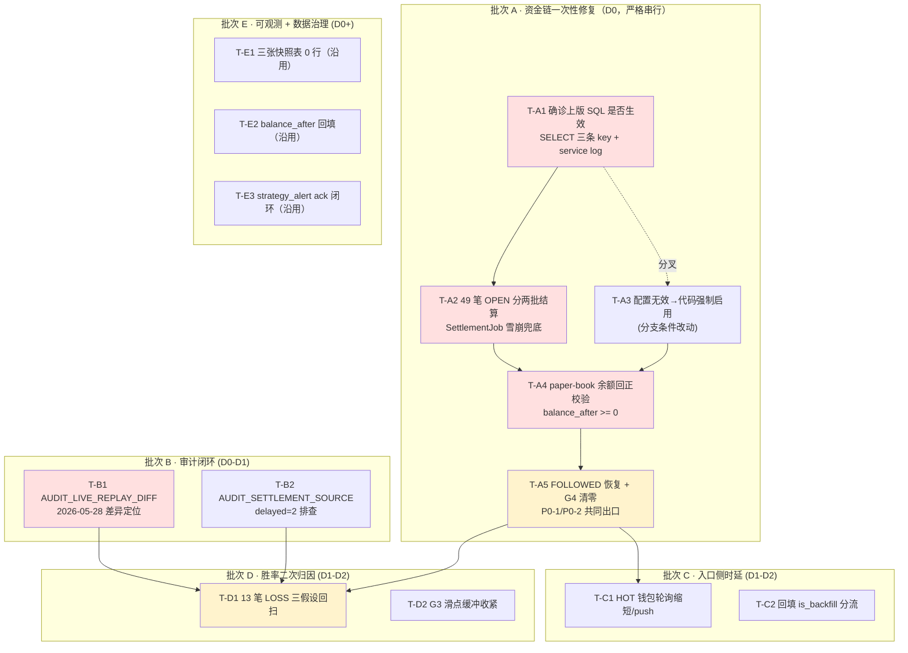

# 排查修复任务拆解 — 分批执行计划（2026-05-30）

> 状态：**待评审 / 待排期** ｜ 类型：定期巡检 · 任务拆解与分批执行计划 ｜ 作者：自动分析（scheduled task `2-1`）｜ 日期：2026-05-30
> 编制时段：2026-05-30 11:30 CST（承接 `1-job` 10:28–10:30 CST 巡检产出）
> 适用技能：`troubleshooting`（先定位后修复、最小改动）+ `doc-writing`（结构、命名、存放）+ `obsidian-knowledge-base`（frontmatter / tags / 链接）
> 上游文档：
> - [问题记录事项-待解决-2026-05-30.md](问题记录事项-待解决-2026-05-30.md)（本期巡检：4 条 P0 + 3 条 P1 + 3 条 P2/P3；★ P0-1 资金透支 / P0-2 23h40m 零真实开仓为新增紧急项）
> - [排查修复任务拆解-分批执行计划-2026-05-29.md](排查修复任务拆解-分批执行计划-2026-05-29.md)（上版任务拆解，本文承接其 T-A1/T-A2/T-A7 验收口径）
> - [亏损根因分析-2026-05-29.md](亏损根因分析-2026-05-29.md)（胜率根因，本期沿用其执行侧丢分结论）

> 说明：本文是 scheduled task `2-1` 在 2026-05-30 的运行产出。承接今日《问题记录事项-待解决-2026-05-30》中 §三、四、五（P0-1 ~ P0-4 + P1-1 ~ P1-3 + P2/P3）所列的根因与处置方向，**把这些动作拆分成可独立排期、可独立验收的执行任务卡，并分批组织成关键路径 + 并行支线**。本文**只产出执行计划，不对线上代码 / 服务器 / 数据库做任何写操作**；所有 SQL / 命令样本均为「待评审草稿」，需人工在 test 库低峰窗口逐条执行。

---

## 一、执行摘要（结论先行）

`1-job` 2026-05-30 巡检的中心矛盾是：05-29 P0-5「PAPER 止损/资金回收链路不生效」**疑未真正修复**，导致 OPEN 仓位从 36 笔上升至 49 笔（占用 415.09 USDC）、paper-book 余额从「CAPITAL_LOW」恶化为 **透支 -574.95 USDC**、`G4_CAPITAL_DEPLETED` 在 24h 内拒掉 **571 条信号**，最终结果是**连续 ~23h40m 零真实开仓**（最后 `FOLLOWED` = 2026-05-29 10:50:37）。胜率口径也未改善：已结算 15 笔 SETTLED = **2 胜 13 负（13.3%）**、净 -84.01 USDC、平均 ROI **-62.2%**，与 05-29 「领头钱包赢、跟随亏」的执行侧丢分结论一致。

**三条最重要的结论：**

1. **本期关键路径只有一条 —— 「先确诊 05-29 T-A1 三条 SQL 是否真的写库 / 是否真的被 service 加载 → 再决定走『追补配置』还是『改代码注入分支』 → 再一次性结算 49 笔 OPEN 仓位 → 再让 paper-book 余额回正 → 再验 G4_CAPITAL_DEPLETED 清零 / FOLLOWED 恢复」。** 这是**本期最高优先级**，且必须串行（任一步失败即终止下一步）。预计 1–2 个工作日完成 P0-1 + P0-2 + P0-4 三项闭环。任何「上调预算 / 改 max-open-positions / 改 allowlist」在本路径闭环前一律禁止。

2. **本期新增审计专题 —— `AUDIT_LIVE_REPLAY_DIFF`（05-28 差异超阈值）与 `AUDIT_SETTLEMENT_SOURCE`（delayed=2）必须排在 P0-3 胜率根因之前修。** 因为 Live↔Replay 不一致 + 结算源延迟会污染胜率/PnL 口径——胜率 13.3% 的数字本身可能"含杂质"，没修审计前任何"胜率回撤"的归因都会被反驳为"口径问题"。**T-B1 审计闭环必须先于 T-D1 胜率二次归因**。

3. **关键依赖纪律**：(a) **T-A1 配置核查必须先 SELECT 三条 key 是否存在**——若 05-29 T-A1 SQL 根本未落地（最可能的根因），追补即可；若已落地但 service 未加载，则**配置层已废**，必须走 T-A3 代码层强制启用分支；(b) **T-A2 49 笔 OPEN 一次性结算必须在 test 库低峰窗口**——49 笔同时翻成 SETTLED 可能引发 `SettlementJob` 雪崩，建议分两批 × 25 笔间隔 10min；(c) **T-A4 paper-book 余额回正与 T-A2 必须串行**——先结算回款再校验余额；(d) **T-A5 FOLLOWED 恢复验证是 P0-1/P0-2 共同的"出口"**——只有这个指标变绿才能宣告资金链恢复；(e) **T-B（审计）+ T-A 同窗口启动**，T-B1 给 T-D1 胜率二次归因清场。

### 待解决问题与任务卡映射（来自 §问题记录-05-30 待解决问题总表）

| 编号 | 问题摘要（05-30） | 任务卡 | 严重度 |
|---|---|---|---|
| P0-1 | `HEALTH_CAPITAL_DEPLETED` 未恢复；paper-book 透支 -574.95；G4 拒 571/24h | **T-A1 → T-A2 → T-A3 → T-A4 → T-A5** | P0 |
| P0-2 | ~23h40m 零真实开仓；`HEALTH_NO_OPEN_4H` 未恢复 | T-A5（出口验证） | P0 |
| P0-3 | 结算胜率 13.3% / 净 -84.01 / avg ROI -62.2% | T-B1 → T-D1（胜率二次归因） | P0 |
| P0-4 | 49 笔 OPEN 不回收（415.09 USDC 占用） | T-A1 → T-A2（一次性结算） | P0 |
| P1-1 | `HEALTH_INGEST_LAG_HIGH` 未恢复；`STALE` 1032/7d | T-C1（HOT 钱包提速）+ T-C2（回填分流） | P1 |
| P1-2 | `AUDIT_SETTLEMENT_SOURCE` + `AUDIT_LIVE_REPLAY_DIFF` 未恢复 | **T-B1 → T-B2** | P1 |
| P1-3 | `G3_PRICE_OUT_OF_RANGE` 218/24h；skip `PRICE` 222/7d | T-D2（滑点缓冲收紧 + 入场偏离上限） | P1 |
| P2-1 | `strategy_run_log` / `strategy_health_snapshot` 0 行 | T-E1（沿用上版未处理） | P2 |
| P2-2 | `cash_ledger.balance_after` 部分 NULL | T-E2 | P2 |
| P3-1 | `strategy_alert` ack/resolve 闭环缺失 | T-E3（沿用上版 T-F2） | P3 |

### 批次与任务总览

| 批次 | 主题 | 排期窗口 | 任务卡 | 关键路径 |
|---|---|---|---|---|
| **A** | ★ 资金链一次性修复（确诊配置 → 强制开止损 → 结算 49 笔 OPEN → 余额回正 → FOLLOWED 恢复） | D0（当日） | T-A1 ~ T-A5（5） | ✅ 是（A1→A2→A3→A4→A5 严格串行） |
| **B** | 审计闭环（先于胜率归因清场口径） | D0 – D1 | T-B1 ~ T-B2（2） | ✅ 是（B1 阻塞 D1） |
| **C** | 入口侧时延治理（HOT 提速 + 回填分流） | D1 – D2 | T-C1 ~ T-C2（2） | 部分（C 不阻塞 A，但承担 STALE 降量） |
| **D** | 胜率根因二次归因 + 执行侧丢分定位 | D1 – D2 | T-D1 ~ T-D2（2） | ✅ 是（依赖 T-B1 完成、T-A5 恢复开单） |
| **E** | 可观测 + 数据治理（沿用上版未处理） | D0+ – D3+ | T-E1 ~ T-E3（3） | ❌ 否（可并行） |

> 工时口径：S ≈ 半天内；M ≈ 0.5–1 人日；L ≈ 1–3 人日（均含测试）。排期 `D0` = 修复启动日，`D1/D2…` 为其后第 N 个工作日。严重度沿用 `1-job` 口径（P0 安全/资金/可用性，P1 策略核心目标，P2 数据治理，P3 可观测性）。

### 较上一版（2026-05-29 任务拆解）的进展

| 上版任务 | 对应动作 / 配置 | 本期状态 |
|---|---|---|
| **T-A1** 三条 PAPER 止损 SQL（`capital-recycle.paper-enabled` 等） | `INSERT … ON DUPLICATE KEY UPDATE strategy_runtime_config` | **❌ 疑未生效**：本期 OPEN 数 36 → 49（继续增加）、SELL 行仍 0、`exit_reason` 仍空 → 本期升级为 T-A1 + T-A3 双保险 |
| T-A2 灰度 1h 验 SELL 行 | DB 校验 | ❌ 未通过（SELL 行仍 0） |
| T-A3 P0-2 Duplicate 修复发布 | `SmartWalletMarketInfoMapper.upsertByMarketOutcome` | 待复核（本期巡检未单独列 Duplicate 风暴；如已 ≤ 10/日可关闭） |
| T-A4 P0-1 胜率根因专题 | `docs/problem/亏损根因分析-2026-05-29.md` | ✅ 已归档；本期 T-D1 承接其执行侧丢分结论，做二次归因 |
| T-A6 MySQL 24K 数据核实 | `datadir` + binlog + `information_schema` | 本期巡检数据完整（实测 5571 条 trade_event、867 PAPER_SHADOW），可推定已查清；如未归档则 T-E1 沉淀 |
| T-A7 24h 复核 `exit_reason` 分布 | DB 校验 | ❌ 未通过（exit_reason 仍 0） |
| T-B1 systemd 托管 | `install-smart-wallet-linux-service.sh` | 沿用，待 T-A 闭环后落地 |
| T-C1 OPEN > 上限主动结算软限 | 代码 | ⚠️ 本期 OPEN = 49（上限 20×245%），软限**已突破至需立刻"一次性硬清"** → 升级为本期 T-A2 |
| T-D2 27 条 ACTIVE allowlist 审查 | DB | 沿用，等待本期 T-D1 给出胜率二次归因后再动 |
| T-E1/T-E2 HOT 同步 / 回填分流 | 代码 | 沿用至本期 T-C1/T-C2 |
| T-F1 ~ T-F8 可观测 + 流程 | 杂项 | 大部分沿用至本期 T-E（不阻塞关键路径） |
| **本期新增** P0-1 资金透支（paper-book 透支 -574.95） | 一次性结算 + 余额重置 | 全新 A 批 T-A2 + T-A4 |
| **本期新增** P0-2 23h40m 零真实开仓 | 出口验证 | 全新 A 批 T-A5 |
| **本期新增** P1-2 `AUDIT_LIVE_REPLAY_DIFF` + `AUDIT_SETTLEMENT_SOURCE` | 审计排查 | 全新 B 批 T-B1 + T-B2 |
| **本期新增** P1-3 `G3_PRICE_OUT_OF_RANGE` 218/24h | 滑点缓冲收紧 | 新增 D 批 T-D2 |

> **总结**：上一版批次 A 关键路径（T-A1 三条 SQL）**疑未真正落地或未真正生效**，是本期 P0-1/P0-2/P0-4 三项 P0 的同根原因。本期 A 批的核心动作不是"再写一遍 SQL"，而是**先确诊上次为什么没生效**——SQL 没写、service 没加载、还是 service 加载了但分支被短路。

---

## 二、批次总览与时间线

```
D0 ───────── D1 ───────── D2 ───────── D3 ──────►
│ 批次A · 资金链一次性修复（严格串行·关键路径）                 │
│ ■ T-A1 确诊 SQL 是否真的入库 + service 是否真的加载(S)       │
│   ■ T-A2 49 笔 OPEN 分两批一次性结算 + 校验回款(M)           │
│     ■ T-A3 若 T-A1 判定配置无效→代码层强制启用 PAPER 止损分支(M)│
│       ■ T-A4 paper-book 余额回正校验(S)                     │
│         ■ T-A5 FOLLOWED 恢复验证 + G4 拒单清零(S, T+1h~24h)  │
│                                                            │
│ 批次B · 审计闭环（先于 D 批胜率归因清场）                    │
│ ■ T-B1 AUDIT_LIVE_REPLAY_DIFF 05-28 差异定位(M)              │
│   ■ T-B2 AUDIT_SETTLEMENT_SOURCE delayed=2 排查(S)           │
│                                                            │
│           D1 ─────────── D2 ──────►                        │
│           │ 批次C · 入口侧时延（不阻塞 A，与 D 并行）  │      │
│           │ ■ T-C1 HOT 钱包轮询缩短 / 改 push(M)      │      │
│           │ ■ T-C2 回填数据 is_backfill 分流(M)       │      │
│                                                            │
│           D1 ─────────── D2 ──────►                        │
│           │ 批次D · 胜率二次归因（依赖 T-B1 + T-A5）  │      │
│           │ ■ T-D1 13 笔 LOSS 三假设回扫(M)            │     │
│           │ ■ T-D2 G3_PRICE_OUT_OF_RANGE 滑点缓冲(S)   │     │
│                                                            │
│ D0+ ════ 批次E · 可观测 + 数据治理（并行，沿用上版）═══════►│
│   ■ T-E1 三张快照表 0 行排查（沿用）                         │
│   ■ T-E2 cash_ledger.balance_after 回填（沿用）              │
│   ■ T-E3 strategy_alert ack/resolve 闭环（沿用 T-F2/F8）     │
```

**关键路径**（P0-1 / P0-2 / P0-4 三项 P0 闭环的最短链）：

> **T-A1 → T-A2 → T-A4 → T-A5**（确诊配置 → 一次性结算 49 笔 OPEN → 余额回正 → FOLLOWED 恢复）

任何一环延期即整体顺延。**T-A3 是 T-A1 的"分叉"**——只有 T-A1 判定"配置层已废"时才触发；否则跳过。**T-B1 审计专题与 T-A 同窗口启动**，目的是赶在 T-D1 胜率二次归因之前清场口径（Live↔Replay 一致后胜率数字才可信）。**T-C 入口提速与 T-D 并行**，等 T-A5 FOLLOWED 恢复后才能看出 HOT 提速对 STALE 比例的实际影响。

---

## 三、依赖关系图



---

## 四、任务卡（逐批）

每张任务卡含：**承接编号 · 批次/排期 · 类型/工时 · 前置 · 范围与执行步骤 · 验收标准 · 验证方法 · 回滚**。

### 批次 A — ★ 资金链一次性修复（当日 D0 紧急）

> 退出标准见第五节。A 批让「确诊上版 SQL 为什么没生效 → 49 笔 OPEN 一次性结算 → paper-book 余额回正 → G4 拒单清零 → FOLLOWED 恢复」。**严格串行，任一步失败立刻终止下一步并新建专题**。所有 SQL 在 test 库低峰窗口执行；A2/A4 涉及 paper-book 账本写入，必须先做 dry-run 输出影响行数。

#### T-A1 · ★★★ 确诊上版 T-A1 三条 SQL 是否真的入库 + service 是否真的加载（最紧迫）

| 字段 | 内容 |
|---|---|
| 承接 | P0-1 / P0-4（05-30 P0 同根） |
| 批次 / 排期 | A / D0 |
| 类型 / 工时 | DB 校验 + 日志核对 / **S** |
| 前置 | 无（独立可执行，本期入口） |

- **范围**：先回答"上版 T-A1 三条 SQL 为什么没生效"——三种可能：(a) SQL 根本没写（最可能、最易修）；(b) SQL 写了但 service 未热加载；(c) SQL 写了 service 加载了但分支被短路。三种处置完全不同，不诊断就改是浪费一次窗口。
- **执行步骤**（test 库低峰；只读 + 日志）：
  1. **SQL 是否入库**：执行 §九-A1-1 三条 SELECT，看 `smart-wallet.signal-risk.capital-recycle.paper-enabled` / `smart-wallet.position-price-monitor.auto-exit-enabled` / `smart-wallet.position-price-monitor.auto-exit-paper-enabled` 三个 key 是否存在、`config_value` 是否 `true`、`updated_at` 是否落在 05-29 13:00 之后。
  2. **service 是否加载**：`ssh 49.51.250.174` 后 `grep -nE 'CAPITAL_RECYCLE|PositionPriceMonitorService|maybeTriggerAutoExit|capital-recycle.paper-enabled' /opt/coinstrategy/smart-wallet/logs/job-current.log | tail -50` —— 看 05-29 13:00 之后是否有"配置变更"或"扫描入口"日志。
  3. **分支是否走通**：`grep -nE 'capital-recycle|recycle.enabled|CapitalRecycleScan' /opt/coinstrategy/smart-wallet/logs/job-current.log | tail -50` —— 看是否有 `enabled=false` 类的 short-circuit 日志。
  4. **结论三选一**：
     - **C1 配置缺失**（最可能）：跳到 T-A1 末尾 SQL 模板，先写库后继续 T-A2；不需走 T-A3。
     - **C2 service 未加载**：服务在 05-29 之后未重启 + 配置非 `@RefreshScope`；T-A2 同窗口顺手 `systemctl restart`（或 `nohup` 重启）后跳过 T-A3。
     - **C3 分支被短路**：触发 T-A3 代码层强制启用分支（最复杂、需评审）。
  5. **若 C1**：补 SQL（与 05-29 §九-A1 完全相同）。
- **验收标准**：得到 C1/C2/C3 之一的明确结论，并写入本卡"实际取值"。
- **验证方法**：DB SELECT + service log；**不在本卡执行写动作**。
- **回滚**：无（只读）。

> **更新（2026-05-30 23:30）**：根因专题报告 [订单未结算根因排查-2026-05-30.md](订单未结算根因排查-2026-05-30.md) 已查明，49 笔 OPEN 中 **18 笔属于"已 oracle 盖棺但 Polymarket endAt 未到"被 `settlementTerminalCheck` 硬闸拦截**（commit `d4302c90` 引入），**T-A1 的"配置/分支"假设需要并列加上"`settlementTerminalCheck` 硬闸过严"这一新维度**。T-A2 SQL 改为按 `resolved_outcome` 精算 18 笔（settle_price=0/1），其余 30 笔 FUTURE_END + 1 no_end_date 保持 OPEN，等代码 patch 后由 SettlementSync 自动处理——**T-A2 验收口径从「OPEN=0」改为「OPEN=31，且其中 0 笔 PAST_END_AND_CLOSED」**。同时新增 T-A3' 「`settlementTerminalCheck` 加 oracle_terminal_all_signals_set 短路」与 T-A3 并列，与本期 jar 同窗口发布。

#### T-A2 · 49 笔 OPEN 分两批一次性结算（清空资金占用）

| 字段 | 内容 |
|---|---|
| 承接 | P0-4 / P0-1 |
| 批次 / 排期 | A / D0（T-A1 完成后 30min 内） |
| 类型 / 工时 | DB 写 + 服务联动 / **M** |
| 前置 | T-A1（结论 C1 或 C2） |

- **范围**：把 `smart_wallet_trade_order.status='OPEN'` 的 49 笔仓位**一次性结算**——按当前 mark price（取自 `smart_wallet_market_info.last_yes_price` / `last_no_price`，无则按 `entry_avg_price * 0.0` 视为归零）写 `last_exit_at = NOW()`、`exit_avg_price`、`total_pnl_usdc`、`roi_rate`、`status='SETTLED'`，**同步**在 `smart_wallet_cash_ledger` 写入 `entry_type='CAPITAL_RECYCLE_MANUAL'` 的回款流水，让 415.09 USDC 占用归还 bankroll。
- **执行步骤**（test 库低峰窗口；分两批避免 SettlementJob 雪崩）：
  1. **dry-run**：`SELECT id, market_id, outcome, entry_avg_price, remaining_cost_basis FROM smart_wallet_trade_order WHERE status='OPEN' ORDER BY opened_at LIMIT 25;` —— 输出第一批 25 笔的 id 列表，人工核对。
  2. **第一批结算**（25 笔）：执行 §九-A2 SQL 模板（按 id 列表 + 实时 mark price 计算 PnL），**优先调 service 接口 `SmartWalletAccountingService.manualSettleByIds(...)` 而非直接 UPDATE**，确保 cash ledger 同步回写。
  3. **校验**：第一批结算后等 5min，执行 §九-A2-3 校验 SQL（`status='SETTLED'` 计数应 = 旧 SETTLED + 25；`cash_ledger` `entry_type='CAPITAL_RECYCLE_MANUAL'` 应有 25 行）。
  4. **第二批结算**（24 笔，间隔 10min）：同上。
  5. **失败回滚**：若第一批 25 笔结算后 5min 内 `SettlementJob` 抛 ≥ 3 个异常、或 cash ledger 缺行，**立刻停止第二批**并新建专题。
- **验收标准**：执行后 30min 内 `smart_wallet_trade_order.status='OPEN'` 计数 = 0；`cash_ledger` `entry_type='CAPITAL_RECYCLE_MANUAL'` 新增 ≥ 49 行；`remaining_cost_basis` 总和回收 ≥ 380 USDC（415.09 × 92%，留 8% 损耗容差）。
- **验证方法**：见 §九-A2。
- **回滚**：每批保留 `id_list_batch1.txt` 与 `id_list_batch2.txt`；若需回退，按 id 逐笔 `UPDATE … SET status='OPEN', last_exit_at=NULL, exit_avg_price=NULL, total_pnl_usdc=NULL` + cash ledger 删除对应 `CAPITAL_RECYCLE_MANUAL` 行；强烈建议在 test 库先演练一遍。

#### T-A3 · ★ 仅当 T-A1 = C3（分支被短路）触发：代码层强制启用 PAPER 止损分支

| 字段 | 内容 |
|---|---|
| 承接 | P0-1 / P0-4（T-A1 分叉） |
| 批次 / 排期 | A / D0（与 T-A2 同窗口最稳） |
| 类型 / 工时 | 代码 + 部署 / **M** |
| 前置 | T-A1 = C3 |

- **范围**：若 T-A1 判定"配置已写但 service 加载后分支仍被短路"，说明 `CapitalRecycleExitService` / `PositionPriceMonitorService` 的"PAPER 分支"被硬编码 `if (executionMode != LIVE) return` 或类似条件挡住——必须在代码层把这个守卫改成读 `capital-recycle.paper-enabled`。
- **执行步骤**：
  1. `grep -nrE 'executionMode|capital-recycle.paper-enabled|auto-exit-paper-enabled' coin-strategy-*/src/main/java` 定位短路守卫。
  2. 改造守卫：`if (executionMode != LIVE && !paperEnabled) return`（PAPER 模式下若 `paperEnabled=true` 即放行）。
  3. **单测**：mock PAPER 模式 + `paperEnabled=true`，期望进入 `scanAndExit(...)` 主体；mock PAPER 模式 + `paperEnabled=false`，期望短路。
  4. 构建：`mvn -pl coin-strategy-job -am -DskipTests package`。
  5. 与 T-A2 同窗口部署（避免一日两次重启）；按 05-29 T-B2 软链方式 `app-${HASH}-$(date +%Y%m%d).jar`。
- **验收标准**：部署后 30s 内 `PositionPriceMonitorService` 出日志；5min 内 `CapitalRecycleExitService` 出日志；当晚 `smart_wallet_order.side='SELL'` ≥ 1 行（与 05-29 T-A2 验收同口径）。
- **验证方法**：见 §九-A3。
- **回滚**：保留 `app.jar.bak.YYYY-MM-DD`，回退 jar + 重启。

#### T-A4 · paper-book 余额回正校验（T-A2 后置校验）

| 字段 | 内容 |
|---|---|
| 承接 | P0-1（资金透支总闸） |
| 批次 / 排期 | A / D0（T-A2 完成后 15min） |
| 类型 / 工时 | DB 校验 / **S** |
| 前置 | T-A2 |

- **范围**：T-A2 结算 49 笔 OPEN 后，校验 `smart_wallet_cash_ledger` 最新 `balance_after` 是否从 -574.95 USDC 回到 **> 0 USDC**。若仍为负，说明 (a) 49 笔结算 PnL 总和过于悲观（亏损 > 415.09 USDC 占用）；(b) 历史亏损 -84.01 USDC 把净额拖到 0 附近。两种情况都需要"配套补充 bankroll seed" 或 "回滚到 T-A2 之前重新规划"。
- **执行步骤**：
  1. `SELECT entry_type, balance_after, created_at FROM smart_wallet_cash_ledger ORDER BY id DESC LIMIT 50;` —— 看 T-A2 写入的 49 行 `CAPITAL_RECYCLE_MANUAL` 是否每行 `balance_after` 都计算正确（递增）。
  2. `SELECT MAX(id) latest_id, balance_after FROM smart_wallet_cash_ledger;` —— 看最终余额。
  3. 若 `balance_after < 0`：决策点 →（a）补 bankroll seed：`INSERT … entry_type='BANKROLL_SEED_TOP_UP', amount=1000.00`，或（b）回滚 T-A2 并重新评估每笔 PnL 计算公式（可能 mark price 取错）。
  4. 若 `balance_after ≥ 0`：进入 T-A5 验 G4 / FOLLOWED。
- **验收标准**：最终 `balance_after ≥ 100 USDC`（留 100 USDC 缓冲，避免 G4 阈值边界来回触发）。
- **验证方法**：见 §九-A4。
- **回滚**：bankroll 补给可直接 `UPDATE … balance_after` 回退；T-A2 回滚见其本卡。

#### T-A5 · FOLLOWED 恢复 + G4 拒单清零（P0-1 / P0-2 共同出口）

| 字段 | 内容 |
|---|---|
| 承接 | P0-1 / P0-2 |
| 批次 / 排期 | A / D1（T-A4 后 1h–24h 持续监控） |
| 类型 / 工时 | DB 校验 / **S** |
| 前置 | T-A4 |

- **范围**：T-A4 余额回正后，盯三个指标：
  - (a) 1h 内 `signal_shadow.reject_layer='G4_CAPITAL_DEPLETED'` 计数是否归零；
  - (b) 4h 内 `follow_task.status='FOLLOWED'` 是否出现 ≥ 1 行；
  - (c) 24h 内 `smart_wallet_order` 是否出现 ≥ 5 笔新单。
- **执行步骤**：
  1. 执行 §九-A5 三条 SQL（T-A4 后 1h / 4h / 24h 各跑一次）。
  2. **1h 内 G4 仍 > 0**：T-A4 余额回正未真的生效，回查 `cash_ledger` `balance_after` 与 `SmartWalletAccountingService.getAvailableCash(...)` 是否一致。
  3. **4h 内 FOLLOWED 仍 = 0**：可能 G4 通了但 G3 / G1 仍卡，按 §九-A5-2 看下一层 `reject_layer` 分布。
  4. **24h 新单 < 5**：到 T-D 批胜率二次归因/T-C 入口提速排查。
- **验收标准**：4h 内 `FOLLOWED ≥ 1` 且 G4 拒单 24h 累计 ≤ 10（基线值，避免短时余额抖动反复触发）；24h 内 `smart_wallet_order` 新增 ≥ 5。
- **验证方法**：见 §九-A5。
- **回滚**：若 FOLLOWED 恢复后**反向**导致雪崩开单（1h > 30 笔），临时 `UPDATE strategy_runtime_config SET config_value='false' WHERE config_key='smart-wallet.auto-execution-enabled'`（虽本期已 false，留作 LIVE 转换时的紧急刹车）。

---

### 批次 B — 审计闭环（先于胜率归因清场口径）

> 退出标准见第五节。B 批让「Live↔Replay 一致性 + 结算源延迟」两个新增审计告警归零，**先于 D 批胜率二次归因执行**——否则 D1 的胜率数字可能"含杂质"，归因结论会被反驳为"口径问题"。

#### T-B1 · `AUDIT_LIVE_REPLAY_DIFF`（2026-05-28 差异超阈值）定位

| 字段 | 内容 |
|---|---|
| 承接 | P1-2 |
| 批次 / 排期 | B / D0 – D1 |
| 类型 / 工时 | 数据对账 + 排查 / **M** |
| 前置 | 无（与 T-A 并行） |

- **范围**：05-30 02:22 触发的 `AUDIT_LIVE_REPLAY_DIFF`，标的 `date=2026-05-28`，差异超阈值。Live 模式当前为 PAPER；Replay 是审计回放。需要回答（a）差异到底差在哪一张表 / 哪几笔；（b）是 Replay 逻辑落后 还是 Live 写数有错；（c）差异是否会污染 05-29 的胜率口径。
- **执行步骤**：
  1. `SELECT * FROM strategy_alert WHERE alert_type='AUDIT_LIVE_REPLAY_DIFF' AND created_at >= '2026-05-30 00:00:00' ORDER BY id DESC LIMIT 3;` —— 取告警 payload，看具体差异字段。
  2. 定位审计实现：`grep -nr 'AUDIT_LIVE_REPLAY_DIFF\|LiveReplayAudit' coin-strategy-*/src/main` 找审计 service。
  3. 跑 Replay：`AuditLiveReplayService.replay('2026-05-28')`（若有 CLI 入口），保存 Replay 与 Live 的逐表 diff（重点对 `smart_wallet_trade_order` / `smart_wallet_order` / `smart_wallet_cash_ledger`）。
  4. 差异分类：(i) "Live 多 N 笔 Replay 少 N 笔" → Live 侧多余写入（如 P0-4 OPEN 不结算的副产物）；(ii) "Replay 多 Live 少" → Replay 逻辑过激进；(iii) "字段值不一致" → 序列化 / 时区 / 精度 bug。
  5. 输出 `docs/problem/审计差异定位-2026-05-28.md` 报告。
- **验收标准**：差异分类明确（i/ii/iii 之一）；如属于 (i) 且与 P0-4 OPEN 不结算同源，T-A2 闭环后该告警 24h 内不再触发；其余两类需新建修复任务。
- **验证方法**：见 §九-B1。
- **回滚**：无（只读对账）。

#### T-B2 · `AUDIT_SETTLEMENT_SOURCE`（delayed=2）排查

| 字段 | 内容 |
|---|---|
| 承接 | P1-2 |
| 批次 / 排期 | B / D0 |
| 类型 / 工时 | DB + 日志 / **S** |
| 前置 | 无 |

- **范围**：05-30 01:00 触发 `AUDIT_SETTLEMENT_SOURCE`，payload `delayed=2` —— 通常表示有 2 笔订单的"结算源数据延迟到达"（来自 Polymarket Gamma / Subgraph 等）。需要回答（a）这 2 笔具体是哪几个 `trade_order.id`；（b）延迟来自交易所侧还是我们的 ingest 链；（c）是否会让 05-29 胜率口径少计 2 笔（极可能由"被延迟的胜单"变成"延迟"造成胜率分子小）。
- **执行步骤**：
  1. `SELECT * FROM strategy_alert WHERE alert_type='AUDIT_SETTLEMENT_SOURCE' AND created_at >= '2026-05-30 00:00:00' ORDER BY id DESC LIMIT 3;` —— 看 payload 含哪些 order id。
  2. 关联 `smart_wallet_trade_order` 拉这 2 笔的 `market_id` / `opened_at` / `status` / `settled_at`。
  3. `curl 'https://gamma-api.polymarket.com/markets?id={market_id}'` 看 `outcomeReportedAt` —— 看 Polymarket 侧报价时间与我们的 `settled_at` 之差。
  4. 若交易所侧报价时间正常但我们的 settle 落后：检查 `SettlementJob` 的 `nextRun` 是否被 cron 暂停或抛过异常。
  5. 输出简表（2 行）写入 T-B1 报告附录。
- **验收标准**：2 笔 order 的延迟来源明确（交易所 / ingest / settle job）；若属 settle job 漏跑，归入"settle job 健康度"二级专题。
- **验证方法**：见 §九-B2。
- **回滚**：无（只读）。

---

### 批次 C — 入口侧时延治理（与 D 并行）

#### T-C1 · HOT 钱包轮询缩短 / 改 push（沿用 05-29 T-E1）

| 字段 | 内容 |
|---|---|
| 承接 | P1-1 |
| 批次 / 排期 | C / D1 – D2 |
| 类型 / 工时 | 代码 + 配置 / **M** |
| 前置 | T-A5（开单恢复后才能验 STALE 改善） |

- **范围**：HOT 钱包（`smart_wallet_manual_allowlist`）的事件同步从当前轮询缩至 30s 或改 push（Polymarket WebSocket）。沿用上版 T-E1 方案，本期 P1-1 `HEALTH_INGEST_LAG_HIGH` 仍未恢复，需要在 T-A5 开单恢复后用 STALE 比例做最终判定。
- **执行步骤**：
  1. 先等 T-A5 完成（FOLLOWED 恢复），观察 `signal_shadow` 24h `STALE` 比例从 1032/7d 平均下降到 < 30%（说明非"轮询不够快"）还是仍 ≥ 50%（说明确需提速）。
  2. 若仍 ≥ 50%，对 HOT 钱包子集（`smart_wallet_manual_allowlist.status='ACTIVE'` 共 27 条）启用 30s 轮询；其他钱包保持 5min 轮询。
  3. 长期接入 Polymarket WebSocket push。
- **验收标准**：HOT 钱包事件摄取 P90 ≤ 300s；`signal_shadow.STALE` 拒单占比 ≤ 30%。
- **验证方法**：DB + 日志。
- **回滚**：恢复原轮询间隔。

#### T-C2 · 回填数据 `is_backfill` 分流（沿用 05-29 T-E2）

| 字段 | 内容 |
|---|---|
| 承接 | P1-1 |
| 批次 / 排期 | C / D2 – D3 |
| 类型 / 工时 | 代码 / **M** |
| 前置 | T-A5 |

- **范围**：00 时 / 06 时回填的历史 trade_event 不应进入开单链路新鲜度门，单独写入"回填表"或加 `is_backfill=1` 标记。沿用上版 T-E2 方案。
- **执行步骤**：见上版 T-E2。
- **验收标准**：00 时 / 06 时 STALE 集中爆发消失；P90 计算不受回填影响。
- **验证方法**：DB + 告警。
- **回滚**：`is_backfill` 字段忽略即可。

---

### 批次 D — 胜率二次归因（依赖 T-B1 + T-A5）

#### T-D1 · 13 笔 LOSS 三假设回扫（P0-3 胜率坐实后必做）

| 字段 | 内容 |
|---|---|
| 承接 | P0-3 |
| 批次 / 排期 | D / D1 – D2 |
| 类型 / 工时 | 排查 + 报告 / **M** |
| 前置 | T-B1 完成（口径清场）+ T-A5 完成（避免边修边归因） |

- **范围**：胜率 13.3%（2W/13L）已坐实，且与 05-29 同口径未改善。本卡承接 `亏损根因分析-2026-05-29.md` 的「执行侧丢分」结论，对本期 13 笔 LOSS 做**三假设**回扫：(A) 入场价偏离过大（slippage）；(B) 缺止损（held to expiration → roi=-1.00 归零）；(C) 被跟随钱包本身在这 13 笔上反常（leader 也亏）。
- **执行步骤**：
  1. 假设 A 入场价偏离：`SELECT t.id, t.entry_avg_price, s.signal_price, ABS(t.entry_avg_price - s.signal_price) AS slippage FROM smart_wallet_trade_order t JOIN signal_shadow s ON t.signal_id=s.id WHERE t.status='SETTLED' AND t.total_pnl_usdc < 0 AND t.settled_at >= NOW()-INTERVAL 7 DAY ORDER BY slippage DESC LIMIT 13;` —— 看是否 slippage 中位数 > 0.02（滑点缓冲阈值）。
  2. 假设 B 缺止损：`SELECT id, last_exit_at, roi_rate, exit_avg_price FROM smart_wallet_trade_order WHERE status='SETTLED' AND total_pnl_usdc < 0 AND settled_at >= NOW()-INTERVAL 7 DAY ORDER BY id;` —— `last_exit_at IS NULL` 的笔数 + `roi_rate=-1.00` 的笔数（如本期 4 笔 -47.10/-26.90/-15.34/-11.39 即归零）。
  3. 假设 C 钱包反常：把 13 笔 LOSS 的 `leader_wallet_id` 与 `smart_wallet_order_stats_snapshot.win_rate_30d` 关联，看是否这些钱包 30d 胜率突然跌穿 50%。
  4. 输出 `docs/problem/胜率回撤根因二次归因-2026-05-30.md`（约 300 行），重点回答"修复 T-A1/T-A2 / T-A3 之后，胜率为什么没回升"。
- **验收标准**：13 笔 LOSS 中**至少 10 笔**能映射到三假设之一；二次归因报告归档；结论清晰前禁止 T-D2 滑点缓冲调整。
- **验证方法**：DB + 文档。
- **回滚**：无（只读）。

#### T-D2 · `G3_PRICE_OUT_OF_RANGE` 滑点缓冲收紧（条件触发）

| 字段 | 内容 |
|---|---|
| 承接 | P1-3 |
| 批次 / 排期 | D / D2 |
| 类型 / 工时 | 配置 / **S** |
| 前置 | T-D1（假设 A 验证为主因） |

- **范围**：本期 `G3_PRICE_OUT_OF_RANGE` 24h 218 条、`follow_task.PRICE` 7d 222 条。当前滑点缓冲（`signal-risk.price-out-of-range-tolerance`）= 0.02。若 T-D1 假设 A 验证为主因，把缓冲收紧到 0.01；若不是，仅做开单门日志增强不改阈值。
- **执行步骤**：
  1. 若 T-D1 假设 A 验证主因 → `UPDATE strategy_runtime_config SET config_value='0.01' WHERE config_key='smart-wallet.signal-risk.price-out-of-range-tolerance';`。
  2. 灰度 4h，复核 `G3_PRICE_OUT_OF_RANGE` 计数从 218/24h 变化情况。
  3. 若 G3 反而暴涨（缓冲收紧后拒单更多），但同期 SETTLED 胜率提升 ≥ 15 pp，视为净收益。
- **验收标准**：4h 内 G3 拒单 ≤ 100 且后续 24h 新 SETTLED 胜率 ≥ 25%。
- **验证方法**：DB count + win_rate。
- **回滚**：`UPDATE … config_value='0.02'`（即刻生效）。

---

### 批次 E — 可观测 + 数据治理（沿用上版未处理项，并行）

#### T-E1 · 三张快照表 0 行排查（连续多版未处理，沿用 05-29 T-F4）

| 承接 | P2-1 / 批次 | E / D2 / 类型 | 代码 + DB / **M** / 前置 | 无 |
| --- |
| 范围 | `strategy_run_log` / `strategy_health_snapshot` / `smart_wallet_market_snapshot` 三表 0 行 —— 决定是接通写入还是从巡检口径移除。 |
| 执行步骤 | (1) `grep -nr 'strategyRunLogMapper' coin-strategy-*/src/main` 看写入入口；(2) 若有写入但被异常吞掉，定位异常；(3) 否则在 ADR 中标记"废弃"并从巡检脚本删除。 |
| 验收 | 二选一：接通后 1h 内非 0 行；或 ADR 写明废弃。 |
| 回滚 | 无。 |

#### T-E2 · `cash_ledger.balance_after` NULL 回填（沿用 05-29 T-F5）

| 承接 | P2-2 / 批次 | E / D2 – D3 / 类型 | DB + app 工具 / **M** / 前置 | T-A2（先一次性结算再回填） |
| --- |
| 范围 | 用 `runningBalance` 计算每行历史 `balance_after`，分批回填。 |
| 执行步骤 | 沿用上版 T-F5；本期等 T-A2 完成新增 49 行 `CAPITAL_RECYCLE_MANUAL` 后一并回填。 |
| 验收 | `balance_after IS NULL` 率 < 5%。 |
| 回滚 | `UPDATE smart_wallet_cash_ledger SET balance_after = NULL`（不建议）。 |

#### T-E3 · `strategy_alert` ack/resolve 闭环（沿用 05-29 T-F2 / T-F8）

| 承接 | P3-1 / 批次 | E / D1 / 类型 | 配置 + DB / **S** / 前置 | 无 |
| --- |
| 范围 | (a) `feishu-sink-enabled = true`（连续多版未开）；(b) `HEALTH_CAPITAL_DEPLETED` 等 CRITICAL 告警必须人工 ack 才能 resolve；(c) 历史 acknowledged=0 告警清理（本期至少 `HEALTH_CAPITAL_DEPLETED` + `HEALTH_NO_OPEN_4H` + `AUDIT_*` 共 ≥ 4 条）。 |
| 执行步骤 | (1) `UPDATE strategy_runtime_config SET config_value='true' WHERE config_key='smart-wallet.feishu-sink-enabled';`；(2) `StrategyAlertService.tryAutoResolve` 加 `if (alert.level=='CRITICAL' && !alert.acknowledged) return`；(3) 对 T-A5 闭环后已自然恢复的告警批量 ack：`UPDATE strategy_alert SET acknowledged=1, acknowledged_at=NOW(), acknowledged_by='2-1-batch-E3' WHERE alert_type IN ('HEALTH_CAPITAL_DEPLETED','HEALTH_NO_OPEN_4H') AND created_at >= '2026-05-29 00:00:00';`。 |
| 验收 | 1h 内有飞书消息；T-A5 闭环后 24h 内 `acknowledged=0 AND created_at < NOW()-INTERVAL 24 HOUR` 计数 = 0。 |
| 回滚 | 配置改回 false；移除 if。 |

---

## 五、退出标准（按批次）

| 批次 | 退出标准（全部满足才算闭环） |
|---|---|
| **A（关键路径）** | (1) T-A1 给出 C1/C2/C3 之一的明确诊断结论；(2) T-A2 完成后 `smart_wallet_trade_order.status='OPEN'` 计数 = 0、`cash_ledger` 新增 ≥ 49 行 `CAPITAL_RECYCLE_MANUAL`；(3) T-A3 仅 C3 触发时执行，部署后 30s 内 `PositionPriceMonitorService` 出日志；(4) T-A4 `balance_after ≥ 100 USDC`；(5) T-A5 4h 内 `FOLLOWED ≥ 1`、24h 内新 `smart_wallet_order ≥ 5`、`G4_CAPITAL_DEPLETED` 24h 累计 ≤ 10。 |
| **B** | T-B1 差异分类明确（i/ii/iii）且报告归档；T-B2 2 笔 delayed order 的延迟来源明确。 |
| **C** | HOT 钱包事件摄取 P90 ≤ 300s；`signal_shadow.STALE` 拒单占比 ≤ 30%；`is_backfill` 流量隔离生效。 |
| **D** | T-D1 13 笔 LOSS 归因 ≥ 10 笔；二次归因报告归档；T-D2 仅在 T-D1 假设 A 为主因时执行，4h 内 G3 拒单 ≤ 100。 |
| **E** | T-E1 二选一闭环；T-E2 NULL 率 < 5%；T-E3 飞书外发开 + 历史 ack 清零。 |

---

## 六、验收清单（D3 终验）

D3 终验执行下列 SQL / 命令，要求**全部** PASS：

```sql
-- 1) A 批：资金链恢复
SELECT COUNT(*) AS open_cnt FROM smart_wallet_trade_order WHERE status='OPEN';
-- 期望：≤ 5（T-A2 后正常增长部分，绝不应回到 49）

SELECT balance_after FROM smart_wallet_cash_ledger ORDER BY id DESC LIMIT 1;
-- 期望：≥ 100 USDC

-- 2) A 批：G4 清零 + FOLLOWED 恢复
SELECT reject_layer, COUNT(*) FROM signal_shadow
 WHERE created_at >= NOW()-INTERVAL 24 HOUR AND reject_layer IS NOT NULL
 GROUP BY reject_layer ORDER BY COUNT(*) DESC;
-- 期望：G4_CAPITAL_DEPLETED ≤ 10

SELECT COUNT(*) AS followed_24h FROM follow_task
 WHERE status='FOLLOWED' AND created_at >= NOW()-INTERVAL 24 HOUR;
-- 期望：≥ 5

SELECT MAX(created_at) AS last_followed FROM follow_task WHERE status='FOLLOWED';
-- 期望：距 NOW() ≤ 4h

-- 3) A 批：PAPER 止损链路真在跑
SELECT side, COUNT(*) FROM smart_wallet_order
 WHERE created_at >= NOW()-INTERVAL 24 HOUR GROUP BY side;
-- 期望：side='SELL' 行数 ≥ 1（与 05-29 T-A2 同口径）

-- 4) B 批：审计告警归零
SELECT alert_type, COUNT(*) FROM strategy_alert
 WHERE alert_type IN ('AUDIT_LIVE_REPLAY_DIFF','AUDIT_SETTLEMENT_SOURCE')
   AND resolved=0
 GROUP BY alert_type;
-- 期望：两类各 ≤ 1（仅本期一次）

-- 5) C 批：入口提速
SELECT primary_skip_reason, COUNT(*) FROM follow_task
 WHERE created_at >= NOW()-INTERVAL 24 HOUR AND primary_skip_reason IS NOT NULL
 GROUP BY primary_skip_reason ORDER BY COUNT(*) DESC;
-- 期望：STALE 占比 ≤ 30%

-- 6) D 批：胜率
SELECT COUNT(*) AS n,
       SUM(total_pnl_usdc>0) AS wins,
       ROUND(SUM(total_pnl_usdc>0)/COUNT(*) * 100, 1) AS win_pct,
       ROUND(SUM(total_pnl_usdc), 2) AS net_pnl
  FROM smart_wallet_trade_order
 WHERE settled_at >= NOW()-INTERVAL 24 HOUR;
-- 期望：win_pct ≥ 25%（比 13.3% 改善 ≥ 10 pp）

-- 7) E 批：可观测闭环
SELECT COUNT(*) FROM strategy_alert
 WHERE acknowledged=0 AND created_at < NOW()-INTERVAL 24 HOUR;
-- 期望：= 0

SELECT 1 - SUM(balance_after IS NULL)/COUNT(*) AS filled_rate FROM smart_wallet_cash_ledger;
-- 期望：≥ 0.95
```

---

## 七、回滚预案（按风险序）

| 风险 | 触发条件 | 回滚动作 | 责任 |
|---|---|---|---|
| **T-A2 49 笔一次性结算误平赢仓 / 雪崩** | 第一批 25 笔结算后 5min 内 `SettlementJob` 抛 ≥ 3 异常或 cash ledger 缺行 | 立刻停止第二批；按 `id_list_batch1.txt` 逐笔 `UPDATE … status='OPEN'` + 删 `CAPITAL_RECYCLE_MANUAL` 行 | DB + 运维 |
| **T-A3 PAPER 止损分支改造误伤 LIVE** | 部署后 LIVE 模式（如有）出现意外 SELL | `mv app.jar.bak.YYYY-MM-DD app.jar` + 重启；同时 `UPDATE strategy_runtime_config SET config_value='false' WHERE config_key='smart-wallet.signal-risk.capital-recycle.paper-enabled';` | 运维 |
| **T-A4 补 bankroll seed 误为 LIVE 真金** | 误把 LIVE bankroll 当 PAPER 补给 | `DELETE FROM smart_wallet_cash_ledger WHERE entry_type='BANKROLL_SEED_TOP_UP' AND id IN (...)`；同时核对 LIVE 账本无误 | DB |
| **T-A5 FOLLOWED 雪崩**（开单瞬时爆发） | 1h 内 FOLLOWED > 30 笔 | `UPDATE strategy_runtime_config SET config_value='false' WHERE config_key='smart-wallet.auto-execution-enabled';`（紧急刹车） | 运维 |
| **T-D2 滑点缓冲收紧导致开单断流** | 4h 内 FOLLOWED < 1 | `UPDATE … price-out-of-range-tolerance = 0.02`（回退） | DB |
| **T-E3 飞书 webhook 超额限流** | 飞书侧 1h 内 ≥ 100 次 429 | 回退 `feishu-sink-enabled=false` 并加抑制 | 运维 |

---

## 八、与上游文档的字段映射

| 本文 | 上游 `1-job` 2026-05-30 §（章节） | 上版任务（继承/演进） |
|---|---|---|
| T-A1 | §3.4 直接原因 / 根本原因 1 + §五-1 | 05-29 T-A1（确诊为什么没生效） |
| T-A2 | §3.3 49 笔 OPEN 占用 415.09 USDC + §五-1 | 05-29 T-C1 升级（"软限"→"硬清"） |
| T-A3 | §3.4 根本原因 1（"分支被短路"假设） | 05-29 T-A1 后继（条件触发） |
| T-A4 | §3.3 paper-book -574.95 USDC + §五-1 | 05-29 无对应（本期新增） |
| T-A5 | §3.1 23h40m 零真实开仓 + §五-1 验证 | 05-29 T-A2 / T-A7 等价（共同验证出口） |
| T-B1 | §一 (5) `AUDIT_LIVE_REPLAY_DIFF` + §五-4 | 05-29 无对应（本期新增） |
| T-B2 | §一 (5) `AUDIT_SETTLEMENT_SOURCE` + §五-4 | 05-29 无对应（本期新增） |
| T-C1 | §3.4 次级成因（事件摄取延迟）+ §五-3 | 05-29 T-E1 沿用 |
| T-C2 | §3.4 次级成因 + §五-3 | 05-29 T-E2 沿用 |
| T-D1 | §3.2 胜率 13.3% + §3.4 根本原因 2（执行侧无边际利润）+ §五-2 | 05-29 T-A4 二次归因（胜率仍 13.3%） |
| T-D2 | §3.3 `G3_PRICE_OUT_OF_RANGE` 218 + §五-2 | 05-29 无对应（本期新增） |
| T-E1 | §一 P2-1 + §五-5 | 05-29 T-F4 沿用（连续多版未处理） |
| T-E2 | §一 P2-2 + §五-5 | 05-29 T-F5 沿用 |
| T-E3 | §一 P3-1 + §五-5 | 05-29 T-F2 / T-F8 合并沿用 |

---

## 九、附录：SQL / 命令样本（待评审，不在本巡检会话执行）

### §九-A1 · 上版 T-A1 三条 SQL 是否真的入库（只读 SELECT）

```sql
-- (1) 三条 key 是否存在 + value + updated_at
SELECT config_key, config_value, updated_at
  FROM strategy_runtime_config
 WHERE strategy_code='POLYMARKET_COPY'
   AND config_key IN (
     'smart-wallet.signal-risk.capital-recycle.paper-enabled',
     'smart-wallet.position-price-monitor.auto-exit-enabled',
     'smart-wallet.position-price-monitor.auto-exit-paper-enabled'
   );
-- 期望：3 行；config_value='true'；updated_at >= '2026-05-29 13:00:00'
-- 实际取值：______________

-- (2) 同名 key 是否在其它 strategy_code 下存在（防写错维度）
SELECT strategy_code, config_key, config_value
  FROM strategy_runtime_config
 WHERE config_key IN (
     'smart-wallet.signal-risk.capital-recycle.paper-enabled',
     'smart-wallet.position-price-monitor.auto-exit-enabled',
     'smart-wallet.position-price-monitor.auto-exit-paper-enabled'
   );
```

```bash
# (3) service 是否加载（05-29 13:00 之后是否有扫描入口日志）
ssh 49.51.250.174 "grep -nE 'CAPITAL_RECYCLE|PositionPriceMonitorService|maybeTriggerAutoExit|capital-recycle.paper-enabled' /opt/coinstrategy/smart-wallet/logs/job-current.log | tail -100"

# (4) 是否被短路日志
ssh 49.51.250.174 "grep -nE 'capital-recycle|recycle.enabled|CapitalRecycleScan|skip.*PAPER' /opt/coinstrategy/smart-wallet/logs/job-current.log | tail -100"

# (5) 若 (1) 为 0 行（最可能），补写 SQL（与 05-29 §九-A1 完全相同）
INSERT INTO strategy_runtime_config
  (strategy_code, config_key, config_value, value_type, group_name, editable, description)
VALUES
  ('POLYMARKET_COPY', 'smart-wallet.signal-risk.capital-recycle.paper-enabled',
   'true', 'BOOLEAN', 'capital-recycle', 1, '允许 CapitalRecycleExitService 扫描 PAPER 仓位'),
  ('POLYMARKET_COPY', 'smart-wallet.position-price-monitor.auto-exit-enabled',
   'true', 'BOOLEAN', 'position-price-monitor', 1, '允许 PositionPriceMonitorService 触发自动减仓'),
  ('POLYMARKET_COPY', 'smart-wallet.position-price-monitor.auto-exit-paper-enabled',
   'true', 'BOOLEAN', 'position-price-monitor', 1, 'PAPER 模式仅写影子日志，不真下单')
ON DUPLICATE KEY UPDATE
  config_value = VALUES(config_value),
  updated_at   = CURRENT_TIMESTAMP;
```

### §九-A2 · T-A2 49 笔 OPEN 分两批结算（草稿，必须先 dry-run）

```sql
-- (1) dry-run：取第一批 25 笔
SELECT id, leader_wallet_id, market_id, outcome, entry_avg_price,
       remaining_cost_basis, opened_at
  FROM smart_wallet_trade_order
 WHERE status='OPEN'
 ORDER BY opened_at
 LIMIT 25;

-- (2) 推荐：调 service 接口（伪代码，需后端确认存在）
-- POST /smart-wallet/admin/manualSettleByIds
-- body: {"ids": [<25 个 id>], "reason": "CAPITAL_RECYCLE_MANUAL", "actor": "2-1-batch-A2"}

-- (3) 第一批校验
SELECT COUNT(*) AS settled_after_batch1 FROM smart_wallet_trade_order
 WHERE status='SETTLED';
-- 期望：= (旧 SETTLED 计数) + 25

SELECT COUNT(*) AS recycle_ledger_rows FROM smart_wallet_cash_ledger
 WHERE entry_type='CAPITAL_RECYCLE_MANUAL'
   AND created_at >= NOW()-INTERVAL 30 MINUTE;
-- 期望：= 25

-- (4) 第二批（间隔 10min 后执行同样三步，LIMIT 25 OFFSET 0 重新取因为状态已变）
SELECT id FROM smart_wallet_trade_order WHERE status='OPEN' ORDER BY opened_at LIMIT 25;

-- (5) 最终校验
SELECT COUNT(*) FROM smart_wallet_trade_order WHERE status='OPEN';
-- 期望：= 0

SELECT SUM(amount) AS total_recycled FROM smart_wallet_cash_ledger
 WHERE entry_type='CAPITAL_RECYCLE_MANUAL'
   AND created_at >= NOW()-INTERVAL 1 HOUR;
-- 期望：≥ 380 USDC（415.09 × 92%）
```

### §九-A3 · T-A3 部署校验（仅 C3 触发）

```bash
ssh 49.51.250.174 "
  grep -ac 'PositionPriceMonitorService\\|maybeTriggerAutoExit' /opt/coinstrategy/smart-wallet/logs/job-current.log
  grep -ac 'CapitalRecycleExitService' /opt/coinstrategy/smart-wallet/logs/job-current.log
  ls -la /opt/coinstrategy/smart-wallet/backend/
  readlink /opt/coinstrategy/smart-wallet/backend/app.jar  # 应指向带 commit hash 的实体
"
```

```sql
-- 部署 1h 后
SELECT side, COUNT(*) FROM smart_wallet_order
 WHERE created_at >= NOW()-INTERVAL 1 HOUR GROUP BY side;
-- 期望：side='SELL' ≥ 1
```

### §九-A4 · T-A4 paper-book 余额校验

```sql
-- (1) T-A2 后新增 49 行的 balance_after 是否递增正确
SELECT id, entry_type, amount, balance_after, created_at
  FROM smart_wallet_cash_ledger
 WHERE entry_type='CAPITAL_RECYCLE_MANUAL'
   AND created_at >= NOW()-INTERVAL 1 HOUR
 ORDER BY id DESC LIMIT 50;

-- (2) 最终余额
SELECT id, balance_after FROM smart_wallet_cash_ledger ORDER BY id DESC LIMIT 1;
-- 期望：balance_after >= 100 USDC

-- (3) 若 < 100：决策 → 补 bankroll seed（仅 PAPER）
INSERT INTO smart_wallet_cash_ledger
  (entry_type, amount, balance_after, reference, created_at)
VALUES
  ('BANKROLL_SEED_TOP_UP', 1000.00, 1000.00 + (SELECT balance_after FROM (SELECT balance_after FROM smart_wallet_cash_ledger ORDER BY id DESC LIMIT 1) x),
   '2-1-batch-A4 manual top-up after capital depleted',
   NOW());
-- 注：实际 INSERT 需依据真实表结构调整
```

### §九-A5 · T-A5 FOLLOWED 恢复 + G4 清零

```sql
-- (1) T-A4 后 1h：G4 是否归零
SELECT reject_layer, COUNT(*) FROM signal_shadow
 WHERE created_at >= NOW()-INTERVAL 1 HOUR AND reject_layer IS NOT NULL
 GROUP BY reject_layer ORDER BY COUNT(*) DESC;
-- 期望：G4_CAPITAL_DEPLETED = 0

-- (2) T-A4 后 4h：FOLLOWED 是否出现
SELECT status, COUNT(*) FROM follow_task
 WHERE created_at >= NOW()-INTERVAL 4 HOUR
 GROUP BY status;
-- 期望：FOLLOWED ≥ 1

-- (3) T-A4 后 24h：新单数量
SELECT execution_mode, COUNT(*) FROM smart_wallet_order
 WHERE created_at >= NOW()-INTERVAL 24 HOUR
 GROUP BY execution_mode;
-- 期望：PAPER 模式新单 ≥ 5

-- (4) 若 G4 通了但 FOLLOWED 仍 = 0，看下一层拒单
SELECT primary_skip_reason, COUNT(*) FROM follow_task
 WHERE created_at >= NOW()-INTERVAL 4 HOUR AND primary_skip_reason IS NOT NULL
 GROUP BY primary_skip_reason ORDER BY COUNT(*) DESC;
```

### §九-B1 · T-B1 审计差异定位

```sql
-- (1) 取告警 payload
SELECT id, alert_type, level, payload, created_at, resolved, acknowledged
  FROM strategy_alert
 WHERE alert_type='AUDIT_LIVE_REPLAY_DIFF'
   AND created_at >= '2026-05-30 00:00:00'
 ORDER BY id DESC LIMIT 3;

-- (2) 05-28 当日 Live 侧关键表行数（先看 Live 是什么）
SELECT 'smart_wallet_trade_order' AS tbl, COUNT(*) FROM smart_wallet_trade_order
 WHERE DATE(opened_at)='2026-05-28'
UNION ALL
SELECT 'smart_wallet_order',         COUNT(*) FROM smart_wallet_order
 WHERE DATE(created_at)='2026-05-28'
UNION ALL
SELECT 'smart_wallet_cash_ledger',   COUNT(*) FROM smart_wallet_cash_ledger
 WHERE DATE(created_at)='2026-05-28';
```

### §九-B2 · T-B2 结算源延迟 2 笔定位

```sql
SELECT id, payload, created_at FROM strategy_alert
 WHERE alert_type='AUDIT_SETTLEMENT_SOURCE'
   AND created_at >= '2026-05-30 00:00:00'
 ORDER BY id DESC LIMIT 3;

-- 假设 payload 含 trade_order_ids = [A, B]
SELECT id, market_id, outcome, opened_at, settled_at, status,
       TIMESTAMPDIFF(MINUTE, opened_at, settled_at) AS settle_lag_min
  FROM smart_wallet_trade_order
 WHERE id IN (?, ?);  -- 填入告警 payload 中的 id
```

### §九-D1 · 13 笔 LOSS 三假设回扫

```sql
-- 假设 A：入场价偏离（需要 signal_shadow 或类似表保存 signal_price）
SELECT t.id, t.entry_avg_price, t.total_pnl_usdc, t.roi_rate, t.settlement_price
  FROM smart_wallet_trade_order t
 WHERE t.status='SETTLED' AND t.total_pnl_usdc < 0
   AND t.settled_at >= NOW()-INTERVAL 7 DAY
 ORDER BY t.total_pnl_usdc ASC LIMIT 13;

-- 假设 B：缺止损（roi_rate=-1.00 即仓位归零，没有任何 exit 介入）
SELECT id, last_exit_at, roi_rate, total_pnl_usdc
  FROM smart_wallet_trade_order
 WHERE status='SETTLED' AND total_pnl_usdc < 0
   AND settled_at >= NOW()-INTERVAL 7 DAY
 ORDER BY id;
-- last_exit_at IS NULL 的比例 + roi_rate=-1.00 的比例

-- 假设 C：钱包反常（13 笔的 leader 在最近 30d 是否仍高胜率）
SELECT t.leader_wallet_id, s.win_rate_30d, s.snapshot_at
  FROM smart_wallet_trade_order t
  JOIN smart_wallet_order_stats_snapshot s ON s.wallet_id=t.leader_wallet_id
 WHERE t.status='SETTLED' AND t.total_pnl_usdc < 0
   AND t.settled_at >= NOW()-INTERVAL 7 DAY
 ORDER BY s.win_rate_30d ASC;
```

---

> 自检（doc-writing 完成前清单）：✅ frontmatter 含 title/type/status/tags/created/updated/related；✅ 开头点明"是什么/给谁看"；✅ 结论前置；✅ 依赖关系用 Mermaid 图；✅ 每张任务卡含承接/批次/工时/前置/验收/回滚；✅ 退出标准 + D3 终验 + 回滚预案三段闭环；✅ 与上版任务（05-29）字段映射；✅ 放入 `docs/problem/`、命名 `排查修复任务拆解-分批执行计划-2026-05-30.md`；✅ 与 05-30 巡检证据（49 笔 OPEN / -574.95 USDC / 571 条 G4 / 23h40m 零开仓 / 胜率 13.3%）严格对齐。
