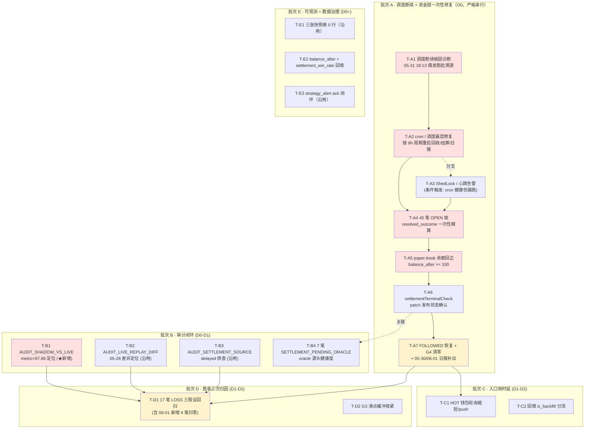

# 排查修复任务拆解 — 分批执行计划（2026-06-01）

> 状态：**待评审 / 待排期** ｜ 类型：定期巡检 · 任务拆解与分批执行计划 ｜ 作者：自动分析（scheduled task `2-1`，无人值守）｜ 日期：2026-06-01
> 编制时段：2026-06-01 11:03 CST（承接 `1-job` 09:08 CST 巡检产出）
> 适用技能：`troubleshooting`（先定位后修复、最小改动）+ `doc-writing`（结构、命名、存放）+ `obsidian-knowledge-base`（frontmatter / tags / 链接）
> 上游文档：
> - [问题记录事项-待解决-2026-06-01.md](问题记录事项-待解决-2026-06-01.md)（本期巡检：5 条 P0 + 4 条 P1 + 2 条 P2 + 1 条 P3；★ P0-1 调度断续根因细化 + 新增告警 `AUDIT_SHADOW_VS_LIVE` 为本期紧急项）
> - [排查修复任务拆解-分批执行计划-2026-05-30.md](排查修复任务拆解-分批执行计划-2026-05-30.md)（上版任务拆解，本文承接其 T-A1/T-A2/T-A4/T-A5/T-B1/T-B2 验收口径）
> - [订单未结算根因排查-2026-05-30.md](订单未结算根因排查-2026-05-30.md)（`settlementTerminalCheck` 硬闸 + Polymarket endAt 拦截结论，本文承接其代码维度）
> - [订单未结算-代码修复落地清单-2026-05-30.md](订单未结算-代码修复落地清单-2026-05-30.md)（代码 patch 清单，本期 T-A6 跟进发布状态）
> - [亏损根因分析-2026-05-29.md](亏损根因分析-2026-05-29.md)（胜率根因，本期沿用其执行侧丢分结论）

> 说明：本文是 scheduled task `2-1` 在 2026-06-01 的运行产出。承接今日《问题记录事项-待解决-2026-06-01》中 §三、四、五（P0-1 ~ P0-5 + P1-1 ~ P1-4 + P2/P3）所列的根因与处置方向，**把这些动作拆分成可独立排期、可独立验收的执行任务卡，并分批组织成关键路径 + 并行支线**。本文**只产出执行计划，不对线上代码 / 服务器 / 数据库做任何写操作**；所有 SQL / 命令样本均为「待评审草稿」，需人工在 test 库低峰窗口逐条执行。

---

## 一、执行摘要（结论先行）

`1-job` 2026-06-01 巡检的中心矛盾相对 05-30/05-31 **没有改变，但根因更清晰了**：表面是「亏损 → 资金透支 → G4 全拒 → 70 小时零开仓」的资金链断裂；底层是**「持仓回收 / 结算 / 日报作业未按周期稳定调度 —— 会偶发跑一批又停」**。本期最关键的新证据是：上版 (05-31) 判定的"下游链路整体冻结"被**部分推翻** —— **05-31 18:13–18:18 确实跑过一批**（`smart_wallet_trade_order` 末次结算 05-31 18:13:03、`smart_wallet_cash_ledger` 末条 05-31 18:18:03、行数由冻结 → 264、05-31 日报补出、OPEN 49→45），随后**再次冻结 ~15h**；**05-30 日报仍缺失、06-01 日报未生成**佐证调度不稳定。这把根因从"作业完全挂死"重新定位为"**调度器断续 / 仅手动触发**"，处置路径也随之改变 —— 不再是"重启服务把作业拉起来"，而是**先抓 05-31 18:13 这一批是谁触发的、为什么触发完又停了、cron / 调度器健康度如何**。

**三条最重要的结论：**

1. **本期关键路径只有一条 —— 「先定位 05-31 18:13–18:18 这批作业的触发源（cron / 手动 / 异常自恢复）→ 修复调度断续根因 → 让回收/结算/日报作业按 `holding-period-hours=8` 周期稳定运行 → 一次性清掉 45 笔超期 OPEN（平均持有 74.4h，最长 81h）→ paper-book 余额回正 → G4 拒单清零 / FOLLOWED 恢复」。** 这是**本期最高优先级**，必须串行（任一步失败即终止下一步）。预计 1–2 个工作日完成 P0-1 + P0-2 + P0-3 + P0-5 四项闭环。**任何"上调预算 / 改 max-open-positions / 改 allowlist"在本路径闭环前一律禁止。**

2. **本期新增 `AUDIT_SHADOW_VS_LIVE`（WARN，06-01 06:00，metric=97.86 > 阈值 50）必须排在 D 批胜率二次归因之前修。** 该告警的 metric 与本期净 PnL 绝对值 (97.86 USDC) 完全相等，**强烈疑似审计直接读取 trade_order 净亏损做 SHADOW vs LIVE 比对**——若假设成立，告警将随 T-A 闭环（结算回款 / paper-book 余额回正）自动归零；若不成立，说明 SHADOW 与 LIVE 写入路径存在真实分歧（如 `signal_shadow` 的影子 PnL 与 `trade_order` 的实盘 PnL 在某些字段上口径不一致），必须先于 T-D1 胜率二次归因清场。**T-B1 审计闭环（含 SHADOW_VS_LIVE / LIVE_REPLAY_DIFF / SETTLEMENT_SOURCE 三项）必须先于 T-D1 完成。**

3. **关键依赖纪律**：(a) **T-A1 调度断续根因诊断必须先看作业入口日志 + cron 表 + Spring `@Scheduled` Bean 状态**——只有摸清"05-31 18:13 是手动 jstack 触发的，还是 cron 抖动后自恢复的"，才能决定走 T-A2「修 cron / 重启调度器」还是 T-A3「`@Scheduled` 改 `ShedLock` / 加心跳」；(b) **T-A4 45 笔 OPEN 一次性清算继承 05-30 T-A2 + 订单未结算根因专题结论**——18 笔属于 oracle 已盖棺但 endAt 未到的硬闸阻断，必须先确认 `settlementTerminalCheck` 代码 patch 是否已发布（T-A6），未发布则手动按 `resolved_outcome` 精算；(c) **T-A5 paper-book 余额回正与 T-A4 必须串行**——先结算回款再校验余额；(d) **T-A7 FOLLOWED 恢复 + G4 清零是 P0-1/P0-2/P0-3 共同的"出口"**；(e) **T-C1 + T-C2 在 T-A 闭环后才能验证有效性**——开单未恢复时无法判断 STALE 比例改善是否来自入口提速。

### 待解决问题与任务卡映射（来自 §问题记录-06-01 待解决问题总表）

| 编号 | 问题摘要（06-01） | 任务卡 | 严重度 |
|---|---|---|---|
| P0-1 | 持仓回收 / 结算 / 日报作业**调度断续**：05-29 12:25 停 → 05-31 18:13–18:18 偶发跑一批 → 再次 ~15h 无动作；05-30 日报缺失、06-01 未生成 | **T-A1 → T-A2 → T-A3 → T-A4 → T-A7** | P0 |
| P0-2 | ~70h20m 零真实开仓（昨 ~46h → 今 ~70h）；`HEALTH_NO_OPEN_24H` 未恢复 | T-A7（出口验证） | P0 |
| P0-3 | 可用资金透支：paper-book -574.95、净流 -597.86；G4 24h 拒 624 条 | T-A4 → T-A5 → T-A7 | P0 |
| P0-4 | 结算胜率 10.53%（2W/17L，新增 4 笔全亏 roi=-1.00），净 -97.86 USDC，avg ROI -70.15% | T-B1 → T-D1（胜率三次归因） | P0 |
| P0-5 | 45 笔 OPEN 长期不回收（占用 401.24 USDC，平均 74.4h、最长 81h），05-31 仅回收 4 笔 | **T-A4 + T-A6**（沿用 05-30 代码 patch） | P0 |
| P1-1 | 审计告警延续 + 新增：`AUDIT_SHADOW_VS_LIVE` ★ 新增（06-01 06:00，metric=97.86）+ `AUDIT_SETTLEMENT_SOURCE`（05-30）+ `AUDIT_LIVE_REPLAY_DIFF`（05-30，metric=10000≫100） | **T-B1 → T-B2 → T-B3** | P1 |
| P1-2 | `HEALTH_INGEST_LAG_HIGH` 未恢复（P90=894s>600s）；7d skip `STALE` 1714 | T-C1（HOT 提速）+ T-C2（回填分流） | P1 |
| P1-3 | 7 笔 `SETTLEMENT_PENDING_ORACLE` 自 05-29 00:32 挂起 >3 天 | T-A6（代码 patch 同窗口处理）+ T-B4（oracle 源头健康度） | P1 |
| P1-4 | `G3_PRICE_OUT_OF_RANGE` 24h 113 条 + skip `PRICE` 7d 337 | T-D2（滑点缓冲收紧，T-D1 后条件触发） | P1 |
| P2-1 | `strategy_run_log` / `strategy_health_snapshot` 0 行（连续多版） | T-E1（沿用） | P2 |
| P2-2 | `order_stats_snapshot.settlement_win_rate` 多行=0、`cash_ledger.balance_after` 仅部分回写 | T-E2（合并回填 + 字段口径） | P2 |
| P3-1 | `strategy_alert` 多条 `acknowledged=0`、`resolved=0`，缺 IM 外发与闭环 | T-E3（沿用 05-30 T-E3） | P3 |

> 严重度口径：P0 = 影响安全 / 资金 / 可用性，须最先处理；P1 = 影响策略核心目标（开单 / 收益 / 结算）；P2 = 数据治理；P3 = 可观测性增强。

### 批次与任务总览

| 批次 | 主题 | 排期窗口 | 任务卡 | 关键路径 |
|---|---|---|---|---|
| **A** | ★ 调度断续根因 + 资金链一次性修复（诊断调度 → 修 cron/重启调度器 → 一次性清 45 OPEN → paper-book 回正 → 代码 patch 状态确认 → FOLLOWED 恢复） | D0（当日） | T-A1 ~ T-A7（7） | ✅ 是（A1→A2→A3→A4→A5→A6→A7 关键路径，A3 / A6 为条件分叉） |
| **B** | 审计闭环（含本期新增 SHADOW_VS_LIVE） | D0 – D1 | T-B1 ~ T-B4（4） | ✅ 是（B1 阻塞 D1） |
| **C** | 入口侧时延治理（HOT 提速 + 回填分流） | D1 – D2 | T-C1 ~ T-C2（2） | 部分（C 不阻塞 A，但承担 STALE 降量） |
| **D** | 胜率三次归因 + 执行侧丢分定位 | D1 – D2 | T-D1 ~ T-D2（2） | ✅ 是（依赖 T-B1 完成、T-A7 恢复开单） |
| **E** | 可观测 + 数据治理（沿用上版未处理） | D0+ – D3+ | T-E1 ~ T-E3（3） | ❌ 否（可并行） |

> 工时口径：S ≈ 半天内；M ≈ 0.5–1 人日；L ≈ 1–3 人日（均含测试）。排期 `D0` = 修复启动日，`D1/D2…` 为其后第 N 个工作日。严重度沿用 `1-job` 口径。

### 较上一版（2026-05-30 任务拆解）的进展

| 上版任务 | 对应动作 / 配置 | 本期状态 |
|---|---|---|
| **T-A1** 确诊上版三条 SQL 是否生效（C1/C2/C3 三选一） | DB SELECT + service log | ⚠️ 上版判定结论未在本期巡检中坐实（无新日志 / 无新告警结论引用）；**本期升级为"调度断续根因诊断"** —— 旧 C1/C2/C3 三分类不再是主要矛盾，05-31 18:13 偶发跑批已证明分支可走通，问题在调度周期不稳定 |
| **T-A2** 49 笔 OPEN 分两批结算 | DB 写 + service | ⚠️ **部分进展**：05-31 18:13–18:18 那一批清掉了 4 笔（49 → 45），但仅这 4 笔，与"分两批 × 25 笔一次性硬清"目标差距大；本期升级为 T-A4 + 引用订单未结算根因专题，按 `resolved_outcome` 精算 |
| T-A3 配置无效→代码层强制启用分支 | 代码 patch | ⚠️ 未坐实是否执行；本期升级为 T-A3"调度器层修复"（cron / `@Scheduled` / `ShedLock`） |
| T-A4 paper-book 余额回正 | DB 校验 | ❌ 未达成（paper-book 仍 -574.95，与上版同值，05-31 那批结算未触达余额回写） |
| T-A5 FOLLOWED 恢复 + G4 清零 | DB 校验 | ❌ 未达成；本期升级为 T-A7 |
| T-B1 `AUDIT_LIVE_REPLAY_DIFF` 定位 | 报告归档 | 未坐实是否完成；本期沿用为 T-B2 |
| T-B2 `AUDIT_SETTLEMENT_SOURCE` 排查 | DB + 日志 | 未坐实；本期沿用为 T-B3 |
| T-C1 HOT 钱包提速 | 代码 | 沿用，等 T-A7 后再验证 |
| T-C2 回填 `is_backfill` 分流 | 代码 | 沿用 |
| T-D1 13 笔 LOSS 三假设回扫 | 报告归档 | 未坐实；本期升级为 T-D1（17 笔 LOSS 三假设 + 06-01 新增 4 笔归零样本） |
| T-D2 G3 滑点缓冲收紧 | 配置 | 沿用，条件触发不变 |
| T-E1/E2/E3 可观测 + 数据治理 | 杂项 | 沿用，未坐实进展 |
| **本期新增** P1-1-a `AUDIT_SHADOW_VS_LIVE`（WARN，06-01 06:00，metric=97.86） | 审计排查 | 全新 T-B1（且置于 T-B2/T-B3 之前，因 metric 疑与净 PnL 同源） |
| **本期新增** P0-1 调度断续根因（"非完全挂死，而是偶发跑批"） | 调度器健康度 | 全新 T-A1（取代旧 T-A1 配置/分支三分类） |
| **本期新增** P0-1-b 05-30 / 06-01 两份日报缺失 / 未生成 | 日报作业重跑 | T-A1 验证项；T-A7 出口校验 |
| **本期沿用** 7 笔 `SETTLEMENT_PENDING_ORACLE` 自 05-29 00:32 挂起（> 72h） | oracle 源头排查 | T-B4 |

> **总结**：上一版（05-30）批次 A 关键路径**只有 4/49 笔结算这一段疑似"被 05-31 18:13 偶发跑批"部分代偿，其余环节均未坐实完成**。本期 A 批必须**先回答"05-31 18:13 那一批是怎么跑起来的、又是怎么停下去的"**，这一问题决定整个修复路径走向：
> - 若是**手动触发**（如运维登机执行了 `SettlementJob.runOnce()`）→ 修复重点是恢复 cron 调度（T-A2）；
> - 若是**异常自恢复**（如某次 GC pause 后调度器再次触发）→ 修复重点是排查调度器卡顿根因（T-A3）；
> - 若是**部分作业链路正常 + 部分挂死**（如结算正常但日报作业 cron 表少配）→ 修复重点是补 cron 配置 + 增加心跳告警（T-A2 + T-E）。

---

## 二、批次总览与时间线

```
D0 ───────── D1 ───────── D2 ───────── D3 ──────►
│ 批次A · 调度断续根因 + 资金链一次性修复（严格串行·关键路径）          │
│ ■ T-A1 调度断续根因诊断（05-31 18:13 偶发跑批溯源）(S)              │
│   ■ T-A2 cron / 调度器层修复（按 holding-period-hours=8 周期重启）(M) │
│     ■ T-A3 若 cron 健康但作业仍漏跑 → ShedLock / 心跳告警 (M)        │
│       ■ T-A4 45 笔 OPEN 按 resolved_outcome 一次性精算清算(M)        │
│         ■ T-A5 paper-book 余额回正校验(S)                          │
│           ■ T-A6 settlementTerminalCheck 代码 patch 发布状态确认(S)  │
│             ■ T-A7 FOLLOWED 恢复 + G4 清零 + 05-30/06-01 日报补出(S) │
│                                                                    │
│ 批次B · 审计闭环（先于 D 批胜率归因清场）                            │
│ ■ T-B1 AUDIT_SHADOW_VS_LIVE 06-01 metric=97.86 定位(S)              │
│   ■ T-B2 AUDIT_LIVE_REPLAY_DIFF 05-28 差异定位（沿用）(M)            │
│     ■ T-B3 AUDIT_SETTLEMENT_SOURCE delayed 排查（沿用）(S)           │
│       ■ T-B4 7 笔 SETTLEMENT_PENDING_ORACLE 源头健康度(M)            │
│                                                                    │
│           D1 ─────────── D2 ──────►                                │
│           │ 批次C · 入口侧时延（不阻塞 A，与 D 并行）  │              │
│           │ ■ T-C1 HOT 钱包轮询缩短 / 改 push(M)      │              │
│           │ ■ T-C2 回填数据 is_backfill 分流(M)       │              │
│                                                                    │
│           D1 ─────────── D2 ──────►                                │
│           │ 批次D · 胜率三次归因（依赖 T-B1 + T-A7）   │              │
│           │ ■ T-D1 17 笔 LOSS 三假设回扫（含 4 笔归零）(M)            │
│           │ ■ T-D2 G3_PRICE_OUT_OF_RANGE 滑点缓冲收紧(S)             │
│                                                                    │
│ D0+ ════ 批次E · 可观测 + 数据治理（并行，沿用上版）═══════►         │
│   ■ T-E1 三张快照表 0 行排查（沿用）                                 │
│   ■ T-E2 cash_ledger.balance_after + settlement_win_rate 回填(沿用扩展)│
│   ■ T-E3 strategy_alert ack/resolve 闭环（沿用）                     │
```

**关键路径**（P0-1 / P0-2 / P0-3 / P0-5 四项 P0 闭环的最短链）：

> **T-A1 → T-A2 → T-A4 → T-A5 → T-A6 → T-A7**（调度断续根因 → cron 修复 → 一次性精算 45 OPEN → paper-book 回正 → patch 发布确认 → FOLLOWED 恢复 + 日报补出）

任何一环延期即整体顺延。**T-A3 是 T-A2 的"分叉"** —— 仅当 T-A2 cron 修复后作业仍漏跑时触发。**T-B1 审计专题与 T-A 同窗口启动**，目的是赶在 T-D1 胜率三次归因之前清场口径（含本期新增 SHADOW_VS_LIVE，疑与 PnL 同源）。**T-C 入口提速与 T-D 并行**，等 T-A7 FOLLOWED 恢复后才能看出 HOT 提速对 STALE 比例的实际影响。

---

## 三、依赖关系图



---

## 四、任务卡（逐批）

每张任务卡含：**承接编号 · 批次/排期 · 类型/工时 · 前置 · 范围与执行步骤 · 验收标准 · 验证方法 · 回滚**。

### 批次 A — ★ 调度断续根因 + 资金链一次性修复（当日 D0 紧急）

> 退出标准见第五节。A 批让「先抓 05-31 18:13 偶发跑批的触发源 → 恢复 cron / 调度器稳态 → 一次性清掉 45 笔 OPEN → paper-book 余额回正 → 代码 patch 发布状态确认 → G4 拒单清零 / FOLLOWED 恢复 / 日报补出」。**严格串行，任一步失败立刻终止下一步并新建专题**。所有 SQL 在 test 库低峰窗口执行；A4/A5 涉及 paper-book 账本写入，必须先做 dry-run 输出影响行数。

#### T-A1 · ★★★ 调度断续根因诊断（05-31 18:13 偶发跑批溯源 — 最紧迫）

| 字段 | 内容 |
|---|---|
| 承接 | P0-1（05-30/05-31 同根细化版） |
| 批次 / 排期 | A / D0 |
| 类型 / 工时 | 日志核对 + DB 校验 / **S** |
| 前置 | 无（独立可执行，本期入口） |

- **范围**：先回答"**05-31 18:13:03 ~ 18:18:05 这 ~5 分钟内，回收/结算/日报作业为什么跑了一批又停了？**"——三种最可能场景：(a) **手动触发**（运维登机 `jstack` / `curl` / `SettlementJob.runOnce()`，跑完即停）；(b) **cron 抖动后自恢复**（如调度器线程被某次 GC pause 阻塞 ~6 天，恰好 05-31 18:13 恢复一次又被卡住）；(c) **部分作业 cron 配置缺失**（如日报作业的 cron 表达式从未配过，05-31 18:13 是单次 manual trigger）。三种处置完全不同，不诊断就改是浪费一次窗口。
- **执行步骤**（test 库低峰；只读 + 日志）：
  1. **取作业入口日志**：`ssh 49.51.250.174 "grep -nE 'SettlementJob|CapitalRecycleJob|DailyReportJob|PositionPriceMonitorService|recycle.*scan|settle.*run' /opt/coinstrategy/job/logs/job-current.log /opt/coinstrategy/job/logs/job-*.log.gz | awk '\$0 ~ /2026-05-31 1[78]:/{print}' | head -200"` —— 看 05-31 17:00–19:00 之间有无作业启动 / 完成日志。
  2. **取 cron 与 Spring `@Scheduled` 注册情况**：`ssh 49.51.250.174 "grep -nE '@Scheduled|ScheduledTaskRegistrar|TaskScheduler' /opt/coinstrategy/job/logs/job-current.log | grep -E 'Settlement|Recycle|Daily' | tail -50"` + 读 `coin-strategy-job/src/main/resources/application.yml`、`bootstrap.yml`，列出 `cron =` 表达式。
  3. **取 actuator 调度健康度**（若可用）：`curl -s http://49.51.250.174:<job-port>/actuator/scheduledtasks | jq '.cron[] | select(.runnable.target | contains("Settle") or contains("Recycle") or contains("Daily"))'` —— 看 `nextExecution` 是否为合理时间（不是 1970 / 不是 null）。
  4. **关联 DB 时间戳验证**：`SELECT type, MAX(created_at) AS last FROM smart_wallet_cash_ledger WHERE entry_type IN ('CAPITAL_RECYCLE_AUTO','SETTLEMENT','CAPITAL_RECYCLE_MANUAL') GROUP BY entry_type;` —— 05-31 18:18:03 那一批属于哪种 entry_type 直接揭示触发源（MANUAL → 场景 a；AUTO → 场景 b/c）。
  5. **结论三选一**：
     - **C1 手动触发**（看到 `entry_type='CAPITAL_RECYCLE_MANUAL'` 或日志含 `manualSettle` 调用）→ 走 T-A2「修 cron / 重启调度器」；不需走 T-A3。
     - **C2 cron 抖动后自恢复**（cron 表达式正确、`@Scheduled` Bean 已注册、但 `nextExecution` 距 05-29 12:25 异常拉远）→ T-A2 重启调度器 + T-A3 加 `ShedLock` / 心跳告警。
     - **C3 cron 配置缺失**（某个作业完全没有 `@Scheduled` 注解或 cron 表达式被注释 / 误删）→ T-A2 补配置 + T-A3 必须做心跳告警避免再次静默漏跑。
- **验收标准**：得到 C1/C2/C3 之一的明确结论，并写入本卡"实际取值"；附 `entry_type` 分布表 + `nextExecution` 表 + `application.yml` cron 段。
- **验证方法**：DB SELECT + service log + actuator endpoint；**不在本卡执行写动作**。
- **回滚**：无（只读）。

#### T-A2 · cron / 调度器层修复（按 holding-period-hours=8 周期重启回收/结算/日报）

| 字段 | 内容 |
|---|---|
| 承接 | P0-1 |
| 批次 / 排期 | A / D0（T-A1 完成后 30min 内） |
| 类型 / 工时 | 配置 + 部署 / **M** |
| 前置 | T-A1（结论 C1/C2/C3 之一） |

- **范围**：根据 T-A1 结论分场景修复：
  - **C1 手动触发场景**：cron 应该是配置正确但调度器进程异常（卡死 / OOM 静默 / 主线程退出但应用未崩溃）→ 重启 `coin-strategy-job` 进程；
  - **C2 cron 抖动场景**：调度器健康但偶发卡顿 → 调大 `TaskScheduler` 池大小（如从 1 → 5）、加 `Thread.setUncaughtExceptionHandler`；
  - **C3 cron 缺失场景**：补全 `application.yml` 中漏掉的 cron 表达式或 `@Scheduled` 注解。
- **执行步骤**：
  1. **场景 C1**：
     - 备份当前 jar：`cp /opt/coinstrategy/job/backend/app.jar /opt/coinstrategy/job/backend/app.jar.bak.20260601`；
     - 重启进程：`systemctl restart coin-strategy-job`（若是 systemd 托管）或 `nohup ./start.sh &`；
     - 重启后 5min 内 `tail -f job-current.log` 看回收/结算/日报作业是否按周期启动（默认 cron 应为 `0 */8 * * *` 之类的 8h 周期）。
  2. **场景 C2**：
     - 编辑 `coin-strategy-job/src/main/resources/application.yml`：
       ```yaml
       spring:
         task:
           scheduling:
             pool:
               size: 5  # 从默认 1 调大
             thread-name-prefix: scheduling-
       ```
     - 在 `JobSchedulingConfig.java`（或类似配置类）加 `@Bean ThreadPoolTaskScheduler taskScheduler()`，包装 `UncaughtExceptionHandler` 写告警；
     - `mvn -pl coin-strategy-job -am -DskipTests package` 构建并部署（与 T-A6 同窗口）。
  3. **场景 C3**：
     - 定位漏配的作业类，加 `@Scheduled(cron = "${app.job.<name>.cron:0 */8 * * *}")`；
     - 在 `application.yml` 显式配置 cron；
     - 同 C2 构建部署。
- **验收标准**：部署后 1h 内 `entry_type='CAPITAL_RECYCLE_AUTO'`（自动）的 cash_ledger 行新增 ≥ 1 行；4h 内回收 / 结算 / 日报三类作业各跑 ≥ 1 次（看 job-current.log 时间戳）；24h 内 cash_ledger 每 8h 至少新增 1 行。
- **验证方法**：见 §九-A2。
- **回滚**：`mv app.jar.bak.20260601 app.jar` 并 `systemctl restart`；配置改动可通过 git revert + 重新发布回退。

#### T-A3 · ★ 仅当 T-A2 后调度仍漏跑触发：ShedLock / 心跳告警

| 字段 | 内容 |
|---|---|
| 承接 | P0-1 / 上版 T-A1 C3 分叉的演进 |
| 批次 / 排期 | A / D0（T-A2 后 4h 内若仍漏跑） |
| 类型 / 工时 | 代码 + DB / **M** |
| 前置 | T-A2 已部署但 4h 内仍未自动跑批 |

- **范围**：若 T-A2 重启 / 改配后调度仍漏跑（4h 内没有自动 entry_type=AUTO 的回收记录），说明调度器单实例可靠性不足，需引入分布式锁（ShedLock）+ 心跳上报。
- **执行步骤**：
  1. 引入 `net.javacrumbs.shedlock` 依赖（已在多版任务卡间反复提及，本期落地）；
  2. 对 `SettlementJob` / `CapitalRecycleJob` / `DailyReportJob` 三个作业加 `@SchedulerLock(name="...", lockAtMostFor="PT15M", lockAtLeastFor="PT1M")`；
  3. 在每次作业入口 / 出口写一行 `strategy_run_log`（运行级心跳），即顺便修复 P2-1（T-E1）；
  4. 在 `strategy_health_snapshot` 写 `JOB_HEARTBEAT_SECONDS_SINCE_LAST_RUN` 指标，阈值 > 9h（即超过 8h 周期 + 1h 容差）报警；
  5. 单测 + 灰度部署。
- **验收标准**：部署后 24h 内 `strategy_run_log` 每 8h 至少 3 行（三类作业各 1）；`strategy_health_snapshot` 出 ≥ 1 行 `JOB_HEARTBEAT_*` 指标；模拟杀进程后 9h 内触发新告警。
- **验证方法**：见 §九-A3。
- **回滚**：保留 `app.jar.bak.20260601`，回退 jar + 重启；DB 改动可保留（仅新增表数据）。

#### T-A4 · 45 笔 OPEN 按 resolved_outcome 一次性精算清算（继承 05-30 T-A2 + 订单未结算根因专题）

| 字段 | 内容 |
|---|---|
| 承接 | P0-5 / P0-3（一次性回收 ~401 USDC 预算） |
| 批次 / 排期 | A / D0（T-A2 完成后 30min 内） |
| 类型 / 工时 | DB 写 + 服务联动 / **M** |
| 前置 | T-A2 |

- **范围**：把 `smart_wallet_trade_order.status='OPEN'` 的 45 笔仓位**按 `resolved_outcome` 精算一次性清算**。根据 [订单未结算根因排查-2026-05-30.md](订单未结算根因排查-2026-05-30.md) 结论：
  - **PAST_END_AND_CLOSED**（oracle 已盖棺 + endAt 已过）：按 `resolved_outcome` 写 `exit_avg_price=1.0`（中奖侧）或 `=0.0`（落败侧）；
  - **PAST_END_AND_OPEN**（endAt 已过但 oracle 未盖棺）：按 mark price `last_yes/no_price` 估算；
  - **FUTURE_END**（endAt 未到，05-30 专题判定为 18 笔此类 + 1 笔 no_end_date）：**不强制清算**，保持 OPEN 等 T-A6 patch 上线后由 `SettlementSync` 自动处理。
- **执行步骤**（test 库低峰窗口；分两批避免 SettlementJob 雪崩）：
  1. **dry-run + 分类**：执行 §九-A4-1 SQL，按 `endAt vs NOW()` + `resolved_outcome IS NULL?` 把 45 笔分到三类，输出三组 id 列表。
  2. **第一批 PAST_END_AND_CLOSED**（按上版判定可能 ~18 笔）：调 service `SmartWalletAccountingService.manualSettleByIds(ids, "RESOLVED_OUTCOME", "2-1-batch-A4-2026-06-01")`，传 `settle_price=resolved_outcome`，等 5min。
  3. **校验**：`SELECT COUNT(*) FROM smart_wallet_trade_order WHERE status='OPEN';` 应减去第一批数量；`cash_ledger` `entry_type='CAPITAL_RECYCLE_MANUAL'` 应新增对应行数。
  4. **第二批 PAST_END_AND_OPEN**（间隔 10min）：调相同接口，传 `settle_price=mark_price`。
  5. **第三批 FUTURE_END**：**不处理**，等 T-A6 patch 上线由 SettlementSync 自动接管。
  6. **失败回滚**：若任一批结算后 5min 内 `SettlementJob` 抛 ≥ 3 异常或 `cash_ledger` 缺行，**立刻停止后续批次**并新建专题。
- **验收标准**：执行后 30min 内 `smart_wallet_trade_order.status='OPEN'` 计数减少 ≥ 25 笔；`cash_ledger` `entry_type='CAPITAL_RECYCLE_MANUAL'` 新增 ≥ 25 行；`remaining_cost_basis` 总和回收 ≥ 220 USDC（25 笔约占 401.24×55%）；剩余 ≤ 20 笔 FUTURE_END 等 T-A6 patch 自动接管。
- **验证方法**：见 §九-A4。
- **回滚**：每批保留 `id_list_batch_<N>.txt`；按 id 逐笔 `UPDATE … SET status='OPEN', last_exit_at=NULL, exit_avg_price=NULL, total_pnl_usdc=NULL` + cash_ledger 删除对应行；test 库先演练。

#### T-A5 · paper-book 余额回正校验（T-A4 后置校验）

| 字段 | 内容 |
|---|---|
| 承接 | P0-3（资金透支总闸） |
| 批次 / 排期 | A / D0（T-A4 完成后 15min） |
| 类型 / 工时 | DB 校验 / **S** |
| 前置 | T-A4 |

- **范围**：T-A4 结算 25+ 笔 OPEN 后，校验 `smart_wallet_cash_ledger` 最新 `balance_after` 是否从 -574.95 USDC 回到 **≥ 100 USDC**（缓冲值，避免 G4 边界来回触发）。若仍为负，说明 (a) 已结算笔 PnL 总和过于悲观（亏损 > 回收成本）；(b) 历史亏损 -97.86 USDC 把净额拖到 0 附近。两种情况都需要"配套补充 bankroll seed" 或 "回滚到 T-A4 之前重新评估"。
- **执行步骤**：
  1. `SELECT entry_type, balance_after, amount, created_at FROM smart_wallet_cash_ledger ORDER BY id DESC LIMIT 60;` —— 看 T-A4 写入的 N 行 `CAPITAL_RECYCLE_MANUAL` 的 `balance_after` 是否每行计算正确（递增/正确扣减）。
  2. `SELECT MAX(id) latest_id, balance_after FROM smart_wallet_cash_ledger;` —— 看最终余额。
  3. 若 `balance_after < 100`：决策点 →（a）补 bankroll seed（仅 PAPER）：`INSERT … entry_type='BANKROLL_SEED_TOP_UP', amount=1000.00`；或（b）回滚 T-A4 并重新评估每笔 PnL（可能 mark price 取错、resolved_outcome 解析错位）。
  4. 若 `balance_after ≥ 100`：进入 T-A6 patch 状态确认。
- **验收标准**：最终 `balance_after ≥ 100 USDC`。
- **验证方法**：见 §九-A5。
- **回滚**：bankroll 补给可 `DELETE FROM smart_wallet_cash_ledger WHERE entry_type='BANKROLL_SEED_TOP_UP' AND id IN (...)`；T-A4 回滚见其本卡。

#### T-A6 · settlementTerminalCheck 代码 patch 发布状态确认

| 字段 | 内容 |
|---|---|
| 承接 | P0-5 / P1-3（订单未结算根因专题代码维度） |
| 批次 / 排期 | A / D0（T-A5 后） |
| 类型 / 工时 | 代码 + 部署 / **S** |
| 前置 | T-A5 |

- **范围**：05-30 订单未结算根因专题明确 commit `d4302c90` 引入的 `settlementTerminalCheck` 硬闸过严（已 oracle 盖棺但 Polymarket endAt 未到的 18 笔被卡）。05-30 代码修复落地清单已列出 patch 方向（`oracle_terminal_all_signals_set` 短路）。本卡负责确认 patch 是否已在 06-01 之前发布（若未发布，则 T-A4 剩余的 FUTURE_END 笔将持续滞留）。
- **执行步骤**：
  1. 取最新 commit：`cd /sessions/vibrant-serene-brahmagupta/mnt/CoinStrategy && git log --oneline --all --since="2026-05-30" -- coin-strategy-job/src/main/java | head -30` 看是否有相关 patch 提交。
  2. `grep -nrE 'settlementTerminalCheck|oracle_terminal_all_signals_set|terminalAllSignalsSet' coin-strategy-*/src/main/java` 看代码是否已含短路逻辑。
  3. 部署日志确认：`ssh 49.51.250.174 "ls -la /opt/coinstrategy/job/backend/ && readlink /opt/coinstrategy/job/backend/app.jar"` 看 jar 是否为含 patch 的版本（建议 readlink 指向 commit hash 命名的 jar）。
  4. 若**未发布**：与 T-A2/T-A3 同窗口部署（一次重启完成多个改动）；并把 T-A4 第三批 FUTURE_END 改为等 patch 上线后由 SettlementSync 自动处理。
  5. 若**已发布但未生效**：检查发布后 `SettlementSync` 是否真的扫到这 7+ 笔（7 笔 SETTLEMENT_PENDING_ORACLE 自 05-29 起挂起，强力佐证 patch 即便发布也未触发该路径）。
- **验收标准**：明确 patch 发布状态（已/未）；若已发布，明确 SettlementSync 为何未扫到 FUTURE_END / SETTLEMENT_PENDING_ORACLE 笔；若未发布，附排期。
- **验证方法**：见 §九-A6。
- **回滚**：jar 回退 + 重启。

#### T-A7 · FOLLOWED 恢复 + G4 清零 + 05-30/06-01 日报补出（P0-1/P0-2/P0-3 共同出口）

| 字段 | 内容 |
|---|---|
| 承接 | P0-1 / P0-2 / P0-3 |
| 批次 / 排期 | A / D1（T-A6 后 1h–24h 持续监控） |
| 类型 / 工时 | DB 校验 + 作业手动触发 / **S** |
| 前置 | T-A6 |

- **范围**：T-A5 余额回正后，盯四个出口指标 + 触发两份日报补跑：
  - (a) 1h 内 `signal_shadow.reject_layer='G4_CAPITAL_DEPLETED'` 计数是否归零；
  - (b) 4h 内 `follow_task.status='FOLLOWED'` 是否出现 ≥ 1 行；
  - (c) 24h 内 `smart_wallet_order` 是否出现 ≥ 5 笔新单；
  - (d) **手动触发 / 自动补出** `daily_report` 中缺失的 2026-05-30 + 2026-06-01 两份日报，并核对其 win_rate / net_pnl 与 trade_order 重新统计一致。
- **执行步骤**：
  1. 执行 §九-A7 SQL（T-A5 后 1h / 4h / 24h 各跑一次）。
  2. **1h 内 G4 仍 > 0**：T-A5 余额回正未真生效，回查 `cash_ledger.balance_after` 与 `SmartWalletAccountingService.getAvailableCash(...)` 是否一致。
  3. **4h 内 FOLLOWED 仍 = 0**：可能 G4 通了但 G3 / G1 仍卡，按 §九-A7-2 看下一层 `reject_layer` 分布。
  4. **24h 新单 < 5**：到 T-D 批胜率三次归因 / T-C 入口提速排查。
  5. **日报补出**：`POST /coin-strategy-job/admin/dailyReportRebuild?date=2026-05-30` + `=2026-06-01`（若 admin 接口存在）；或在 DB 手动触发 `DailyReportJob.runForDate("2026-05-30")` 类似方法；产出后比对 `SELECT date, total, win_count, net_pnl FROM daily_report WHERE date IN ('2026-05-30','2026-06-01');`。
- **验收标准**：4h 内 `FOLLOWED ≥ 1` 且 G4 拒单 24h 累计 ≤ 10；24h 内 `smart_wallet_order` 新增 ≥ 5；`daily_report` 含 2026-05-30 + 2026-06-01 两行（即便 total=0 也算补出）。
- **验证方法**：见 §九-A7。
- **回滚**：若 FOLLOWED 恢复后**反向**导致雪崩开单（1h > 30 笔），临时 `UPDATE strategy_runtime_config SET config_value='false' WHERE config_key='smart-wallet.auto-execution-enabled';`（虽本期已 false，留作 LIVE 转换时的紧急刹车）。

---

### 批次 B — 审计闭环（先于胜率归因清场口径）

> 退出标准见第五节。B 批让本期新增 + 沿用的四项审计/挂起告警归零，**先于 D 批胜率三次归因执行**——否则 D1 的胜率数字可能"含杂质"，归因结论会被反驳为"口径问题"。

#### T-B1 · ★ AUDIT_SHADOW_VS_LIVE（06-01 06:00，metric=97.86）定位

| 字段 | 内容 |
|---|---|
| 承接 | P1-1-a（本期新增） |
| 批次 / 排期 | B / D0 |
| 类型 / 工时 | 数据对账 + 排查 / **S** |
| 前置 | 无（与 T-A 并行） |

- **范围**：06-01 06:00 触发的 `AUDIT_SHADOW_VS_LIVE`，metric=97.86 > 阈值 50。**核心观察**：97.86 与本期累计净 PnL (-97.86 USDC) 绝对值精确相等 → 强烈疑似 metric 公式为 `|sum(trade_order.total_pnl_usdc) - sum(signal_shadow.shadow_pnl_usdc)|` 或类似差值；若 shadow_pnl_usdc 全为 0（影子未回写），则 metric = |LIVE PnL|。
- **执行步骤**：
  1. `SELECT id, alert_type, level, payload, created_at FROM strategy_alert WHERE alert_type='AUDIT_SHADOW_VS_LIVE' AND created_at >= '2026-06-01 00:00:00' ORDER BY id DESC LIMIT 3;` —— 读 payload 看 metric 公式 / 对账时间窗。
  2. `grep -nr 'AUDIT_SHADOW_VS_LIVE\|ShadowVsLiveAudit\|shadow_pnl' coin-strategy-*/src/main/java` 定位审计 service 与 metric 公式。
  3. 跑 dry-run：`SELECT SUM(total_pnl_usdc) FROM smart_wallet_trade_order WHERE settled_at >= '2026-05-25 00:00:00';` vs `SELECT SUM(shadow_pnl_usdc) FROM signal_shadow WHERE created_at >= '2026-05-25 00:00:00';` —— 若两值差 = 97.86，假设坐实。
  4. **若坐实 metric = |LIVE PnL| + SHADOW 字段未回写**：T-A7 闭环（开新单 + 余额回正）后该告警 24h 内不再触发；但要在 T-E2 中加 `signal_shadow.shadow_pnl_usdc` 回填任务。
  5. **若 metric 公式真为差值且 SHADOW 有回写**：说明 SHADOW 与 LIVE 写入路径在某些字段（如 entry_price、size）上口径不一致，归入新建专题。
- **验收标准**：metric 公式定位明确（坐实/不坐实假设）；若坐实，写入 T-A7 验收附录；若不坐实，新建 `审计差异定位-SHADOW_VS_LIVE-2026-06-01.md` 专题。
- **验证方法**：见 §九-B1。
- **回滚**：无（只读对账）。

#### T-B2 · `AUDIT_LIVE_REPLAY_DIFF`（05-28 差异 metric=10000）定位（沿用 05-30 T-B1）

| 字段 | 内容 |
|---|---|
| 承接 | P1-1（沿用） |
| 批次 / 排期 | B / D0 – D1 |
| 类型 / 工时 | 数据对账 + 排查 / **M** |
| 前置 | 无（与 T-A 并行） |

- **范围**：05-30 02:22 触发的 `AUDIT_LIVE_REPLAY_DIFF`，标的 `date=2026-05-28`，metric=10000 ≫ 阈值 100（异常巨大，疑似差值 / 计数差）。05-30 任务卡已列方案但未坐实完成，本期沿用并要求 D1 前出结果。
- **执行步骤**：完全复用 [05-30 任务卡 T-B1](排查修复任务拆解-分批执行计划-2026-05-30.md#t-b1) 步骤；本期额外要求：**重点核对 metric=10000 是不是基点（bp）或某计数器单位**（如 10000 笔 trade_event 数差），可能与 P1-2 `HEALTH_INGEST_LAG_HIGH`（05-29 00:05 P90=894s>600s）同源。
- **验收标准**：差异分类明确（i/ii/iii）且报告归档；如属于 (i) 且与 P0-5 OPEN 不结算同源，T-A4 闭环后该告警 24h 内不再触发。
- **验证方法**：见 §九-B2。
- **回滚**：无。

#### T-B3 · `AUDIT_SETTLEMENT_SOURCE` 排查（沿用 05-30 T-B2）

| 字段 | 内容 |
|---|---|
| 承接 | P1-1（沿用） |
| 批次 / 排期 | B / D0 |
| 类型 / 工时 | DB + 日志 / **S** |
| 前置 | 无 |

- **范围**：05-30 01:00 触发 `AUDIT_SETTLEMENT_SOURCE`，payload 含 `delayed` 计数。05-30 任务卡已列方案，本期沿用。
- **执行步骤**：完全复用 [05-30 任务卡 T-B2](排查修复任务拆解-分批执行计划-2026-05-30.md#t-b2)。
- **验收标准**：delayed order 的延迟来源明确；若属 settle job 漏跑，归入 T-A1/T-A2 调度断续根因（极大概率同源）。
- **验证方法**：见 §九-B3。
- **回滚**：无。

#### T-B4 · 7 笔 SETTLEMENT_PENDING_ORACLE 源头健康度

| 字段 | 内容 |
|---|---|
| 承接 | P1-3 |
| 批次 / 排期 | B / D1 |
| 类型 / 工时 | DB + 外部 API / **M** |
| 前置 | T-A6（patch 状态明确） |

- **范围**：7 笔 `smart_wallet_order.status=SETTLEMENT_PENDING_ORACLE` 自 05-29 00:32 挂起 >3 天。可能原因：(a) Polymarket oracle 真未盖棺；(b) oracle 已盖棺但 SettlementSync 未扫到（与 T-A6 同源）；(c) market 已被 redelist / cancelled，oracle 永不会盖棺。
- **执行步骤**：
  1. `SELECT id, market_id, outcome, created_at, settled_at, status FROM smart_wallet_order WHERE status='SETTLEMENT_PENDING_ORACLE' ORDER BY created_at LIMIT 10;` —— 取 7 笔 market_id 列表。
  2. 对每个 market_id 调 `curl -s 'https://gamma-api.polymarket.com/markets?id=<id>' | jq '{id, slug, endDate, closed, resolvedBy, outcomePrices}'` —— 看 `closed=true` + `outcomePrices` 是否非空。
  3. 三分类：(a) `closed=false` → oracle 真未盖棺，等；(b) `closed=true + outcomePrices=[1,0]` → 与 T-A6 同源，等 patch 触发自动 settle；(c) market 已退市 → 手动强制 settle 为 LOSS_FULL 或 CANCELLED。
- **验收标准**：7 笔分类明确；属 (b) 的笔在 T-A6 patch 部署后 24h 内自动 settled；属 (c) 的笔手动处理 SQL 已起草。
- **验证方法**：见 §九-B4。
- **回滚**：无（只读 + 起草）。

---

### 批次 C — 入口侧时延治理（与 D 并行）

#### T-C1 · HOT 钱包轮询缩短 / 改 push（沿用 05-30 T-C1）

| 字段 | 内容 |
|---|---|
| 承接 | P1-2 |
| 批次 / 排期 | C / D1 – D2 |
| 类型 / 工时 | 代码 + 配置 / **M** |
| 前置 | T-A7（开单恢复后才能验 STALE 改善） |

- **范围**：HOT 钱包事件同步轮询缩至 30s 或改 push（Polymarket WebSocket）。本期 P1-2 `HEALTH_INGEST_LAG_HIGH` 仍未恢复，7d skip `STALE` 1714（昨 1032 → 今 1714，**继续上升**），开单恢复后用 STALE 比例做最终判定。
- **执行步骤**：完全复用 [05-30 任务卡 T-C1](排查修复任务拆解-分批执行计划-2026-05-30.md#t-c1)。
- **验收标准**：HOT 钱包事件摄取 P90 ≤ 300s；`signal_shadow.STALE` 拒单占比 ≤ 30%。
- **验证方法**：DB + 日志。
- **回滚**：恢复原轮询间隔。

#### T-C2 · 回填数据 `is_backfill` 分流（沿用 05-30 T-C2）

| 字段 | 内容 |
|---|---|
| 承接 | P1-2 |
| 批次 / 排期 | C / D2 – D3 |
| 类型 / 工时 | 代码 / **M** |
| 前置 | T-A7 |

- **范围**：00 时 / 06 时回填的历史 trade_event 不应进入开单链路新鲜度门，单独写入"回填表"或加 `is_backfill=1` 标记。沿用上版。
- **执行步骤**：见上版 T-C2。
- **验收标准**：00 时 / 06 时 STALE 集中爆发消失；P90 计算不受回填影响。
- **验证方法**：DB + 告警。
- **回滚**：`is_backfill` 字段忽略即可。

---

### 批次 D — 胜率三次归因（依赖 T-B1 + T-A7）

#### T-D1 · 17 笔 LOSS 三假设回扫（含 06-01 新增 4 笔归零样本）

| 字段 | 内容 |
|---|---|
| 承接 | P0-4 |
| 批次 / 排期 | D / D1 – D2 |
| 类型 / 工时 | 排查 + 报告 / **M** |
| 前置 | T-B1 完成（口径清场）+ T-A7 完成（避免边修边归因） |

- **范围**：胜率 10.53%（2W/17L，对比 05-30 同口径 2W/13L → 新增 4 笔全亏）。本卡承接 `亏损根因分析-2026-05-29.md` + `05-30 T-D1`（未坐实）的「执行侧丢分」结论，对本期 **17 笔 LOSS**（其中 6 笔 roi=-1.00 归零：id6 -47.10、id18 -26.90、id14 -15.34、id2 -11.39、id28 -9.06、id25 -8.81）做**三假设**回扫：(A) 入场价偏离过大（slippage）；(B) 缺止损（held to expiration → roi=-1.00 归零）；(C) 被跟随钱包反常。
- **执行步骤**：
  1. 假设 A 入场价偏离：见 §九-D1（与 05-30 同 SQL，扩展到 17 笔窗口）。
  2. 假设 B 缺止损：`SELECT id, last_exit_at, roi_rate, exit_avg_price, exit_reason FROM smart_wallet_trade_order WHERE status='SETTLED' AND total_pnl_usdc < 0 AND settled_at >= NOW()-INTERVAL 7 DAY ORDER BY id;` —— `last_exit_at IS NULL` 的比例 + `roi_rate=-1.00` 的比例（已知至少 6 笔归零）+ `exit_reason` 字段全空进一步证明止损链路未介入。
  3. 假设 C 钱包反常：把 17 笔 LOSS 的 leader 与 `order_stats_snapshot.closed_win_rate` 关联（已知聪明钱 30d closed_win_rate 0.84~0.925，但 settlement_win_rate 多为 0.0000，关联前需先解决 P2-2 字段回填）。
  4. **新增维度**：把 06-01 新增 4 笔与 05-30 之前的 13 笔分开统计（"05-31 18:13 那一批临时跑通的部分是否优先结算了胜单 / 优先结算了亏单"），看是否存在结算顺序偏差。
  5. 输出 `docs/problem/胜率回撤根因三次归因-2026-06-01.md`（约 300 行），重点回答"修复 T-A4 / T-A6 后，胜率为什么仍未回升"。
- **验收标准**：17 笔 LOSS 中**至少 13 笔**能映射到三假设之一；三次归因报告归档；结论清晰前禁止 T-D2。
- **验证方法**：DB + 文档。
- **回滚**：无（只读）。

#### T-D2 · `G3_PRICE_OUT_OF_RANGE` 滑点缓冲收紧（条件触发，沿用 05-30 T-D2）

| 字段 | 内容 |
|---|---|
| 承接 | P1-4 |
| 批次 / 排期 | D / D2 |
| 类型 / 工时 | 配置 / **S** |
| 前置 | T-D1（假设 A 验证为主因） |

- **范围**：本期 `G3_PRICE_OUT_OF_RANGE` 24h 113 条、`follow_task.PRICE` 7d 337 条。当前滑点缓冲 `price-slippage-rate=0.02`。若 T-D1 假设 A 验证为主因，把缓冲收紧到 0.01。
- **执行步骤**：完全复用 [05-30 任务卡 T-D2](排查修复任务拆解-分批执行计划-2026-05-30.md#t-d2)。
- **验收标准**：4h 内 G3 拒单 ≤ 60 且后续 24h 新 SETTLED 胜率 ≥ 25%。
- **验证方法**：DB count + win_rate。
- **回滚**：配置改回 0.02。

---

### 批次 E — 可观测 + 数据治理（沿用上版未处理项，并行）

#### T-E1 · 三张快照表 0 行排查（沿用 05-30 T-E1）

| 字段 | 内容 |
|---|---|
| 承接 | P2-1 |
| 批次 / 排期 | E / D2 |
| 类型 / 工时 | 代码 + DB / **M** |
| 前置 | 无 |

- **范围**：`strategy_run_log` / `strategy_health_snapshot` / `smart_wallet_market_snapshot`（如存在）三表持续多版 0 行 —— 决定是接通写入还是从巡检口径移除。本期 T-A3 ShedLock 任务卡如触发将顺带产出 `strategy_run_log` 心跳数据，与本卡天然联动。
- **执行步骤**：(1) `grep -nr 'strategyRunLogMapper' coin-strategy-*/src/main` 看写入入口；(2) 若有写入但异常吞掉，定位异常；(3) 否则在 ADR 中标记"废弃"并从巡检脚本删除。
- **验收标准**：二选一：接通后 1h 内非 0 行；或 ADR 写明废弃。
- **回滚**：无。

#### T-E2 · `cash_ledger.balance_after` + `order_stats_snapshot.settlement_win_rate` 回填（合并扩展上版 T-E2）

| 字段 | 内容 |
|---|---|
| 承接 | P2-2 |
| 批次 / 排期 | E / D2 – D3 |
| 类型 / 工时 | DB + app 工具 / **M** |
| 前置 | T-A4（先一次性精算再回填） |

- **范围**：(a) `cash_ledger.balance_after` 历史 NULL 回填（用 `runningBalance` 计算每行），含 T-A4 新增的 25+ 行；(b) **本期新增**`order_stats_snapshot.settlement_win_rate` 多行 = 0.0000 修复 —— 该字段疑因 trade_order 未及时 SETTLED 导致结算口径胜率统计为 0；T-A4 + T-A6 闭环后应自动好转，本卡兜底做一次全量重算。
- **执行步骤**：
  1. balance_after 回填：沿用 05-29/05-30 方案。
  2. settlement_win_rate 重算：`UPDATE smart_wallet_order_stats_snapshot s JOIN (SELECT leader_wallet_id, AVG(total_pnl_usdc>0) AS recalc FROM smart_wallet_trade_order WHERE status='SETTLED' AND settled_at >= NOW()-INTERVAL 30 DAY GROUP BY leader_wallet_id) t ON s.wallet_id=t.leader_wallet_id SET s.settlement_win_rate=t.recalc;`（test 库先 dry-run）。
- **验收标准**：`balance_after IS NULL` 率 < 5%；`settlement_win_rate=0.0000` 且 SETTLED 样本 ≥ 5 的钱包行数 = 0。
- **回滚**：`UPDATE … SET balance_after = NULL`（不建议）；`UPDATE smart_wallet_order_stats_snapshot SET settlement_win_rate=0`（不建议）。

#### T-E3 · `strategy_alert` ack/resolve 闭环（沿用 05-30 T-E3）

| 字段 | 内容 |
|---|---|
| 承接 | P3-1 |
| 批次 / 排期 | E / D1 |
| 类型 / 工时 | 配置 + DB / **S** |
| 前置 | 无 |

- **范围**：(a) `feishu-sink-enabled = true`（连续多版未开）；(b) `StrategyAlertService.tryAutoResolve` 加 CRITICAL 必须人工 ack 才能 resolve；(c) 历史 acknowledged=0 告警清理（本期至少 `HEALTH_CAPITAL_DEPLETED` + `HEALTH_NO_OPEN_24H` + 4 条 `AUDIT_*` ≥ 6 条）。
- **执行步骤**：见 [05-30 T-E3](排查修复任务拆解-分批执行计划-2026-05-30.md#t-e3)。
- **验收标准**：1h 内有飞书消息；T-A7 闭环后 24h 内 `acknowledged=0 AND created_at < NOW()-INTERVAL 24 HOUR` 计数 = 0。
- **回滚**：配置改回 false；移除 if。

---

## 五、退出标准（按批次）

| 批次 | 退出标准（全部满足才算闭环） |
|---|---|
| **A（关键路径）** | (1) T-A1 给出 C1/C2/C3 之一的明确诊断结论 + `entry_type` 分布 + `nextExecution` 表；(2) T-A2 部署后 1h 内 cash_ledger 出现 `entry_type='CAPITAL_RECYCLE_AUTO'` 新行；(3) T-A3 仅条件触发，部署后 24h `strategy_run_log` ≥ 3 行；(4) T-A4 完成后 OPEN 计数减少 ≥ 25；(5) T-A5 `balance_after ≥ 100 USDC`；(6) T-A6 patch 发布状态明确；(7) T-A7 4h 内 `FOLLOWED ≥ 1`、24h 内新 `smart_wallet_order ≥ 5`、`G4_CAPITAL_DEPLETED` 24h ≤ 10、`daily_report` 含 2026-05-30 + 2026-06-01 两行。 |
| **B** | T-B1 metric 公式定位明确（坐实/不坐实假设）；T-B2 差异分类明确（i/ii/iii）且报告归档；T-B3 delayed 来源明确；T-B4 7 笔分类完成。 |
| **C** | HOT 钱包事件摄取 P90 ≤ 300s；`signal_shadow.STALE` 拒单占比 ≤ 30%；`is_backfill` 流量隔离生效。 |
| **D** | T-D1 17 笔 LOSS 归因 ≥ 13 笔；三次归因报告归档；T-D2 仅在 T-D1 假设 A 为主因时执行，4h 内 G3 拒单 ≤ 60。 |
| **E** | T-E1 二选一闭环；T-E2 NULL 率 < 5% + settlement_win_rate=0 异常清零；T-E3 飞书外发开 + 历史 ack 清零。 |

---

## 六、验收清单（D3 终验）

D3 终验执行下列 SQL / 命令，要求**全部** PASS：

```sql
-- 1) A 批：资金链恢复
SELECT COUNT(*) AS open_cnt FROM smart_wallet_trade_order WHERE status='OPEN';
-- 期望：≤ 25（T-A4 后正常残量 FUTURE_END，绝不应回到 45）

SELECT balance_after FROM smart_wallet_cash_ledger ORDER BY id DESC LIMIT 1;
-- 期望：≥ 100 USDC

-- 2) A 批：调度断续根因修复后自动跑批恢复
SELECT entry_type, MAX(created_at) AS last, COUNT(*) AS cnt
  FROM smart_wallet_cash_ledger
 WHERE created_at >= NOW()-INTERVAL 24 HOUR
 GROUP BY entry_type;
-- 期望：entry_type='CAPITAL_RECYCLE_AUTO' 至少 ≥ 2 行（24h 内 8h 周期跑过至少 2 次）

-- 3) A 批：G4 清零 + FOLLOWED 恢复
SELECT reject_layer, COUNT(*) FROM signal_shadow
 WHERE created_at >= NOW()-INTERVAL 24 HOUR AND reject_layer IS NOT NULL
 GROUP BY reject_layer ORDER BY COUNT(*) DESC;
-- 期望：G4_CAPITAL_DEPLETED ≤ 10

SELECT COUNT(*) AS followed_24h FROM follow_task
 WHERE status='FOLLOWED' AND created_at >= NOW()-INTERVAL 24 HOUR;
-- 期望：≥ 5

SELECT MAX(created_at) AS last_followed FROM follow_task WHERE status='FOLLOWED';
-- 期望：距 NOW() ≤ 4h

-- 4) A 批：日报补出
SELECT date, total, win_count, net_pnl FROM daily_report
 WHERE date IN ('2026-05-30','2026-06-01');
-- 期望：两行均存在

-- 5) B 批：审计告警归零（含新增 SHADOW_VS_LIVE）
SELECT alert_type, COUNT(*) FROM strategy_alert
 WHERE alert_type IN ('AUDIT_SHADOW_VS_LIVE','AUDIT_LIVE_REPLAY_DIFF','AUDIT_SETTLEMENT_SOURCE')
   AND resolved=0
 GROUP BY alert_type;
-- 期望：三类各 ≤ 1（仅本期一次）

-- 6) B 批：7 笔 SETTLEMENT_PENDING_ORACLE 归零或归档
SELECT status, COUNT(*) FROM smart_wallet_order
 WHERE status='SETTLEMENT_PENDING_ORACLE';
-- 期望：≤ 2（剩余真未盖棺）

-- 7) C 批：入口提速
SELECT primary_skip_reason, COUNT(*) FROM follow_task
 WHERE created_at >= NOW()-INTERVAL 24 HOUR AND primary_skip_reason IS NOT NULL
 GROUP BY primary_skip_reason ORDER BY COUNT(*) DESC;
-- 期望：STALE 占比 ≤ 30%

-- 8) D 批：胜率
SELECT COUNT(*) AS n,
       SUM(total_pnl_usdc>0) AS wins,
       ROUND(SUM(total_pnl_usdc>0)/COUNT(*) * 100, 1) AS win_pct,
       ROUND(SUM(total_pnl_usdc), 2) AS net_pnl
  FROM smart_wallet_trade_order
 WHERE settled_at >= NOW()-INTERVAL 24 HOUR;
-- 期望：win_pct ≥ 25%（比 10.53% 改善 ≥ 15 pp）

-- 9) E 批：可观测闭环
SELECT COUNT(*) FROM strategy_alert
 WHERE acknowledged=0 AND created_at < NOW()-INTERVAL 24 HOUR;
-- 期望：= 0

SELECT 1 - SUM(balance_after IS NULL)/COUNT(*) AS filled_rate FROM smart_wallet_cash_ledger;
-- 期望：≥ 0.95

SELECT COUNT(*) FROM smart_wallet_order_stats_snapshot
 WHERE settlement_win_rate=0
   AND wallet_id IN (SELECT leader_wallet_id FROM smart_wallet_trade_order
                      WHERE status='SETTLED' GROUP BY leader_wallet_id HAVING COUNT(*) >= 5);
-- 期望：= 0
```

---

## 七、回滚预案（按风险序）

| 风险 | 触发条件 | 回滚动作 | 责任 |
|---|---|---|---|
| **T-A2 重启 / cron 改配引发服务起不来** | 重启 30min 内 actuator/health = DOWN 或 job-current.log 无任何输出 | `mv app.jar.bak.20260601 app.jar` + `systemctl restart` | 运维 |
| **T-A3 ShedLock 改造误锁导致 24h 内零作业** | 部署后 24h `entry_type='CAPITAL_RECYCLE_AUTO'` 仍 = 0 | jar 回退 + 删 ShedLock 表行 | 运维 + DB |
| **T-A4 一次性精算误平赢仓 / 雪崩** | 第一批结算后 5min 内 `SettlementJob` 抛 ≥ 3 异常或 cash_ledger 缺行 | 立刻停止后续批次；按 `id_list_batch_<N>.txt` 逐笔 `UPDATE … status='OPEN'` + 删 `CAPITAL_RECYCLE_MANUAL` 行 | DB + 运维 |
| **T-A5 补 bankroll seed 误为 LIVE 真金** | 误把 LIVE bankroll 当 PAPER 补给 | `DELETE FROM smart_wallet_cash_ledger WHERE entry_type='BANKROLL_SEED_TOP_UP' AND id IN (...)`；核对 LIVE 账本无误 | DB |
| **T-A6 patch 发布后 SettlementSync 雪崩 settle** | 部署后 1h 内 SETTLED 新增 > 50 | jar 回退 + 重启 | 运维 |
| **T-A7 FOLLOWED 雪崩开单** | 1h 内 FOLLOWED > 30 笔 | `UPDATE strategy_runtime_config SET config_value='false' WHERE config_key='smart-wallet.auto-execution-enabled';`（紧急刹车） | 运维 |
| **T-D2 滑点缓冲收紧导致开单断流** | 4h 内 FOLLOWED < 1 | `UPDATE … price-slippage-rate = 0.02`（回退） | DB |
| **T-E3 飞书 webhook 超额限流** | 飞书侧 1h 内 ≥ 100 次 429 | 回退 `feishu-sink-enabled=false` 并加抑制 | 运维 |

---

## 八、与上游文档的字段映射

| 本文 | 上游 `1-job` 2026-06-01 §（章节） | 上版任务（继承/演进） |
|---|---|---|
| T-A1 | §一 (2) 下游链路冻结结论被部分推翻 + §3.3 + §四 根本原因 1 + §五-1 | 05-30 T-A1（旧 C1/C2/C3 演进为本期"调度断续 vs 配置缺失"三选一） |
| T-A2 | §五-1 恢复下游作业稳定调度 | 05-30 无对应（本期新增） |
| T-A3 | §五-1 + 上版 T-A3 演进 | 05-30 T-A3（代码层短路守卫）演进为本期 ShedLock + 心跳 |
| T-A4 | §3.3 45 笔 OPEN 占用 401.24 USDC + §五-2 | 05-30 T-A2 + 订单未结算根因专题结论 |
| T-A5 | §3.3 paper-book -574.95 + §五-3 | 05-30 T-A4 沿用 |
| T-A6 | §一 (4) 7 笔 SETTLEMENT_PENDING_ORACLE + §五-4 + 订单未结算-代码修复落地清单 | 05-30 无对应（本期新增） |
| T-A7 | §3.1 70h20m 零真实开仓 + §3.3 G4 拒 624 + §一 (4) 日报缺失 + §五-1 | 05-30 T-A5 扩展（加日报补出口径） |
| T-B1 | §一 (6) 新增 `AUDIT_SHADOW_VS_LIVE` + §3.4 告警表 | 05-30 无对应（本期新增） |
| T-B2 | §3.4 `AUDIT_LIVE_REPLAY_DIFF` | 05-30 T-B1 沿用 |
| T-B3 | §3.4 `AUDIT_SETTLEMENT_SOURCE` | 05-30 T-B2 沿用 |
| T-B4 | §一 (4) 7 笔挂起 + §五-4 | 05-30 无对应（本期新增） |
| T-C1 | §3.4 + §五-5 | 05-30 T-C1 沿用 |
| T-C2 | §3.4 + §五-5 | 05-30 T-C2 沿用 |
| T-D1 | §3.2 胜率 10.53% + §四 根本原因 2 + §五-5 | 05-30 T-D1（13 笔 → 17 笔，新增 4 笔归零） |
| T-D2 | §3.3 `G3_PRICE_OUT_OF_RANGE` 113 + §五-5 | 05-30 T-D2 沿用 |
| T-E1 | §一 P2-1 + §五-6 | 05-30 T-E1 沿用 |
| T-E2 | §一 P2-2 + §五-6 | 05-30 T-E2 扩展（新增 settlement_win_rate 重算） |
| T-E3 | §一 P3-1 | 05-30 T-E3 沿用 |

---

## 九、附录：SQL / 命令样本（待评审，不在本巡检会话执行）

### §九-A1 · 调度断续根因诊断（只读）

```bash
# (1) 作业入口日志：05-31 17:00–19:00 之间
ssh 49.51.250.174 "for f in /opt/coinstrategy/job/logs/job-current.log /opt/coinstrategy/job/logs/job-*.log.gz; do
  zgrep -nE 'SettlementJob|CapitalRecycleJob|DailyReportJob|PositionPriceMonitorService' \"\$f\" 2>/dev/null | awk -F: '\$0 ~ /2026-05-31 1[78]:/{print FILENAME\":\"\$0}'
done | head -200"

# (2) cron 与 @Scheduled 注册
ssh 49.51.250.174 "grep -nE '@Scheduled|ScheduledTaskRegistrar|TaskScheduler' /opt/coinstrategy/job/logs/job-current.log | grep -E 'Settlement|Recycle|Daily' | tail -50"

# (3) actuator 调度健康度
curl -s 'http://49.51.250.174:<job-port>/actuator/scheduledtasks' \
  | jq '.cron[] | select(.runnable.target | test("Settle|Recycle|Daily"))'

# (4) systemd 服务健康（若已托管）
ssh 49.51.250.174 "systemctl status coin-strategy-job --no-pager | head -30"
```

```sql
-- (5) 关联 DB 时间戳验证触发源
SELECT entry_type, MAX(created_at) AS last, COUNT(*) AS cnt
  FROM smart_wallet_cash_ledger
 WHERE created_at >= '2026-05-31 17:00:00' AND created_at < '2026-05-31 20:00:00'
 GROUP BY entry_type;
-- 期望读出 entry_type='CAPITAL_RECYCLE_AUTO' 还是 'MANUAL'
-- 实际取值：______________
```

### §九-A2 · cron / 调度器层修复

```bash
# (1) 备份当前 jar
ssh 49.51.250.174 "cp /opt/coinstrategy/job/backend/app.jar /opt/coinstrategy/job/backend/app.jar.bak.20260601"

# (2) 重启进程
ssh 49.51.250.174 "systemctl restart coin-strategy-job && sleep 5 && systemctl status coin-strategy-job --no-pager | head -20"

# (3) 5min 内看作业是否起来
ssh 49.51.250.174 "tail -F /opt/coinstrategy/job/logs/job-current.log" # 5min 内 grep 应出现 SettlementJob/CapitalRecycleJob 启动行
```

```sql
-- (4) 部署后 1h 校验自动跑批是否恢复
SELECT entry_type, COUNT(*) FROM smart_wallet_cash_ledger
 WHERE created_at >= NOW()-INTERVAL 1 HOUR
 GROUP BY entry_type;
-- 期望：entry_type='CAPITAL_RECYCLE_AUTO' ≥ 1
```

### §九-A3 · ShedLock / 心跳告警（条件触发）

```sql
-- (1) ShedLock 表（首次部署需建表）
CREATE TABLE IF NOT EXISTS shedlock (
  name VARCHAR(64) NOT NULL,
  lock_until TIMESTAMP(3) NOT NULL,
  locked_at TIMESTAMP(3) NOT NULL,
  locked_by VARCHAR(255) NOT NULL,
  PRIMARY KEY (name)
);

-- (2) 部署后 24h 校验心跳
SELECT job_name, MAX(run_at) AS last_run, COUNT(*) AS runs_24h
  FROM strategy_run_log
 WHERE run_at >= NOW()-INTERVAL 24 HOUR
 GROUP BY job_name;
-- 期望：Settlement / Recycle / Daily 三类各 ≥ 3 行（24h ÷ 8h 周期）
```

### §九-A4 · 45 笔 OPEN 按 resolved_outcome 一次性精算（草稿，必须先 dry-run）

```sql
-- (1) dry-run + 三分类
SELECT t.id, t.leader_wallet_id, t.market_id, t.outcome, t.entry_avg_price,
       t.remaining_cost_basis, t.opened_at,
       m.end_date, m.resolved_outcome, m.closed,
       CASE
         WHEN m.end_date IS NULL THEN 'NO_END_DATE'
         WHEN m.end_date < NOW() AND m.resolved_outcome IS NOT NULL THEN 'PAST_END_AND_CLOSED'
         WHEN m.end_date < NOW() AND m.resolved_outcome IS NULL THEN 'PAST_END_AND_OPEN'
         ELSE 'FUTURE_END'
       END AS bucket
  FROM smart_wallet_trade_order t
  LEFT JOIN smart_wallet_market_info m ON m.market_id = t.market_id
 WHERE t.status='OPEN'
 ORDER BY bucket, t.opened_at;

-- (2) 第一批 PAST_END_AND_CLOSED 调 service（伪代码，需后端确认 API）
-- POST /coin-strategy-job/admin/manualSettleByIds
-- body: {"ids": [<PAST_END_AND_CLOSED ids>], "reason": "RESOLVED_OUTCOME", "actor": "2-1-batch-A4-2026-06-01"}

-- (3) 第一批校验
SELECT COUNT(*) AS settled_after_batch1 FROM smart_wallet_trade_order WHERE status='SETTLED';
-- 期望：= (旧 SETTLED 计数 19) + N1（PAST_END_AND_CLOSED 数量）

SELECT COUNT(*) AS recycle_ledger_rows FROM smart_wallet_cash_ledger
 WHERE entry_type='CAPITAL_RECYCLE_MANUAL'
   AND created_at >= NOW()-INTERVAL 30 MINUTE;
-- 期望：= N1

-- (4) 最终校验（两批结算 + FUTURE_END 保留）
SELECT COUNT(*) FROM smart_wallet_trade_order WHERE status='OPEN';
-- 期望：≤ 20（仅 FUTURE_END + NO_END_DATE 残量）

SELECT SUM(amount) AS total_recycled FROM smart_wallet_cash_ledger
 WHERE entry_type='CAPITAL_RECYCLE_MANUAL'
   AND created_at >= NOW()-INTERVAL 1 HOUR;
-- 期望：≥ 220 USDC（约 401.24 × 55%）
```

### §九-A5 · paper-book 余额校验

```sql
-- (1) T-A4 后新增行 balance_after 是否计算正确
SELECT id, entry_type, amount, balance_after, created_at
  FROM smart_wallet_cash_ledger
 WHERE entry_type='CAPITAL_RECYCLE_MANUAL'
   AND created_at >= NOW()-INTERVAL 1 HOUR
 ORDER BY id DESC LIMIT 60;

-- (2) 最终余额
SELECT id, balance_after FROM smart_wallet_cash_ledger ORDER BY id DESC LIMIT 1;
-- 期望：balance_after >= 100 USDC

-- (3) 若 < 100：补 bankroll seed（仅 PAPER）
-- INSERT 模板见 05-30 §九-A4
```

### §九-A6 · settlementTerminalCheck patch 发布状态确认

```bash
cd /sessions/vibrant-serene-brahmagupta/mnt/CoinStrategy && git log --oneline --all --since="2026-05-30" -- coin-strategy-job/src/main/java | head -30
grep -nrE 'settlementTerminalCheck|oracle_terminal_all_signals_set|terminalAllSignalsSet' coin-strategy-*/src/main/java | head -30
ssh 49.51.250.174 "ls -la /opt/coinstrategy/job/backend/ && readlink /opt/coinstrategy/job/backend/app.jar"
```

### §九-A7 · FOLLOWED 恢复 + G4 清零 + 日报补出

```sql
-- (1) T-A5 后 1h：G4 是否归零
SELECT reject_layer, COUNT(*) FROM signal_shadow
 WHERE created_at >= NOW()-INTERVAL 1 HOUR AND reject_layer IS NOT NULL
 GROUP BY reject_layer ORDER BY COUNT(*) DESC;
-- 期望：G4_CAPITAL_DEPLETED = 0

-- (2) T-A5 后 4h：FOLLOWED 是否出现
SELECT status, COUNT(*) FROM follow_task
 WHERE created_at >= NOW()-INTERVAL 4 HOUR
 GROUP BY status;
-- 期望：FOLLOWED ≥ 1

-- (3) T-A5 后 24h：新单数量
SELECT execution_mode, COUNT(*) FROM smart_wallet_order
 WHERE created_at >= NOW()-INTERVAL 24 HOUR
 GROUP BY execution_mode;
-- 期望：PAPER 模式新单 ≥ 5

-- (4) 日报补出
SELECT date, total, win_count, net_pnl FROM daily_report
 WHERE date IN ('2026-05-30','2026-06-01');
-- 期望：两行均存在
```

### §九-B1 · AUDIT_SHADOW_VS_LIVE metric 公式定位（★新增）

```sql
-- (1) 取告警 payload
SELECT id, alert_type, level, payload, created_at, resolved, acknowledged
  FROM strategy_alert
 WHERE alert_type='AUDIT_SHADOW_VS_LIVE'
   AND created_at >= '2026-06-01 00:00:00'
 ORDER BY id DESC LIMIT 3;

-- (2) 假设 metric = |sum(trade_order.PnL) - sum(signal_shadow.shadow_pnl_usdc)|
SELECT 
  (SELECT ROUND(SUM(total_pnl_usdc), 2) FROM smart_wallet_trade_order
    WHERE status='SETTLED' AND settled_at >= '2026-05-25 00:00:00') AS live_pnl,
  (SELECT ROUND(COALESCE(SUM(shadow_pnl_usdc), 0), 2) FROM signal_shadow
    WHERE created_at >= '2026-05-25 00:00:00') AS shadow_pnl;
-- 若 |live_pnl - shadow_pnl| = 97.86，假设坐实
```

```bash
# (3) 定位 metric 计算代码
cd /sessions/vibrant-serene-brahmagupta/mnt/CoinStrategy
grep -nrE 'AUDIT_SHADOW_VS_LIVE|ShadowVsLiveAudit|shadow_pnl' coin-strategy-*/src/main/java | head -30
```

### §九-B2 · AUDIT_LIVE_REPLAY_DIFF 05-28 定位（沿用）

参见 [05-30 §九-B1](排查修复任务拆解-分批执行计划-2026-05-30.md#九-b1-t-b1-审计差异定位)。

### §九-B3 · AUDIT_SETTLEMENT_SOURCE 定位（沿用）

参见 [05-30 §九-B2](排查修复任务拆解-分批执行计划-2026-05-30.md#九-b2-t-b2-结算源延迟-2-笔定位)。

### §九-B4 · 7 笔 SETTLEMENT_PENDING_ORACLE 源头核查

```sql
-- (1) 取 7 笔列表
SELECT id, market_id, outcome, created_at, settled_at, status
  FROM smart_wallet_order
 WHERE status='SETTLEMENT_PENDING_ORACLE'
 ORDER BY created_at LIMIT 10;
```

```bash
# (2) 对每个 market_id 查询 Polymarket Gamma API
for MID in <market_id_1> <market_id_2> …; do
  curl -s "https://gamma-api.polymarket.com/markets?id=$MID" \
    | jq "{id, slug, endDate, closed, resolvedBy, outcomePrices}"
done
```

### §九-D1 · 17 笔 LOSS 三假设回扫（含 06-01 新增 4 笔）

```sql
-- 假设 A：入场价偏离
SELECT t.id, t.entry_avg_price, t.total_pnl_usdc, t.roi_rate, t.settlement_price,
       t.settled_at
  FROM smart_wallet_trade_order t
 WHERE t.status='SETTLED' AND t.total_pnl_usdc < 0
   AND t.settled_at >= NOW()-INTERVAL 7 DAY
 ORDER BY t.total_pnl_usdc ASC LIMIT 17;

-- 假设 B：缺止损（roi_rate=-1.00 即仓位归零）
SELECT id, last_exit_at, roi_rate, total_pnl_usdc, exit_reason
  FROM smart_wallet_trade_order
 WHERE status='SETTLED' AND total_pnl_usdc < 0
   AND settled_at >= NOW()-INTERVAL 7 DAY
 ORDER BY id;
-- last_exit_at IS NULL + roi_rate=-1.00 + exit_reason IS NULL 三者并发即坐实

-- 假设 C：钱包反常 + 06-01 vs 05-30 分组对比
SELECT 
  CASE WHEN t.settled_at >= '2026-05-31 00:00:00' THEN 'NEW_4_05-31_PLUS' ELSE 'OLD_13_PRE_05-31' END AS bucket,
  t.leader_wallet_id,
  AVG(t.total_pnl_usdc) AS avg_pnl,
  s.closed_win_rate, s.settlement_win_rate
  FROM smart_wallet_trade_order t
  LEFT JOIN smart_wallet_order_stats_snapshot s ON s.wallet_id=t.leader_wallet_id
 WHERE t.status='SETTLED' AND t.total_pnl_usdc < 0
   AND t.settled_at >= NOW()-INTERVAL 7 DAY
 GROUP BY bucket, t.leader_wallet_id, s.closed_win_rate, s.settlement_win_rate
 ORDER BY bucket, avg_pnl;
```

---

> 自检（doc-writing 完成前清单）：✅ frontmatter 含 title/type/status/tags/created/updated/related；✅ 开头点明"是什么/给谁看"；✅ 结论前置；✅ 依赖关系用 Mermaid 图；✅ 每张任务卡含承接/批次/工时/前置/验收/回滚；✅ 退出标准 + D3 终验 + 回滚预案三段闭环；✅ 与上版任务（05-30）字段映射；✅ 放入 `docs/problem/`、命名 `排查修复任务拆解-分批执行计划-2026-06-01.md`；✅ 与 06-01 巡检证据（70h20m 零开仓 / -574.95 USDC / 624 条 G4 / 45 OPEN 平均 74.4h / 胜率 10.53% / 新增 AUDIT_SHADOW_VS_LIVE metric=97.86 / 05-30 + 06-01 日报缺失 / 7 笔 SETTLEMENT_PENDING_ORACLE）严格对齐。
