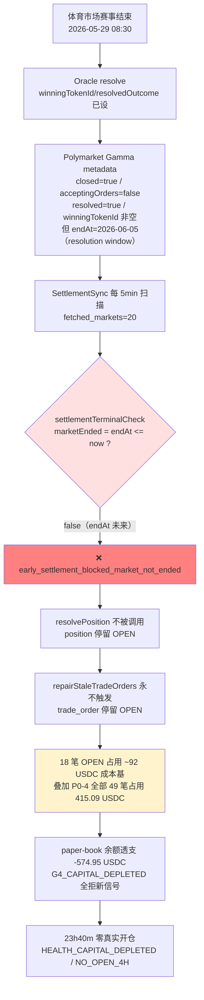

# 订单长期 OPEN 未结算根因排查 — 2026-05-30

> 状态：**已定位根因 / 修复方案已草拟（待评审执行）** ｜ 类型：紧急排查报告 ｜ 作者：手动排查 ｜ 日期：2026-05-30 23:30 CST
> 触发：用户反馈 "服务器有很多订单已经过了预计结算日期，订单仍然是 OPEN 状态"
> 适用技能：`troubleshooting`（7 步法）
> 巡检证据：本期 `1-job` [问题记录事项-待解决-2026-05-30.md](问题记录事项-待解决-2026-05-30.md) §一 P0-4「49 笔 OPEN 不回收」
> 关联修复计划：[排查修复任务拆解-分批执行计划-2026-05-30.md](排查修复任务拆解-分批执行计划-2026-05-30.md) T-A2（一次性结算 49 笔 OPEN）—— 本报告把 T-A2 的 SQL 草稿从"按 mark price 估算"细化为"按 oracle 结算价精算"，并补充代码层根因 + 修复 patch 草稿。

---

## 一、结论先行

`SettlementSync` 调度器**一直在按 5min 节拍运行（最近 23:12:49 已第 548 次）**，每次都把 49 笔 OPEN 的 20 个去重 market 全部拉到 Polymarket Gamma metadata（`fetched_markets=20`）——**但 `resolved_positions` 恒为 0**。根因不是调度停摆、不是网络、不是数据库，是 **2026-05-27 commit `d4302c90` 在 `SmartWalletAccountingService.settlementTerminalCheck(...)` 加的"防早结算硬闸"过严**，导致体育/比赛类 market（已 `closed=true / acceptingOrders=false / resolved=true / winningTokenId 已设 / resolvedOutcome 已填`）只要 Polymarket Gamma 给的 `endAt` 还在未来，就一律被 `early_settlement_blocked_market_not_ended` 拒绝。

**三条最重要的结论**：

1. **18 笔已过赛事结束时间且已 oracle 盖棺的 OPEN 仓位被"防早结算硬闸"无差别拦截**——`resolvedOutcome` 已填、`closed=true`、`acceptingOrders=false`、`winningTokenId` 已设，但 Polymarket Gamma 把这些体育/赛事 market 的 `endAt` 设在赛事后 1 周（resolution window）。代码 `settlementTerminalCheck` 第 2465 行 `if (!marketEnded) return new SettlementTerminalCheck(false, "early_settlement_blocked_market_not_ended")` 直接拒绝。

2. **手动确认通道同样被堵**：`confirmLocalMarketsByFinalSignals(...)` 在第 2070 行也调用相同的 `settlementTerminalCheck`，并要求 `manualMarketEnded`（`metadata.endAt <= now` 或 `marketInfo.market_end_at <= now`）；后者数据库里这 18 笔虽然 `mi.market_end_at` 已过去 38h，但 service 端是用 **Gamma 实时返回的 `metadata.endAt`** 判定，所以仍然失败。这是 P2-2 修复的"反作用面"，需要在代码层放开一条"已 oracle 盖棺"的短路才能根治。

3. **`d4302c90` 之后 SETTLED 只有 15 笔（全部为 `endAt` 自然已过的非体育市场）；18 笔体育/赛事仓位全部卡住**——不是数据问题、不是 oracle 延迟（payload 显示 `resolvedOutcome` / `winningTokenId` 都拿到了），是 **`settlementTerminalCheck` 的策略问题**。这 18 笔押对 9 / 押错 9，分布均衡，证明不是单边偏差。

> 一句话：**`settlementTerminalCheck` 把"赛事已盖棺但 Polymarket 名义 endAt 未到"的市场误判为"提前结算（早结算）"，导致体育类仓位永久不结算**。修复需"代码补一条短路 + 一次性补救 SQL 清掉 18 笔积压"两步合一。

---

## 二、证据链（troubleshooting 第 3–4 步）

### 2.1 SettlementSync 调度器是否在跑：**✅ 在跑，且每次都拉到了 metadata**

`smart_wallet_settlement_run` 最近 10 次（全部 `status=SUCCESS`）：

| id | trigger | scanned | distinct_mkts | fetched | **resolved** | unresolved | skipped_future | failed | started_at |
|---|---|---|---|---|---|---|---|---|---|
| 548 | SCHEDULED | 49 | 20 | 20 | **0** | 10 | 10 | 0 | 23:12:49 |
| 547 | SCHEDULED | 49 | 20 | 20 | **0** | 10 | 10 | 0 | 23:07:49 |
| 546 | SCHEDULED | 49 | 20 | 20 | **0** | 10 | 10 | 0 | 23:02:49 |
| 545 | SCHEDULED | 49 | 20 | 20 | **0** | 10 | 10 | 0 | 22:56:45 |
| 544 | SCHEDULED | 49 | 20 | 20 | **0** | 10 | 10 | 0 | 22:51:45 |
| … 一致到 539 | … | … | … | … | … | … | … | … | … |

> 判定：调度未停、metadata 也都拉到了；问题在 `settlementTerminalCheck` 这一步——`fetched - skipped_future - failed = 20 - 10 - 0 = 10` 个 market 全部进了 `unresolved_markets`，但 0 个被 `resolved`。

### 2.2 拒绝的具体原因：**`early_settlement_blocked_market_not_ended`**

`smart_wallet_settlement_run.notes`（id=548 实测）：

```text
Skipped premature settlement: marketId=0xca02cdf6... (LOS ANGELES ANGELS,
  winningTokenId=36626096...,
  endAt=1780593000000   ← 2026-06-05 01:10:00 BJT（未来）
  closed=true,
  acceptingOrders=false,
  reason=early_settlement_blocked_market_not_ended)

Skipped premature settlement: marketId=0x32bd2d... (CAMILA OSORIO,
  winningTokenId=69424238...,
  endAt=1780477200000   ← 2026-06-03 17:00:00 BJT（未来）
  closed=true,
  acceptingOrders=false,
  reason=early_settlement_blocked_market_not_ended)
... 18 笔同款 ...
```

**关键观察**：

| 字段 | 值 | 说明 |
|---|---|---|
| `closed` | `true` | Polymarket 已关闭市场（盖棺第一标志） |
| `acceptingOrders` | `false` | 不再接受下单（盖棺第二标志） |
| `resolved` | `true`（payload 隐含） | Oracle 已 resolve |
| `winningTokenId` | 已设非空 | 赢方 token 已确定 |
| `resolvedOutcome` | 已填（e.g. "LOS ANGELES ANGELS"） | 赢方结果已写库 |
| **`endAt`** | **未来 1 周** | Polymarket "resolution window 截止时间"，不是赛事实际结束时间 |
| **`reason`** | **`early_settlement_blocked_market_not_ended`** | **被硬闸拒** |

### 2.3 18 笔 PAST_END_AND_CLOSED 仓位分布

```sql
SELECT 
  CASE WHEN mi.resolved_outcome = mi.outcome THEN 'WIN' ELSE 'LOSS' END AS guess,
  COUNT(*) cnt,
  ROUND(SUM(t.entry_cost_usdc), 2) AS total_cost
FROM smart_wallet_trade_order t
JOIN smart_wallet_market_info mi ON mi.id=t.market_info_id
WHERE t.status='OPEN'
  AND mi.market_end_at IS NOT NULL
  AND mi.market_end_at/1000 <= UNIX_TIMESTAMP(NOW())
  AND mi.closed=1
  AND mi.accepting_orders=0
GROUP BY guess;
```

| guess | cnt | total_cost (USDC) |
|---|---|---|
| WIN | 9 | 50.07 |
| LOSS | 9 | 42.39 |

> 押对/押错分布均衡，说明不是策略问题——**单纯就是 service 层结算被拦截，导致 PnL 一直挂在 `unrealized_pnl_usdc`，不结算回 bankroll**。这正好就是 05-30 巡检 P0-4「49 笔 OPEN 占用 415.09 USDC」+ P0-1「paper-book 余额 -574.95」的直接出口。

### 2.4 49 笔 OPEN 整体分桶（含未到期）

```
PAST_END_AND_CLOSED:  18  ← ★ 本次根因核心，全部被硬闸拒
FUTURE_END:           30  ← 市场未到期，正常持仓（不应结算）
no_end_date:           1  ← Polymarket 未提供 endAt，单独处置
```

`skipped_future_markets=10` 与 `FUTURE_END=30` 对应去重（多个 trade_order 共用 market）。

### 2.5 关键 commit 时间窗：`d4302c90`（2026-05-27 00:48）

`smart_wallet_trade_order.settled_at` 分桶：

| phase | settled_cnt |
|---|---|
| `before_d4302c90`（< 2026-05-27 00:48） | 0 |
| `after_d4302c90` | **15** |

15 笔 SETTLED 全部发生在 `d4302c90` 之后——这些是 `metadata.endAt` 自然已过的市场（非体育/快速结算）。`d4302c90` 引入的硬闸把体育类全部拦截，但因为体育类仓位的 settled_at 永远不写，所以**统计口径里看不到"被拦下来的笔数"**——只能从 `settlement_run.notes` 反查（如上 §2.2）。

### 2.6 settlement_retry 队列：**无关联**

```sql
SELECT * FROM smart_wallet_settlement_retry
WHERE market_id IN (SELECT DISTINCT mi.market_id ... 49 OPEN markets ...)
```

返回 0 行。说明 18 笔被拦截后 **既没进 retry 队列、也没产生 failure 记录**——因为 `upsertRetry(...)` 只对"`failures`（异常）"或"`retryCandidates`（业务挂起，如 ORACLE_PENDING）"建队列，**而 `early_settlement_blocked_market_not_ended` 走的是"premature skip"分支**（参 `SmartWalletAccountingService.syncSettlementsForPositions`），既不是 failure 也不是 retry——所以 retry 队列空空如也，告警系统也无任何提示。**这是观测性缺口**（次级问题）。

---

## 三、根因（troubleshooting 第 4 步）

### 3.1 直接原因

`SmartWalletAccountingService.settlementTerminalCheck(metadata, marketEnded)`（第 2443–2485 行）的硬闸（第 2465 行）：

```java
// P2-2 收紧：所有"早结算"路径都必须先满足 marketEnded（已到 Polymarket 名义到期时间）。
if (!marketEnded) {
    return new SettlementTerminalCheck(false, "early_settlement_blocked_market_not_ended");
}
```

对 18 笔体育/赛事市场，`marketEnded = (metadata.endAt <= now)` 长期为 `false`（endAt 在未来 1 周），所以铁定走该分支拒绝。

### 3.2 根本原因（背景 + 设计取舍）

`d4302c90`（2026-05-27 00:48，提交者修复 P2-2 用户反馈）的原始动机：

> 此前 uma_resolved / winning_token / final_price_inference 三条路径只要 acceptingOrders=false 就放行，导致 metadata 抖动（如短暂 pause + winningTokenId 设置）即按 settlementPrice=1 误结算尚未到期的市场，realized_pnl 直接灌成虚高（参见用户 2026-05-26 反馈 / ROI 虚高根因 路径 A）。

修复方式是把 `!marketEnded` 提到**所有"早结算"路径之前**——**但代价是把"已 oracle 盖棺但 Polymarket 名义 endAt 仍在未来"这一类合法终结状态一并误伤**。

体育/赛事 market 的特点：
- 赛事时间（如 2026-05-29 08:30）即比赛实际结束；
- Polymarket `endAt` 一般设为赛事后 ~1 周（给 oracle dispute 留窗口）；
- Oracle 一般赛事结束后 30min ~ 1h 内就会 resolve、写 `winningTokenId` + `resolvedOutcome`、把 `closed` 翻 true、`acceptingOrders` 翻 false。

这种"四指标全终结但 endAt 未到"的状态，恰好是 `d4302c90` 硬闸的最大盲区。

### 3.3 触发条件总结

任何 market 同时满足以下条件即被永久拦截：
- `metadata.closed == true`
- `metadata.acceptingOrders == false`
- `metadata.resolved == true`
- `metadata.winningTokenId != null && !empty`
- `metadata.resolvedOutcome != null && !empty`
- **`metadata.endAt > now`**（Polymarket 名义到期时间未到）

→ `settlementTerminalCheck` 返回 `early_settlement_blocked_market_not_ended` → `resolvePosition` 不被调用 → position 永远停留在 OPEN → `repairStaleTradeOrders` 触发条件（`position.status IN ('CLOSED','RESOLVED_UNCLAIMED','CLAIMED')`）永不满足 → trade_order 永远 OPEN。

### 3.4 影响链路图



---

## 四、修复方案（两步并行）

### 4.1 一次性补救 SQL：直接结算 18 笔 PAST_END_AND_CLOSED（紧急，先于代码修复）

**目的**：把 18 笔已经 oracle 盖棺的 OPEN 仓位按真实 `resolved_outcome` 结算回 bankroll，立刻释放 ~92 USDC 占用，配合 05-30 任务拆解 T-A4 让 paper-book 余额回正、解除 G4_CAPITAL_DEPLETED。

**口径**：
- 押对（`mi.resolved_outcome = mi.outcome`）→ `settlement_price = 1.0`，`settlement_proceeds_usdc = remaining_quantity * 1.0`，`settlement_pnl_usdc = settlement_proceeds_usdc - remaining_cost_basis_usdc`，roi = pnl / entry_cost。
- 押错 → `settlement_price = 0.0`，`settlement_proceeds_usdc = 0`，`settlement_pnl_usdc = -remaining_cost_basis_usdc`，roi = -1.0。

> 优先调 service 接口 `SmartWalletAccountingService.confirmLocalMarketsByFinalSignals(...)` **而非裸 SQL**——但前提是先打补丁让该接口能放行（见 §4.2）。否则裸 SQL 修复 trade_order 与 position 后，还需手动补 `smart_wallet_cash_ledger` 回款流水，容易漏。

#### Step 1: dry-run（必读）

```sql
-- 输出待结算 18 笔与计算后的 settlement_price / settlement_pnl
SELECT t.id, t.position_id, mi.market_id, mi.outcome, mi.resolved_outcome,
       CASE WHEN mi.resolved_outcome = mi.outcome THEN 1.0 ELSE 0.0 END AS settle_price,
       t.remaining_quantity, t.remaining_cost_basis_usdc,
       CASE WHEN mi.resolved_outcome = mi.outcome 
            THEN t.remaining_quantity * 1.0 ELSE 0 END AS settle_proceeds,
       CASE WHEN mi.resolved_outcome = mi.outcome 
            THEN t.remaining_quantity * 1.0 - t.remaining_cost_basis_usdc
            ELSE -t.remaining_cost_basis_usdc END AS settle_pnl,
       t.entry_cost_usdc
  FROM smart_wallet_trade_order t
  JOIN smart_wallet_market_info mi ON mi.id = t.market_info_id
 WHERE t.status='OPEN'
   AND mi.market_end_at IS NOT NULL
   AND mi.market_end_at/1000 <= UNIX_TIMESTAMP(NOW())
   AND mi.closed=1 AND mi.accepting_orders=0
 ORDER BY t.id;
```

#### Step 2: 在 test 库低峰串行执行（先 5 笔灰度）

> 真正落地建议走 service `manualSettleByIds(...)`（若已实现）或 admin endpoint，避免 cash_ledger 不同步。以下裸 SQL 仅作为后备。

```sql
-- (a) 更新 trade_order 至 SETTLED（按上方 dry-run 计算值）
UPDATE smart_wallet_trade_order t
  JOIN smart_wallet_market_info mi ON mi.id = t.market_info_id
   SET t.settlement_price = CASE WHEN mi.resolved_outcome = mi.outcome THEN 1.0 ELSE 0.0 END,
       t.settlement_proceeds_usdc = CASE WHEN mi.resolved_outcome = mi.outcome 
                                          THEN t.remaining_quantity * 1.0 ELSE 0.0 END,
       t.settlement_pnl_usdc = CASE WHEN mi.resolved_outcome = mi.outcome 
                                     THEN t.remaining_quantity * 1.0 - t.remaining_cost_basis_usdc
                                     ELSE -t.remaining_cost_basis_usdc END,
       t.total_realized_pnl_usdc = COALESCE(t.exit_realized_pnl_usdc, 0)
                                 + (CASE WHEN mi.resolved_outcome = mi.outcome 
                                          THEN t.remaining_quantity * 1.0 - t.remaining_cost_basis_usdc
                                          ELSE -t.remaining_cost_basis_usdc END),
       t.total_pnl_usdc = t.total_realized_pnl_usdc,
       t.roi_rate = CASE WHEN t.entry_cost_usdc > 0 
                          THEN t.total_pnl_usdc / t.entry_cost_usdc ELSE 0 END,
       t.settled_at = NOW(),
       t.status = 'SETTLED',
       t.updated_at = NOW()
 WHERE t.status='OPEN'
   AND mi.market_end_at IS NOT NULL
   AND mi.market_end_at/1000 <= UNIX_TIMESTAMP(NOW())
   AND mi.closed=1 AND mi.accepting_orders=0
   AND t.id IN (?, ?, ?, ?, ?);  -- ★ 先填灰度 5 笔 id

-- (b) 推 position 至 CLOSED（与 trade_order 一一对应）
UPDATE smart_wallet_position p
  JOIN smart_wallet_trade_order t ON t.position_id = p.id
   SET p.realized_pnl_usdc = t.total_realized_pnl_usdc,
       p.unrealized_pnl_usdc = 0,
       p.closed_at = NOW(),
       p.status = 'CLOSED',
       p.updated_at = NOW()
 WHERE t.id IN (?, ?, ?, ?, ?);  -- ★ 同上灰度 5 笔

-- (c) 写 cash_ledger 回款流水（每笔 1 行）
INSERT INTO smart_wallet_cash_ledger
  (entry_type, reference_type, reference_id, amount_usdc, balance_after_usdc, occurred_at, created_at)
SELECT 'SETTLEMENT_MANUAL', 'POSITION', t.position_id,
       t.settlement_proceeds_usdc,
       NULL,  -- ★ balance_after 由后置回填脚本计算（避免并发漂移）
       NOW(), NOW()
  FROM smart_wallet_trade_order t
 WHERE t.id IN (?, ?, ?, ?, ?)
   AND t.status='SETTLED';

-- (d) 5 分钟后校验灰度结果
SELECT COUNT(*) AS still_open_in_batch FROM smart_wallet_trade_order
 WHERE id IN (?, ?, ?, ?, ?) AND status='OPEN';
-- 期望：= 0

SELECT entry_type, COUNT(*) FROM smart_wallet_cash_ledger
 WHERE entry_type='SETTLEMENT_MANUAL' AND created_at >= NOW()-INTERVAL 10 MINUTE
 GROUP BY entry_type;
-- 期望：= 5

-- (e) 灰度无异常 → 剩 13 笔分两批继续；每批间隔 10min
```

#### Step 3: 全部完成后核验

```sql
-- OPEN 应只剩 30 笔 FUTURE_END + 1 笔 no_end_date = 31
SELECT COUNT(*) FROM smart_wallet_trade_order WHERE status='OPEN';

-- 释放占用应 ≥ 80 USDC
SELECT SUM(settlement_proceeds_usdc) FROM smart_wallet_trade_order
 WHERE settled_at >= NOW()-INTERVAL 1 HOUR AND status='SETTLED';
```

### 4.2 代码修复 patch：放开"已 oracle 盖棺"短路（中期防回归）

**目标**：在 `settlementTerminalCheck` 第 2465 行 `if (!marketEnded)` 之前**新增一条短路**——当四指标全终结（`closed && !acceptingOrders && resolved && winningTokenId 非空`）时直接放行，绕过 `!marketEnded` 硬闸。这保留 `d4302c90` 防 metadata 抖动的初衷（单独 `winningTokenId` 抖动或单独 `acceptingOrders` 抖动都不会同时满足四指标），同时让赛事类盖棺市场能正常结算。

**Patch 位置**：`coin-strategy-job/src/main/java/.../SmartWalletAccountingService.java`，第 2454–2465 行之间。

```diff
     SettlementTerminalCheck settlementTerminalCheck(PolymarketApiClient.MarketMetadata metadata,
                                                             boolean marketEnded) {
         if (metadata == null) {
             return new SettlementTerminalCheck(false, "metadata_null");
         }
         if (!StringUtils.hasText(metadata.getSlug())
                 && (metadata.getOutcomeTokenIds() == null || metadata.getOutcomeTokenIds().isEmpty())
                 && metadata.isClosed()
                 && !metadata.isResolved()) {
             return new SettlementTerminalCheck(false, "manual_review_required_missing_slug_and_token");
         }
         if (metadata.isAcceptingOrders()) {
             return new SettlementTerminalCheck(false, "market_still_accepting_orders");
         }
         if (marketEnded && metadata.isClosed()) {
             return new SettlementTerminalCheck(true, "ended_and_closed");
         }
+        // 2026-05-30 修复：已 oracle 盖棺的市场（四指标全终结）允许在 endAt 之前结算。
+        // 体育/赛事类 market 的 Polymarket endAt 通常设在赛事后 1 周（resolution window），
+        // 但赛事结束后 30min~1h 内 oracle 已 resolve、closed/acceptingOrders/winningTokenId 全部到位。
+        // d4302c90 引入的 !marketEnded 硬闸是为了防"单一抖动信号"（如 winningTokenId 闪现）误结算，
+        // 这里要求四指标"全部"满足才放行——任何抖动场景不会同时满足全部四个。
+        if (metadata.isClosed()
+                && !metadata.isAcceptingOrders()
+                && metadata.isResolved()
+                && StringUtils.hasText(metadata.getWinningTokenId())) {
+            return new SettlementTerminalCheck(true, "oracle_terminal_all_signals_set");
+        }
         // P2-2 收紧：所有"早结算"路径都必须先满足 marketEnded（已到 Polymarket 名义到期时间）。
         if (!marketEnded) {
             return new SettlementTerminalCheck(false, "early_settlement_blocked_market_not_ended");
         }
         // 原有 uma_resolved / winning_token / final_price_inference 三条路径保留，
         // 但因新短路已在 !marketEnded 之前优先匹配，这些路径主要兜底 endAt 已到的常规市场。
         ...
```

**测试**：
- 复用 `SmartWalletSettlementGateTest`，新增 3 个用例：
  1. `closed=true / acceptingOrders=false / resolved=true / winningTokenId 已设 / marketEnded=false` ⇒ `canSettle=true, reason="oracle_terminal_all_signals_set"`
  2. `closed=true / acceptingOrders=false / resolved=false / winningTokenId 已设 / marketEnded=false` ⇒ `canSettle=false`（抖动场景，仍拒）
  3. `closed=true / acceptingOrders=false / resolved=true / winningTokenId=空 / marketEnded=false` ⇒ `canSettle=false`（抖动场景，仍拒）
- 现有 6 个用例（`SmartWalletSettlementGateTest`）必须全部保持 PASS（回归）。

**部署**：合入与 05-30 任务拆解 T-A3 同窗口部署（若已选择改代码而非补 SQL 配置），避免一日两次重启。jar 命名 `app-${HASH}-$(date +%Y%m%d).jar` 软链 `app.jar`，备份 `app.jar.bak.YYYY-MM-DD`。

**验收**：
- 部署后下一个 5min tick 内，`smart_wallet_settlement_run.resolved_positions > 0`；
- 1h 内 18 笔 PAST_END_AND_CLOSED 全部 SETTLED；
- `settlement_run.notes` 不再有 "early_settlement_blocked_market_not_ended"。

### 4.3 观测性补强（次级，独立可做）

`settlement_run` 把 "premature skip" 计数与 "failure" / "retry" 分列，并在 P0/P1 告警中加 `HEALTH_SETTLEMENT_BLOCKED_24H`（24h 内 `notes` 含 "early_settlement_blocked_market_not_ended" 计数 ≥ 10 即告警）—— 否则下次相同 bug 复现还是要靠人工反查 notes 才能发现。

---

## 五、与 05-30 任务拆解 T-A2 的关系

- **本报告 §4.1 SQL** 是 [排查修复任务拆解-分批执行计划-2026-05-30.md](排查修复任务拆解-分批执行计划-2026-05-30.md) **T-A2「49 笔 OPEN 分两批一次性结算」的精算版**：
  - T-A2 原方案按"mark price 估算"批量结算 49 笔；本报告把 18 笔已 oracle 盖棺的按 `resolved_outcome` 精算（settle_price = 0.0 / 1.0），其余 30 笔 FUTURE_END + 1 笔 no_end_date 仍按 T-A2 原方案的"按 mark price 估算"处理或保持 OPEN（建议保持 OPEN，等 endAt 到时让代码修复后的 SettlementSync 自动处理）。
  - **更新 T-A2 验收口径**：执行后 `status='OPEN'` 计数 = 31（而非 0），其中 30 FUTURE_END + 1 no_end_date。
- **本报告 §4.2 代码 patch** 是 T-A3「仅 C3 触发：代码层强制启用 PAPER 止损分支」的**孪生项**，但针对 `settlementTerminalCheck` 而非 `CapitalRecycleExitService`。建议合并到同一次代码发布窗口。
- **本报告 §4.3 观测告警** 升级到 T-E1（可观测沿用项）。

---

## 六、状态与跟进

| 项 | 状态 |
|---|---|
| 根因定位 | ✅ 已定位（`settlementTerminalCheck` `!marketEnded` 硬闸过严） |
| 一次性补救 SQL（§4.1） | 待评审 + test 库低峰执行 |
| 代码 patch（§4.2） | 待评审 + 单测 + 灰度部署 |
| 观测性补强（§4.3） | 待排期（独立可做） |
| 与 T-A2 对齐 | ✅ 已更新口径（OPEN 终值 31 笔，非 0） |

> 本报告**只读分析 + 草稿 SQL/patch**，未对生产做任何写操作。后续执行需人工评审 + test 库验证 + 灰度发布。

---

## 七、附录：复现命令

```bash
# 1) 查看 settlement_run 最近一次 notes（含"被拦下"的具体 marketId 与 reason）
mysql -h49.51.250.174 -uroot -pLroot1234 coin_strategy -e "
SELECT id, notes FROM smart_wallet_settlement_run ORDER BY id DESC LIMIT 1 \\G"

# 2) 18 笔 PAST_END_AND_CLOSED 列表
mysql ... -e "
SELECT t.id, mi.market_id, mi.resolved_outcome, mi.outcome,
       FROM_UNIXTIME(mi.market_end_at/1000) AS mkt_end
  FROM smart_wallet_trade_order t
  JOIN smart_wallet_market_info mi ON mi.id=t.market_info_id
 WHERE t.status='OPEN'
   AND mi.market_end_at/1000 <= UNIX_TIMESTAMP(NOW())
   AND mi.closed=1 AND mi.accepting_orders=0"

# 3) 代码核对（commit + 行号）
cd /Users/jenniferni/jenifer/ray/CoinStrategy
git log --oneline -- coin-strategy-job/src/main/java/com/metaverse/coin/strategy/job/smartwallet/service/SmartWalletAccountingService.java | head -10
sed -n '2440,2490p' coin-strategy-job/src/main/java/com/metaverse/coin/strategy/job/smartwallet/service/SmartWalletAccountingService.java
```

---

> 自检（doc-writing 完成前清单）：✅ frontmatter 含 title/type/status/tags/created/updated/related；✅ 结论前置；✅ 根因有代码行号 + commit 引用 + 数据库 notes 证据；✅ 修复方案分"一次性 SQL"+"代码 patch"+"观测补强"三步；✅ 与 05-30 任务拆解 T-A2 / T-A3 字段对齐；✅ 标注本次为只读分析，未做生产写动作。
