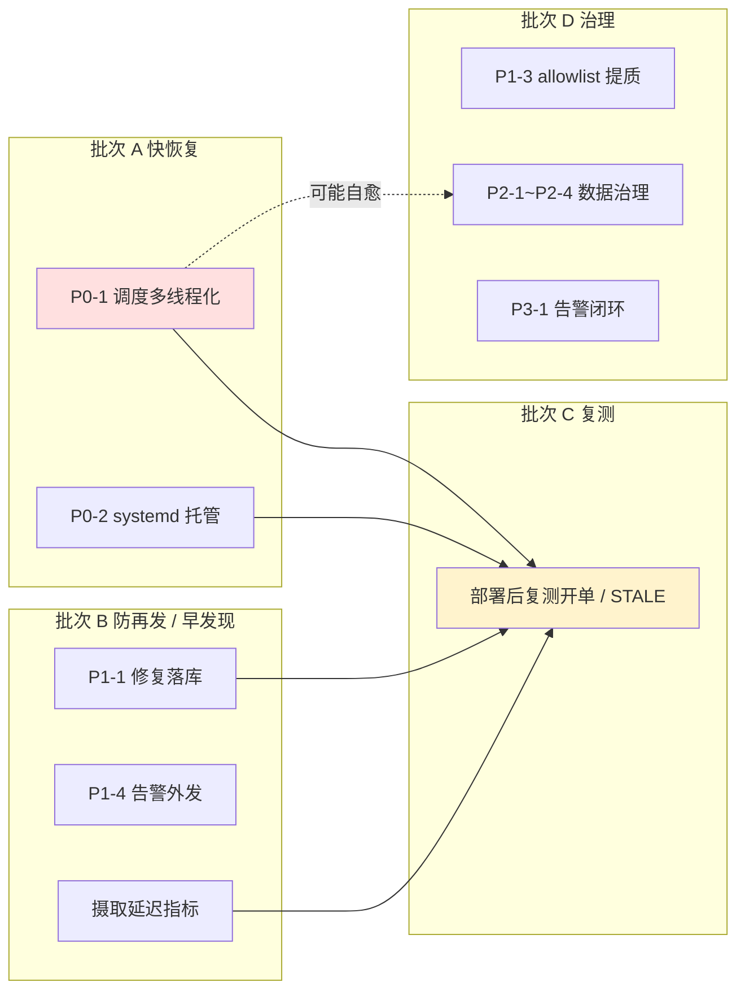

# 问题排查修复分析 — 跟单策略结构性卡死及配套治理（2026-05-24）

> 状态：**待评审 / 待执行** ｜ 类型：定期巡检 · 排查修复分析 ｜ 作者：自动分析（scheduled task `2-1`）｜ 日期：2026-05-24
> 分析时段：2026-05-24 11:03 CST（对仓库 `CoinStrategy` 只读核验）
> 适用技能：`troubleshooting`（先定位后修复）+ `doc-writing`（文档结构、命名）+ `coding-standards` / `git-commit-convention`（修复落地规范）
> 上一份问题记录：[问题记录事项-待解决-2026-05-24.md](问题记录事项-待解决-2026-05-24.md)（scheduled task `1-job` 巡检输出）
> 关联文档：[../../Polymarket跟单策略运行分析报告-2026-05-23.md](../../Polymarket跟单策略运行分析报告-2026-05-23.md)、[../../polymarket/7项交易侧修复-实施清单-2026-05-23.md](../../polymarket/7项交易侧修复-实施清单-2026-05-23.md)

> 说明：本文是 scheduled task `2-1`（服务器环境排查后问题分析）在 2026-05-24 的运行结果。任务承接 `1-job` 巡检文档《问题记录事项-待解决-2026-05-24》，对其中 **13 个待解决问题（P0-1 ~ P3-2）逐条分析「如何排查、如何修复」，并把修复拆成可分批执行的任务**。本文**只产出分析与任务拆解，不对线上代码 / 服务器 / 数据库做任何写操作**；所有代码锚点均经本次对仓库的只读核验确认，核验方法见第七节。

---

## 一、执行摘要（结论先行）

`1-job` 巡检已把「37 小时以上零开单」的根因定位到代码层。本文承接该结论，**不再重复定位**，而是回答下一个问题：**这 13 个问题各自怎么排查、怎么修、先修哪个、改多大、有什么风险**。

**三条最重要的结论：**

1. **主卡点能快速恢复，且修复材料半数已在仓库里。** 核心根因 P0-1（单线程调度器垄断）经核验属实——`CoinStrategyJobApplication.java` 第 15 行 `@EnableScheduling`，全部 `resources/*.yml` 无 `spring.task.scheduling.pool.size`、无自定义 `TaskScheduler` Bean。把调度改为线程池是开单恢复的唯一前提，工作量约 1–3 人日。P0-2（systemd 托管）与 P1-4（告警外发）的「轮子」已在仓库（systemd 单元模板含 `Restart=always`、安装脚本、飞书告警 Sink），只差「装上 / 接线」。

2. **修复必须治本，调阈值是掩盖。** P1-1 已暴露教训：上一轮 7 项交易侧修复打在「收紧 / 分级新鲜度门」上，而真瓶颈是「摄取本身慢约 70 分钟」——分级后 SPORTS 窗口收到 600s 反而让更多事件落入 STALE。**正确顺序是先修 P0-1 提调度并发、把摄取延迟压回 600s 内，再回看新鲜度阈值是否需要动。**

3. **建议分 4 批执行，先恢复、再可观测、后治理。** 批次 A（恢复开单：P0-1、P0-2）→ 批次 B（防再发 + 早发现：P1-1、P1-4、摄取延迟指标）→ 批次 C（部署后复测）→ 批次 D（质量与数据治理：P1-3、P1-5、P2-*、P3-*）。**批次 C 强依赖 A、B 完成。**

### 修复方案总表

承接 `1-job`《待解决问题总表》的 13 条编号，逐条给出修复动作与工作量：

| 编号 | 问题（承自 1-job） | 修复动作 | 严重度 | 修复类型 | 工作量 | 状态 |
|---|---|---|---|---|---|---|
| P0-1 | 单线程调度器垄断 → 摄取滞后 ~70min → 100% 信号被 `G5_SIGNAL_STALE_INGEST` 拒 | 调度多线程化 + HOT 事件同步隔离 | P0 | 代码 | L（1–3d） | 待执行 |
| P0-2 | 服务无进程守护，裸 `nohup` 启动 | 执行 `install-smart-wallet-linux-service.sh` 托管为 systemd | P0 | 运维 | S（<0.5d） | 待执行 |
| P1-1 | 7 项交易侧修复方向错位，部署 jar 与 git 提交不一致 | 先做 P0-1；改动按 `git-commit-convention` 分提交落库 | P1 | 代码治理 | M（0.5–1d） | 待执行 |
| P1-2 | 当前版本零结算，胜率无法评估 | 待 P0-1 修复、积累 ≥50–100 笔结算样本后评估 | P1 | 验证 | S | 待观察 |
| P1-3 | 被跟 allowlist 钱包质量差，影子单大量负 EV | 复核 allowlist，剔除低质量 / 冷却期钱包 | P1 | 数据 + 轻代码 | M | 待执行 |
| P1-4 | 健康告警只写日志、不外发 | 把 `StrategyHealthMonitorJob` 接入已有飞书告警 Sink | P1 | 代码 | M | 待执行 |
| P1-5 | 服务器内存偏紧（空闲 144MB，swap 354MB） | 监控 GC / 内存；必要时升配或分机部署 | P1 | 运维 | S | 待观察 |
| P2-1 | `cash_ledger.balance_after` 2,339 行全 NULL | 写入处回填滚动余额 + 历史一次性回算 | P2 | 数据 + 代码 | M | 待执行 |
| P2-2 | `daily_report` / `trade_order` 存在未来日期结算记录 | 结算时间改用真实结算时刻；清理异常行 | P2 | 数据 + 代码 | M | 待执行 |
| P2-3 | `strategy_run_log` 等三张快照表 0 行 | 先复测（疑为 P0-1 下游表现），仍空再排查写入链路 | P2 | 排查 + 代码 | S→M | 待执行 |
| P2-4 | `leader_trade_outcome` 59% 记录为 `LOW_CONFIDENCE` | 排查置信度判定口径与数据源，提升回填质量 | P2 | 数据 + 代码 | M | 待执行 |
| P3-1 | 2 条 `strategy_alert` 长期未确认 / 未解决 | 逐条核实并修复或显式确认 | P3 | 排查 + 数据 | M | 待执行 |
| P3-2 | 巡检 SSH 连通性不稳定 | 巡检脚本已内置重试；必要时服务器侧落地只读导出兜底 | P3 | 运维 | S | 待观察 |

> 严重度沿用 `1-job` 口径：P0 = 影响安全/资金/可用性；P1 = 影响策略核心目标；P2 = 数据治理；P3 = 可观测性与巡检增强。
> 工作量口径：S ≈ 半天内；M ≈ 0.5–1 人日；L ≈ 1–3 人日（均含测试）。

### 较 1-job 文档的新增信息

`1-job` 给出的是「问题定位」，本文在其基础上新增三类信息：(1) 每条问题的**排查步骤**（可直接执行的 SQL / 命令）；(2) 每条修复的**代码锚点**（文件、行号、配置键，经只读核验）；(3) **任务级依赖与分批计划**——明确「复测必须在 P0-1、P0-2、P1-1 之后」。

---

## 二、分析范围与方法

### 2.1 输入与依据

| 输入 | 来源 | 用途 |
|---|---|---|
| 《问题记录事项-待解决-2026-05-24》 | `1-job` 巡检输出 | 13 条待解决问题的现象、证据、根因 |
| 仓库 `CoinStrategy` 源码 | 本地工作区（只读） | 核验根因、定位修复锚点 |
| `git status` / `git log` | 本地 git | 核验 P1-1 部署可追溯性 |

本文不重复 `1-job` 的数据库 / 服务器实测；运行态结论直接采信 `1-job`，本文只补充**代码层核验**。

### 2.2 分析方法

遵循 `troubleshooting` 技能「**第 0 步抑制冲动 → 收集证据 → 验证假设 → 定位根因 → 最小改动修复并验证**」。对每条问题，先用只读手段（`grep` / `cat` / `git status`）把 `1-job` 给出的根因在代码里**证实或证伪**，再据此拆修复任务。本次未做任何写操作——改代码、跑脚本、改数据库均留待人工评审后执行。

---

## 三、对"如何修复"的专项判断

承接 `1-job` 对策略「三问」的判断，本文对「如何修复」给出三项专项判断。

### 3.1 主卡点能否快速恢复？——**能，但需代码改动 + 重新部署**

P0-1 的修复不是「调个参数」就能好——单线程调度器是结构问题，须引入线程池（代码改动 + 编译 + 部署）。但改动面可控：核心是新增一个 `SchedulingConfig` 或一行 `spring.task.scheduling.pool.size` 配置，加上把 HOT 事件同步隔离。乐观估计 1 人日内可出可灰度版本，叠加 P0-2（半天）后当天即可恢复。**最大不确定性是并发安全**（见第六节风险与第五节补充建议）。

### 3.2 修复是「治本」还是「掩盖」？——**必须治本（提调度并发），禁止只调阈值**

`1-job` 已明确、本文核验确认：P1-1 上一轮修复把力气花在「收紧 / 分级新鲜度门」，而真瓶颈是「摄取慢 70 分钟」。代码核验显示，新鲜度门 `G5_SIGNAL_STALE_INGEST`（`SmartWalletFollowTaskService` 第 884–906 行）按市场类别取窗口，SPORTS 仅 600s——**摄取慢 70 分钟时，再宽的窗口对快市场也无意义**。因此修复顺序硬约束为：**先 P0-1（降摄取延迟）→ 再复测 → 最后才回看阈值**。

### 3.3 应该按什么顺序修？——**P0 优先，分 4 批，复测设强依赖**

按「快恢复 → 防再发 / 早发现 → 复测 → 治理」分 4 批（详见第六节）。关键依赖：**部署后复测（验证开单是否恢复）必须等 P0-1、P0-2 完成、且 P1-1 把修复落库成可追溯 jar 之后**——否则复测结论无法归因、无法复现。

---

## 四、逐问题排查修复方案

承接 `1-job`《待解决问题清单》的 P0-1 ~ P3-2 编号，每条在其「现象 → 证据 → 根因」之上，补「**排查步骤 → 根因确认 → 修复方案（任务拆解）→ 验证方法 → 风险与回滚**」。

### P0-1 单线程调度器垄断导致事件摄取滞后，100% 信号过期被拒 ★本期核心卡点

- **现象**：近 24h 跟单任务 0 笔成交，92% 被跳过原因为 `STALE`；事件入库即 `signalAgeMs≈4,226,000ms`，远超 600s，100% 命中 `G5_SIGNAL_STALE_INGEST`。
- **排查步骤**：
  1. 确认是否单线程：`grep -rn "EnableScheduling\|ThreadPoolTaskScheduler\|SchedulingConfigurer" coin-strategy-job/src/main/java` 与 `grep -rn "spring.task.scheduling" coin-strategy-job/src/main/resources`。
  2. 量化摄取延迟（线上 DB 复跑）：
     ```sql
     SELECT COUNT(*) n,
            ROUND(AVG(TIMESTAMPDIFF(SECOND, opened_at, created_at))) avg_lag_s,
            MAX(TIMESTAMPDIFF(SECOND, opened_at, created_at)) max_lag_s,
            SUM(TIMESTAMPDIFF(SECOND, opened_at, created_at) <= 600) within_600s
     FROM smart_wallet_trade_event
     WHERE created_at >= NOW() - INTERVAL 24 HOUR;
     ```
  3. 确认线程占用（服务器只读）：`grep -oE '\[(scheduling-[0-9]+|sw-[a-z-]+)\]' job-current.log | sort | uniq -c | sort -rn | head`。
- **根因确认（已核验）**：

  | 核验项 | 结论 |
  |---|---|
  | `CoinStrategyJobApplication.java:15` | `@EnableScheduling` 存在 |
  | `config/` 目录 + 全量 `*.yml` | **无** `ThreadPoolTaskScheduler` Bean、**无** `spring.task.scheduling.pool.size` |
  | `smartwallet/` 下 `@Scheduled` 方法 | 50+ 个，最密集者 2–5s 一次（`SmartWalletOrderPollingService` 2s、`MakerPriceFollowupService` 3s 等） |
  | HOT 事件同步入口 | `PolymarketWalletDiscoveryService.scheduledSyncWatchlistTrades`（第 376 行，`event-sync-fixed-delay-ms` 默认 30000） |
  | 重任务入口 | `ClosedPositionIncrementalSyncJob.incrementalHot`（第 34 行，默认 300000）、`incrementalWarm`（第 57 行，默认 900000） |
  | G5 闸门 | `SmartWalletFollowTaskService` 第 884–906 行 S2.5 入口硬新鲜度门，调 `maxIngestSignalAgeMsFor(category)`（定义约第 1133–1140 行，配置键 `risk.maxIngestSignalAgeByCategory` / `risk.maxIngestSignalAgeSeconds` 默认 10800s） |

  Spring `@EnableScheduling` 在未自定义 `TaskScheduler` 时使用**单线程**调度器，全部 `@Scheduled` 串行。`1-job` 给出的根因——重任务把 `scheduling-1` 占满、HOT 事件同步被饿死——在代码层确认成立。
- **修复方案（任务拆解）**：

  | 子任务 | 内容 | 文件锚点 | 工作量 |
  |---|---|---|---|
  | P0-1-a | 引入调度线程池：新增 `SchedulingConfig`（`ThreadPoolTaskScheduler`，`poolSize=8~12`、`threadNamePrefix="sched-"`）。**最小改动备选**：仅在 `application.yml` 加 `spring.task.scheduling.pool.size: 8`（本项目无自定义 TaskScheduler，该键直接生效） | 新增 `job/config/SchedulingConfig.java` 或改 `application.yml` | S |
  | P0-1-b | 隔离 HOT 事件同步：把 `scheduledSyncWatchlistTrades` 与闭仓同步、发现等重任务拆到不同调度池，或改为提交到专用 `ThreadPoolTaskExecutor` | `PolymarketWalletDiscoveryService.java:376`、`ClosedPositionIncrementalSyncJob.java:34/57` | M |
  | P0-1-c | 重任务降压：复核 `ClosedPositionSync` 单次运行的钱包批量与频率，把非实时重任务移出关键节拍或降频、错峰 | `closed-position-sync.*` / `discovery-fixed-delay-ms` 等配置键 | M |
  | P0-1-d | （治本，可二期）HOT 事件同步从轮询改事件驱动：复用已存在的 `PolymarketWatchlistSubscriptionService`（WS 订阅）推流入库 | `PolymarketWatchlistSubscriptionService.java` | L |
  | P0-1-e | 复测后再决定是否微调 `risk.maxIngestSignalAgeByCategory`——先治摄取、再谈阈值 | `SmartWalletProperties` `risk` 段 | S |
- **验证方法**：单测验证线程池装配；本地起服务日志出现多个 `sched-*` 线程；线上复测（见 P1-2 / 第六节）摄取延迟 P90 ≤ 600s、`G5_SIGNAL_STALE_INGEST` 占比降到个位数、出现真实 `FOLLOWED` 开单。
- **风险与回滚**：并发调度后，原先隐式串行的高频任务若有共享可变状态可能并发不安全——上线前需 review；保守方案是 HOT 同步先用「独立单线程池」隔离（不阻塞且不引入并发）。回滚为配置项，把 `pool.size` 调回 1 即可，无数据副作用。
- **状态**：待执行，最高优先级（批次 A）。

### P0-2 服务无进程守护，裸 `nohup` 启动

- **现象**：job 服务以裸 `nohup java -jar` 启动，无系统级托管，崩溃不自愈、无人感知。
- **排查步骤**：SSH 只读确认 `systemctl list-units | grep -iE 'smart|coin|strategy'`、`crontab -l`、`ps -ef | grep app.jar`。
- **根因确认（已核验）**：仓库**已具备全部托管材料**，只是未在服务器启用——`deploy/linux/systemd/smart-wallet-backend.service.template`（已含 `Restart=always`、`RestartSec=5`、`LimitNOFILE=65535` 及安全加固项）、`scripts/install-smart-wallet-linux-service.sh`（渲染模板、装单元、`daemon-reload`、`enable`；需 root；脚本注释明确：在 job 机 `49.51.250.174` 上执行需传 `SMART_WALLET_INSTALL_NGINX=false`）。根本原因为部署流程缺「托管为系统服务」这一步。
- **修复方案（任务拆解）**：

  | 子任务 | 内容 | 工作量 |
  |---|---|---|
  | P0-2-a | 在 `49.51.250.174` 以 root 执行 `SMART_WALLET_INSTALL_NGINX=false bash scripts/install-smart-wallet-linux-service.sh`（执行前确认 `app.jar`、env 文件路径正确） | S |
  | P0-2-b | 停掉裸 `nohup` 进程（PID 802211），改 `systemctl start smart-wallet-backend`；`systemctl enable` 开机自启 | S |
  | P0-2-c | 建议把 `RestartSec` 5→10，避免崩溃风暴下紧密重启（与 `1-job` 建议一致） | S |
  | P0-2-d | 叠加外部看门狗：基于 8081 健康端点的探活脚本（cron / systemd timer），失败重启并通知 | S |
- **验证方法**：`systemctl status smart-wallet-backend` 为 `active (running)`；`kill` 测试后观察自动拉起；`systemctl is-enabled` 为 `enabled`。
- **风险与回滚**：切换瞬间有秒级停服，选开单低峰执行。回滚 `systemctl disable --now` 后回退裸启动。
- **状态**：待执行（批次 A）。

### P1-1 7 项交易侧修复方向错位，且部署 jar 与 git 提交不一致

- **现象**：今日 01:19 部署的新 `app.jar` 由未提交的 git 工作区构建，「线上版本」无法由任何 commit 复现；且策略仍 100% 卡死。
- **排查步骤**：`git status --short`、`git log --oneline -8`，比对工作区改动与最近一次策略提交。
- **根因确认（已核验 `git status`）**：工作区未提交改动含 **6 个主代码文件**——`common-service/.../smartwallet/config/SmartWalletProperties.java`、`MarketInfoEndAtRefreshJob.java`、`PolymarketWalletDiscoveryService.java`、`SmartWalletFollowTaskService.java`、`SmartWalletMarketStateService.java`、`SmartWalletSignalRiskService.java`，外加 **8 个测试类**。最近一次策略代码提交为 `618888fb`（"1. 市场修复"）。方向错位的根因已由 §3.2 判断：修复打在「新鲜度门」而非「摄取延迟」。
- **修复方案（任务拆解）**：

  | 子任务 | 内容 | 工作量 |
  |---|---|---|
  | P1-1-a | 先做 P0-1——把力气放回真瓶颈「摄取延迟」 | 见 P0-1 |
  | P1-1-b | 按 `git-commit-convention` 把工作区改动按主题分提交（新鲜度分级、市场状态前移分开），勿一把梭 | M |
  | P1-1-c | 合入 P0-1 修复后，从干净 commit 重新构建 `app.jar`，记录 `git rev-parse HEAD` 与 jar 的对应关系 | S |
  | P1-1-d | 部署 / 构建脚本注入 build 元信息（commit hash 写入 jar `MANIFEST` 或 `/actuator/info`），让线上 jar 可反查 commit | S |
- **验证方法**：`git status` 干净；线上 jar 能反查出构建 commit；P0-1 复测开单恢复。
- **风险与回滚**：分提交勿漏文件——提交后用 `git stash` 验证编译通过，测试类与主类同批提交。
- **状态**：待执行（批次 B，是 P1-2 复测的前置）。

### P1-2 当前版本零结算，胜率无法评估；历史纸面胜率偏低

- **现象**：当前版本无新结算样本；历史纸面胜率 34.7%（仓位级）/ 45.8%（订单级），累计盈亏 −2.67 USDC。
- **排查步骤**：开单恢复后跑 `trade_order` 已平仓胜负统计；以 `trade_order` 为权威口径（`daily_report` 不可信，见 P2-2）。
- **根因确认**：胜率无法评估的直接原因是开单停摆（P0-1），非胜率逻辑本身问题；历史样本量小、单笔盈亏波动主导，无统计意义。
- **修复方案（任务拆解）**：本条不是「修 bug」，而是「修复 P0-1 后做评估」——
  | 子任务 | 内容 | 工作量 |
  |---|---|---|
  | P1-2-a | 待 P0-1 / P1-1 完成、开单恢复后，持续累计 ≥ 50–100 笔已结算样本 | — |
  | P1-2-b | 以 `trade_order` 为口径评估当前版本胜率与盈亏；与历史纸面口径对比 | S |
- **验证方法**：样本量达标后胜率统计置信区间收窄。
- **风险与回滚**：无代码改动，纯观察。
- **状态**：待观察（依赖 P0-1）。

### P1-3 被跟 allowlist 钱包质量差，影子单大量 Kelly 负 EV

- **现象**：影子单 `would_have_skipped_reason` 大量 "Kelly stake: negative EV"；被跟钱包 `archetype=NOISE_OR_INSUFFICIENT`、`lane=OBSERVE_ONLY`、`winRate7d≈0.27`，靠 `manual_allowlist` 强行绕过准入门。
- **排查步骤**：
  ```sql
  SELECT a.wallet_address, a.status, p.archetype, p.lane, p.win_rate_7d, p.replicability
  FROM smart_wallet_manual_allowlist a
  LEFT JOIN <钱包画像表> p ON p.wallet_address = a.wallet_address
  WHERE a.status = 'ACTIVE';
  ```
  找出 `archetype='NOISE_OR_INSUFFICIENT'` 或处于 `OBSERVE_COOLDOWN` 的条目。
- **根因确认（已核验）**：`SmartWalletFollowTaskService` 第 855 行起对 `manualAllowlistService.findActive(...)` 有特判——allowlist 钱包即使 `profile==null` 也放行进入跟单链路。当前语义上 allowlist 既绕过「准入门」也实际绕过「信号质量门」。
- **修复方案（任务拆解）**：

  | 子任务 | 内容 | 工作量 |
  |---|---|---|
  | P1-3-a | 数据复核：在 23 条 allowlist 中剔除 / 停用 `NOISE_OR_INSUFFICIENT` 与冷却期钱包 | S |
  | P1-3-b | 明确语义：allowlist 仅绕过准入门，**不绕过信号质量门 / Kelly EV 门**；对 allowlist 钱包仍走 EV 校验 | M |
  | P1-3-c | 写入 allowlist 时校验钱包当前 `archetype` / `lane`，低质量给出告警或拒绝 | S |
- **验证方法**：影子单 `negative EV` 占比下降。
- **风险与回滚**：以数据与轻代码为主，风险低；回滚即恢复 allowlist 行。
- **状态**：待执行（批次 D）。

### P1-4 健康告警只写日志、不外发

- **现象**：`StrategyHealthMonitorJob` 已正确检测「零开仓」并持续打 `CRITICAL`，但只写本地日志、不外发，导致「37 小时零开单」延迟到次日才被发现。
- **排查步骤**：核查 `StrategyHealthMonitorJob` 是否有通知调用；核查仓库是否已有 IM 告警能力。
- **根因确认（已核验）**：`StrategyHealthMonitorJob.java` 第 91 行（24h `CRITICAL`）、第 120 行（4h `WARNING`）均只 `log.error` / `log.warn`，**无任何通知调用**。但仓库**已有 IM 告警能力**——`smartwallet/audit/FeishuStrategyAuditAlertSink.java`、`SmartWalletAuditAlertSink.java`、`StrategyAlertServiceAuditAlertSink.java`，及接口 `StrategyAuditAlertSink.java`。即「外发飞书」的轮子已造好，只是 HealthMonitor 没接。
- **修复方案（任务拆解）**：

  | 子任务 | 内容 | 文件锚点 | 工作量 |
  |---|---|---|---|
  | P1-4-a | 向 `StrategyHealthMonitorJob` 注入已有告警 Sink，在 `CRITICAL` / `WARN` 分支调用外发 | `StrategyHealthMonitorJob.java:91,120` | M |
  | P1-4-b | 复用 / 对齐告警去重与限频，避免每小时重复轰炸 | `smartwallet/audit/` 包 | S |
  | P1-4-c | 校验飞书 webhook 配置在 `49.51.250.174` 的 env / yml 已正确且可达 | env 文件 | S |
- **验证方法**：本地 mock「24h 零开仓」，确认飞书收到消息。
- **风险与回滚**：webhook 凭据走 env、不进 git（遵循 `trading-security-audit`）；外发失败须降级为日志、不可抛断 HealthMonitor。回滚即移除注入。
- **状态**：待执行（批次 B）。

### P1-5 服务器内存偏紧

- **现象**：服务器物理内存 3,659 MB，巡检时 `free` 仅 144 MB，swap 已用 354 MB。
- **排查步骤**：观察 JVM GC 日志与 `free -m` 趋势；确认 RSS≈783 MB、`-Xms512m -Xmx1024m` 是否够用。
- **根因确认**：小规格机器（3.6 GB）同时承载 JVM + MySQL，内存余量小。暂未致故障。
- **修复方案（任务拆解）**：

  | 子任务 | 内容 | 工作量 |
  |---|---|---|
  | P1-5-a | 把 JVM GC 暂停 / 系统内存纳入指标监控（可并入 P1-4 / 补充建议 2 的指标通道） | S |
  | P1-5-b | 若高峰频繁 GC 抖动 / swap 持续增长，再升配，或把 MySQL 与应用分机部署 | M |
- **验证方法**：监控曲线无持续 swap 增长、无 GC 长暂停。
- **风险与回滚**：纯观察 / 运维，风险低。
- **状态**：待观察（批次 D）。

### P2-1 `cash_ledger.balance_after` 全部为 NULL

- **现象**：`smart_wallet_cash_ledger` 2,339 行的 `balance_after` 字段全部为 NULL。
- **排查步骤**：核查账本写入处是否计算并回填滚动余额。
- **根因确认（已核验）**：`balance_after` 相关写入在 `SmartWalletAccountingService.java` 与实体 `SmartWalletCashLedgerEntity`；写账本时未回填滚动余额。
- **修复方案（任务拆解）**：

  | 子任务 | 内容 | 工作量 |
  |---|---|---|
  | P2-1-a | 账本写入处计算并回填 `balance_after` | M |
  | P2-1-b | 对历史 2,339 行写一次性回算脚本（按 `created_at` 顺序滚加） | S |
- **验证方法**：抽样核对 `balance_after` 与逐笔累加一致；`SELECT COUNT(*) ... WHERE balance_after IS NULL` = 0。
- **风险与回滚**：回算脚本先在备份 / 影子表演练；回滚需保留回算前快照。
- **状态**：待执行（批次 D）。

### P2-2 `daily_report` / `trade_order` 存在未来日期结算记录

- **现象**：`smart_wallet_trade_order` 有 9 笔 `settled_at` 晚于当前时间（05-25 / 05-27 / 05-29 / 06-30）；`smart_wallet_daily_report` 相应生成 4 行未来日期报告。
- **排查步骤**：`SELECT * FROM smart_wallet_trade_order WHERE settled_at > NOW()`；定位结算逻辑写入 `settled_at` 的取值来源。
- **根因确认**：结算逻辑把市场「名义到期时间」误当作实际结算时刻写入。
- **修复方案（任务拆解）**：

  | 子任务 | 内容 | 工作量 |
  |---|---|---|
  | P2-2-a | 结算时间改用真实结算时刻（非市场名义到期时间） | M |
  | P2-2-b | 清理 9 条异常 `trade_order` 与 4 行未来日期 `daily_report` | S |
- **验证方法**：`SELECT COUNT(*) FROM smart_wallet_trade_order WHERE settled_at > NOW()` = 0。
- **风险与回滚**：清理前备份相关行；回滚可从备份恢复。
- **状态**：待执行（批次 D）。

### P2-3 三张快照 / 日志表 0 行

- **现象**：`strategy_run_log`、`strategy_health_snapshot`、`smart_wallet_market_snapshot` 三表行数均为 0。
- **排查步骤**：先确认是否 P0-1 的下游表现——核查相关写入任务是否被单线程饿死。
- **根因确认（已核验）**：写入任务均为 `@Scheduled`——`HealthSnapshotScheduler.scheduledSnapshot`（60s）、`MarketSnapshotCollectorService.scheduledCollectRecentMarketSnapshots`（45s，确实写 `smart_wallet_market_snapshot`）。`MonitorProperties.enabled` 默认 `true`，故**非「开关未开」**。在单线程调度下，这些 45–60s 的任务极易被重任务饿死——**高度疑为 P0-1 的下游表现**。
- **修复方案（任务拆解）**：

  | 子任务 | 内容 | 工作量 |
  |---|---|---|
  | P2-3-a | **P0-1 上线后先复测**——若三表开始有行，则本条自愈，无需改代码 | S |
  | P2-3-b | 若复测后仍 0 行，再排查 `strategy_run_log` / `strategy_health_snapshot` 写入链路是否接通，或确认废弃并从监控口径移除 | M |
- **验证方法**：复测后 `SELECT COUNT(*)` > 0。
- **风险与回滚**：先复测、不预改，避免在错误层级修复（同 P1-1 的教训）。
- **状态**：待执行（批次 D，依赖 P0-1）。

### P2-4 `leader_trade_outcome` 59% 记录为 `LOW_CONFIDENCE`

- **现象**：`smart_wallet_leader_trade_outcome` 共 92,923 行，`LOW_CONFIDENCE` 54,661 行（59%）。
- **排查步骤**：定位 `outcome_status` 判定逻辑，核实 `LOW_CONFIDENCE` 的判定口径与数据源置信度来源。
- **根因确认**：leader 成交结果的数据源置信度不足，过半无法可靠定盈亏（待执行时进一步定位具体判定代码）。
- **修复方案（任务拆解）**：

  | 子任务 | 内容 | 工作量 |
  |---|---|---|
  | P2-4-a | 排查 `LOW_CONFIDENCE` 判定口径与数据源 | M |
  | P2-4-b | 提升结果回填质量 / 修正置信度判定；评估对钱包画像的影响 | M |
- **验证方法**：`LOW_CONFIDENCE` 占比下降，钱包画像胜率口径更可信。
- **风险与回滚**：改动影响画像，须灰度并对比修改前后画像分布。
- **状态**：待执行（批次 D）。

### P3-1 2 条 `strategy_alert` 长期未确认 / 未解决

- **现象**：`strategy_alert` 有 2 条 `resolved=0`——`AUDIT_LIVE_REPLAY_DIFF`（05-23，偏差 `metric_value=10000` ≫ `threshold=100`）、`AUDIT_SETTLEMENT_SOURCE`（05-17，结算源审计 `delayed=819`）。
- **排查步骤**：
  - `AUDIT_LIVE_REPLAY_DIFF`：关联 `LiveReplayDiffJob` / `LiveReplayDiffReportService` 排查回放校验链路偏差来源。
  - `AUDIT_SETTLEMENT_SOURCE`：关联 `SettlementSourceAuditJob` / `SettlementSourceAuditService` 排查结算源延迟。
- **根因确认**：回放校验链路偏差未修复；结算源延迟告警未跟进（待执行时进一步定位）。
- **修复方案（任务拆解）**：

  | 子任务 | 内容 | 工作量 |
  |---|---|---|
  | P3-1-a | 逐条核实 `AUDIT_LIVE_REPLAY_DIFF`，修复偏差或显式 `acknowledged` | M |
  | P3-1-b | 逐条核实 `AUDIT_SETTLEMENT_SOURCE`，跟进结算源延迟或显式确认 | M |
- **验证方法**：2 条告警 `resolved=1` 或 `acknowledged`，审计监控无长期空转。
- **风险与回滚**：以排查为主，风险低。
- **状态**：待执行（批次 D）。

### P3-2 巡检 SSH 连通性不稳定

- **现象**：巡检环境对服务器 22 端口为间歇可达（约 60% 成功率），3306 同样间歇。
- **排查步骤**：观察后续巡检 SSH / DB 连通成功率；判断是巡检沙箱出网抖动还是服务器侧网络抖动。
- **根因确认**：巡检沙箱出网或服务器侧网络存在抖动。
- **修复方案（任务拆解）**：

  | 子任务 | 内容 | 工作量 |
  |---|---|---|
  | P3-2-a | 巡检脚本已内置重试（本次成功），保持现状观察 | — |
  | P3-2-b | 若后续频繁整次失败，在服务器侧落地「只读巡检导出」（定时把巡检快照导出到文件 / 对象存储）作为兜底 | S |
- **验证方法**：巡检连续多次成功，或兜底导出可用。
- **风险与回滚**：纯巡检增强，风险低。
- **状态**：待观察（批次 D）。

---

## 五、补充建议（你想补充的内容）

1. **P0-1 并发安全是最大未知数。** 50+ 个 `@Scheduled` 此前隐式串行，多线程化后须逐个 review 高频任务是否有共享可变状态。保守落地：HOT 同步先用「独立单线程池」隔离——既不被重任务阻塞、又不引入并发风险，作为 P0-1-b 的安全起步。
2. **给摄取延迟加专门监控。** 新增指标 `AVG/P90(TIMESTAMPDIFF(SECOND, opened_at, created_at))`，P90 > 600s 即告警，复用 P1-4 的 IM 通道。本期「事件滞后 70 分钟」在 DB 里清晰可见却无指标盯它。
3. **「先复测、不预改」要贯穿到 P2-3。** P1-1 的教训是「在错误层级修复」。P2-3 三张空表高度疑为 P0-1 下游表现，必须等 P0-1 上线复测后再决定改不改，不要先动写入逻辑。
4. **部署可追溯不能再拖。** 当前「工作区构建 + 未提交」一旦机器重置即丢失修复。P1-1-d 的 build 元信息注入应作为长期机制固化进构建脚本。
5. **跳过原因看板。** 把 `follow_task.primary_skip_reason` / `topRejections` 做成按日看板，便于一眼看出卡点迁移（如本期从 `NON_TRADABLE` 迁到 `STALE`）。

---

## 六、建议执行顺序（Action Items）

| 优先级 | 行动项 | 关联问题 | 批次 | 类型 |
|---|---|---|---|---|
| 1 | 调度多线程化 + 隔离 HOT 事件同步，把摄取延迟压回 600s 内 | P0-1 | A | 快恢复 |
| 2 | 执行 `install-smart-wallet-linux-service.sh`，托管为 systemd 服务 | P0-2 | A | 快恢复 |
| 3 | 把工作区 7 项修复按 `git-commit-convention` 分提交落库，重建可追溯 jar | P1-1 | B | 防再发 |
| 4 | `StrategyHealthMonitorJob` 接入已有飞书告警 Sink，告警外发 | P1-4 | B | 早发现 |
| 5 | 新增「事件摄取延迟」指标 + 告警，并做跳过原因看板 | 补充建议 2、5 | B | 早发现 |
| 6 | 部署后复测开单转化率与 STALE 拒绝率，验证修复效果 | P0-1 / P1-2 | C | 早发现 |
| 7 | 复核 manual_allowlist，剔除低质量 / 冷却期钱包 | P1-3 | D | 防再发 |
| 8 | 数据治理：回填 `cash_ledger.balance_after`、修结算时间、复测三张空表、整治 `LOW_CONFIDENCE` | P2-1~P2-4 | D | 防再发 |
| 9 | 闭环 2 条未解决 `strategy_alert`；观察服务器内存与 SSH 连通性 | P3-1 / P1-5 / P3-2 | D | 早发现 |

> **强依赖：行动项 6（复测）必须在行动项 1、2、3 完成且新 jar 部署后进行。** 其余行动项可并行。
> 批次划分：A 快恢复 → B 防再发 / 早发现 → C 复测 → D 质量与数据治理。



---

## 七、附录：代码核验方法与证据

本次分析对仓库 `CoinStrategy` 做的只读核验（未做任何写操作）：

- **调度根因（P0-1）**：`grep -rn "EnableScheduling|ThreadPoolTaskScheduler|SchedulingConfigurer"` 与 `grep -rn "spring.task.scheduling"` —— 确认 `CoinStrategyJobApplication.java:15` 有 `@EnableScheduling`、无线程池配置、无自定义 `TaskScheduler` Bean；`grep -rn "@Scheduled"` 确认 `smartwallet/` 下 50+ 个定时任务。
- **G5 闸门（P0-1）**：`sed -n '855,906p' SmartWalletFollowTaskService.java` —— 确认 S2.5 入口硬新鲜度门、`G5_SIGNAL_STALE_INGEST`、`maxIngestSignalAgeMsFor(category)`。
- **运维材料（P0-2）**：`cat deploy/linux/systemd/smart-wallet-backend.service.template`（确认 `Restart=always`）、`head scripts/install-smart-wallet-linux-service.sh`（确认安装逻辑与 `SMART_WALLET_INSTALL_NGINX` 参数）。
- **部署可追溯（P1-1）**：`git status --short`（6 主文件 + 8 测试类未提交）、`git log --oneline -8`（最近策略提交 `618888fb`）。
- **告警能力（P1-4）**：`cat StrategyHealthMonitorJob.java`（确认第 91 / 120 行仅写日志）、`ls smartwallet/audit/`（确认 `FeishuStrategyAuditAlertSink` 等已存在）。
- **数据治理锚点（P2）**：`grep -rln "balanceAfter|balance_after"`（定位 `SmartWalletAccountingService`）、`grep -n "@Scheduled" HealthSnapshotScheduler.java`、`cat MonitorProperties.java`（确认 `enabled` 默认 true）、`MarketSnapshotCollectorService.java`（确认写 `smart_wallet_market_snapshot`）。

> 待执行时进一步定位的项（不确定即标注，不伪装成结论）：(1) P0-1 多线程并发安全须逐任务 review；(2) P2-3 是否纯由 P0-1 饿死所致，须复测确认；(3) `ClosedPositionSync` 2,879 次是钱包级计数还是触发次数，须看线上日志区分；(4) job 机 `49.51.250.174` 能否直连飞书 webhook 须实测。

---

## 自检（依据 `doc-writing` 技能完成前清单）

- [x] 开头点明「这是什么 / 给谁看」：`2-1` 承接 `1-job` 巡检的排查修复分析，供 Ray 与工程侧执行。
- [x] 结构对齐上一份文档：执行摘要 / 范围方法 / 专项判断 / 逐问题清单 / 补充建议 / Action Items / 附录 / 自检，与《问题记录事项-待解决-2026-05-24》一一对应。
- [x] 沿用 `1-job` 的 P0-1 ~ P3-2 编号，每条问题一一对应、可对照阅读。
- [x] 重要结论前置：执行摘要 + 修复方案总表 + 三项专项判断。
- [x] 用图表代替大段文字：修复方案总表、逐问题任务拆解表、批次依赖 Mermaid。
- [x] 标注状态、作者、日期、分析时段。
- [x] 术语、单位、口径清晰（ms/s、USDC、工作量 S/M/L、批次定义、严重度沿用 1-job）。
- [x] 放入正确目录并规范命名：`docs/problem/问题排查修复方案-2026-05-24.md`。
- [x] 与上一份问题记录及相关文档建立链接。

> 自动运行说明：本次为 scheduled task `2-1` 的无人值守运行。本文承接 `1-job` 巡检文档，对仓库做**只读核验**（`grep` / `cat` / `git status`），**未修改任何线上代码、服务器或数据库**，产出为可分批执行的排查修复分析与任务拆解。所有修复动作均留待人工评审后执行。文档结构对齐《问题记录事项-待解决-2026-05-24》，遵循项目 `troubleshooting` 与 `doc-writing` 技能。
