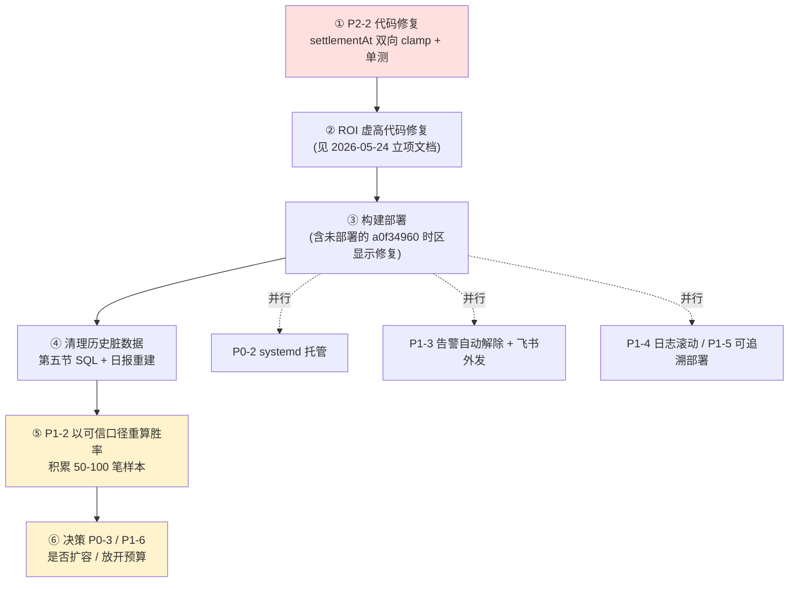

# 问题排查修复方案 — 跟单策略结算口径修复与配套治理（2026-05-25）

> 状态：**待评审 / 待执行** ｜ 类型：定期巡检 · 排查修复方案 ｜ 作者：人工排查（承接 scheduled task `1-job`）｜ 日期：2026-05-25
> 分析时段：2026-05-25 09:30–09:45 CST（test 数据库只读实测 + 仓库代码只读核验）
> 适用技能：`troubleshooting`（先定位后修复）+ `doc-writing`（文档结构、命名、图表）
> 承接巡检：[问题记录事项-待解决-2026-05-25.md](问题记录事项-待解决-2026-05-25.md)（`1-job` 巡检输出，16 项问题）
> 关联文档：[跟单ROI虚高根因分析与修复方案-2026-05-24.md](跟单ROI虚高根因分析与修复方案-2026-05-24.md)、[问题排查修复方案-2026-05-24.md](问题排查修复方案-2026-05-24.md)、[排查修复任务拆解-分批执行计划-2026-05-24.md](排查修复任务拆解-分批执行计划-2026-05-24.md)

> 说明：本文承接 `1-job` 巡检《问题记录事项-待解决-2026-05-25》，对其中 **15 个待解决问题（P0-1 ~ P3-2，P0-0 已关闭）逐条给出「根因 → 修复方案」**。本文**只产出方案，不对线上代码 / 服务器 / 数据库做任何写操作**；所有代码锚点经本次对仓库只读核验，所有数据结论经本次对 test 库 `SELECT` 实测（实测时刻 `NOW()` = 2026-05-25 09:33:54 CST）。脏数据清理 SQL 见第五节，需由人工在 test 库执行。

---

## 一、执行摘要（结论先行）

`1-job` 巡检已定位「开单已恢复、卡点迁移到持仓上限、胜率偏低且账面盈利不可信」。本文回答下一个问题：**这 15 个问题各自的根因在哪、怎么修、先修哪个、改多大、有什么风险。**

**三条最重要的结论：**

1. **本期第一优先是「结算口径」这条线（P2-2 + ROI 虚高），它是代码 bug，可治本，且投入产出比最高。** 经实测，`smart_wallet_trade_order` 有 **29 笔** `settled_at` 异常（11 笔未来日期、最远 2026-06-30；18 笔结算早于开仓），`smart_wallet_position` 有 **44 笔** `closed_at` 异常，`smart_wallet_daily_report` 有 **4 行**未来日期报告。根因是 `SmartWalletAccountingService.settlementAt()` 用「市场名义到期时间」当结算时刻，且只有上界保护、缺下界保护。修好它，胜率、`daily_report`、前端盈利比例三处会同时变可信。

2. **「时区显示」与「结算时间错误」是两个不同的问题，不要混淆。** 上一轮针对「开单时间按 UTC 显示」的修复（commit `a0f34960`，给 `java.util.Date` 出参统一北京时间序列化）是**展示层**修复，只解决「存对了、显示偏 8 小时」。本文的 P2-2 是**数据层 / 逻辑层** bug——`settled_at` 存进库的值本身就是错的（未来日期 / 早于开仓），与时区无关。两者需分别修复；且 `a0f34960` 目前**已提交未部署**，需随下次发版一并构建上线。

3. **修复必须按依赖顺序推进，先治本再决策。** 正确顺序是：**先修结算口径代码（P2-2）并部署 → 再清历史脏数据 → 再以可信口径重算胜率（P1-2）→ 最后才决策是否放开持仓上限（P0-3）**。在胜率仍不可信时贸然调高 `max-open-positions` 会放大真实亏损敞口。

### 修复方案总表

承接 `1-job`《待解决问题总表》15 条编号（P0-0 已关闭，不列入），逐条给出修复动作：

| 编号 | 问题 | 修复动作 | 修复类型 | 工作量 | 状态 |
|---|---|---|---|---|---|
| **P2-2** | `trade_order` / `position` / `daily_report` 结算时间为未来日期 / 早于开仓 | `settlementAt()` 增加 `[opened_at, now]` 双向 clamp；清理 29+44+4 行脏数据 | 代码 + 数据 | M | 待执行 ★本期核心 |
| P1-2 | 当前版本胜率偏低（20.8%），账面盈利由幻影结算虚高 | 前置依赖 P2-2 + ROI 虚高修复；之后以可信口径重算胜率 | 验证 | M | 待执行（依赖 P2-2） |
| P0-3 | 组合持仓数上限 `max-open-positions=20` 被打满 | **暂不扩容**；先优化出场 / 结算加快仓位周转；待 P1-2 后再决策 | 决策 + 代码 | M | 待决策 |
| P0-2 | 服务无进程守护，裸 `nohup` 启动 | 在服务器执行 `install-smart-wallet-linux-service.sh` 托管为 systemd | 运维 | S | 待执行 |
| P0-1 | 信号新鲜度门 `G5_SIGNAL_STALE_INGEST` 仍拒单 | 缩短 HOT 钱包同步轮询间隔 / 改近实时；或按类别复核新鲜度上限 | 代码 + 配置 | M | 待执行（优先级低于 P2-2） |
| P1-1 | allowlist 低质量钱包负 EV | 复核 24 条 `manual_allowlist`，剔除 `NOISE_OR_INSUFFICIENT` / 冷却期钱包 | 数据 + 轻代码 | M | 待执行 |
| P1-3 | 健康告警不外发 IM；CRITICAL 告警恢复后不自动解除 | 启用飞书 Sink 配置；为健康告警补「条件恢复 → 自动 resolved」逻辑 | 配置 + 代码 | M | 待执行 |
| P1-4 | 服务器负载 / 磁盘升高，日志无滚动清理 | logback 增加按大小 + 保留天数滚动；监控 GC / 磁盘 | 代码 + 运维 | S | 待执行 |
| P1-5 | 部署 jar 工作区直传，无可追溯 commit | 由明确 commit 在受控环境构建，服务器记录 commit 号；清理 `._*` | 工程治理 | S | 待执行 |
| P1-6 | 可用资金偏低（`HEALTH_CAPITAL_LOW`，available≈99/500） | 与 P0-3 合并；加快亏损仓位出清回收额度，而非简单调高 budget | 决策 | S | 待执行（依赖 P1-2） |
| P2-1 | `cash_ledger.balance_after` 2,485 行全 NULL | `appendCashLedger()` 写入处回填滚动余额；历史行用窗口函数一次性回算 | 代码 + 数据 | M | 待执行 |
| P2-3 | `strategy_run_log` / `strategy_health_snapshot` / `market_snapshot` 三表 0 行 | 核实三个写入器是否启用 / 静默报错；确认废弃则移出监控口径 | 排查 + 代码 | S→M | 待排查 |
| P2-4 | `leader_trade_outcome` 56% 为 `LOW_CONFIDENCE` | 排查置信度判定口径与数据源，提升结果回填质量 | 数据 + 代码 | M | 待排查 |
| P3-1 | 4 条 `strategy_alert` 全部未确认 / 未解决 | id=3 立即标 `resolved`；其余逐条核实并确认（SQL 见第五节） | 数据 | S | 待执行 |
| P3-2 | 巡检 SSH / MySQL 连通性间歇 | 巡检脚本已内置重试；必要时服务器侧落地只读导出兜底 | 运维 | S | 待观察 |

> 严重度沿用 `1-job` 口径：P0 = 影响安全 / 资金 / 可用性；P1 = 影响策略核心目标；P2 = 数据治理；P3 = 可观测性。
> 工作量口径：S ≈ 半天内；M ≈ 0.5–1 人日；L ≈ 1–3 人日（均含测试）。

### 较 `1-job` 巡检文档的新增信息

`1-job` 给出的是「问题定位」，本文新增三类信息：(1) 每条问题经只读核验的**代码锚点**（文件、行号、方法）；(2) 经 test 库实测的**脏数据精确清单与清理 SQL**；(3) **修复的依赖顺序与风险**。

---

## 二、分析范围与方法

### 2.1 数据库实测（只读）

- 连接：`jdbc:mysql://49.51.250.174:3306/coin_strategy`，仅执行 `SELECT` / `information_schema` 查询，未做任何写操作。
- 实测时刻：MySQL `NOW()` = `2026-05-25 09:33:54`，`CURDATE()` = `2026-05-25`，会话时区 `SYSTEM`（服务器为东八区）。
- 覆盖：`smart_wallet_trade_order`、`smart_wallet_position`、`smart_wallet_daily_report`、`smart_wallet_cash_ledger`、`strategy_alert`、`strategy_run_log` / `strategy_health_snapshot` / `smart_wallet_market_snapshot` 三张快照表。

### 2.2 代码只读核验

- 仓库 `CoinStrategy`，模块 `coin-strategy-job`。所有行号基于本次核验时的工作区状态。
- 核验文件：`SmartWalletAccountingService.java`、`SmartWalletTradeOrderService.java`、`StrategyHealthMonitorJob.java`、`FeishuStrategyAuditAlertSink.java`、`HealthSnapshotScheduler.java`、`MarketSnapshotCollectorService.java`。

---

## 三、本期核心：结算口径错误（P2-2）根因与修复

### 3.1 现象（test 库实测）

| 异常类别 | 表 | 数量 | 实测样例 |
|---|---|---|---|
| 结算时间为未来日期 | `smart_wallet_trade_order` | **11** | id=610 `opened_at`=05-24 17:34、`settled_at`=**2026-05-31 17:00**；id=581/590 `settled_at`=**2026-06-30 08:00** |
| 结算早于开仓 | `smart_wallet_trade_order` | **18** | id=634 `opened_at`=05-25 04:15、`settled_at`=**05-24 21:00**（早 7 小时 15 分） |
| 结算时间为未来日期 | `smart_wallet_position`（`closed_at`） | **11** | position 796/798 `closed_at`=2026-05-31 17:00 |
| 结算早于开仓 | `smart_wallet_position`（`closed_at`） | **33** | — |
| 未来日期报告 | `smart_wallet_daily_report` | **4** | id=44/46/48/41，`report_date`=05-27 / 05-29 / 05-31 / 06-30 |

> 注：实测 29 笔异常 `trade_order` 与巡检文档「11+16」略有出入，因数据为实时变化——巡检在 09:10、本文在 09:33，期间又新增了结算早于开仓的订单（id=635、637 等），**说明该 bug 仍在持续产生新脏数据**。

异常 `settled_at` 的取值都是「整点 / 半点」（13:30、16:00、17:00、07:05、08:00），这是 Polymarket 市场的**名义到期时间**特征，直接指向根因。

### 3.2 根因（代码锚点经只读核验）

**直接原因：`settlementAt()` 只有上界保护，缺下界保护。**

`coin-strategy-job` → `SmartWalletAccountingService.java`：

```java
// resolvePosition() 内，约 line 3147-3148
Date now = new Date();
Date settlementAt = settlementAt(metadata, now);
...
// 约 line 3195-3196：把结算时刻同时写进 closed_at 与 last_filled_at
p.setClosedAt(finalSettlementAt).setLastFilledAt(finalSettlementAt);

// settlementAt()，约 line 3203
private Date settlementAt(PolymarketApiClient.MarketMetadata metadata, Date fallback) {
    Date fallbackDate = fallback == null ? new Date() : fallback;
    if (metadata != null && metadata.getEndAt() != null && metadata.getEndAt() > 0) {
        Date endAt = new Date(metadata.getEndAt());
        if (endAt.after(fallbackDate)) {   // 仅上界保护：endAt 晚于 now → 退回 now
            return fallbackDate;
        }
        return endAt;                       // ← 缺下界保护：endAt 早于 opened_at 时直接返回
    }
    return fallbackDate;
}
```

- **结算早于开仓（18 笔）**：当我方在市场即将到期 / 已到期时才开的仓，`endAt`（名义到期）早于 `opened_at`。`settlementAt()` 的 `endAt.after(now)` 为假（`endAt` 不在未来），直接 `return endAt` → `settled_at < opened_at`。**当前代码仍在持续产生此类脏数据。**
- **结算为未来日期（11 笔）**：上界保护 `if (endAt.after(now))` 是近期才加的修复（注释引用「问题记录-2026-05-24 P2-2」），**部署前**（≤05-24 17:32 的 jar）写入的历史行没有该保护，于是把未来的 `endAt` 直接写库。实测 11 笔的 `updated_at` 均 ≤ 05-24 22:35，无一晚于 05-25 01:12 新 jar 上线时刻，与「上界保护已在新 jar 生效」一致。

**根本原因：用「市场名义到期时间」`metadata.endAt` 充当「实际结算时刻」。** 二者本就不是一回事——名义到期是合约定义的时间，实际结算是预言机出结果、我方处理入账的时间。把前者写进 `settled_at` / `closed_at`，必然出现未来日期或早于开仓。

**传导链**：`position.closed_at` →（`SmartWalletTradeOrderService.buildEntity()`，`settled ? position.getClosedAt() : null`）→ `trade_order.settled_at`；同时 `resolvePosition()` 末尾 `rebuildDailyReport(addr, toLocalDate(settlementAt))` 用错误结算时刻给 `daily_report` 分桶 → 产生未来日期报告行。

### 3.3 修复方案（代码，不在本文执行）

**改 `settlementAt()`：把结果 clamp 到 `[opened_at, now]` 闭区间。** 默认值由「名义到期时间」改为「真实结算处理时刻 `now`」，名义到期时间仅作落在合理区间内时的可选估计。

```java
// 调用方 resolvePosition()：把 position.openedAt 传入
Date settlementAt = settlementAt(metadata, now, position.getOpenedAt());

// 改造后的 settlementAt()
private Date settlementAt(PolymarketApiClient.MarketMetadata metadata, Date now, Date openedAt) {
    Date upper = (now == null) ? new Date() : now;                       // 上界：实际处理时刻
    Date lower = (openedAt != null && openedAt.before(upper)) ? openedAt : upper; // 下界：开仓时刻
    Date candidate = upper;                                              // 默认用真实结算处理时刻
    if (metadata != null && metadata.getEndAt() != null && metadata.getEndAt() > 0) {
        candidate = new Date(metadata.getEndAt());                       // 名义到期仅作候选
    }
    if (candidate.before(lower)) return lower;                           // 下界保护（修复 18 笔类问题）
    if (candidate.after(upper))  return upper;                           // 上界保护（保留原有）
    return candidate;
}
```

**配套核查**：

1. `repairPrematureSettlement` 路径（`SmartWalletAccountingService` 约 line 1713 / 3487）用 `snapshot.lastFilledAt()` 设 `closed_at`——`lastFilledAt` 源自真实 fill，一般安全，但若某 position 的 fill 链里混入了被污染的结算 fill，仍可能带出脏值，建议同一改动里加一致性断言。
2. 修复后补单测：构造「`endAt` 早于 `openedAt`」「`endAt` 晚于 `now`」「`endAt` 落在区间内」三种 metadata，断言 `settledAt ∈ [openedAt, now]`（参考 `test-driven-development` 技能）。

### 3.4 与「ROI 虚高」的关系

P2-2（结算**时间**错）与 ROI 虚高（结算 / 估值**价格**错，持仓被按 \$1.00 全额赔付价估值）是**两个独立 bug，但同属「结算口径」这条线**，且叠加污染同一批指标（胜率、`daily_report`、前端盈利比例）。ROI 虚高的根因定位与修复方案已在 [跟单ROI虚高根因分析与修复方案-2026-05-24.md](跟单ROI虚高根因分析与修复方案-2026-05-24.md) 立项（结论：`roiRate = markPrice/price − 1`，`markPrice` 被错当成 1.00），本文**不重复**，仅强调：**两者建议在同一个发版里一起修复、一起部署、一起回算历史数据**，否则胜率口径仍不可信。

---

## 四、逐条修复方案

每条按 `troubleshooting` 技能「现象 → 根因 → 修复 → 状态」结构记录。P2-2 见第三节，此处不再重复。

### P1-2 当前版本胜率偏低，账面盈利由幻影结算虚高

- **现象**：当前版本已了结 24 笔，胜率 20.8%；账面 +93.97 USDC，剔除幻影后实际约 −28 USDC。
- **根因**：(1) 策略层——入场信号质量弱（见 P1-1）；(2) 数据层——P2-2 结算时间错 + ROI 虚高，使账面盈亏虚高。
- **修复**：本身不是独立 bug，而是 P2-2 + ROI 虚高的下游表现。**前置依赖**：P2-2 与 ROI 虚高修复并部署、历史数据回算完成后，以「真实结算价 + 真实结算时刻」口径重算胜率；积累 ≥ 50–100 笔可信样本后再评估策略真实盈利能力。
- **状态**：待执行（强依赖 P2-2）。

### P0-3 组合持仓数上限被打满

- **现象**：`G4_MAX_OPEN_POSITIONS` 今日占 ~82% 拒单；`max-open-positions=20` 已打满。
- **根因**：P0-0 暴露死锁解除后开单恢复，但出场 / 结算速度跟不上开仓速度，槽位被迅速占满。属预期内的卡点迁移，非缺陷。
- **修复（决策项，建议）**：**在 P1-2 胜率问题解决前不扩容**——胜率仅 20.8% 时调高上限会放大亏损敞口。优先做：(a) 优化出场 / 结算链路加快仓位周转（与 P2-2 同在 `SmartWalletAccountingService`，可一并评估）；(b) 提升入场信号质量（P1-1），确保 20 个槽位装的是高质量仓位。待胜率可信后再评估是否上调 `max-open-positions` 并同步核对 `max-total-open-cost-usdc=500` 资金预算。
- **状态**：待决策（依赖 P1-2）。

### P0-2 服务无进程守护

- **现象**：job 服务以裸 `nohup java -jar` 启动，无 systemd / crontab 托管。
- **根因**：部署流程缺「托管为系统服务」一步；仓库已有 `scripts/install-smart-wallet-linux-service.sh` 与 systemd 单元模板，未在服务器启用。
- **修复（运维）**：在服务器执行 `install-smart-wallet-linux-service.sh`，托管为 systemd 单元，设 `Restart=always` / `RestartSec=10`；叠加基于 8081 健康端点的外部看门狗。低风险、一次性。
- **状态**：待执行（上一版即列出，仍未处理）。

### P0-1 信号新鲜度门仍拒单

- **现象**：`G5_SIGNAL_STALE_INGEST` 今日 185 次；近 24h SKIPPED 中 97% 为 `STALE,SIGNAL_STALE_INGEST`。`trade_event` 摄取时延 `opened_at→created_at` 多在 500–660 秒，约半数越过 SPORTS 类约 600s 的新鲜度上限。
- **根因**：HOT 钱包事件同步为轮询模式，稳态时延与新鲜度上限接近，约半数事件越线。
- **修复**：(a) 缩短 HOT 钱包同步轮询间隔或改近实时推流，把摄取时延压回 600s 内；(b) 或按市场类别复核新鲜度上限是否合理。**注意**：上一轮已有教训——单纯调阈值是掩盖，应优先压低摄取时延这一真瓶颈。优先级低于 P2-2 / P1-2。
- **状态**：待执行。

### P1-1 allowlist 低质量钱包负 EV

- **现象**：影子单大量以 "Kelly stake: negative EV" 收尾；被跟钱包 `archetype=NOISE_OR_INSUFFICIENT`、`lane=OBSERVE_ONLY`、处于 `OBSERVE_COOLDOWN`，靠 `manual_allowlist` 强制绕过准入。
- **根因**：人工 allowlist 把质量不足、观察冷却期的钱包强行纳入跟单。
- **修复（数据 + 轻代码）**：(a) 复核 `smart_wallet_manual_allowlist` 24 条，剔除 `NOISE_OR_INSUFFICIENT` / 冷却期钱包；(b) 代码上明确 allowlist 语义——仅「绕过准入门」，不「绕过信号质量 / EV 门」。
- **状态**：待执行。

### P1-3 健康告警不外发 IM，CRITICAL 告警不自动解除

- **现象**：`strategy_alert` 落库 4 条但无 IM 通知；id=3「24h 零开仓」CRITICAL 在开单 17:32 恢复后仍 `resolved=0`。
- **根因（经核验）**：
  - 外发能力**已存在**——`StrategyHealthMonitorJob`（`@Scheduled` 每 1h）的 WARN/CRITICAL 分支已调 `SmartWalletAuditAlertSink.publish()`，默认实现 `FeishuStrategyAuditAlertSink` 会「落 `strategy_alert` 表 + 按开关推飞书」。**未外发的真实原因是配置未开**：需 `smart-wallet.audit.feishu-sink-enabled=true` 且 `feishu-webhook-url` 非空，test 环境大概率未配置。
  - **无自动解除逻辑**——`StrategyHealthMonitorJob` 只「检测 + publish」，全仓无任何代码把 `strategy_alert.resolved` 置 1。id=3 长期挂起即直接证据。
- **修复**：(a) 配置层——在 test/prod profile 配 `feishu-sink-enabled=true` + 有效 `feishu-webhook-url`；(b) 代码层——为健康类告警补「条件恢复 → 自动 `resolved=1, resolved_at=NOW()`」闭环：`StrategyHealthMonitorJob` 每轮检测时，对「当前已不满足触发条件」的同 `alert_type` 未解决告警执行 resolve。
- **状态**：待执行。id=3 的历史行可立即用 SQL 手动 resolve（见第五节）。

### P1-4 服务器负载 / 磁盘升高，日志无滚动

- **现象**：load≈3.6–4.5、磁盘用量 64%；`logs/` 下单个 `job-2026-05-22.log` 达 92 MB。
- **根因**：日志无按大小滚动 + 无保留天数清理，磁盘单调增长；多线程 jar 持续运行致负载偏高。
- **修复（代码 + 运维）**：(a) `logback-spring.xml` 的 `RollingFileAppender` 增加 `SizeAndTimeBasedRollingPolicy`——按天 + 单文件上限（如 100 MB）滚动，设 `maxHistory`（如 14 天）与 `totalSizeCap`（如 2 GB）；(b) 监控 JVM GC 与系统负载，持续偏高再考虑升配或应用与 MySQL 分机部署。
- **状态**：待执行。

### P1-5 部署 jar 无可追溯 commit

- **现象**：服务器 `backend/` 下 `app.jar` 旁有 `._app.jar`（macOS AppleDouble 元数据），说明 jar 系本地 Mac 构建后直传。
- **根因**：部署流程为「本地构建 + 直传」，未由明确 git commit 在受控环境构建。
- **修复（工程治理）**：线上 jar 由明确 commit 构建产出（jar `MANIFEST` 注入 commit 号——仓库已有 `build(job): jar MANIFEST 注入构建版本/时间/commit 元信息` 的提交，确认其生效）；服务器侧记录当前运行 commit；清理 `._*` 直传痕迹。
- **状态**：待执行。

### P1-6 可用资金偏低

- **现象**：`strategy_alert` id=4 `HEALTH_CAPITAL_LOW`，available≈99.25 / budget 500 USDC。
- **根因**：开单恢复后仓位与占用成本快速堆积，可用资金降至预算的 ~20%。
- **修复（决策）**：与 P0-3 合并看。先确认占用资金对应的是不是高质量仓位；若多为低质量持仓，应通过提升信号质量（P1-1）+ 加快亏损仓位出清来回收额度，而非简单调高 `budget`。依赖 P1-2 的可信胜率口径。
- **状态**：待执行（依赖 P1-2）。

### P2-1 `cash_ledger.balance_after` 全部为 NULL

- **现象**：`smart_wallet_cash_ledger` 实测 2,485 行，`balance_after` 全部 NULL。
- **根因（经核验）**：`SmartWalletAccountingService.appendCashLedger()`（约 line 2990）插入 `SmartWalletCashLedgerEntity` 时，对 `ORDER_NOTIONAL` / `FEE` / `NETWORK_FEE` / `REALIZED_PNL` 四类流水均**未调用 `setBalanceAfter()`**；实体有该字段，从未被写入。
- **修复（代码 + 数据）**：
  - 代码：`appendCashLedger()` 写入前按 `execution_address` 取上一条流水的 `balance_after`（无则取初始预算），按 `direction`（IN/OUT）累加本条 `amount`，回填 `balance_after`；注意四类流水在同一方法内连续插入，需串行累加。
  - 历史数据：用窗口函数按 `execution_address` + `occurred_at` 排序一次性回算（见第五节，需先确定初始余额口径）。
- **状态**：待执行。

### P2-3 三张快照 / 日志表 0 行

- **现象**：`strategy_run_log`、`strategy_health_snapshot`、`smart_wallet_market_snapshot` 实测均 0 行。
- **根因（经核验，待运行态确认）**：写入器代码**均存在**——`HealthSnapshotScheduler`（`@Scheduled` 每 60s，`snapshotMapper.insert`）、`MarketSnapshotCollectorService`（含 `@Scheduled` + `saveSnapshot`）、`StrategyRunLogService`。三表却空，说明写入链路未真正跑通：要么对应调度 / 采集开关未开（`strategy-monitor.*`），要么静默报错被吞，要么该子系统（策略引擎监控）在本部署未启用。
- **修复（先排查再决定）**：(a) 在服务器 grep 三个写入器的日志，确认调度是否触发、是否抛异常；(b) 跑通则补开关 / 修异常；(c) 确认该监控子系统已废弃，则从巡检口径移除这三张表，避免「形同虚设」。
- **状态**：待排查。

### P2-4 `leader_trade_outcome` 56% 为 `LOW_CONFIDENCE`

- **现象**：`smart_wallet_leader_trade_outcome` 98,577 行中 `LOW_CONFIDENCE` 占 56.0%。
- **根因**：leader 成交结果的数据源置信度不足，过半无法可靠定盈亏——与 P1-1 低质量 allowlist 互为因果。
- **修复（数据 + 代码）**：排查 `LOW_CONFIDENCE` 判定口径与数据源（结果回填依赖的市场结算 / 价格数据质量），提升回填质量；与 P2-2 结算口径修复有协同——结算数据修好后，部分 `LOW_CONFIDENCE` 可能自动转为可定论。
- **状态**：待排查。

### P3-1 4 条 `strategy_alert` 未确认 / 未解决

- **现象**：`strategy_alert` 共 4 条，全部 `acknowledged=0`、`resolved=0`：

  | id | alert_type | level | 说明 | 处置 |
  |---|---|---|---|---|
  | 1 | AUDIT_SETTLEMENT_SOURCE | WARN | 结算源审计 `delayed=819` | 与 P2-2 同源，P2-2 修复后复核 |
  | 2 | AUDIT_LIVE_REPLAY_DIFF | WARN | Live↔Replay 偏差超阈值 | 单独核实后确认 |
  | 3 | HEALTH_NO_OPEN_24H | CRITICAL | 24h 零开仓——**开单已 17:32 恢复** | **立即标 `resolved`** |
  | 4 | HEALTH_CAPITAL_LOW | WARN | 可用资金偏低（见 P1-6） | 随 P1-6 处置 |

- **根因**：缺告警确认 / 闭环流程（与 P1-3 同源）。
- **修复**：id=3 立即 SQL 标 `resolved`（见第五节）；其余逐条核实后确认。根治依赖 P1-3 的自动解除逻辑。
- **状态**：待执行。

### P3-2 巡检 SSH / MySQL 连通性间歇

- **现象**：巡检对服务器 22 / 3306 端口间歇可达，需重试。
- **根因**：巡检沙箱出网或服务器侧网络抖动。
- **修复（运维）**：巡检脚本已内置重试（本次成功）；若后续频繁失败，在服务器侧落地只读巡检导出作为兜底。
- **状态**：待观察。

---

## 五、脏数据清理 SQL

> ⚠️ 执行前提与顺序：
> 1. **必须先部署 P2-2 代码修复**，否则清理后仍会持续产生新脏数据。
> 2. 所有 `UPDATE` / `DELETE` 前先跑对应 `SELECT` 预览，并对相关表做备份（`CREATE TABLE ..._bak_20260525 AS SELECT ...`）。
> 3. 在 **test 库**执行；本文不代为执行。
> 4. 校正口径：异常结算时间统一校正为该行 `updated_at`（= 真实结算处理时刻，经实测 29 笔 `trade_order`、44 笔 `position` 的 `updated_at` 均落在 `[opened_at, NOW()]` 内，是当前可得的最佳代理值）。

### 5.1 P2-2 ── `smart_wallet_trade_order` 异常结算时间（29 行）

```sql
-- ① 预览
SELECT id, position_id, status, opened_at, settled_at, updated_at
FROM smart_wallet_trade_order
WHERE settled_at > NOW() OR settled_at < opened_at
ORDER BY id;

-- ② 备份
CREATE TABLE smart_wallet_trade_order_bak_20260525 AS
SELECT * FROM smart_wallet_trade_order
WHERE settled_at > NOW() OR settled_at < opened_at;

-- ③ 校正：把异常 settled_at 改为 updated_at（真实结算处理时刻）
--    注：若该表 updated_at 带 ON UPDATE CURRENT_TIMESTAMP，本 UPDATE 会同时把
--    updated_at 刷新为执行时刻——RHS 的 updated_at 取的是旧值，settled_at 结果正确，
--    但执行后 updated_at 原值丢失，故第 ② 步备份是必须的。
UPDATE smart_wallet_trade_order
SET settled_at = updated_at
WHERE settled_at > NOW() OR settled_at < opened_at;

-- ④ 校验：应返回 0 行
SELECT COUNT(*) AS still_bad FROM smart_wallet_trade_order
WHERE settled_at > NOW() OR settled_at < opened_at;
```

### 5.2 P2-2 ── `smart_wallet_position` 异常 `closed_at`（44 行）

```sql
-- ① 预览
SELECT id, status, opened_at, closed_at, last_filled_at, updated_at
FROM smart_wallet_position
WHERE closed_at IS NOT NULL AND (closed_at > NOW() OR closed_at < opened_at)
ORDER BY id;

-- ② 备份
CREATE TABLE smart_wallet_position_bak_20260525 AS
SELECT * FROM smart_wallet_position
WHERE closed_at IS NOT NULL AND (closed_at > NOW() OR closed_at < opened_at);

-- ③ 校正 closed_at（resolvePosition 把 last_filled_at 也设成了同一错误值，一并校正）
UPDATE smart_wallet_position
SET closed_at = updated_at,
    last_filled_at = updated_at
WHERE closed_at IS NOT NULL AND (closed_at > NOW() OR closed_at < opened_at);

-- ④ 校验
SELECT COUNT(*) AS still_bad FROM smart_wallet_position
WHERE closed_at IS NOT NULL AND (closed_at > NOW() OR closed_at < opened_at);
```

### 5.3 P2-2 ── `smart_wallet_daily_report` 未来日期报告（4 行）

未来日期报告是「错误结算时刻分桶」产生的幻影行。清理后需重算受影响日期的日报。

```sql
-- ① 预览
SELECT id, report_date, realized_pnl_usdc, net_pnl_usdc, winning_positions, losing_positions
FROM smart_wallet_daily_report
WHERE report_date > CURDATE()
ORDER BY report_date;

-- ② 备份后删除
CREATE TABLE smart_wallet_daily_report_bak_20260525 AS
SELECT * FROM smart_wallet_daily_report WHERE report_date > CURDATE();

DELETE FROM smart_wallet_daily_report WHERE report_date > CURDATE();
```

> 删除后，5.1 中被校正的 29 笔订单的盈亏会落到新的（真实）日期。**建议在 5.1 / 5.2 完成后，触发应用的日报重建**（`rebuildDailyReport`，可通过既有 trade-order backfill / repair 接口），把这批盈亏重新分桶到正确日期，否则对应日期的 `daily_report` 会偏少。日报重建口径还需等 ROI 虚高修复后才完全可信。

### 5.4 P3-1 ── `strategy_alert` 确认 / 解除

```sql
-- id=3 HEALTH_NO_OPEN_24H：开单已于 05-24 17:32 恢复，立即解除
UPDATE strategy_alert
SET resolved = 1, resolved_at = NOW(), acknowledged = 1, acknowledged_at = NOW()
WHERE id = 3 AND alert_type = 'HEALTH_NO_OPEN_24H';

-- id=1/2/4：核实后确认（resolved 仍留待对应问题真正解决后再置）
UPDATE strategy_alert SET acknowledged = 1, acknowledged_at = NOW()
WHERE id IN (1, 2, 4) AND acknowledged = 0;
```

### 5.5 P2-1 ── `cash_ledger.balance_after` 历史回算（参考脚本）

历史回算需先确定**初始余额口径**（如初始预算 500 USDC，或首条流水前的账户余额）。确定后用窗口函数按账户回算：

```sql
-- 预演（先 SELECT 验证累加结果合理，再改 UPDATE）：
-- 约定 IN 为入账(+)、OUT 为出账(-)，@init 为该账户初始余额
SELECT id, execution_address, occurred_at, direction, amount,
       @init + SUM(CASE WHEN direction='IN' THEN amount ELSE -amount END)
               OVER (PARTITION BY execution_address ORDER BY occurred_at, id) AS balance_after_calc
FROM smart_wallet_cash_ledger
ORDER BY execution_address, occurred_at, id;
```

> 该回算口径需与代码修复（`appendCashLedger` 回填逻辑）保持一致；建议代码修复先行，历史回算作为一次性数据治理跟进。

### 5.6 ROI 虚高 ── 存量持仓订正

> ⚠️ 关键前提，务必先读：
>
> 1. **`settlement_price = 1.0` + `roi_rate` 偏高这个组合，无法区分「真实低价中标」与「幻影结算」。** 便宜买入（入场价如 0.22）的真实赢单，合法 `roi_rate` 就是 `(1−0.22)/0.22 ≈ 3.5`。实测 15 笔候选里，id=7 / 12 / 23 是 5 月初的 `CLAIMED`（已领取真实赔付）仓位，几乎可以肯定是**真实赢单**——若对它们盲目「订正」反而会破坏正确数据。
> 2. 能凭 SQL 100% 判定为幻影的，只有「`settled_at` 未来日期 / 早于开仓」那一类（已在 5.1 / 5.2 覆盖）。其余真假之分，**必须由修复后的代码逐仓位重新核对市场是否真的 resolved**。
> 3. `smart_wallet_trade_order` / `smart_wallet_daily_report` 是**派生表**，由 `position`（+fills）重算得到；`position` 的错误结算还连带写了 `cash_ledger` 的 `REALIZED_PNL` 流水。**因此存量订正不能靠裸 SQL 改 `roi_rate` / `status`**——会造成持仓、账本、派生表三者不一致。
>
> 结论：本节 SQL 只负责**识别**与**校验**；真正的「撤销错误结算 + 重算」走 app 内置修复工具（B 步），这是唯一能正确区分真假赢单、且同步回滚账本的途径。

**A. 识别受影响行（只读 SELECT）**

```sql
-- A1 候选集：已结算、按满额赔付价(≈1.0)估值、roi_rate 偏高。
--    注意：含真实低价赢单，不可直接当作"待订正"。实测约 15 笔。
SELECT id, position_id, status, opened_at, settled_at,
       entry_cost_usdc, settlement_price, total_pnl_usdc, roi_rate
FROM smart_wallet_trade_order
WHERE settlement_price >= 0.999 AND roi_rate >= 1.0
ORDER BY roi_rate DESC;

-- A2 候选集中【可确定为幻影】的子集：结算时间本身不合法。
--    这部分 100% 要订正，与 5.1 / 5.2 同源。
SELECT id, position_id, status, opened_at, settled_at, roi_rate
FROM smart_wallet_trade_order
WHERE settlement_price >= 0.999 AND roi_rate >= 1.0
  AND (settled_at > NOW() OR settled_at < opened_at);

-- A3 源头 position：被按满额赔付价估值/结算。实测约 17 笔（16 CLAIMED + 1 CLOSED）。
--    实测无 OPEN 仓位命中该指纹，故"路径 B（未结算持仓 markPrice 污染）"当前无存量。
SELECT id, status, quantity, cost_basis_usdc, original_cost_basis_usdc,
       last_mark_price, realized_pnl_usdc, closed_at
FROM smart_wallet_position
WHERE last_mark_price >= 0.999
  AND status IN ('RESOLVED_UNCLAIMED', 'CLAIMED', 'CLOSED')
ORDER BY id;
```

**B. 订正：用 app 内置修复工具（首选，非裸 SQL）**

`SmartWalletAccountingService.repairPrematureResolvedPaperPositions()`（约 line 1789）会逐仓位重新核对当前市场 metadata（是否真的 `closed && !acceptingOrders && resolved`），对「过早 / 错误结算」的仓位按 fill 链 `replayPositionFromFills` 重算，并回滚对应账本——这是能正确区分真假赢单的唯一途径。已有 web 接口可触发（`coin-strategy-web`，端口 8080，context-path `/strategy/api`）：

前提：先部署含 ROI 虚高 P0+P1 修复 + 本文 P2-2 修复的新 jar，否则修复逻辑本身仍是旧的。

```bash
# ① 撤销并重修所有"过早结算"仓位（异步，返回 triggerId）
curl -X POST 'http://<web-host>:8080/strategy/api/smart-wallet/accounting/repair-premature-settlements?limit=500&refreshCache=true'

# ② 用返回的 triggerId 查执行结果
curl 'http://<web-host>:8080/strategy/api/smart-wallet/accounting/repair-premature-settlements/{triggerId}'

# ③ 仓位修好后，重建派生表 trade_order
curl -X POST 'http://<web-host>:8080/strategy/api/smart-wallet/trade-orders/backfill'
```

> 若只想修指定仓位，用 `POST /strategy/api/smart-wallet/accounting/repair-premature-settlements/by-ids`（body 传 A3 查到的 position id 列表，字段名以 `SmartWalletAccountingController` 对应 handler 实际解析为准）。

**C. daily_report 订正**

ROI 虚高的盈亏经 B 步重算后，`daily_report` 需同步重建：5.3 已删除 4 行未来日期报告；B 步完成（trade-orders backfill）后会对受影响日期触发 `rebuildDailyReport`，把盈亏重新分桶到正确日期。

**D. 兜底：派生表一致性重算 SQL（仅在无法走 app 工具时，且明确局限）**

如果个别 `trade_order` 行确实无法经 B 步重修，可用下式让 `roi_rate` 至少与 `total_pnl_usdc` 自洽——但**这只消除派生列内部不一致，不还原真值**：若 `total_pnl_usdc` 本身因 1.0 结算而虚高，`roi_rate` 仍是虚高的，**不能替代 B 步**。

```sql
-- 备份
CREATE TABLE smart_wallet_trade_order_roibak_20260525 AS
SELECT * FROM smart_wallet_trade_order
WHERE settlement_price >= 0.999 AND roi_rate >= 1.0;

-- 仅一致性重算（roiBase 与代码 buildEntity 口径一致：优先 entry_cost_usdc）
UPDATE smart_wallet_trade_order
SET roi_rate = total_pnl_usdc / NULLIF(entry_cost_usdc, 0)
WHERE settlement_price >= 0.999 AND roi_rate >= 1.0 AND entry_cost_usdc > 0;
```

**E. 校验**

B 步完成后重跑 A1：`settlement_price >= 0.999 AND roi_rate >= 1.0` 的行应只剩「真实低价赢单」（如 id=7 / 12 / 23 这类 `CLAIMED` 仓位），未来日期 / 早于开仓的幻影行应归零；当日 `smart_wallet_daily_report.net_pnl_usdc` 应收敛到剔除幻影后的口径。

---

## 六、建议执行顺序



| 批次 | 行动项 | 关联问题 | 类型 |
|---|---|---|---|
| A（治本·必须串行） | P2-2 结算口径代码修复 + ROI 虚高修复 + 构建部署 + 清脏数据 + 日报重建 | P2-2 / P1-2 / ROI 虚高 | 快恢复 |
| B（可并行·工程治理） | P0-2 systemd 托管；P1-4 日志滚动；P1-5 可追溯部署 | P0-2 / P1-4 / P1-5 | 防发生 |
| C（可并行·可观测） | P1-3 告警自动解除 + 飞书外发；P3-1 手动 resolve id=3 | P1-3 / P3-1 | 早发现 |
| D（A 完成后） | 以可信口径重算胜率；复核 24 条 allowlist | P1-2 / P1-1 | 防发生 |
| E（D 完成后·决策） | 决策 P0-3 是否扩容、P1-6 是否放开预算 | P0-3 / P1-6 | 决策 |
| F（治理·可延后） | P2-1 余额回填；P2-3 三空表排查；P2-4 LOW_CONFIDENCE 排查；P0-1 摄取时延 | P2-1 / P2-3 / P2-4 / P0-1 | 防发生 |

> **强依赖**：批次 D（重算胜率）必须在批次 A 完成之后；批次 E（扩容决策）必须在批次 D 之后——在胜率不可信时扩容会放大亏损敞口。

---

## 七、附录：核验方法与证据

- **数据库实测**（2026-05-25 09:33 CST，库 `coin_strategy`，只读 `SELECT`）：
  - `smart_wallet_trade_order`：`settled_at > NOW()` 11 行、`settled_at < opened_at` 18 行；逐行取 `id / opened_at / settled_at / updated_at`。
  - `smart_wallet_position`：`closed_at > NOW()` 11 行、`closed_at < opened_at` 33 行。
  - `smart_wallet_daily_report`：`report_date > CURDATE()` 4 行（id 41/44/46/48）。
  - `smart_wallet_cash_ledger`：总 2,485 行、`balance_after IS NULL` 2,485 行。
  - `strategy_alert`：4 行，列 `id/strategy_id/alert_level/alert_type/title/message/acknowledged/resolved/...`，全部 `acknowledged=0 resolved=0`。
  - `strategy_run_log` / `strategy_health_snapshot` / `smart_wallet_market_snapshot`：均 0 行。
- **代码只读核验**（仓库 `CoinStrategy`，模块 `coin-strategy-job`）：
  - `SmartWalletAccountingService.java`：`settlementAt()`（约 line 3203）、`resolvePosition()` 调用点（约 line 3148）、`closed_at/last_filled_at` 写入（约 line 3195-3196）、`appendCashLedger()`（约 line 2990）。
  - `SmartWalletTradeOrderService.buildEntity()`：`settled_at = position.closed_at` 传导。
  - `StrategyHealthMonitorJob.java`：`@Scheduled` 每 1h、`alertSink.publish()`（约 line 185）。
  - `FeishuStrategyAuditAlertSink.java`：飞书外发开关 `feishu-sink-enabled` / `feishu-webhook-url`。
  - `HealthSnapshotScheduler.java` / `MarketSnapshotCollectorService.java`：三张空表对应的写入器存在性。

---

## 自检（依据 `doc-writing` 技能完成前清单）

- [x] 开头点明「这是什么 / 给谁看」：承接 `1-job` 巡检的逐条修复方案，供 Ray 评审执行。
- [x] 重要结论前置：执行摘要 + 修复方案总表 + 三条核心结论。
- [x] 用图表代替大段文字：修复总表、脏数据清单、执行批次用表，执行顺序用 Mermaid。
- [x] 标注状态、作者、日期、分析时段。
- [x] 术语、单位、口径清晰（USDC、CST、严重度 / 工作量定义、脏数据校正口径）。
- [x] 放入正确目录并按「问题排查修复方案-日期」命名：`docs/problem/问题排查修复方案-2026-05-25.md`。
- [x] 与相关文档建立链接（1-job 巡检、ROI 虚高分析、上一版修复方案）。
- [x] 不确定内容已标注（P2-3 待运行态确认、P2-1 初始余额口径待定）。
