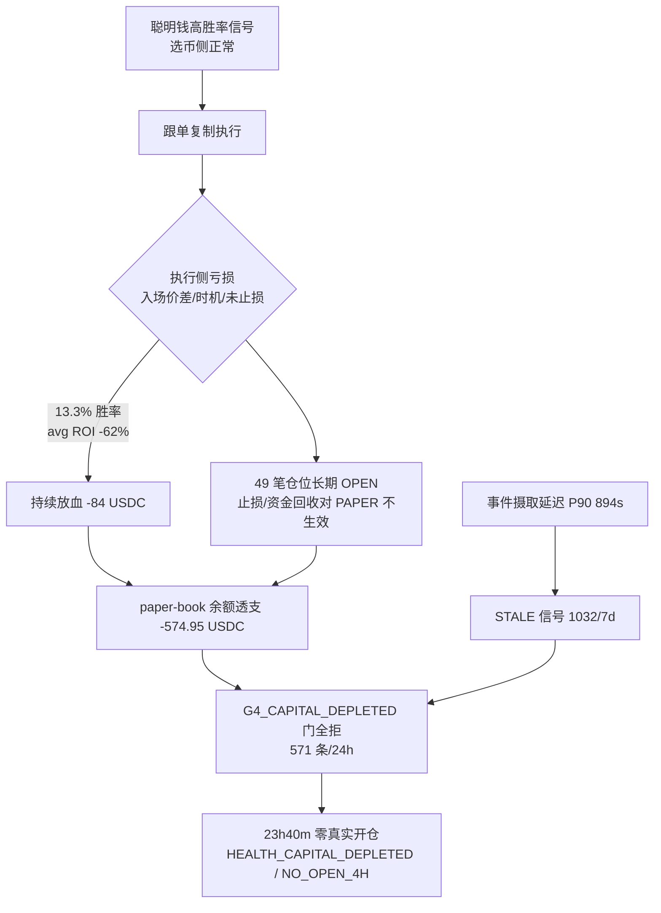

> ✅ **已修复（superseded，2026-06-05 归档）**：本巡检快照记录的主阻塞问题（零开仓 / 下游停摆 / OPEN 卡死 / 摄取滞后）已于 2026-06-03 部署并实测验证修复；残留项（资金透支 P0-3、胜率口径 P0-4）已并入活跃日志 `问题记录事项-待解决-2026-06-05.md` 跟踪。本文保留作历史留痕。

---
title: 问题记录事项 — 待解决（2026-05-30）
type: report
status: active
tags: [polymarket, smart-wallet, troubleshooting, report, job, problem-log]
created: 2026-05-30
updated: 2026-05-30
related: ["[[问题记录事项-待解决-2026-05-29]]", "[[亏损根因分析-2026-05-29]]", "[[排查修复任务拆解-分批执行计划-2026-05-29]]"]
---

# 问题记录事项 — 待解决（2026-05-30）

> 状态：**待解决** ｜ 类型：定期巡检 · 问题记录 ｜ 作者：自动巡检（scheduled task `1-job`）｜ 日期：2026-05-30
> 巡检时段：2026-05-30 10:28–10:30 CST（数据库 `NOW()` 实测，库 `coin_strategy`@`49.51.250.174`）
> 适用技能：[`troubleshooting`](../../skills/troubleshooting/SKILL.md)（排查方法与报告结构）+ [`doc-writing`](../../skills/doc-writing/SKILL.md)（结构、命名、存放）+ [`obsidian-knowledge-base`](../../skills/obsidian-knowledge-base/SKILL.md)（frontmatter / tags / 链接）。**结构未自定义，沿用 skill 模板。**
> 上一份巡检：[问题记录事项-待解决-2026-05-29.md](问题记录事项-待解决-2026-05-29.md)
> 关联文档：[亏损根因分析-2026-05-29.md](亏损根因分析-2026-05-29.md)、[排查修复任务拆解-分批执行计划-2026-05-29.md](排查修复任务拆解-分批执行计划-2026-05-29.md)

> 取数方式：本期沙箱网络对 `49.51.250.174:3306` 与 `:22` **均已恢复可达**（与同目录 `问题记录事项-待解决-2026-05-30/README.md` 那次网络受限的运行不同），故通过 `pymysql` 直连库取得全部实测数据。
>
> **本期关键变化（对比 05-29）：**（1）**开单从「节奏恢复」急转为「完全停摆」**：最后一笔真实跟单开仓（`smart_wallet_order` / `follow_task.status=FOLLOWED`）停在 **2026-05-29 10:50:37**，至巡检时 **已 ~23h40m 零真实开仓**，05-29 11:00 之后所有 `follow_task` 只产出 `PAPER_SHADOW`（影子模拟）与 `SKIPPED`。（2）**根因升级为「可用资金耗尽」**：05-29 11:23:13 触发 **CRITICAL `HEALTH_CAPITAL_DEPLETED`（未恢复）**，近 24h 内 **571 条信号在 `G4_CAPITAL_DEPLETED` 门被拒**；`smart_wallet_cash_ledger` paper-book 余额 `balance_after = -574.95 USDC`（已透支为负）。（3）**昨日 P0-1「胜率 14.3%」未改善反而坐实**：已结算 15 笔 `trade_order` 仅 2 胜 13 负 = **13.3%**，净 `total_pnl_usdc = -84.01 USDC`，平均 ROI **-62.2%**；`smart_wallet_daily_report(2026-05-29)` win_rate=0.1333、net_pnl=-93.11 USDC。（4）**昨日 P0-5「止损/资金回收对 PAPER 仓位不生效」修复疑未落地**：`smart_wallet_trade_order` 仍有 **49 笔 `status=OPEN`**，占用成本 **415.09 USDC** 长期不回收 —— 这正是资金耗尽、无法继续开单的直接出口。（5）新增审计告警：05-30 01:00 `AUDIT_SETTLEMENT_SOURCE`（delayed=2）、05-30 02:22 `AUDIT_LIVE_REPLAY_DIFF`（date=2026-05-28 差异超阈值）。

---

## 一、执行摘要（结论先行）

本文核查**当前版本跟单策略**（Polymarket Copy Trading，`coin-strategy-job` 服务，策略 `POLYMARKET_COPY`，`smart-wallet.auto-execution-enabled = false` 仍为 PAPER / 测试模式）三件事：开单是否正常、胜率是否正常、卡点在哪里。

**三条最重要的结论：**

1. **开单不正常 —— 已连续约 24 小时零真实开仓，策略事实上停摆。** 最后一笔真实跟单单 `smart_wallet_order` 落在 `2026-05-29 10:50:37`（库 `NOW()=2026-05-30 10:28`，间隔 ~23h40m）。05-29 11:00 之后逐小时统计中 `FOLLOWED` 恒为 0，只剩 `PAPER_SHADOW` + `SKIPPED`。`HEALTH_NO_OPEN_4H` 已于 05-29 15:23 告警且**未恢复**。

2. **胜率不正常 —— 远低于「跟随高胜率聪明钱」应有的水位。** 已结算口径：`smart_wallet_trade_order` SETTLED 15 笔 = **2 胜 13 负（13.3%）**，净 -84.01 USDC，平均 ROI **-62.2%**；`smart_wallet_order` SETTLED 28 笔 = 8 胜 20 负（28.6%）。被跟随的聪明钱本身 30 日胜率高达 93%+（`order_stats_snapshot`），但跟单复制后大幅亏损，说明**边际利润在「执行/时机/陈旧入场」环节被吃光**。多笔结算为 `roi_rate = -1.00`（仓位归零），单笔最大亏损 -47.10 / -26.90 / -15.34 USDC。

3. **卡点链路明确：资金耗尽是「总闸」，陈旧信号与持仓不回收是「成因」。** 「信号→开单」漏斗当前断在 **G4（资金）门**：近 24h `signal_shadow` REJECTED 中 `G4_CAPITAL_DEPLETED` 571 条、`G3_PRICE_OUT_OF_RANGE` 218 条；`follow_task` 近 7 日 skip 主因 `STALE` 1032、`CAPACITY` 545、`PRICE` 222。资金耗尽的上游成因是 **49 笔 OPEN 仓位长期不结算/不回收（占用 415 USDC）+ 亏损持续放血**，与 05-29 的 P0-5（止损/资金回收对 PAPER 不生效）同源、且**本期未见缓解**。

> 一句话：**这不是数据库或网络故障，而是「亏损 → 资金透支 → G4 门全拒 → 停止开单」的资金链断裂**，叠加入口侧信号陈旧。属策略/参数与已知未修项，需人工处置。

### 待解决问题总表

| 编号 | 问题 | 严重度 | 对"三问"的影响 | 状态 |
|---|---|---|---|---|
| **P0-1** | **可用资金耗尽：05-29 11:23 CRITICAL `HEALTH_CAPITAL_DEPLETED` 未恢复；paper-book `balance_after = -574.95 USDC`（透支）；近 24h 571 条信号在 `G4_CAPITAL_DEPLETED` 门被拒** | P0 | 开单（总闸） | **新增·紧急·待处置** |
| **P0-2** | **~23h40m 零真实开仓：最后一笔 `smart_wallet_order` = 2026-05-29 10:50:37，之后仅 PAPER_SHADOW；`HEALTH_NO_OPEN_4H`（05-29 15:23）未恢复** | P0 | 开单 | **新增·待处置（P0-1 的直接现象）** |
| **P0-3** | **结算胜率 13.3%（2W/13L），净 -84.01 USDC，avg ROI -62.2%；`daily_report` 05-29 win_rate=0.1333 / net -93.11** | P0 | 胜率 | **延续·坐实（昨 P0-1）** |
| **P0-4** | **49 笔 `trade_order.status=OPEN` 长期不回收（占用成本 415.09 USDC），止损/资金回收对 PAPER 仓位仍未生效** | P0 | 胜率·资金周转 | **延续·未缓解（昨 P0-5，修复疑未落地）** |
| **P1-1** | **`HEALTH_INGEST_LAG_HIGH`（05-29 00:05，P90=894s>600s）未恢复；7 日 skip 主因 `STALE` 1032（信号陈旧）** | P1 | 开单质量·入口 | 延续·待解决 |
| **P1-2** | **新增审计告警未恢复：`AUDIT_SETTLEMENT_SOURCE`（05-30 01:00，delayed=2）、`AUDIT_LIVE_REPLAY_DIFF`（05-30 02:22，date=2026-05-28 超阈值）** | P1 | 结算一致性·可观测性 | **新增·待解决** |
| **P1-3** | **`G3_PRICE_OUT_OF_RANGE` 24h 218 条 + skip `PRICE` 222：跟单到达时价格已越过滑点缓冲（0.02）** | P1 | 开单质量 | 延续·待解决 |
| P2-1 | `strategy_run_log` / `strategy_health_snapshot` 两表 0 行，运行级可观测性缺失（连续多版） | P2 | 可观测性 | 延续·待解决 |
| P2-2 | `smart_wallet_cash_ledger.balance_after` 多行 NULL（仅部分 entry 回写余额） | P2 | 数据完整性 | 延续·待解决 |
| P3-1 | `strategy_alert` 多条 `acknowledged=0`、`resolved=0`，缺 IM 外发与闭环 | P3 | 可观测性 | 延续·待解决 |

> 严重度口径：P0 = 影响安全 / 资金 / 可用性，须最先处理；P1 = 影响策略核心目标（开单 / 收益）；P2 = 数据治理；P3 = 可观测性增强。

### 较上一版（2026-05-29）的关键变化

- **恶化**：开单由「当日新开 46 笔」→ **23h40m 零真实开仓**；资金由「CAPITAL_LOW（剩余 ~10–18%）」→ **CAPITAL_DEPLETED（透支 -574.95 USDC）**。
- **未改善**：胜率仍 ~13%；49 笔 OPEN 仓位不回收（昨 36 笔，今 49 笔，**继续增加**），印证 P0-5 修复未生效。
- **新增**：两条结算/回放审计告警（P1-2）。
- **缓解（瞬时）**：巡检时刻事件摄取已追上（`trade_event` 最新 10:28:46，`NOW()=10:30`），但 `HEALTH_INGEST_LAG_HIGH` 告警仍挂 `resolved=0`，需复核是否真正恢复。

---

## 二、巡检方法与口径（troubleshooting 第 0–2 步）

- **方法**：按 `troubleshooting` 七步法——先定位、再修复；以日志/数据为证，不以猜测代结论。本期为无人值守自动运行，只读取数、**不执行任何写操作**（未改配置、未下单、未改库）。
- **取数**：`pymysql` 直连 `coin_strategy`，`NOW()=2026-05-30 10:28:33`，MySQL `8.0.45`。
- **链路模型**：`聪明钱事件(trade_event) → 信号/影子(signal_shadow) → 跟单任务(follow_task) → 订单(order) → 成交(fill) → 持仓/交易单(position/trade_order) → 结算(settled)`。任一环断点即为「卡点」。
- **当前版本范围**：策略 `POLYMARKET_COPY`，服务 `coin-strategy-job`，`execution_mode=PAPER`，`auto-execution-enabled=false`（**无 LIVE 资金敞口，本期问题均在 PAPER 账本内**）。

---

## 三、排查过程与证据（troubleshooting 第 3–4 步）

### 3.1 开单是否正常 —— ❌ 否（已停摆 ~24h）

`follow_task` 按状态分布（全量）：`SKIPPED` 1081、`PAPER_SHADOW` 867、`FOLLOWED` 85、`SETTLED` 28；`FOLLOWED` 的最大 `created_at` 仅到 **2026-05-29 10:50:06**。

逐小时（节选，UTC+8）显示 `FOLLOWED` 在 05-29 11:00 后归零：

| 时段 | FOLLOWED | PAPER_SHADOW | SKIPPED |
|---|---|---|---|
| 05-29 10 | 21 | 11 | 24 |
| 05-29 11 | **0** | 4 | 7 |
| 05-29 15 | 0 | 79 | 9 |
| 05-29 20 | 0 | 2 | 146 |
| 05-30 00 | 0 | 96 | 41 |
| 05-30 09 | 0 | 42 | 54 |
| 05-30 10 | 0 | 13 | 16 |

> 判定：近 24h 真实开仓 = 0，远超「最近开单距今 > 2h 即告警」的基准 ⇒ **开单异常（停摆）**。`smart_wallet_order` 全部 `execution_mode=PAPER`，最后一笔 `2026-05-29 10:50:37`。

### 3.2 胜率是否正常 —— ❌ 否（13.3%，且多笔归零）

| 口径 | 样本 | 胜 | 负 | 胜率 | 净 PnL(USDC) | 平均 ROI |
|---|---|---|---|---|---|---|
| `trade_order` SETTLED | 15 | 2 | 13 | **13.3%** | **-84.01** | **-62.2%** |
| `trade_order` OPEN（浮动） | 49 | 11 | 11 | — | -9.71 | -0.9% |
| `smart_wallet_order` SETTLED | 28 | 8(WIN) | 20(LOSS) | 28.6% | — | — |
| `daily_report` 2026-05-29 | 109 单 | 2 | 13 | 0.1333 | net -93.11 | — |

- 单笔最大亏损（SETTLED，`roi_rate=-1.00` 即归零）：`-47.10`（market 6713）、`-26.90`（27883）、`-15.34`（6702）、`-11.39`（4206）……合计这批「整仓归零」是亏损主体。
- **反差证据**：被跟随钱包 30 日表现强（`order_stats_snapshot`：`0xc6b1…` 胜率 93.9%、`0x47a8…` 93.75%）。**领头的赢、跟随的亏** ⇒ 亏损产生在复制执行侧（入场价差/时机/未止损），而非选币侧。

> 判定：以「跟随高胜率聪明钱」为目标，13.3% 的结算胜率与 -62% 平均 ROI **严重偏离正常区间** ⇒ **胜率异常**。与 05-29 / `亏损根因分析-2026-05-29.md` 结论一致且未改善。

### 3.3 卡点在哪里 —— 资金门（总闸）+ 陈旧信号（成因）

近 24h `signal_shadow` 决策：`PAPER_SHADOW` 766、`REJECTED` 46（注：影子模式下多数信号走 PAPER_SHADOW，真实门拒集中体现在 `reject_layer`）。`reject_layer` 分布：

| reject_layer | 近 24h 计数 | 含义 |
|---|---|---|
| **`G4_CAPITAL_DEPLETED`** | **571** | **可用资金耗尽 —— 当前总闸** |
| `G3_PRICE_OUT_OF_RANGE` | 218 | 到达时价格越过滑点缓冲 |
| `G3_TRIGGER_SIZE_TOO_SMALL` | 17 | 触发单过小 |
| `G1_OBSERVE_COOLDOWN` | 3 | 观察冷却 |
| `G10_KELLY_NEGATIVE_EV` | 1 | Kelly 负 EV |
| `G6_MARKET_END_TOO_FAR` / `G2_ARCHETYPE_OBSERVE_ONLY` | 各 1 | 次要 |

`follow_task.primary_skip_reason`（近 7 日）：`STALE` 1032、`CAPACITY` 545、`PRICE` 222、`NON_TRADABLE` 49、`SIZE` 4。

**资金账本证据**：`smart_wallet_cash_ledger` 最新有效 `balance_after = -574.95 USDC`（paper-book，已透支为负），全账本 `IN-OUT` 净额 **-584.01 USDC**。49 笔 `trade_order.status=OPEN` 占用 `remaining_cost_basis` **415.09 USDC** —— 资金被未回收的持仓长期锁死。

### 3.4 根因（troubleshooting 第 4 步：直接原因 vs 根本原因）

- **直接原因**：`G4_CAPITAL_DEPLETED` 门把所有新信号拒绝 ⇒ 不再开单。
- **根本原因（两条，均为已知未修项）**：
  1. **资金回收/止损链路对 PAPER 仓位不生效**（延续 05-29 P0-5）：`capital-recycle.enabled=true`、`holding-period-hours=8`，但 49 笔仓位仍 OPEN 不回收，资金不归还 bankroll ⇒ 越开越缺钱直至透支。
  2. **执行侧无正向边际利润**：跟随的钱包胜率 90%+，但复制后 13% 胜率、多笔归零，说明入场价/时机/缺止损吃光全部 alpha；亏损又反过来加速资金耗尽。
- **次级成因**：事件摄取延迟（`HEALTH_INGEST_LAG_HIGH` P90 894s）→ 大量 `STALE` 信号被跳过，进一步压低有效开单与跟随质量。

---

## 四、影响评估

- **资金**：PAPER 模式，**无真实资金损失**；但 paper-book 已透支 -574.95 USDC，回测/纸面权益严重受损，策略评估口径失真。
- **可用性**：当前版本策略**事实停摆 ~24h**，无法产生真实跟单，仅影子模拟在跑。
- **数据可信度**：`AUDIT_LIVE_REPLAY_DIFF`（05-28 差异超阈）与 `AUDIT_SETTLEMENT_SOURCE`（delayed=2）提示 Live↔Replay 一致性与结算源存在偏差，**胜率/PnL 口径需在审计修复后复核**。

---

## 五、建议处置（仅建议，本次自动运行未执行任何写操作）

> 遵循 `troubleshooting`「未定位根因不乱改」，以下为定位后的处置建议，按优先级排序；**涉及资金逻辑改动须灰度后再全量**。

1. **P0｜先恢复资金链，再谈开单**：核查并落地 05-29 P0-5 的「PAPER 资金回收/止损」开关与 `CapitalRecycleExitService` / `PositionPriceMonitorService` 在 PAPER 下的扫描分支，使到期（>8h）/触损仓位能结算回款；对 49 笔 OPEN 仓位做一次性结算或重置，使 paper-book 余额回正。验证：`G4_CAPITAL_DEPLETED` 计数归零、`FOLLOWED` 恢复。
2. **P0｜止血胜率**：在执行侧加入「入场价偏离/滑点上限收紧」与「强制止损」，对照「领头钱包赢、跟随亏」定位具体丢分环节（入场延迟 or 缺止损 or 价格越界）。可结合 `亏损根因分析-2026-05-29.md` 已列方向。
3. **P1｜入口提速**：处置 `HEALTH_INGEST_LAG_HIGH`（P90 894s），降低 `STALE`（1032/7d）跳过；复核摄取链路是否瞬时恢复还是反复。
4. **P1｜审计闭环**：跟进 `AUDIT_LIVE_REPLAY_DIFF` / `AUDIT_SETTLEMENT_SOURCE`，修复后重算 05-28/05-29 胜率与 PnL 口径。
5. **P2/P3｜可观测性**：补 `strategy_run_log` / `strategy_health_snapshot` 落库；`strategy_alert` 接 IM 外发并做 ack/resolve 闭环。

---

## 六、状态与闭环

- **本期状态**：**待解决**。已定位根因（资金链断裂 + 执行侧无边际 + 入口陈旧），未做任何修复（自动巡检只读）。
- **待人工跟进**：上节 P0-1/P0-2/P0-3/P0-4 四项需优先处置；处置后将结果回填本记录「五、建议处置」对应项并更新 `status`。
- **复核入口（可复跑）**：诊断脚本见同目录 [`问题记录事项-待解决-2026-05-30/diagnose.py`](问题记录事项-待解决-2026-05-30/README.md)；本期实测 SQL 口径以本文 §3 为准（已按真实表结构 `created_at` / `status` / `reject_layer` / `total_pnl_usdc` 校准，非占位）。

---

> 自检（doc-writing 完成前清单）：✅ 开头点明「是什么/给谁看」；✅ 结论前置；✅ 链路用 Mermaid 图；✅ 标注状态/作者/日期；✅ 金额单位 USDC、阈值标清；✅ 放入 `docs/problem/`、命名 `问题记录事项-待解决-2026-05-30.md`；✅ 与上一版及关联文档建立链接。
