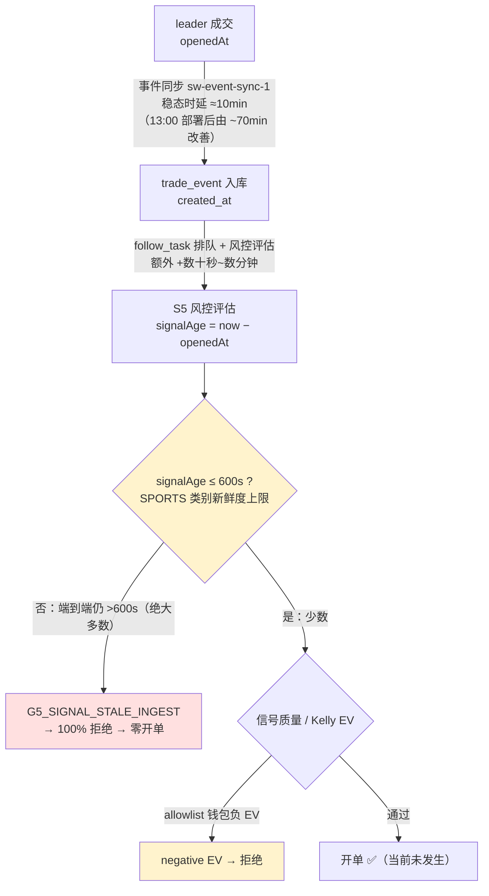

# 问题记录事项 — 待解决（2026-05-24）

> 状态：**待解决** ｜ 类型：定期巡检 · 问题记录 ｜ 作者：自动巡检（scheduled task `1-job`）｜ 日期：2026-05-24
> 巡检时段：2026-05-24 15:46–15:51 CST（数据库 `NOW()` + 服务器 `date` 实测）
> 适用技能：`troubleshooting`（系统化排查方法与报告结构）+ `doc-writing`（文档结构、命名、图表与存放规范）
> 上一份运行分析：[../../Polymarket跟单策略运行分析报告-2026-05-23.md](../../Polymarket跟单策略运行分析报告-2026-05-23.md)
> 关联文档：[问题排查修复方案-2026-05-24.md](问题排查修复方案-2026-05-24.md)、[排查修复任务拆解-分批执行计划-2026-05-24.md](排查修复任务拆解-分批执行计划-2026-05-24.md)、[POLYMARKET_COPY_strategy_health_report_20260518.docx](POLYMARKET_COPY_strategy_health_report_20260518.docx)

> 说明：本文为 `1-job` 巡检在 2026-05-24 的第二次运行结果，**取代当日早先约 10:30 CST 的同名文档**。本次同时成功直连 test 数据库与 SSH 登录服务器，结论由 2026-05-24 的数据库 + 服务器进程 + 应用日志三方实测数据驱动。**本期关键变化：当日 13:00 部署了新 `app.jar`，上一版巡检的第一优先级修复（多线程调度）已落地并被实测验证有效——但开单仍未恢复，根因已从"结构性拥堵"收敛为"最后一公里时延差"。**

> ★ **2026-05-24 16:20 CST 追加排查（重要修正）**：经对被跟地址 `0x2005…75ea` 逐事件追踪，定位到开单停摆的**真正主因是暴露上限死锁**（风控门 `G10c_EXPOSURE_LIMIT / TVL_UTILIZATION_LIMIT`），而非新鲜度。详见下方「★ 追加排查」节，该节**修正了本文前述以"新鲜度门"为唯一主因的判断**。

---

## 一、执行摘要（结论先行）

本文核查 **当前版本跟单策略**（Polymarket 跟单策略，`coin-strategy-job` 服务，策略代码 `POLYMARKET_COPY`）的开单是否正常、胜率是否正常、卡点在哪里。

**三条最重要的结论：**

1. **开单仍不正常——已约 43 小时零开单，但卡点性质已改变。** 最后一笔真实（纸面）开单停在 **2026-05-22 20:38:47**。当日 13:00 部署的新 jar 已实现多线程调度，把事件摄取的稳态时延从上一版的约 70 分钟压到约 **10 分钟**——这是实测可见的明确进展。但 SPORTS 类别的入口新鲜度上限是 **600 秒（10 分钟）**，信号端到端时延（leader 成交 → 风控评估）仍恰好压在 600 秒线上甚至略高，所以真实跟单仍 100% 命中 `G5_SIGNAL_STALE_INGEST` 被拒。**修复方向正确，但差最后一步。**

2. **卡点已从"结构性卡死"收敛为"最后一公里时延差"。** 部署后（13:04 起）所有 118 笔真实（`PAPER`）跟单任务全部 `SKIPPED`，其中 117 笔为 `STALE / SIGNAL_STALE_INGEST`。问题不再是调度线程被垄断，而是**架构端到端时延（约 10–15 分钟）与 600 秒新鲜度门之间还差几分钟**。

3. **当前版本胜率仍无法评估。** 2026-05-22 之后零结算订单。历史纸面口径（截至 05-22，72 笔已平仓）胜率仅 34.7%、累计盈亏 −2.67 USDC，既偏低又样本不足。

### 待解决问题总表

| 编号 | 问题 | 严重度 | 对"三问"的影响 | 状态 |
|---|---|---|---|---|
| **P0-0** | **暴露上限死锁：`G10c_EXPOSURE_LIMIT/TVL_UTILIZATION_LIMIT` 100% 拒单（10 笔 OPEN 持仓占用 157.19 USDC ≥ 上限 155.42）——本期开单停摆的真正主因** | P0 | 开单 · 卡点 | 代码已修复（移除 Layer 3）· 待编译部署 |
| P0-1 | 信号端到端时延（leader openedAt→风控评估）仍 >600s，SPORTS 新鲜度门拒绝约 62% 事件。13:00 多线程部署已将摄取稳态时延 ~70min→~10min，仍差最后一步。**注：此为并列第二堵墙，非主因（主因见 P0-0）** | P0 | 开单 · 卡点 | 进展中 · 待解决 |
| P0-2 | 服务仍无进程守护（裸 `nohup` 启动，无 systemd / crontab） | P0 | 可用性 | 待解决 |
| P1-1 | 通过新鲜度门的少数信号在风控端因 allowlist 钱包负 EV 被拒（影子单全部 negative EV） | P1 | 开单质量 | 待解决 |
| P1-2 | 当前版本零结算，胜率无法评估；历史纸面胜率 34.7% 偏低 | P1 | 胜率 | 待观察 |
| P1-3 | 健康告警已写入 `strategy_alert` 表（较上版改善），但仍不外发到 IM 渠道 | P1 | 可观测性 | 部分改善 · 待解决 |
| P1-4 | 服务器负载升高（load≈2.7）、内存偏紧（空闲 176MB，swap 已用 377MB） | P1 | 稳定性 | 待观察 |
| P1-5 | 部署 jar 疑似工作区直传（目录含 `._app.jar` macOS 元数据），无可追溯 commit | P1 | 工程治理 | 待解决 |
| P2-1 | `smart_wallet_cash_ledger.balance_after` 2,339 行全为 NULL | P2 | 数据完整性 | 待解决 |
| P2-2 | `trade_order` 9 笔 / `daily_report` 4 行 存在未来日期结算记录 | P2 | 数据完整性 | 待解决 |
| P2-3 | `strategy_run_log` / `strategy_health_snapshot` / `smart_wallet_market_snapshot` 三表 0 行 | P2 | 可观测性 | 待解决 |
| P2-4 | `smart_wallet_leader_trade_outcome` 57% 记录为 `LOW_CONFIDENCE` | P2 | 数据质量 | 待解决 |
| P3-1 | 3 条 `strategy_alert` 全部未确认 / 未解决（含今日新增 CRITICAL） | P3 | 可观测性 | 待解决 |
| P3-2 | 巡检 SSH / MySQL 连通性间歇（22 / 3306 端口需重试） | P3 | 巡检能力 | 待观察 |

> 严重度口径：P0 = 影响安全 / 资金 / 可用性，须最先处理；P1 = 影响策略核心目标（开单 / 收益）；P2 = 数据治理；P3 = 可观测性与巡检增强。

### 较本日早先版本（约 10:30 CST）的变化

| 维度 | 早先版本（约 10:30 CST） | 本次（15:50 CST） | 判断 |
|---|---|---|---|
| 部署 jar | `app.jar` 时间戳 01:19 | `app.jar` 时间戳 **13:00**，进程 13:04:05 重启 | 当日二次部署 |
| 调度模型 | 单线程 `scheduling-1` 垄断 | 新增 `sched-1..8` 线程池 + 专用 `sw-event-sync-1` 线程 | ✅ 上版 P0-1 建议已落地 |
| 事件摄取稳态时延 | 约 70 分钟（≈4,200s） | 约 **10–11 分钟**（≈600–650s） | ✅ 实测大幅改善 |
| 真实开单 | 仍为 0 | 仍为 0 | ❌ 未恢复 |
| 健康告警落库 | 仅落本地日志 | 已写入 `strategy_alert` 表（id=3，13:05 CRITICAL） | ✅ 部分改善 |

---

## ★ 追加排查（2026-05-24 16:20 CST）：开单停摆的真正主因 = 暴露上限死锁

> 触发：用户反馈"约 13:30 重新部署后仍未开仓，且被跟地址 `0x2005…75ea` 在持续开仓"。本节对该地址逐事件追踪，**修正本文前述以"新鲜度门"为唯一主因的判断**。

### A. 关键结论

部署后零开单的**真正主因不是新鲜度，而是暴露上限死锁**：风控门 `G10c_EXPOSURE_LIMIT(TVL_UTILIZATION_LIMIT)` 正在 100% 拒绝所有新订单。自 **2026-05-22 20:38:47**（最后一笔开单 `trade_order` id=606）起，未平仓持仓总成本达到 157.19 USDC，触发 Layer-3 总暴露上限，此后任何新单——无论信号多新鲜、被跟钱包多活跃——都被拒。

部署没能解决问题，是因为部署修的是调度 / 新鲜度（上一版 P0-1），**根本没碰到暴露门这堵墙**。

补充：服务进程 `PID 962489` 启动于 **13:04:05**，`app.jar` 时间戳 13:00，**此后再未重启**。若约 13:30 另做过改动，需确认是否真正部署生效——进程未重启即代码改动未加载。

### B. 死锁证据（实测）

被跟地址 `0x2005…75ea`（alias RN1）确实在持续开仓——`leader_trade_outcome` 6,508 条、最近成交 2026-05-24 16:05:42、`trades_7d=2,133`。其交易事件也确实被服务捕获（最新 `trade_event` id=116439，16:11 入库）。但每一笔的 POLY_FLOW 链路都止于风控门：

| 事件类型 | 占比 | 卡在哪个门 | follow_task 结果 |
|---|---|---|---|
| 陈旧事件（摄取 >600s） | ~62% | `G5_SIGNAL_STALE_INGEST`（新鲜度） | PAPER / SKIPPED |
| 新鲜事件（摄取 ≤600s） | ~38% | **`G10c_EXPOSURE_LIMIT(TVL_UTILIZATION_LIMIT)`** | PAPER_SHADOW |

新鲜事件已通过 S2 钱包准入、S4 市场检查、S3 候选增强、S5 信号评分，唯独倒在暴露门。一条完整链路（eventId=116439，16:11:53 实测日志）：

```
S5 信号评分模型   → 通过 (signalScore=0.00)
S5 评估跟单风控   → 拒绝 firstRejectGate=G10c_EXPOSURE_LIMIT(TVL_UTILIZATION_LIMIT)
                    reasonSummary="[EXPOSURE_LIMIT_BLOCK] TVL_UTILIZATION_LIMIT
                    marketExposure=0.00 walletExposure=0.00 totalExposure=157.19"
S6 任务创建       → PAPER_SHADOW（因被拒，记为影子单）
```

部署后服务器日志近 4,000 行的 `firstRejectGate` 分布印证：`G10c_EXPOSURE_LIMIT` 21 次 > `G5_SIGNAL_STALE_INGEST` 12 次——**暴露门已是头号拒绝原因**。

### C. 暴露门的数学（精确到 1.77 USDC）

`FollowExposureLimitService` Layer-3「总 TVL 利用率上限」：

```
maxTotalExposure = availableCapital × maxTvlUtilizationPct
拒绝条件:  totalExposure ≥ maxTotalExposure
```

实测代入：

| 量 | 值 | 来源 |
|---|---|---|
| `availableCapital` | 194.27 USDC | HealthMonitor 实测 |
| `maxTvlUtilizationPct` | 0.80 | `SmartWalletProperties` 默认值（代码实测） |
| `maxTotalExposure` | 194.27 × 0.80 = **155.42** | 计算 |
| `totalExposure`（10 笔 OPEN 持仓剩余成本之和） | **157.19** | `trade_order` 实测 |
| 剩余额度 | 155.42 − 157.19 = **−1.77** | → 负 → 拒绝 |

超限仅 1.77 USDC，但足以锁死全部开单。

### D. 代码根因：分母用错——把"自由资金"当成了"总 TVL"

`availableCapital` 的口径（`SmartWalletAccountingService.availableCapitalUsdcByMode`）：

```
availableCapital = maxTotalOpenCostUsdc(500) + 已实现盈亏 − 手续费 − openCost − 锁定理赔
```

即 `availableCapital` **已经扣掉了 openCost（157.19）**，是"还能再用的自由资金"。

而 Layer-3 的设计意图（代码注释）是利用率：`总成本 / 总 TVL ≤ Z%`。分母「总 TVL」应是**总资金**（≈ `availableCapital + openCost` = 194.27 + 157.19 = 351.46）。但代码把已扣除的 `availableCapital` 当成了分母：

- 正确口径：`utilization = 157.19 / 351.46 = 44.7%` < 80% → 应放行
- 实际计算：`maxTotalExposure = 194.27 × 0.8 = 155.42` < 157.19 → 拒绝

这是一处**自收紧死锁**：每开一仓，openCost ↑、availableCapital ↓ 同额 → 上限 `availableCapital×0.8` ↓、实际 `totalExposure` ↑，两者快速交叉。死锁阈值推导：

```
(T − E)×0.8 ≤ E   ⟹   E ≥ 0.444·T        （T=总资金≈351，E=openCost）
⟹  E ≥ ~156 USDC 即永久锁死
```

当前 E=157.19，恰好越线——这正是开单停在 2026-05-22 20:38:47（order id=606 把 E 推过阈值）的精确原因。

### E. 这 10 笔 OPEN 持仓不会自行释放

10 笔 OPEN 持仓中 7 笔开于 2026-05-01，对应市场均为**长周期市场**（美联储利率决议、NBA 总冠军、"Anthropic 是否第一 AI 模型"、英伟达市值、WNBA 冠军等），`market_lifecycle=ACTIVE`、`closed=0`，到期时间在 2026-06 至 2026-10。即它们**会合法占用约 157 USDC 资金数周至数月**——死锁不会自行解除。

### F. 修复方案与处置（2026-05-24 已实施代码改动）

经与 Ray 复核设计意图后确认：`maxTvlUtilizationPct` / Layer 3「总 TVL 利用率上限」**本身无独立意义**——它唯一的机械效果是强制预留 `(1−pct)` 比例的资金不进持仓，而本项目并无此预留需求；总资金上限已由动态预算（初始预算 ± 盈亏）天然约束。该闸还损害资金使用效率并直接造成本次死锁。

**处置：整体移除 Layer 3 / `maxTvlUtilizationPct`**（保留 Layer 1 单市场上限、Layer 2 单地址上限）。改动文件：

| 文件 | 改动 |
|---|---|
| `FollowExposureLimitService.java` | 删除 Layer 3 总 TVL 利用率拦截逻辑；`check()` 去掉 `availableCapital` 形参；`totalExposure` 仅保留作观测字段；javadoc 改为两层 |
| `SmartWalletProperties.java` | 删除 `ExposureLimitConfig.maxTvlUtilizationPct` 配置项 |
| `SmartWalletSignalRiskService.java` | Gate 10c 调用方同步去掉 `availableCapital` 实参 |
| `FollowExposureLimitServiceTest.java` | 重写：新增「总暴露不再拦截」回归守护用例 + Layer 1 / Layer 2 用例 |
| `SmartWalletSignalRiskServiceTest.java` | mock 桩同步为 4 参 |

> 状态：代码改动已完成，并通过引用一致性、残留引用、括号配平自检；沙箱无 JDK / Maven 无法编译，**需在构建环境编译 + 跑测试，再重新部署并重启 job 进程后生效**（当前线上仍为 2026-05-24 13:04 启动的旧 jar）。

> 仍未解决：暴露死锁解开后，新鲜度门（约 62% 事件 >600s 被 `G5_SIGNAL_STALE_INGEST` 拒）仍是第二堵墙，须继续按本文 P0-1 推进。

---

## 二、本次巡检范围与方法

### 2.1 连通性

| 通道 | 结果 | 说明 |
|---|---|---|
| MySQL（3306） | ✅ 可达（间歇，已加重试） | 取得开单 / 胜率 / 配置 / 数据质量；单次连接约需 3–4 次重试 |
| SSH（22） | ✅ 可达（间歇，已加重试） | 取得进程 / 内存 / 日志 / 部署信息；本次首次尝试即成功 |
| 裸 TCP 探测 | 间歇 | 22 与 3306 端口在巡检沙箱侧均为间歇可连，已用重试兜底（见 P3-2） |

### 2.2 数据口径

- 运行态数据来自 2026-05-24 15:46–15:51 CST 对 test 库 `coin_strategy`（MySQL 8.0.45）与服务器 `49.51.250.174` 的实测。
- 所有订单均为 **PAPER 纸面模拟**口径（`smart-wallet.auto-execution-enabled=false`），不代表真实链上资金损益。
- 服务器侧证据来自只读命令（`ps` / `free` / `df` / `systemctl` / `ls` / `tail` / `grep`），未对服务器做任何写操作；数据库侧仅执行 `SELECT`，未做任何写操作。
- "部署后 / post-deploy" 一律指 `created_at >= 2026-05-24 13:04:00`（新 jar 进程启动时刻）。

---

## 三、对任务"三问"的专项判断

### 3.1 开单是否正常？——**不正常（约 43 小时零开单）**

最后一笔真实纸面开单的关键时间戳全部停在 **2026-05-22 20:38:47**（`trade_order.opened_at` / `smart_wallet_order` / `smart_wallet_fill.filled_at` / 最后一条 `FOLLOWED` 任务 `executed_at`）。至巡检时刻已约 **43 小时**零开单。

跟单任务仍在持续产生，但全部无法转化为真实开单：

| 时间窗 | follow_task 总数 | SKIPPED | PAPER_SHADOW | FOLLOWED |
|---|---|---|---|---|
| 部署后 05-24 13:04→15:50 | 187 | 118 | 69 | **0** |
| 今日 05-24（全天） | 1,461 | 1,207 | 254 | **0** |
| 近 24 小时 | 1,598 | 1,236 | 362 | **0** |
| 全量（自 04-30） | 60,091 | 54,537 | 5,440 | 32（+ 82 SETTLED） |

> `PAPER_SHADOW` 是"影子单"（旁路评估、不落实际仓位），不计入真实开单。真实开单走 `execution_mode=PAPER` → `status=FOLLOWED` 路径；本期该路径转化率为 **0**。

应用自带 `StrategyHealthMonitorJob` 的实测佐证——`job-error-current.log` 自 13:04 重启后持续报警（13:05 / 14:07 / 15:08 各一次 CRITICAL），并已写入 `strategy_alert` 表：

```
2026-05-24 15:08:07 ERROR StrategyHealthMonitorJob -
  [HealthMonitor] CRITICAL: Zero positions opened in the last 24 hours! Strategy may be structurally blocked.
  availableCapital = 194.27   openPositions = 10/20   qualifiedWatchlist = 15
  tasksByStatus    = {PAPER_SHADOW=357, SKIPPED=1223}
  topRejections    = {OTHER=10015, STALE=1232, SIGNAL_FRESHNESS=121, NON_TRADABLE=79, ...}
```

### 3.2 胜率是否正常？——**当前版本无法评估**

2026-05-22 之后零结算订单（`trade_order` 自 05-22 起新增 0 笔），**当前版本没有任何新胜率样本**。仅能给出历史纸面口径（截至 05-22）：

| 口径 | 样本 | 胜 / 负 / 平 | 胜率 | 备注 |
|---|---|---|---|---|
| `trade_order` 已平仓（剔除 10 笔 OPEN） | 72 | 25 / 40 / 7 | **34.7%**（剔除平局 38.5%） | 仓位级 |
| `smart_wallet_order` 已结算 | 83 | 38 / 45 / — | **45.8%** | 订单级 |

累计盈亏（`trade_order` 全量 82 笔）：平仓已实现约 +57.30、结算已实现 −55.50（二者合计 `total_realized_pnl` +1.80），未实现 `unrealized` −4.47，**合计 `total_pnl` −2.67 USDC**（口径：`total_pnl` = `total_realized` + `unrealized` = 1.80 + (−4.47)）。

主要拖累是 `CLAIMED` 状态的 18 笔（市场判负、结算归零）：合计 −48.78 USDC，其中 13 笔为整笔本金亏光（如 id=6 入场 34.61 → 盈亏 −34.61）。

判断：胜率**偏低且样本不足**——34.7% 的仓位级胜率在 72 个样本下统计意义弱。当前停滞期无新样本，**无法判断"当前版本"胜率是否正常**，须先恢复开单并积累足量已结算样本。

### 3.3 卡点在哪里？



**主卡点是"端到端信号时延 vs 600s 新鲜度门"的最后一公里差**：13:00 的多线程部署已让事件摄取稳态时延从约 70 分钟降到约 10 分钟，但摄取（≈10min）叠加 follow_task 排队与风控评估的额外耗时后，信号在被判定时的总"年龄"仍恰好压在或略高于 600 秒（SPORTS 类别上限），于是真实跟单仍被 `G5_SIGNAL_STALE_INGEST` 全部拒绝。**次级卡点**为信号质量偏弱（P1-1）——即使新鲜度门通过，低质量 allowlist 钱包的信号也会因 Kelly 负 EV 被拒。

---

## 四、待解决问题清单

每条按 `troubleshooting` 技能的"现象 → 证据 → 根因 → 影响 → 状态 / 建议"结构记录。

### P0-1 信号端到端时延仍略超 600s 新鲜度门，真实开单 100% 被拒 ★本期核心卡点

- **现象**：部署后所有真实（`PAPER`）跟单任务 0 笔成交；被跳过任务中 99% 原因为 `STALE / SIGNAL_STALE_INGEST`。
- **证据**：
  - **部署后 follow_task 实测**：`execution_mode=PAPER` 共 118 笔，**全部 `SKIPPED`**；其中 117 笔 `skip_reason_tags='STALE,SIGNAL_STALE_INGEST'`，1 笔 `NON_TRADABLE`。`execution_mode=PAPER_SHADOW` 69 笔（影子单，旁路评估）。
  - **拒绝原因铁证**（`job-current.log`，15:40:56）：`firstRejectGate=G5_SIGNAL_STALE_INGEST`，`blockerCategories=SIGNAL_FRESHNESS`，`reasonSummary="交易事件 openedAt 早于入口新鲜度上限（类别=SPORTS），判定为历史成交"`。`job-current.log` 中 `SIGNAL_STALE_INGEST` 累计出现 473 次。
  - **摄取时延已大幅改善**（`trade_event` 的 `opened_at`→`created_at`，部署后按 30 分钟分桶）：

    | 时段桶 | 事件数 | 平均时延 |
    |---|---|---|
    | 13:30 | 39 | 628s（≈10.5min） |
    | 14:00 | 10 | 635s |
    | 15:00 | 11 | 627s |
    | 15:30 | 8 | 650s |

    最近 1 小时 48 条事件平均 603s、最小 308s、最大 935s。**对比上一版巡检的约 70 分钟（≈4,200s），稳态时延改善约 7 倍。**
  - **但仍卡在 600s 线上**：部署后 203 条事件中，摄取时延 ≤600s 仅 56 条（27.6%），落在 601–1200s（10–20min）的 82 条（40.4%），>60min 的 61 条（30%，多为历史回填批次）。叠加 follow_task 排队后，连 ≤600s 的事件在风控评估时也普遍越线。
- **根因**：13:00 部署的多线程调度（`sched-1..8` 线程池 + 专用 `sw-event-sync-1` 线程）已解决"单线程被重任务垄断"的结构性拥堵；但 HOT 钱包事件同步仍是**轮询模式**，稳态时延下限约 10 分钟，而 SPORTS 类别的入口新鲜度上限是 **600 秒**。两者几乎相等，导致信号端到端时延（leader openedAt → 风控评估）系统性地略超阈值。**修复方向正确，但未完全闭合时延差。**
- **影响**：真实开单仍完全停摆，约 43 小时零开单。
- **状态 / 建议**：进展中 · 待解决，最高优先级。**两条路径，二选一即可恢复开单，两者都做最稳**：(a) 把 HOT 钱包事件同步做到近实时——缩短轮询间隔或改 WebSocket 推流，让端到端时延稳定低于 600s；(b) 既然结构性拥堵已消除，可重新评估按市场类别上调新鲜度上限——SPORTS 由 600s 调到与真实时延下限匹配的值（如 1,200–1,500s）。说明：上一版强调"只调阈值是掩盖"，是因为当时时延高达 70 分钟；如今稳态时延仅 10 分钟，适度上调阈值已是**合理且非掩盖**的工程取舍（10–15 分钟前的跟单信号在多数 Polymarket 市场仍可执行）。

### P0-2 服务仍无进程守护，裸 `nohup` 启动

- **现象**：job 服务以裸 `nohup java -jar` 启动，无系统级托管。
- **证据**（SSH 实测）：进程 `PID 962489`，`java -Xms512m -Xmx1024m -XX:+UseG1GC -Dspring.profiles.active=test -jar /opt/coinstrategy/smart-wallet/backend/app.jar`，启动于 **2026-05-24 13:04:05**；`systemctl` 无任何 `smart` / `coin` / `strategy` 服务单元；`ubuntu` 用户无 crontab；`backend/` 目录下有 `app.pid`。13:04 的重启为人工操作（13:00 部署新 jar 后手动拉起）。
- **根因**：部署流程缺少"托管为系统服务"这一步（仓库内已有 `scripts/install-smart-wallet-linux-service.sh` 与 systemd 单元模板，但未在服务器启用）。
- **影响**：进程崩溃不会自愈、无人感知；这是历史"长时间停机无人发现"的直接原因。
- **状态 / 建议**：待解决。在服务器执行 `install-smart-wallet-linux-service.sh`，托管为 systemd 单元并设 `Restart=always` / `RestartSec=10`；叠加基于 8081 健康端点的外部看门狗。

### P1-1 通过新鲜度门的信号在风控端因低质量 allowlist 钱包负 EV 被拒

- **现象**：`PAPER_SHADOW` 影子单（旁路新鲜度门的评估通道）大量以 "Kelly stake: negative EV, signal rejected" 收尾。
- **证据**：影子单 `would_have_skipped_reason` 显示被跟钱包标记 `archetype=NOISE_OR_INSUFFICIENT, lane=OBSERVE_ONLY`、`winRate7d` 仅 0.27–0.44、`replicability` 0.26–0.34，处于 `OBSERVE_COOLDOWN`，靠 `manual_allowlist` 强制绕过准入门与冷却门；`SIGNAL_SCORE` 普遍 `score=0.00`。`smart_wallet_manual_allowlist` 当前 23 条。
- **根因**：人工 allowlist 把质量不足、处于观察冷却期的钱包强行纳入跟单；其信号天然弱，Kelly 计算得到负 EV。
- **影响**：即使 P0-1 的时延问题修复，开单也会因信号质量被风控拦下；这是"恢复开单后仍可能不开单"的潜在二级卡点。
- **状态 / 建议**：待解决。复核 23 条 allowlist 名单，剔除 `NOISE_OR_INSUFFICIENT` / 冷却期钱包；明确 allowlist 仅"绕过准入门"而非"绕过信号质量 / EV 门"。

### P1-2 当前版本零结算，胜率无法评估；历史纸面胜率偏低

- **现象**：当前版本无新结算样本，历史纸面胜率 34.7%、累计盈亏 −2.67 USDC。
- **证据**：见 §3.2。`trade_order` 已平仓 72 笔 25 胜 / 40 负 / 7 平；`CLAIMED` 18 笔合计 −48.78 USDC（13 笔本金亏光）。
- **根因**：开单停摆（P0-1）导致无新样本；历史样本量小，单笔盈亏波动主导整体。
- **影响**：无法回答"当前版本胜率是否正常"。
- **状态 / 建议**：待观察。先解决 P0-1 / P1-1 让开单恢复并积累 ≥ 50–100 笔已结算样本，再评估胜率；评估以 `trade_order` 为权威口径（`daily_report` 不可靠，见 P2-2）。

### P1-3 健康告警已落库但仍不外发

- **现象**：`StrategyHealthMonitorJob` 已正确检测"零开仓"并持续打 `CRITICAL`，本期较上一版有改善——告警已写入 `strategy_alert` 表（id=3，13:05:52）；但仍**不外发到任何即时通知渠道**。
- **证据**：`strategy_alert` 表新增 1 条 `HEALTH_NO_OPEN_24H` / `CRITICAL`；`job-error-current.log` 13:05 / 14:07 / 15:08 连续 CRITICAL。无邮件 / IM 通知记录。
- **根因**：告警 sink 只有日志文件与数据库表，缺少 IM 外发。
- **影响**：问题虽被"检测到"并"落库"，却未被"通知到人"——本期"43 小时零开单"仍是被定期巡检发现，而非告警主动推送。
- **状态 / 建议**：部分改善 · 待解决。将 CRITICAL / WARN 告警外发到企业微信 / 钉钉 / 飞书等即时渠道。

### P1-4 服务器负载升高、内存偏紧

- **现象**：负载 `2.60 / 2.65 / 2.86`，较上一版（≈1.0）明显升高；物理内存 3,659 MB，巡检时空闲仅 176 MB，swap 已用 377 MB / 1,987 MB。
- **证据**（SSH `uptime` / `free -m`）：`load average: 2.60, 2.65, 2.86`；`Mem total=3659 used=1696 free=176 available=1963 buff/cache=2078`；`Swap used=377`。磁盘 `/` 用量 47%。
- **根因**：新多线程 jar（`sched-1..8` 线程池）CPU 占用上升属预期；小规格机器（3.6 GB）同时承载 JVM + MySQL，内存余量小。
- **影响**：暂未致故障（`available` 1,963 MB 仍可用），但负载与 swap 使用上升，高峰期存在 GC 抖动 / OOM 风险。
- **状态 / 建议**：待观察。监控 JVM GC 与系统负载 / 内存；若持续偏高，考虑升配或将 MySQL 与应用分机部署。

### P1-5 部署 jar 疑似工作区直传，无可追溯 commit

- **现象**：`backend/` 目录下 `app.jar`（时间戳 13:00，66.5 MB）旁有一个 `._app.jar`（163 B）。
- **证据**（SSH `ls -la`）：`._app.jar` 是 macOS 复制文件时附带的 AppleDouble 元数据文件，表明 jar 系在本地 Mac 构建后直接 scp / 拷贝上传；目录另有 4 个历史备份（05-17 ×2、05-18 ×2）。
- **根因**：部署流程为"本地构建 + 直传"，未由某个明确 git commit 在受控环境构建。
- **影响**：线上运行版本无法由 git 历史复现，不可追溯；机器重置即丢失修复。
- **状态 / 建议**：待解决。建立可追溯部署——线上 jar 由明确 commit 构建产出，并在服务器记录对应 commit 号；清理 `._*` 等直传痕迹。（说明：本次巡检未在服务器执行 `git` 比对，本条为基于文件元数据的推断，建议结合代码侧核实。）

### P2-1 `cash_ledger.balance_after` 全部为 NULL

- **现象**：`smart_wallet_cash_ledger` 2,339 行的 `balance_after` 字段**全部为 NULL**（实测 `null_cnt=2339 / total=2339`）。
- **根因**：账本写入未回填滚动余额。
- **影响**：无法从账本直接追溯任意时点的账户余额。
- **状态 / 建议**：待解决。账本写入时计算并回填 `balance_after`，或对历史行一次性回算。

### P2-2 `daily_report` / `trade_order` 存在未来日期结算记录

- **现象**：`smart_wallet_trade_order` 有 9 笔 `settled_at` 晚于当前时间（最远 2026-06-30）；`smart_wallet_daily_report` 相应有 4 行未来日期报告（`report_date` 最远 2026-06-30）。
- **根因**：结算逻辑把市场"名义到期时间"误当作实际结算时刻写入。
- **影响**：污染按日盈亏归集；`daily_report` 不可作为权威报表。
- **状态 / 建议**：待解决。结算时间改用真实结算时刻，清理 9 条异常 `trade_order` 与 4 行未来日期报告。

### P2-3 三张快照 / 日志表 0 行

- **现象**：`strategy_run_log`、`strategy_health_snapshot`、`smart_wallet_market_snapshot` 三表行数均为 0。
- **根因**：对应写入逻辑未接通或功能未启用（注：健康告警本期已能写 `strategy_alert` 表，但 `strategy_health_snapshot` 仍为空）。
- **影响**：策略运行日志、健康快照、市场快照三项可观测能力形同虚设。
- **状态 / 建议**：待解决。接通三张表写入，或确认废弃并从监控口径移除。

### P2-4 `leader_trade_outcome` 57% 记录为 `LOW_CONFIDENCE`

- **现象**：`smart_wallet_leader_trade_outcome` 共 93,896 行，`outcome_status` 分布：`LOW_CONFIDENCE` 53,622（57.1%）、`OPEN` 33,177、`CLOSED_WIN` 4,422、`CLOSED_LOSS` 2,650、`CLOSED_BREAKEVEN` 18、`UNRESOLVED` 7。
- **根因**：leader 成交结果的数据源置信度不足，过半无法可靠定盈亏。
- **影响**：基于 leader 结果的钱包画像 / 胜率评估准确性受限——这与 P1-1 的低质量 allowlist 互为因果。
- **状态 / 建议**：待解决。排查 `LOW_CONFIDENCE` 判定口径与数据源，提升结果回填质量。

### P3-1 3 条 `strategy_alert` 长期未确认 / 未解决

- **现象**：`strategy_alert` 共 3 条，`acknowledged=0` 且 `resolved=0`：
  - id=1 `AUDIT_SETTLEMENT_SOURCE`（WARN，2026-05-17）：结算源审计异常 `delayed=819`。
  - id=2 `AUDIT_LIVE_REPLAY_DIFF`（WARN，2026-05-23）：Live↔Replay 偏差 `metric_value=10000` 远超 `threshold=100`。
  - id=3 `HEALTH_NO_OPEN_24H`（CRITICAL，2026-05-24 13:05:52，本期新增）：跟单策略 24h 零开仓。
- **根因**：告警未建立确认 / 闭环流程。
- **影响**：审计与健康类监控持续报警却无人闭环。
- **状态 / 建议**：待解决。逐条核实并修复或显式确认（`acknowledged` / `resolved`）；id=3 在 P0-1 修复后应自动解除。

### P3-2 巡检 SSH / MySQL 连通性间歇

- **现象**：巡检环境对服务器 22 / 3306 端口为**间歇可达**，需重试。
- **证据**：裸 TCP 探测 22 端口 6 次成功 1 次、3306 端口 4 次成功 2 次；脚本内置重试后 SSH 与 MySQL 均连上（MySQL 单次连接约需 3–4 次重试）。
- **根因**：巡检沙箱出网或服务器侧网络存在抖动。
- **影响**：每次自动巡检需靠重试才能连上，偶发会整次失败。
- **状态 / 建议**：待观察。巡检脚本已内置重试（本次成功）；若后续频繁失败，建议在服务器侧落地只读巡检导出作为兜底。

---

## 五、补充建议（巡检补充内容）

1. **P0-1 已是"最后一公里"问题，建议趁热打铁。** 13:00 的部署证明"多线程调度"方向完全正确（摄取时延 70min→10min 实测可见）。现在只差把端到端时延再压几分钟、或把 SPORTS 新鲜度门调到与真实时延匹配——任一动作即可大概率恢复开单。这是本期投入产出比最高的一件事。
2. **新鲜度门的口径之争已可收敛。** 上一版强调"调阈值是掩盖"，前提是 70 分钟的结构性拥堵；如今拥堵已消除、稳态时延仅 10 分钟，按市场类别把 SPORTS 上限上调到 ~1,200s 已是合理工程取舍，不再是掩盖。建议"压时延 + 调阈值"二选一先恢复开单，再择优长期化。
3. **给"端到端信号时延"加常驻指标与告警。** 本期能精确定位，靠的是逐条比对 `trade_event` 的 `opened_at` / `created_at`。建议把 `AVG(TIMESTAMPDIFF(SECOND, opened_at, created_at))` 与"openedAt→风控评估"耗时做成常驻指标，超过 600s 即告警。
4. **告警闭环只差最后一步。** `StrategyHealthMonitorJob` 本期已能写 `strategy_alert` 表（较上版改善），补一个 IM 外发即可让"检测到 + 落库"升级为"通知到人"。
5. **建立可追溯部署。** 13:00 的 jar 目录含 `._app.jar`（macOS 元数据），说明仍是本地构建后直传。建议线上 jar 可由某个 git commit 复现，避免修复随机器重置丢失。
6. **做跳过原因看板。** 把 `follow_task.primary_skip_reason` 与 `HealthMonitor.topRejections` 做成按小时 / 按日看板，便于一眼看出卡点迁移（如本期从"结构性拥堵"迁移到"时延差几分钟"）。

---

## 六、建议处理顺序（Action Items）

| 优先级 | 行动项 | 关联问题 | 类型 |
|---|---|---|---|
| 1 | 把 HOT 钱包事件同步做到近实时（缩短轮询间隔 / 改 WebSocket）；若时延下限确实 >600s，则按类别上调 SPORTS 新鲜度上限——目标让端到端信号时延 < 新鲜度门 | P0-1 | 快恢复 |
| 2 | 执行 `scripts/install-smart-wallet-linux-service.sh`，托管为 systemd 服务（`Restart=always`） | P0-2 | 快恢复 |
| 3 | 新增"事件摄取 / 端到端信号时延"指标 + 告警，并将健康告警外发到 IM 渠道 | P1-3 / 补充 3、4 | 早发现 |
| 4 | 部署后复测开单转化率与 STALE 拒绝率，验证 P0-1 是否闭环 | P0-1 / P1-2 | 早发现 |
| 5 | 复核 `manual_allowlist`（23 条），剔除 `NOISE_OR_INSUFFICIENT` / 冷却期钱包 | P1-1 | 防发生 |
| 6 | 建立可追溯部署：线上 jar 由明确 commit 构建，清理 `._*` 直传痕迹 | P1-5 | 防发生 |
| 7 | 数据治理：回填 `cash_ledger.balance_after`、修结算时间、接通三张空表、整治 `LOW_CONFIDENCE` | P2-1~P2-4 | 防发生 |
| 8 | 闭环 3 条 `strategy_alert`；观察服务器负载与内存 | P3-1 / P1-4 | 早发现 |

> 强依赖：行动项 4（复测）必须在行动项 1 完成之后进行。

---

## 七、附录：核对方法与证据

- **数据库实测**（2026-05-24 15:46–15:51 CST，库 `coin_strategy`，MySQL 8.0.45）：`smart_wallet_follow_task` 状态 / `execution_mode` / `primary_skip_reason` / `skip_reason_tags` 分布（全量 / 今日 / 近 24h / 部署后）；`smart_wallet_trade_order` 状态与盈亏；`smart_wallet_order` / `smart_wallet_fill` 时间戳；`smart_wallet_trade_event` 摄取时延（按 30 分钟分桶 + 逐条）；`strategy_runtime_config`（109 条）；`smart_wallet_cash_ledger` / `smart_wallet_daily_report` / `strategy_alert` / `smart_wallet_leader_trade_outcome` 数据质量。
- **服务器实测**（2026-05-24 15:49 CST，SSH `ubuntu@49.51.250.174`，只读命令）：
  - 进程：`ps` —— PID 962489，启动 2026-05-24 13:04:05，`-jar .../app.jar`，profile=test，port 8081。
  - 部署：`ls -la backend/` —— `app.jar` 时间戳 13:00（66.5 MB），含 `._app.jar` 元数据，4 个历史备份。
  - 守护：`systemctl` 无服务单元，`crontab -l` 无任务。
  - 资源：`free -m`（内存 / swap）、`df -h`（磁盘 47%）、`uptime`（40 天，load≈2.7）。
  - 日志：`job-error-current.log`（HealthMonitor CRITICAL ×3，13:05 / 14:07 / 15:08）、`job-current.log` 线程分布（新增 `sched-1..8` 线程池 + `sw-event-sync-1`）、`SIGNAL_STALE_INGEST` 链路样例（473 次）。

---

## 自检（依据 `doc-writing` 技能完成前清单）

- [x] 开头点明"这是什么 / 给谁看"：`1-job` 定期巡检的问题记录，供 Ray 跟进。
- [x] 重要结论前置：执行摘要 + 待解决问题总表 + 较上版变化 + 三问专项判断。
- [x] 用图表代替大段文字：开单 / 拒绝 / 时延 / 版本对比用表，卡点链路用 Mermaid。
- [x] 标注状态、作者、日期、巡检时段。
- [x] 术语、单位、口径清晰（PAPER 模拟、CST、USDC、ms/s、严重度定义、post-deploy 口径）。
- [x] 放入正确目录并按"问题记录事项-待解决-日期"命名：`docs/problem/问题记录事项-待解决-2026-05-24.md`。
- [x] 与相关文档建立链接。

> 自动运行说明：本次为 scheduled task `1-job` 的无人值守运行。本次同时成功直连 test 数据库与 SSH 登录服务器，结论由 2026-05-24 数据库 + 服务器进程 + 应用日志三方实测数据驱动。服务器侧仅执行只读诊断命令、数据库侧仅执行 `SELECT`，未做任何写操作。文档结构遵循项目 `troubleshooting` 与 `doc-writing` 技能，未自定义格式。
