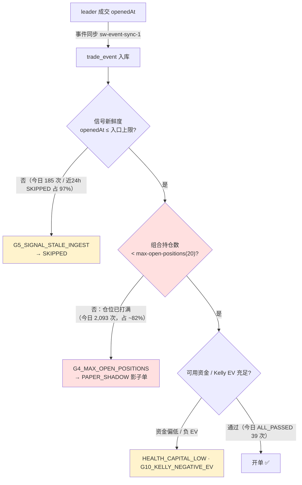

# 问题记录事项 — 待解决（2026-05-25）

> 状态：**待解决** ｜ 类型：定期巡检 · 问题记录 ｜ 作者：自动巡检（scheduled task `1-job`）｜ 日期：2026-05-25
> 巡检时段：2026-05-25 09:10–09:14 CST（数据库 `NOW()` + 服务器 `date` 实测）
> 适用技能：`troubleshooting`（系统化排查方法与报告结构）+ `doc-writing`（文档结构、命名、图表与存放规范）
> 上一份巡检：[问题记录事项-待解决-2026-05-24.md](问题记录事项-待解决-2026-05-24.md)
> 关联文档：[问题排查修复方案-2026-05-24.md](问题排查修复方案-2026-05-24.md)、[排查修复任务拆解-分批执行计划-2026-05-24.md](排查修复任务拆解-分批执行计划-2026-05-24.md)、[跟单ROI虚高根因分析与修复方案-2026-05-24.md](跟单ROI虚高根因分析与修复方案-2026-05-24.md)

> 说明：本文为 `1-job` 巡检在 2026-05-25 的运行结果。本次同时成功直连 test 数据库与 SSH 登录服务器，结论由 2026-05-25 数据库 + 服务器进程 + 应用日志三方实测数据驱动。**本期关键变化：上一版的第一主因 P0-0「暴露上限死锁」已修复并部署，开单已于 2026-05-24 17:32 恢复并持续至今；卡点随之迁移到「组合持仓数上限（20）」，胜率首次可评估——结论是偏低且账面盈利不可信。**

---

## 一、执行摘要（结论先行）

本文核查 **当前版本跟单策略**（Polymarket 跟单策略，`coin-strategy-job` 服务，策略代码 `POLYMARKET_COPY`）的开单是否正常、胜率是否正常、卡点在哪里。

**三条最重要的结论：**

1. **开单已恢复正常。** 最后一笔真实（纸面）开单为 **2026-05-25 09:05:18**（`trade_order` id=642），距巡检时刻仅约 10 分钟；最后一笔 `FOLLOWED` 跟单任务执行于 09:06:24。开单自 **2026-05-24 17:32:27** 恢复（上一版 P0-0 暴露死锁修复部署生效），此后 05-24 开 23 笔、05-25 至 09:05 已开 13 笔。**上一版「约 43 小时零开单」的结构性卡死已解除。**

2. **卡点已从「开不出单」迁移为「开单速率被组合持仓上限节流」。** 当前头号风控拒绝门是 **`G4_MAX_OPEN_POSITIONS`**——今日 `job-current.log` 中 `firstRejectGate` 分布里它占 2,093 次（约 82%），远超第二位的 `G5_SIGNAL_STALE_INGEST`（185 次）。组合持仓数上限 `max-open-positions=20` 已被打满（实测 `smart_wallet_position` OPEN 19 笔 + 3 笔待预言机结算），新鲜信号大量倒在这一门上。次级约束为「可用资金偏低」与「信号新鲜度门」。

3. **当前版本胜率偏低，且账面盈利不可信。** 当前版本（自 05-24 17:32 起，已了结 24 笔）胜 5 / 负 19，胜率仅 **20.8%**。账面 `total_pnl` 显示 +93.97 USDC，但其中 +204 USDC 全部来自 2 笔异常高 ROI 订单（id=610 ROI 11.1 倍、id=616 ROI 7.0 倍），而 id=610 的 `settled_at` 是**未来日期 2026-05-31**——属提前/幻影结算。剔除该幻影后当前版本实际为**负**（≈ −28 USDC）。该现象与已立项的 [跟单ROI虚高根因分析与修复方案-2026-05-24.md](跟单ROI虚高根因分析与修复方案-2026-05-24.md) 同一根因（持仓按 \$1.00 全额赔付价估值），且 P2-2 结算时间错误本期未修复。

### 待解决问题总表

| 编号 | 问题 | 严重度 | 对"三问"的影响 | 状态 |
|---|---|---|---|---|
| ~~P0-0~~ | ~~暴露上限死锁 `G10c_EXPOSURE_LIMIT`~~ | ~~P0~~ | ~~开单·卡点~~ | ✅ **已修复并部署（本期关闭）** |
| **P0-3** | **组合持仓数上限 `max-open-positions=20` 被打满，`G4_MAX_OPEN_POSITIONS` 成为头号拒单门（今日占 ~82%）——本期开单速率的主卡点** | P0 | 开单·卡点 | 待决策（调上限 / 提高仓位周转 / 维持现状择优） |
| P0-2 | 服务仍无进程守护（裸 `nohup` 启动，无 systemd / crontab） | P0 | 可用性 | 待解决（上一版即列出，未处理） |
| P1-2 | 当前版本胜率偏低（20.8%），账面盈利由幻影结算虚高，真实盈利能力为负 | P1 | 胜率 | 待解决（本期由"无法评估"升级为"已评估·偏低"） |
| **P1-6** | **可用资金偏低：`HEALTH_CAPITAL_LOW` 告警，available≈99.25 / budget 500 USDC（剩余 19.9%）** | P1 | 开单·卡点 | 待解决（本期新增） |
| P0-1 | 信号新鲜度门 `G5_SIGNAL_STALE_INGEST` 仍拒单（今日 185 次、近 24h SKIPPED 中占 97%） | P1 | 开单质量 | 部分改善·待解决（已从主卡点降级） |
| P1-1 | 通过新鲜度门的信号在风控端因 allowlist 低质量钱包负 EV 被拒 | P1 | 开单质量 | 待解决 |
| P1-3 | 健康告警已落 `strategy_alert` 表但仍不外发 IM；且 id=3 CRITICAL 开单恢复后未自动解除 | P1 | 可观测性 | 待解决 |
| P1-4 | 服务器负载继续升高（load≈3.6–4.5，上版≈2.7）、磁盘用量 64%（上版 47%） | P1 | 稳定性 | 待观察 |
| P1-5 | 部署 jar 仍为工作区直传（目录含 `._app.jar` macOS 元数据），无可追溯 commit | P1 | 工程治理 | 待解决 |
| P2-1 | `smart_wallet_cash_ledger.balance_after` 2,473 行全为 NULL | P2 | 数据完整性 | 待解决 |
| P2-2 | `trade_order` 11 笔未来日期结算 + 16 笔结算早于开仓；污染胜率与日报 | P2 | 数据完整性 | 待解决（本期加重，且已实际污染胜率评估） |
| P2-3 | `strategy_run_log` / `strategy_health_snapshot` / `smart_wallet_market_snapshot` 三表 0 行 | P2 | 可观测性 | 待解决 |
| P2-4 | `smart_wallet_leader_trade_outcome` 56% 记录为 `LOW_CONFIDENCE` | P2 | 数据质量 | 待解决 |
| P3-1 | 4 条 `strategy_alert` 全部未确认 / 未解决 | P3 | 可观测性 | 待解决 |
| P3-2 | 巡检 SSH / MySQL 连通性间歇（22 / 3306 端口需重试） | P3 | 巡检能力 | 待观察 |

> 严重度口径：P0 = 影响安全 / 资金 / 可用性，须最先处理；P1 = 影响策略核心目标（开单 / 收益）；P2 = 数据治理；P3 = 可观测性与巡检增强。

### 较上一版（2026-05-24）的变化

| 维度 | 上一版（2026-05-24 15:50 CST） | 本次（2026-05-25 09:14 CST） | 判断 |
|---|---|---|---|
| 运行 jar | `app.jar` 时间戳 05-24 13:00 | `app.jar` 时间戳 **05-25 01:04**，进程 01:12:36 重启 | 当日新部署 |
| 真实开单 | 仍为 0（约 43 小时零开单） | **已恢复**，最后一笔 05-25 09:05:18 | ✅ 卡死解除 |
| 主卡点 | 暴露上限死锁 `G10c_EXPOSURE_LIMIT` | `G4_MAX_OPEN_POSITIONS`（组合持仓上限） | 卡点迁移 |
| 暴露死锁 P0-0 | 代码已改·待部署 | 已部署生效（开单 287 USDC 远超旧 155 上限） | ✅ 关闭 |
| 胜率 | 当前版本零结算·无法评估 | 当前版本 24 笔已了结·胜率 20.8% | 由"不可评估"→"已评估·偏低" |
| 可用资金 | available 194.27 USDC | available≈99.25 USDC（新增 `HEALTH_CAPITAL_LOW`） | ❌ 资金趋紧 |
| 服务器负载 | load≈2.7、磁盘 47% | load≈3.6–4.5、磁盘 64% | ❌ 继续升高 |

---

## 二、本次巡检范围与方法

### 2.1 连通性

| 通道 | 结果 | 说明 |
|---|---|---|
| MySQL（3306） | ✅ 可达（间歇，已加重试） | 取得开单 / 胜率 / 配置 / 数据质量；单次连接约需 1–6 次重试 |
| SSH（22） | ✅ 可达（间歇，已加重试） | 取得进程 / 内存 / 日志 / 部署信息；单次连接约需 1–5 次重试 |

### 2.2 数据口径

- 运行态数据来自 2026-05-25 09:10–09:14 CST 对 test 库 `coin_strategy`（MySQL 8.0.45）与服务器 `49.51.250.174` 的实测。
- 所有订单均为 **PAPER 纸面模拟**口径，不代表真实链上资金损益。
- 服务器侧证据来自只读命令（`ps` / `free` / `df` / `systemctl` / `ls` / `tail` / `grep`），未对服务器做任何写操作；数据库侧仅执行 `SELECT`，未做任何写操作。
- "当前版本"在本文指 **开单恢复时刻（2026-05-24 17:32:27）之后** 的运行；其间 05-25 01:12 又重启过一次新 jar，故该窗口跨两个 jar，最新 jar 的已结算样本过少（详见 §3.2）。

---

## 三、对任务"三问"的专项判断

### 3.1 开单是否正常？——**正常（已恢复并持续）**

最后一笔真实纸面开单为 `trade_order` id=642，`opened_at` = **2026-05-25 09:05:18**，距巡检时刻约 10 分钟；最后一条 `FOLLOWED` 跟单任务 `executed_at` = 09:06:24。开单链路活跃。

开单恢复时间线与速率：

| 时间窗 | 开单情况 | 证据 |
|---|---|---|
| 2026-05-22 20:38 → 05-24 17:32 | 零开单（上一版「43 小时卡死」） | 上一版巡检 |
| 2026-05-24 17:32:27 | 开单恢复（`trade_order` id=607 / `follow_task` id=114542） | 暴露死锁 P0-0 修复部署生效 |
| 2026-05-24（全天） | 开 23 笔，成本 179.48 USDC | `trade_order` 实测 |
| 2026-05-25（至 09:05） | 开 13 笔，成本 128.30 USDC | `trade_order` 实测 |

跟单任务转化率（`execution_mode=PAPER` 真实通道，自 05-24 17:30 起）：共 336 笔任务 → `FOLLOWED` 17 + `SETTLED` 26（= 43 笔转化为真实开单）+ `SKIPPED` 293，转化率约 **12.8%**。转化率不高（受 §3.3 卡点制约），但开单路径已实测打通，不再是 0。

`smart_wallet_trade_order` 全量 118 笔状态分布：`OPEN` 22、`EXITED` 29、`SETTLED` 49、`CLAIMED` 18。

### 3.2 胜率是否正常？——**不正常（偏低，且账面盈利不可信）**

本期当前版本首次具备可评估的已结算样本，结论是**偏低**。

| 口径 | 样本 | 胜 / 负 / 平 | 胜率 | 累计 `total_pnl` |
|---|---|---|---|---|
| 当前版本（开仓 ≥ 05-24 17:32，已了结） | 24 | 5 / 19 / 0 | **20.8%** | +93.97 USDC（见下方警示） |
| 全量已了结（`CLAIMED`+`EXITED`+`SETTLED`） | 96 | 30 / 59 / 7 | **31.3%**（剔除平局 33.7%） | +87.33 USDC |

**账面盈利不可信——关键警示：**

当前版本账面 +93.97 USDC 几乎全部来自 2 笔异常订单：

| 订单 | 成本 | `total_pnl` | `roi_rate` | `settled_at` | 问题 |
|---|---|---|---|---|---|
| id=610 | 10.99 | **+122.01** | 11.1 倍 | **2026-05-31 17:00（未来日期）** | 市场未结算，属提前/幻影结算 |
| id=616 | 11.74 | +82.13 | 7.0 倍 | 2026-05-24 23:12 | ROI 异常高，疑同源估值偏差 |

其余 22 笔已了结订单为「3 笔小额盈利 + 19 笔本金全损（ROI = −100%）」。**剔除 id=610 的幻影 +122.01 后，当前版本实际为约 −28 USDC，且 id=616 同样存疑——真实盈利能力为负。**

根因与已立项文档一致：[跟单ROI虚高根因分析与修复方案-2026-05-24.md](跟单ROI虚高根因分析与修复方案-2026-05-24.md) 已定位「持仓被按 \$1.00 全额赔付价估值/结算」导致 ROI 虚高；本期 P2-2「结算时间错误」未修复（11 笔未来日期结算、16 笔结算早于开仓），二者叠加使胜率/盈亏口径被污染。

旁证：`smart_wallet_daily_report` 当日（2026-05-25）`realized_pnl` = **−30.26**、`net_pnl` = −30.74 USDC——按日口径今天是亏损日；而 `daily_report` 自身亦被未来日期记录污染（含 2026-05-31 一行 +116.49，对应 id=610 幻影），不可作权威报表。

**判断：胜率偏低（当前版本 20.8%），账面正收益是数据缺陷造成的假象，须在 P2-2 / ROI 虚高修复后重新评估。**

### 3.3 卡点在哪里？

**主卡点是 `G4_MAX_OPEN_POSITIONS`——组合持仓数上限被打满。** 今日 `job-current.log`（自 01:12 重启起）`firstRejectGate` 分布：

| 拒绝门 | 次数 | 占比 |
|---|---|---|
| **G4_MAX_OPEN_POSITIONS** | **2,093** | **~82%** |
| G5_SIGNAL_STALE_INGEST | 185 | 7% |
| G1_WATCHLIST_UNQUALIFIED | 154 | 6% |
| G3_PRICE_OUT_OF_RANGE | 113 | 4% |
| G3_TRIGGER_SIZE_TOO_SMALL | 92 | 4% |
| NONE(ALL_PASSED) | 39 | — |
| G10_KELLY_NEGATIVE_EV | 23 | — |
| 其他（G7 / G2c） | 32 | — |

配置 `smart-wallet.signal-risk.max-open-positions = 20`；实测 `smart_wallet_position` OPEN 19 笔 + 3 笔 `SETTLEMENT_PENDING_ORACLE`，`trade_order` OPEN 22 笔——**组合已被打满**。日志中「reached the portfolio limit」近期累计出现 2,810 次。这是 P0-0 暴露死锁解除、开单恢复后，仓位快速堆积到上限而出现的**新卡点**：信号即使足够新鲜，也因「20 个仓位槽位已满」只能转为 `PAPER_SHADOW` 影子单，无法转化为真实开单。

**次级卡点**：(1) 信号新鲜度门 `G5_SIGNAL_STALE_INGEST` 仍在上游过滤掉大量陈旧事件（近 24h SKIPPED 任务中 514/527 = 97% 为 `STALE,SIGNAL_STALE_INGEST`）；(2) 可用资金偏低（`HEALTH_CAPITAL_LOW`，available≈99.25 / 500 USDC）；(3) allowlist 低质量钱包负 EV（P1-1）。

---

## 四、待解决问题清单

每条按 `troubleshooting` 技能的"现象 → 证据 → 根因 → 影响 → 状态 / 建议"结构记录。

### P0-3 组合持仓数上限被打满，`G4_MAX_OPEN_POSITIONS` 成为头号卡点 ★本期核心卡点

- **现象**：开单恢复后，新鲜信号大量倒在 `G4_MAX_OPEN_POSITIONS` 门，转为 `PAPER_SHADOW` 影子单而非真实开单。
- **证据**：今日 `job-current.log` `firstRejectGate=G4_MAX_OPEN_POSITIONS` 2,093 次（占 ~82%）；`blockerCategories` 含 `POSITION_LIMIT` 共 418 次；日志「reached the portfolio」累计 2,810 次。配置 `max-open-positions=20`；实测 OPEN 持仓 19 + 待结算 3，`trade_order` OPEN 22。一条样例（eventId=117274，07:20:37）：`result=PAPER_SHADOW ... firstRejectGate=G4_MAX_OPEN_POSITIONS blockerCategories=OTHER,POSITION_LIMIT`。
- **根因**：P0-0 暴露死锁解除后开单恢复，但出场 / 结算速度跟不上开仓速度，20 个仓位槽位被迅速占满；此后新信号被组合层持仓数上限节流。属预期内的卡点迁移，非缺陷。
- **影响**：开单不再为 0，但开单速率被「仓位周转速度」死死限制；同时 20 个槽位若被低质量持仓占据（见 P1-2 胜率 20.8%），会持续以亏损仓位挤占额度。
- **状态 / 建议**：待决策。三选一并观察：(a) 若策略设计允许，适度上调 `max-open-positions`（同时核对 `max-total-open-cost-usdc=500` 资金预算是否同步放开）；(b) 优化出场 / 结算链路，加快仓位周转，让槽位更快释放；(c) 维持现状但优先提升入场信号质量，确保 20 个槽位被高质量仓位占据。**注意：在胜率仅 20.8% 时贸然调高上限会放大亏损敞口，建议先解决 P1-2 胜率问题再决定是否扩容。**

### P0-2 服务仍无进程守护，裸 `nohup` 启动

- **现象**：job 服务以裸 `nohup java -jar` 启动，无系统级托管。
- **证据**（SSH 实测）：进程 `PID 1132468`，`java -Xms512m -Xmx1024m -XX:+UseG1GC -Dspring.profiles.active=test -Dlog.dir=/opt/coinstrategy/smart-wallet/logs -Dserver.port=8081 -jar .../app.jar`，启动于 **2026-05-25 01:12:36**；`systemctl` 无任何 `smart` / `coin` / `strategy` 服务单元；`ubuntu` 用户无 crontab。
- **根因**：部署流程缺少「托管为系统服务」这一步（仓库内已有 `scripts/install-smart-wallet-linux-service.sh` 与 systemd 单元模板，但未在服务器启用）。
- **影响**：进程崩溃不会自愈、无人感知。
- **状态 / 建议**：待解决（上一版即列出，本期仍未处理）。在服务器执行 `install-smart-wallet-linux-service.sh`，托管为 systemd 单元并设 `Restart=always` / `RestartSec=10`；叠加基于 8081 健康端点的外部看门狗。

### P1-2 当前版本胜率偏低，账面盈利由幻影结算虚高

- **现象**：当前版本已了结 24 笔，胜率 20.8%；账面 +93.97 USDC，但实际盈利能力为负。
- **证据**：见 §3.2。胜 5 / 负 19；+93.97 中 +204.14 来自 id=610（+122.01，`settled_at` 未来日期 2026-05-31）与 id=616（+82.13，ROI 7.0 倍）；其余 22 笔为 3 小胜 + 19 笔本金全损。剔除 id=610 幻影后约 −28 USDC。`daily_report` 当日 `net_pnl` = −30.74 USDC。
- **根因**：(1) 策略层面——入场信号质量弱（allowlist 低质量钱包，见 P1-1），20.8% 的真实胜率本身偏低；(2) 数据层面——持仓按 \$1.00 全额赔付价估值 + P2-2 结算时间错误，使账面 ROI / 盈亏虚高（详见 [跟单ROI虚高根因分析与修复方案-2026-05-24.md](跟单ROI虚高根因分析与修复方案-2026-05-24.md)）。
- **影响**：无法用账面数字判断策略是否盈利；若据此账面正收益做扩容决策（如调高 P0-3 上限）会放大真实亏损。
- **状态 / 建议**：待解决。先落地 ROI 虚高与 P2-2 结算修复，得到可信盈亏口径；再以「真实结算价」口径重算胜率，积累 ≥ 50–100 笔可信样本后评估；同步推进 P1-1 提升入场信号质量。

### P1-6 可用资金偏低（`HEALTH_CAPITAL_LOW`）

- **现象**：`strategy_alert` 新增一条 `HEALTH_CAPITAL_LOW` WARN 告警。
- **证据**：`strategy_alert` id=4，2026-05-24 20:35:32，message：「可用资金偏低，预算剩余 19.9%。available=99.25 USDC, budget=500.00 USDC」。当前 OPEN 持仓剩余成本合计 287.05 USDC。
- **根因**：P0-0 解除后开单恢复，仓位与占用成本快速堆积，可用资金（预算 500 − 占用 − 已实现亏损等）降至约 99 USDC。
- **影响**：与 P0-3 一并构成开单的资金侧约束；可用资金进一步耗尽会再次出现「开不出单」。
- **状态 / 建议**：待解决。结合 P1-2，先确认占用资金对应的是不是高质量仓位；若多为低质量持仓，应通过提升信号质量 + 加快亏损仓位出清来回收额度，而非简单调高 budget。

### P0-1 信号新鲜度门仍拒单（已从主卡点降级）

- **现象**：陈旧事件仍被 `G5_SIGNAL_STALE_INGEST` 拒绝。
- **证据**：今日 `firstRejectGate=G5_SIGNAL_STALE_INGEST` 185 次；近 24h `SKIPPED` 任务中 514/527（97%）`skip_reason_tags='STALE,SIGNAL_STALE_INGEST'`。样例（eventId=117291，09:05:00）：`reasonSummary="交易事件 openedAt 早于入口新鲜度上限（类别=SPORTS），判定为历史成交"`。`trade_event` 摄取时延（`opened_at`→`created_at`）近数小时多在 500–660 秒，约半数事件 ≤600s。
- **根因**：HOT 钱包事件同步为轮询模式，稳态时延与 SPORTS 类入口新鲜度上限（约 600s）接近，约半数事件越线。
- **影响**：在上游过滤掉相当一部分信号；但因开单已恢复，它不再是「零开单」的主因，故本期由 P0 降级为 P1。
- **状态 / 建议**：部分改善·待解决。缩短 HOT 钱包同步轮询间隔 / 改近实时推流；或按市场类别复核新鲜度上限。优先级低于 P0-3 / P1-2。

### P1-1 通过新鲜度门的信号在风控端因低质量 allowlist 钱包负 EV 被拒

- **现象**：影子单大量以 "Kelly stake: negative EV, signal rejected" 收尾，`SIGNAL_SCORE` 普遍 `score=0.00`。
- **证据**：`would_have_skipped_reason` 显示被跟钱包 `archetype=NOISE_OR_INSUFFICIENT, lane=OBSERVE_ONLY`、`winRate≈0.43`、`replicability≈0.26`，处于 `OBSERVE_COOLDOWN`，靠 `manual_allowlist` 强制绕过准入门与冷却门。`smart_wallet_manual_allowlist` 当前 24 条。
- **根因**：人工 allowlist 把质量不足、处于观察冷却期的钱包强行纳入跟单。
- **影响**：与 P1-2 互为因果——低质量信号既拉低胜率，又在 EV 门被拒。
- **状态 / 建议**：待解决。复核 24 条 allowlist，剔除 `NOISE_OR_INSUFFICIENT` / 冷却期钱包；明确 allowlist 仅"绕过准入门"而非"绕过信号质量 / EV 门"。

### P1-3 健康告警已落库但仍不外发，且 CRITICAL 告警未自动解除

- **现象**：`StrategyHealthMonitorJob` 告警写入 `strategy_alert` 表，但不外发 IM；且 id=3「24h 零开仓」CRITICAL 在开单恢复后仍 `resolved=0`。
- **证据**：`strategy_alert` id=3（CRITICAL，2026-05-24 13:05:52）在开单于 17:32 恢复后，至今 `acknowledged=0 / resolved=0`，为陈旧告警。无邮件 / IM 通知记录。
- **根因**：告警 sink 只有日志与数据库表，缺少 IM 外发；且缺少「条件恢复后自动 resolve」闭环。
- **影响**：告警「检测到 + 落库」却未「通知到人」，也未在恢复后清除，监控信噪比下降。
- **状态 / 建议**：待解决。补 IM 外发（企业微信 / 钉钉 / 飞书）；为健康类告警增加「恢复即自动 resolved」逻辑。

### P1-4 服务器负载、磁盘用量继续升高

- **现象**：负载与磁盘较上一版进一步升高。
- **证据**（SSH 实测）：`uptime` load average `3.62 / 4.54 / 3.91`（上版≈2.7）；`free -m` 内存 total 3,659 / used 1,704 / free 409 / available 1,955，swap used 393；`df -h /` 用量 **64%**（上版 47%）。`logs/` 目录单个 `job-2026-05-22.log` 达 92 MB。
- **根因**：多线程 jar 持续运行 + 开单恢复后处理量上升；日志无滚动清理，磁盘单调增长。
- **影响**：负载偏高存在 GC 抖动风险；磁盘按此增速数周内可能告急。
- **状态 / 建议**：待观察。配置日志滚动 + 定期清理；监控 JVM GC 与系统负载；若持续偏高考虑升配或应用与 MySQL 分机部署。

### P1-5 部署 jar 仍为工作区直传，无可追溯 commit

- **现象**：`backend/` 目录 `app.jar`（05-25 01:04，66.5 MB）旁仍有 `._app.jar`（163 B）。
- **证据**（SSH `ls -la`）：`._app.jar` 为 macOS 复制时附带的 AppleDouble 元数据，表明 jar 系本地 Mac 构建后直接上传；目录另有 4 个历史备份（05-17 ×2、05-18 ×2）。
- **根因**：部署流程为"本地构建 + 直传"，未由明确 git commit 在受控环境构建。
- **影响**：线上版本无法由 git 历史复现；本期 05-25 01:04 又部署一次，但具体改了什么无可追溯记录。
- **状态 / 建议**：待解决。建立可追溯部署——线上 jar 由明确 commit 构建产出并在服务器记录 commit 号；清理 `._*` 直传痕迹。

### P2-1 `cash_ledger.balance_after` 全部为 NULL

- **现象**：`smart_wallet_cash_ledger` 2,473 行的 `balance_after` 字段全部为 NULL（实测 `null_cnt=2473 / total=2473`）。
- **根因**：账本写入未回填滚动余额。
- **影响**：无法从账本直接追溯任意时点的账户余额。
- **状态 / 建议**：待解决。账本写入时计算并回填 `balance_after`，或对历史行一次性回算。

### P2-2 `trade_order` 存在未来日期 / 早于开仓的结算记录

- **现象**：`smart_wallet_trade_order` 有 11 笔 `settled_at` 晚于当前时间（最远 2026-06-30），16 笔 `settled_at` 早于 `opened_at`；`daily_report` 有 4 行未来日期报告。
- **证据**：实测 `settled_at > NOW()` 计 11 笔、`settled_at < opened_at` 计 16 笔；`daily_report` `report_date > CURDATE()` 计 4 行。id=610 即典型——`opened_at` 05-24 17:34、`settled_at` 2026-05-31。
- **根因**：结算逻辑把市场"名义到期时间"误当作实际结算时刻写入，并据此提前计提盈亏。
- **影响**：本期已实际污染胜率评估（§3.2）与 `daily_report`；二者均不可作权威报表。
- **状态 / 建议**：待解决（本期加重，影响升级）。结算时间改用真实结算时刻；清理 11 笔未来日期 `trade_order` 与 4 行未来日期报告；与 ROI 虚高修复合并处理。

### P2-3 三张快照 / 日志表 0 行

- **现象**：`strategy_run_log`、`strategy_health_snapshot`、`smart_wallet_market_snapshot` 三表行数均为 0。
- **根因**：对应写入逻辑未接通或功能未启用。
- **影响**：策略运行日志、健康快照、市场快照三项可观测能力形同虚设。
- **状态 / 建议**：待解决。接通三张表写入，或确认废弃并从监控口径移除。

### P2-4 `leader_trade_outcome` 56% 记录为 `LOW_CONFIDENCE`

- **现象**：`smart_wallet_leader_trade_outcome` 共 98,577 行，`LOW_CONFIDENCE` 55,230（56.0%），`OPEN` 37,372，`CLOSED_WIN` 3,845，`CLOSED_LOSS` 2,107，`CLOSED_BREAKEVEN` 18，`UNRESOLVED` 5。
- **根因**：leader 成交结果的数据源置信度不足，过半无法可靠定盈亏。
- **影响**：基于 leader 结果的钱包画像 / 胜率评估准确性受限——与 P1-1 低质量 allowlist 互为因果。
- **状态 / 建议**：待解决。排查 `LOW_CONFIDENCE` 判定口径与数据源，提升结果回填质量。

### P3-1 4 条 `strategy_alert` 全部未确认 / 未解决

- **现象**：`strategy_alert` 共 4 条，全部 `acknowledged=0` 且 `resolved=0`：
  - id=1 `AUDIT_SETTLEMENT_SOURCE`（WARN，2026-05-17）：结算源审计异常 `delayed=819`。
  - id=2 `AUDIT_LIVE_REPLAY_DIFF`（WARN，2026-05-23）：Live↔Replay 偏差 `metric_value=10000` 远超 `threshold=100`。
  - id=3 `HEALTH_NO_OPEN_24H`（CRITICAL，2026-05-24 13:05）：24h 零开仓——**开单已于 17:32 恢复，此告警应已可解除**。
  - id=4 `HEALTH_CAPITAL_LOW`（WARN，2026-05-24 20:35）：可用资金偏低（见 P1-6）。
- **根因**：告警未建立确认 / 闭环流程（与 P1-3 同源）。
- **影响**：审计与健康类监控持续报警却无人闭环，陈旧告警淹没新告警。
- **状态 / 建议**：待解决。逐条核实并修复或显式确认；id=3 应立即标记 `resolved`。

### P3-2 巡检 SSH / MySQL 连通性间歇

- **现象**：巡检环境对服务器 22 / 3306 端口为间歇可达，需重试。
- **证据**：本次裸 TCP 探测 22 端口 6 次成功 1 次、3306 端口 6 次成功 3 次；脚本内置重试后 SSH 与 MySQL 均连上（SSH 约需 1–5 次、MySQL 约需 1–6 次重试）。
- **根因**：巡检沙箱出网或服务器侧网络存在抖动。
- **影响**：每次自动巡检需靠重试才能连上，偶发会整次失败。
- **状态 / 建议**：待观察。巡检脚本已内置重试（本次成功）；若后续频繁失败，建议在服务器侧落地只读巡检导出作为兜底。

---

## 五、补充建议（巡检补充内容）

1. **不要被账面 +93.97 USDC 误导。** 本期最大的风险不是「开不出单」，而是「开出单但在亏」——真实胜率 20.8%、剔除幻影后净值为负。任何扩容动作（调高 P0-3 持仓上限、放开资金预算）都应在 P1-2 / P2-2 / ROI 虚高修复、得到可信盈亏口径之后再决策。
2. **P0-3 与 P1-2 要合并看。** 持仓上限被打满本身不是坏事，坏的是「20 个槽位被低质量亏损仓位占据」。优先级应是「先提升入场信号质量（P1-1）→ 让槽位装的是好仓位 → 再决定是否扩容」，而非先扩容。
3. **优先补「结算口径」这条线。** P2-2（结算时间错误）+ ROI 虚高是同一类问题，且已直接污染胜率这个核心指标。它的投入产出比最高——修好之后，胜率、`daily_report`、前端盈利比例三处会同时变可信。
4. **告警闭环差最后两步。** `strategy_alert` 已能落库，但缺 (a) IM 外发、(b) 条件恢复后自动 `resolved`。id=3 CRITICAL 在开单恢复 16 小时后仍挂着，就是缺 (b) 的直接证据。
5. **给「仓位周转 / 槽位占用」加常驻指标。** 建议把「OPEN 持仓数 / 上限」「平均持仓时长」「槽位释放速率」做成看板，便于判断 P0-3 是健康的高周转还是亏损仓位淤积。
6. **沿用上一版未闭环的工程项。** P0-2（进程守护）、P1-5（可追溯部署）、P1-4（日志滚动 / 磁盘）三项上一版即列出，本期仍未处理，建议本轮一并清掉——它们都是低风险、一次性的工程治理动作。

---

## 六、建议处理顺序（Action Items）

| 优先级 | 行动项 | 关联问题 | 类型 |
|---|---|---|---|
| 1 | 修复结算口径：P2-2 结算时间错误 + 持仓按 \$1.00 估值导致的 ROI 虚高，得到可信盈亏 | P1-2 / P2-2 | 快恢复 |
| 2 | 以可信口径重算当前版本胜率；复核 24 条 `manual_allowlist`，剔除低质量 / 冷却期钱包 | P1-2 / P1-1 | 防发生 |
| 3 | 决策 P0-3：在胜率问题解决前**不扩容**；先优化出场 / 结算加快仓位周转 | P0-3 / P1-6 | 快恢复 |
| 4 | 执行 `scripts/install-smart-wallet-linux-service.sh`，托管为 systemd 服务（`Restart=always`） | P0-2 | 快恢复 |
| 5 | 告警闭环：CRITICAL/WARN 外发 IM；健康告警条件恢复后自动 `resolved`；手动 resolve id=3 | P1-3 / P3-1 | 早发现 |
| 6 | 配置日志滚动 + 清理；监控服务器负载 / 磁盘 / JVM GC | P1-4 | 早发现 |
| 7 | 建立可追溯部署：线上 jar 由明确 commit 构建，清理 `._*` 直传痕迹 | P1-5 | 防发生 |
| 8 | 数据治理：回填 `cash_ledger.balance_after`、接通三张空表、整治 `LOW_CONFIDENCE` | P2-1 / P2-3 / P2-4 | 防发生 |
| 9 | 优化 HOT 钱包事件同步时延 / 复核新鲜度上限 | P0-1 | 早发现 |

> 强依赖：行动项 3（P0-3 扩容决策）必须在行动项 1、2 完成之后进行——在胜率不可信时扩容会放大亏损敞口。

---

## 七、附录：核对方法与证据

- **数据库实测**（2026-05-25 09:10–09:14 CST，库 `coin_strategy`，MySQL 8.0.45）：`smart_wallet_trade_order` 状态 / 盈亏 / 时间戳 / 胜负分布；`smart_wallet_follow_task` 状态 / `execution_mode` / `primary_skip_reason` / `skip_reason_tags` 分布（全量 / 近 24h / 自 05-24 17:30）；`smart_wallet_trade_event` 摄取时延（按小时分桶）；`strategy_runtime_config`（106 条，重点 `max-open-positions` / `max-signal-age-seconds` / `max-total-open-cost-usdc`）；`strategy_alert`（4 条）；`smart_wallet_cash_ledger` / `smart_wallet_daily_report` / `smart_wallet_leader_trade_outcome` / 三张快照表数据质量。
- **服务器实测**（2026-05-25 09:13–09:14 CST，SSH `ubuntu@49.51.250.174`，只读命令）：
  - 进程：`ps` —— PID 1132468，启动 2026-05-25 01:12:36，`-jar .../app.jar`，profile=test，port 8081。
  - 部署：`ls -la backend/` —— `app.jar` 时间戳 05-25 01:04（66.5 MB），含 `._app.jar` 元数据，4 个历史备份。
  - 守护：`systemctl` 无服务单元，`crontab -l` 无任务。
  - 资源：`free -m`（内存 / swap）、`df -h`（磁盘 64%）、`uptime`（40 天，load≈3.6–4.5）。
  - 日志：`logs/job-current.log`（自 01:12，`firstRejectGate` / `blockerCategories` 分布、`G4` / `G5` 样例）、`job-error-current.log`（末次写入 05-24 17:32，此后无 ERROR）。

---

## 自检（依据 `doc-writing` 技能完成前清单）

- [x] 开头点明"这是什么 / 给谁看"：`1-job` 定期巡检的问题记录，供 Ray 跟进。
- [x] 重要结论前置：执行摘要 + 待解决问题总表 + 较上版变化 + 三问专项判断。
- [x] 用图表代替大段文字：开单 / 拒绝门 / 胜率 / 版本对比用表，卡点漏斗用 Mermaid。
- [x] 标注状态、作者、日期、巡检时段。
- [x] 术语、单位、口径清晰（PAPER 模拟、CST、USDC、严重度定义、"当前版本"口径）。
- [x] 放入正确目录并按"问题记录事项-待解决-日期"命名：`docs/problem/问题记录事项-待解决-2026-05-25.md`。
- [x] 与相关文档建立链接（上一版巡检、ROI 虚高分析、排查修复方案等）。

> 自动运行说明：本次为 scheduled task `1-job` 的无人值守运行。本次同时成功直连 test 数据库与 SSH 登录服务器，结论由 2026-05-25 数据库 + 服务器进程 + 应用日志三方实测数据驱动。服务器侧仅执行只读诊断命令、数据库侧仅执行 `SELECT`，未做任何写操作。文档结构遵循项目 `troubleshooting` 与 `doc-writing` 技能，未自定义格式。
