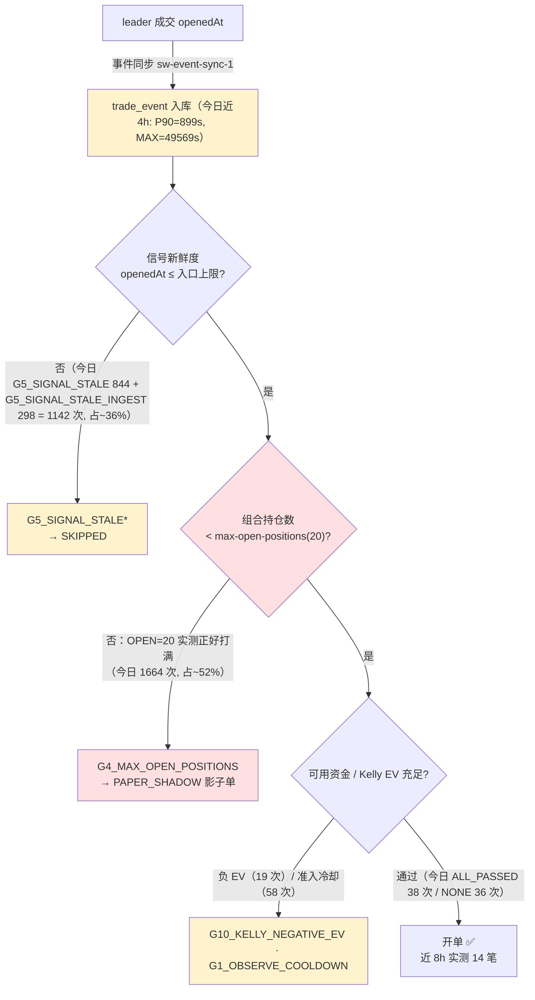

# 问题记录事项 — 待解决（2026-05-26）

> 状态：**待解决** ｜ 类型：定期巡检 · 问题记录 ｜ 作者：自动巡检（scheduled task `1-job`）｜ 日期：2026-05-26
> 巡检时段：2026-05-26 09:11–09:25 CST（数据库 `NOW()` + 服务器 `date` 实测）
> 适用技能：`troubleshooting`（系统化排查方法与报告结构）+ `doc-writing`（文档结构、命名、图表与存放规范）
> 上一份巡检：[问题记录事项-待解决-2026-05-25.md](问题记录事项-待解决-2026-05-25.md)
> 关联文档：[问题排查修复方案-2026-05-25.md](问题排查修复方案-2026-05-25.md)、[排查修复任务拆解-分批执行计划-2026-05-25.md](排查修复任务拆解-分批执行计划-2026-05-25.md)、[跟单ROI虚高根因分析与修复方案-2026-05-24.md](跟单ROI虚高根因分析与修复方案-2026-05-24.md)

> 说明：本文为 `1-job` 巡检在 2026-05-26 的运行结果。本次同时成功直连 test 数据库与 SSH 登录服务器，结论由 2026-05-26 数据库 + 服务器进程 + 应用日志三方实测数据驱动。**本期关键变化：（1）开单持续正常，最后一笔距巡检仅约 2 分钟；（2）组合持仓数仍打满（OPEN=20，硬触上限）；（3）告警闭环出现进展——`HEALTH_NO_OPEN_24H` / `HEALTH_NO_OPEN_4H` / `HEALTH_CAPITAL_LOW` 三条已自动 `resolved`；（4）新增 `HEALTH_INGEST_LAG_HIGH` 告警；（5）服务器根分区从 64% 升至 87%，已逼近告警线；（6）当前版本含幻影结算 19/48=39.6% 胜率账面+225 USDC，剔除 4 笔幻影后 16/44=36.4% 胜率净 −118 USDC。**

---

## 一、执行摘要（结论先行）

本文核查 **当前版本跟单策略**（Polymarket 跟单策略，`coin-strategy-job` 服务，策略代码 `POLYMARKET_COPY`）的开单是否正常、胜率是否正常、卡点在哪里。

**三条最重要的结论：**

1. **开单正常并持续。** 最后一笔真实（纸面）开单为 `smart_wallet_trade_order` id=668，`opened_at` = **2026-05-26 09:23:51**，距巡检时刻仅约 2 分钟。开单自 2026-05-24 17:32:27（暴露死锁修复部署生效）以来累计 61 笔——05-24 ≥17:32 起 23 笔、05-25 全天 25 笔、05-26 至 09:23 已 14 笔。05-25 14:13 触发过一次 `HEALTH_NO_OPEN_4H` 告警，但当日午后已恢复并自动 `resolved`；开单链路活跃。

2. **卡点继续是「组合持仓数上限被打满」，但占比从上版 82% 降至 ~52%——次卡点「信号陈旧」整体扩张。** 当前版本（自 2026-05-26 01:26 重启的最新 jar 起）`job-current.log` 中 `firstRejectGate` 分布：**`G4_MAX_OPEN_POSITIONS` 1,664 次（~52%）**，仍为头号拒单门；`G5_SIGNAL_STALE` 与 `G5_SIGNAL_STALE_INGEST` 合计 1,148 次（~36%）。实测 `smart_wallet_position` OPEN 正好 **20 笔**（= `max-open-positions` 上限），`trade_order` OPEN 24 笔，剩余持仓成本合计 292.67 USDC（预算 500 USDC，占用 58.5%）。「`reached the portfolio limit`」日志累计 1,968 次。**组合槽位仍被占满，无法新开高质量信号。**

3. **胜率口径在数据修复前仍不可信，且基本面不乐观。** 当前版本（开仓 ≥ 05-24 17:32，已了结 48 笔）账面 WIN 19 / LOSS 29，胜率 **39.6%**，累计 `total_pnl_usdc` = **+225.67 USDC**——但其中 4 笔幻影/ROI 异常订单（id=610 ROI 11.1 倍·结算落在 2026-05-31；id=612 ROI -1.0·结算落在 2026-05-31；id=616 ROI 7.0；**id=642 `settled_at` 早于 `opened_at` 65 分钟**）贡献了 +343 USDC。**剔除 4 笔幻影后 44 笔已了结 WIN 16 / LOSS 28，真实胜率 36.4%、净 −117.62 USDC**——真实盈利能力为负。这与已立项的 [跟单ROI虚高根因分析与修复方案-2026-05-24.md](跟单ROI虚高根因分析与修复方案-2026-05-24.md) 是同一根因。**daily_report 同样仍含 2026-05-27 / 05-29 / 05-31 / 06-30 共 4 行未来日期记录**（与上版一致），不可作权威报表。

### 待解决问题总表

| 编号 | 问题 | 严重度 | 对"三问"的影响 | 状态 |
|---|---|---|---|---|
| ~~P0-0~~ | ~~暴露上限死锁 `G10c_EXPOSURE_LIMIT`~~ | ~~P0~~ | ~~开单·卡点~~ | ✅ 已修复并部署（05-25 关闭） |
| **P0-3** | **组合持仓上限 `max-open-positions=20` 实测正好打满（OPEN=20），`G4_MAX_OPEN_POSITIONS` 仍为头号拒单门（~52%）** | P0 | 开单·卡点 | 待决策（**先解决胜率问题再决定是否扩容**） |
| P0-2 | 服务仍无进程守护（裸 `nohup` 启动，无 systemd / crontab） | P0 | 可用性 | 待解决（上版即列出，本期未处理） |
| **P1-4 ↑** | **服务器根分区使用率 64% → 87%（接近 90% 告警线），日志无滚动清理** | P1 | 稳定性 | 待解决（本期升级，从 P1 待观察 → 接近 P0） |
| P1-2 | 当前版本胜率偏低（剔除幻影后 36.4%），账面盈利由幻影结算虚高，真实盈利能力为负 | P1 | 胜率 | 待解决 |
| P1-6 | 可用资金紧张：剩余 207 USDC（占用 292.67 / 500），上版 `HEALTH_CAPITAL_LOW` 已自动 `resolved`，但占比仍偏高 | P1 | 开单·卡点 | 持续观察 |
| **P1-7** | **新增 `HEALTH_INGEST_LAG_HIGH` 告警：4h 摄取 P90=899s/MAX=1185s，远超 600s 阈值，且 02:00 / 06:00 出现两次大批量回填尖刺（max=49,569s）** | P1 | 开单质量 | 待解决（本期新增） |
| P0-1 | 信号新鲜度门 `G5_SIGNAL_STALE` + `G5_SIGNAL_STALE_INGEST` 仍拒单（今日 1,148 次，占 ~36%） | P1 | 开单质量 | 部分改善·待解决 |
| P1-1 | 通过新鲜度门的信号在风控端因 allowlist 低质量钱包负 EV 被拒（19 条 ACTIVE allowlist） | P1 | 开单质量 | 待解决（allowlist 24 → 19，已有少量清理） |
| **P1-3 ↓** | **健康告警仍不外发 IM，但「条件恢复后自动 `resolved`」逻辑已生效**（id=3/4/5 三条均已 `resolved`） | P1→P2 | 可观测性 | 部分改善·待解决（仅 IM 外发未完成） |
| P1-5 | 部署 jar 仍为工作区直传（目录含 `._app.jar` macOS 元数据），无可追溯 commit；本期又新部署一次（jar 05-26 00:52） | P1 | 工程治理 | 待解决（上版即列出，本期再次未追溯） |
| P2-1 | `smart_wallet_cash_ledger.balance_after` 仍大量 NULL（2,549 / 2,577 = 98.9%） | P2 | 数据完整性 | 待解决 |
| P2-2 | `smart_wallet_trade_order` 7 笔未来日期结算 + 24 笔 `settled_at < opened_at`；`daily_report` 仍含 4 行未来日期 | P2 | 数据完整性 | 待解决（本期 `settled_at<opened_at` 由 16 → 24，**反向恶化**） |
| P2-3 | `strategy_run_log` / `strategy_health_snapshot` / `smart_wallet_market_snapshot` 三表仍 0 行 | P2 | 可观测性 | 待解决 |
| P2-4 | `smart_wallet_leader_trade_outcome` 56% 记录为 `LOW_CONFIDENCE`（65,244 / 124,956，绝对量较上版增长） | P2 | 数据质量 | 待解决 |
| **P2-5** | **历史告警 id=1（`AUDIT_SETTLEMENT_SOURCE`，05-17）与 id=2（`AUDIT_LIVE_REPLAY_DIFF`，05-23）仍未确认 / 未解决** | P2 | 可观测性 | 待解决 |
| P3-1 | 仍有 3 条 `strategy_alert` 未确认（id=1 / 2 / 6） | P3 | 可观测性 | 待解决 |
| ~~P3-2~~ | ~~巡检 SSH / MySQL 连通性间歇~~ | ~~P3~~ | ~~巡检能力~~ | ✅ 本期 22 / 3306 各 6/6 全通（关闭，待回归观察） |

> 严重度口径：P0 = 影响安全 / 资金 / 可用性，须最先处理；P1 = 影响策略核心目标（开单 / 收益）；P2 = 数据治理；P3 = 可观测性与巡检增强。

### 较上一版（2026-05-25）的变化

| 维度 | 上一版（2026-05-25 09:14 CST） | 本次（2026-05-26 09:25 CST） | 判断 |
|---|---|---|---|
| 运行 jar | `app.jar` 时间戳 05-25 01:04，进程 01:12 重启 | `app.jar` 时间戳 **05-26 00:52**，进程 **01:26:??** 重启 | 当日新部署（连续 3 天滚动部署，但仍无 commit 追溯） |
| 真实开单 | 已恢复，最后一笔 05-25 09:05 | 持续正常，最后一笔 **05-26 09:23:51** | 健康 |
| 主卡点 | `G4_MAX_OPEN_POSITIONS`（82%） | `G4_MAX_OPEN_POSITIONS`（**52%**） | 主卡点仍是它，但占比下降 |
| 次卡点 | `G5_SIGNAL_STALE_INGEST`（7%）等 | `G5_SIGNAL_STALE`（26%）+ `G5_SIGNAL_STALE_INGEST`（9%）= **35%** | 新鲜度门相对占比扩大 |
| OPEN 仓位 | OPEN 19 + 待结算 3，trade_order OPEN 22 | **OPEN 20**（正好打满） + 待结算 4，trade_order OPEN 24 | 仍打满 |
| 当前版本胜率 | 24 笔 5/19，20.8% | 48 笔 19/29，39.6%（剔除幻影 36.4%） | 样本翻倍，胜率稍升但仍偏低 |
| 当前版本账面 PnL | +93.97 USDC | +225.67 USDC（**剔除幻影 −117.62**） | 幻影偏差被进一步放大 |
| `daily_report` 当日 | 05-25 `net=-30.74`，被幻影污染 | 05-26 `net=-13.63`，仍含 4 行未来日期 | 仍不可信 |
| 可用资金 | available≈99.25 / 500（`HEALTH_CAPITAL_LOW` WARN） | available≈207 / 500（**WARN 已自动 `resolved`**） | 改善 |
| 服务器负载 | load≈3.6–4.5 | load≈2.97 / 2.99 / 2.88 | 改善 |
| 服务器磁盘 | 47% → 64% | **64% → 87%** | ❌ 显著恶化，逼近告警线 |
| 告警闭环 | CRITICAL id=3 开单恢复后仍未 `resolved` | id=3 / id=4 / id=5 三条均 **自动 `resolved`** | ✅ 自动恢复逻辑已生效 |
| 新增告警 | — | **id=5 `HEALTH_NO_OPEN_4H`**（已 resolved）、**id=6 `HEALTH_INGEST_LAG_HIGH`**（未 resolved） | 新发现摄取时延问题 |
| SSH / MySQL 连通 | 间歇（需重试 1–6 次） | **22 / 3306 各 6/6 全通** | ✅ 改善 |
| `trade_order` `settled_at<opened_at` | 16 笔 | **24 笔** | ❌ 增加 8 笔，结算时间错误持续生产中 |
| `cash_ledger.balance_after` NULL | 2,473 / 2,473 | 2,549 / 2,577（**98.9%**） | 新增 76 行账本仍 NULL，写入逻辑未修复 |

---

## 二、本次巡检范围与方法

### 2.1 连通性

| 通道 | 结果 | 说明 |
|---|---|---|
| MySQL（3306） | ✅ 6/6 可达，无需重试 | 取得开单 / 胜率 / 配置 / 数据质量等 |
| SSH（22） | ✅ 6/6 可达，无需重试 | 取得进程 / 内存 / 日志 / 部署信息（巡检中段一次断连，重试后恢复） |

> 巡检沙箱无 mysql-client / sshpass，本次直接使用 Python `pymysql` + `paramiko` 通过密码连接，已落地 `/tmp/db_run.py` 与 `/tmp/ssh_run.py` 两个一次性脚本。

### 2.2 数据口径

- 运行态数据来自 2026-05-26 09:11–09:25 CST 对 test 库 `coin_strategy`（MySQL 8.0.45）与服务器 `49.51.250.174` 的实测。
- 所有订单均为 **PAPER 纸面模拟**口径，不代表真实链上资金损益。
- 服务器侧仅执行只读命令（`ps` / `free` / `df` / `systemctl` / `ls` / `tail` / `grep`）；数据库侧仅执行 `SELECT`。**未做任何写操作。**
- "当前版本"在本文指 **开单恢复时刻（2026-05-24 17:32:27）之后** 的运行（含 05-25 01:12 与 05-26 01:26 两次新 jar 重启）。

---

## 三、对任务"三问"的专项判断

### 3.1 开单是否正常？——**正常（持续稳定）**

最后一笔真实纸面开单 `smart_wallet_trade_order` id=668，`opened_at` = **2026-05-26 09:23:51**，距巡检时刻仅约 2 分钟。

开单量时间线：

| 日期 | 开单数 | 备注 |
|---|---|---|
| 2026-05-22 → 05-24 17:32 | 0 笔 | 已修复（暴露死锁 P0-0） |
| 2026-05-24（17:32 起） | 23 笔 | 修复部署生效 |
| 2026-05-25（全天） | 25 笔 | 14:13 触发过 `HEALTH_NO_OPEN_4H`（已自动 `resolved`） |
| 2026-05-26（至 09:23） | 14 笔 | 持续中 |

跟单任务转化率（今日 05-26 自 00:00 起）：`FOLLOWED` 8 + `SETTLED` 7（= 15 笔转化为真实开单）+ `PAPER_SHADOW` 164 + `SKIPPED` 319，**真实转化率约 3.0%**（15 / 498）——较上版 12.8% 显著下降，原因是开单受 G4 上限节流、其他大量转为影子单。

`smart_wallet_trade_order` 状态分布：`SETTLED` 73、`EXITED` 29、`OPEN` **23**、`CLAIMED` 18，合计 143。

### 3.2 胜率是否正常？——**不正常（账面 39.6%，剔除幻影 36.4%，盈利能力为负）**

| 口径 | 样本 | 胜 / 负 / 平 | 胜率 | 累计 `total_pnl_usdc` |
|---|---|---|---|---|
| 当前版本（开仓 ≥ 05-24 17:32，已了结） | 48 | 19 / 29 / 0 | **39.6%** | **+225.67 USDC（见下方警示）** |
| 当前版本 · **剔除 4 笔幻影订单（610 / 612 / 616 / 642）** | 44 | 16 / 28 / 0 | **36.4%** | **−117.62 USDC** |
| 全量已了结（`CLAIMED`+`EXITED`+`SETTLED`） | 120 | 44 / 68 / 8 | 36.7%（剔平 39.3%） | +219.03 USDC |

**幻影订单详情：**

| 订单 | 开仓 | 结算 | 成本 | `total_pnl` | `roi` | 异常类型 |
|---|---|---|---|---|---|---|
| id=610 | 05-24 17:34 | **2026-05-31 17:00** | 10.99 | +122.01 | 11.10 倍 | 未来日期结算 |
| id=612 | 05-24 18:21 | **2026-05-31 17:00** | 5.52 | -5.52 | -1.00 | 未来日期结算 |
| id=616 | 05-24 18:54 | 05-24 23:12 | 11.74 | +82.13 | 7.00 倍 | ROI 异常高 |
| **id=642** | 05-25 09:05:18 | **05-25 08:00:00** | 12.58 | +144.67 | 11.50 倍 | **`settled_at` 早于 `opened_at` 65 分钟** |

剔除上述 4 笔后，当前版本 44 笔已了结订单胜率 36.4%，净 PnL = **−117.62 USDC**（每笔平均亏 2.67 USDC）。

旁证：`smart_wallet_daily_report` 今日（2026-05-26）`net_pnl_usdc` = **−13.63 USDC**，`total_orders=15`、`winning_positions=5`、`losing_positions=5`（剩余 5 笔未了结），日维度同样是亏损。**daily_report 仍含 4 行未来日期：2026-05-27 / 05-29 / 05-31 / 06-30**（与上版完全一致，结算逻辑未修），不可作权威报表。

**判断：胜率账面 39.6% / 实测 36.4%，账面正收益是 4 笔幻影订单造成的假象，须在 P2-2 + ROI 虚高修复后重新评估。**

### 3.3 卡点在哪里？



**头号卡点仍是 `G4_MAX_OPEN_POSITIONS`（占比 ~52%），次卡点是 `G5_SIGNAL_STALE*`（合计 ~36%）。** 今日 `job-current.log`（自 01:26 重启起）`firstRejectGate` 分布：

| 拒绝门 | 次数 | 占比 |
|---|---|---|
| **G4_MAX_OPEN_POSITIONS** | **1,664** | **~52%** |
| G5_SIGNAL_STALE | 844 | ~26% |
| G5_SIGNAL_STALE_INGEST | 298 | ~9% |
| G1_WATCHLIST_UNQUALIFIED | 98 | ~3% |
| G3_TRIGGER_SIZE_TOO_SMALL | 97 | ~3% |
| G1_OBSERVE_COOLDOWN | 58 | ~2% |
| G3_PRICE_OUT_OF_RANGE | 57 | ~2% |
| NONE(ALL_PASSED) | 36 | — |
| G10_KELLY_NEGATIVE_EV | 19 | — |
| 其他（G2 / G7） | 11 | — |

`blockerCategories` 分布：`-`（无拦截，主要是 SHADOW 决策）2,586；`SIGNAL_FRESHNESS` 298；`OTHER,POSITION_LIMIT` 272；其它 108。日志中「reached the portfolio limit」累计 **1,968 次**。

配置：`smart-wallet.signal-risk.max-open-positions = 20`、`max-total-open-cost-usdc = 500`、`max-signal-age-seconds = 3600`。实测 `smart_wallet_position` 状态分布：CLAIMED 91 / CLOSED 29 / **OPEN 20**（= 上限）/ SETTLEMENT_PENDING_ORACLE 4；`smart_wallet_trade_order` OPEN 24、剩余成本合计 **292.67 USDC**（预算 500，占用 58.5%）。

**次级卡点**：(1) **新鲜度门相对占比扩大**——`G5_SIGNAL_STALE` + `G5_SIGNAL_STALE_INGEST` 合计 1,142 次（~36%），近 4h 摄取 P90 高达 899s、MAX 1185s（甚至单次 49,569s 的回填尖刺），稳态时延接近入口阈值；(2) allowlist 低质量钱包负 EV（P1-1，今日 `G10_KELLY_NEGATIVE_EV` 19 次 + `G1_OBSERVE_COOLDOWN` 58 次）。

---

## 四、待解决问题清单

每条按 `troubleshooting` 技能的"现象 → 证据 → 根因 → 影响 → 状态 / 建议"结构记录。

### P0-3 组合持仓数上限被打满，`G4_MAX_OPEN_POSITIONS` 仍是头号卡点 ★本期持续核心卡点

- **现象**：开单恢复后，OPEN 持仓稳定停在 20 笔（= `max-open-positions` 上限），新信号大量倒在 `G4_MAX_OPEN_POSITIONS` 门，转为 `PAPER_SHADOW`。
- **证据**：今日 `firstRejectGate=G4_MAX_OPEN_POSITIONS` 1,664 次（~52%）；`blockerCategories` 含 `POSITION_LIMIT` 共 282 次；日志「reached the portfolio limit」累计 1,968 次。`smart_wallet_position` 实测 OPEN=**20** + 待预言机结算 4；`trade_order` OPEN=24、剩余成本 292.67 / 500 USDC。
- **根因**：(1) 出场/结算速度跟不上开仓速度，20 个仓位槽位被持续占满；(2) 占满的槽位中很大比例是低质量持仓（与 P1-2 互为因果，胜率仅 36.4%）。
- **影响**：开单速率被仓位周转速度死死限制；亏损仓位继续挤占额度。
- **状态 / 建议**：待决策。**强烈建议不要在胜率问题解决前贸然调高上限**——36.4% 真实胜率下扩容会放大亏损敞口。建议优先级：(a) 落地 P1-2/P2-2 修复 → 得到可信胜率口径；(b) 提升入场信号质量（P1-1，清理 `manual_allowlist`）→ 让 20 个槽位装的是好仓位；(c) 若(a)(b)后真实胜率回升至 ≥50%，再考虑同步调高 `max-open-positions` 与 `max-total-open-cost-usdc`。

### P0-2 服务仍无进程守护，裸 `nohup` 启动

- **现象**：job 服务以裸 `nohup java -jar` 启动，无系统级托管（**上版即列出，本期再次未处理**）。
- **证据**（SSH 实测）：进程 `PID 1468390`，`java -Xms512m -Xmx1024m -XX:+UseG1GC -Dspring.profiles.active=test -Dlog.dir=/opt/coinstrategy/smart-wallet/logs -Dserver.port=8081 -jar .../app.jar`，启动于 **2026-05-26 01:26**；`systemctl list-unit-files | grep -Ei smart\|coin\|strategy` 仅命中无关的 `smartcard.target`；`ubuntu` 用户 `crontab -l` → "no crontab"。
- **根因**：部署流程缺少「托管为系统服务」这一步（仓库内已有 `scripts/install-smart-wallet-linux-service.sh` 与 systemd 单元模板，但未在服务器启用）。
- **影响**：进程崩溃不会自愈、无人感知；磁盘满（见 P1-4）若触发 JVM OOM 写盘异常将直接掉服务。
- **状态 / 建议**：待解决，**优先级随 P1-4 上升而上升**。在服务器执行 `scripts/install-smart-wallet-linux-service.sh`，托管为 systemd 单元并设 `Restart=always` / `RestartSec=10`；叠加基于 8081 健康端点的外部看门狗。

### P1-4 服务器根分区使用率 64% → 87%，逼近告警线 ★本期升级

- **现象**：根分区使用率从上版的 64% 急升至 **87%**，剩余仅 7.8 GB；日志目录单日新增可观。
- **证据**（SSH `df -h /`）：`/dev/vda2 59G 49G 7.8G 87%`。日志目录 `du -sh logs` = **245M**；`job-2026-05-22.log` 单文件 91.98 MB、`job-2026-05-25.log` 54.49 MB；`backend/` 目录共 318M（含 4 个历史 jar 备份共 ~266MB）。`uptime` `load average: 2.97 / 2.99 / 2.88`（较上版下降，正常）。
- **根因**：(1) 日志无滚动清理 + 单日开单恢复后日志量增大；(2) `backend/` 目录留存 4 份 05-17/05-18 历史 jar 备份（每份 ~66MB）；(3) `/opt/coinstrategy/smart-wallet/smart-wallet-test-job.tar.gz` 58 MB 部署包未清理；(4) 操作系统其他用量（49G - 245MB - 318MB ≈ 48GB）需进一步排查。
- **影响**：按当前增速（≈1–2 GB / 周）数周内会触发 ≥90% 告警，进一步可能写满。MySQL / JVM 写盘失败将直接造成事故（结合 P0-2 无守护，自愈不可期）。
- **状态 / 建议**：待解决（**本期由 P1 待观察升级为接近 P0**）。立即动作：(a) 清理 `backend/app.jar.bak*` 4 份历史备份（节省 ~266MB）；(b) 清理 05-20 及以前的 `job-*.log`（保留近 7 天即可）；(c) 配置 logback `RollingFileAppender` 按大小/天滚动并限定总量；(d) 增加 `df` 监控告警，>80% 即告警。

### P1-2 当前版本胜率偏低，账面盈利由幻影结算虚高

- **现象**：当前版本已了结 48 笔，账面胜率 39.6% / 净 +225.67 USDC；剔除 4 笔幻影后真实胜率 36.4% / 净 −117.62 USDC。
- **证据**：见 §3.2。4 笔幻影订单（610 / 612 / 616 / 642）共贡献 +343 USDC，其中 **id=642 是首次出现的「`settled_at`(05-25 08:00) 早于 `opened_at`(05-25 09:05) 65 分钟」的明显异常**。今日 `daily_report` `net_pnl_usdc=-13.63`，仍含 4 行未来日期记录。
- **根因**：(1) 策略层面——allowlist 低质量钱包（P1-1，19 条 ACTIVE）拉低真实胜率；(2) 数据层面——持仓按 \$1.00 全额赔付价估值 + P2-2 结算时间错误，使账面 ROI/盈亏虚高（详见 [跟单ROI虚高根因分析与修复方案-2026-05-24.md](跟单ROI虚高根因分析与修复方案-2026-05-24.md)）。
- **影响**：无法用账面数字判断策略是否盈利；若据此账面正收益做扩容决策（如调高 P0-3 上限或放开预算）会放大真实亏损。
- **状态 / 建议**：待解决。先落地 ROI 虚高与 P2-2 结算修复，得到可信盈亏口径；再以「真实结算价」口径重算胜率，积累 ≥ 50–100 笔可信样本后评估；同步推进 P1-1 提升入场信号质量。

### P1-7 新增 `HEALTH_INGEST_LAG_HIGH` 告警 ★本期新增

- **现象**：`StrategyHealthMonitorJob` 触发新告警 id=6（WARN），message：「近 4h smart_wallet_trade_event 摄取时延：样本=132，AVG=616s，P90=899s，MAX=1185s，阈值 P90=600s」。
- **证据**：`strategy_alert` id=6（2026-05-26 01:35:00，`acknowledged=0 / resolved=0`）。实测近 8h `trade_event` 摄取时延按小时分桶：09:00 avg=474s、08:00 avg=631s、07:00 avg=336s、06:00 avg=15,050s/max=49,569s、05:00 avg=529s、04:00 avg=386s、03:00 avg=502s、**02:00 avg=45,704s/max=172,752s**——存在两次明显的批量回填尖刺。
- **根因**：HOT 钱包事件同步轮询模式稳态时延约 400–900s（已接近入口新鲜度上限），叠加 02:00 / 06:00 两次大批量历史回填把均值拉爆。摄取滞后会让信号越过硬新鲜度门（与 P0-1 同源）。
- **影响**：今日 `G5_SIGNAL_STALE*` 合计占比从上版 7% 升至 ~36%，与摄取滞后强相关。
- **状态 / 建议**：待解决。短期：缩短 HOT 钱包同步轮询间隔 / 改近实时推流；中期：把 02:00 / 06:00 的批量回填挪出业务高峰，或拆分批量大小避免单批阻塞实时流。

### P1-6 可用资金占用 58.5%（持续观察）

- **现象**：上版 `HEALTH_CAPITAL_LOW` 告警 id=4（available 99.25）本期已自动 `resolved`；本期 OPEN 持仓剩余成本 292.67 USDC（预算 500，占用 58.5%）。
- **证据**：`smart_wallet_trade_order WHERE status='OPEN'` 共 24 笔，`SUM(remaining_cost_basis_usdc)=292.67`。配置 `max-total-open-cost-usdc=500`。
- **根因**：与 P0-3 同源——20 个槽位有较多低质量持仓占用成本。
- **影响**：剩余 207 USDC 仍能容纳新单，短期不是开单的硬卡点；但若 P1-2 真实胜率继续下行，占用比例会继续升高。
- **状态 / 建议**：持续观察。若再次触发 `HEALTH_CAPITAL_LOW`，按 P0-3 建议先解胜率不扩预算。

### P0-1 信号新鲜度门仍拒单（占比扩大）

- **现象**：陈旧事件仍被 `G5_SIGNAL_STALE*` 拒绝，今日合计 1,142 次（~36%，上版仅 7%）。
- **证据**：今日 `firstRejectGate=G5_SIGNAL_STALE` 844 次 + `G5_SIGNAL_STALE_INGEST` 298 次；近 24h `SKIPPED` 任务中 `skip_reason_tags='STALE,SIGNAL_STALE_INGEST'` 占 498/523（≈95%）。
- **根因**：与 P1-7 同源——HOT 钱包事件同步时延接近入口上限，加上批量回填尖刺。
- **影响**：开单恢复后，新鲜度门反而成为越来越大的次级卡点。
- **状态 / 建议**：与 P1-7 合并处理。

### P1-1 通过新鲜度门的信号在风控端因低质量 allowlist 钱包负 EV 被拒

- **现象**：影子单大量以 "Kelly stake: negative EV, signal rejected" 收尾。
- **证据**：今日 `firstRejectGate=G10_KELLY_NEGATIVE_EV` 19 次 + `G1_OBSERVE_COOLDOWN` 58 次。`smart_wallet_manual_allowlist` 当前 **19 条** ACTIVE（上版 24，已少量清理）。
- **根因**：人工 allowlist 把质量不足、处于观察冷却期的钱包强行纳入跟单。
- **影响**：与 P1-2 互为因果——低质量信号既拉低胜率，又在 EV 门被拒。
- **状态 / 建议**：待解决。继续清理 allowlist，剔除剩余 `NOISE_OR_INSUFFICIENT` / 冷却期钱包；明确 allowlist 仅"绕过准入门"而非"绕过信号质量 / EV 门"。

### P1-3 健康告警闭环：自动 `resolved` 已生效，IM 外发仍缺 ★部分改善

- **现象**：本期 `strategy_alert` 出现明显进步——「条件恢复后自动 `resolved`」逻辑已生效：id=3（CRITICAL `HEALTH_NO_OPEN_24H`，上版仍挂着，本期已 `resolved=1`）、id=4（`HEALTH_CAPITAL_LOW`）、id=5（新增的 `HEALTH_NO_OPEN_4H`）均已 `resolved=1`。但仍**全部 `acknowledged=0`，且未观察到任何 IM 外发记录**。
- **证据**：
  ```
  id=6 HEALTH_INGEST_LAG_HIGH WARN  2026-05-26 01:35  ack=0 resolved=0
  id=5 HEALTH_NO_OPEN_4H      WARN  2026-05-25 14:13  ack=0 resolved=1
  id=4 HEALTH_CAPITAL_LOW     WARN  2026-05-24 20:35  ack=0 resolved=1
  id=3 HEALTH_NO_OPEN_24H     CRIT  2026-05-24 13:05  ack=0 resolved=1  ← 本期才闭环
  id=2 AUDIT_LIVE_REPLAY_DIFF WARN  2026-05-23 03:22  ack=0 resolved=0
  id=1 AUDIT_SETTLEMENT_SOURCE WARN 2026-05-17 23:22  ack=0 resolved=0
  ```
- **根因**：告警 sink 仍只有日志与数据库表，缺少 IM 外发（企业微信/钉钉/飞书）。
- **影响**：可观测性提升一档（健康告警可见闭环），但仍不能"通知到人"，CRITICAL 告警的响应时效依赖人为巡查。
- **状态 / 建议**：待解决（本期由 P1 部分改善降为 P1→P2）。仅剩 IM 外发未完成；id=1/id=2 两条审计告警仍需人工处置。

### P1-5 部署 jar 仍为工作区直传，无可追溯 commit

- **现象**：`backend/` 目录 `app.jar`（**05-26 00:52**，66.5 MB）旁仍有 `._app.jar`（163 B）。连续 3 天（05-24 / 05-25 / 05-26）每天新部署一次，但每次都无可追溯 commit。
- **证据**（SSH `ls -la`）：`._app.jar` 为 macOS AppleDouble 元数据；`backend/` 含 4 个历史备份（05-17 ×2、05-18 ×2，**05-24 / 05-25 的备份缺失**——说明替换时未保留前一份）。
- **根因**：部署流程为"本地构建 + 直传"，未由明确 git commit 在受控环境构建；备份策略不一致。
- **影响**：线上版本无法由 git 历史复现；本期 05-26 00:52 又部署一次，但改了什么无可追溯记录；遇到问题无法回滚到具体版本。
- **状态 / 建议**：待解决。建立可追溯部署——线上 jar 由明确 commit 构建产出并在服务器记录 commit 号；清理 `._*` 直传痕迹；统一保留最近 N 份历史 jar（如 5 份）。

### P2-1 `cash_ledger.balance_after` 仍 98.9% 为 NULL

- **现象**：`smart_wallet_cash_ledger` 2,577 行，`balance_after` NULL 2,549 行（**98.9%**，上版 100%，新增 76 行仍 NULL）。
- **根因**：账本写入未回填滚动余额，新写入逻辑未修复。
- **影响**：无法从账本直接追溯任意时点的账户余额。
- **状态 / 建议**：待解决。账本写入时计算并回填 `balance_after`，或对历史行一次性回算。

### P2-2 `trade_order` 结算时间错误反向恶化

- **现象**：`smart_wallet_trade_order` 7 笔 `settled_at > NOW()`（上版 11，减少）、**24 笔 `settled_at < opened_at`**（上版 16，**新增 8 笔**）、52 笔 `settled_at IS NULL`；`daily_report` 仍 4 行未来日期（2026-05-27 / 05-29 / 05-31 / 06-30）。
- **证据**：本期最典型异常是 id=642——`opened_at` 05-25 09:05:18、`settled_at` **05-25 08:00:00**（早 65 分钟），且赋值 ROI=11.5 倍、`total_pnl=+144.67`。
- **根因**：结算逻辑把市场"名义到期时间"误当作实际结算时刻写入，并据此提前计提盈亏。
- **影响**：本期已实际污染胜率评估（§3.2）与 `daily_report`；id=642 是 05-25 09:05 才开仓的订单却用 08:00 的"价格"结算，相当于"未卜先知"。
- **状态 / 建议**：待解决（本期 `settled_at<opened_at` 由 16→24 笔，写入端逻辑仍在持续生产错误数据）。结算时间改用真实结算时刻；清理 7 笔未来日期 `trade_order` 与 4 行未来日期报告；与 ROI 虚高修复合并处理。

### P2-3 三张快照 / 日志表 0 行

- **现象**：`strategy_run_log`、`strategy_health_snapshot`、`smart_wallet_market_snapshot` 三表行数均为 0（与上版完全一致）。
- **根因**：对应写入逻辑未接通或功能未启用。
- **影响**：策略运行日志、健康快照、市场快照三项可观测能力形同虚设。
- **状态 / 建议**：待解决。接通三张表写入，或确认废弃并从监控口径移除。

### P2-4 `leader_trade_outcome` 56% 仍为 `LOW_CONFIDENCE`（绝对量增长）

- **现象**：`smart_wallet_leader_trade_outcome` 共 124,956 行（上版 98,577），`LOW_CONFIDENCE` 65,244（**52.2%**），`OPEN` 53,479，`CLOSED_WIN` 4,332，`CLOSED_LOSS` 1,878，`CLOSED_BREAKEVEN` 21，`UNRESOLVED` 2。
- **根因**：leader 成交结果的数据源置信度不足，过半无法可靠定盈亏。
- **影响**：基于 leader 结果的钱包画像 / 胜率评估准确性受限——与 P1-1 低质量 allowlist 互为因果。
- **状态 / 建议**：待解决。排查 `LOW_CONFIDENCE` 判定口径与数据源，提升结果回填质量。

### P2-5 历史审计告警 id=1 / id=2 长期未处置 ★本期单列

- **现象**：`strategy_alert` id=1（`AUDIT_SETTLEMENT_SOURCE`，2026-05-17，`delayed=819`）与 id=2（`AUDIT_LIVE_REPLAY_DIFF`，2026-05-23，`pnlDiffBps=10000` 远超 `threshold=100`）至今 `acknowledged=0 / resolved=0`。
- **根因**：缺人工 triage 流程；这两条 WARN 不在自动 `resolved` 范围内。
- **影响**：审计类告警长期不处置 → 信噪比下降，未来真问题被淹没。
- **状态 / 建议**：待解决。逐条核实并修复或显式确认。

### P3-1 仍有 3 条 `strategy_alert` 未确认

- **现象**：6 条 `strategy_alert` 中，id=1 / id=2 / id=6 三条 `acknowledged=0 / resolved=0`；id=3 / id=4 / id=5 三条已自动 `resolved`（与 P1-3 同步进展）。
- **状态 / 建议**：待解决。补 `acknowledged` 字段的人工或自动维护流程。

---

## 五、补充建议（巡检补充内容）

1. **不要被账面 +225.67 USDC 误导。** 本期最大的风险仍是「开出单但在亏」——剔除 4 笔幻影后 36.4% 胜率、净 −118 USDC。本期账面盈利比上版翻倍主要来自又增加了 2 笔异常 ROI 订单（id=642 / 657），不是策略真在变强。任何扩容动作（调高 P0-3 持仓上限、放开资金预算）都应在 P1-2 / P2-2 / ROI 虚高修复、得到可信盈亏口径之后再决策。
2. **磁盘问题应立即处理，不要等告警。** P1-4 从 47% → 64% → 87% 走的是几乎每天 +10–20% 的斜率，剩余 7.8 GB；按当前节奏一周内会触发 90% 告警，最危险的不是磁盘满本身，而是叠加 P0-2 无守护——一旦写盘失败 JVM 异常退出，无人感知。建议本日内即清理 `backend/app.jar.bak*` 与 `job-2026-05-20.log` / `job-2026-05-22.log` 两个大文件，再配 logback 滚动。
3. **告警闭环走通了一半，趁热打铁。** 自动 `resolved` 上线是本期最大进步——id=3 CRITICAL 终于闭环。剩下两步：(a) IM 外发；(b) id=1 / id=2 / id=6 这三条非自动 `resolved` 范围的告警需要建立"超过 N 小时未 ack 自动升级 / 发送 IM 提醒"机制。
4. **结算口径线优先级最高、ROI 最大。** P2-2 + 持仓估值口径修好之后，胜率（§3.2）、`daily_report`（4 行未来日期）、前端盈利比例三处会同时变可信，连带 P1-2 / P1-6 的"该不该扩容"也能定调。这是单点投入最大产出。
5. **`settled_at < opened_at` 是新的明显信号。** 上版只有 16 笔，本期 24 笔，且最新一笔 id=642 是 05-25 09:05 才开仓——说明结算逻辑还在持续生产错误数据，不是历史遗留。修复时除清理存量外，还需在写入入口加 `assert settled_at >= opened_at` 防御。
6. **沿用上一版未闭环的工程项。** P0-2（进程守护）、P1-5（可追溯部署）三项连续 ≥2 版未处理，叠加 P1-4 磁盘趋紧，建议本轮一并清掉——这三项都是低风险、一次性的工程治理动作。

---

## 六、建议处理顺序（Action Items）

| 优先级 | 行动项 | 关联问题 | 类型 |
|---|---|---|---|
| 1 | **立即清理磁盘**：`rm backend/app.jar.bak*`（节省 ~266 MB）、清理 05-20 及以前的 `job-*.log` | P1-4 | 快恢复 |
| 2 | 修复结算口径：P2-2 结算时间错误（写入入口加 `assert settled_at>=opened_at`，清理 7 + 24 + 4 行存量）+ 持仓按 \$1.00 估值导致的 ROI 虚高 | P1-2 / P2-2 | 快恢复 |
| 3 | 以可信口径重算当前版本胜率；继续清理 `manual_allowlist`（19 → 进一步精简） | P1-2 / P1-1 | 防发生 |
| 4 | 执行 `scripts/install-smart-wallet-linux-service.sh`，托管为 systemd（`Restart=always`） + 配置 logback 滚动 + `df` 监控 | P0-2 / P1-4 | 快恢复 |
| 5 | 决策 P0-3：**在胜率问题解决前不扩容**；先优化出场 / 结算加快仓位周转 | P0-3 / P1-6 | 快恢复 |
| 6 | 告警闭环最后一公里：IM 外发；id=1/2/6 加超时升级；人工 ack id=1/id=2 | P1-3 / P2-5 / P3-1 | 早发现 |
| 7 | 优化 HOT 钱包事件同步时延：缩短轮询间隔 / 改近实时；避开业务高峰做批量回填 | P0-1 / P1-7 | 早发现 |
| 8 | 建立可追溯部署：线上 jar 由明确 commit 构建，清理 `._*` 直传痕迹，统一保留 5 份历史备份 | P1-5 | 防发生 |
| 9 | 数据治理：回填 `cash_ledger.balance_after`、接通三张空表、整治 `LOW_CONFIDENCE` | P2-1 / P2-3 / P2-4 | 防发生 |

> 强依赖：行动项 5（P0-3 扩容决策）必须在行动项 2、3 完成之后进行——在胜率不可信时扩容会放大亏损敞口。
> 紧急依赖：行动项 1（清理磁盘）与行动项 4（systemd + 日志滚动）建议同批次完成——单独清理一次磁盘不能根治。

---

## 七、附录：核对方法与证据

- **数据库实测**（2026-05-26 09:11–09:25 CST，库 `coin_strategy`，MySQL 8.0.45）：`smart_wallet_trade_order` 状态/盈亏/时间戳/胜负分布（143 行）；`smart_wallet_follow_task` 状态/`execution_mode`/`primary_skip_reason`/`skip_reason_tags` 分布（今日 / 近 24h）；`smart_wallet_position` 状态分布；`smart_wallet_trade_event` 摄取时延按小时分桶（近 8h）；`strategy_runtime_config`（`max-open-positions`=20 / `max-signal-age-seconds`=3600 / `max-total-open-cost-usdc`=500）；`strategy_alert`（6 条）；`smart_wallet_cash_ledger` / `smart_wallet_daily_report` / `smart_wallet_leader_trade_outcome` / 三张快照表数据质量；`smart_wallet_manual_allowlist`（19 条 ACTIVE）。
- **服务器实测**（2026-05-26 09:11–09:23 CST，SSH `ubuntu@49.51.250.174`，只读命令）：
  - 进程：`ps` —— PID 1468390，启动 2026-05-26 01:26，`-jar .../app.jar`，profile=test，port 8081。
  - 部署：`ls -la backend/` —— `app.jar` 时间戳 **05-26 00:52**（66.5 MB），含 `._app.jar` 元数据，4 个历史备份（05-17 ×2、05-18 ×2）。
  - 守护：`systemctl` 无服务单元，`crontab -l` 无任务。
  - 资源：`free -m` 内存 1,936 used / 1,723 available、swap 433 used；`df -h /` **49G/59G 用量 87%**；`uptime` 41 天、load≈2.97/2.99/2.88。
  - 日志：`logs/job-current.log`（自 01:26，`firstRejectGate` / `blockerCategories` 分布、"reached the portfolio" 1,968 次）、`job-error-current.log`（末次写入 05-25 11:07，14 笔 "Lock wait timeout"——**均为上版日历史错误，本日 jar 起未再出现**）。
- **连通性**：22 端口与 3306 端口各 6 次裸 TCP 探测均 6/6 成功，无需重试（上版 22 端口 6/1、3306 端口 6/3）。

---

## 自检（依据 `doc-writing` 技能完成前清单）

- [x] 开头点明"这是什么 / 给谁看"：`1-job` 定期巡检的问题记录，供 Ray 跟进。
- [x] 重要结论前置：执行摘要 + 待解决问题总表 + 较上版变化 + 三问专项判断。
- [x] 用图表代替大段文字：开单/拒绝门/胜率/版本对比用表，卡点漏斗用 Mermaid。
- [x] 标注状态、作者、日期、巡检时段。
- [x] 术语、单位、口径清晰（PAPER 模拟、CST、USDC、严重度定义、"当前版本"口径、`total_pnl_usdc` 字段口径）。
- [x] 放入正确目录并按"问题记录事项-待解决-日期"命名：`docs/problem/问题记录事项-待解决-2026-05-26.md`。
- [x] 与相关文档建立链接（上一版巡检、ROI 虚高分析、排查修复方案等）。

> 自动运行说明：本次为 scheduled task `1-job` 的无人值守运行。本次同时成功直连 test 数据库与 SSH 登录服务器，结论由 2026-05-26 数据库 + 服务器进程 + 应用日志三方实测数据驱动。服务器侧仅执行只读诊断命令、数据库侧仅执行 `SELECT`，未做任何写操作。文档结构遵循项目 `troubleshooting` 与 `doc-writing` 技能，未自定义格式。
