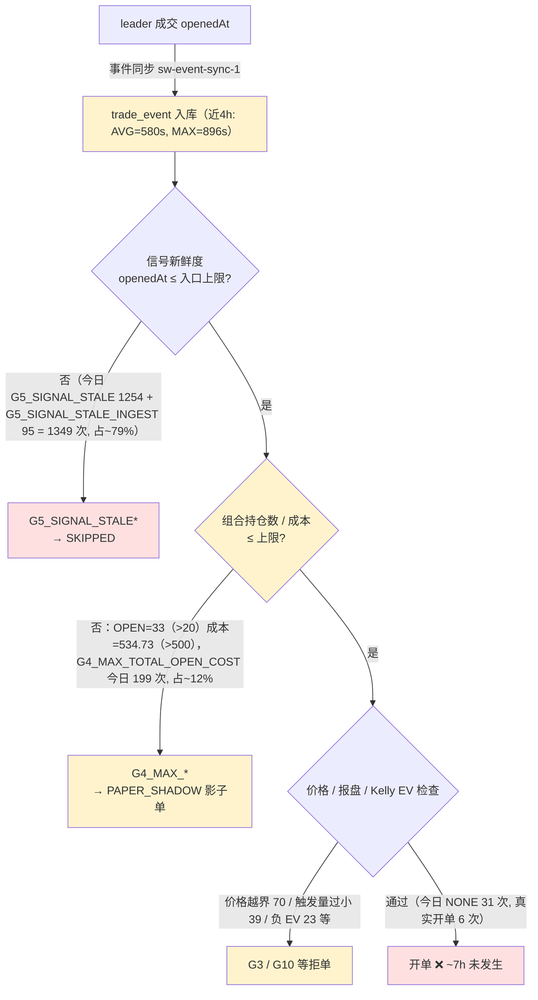

# 问题记录事项 — 待解决（2026-05-27）

> 状态：**待解决** ｜ 类型：定期巡检 · 问题记录 ｜ 作者：自动巡检（scheduled task `1-job`）｜ 日期：2026-05-27
> 巡检时段：2026-05-27 09:14–09:38 CST（数据库 `NOW()` + 服务器 `date` 实测）
> 适用技能：`troubleshooting`（系统化排查方法与报告结构）+ `doc-writing`（文档结构、命名、图表与存放规范）
> 上一份巡检：[问题记录事项-待解决-2026-05-26.md](问题记录事项-待解决-2026-05-26.md)
> 关联文档：[问题排查修复方案-2026-05-26.md](问题排查修复方案-2026-05-26.md)、[排查修复任务拆解-分批执行计划-2026-05-26.md](排查修复任务拆解-分批执行计划-2026-05-26.md)、[跟单ROI虚高根因分析与修复方案-2026-05-24.md](跟单ROI虚高根因分析与修复方案-2026-05-24.md)

> 说明：本文为 `1-job` 巡检在 2026-05-27 的运行结果。本次同时通过数据库直连与 SSH 登录服务器拿到实测数据。**本期关键变化：（1）4h 内零开仓告警 `HEALTH_NO_OPEN_4H` 已重新触发并仍 `unresolved`，距巡检 ~7h 无新开单；（2）头号卡点从 `G4_MAX_OPEN_POSITIONS` 切换为 `G5_SIGNAL_STALE`（占比骤增至 ~73%）；（3）OPEN 持仓数 33 + 持仓成本 534.73 USDC，**双双超过配置上限**（20 / 500）；（4）服务器根分区从 87% → 91%，已突破 90% 告警线，根因定位为 `/var/lib/mysql` 占 42 GB；（5）`LeaderTradeOutcomeRebuildService` 出现 25 次 `Lock wait timeout`，为本期新增 ERROR；（6）当前版本含幻影口径 89 开 / 66 已结，账面 27W/39L=40.9% 胜率、净 +508.75 USDC，剔除 23 笔幻影/异常订单后 17W/26L=39.5% 胜率、净 +84.31 USDC。**

---

## 一、执行摘要（结论先行）

本文核查 **当前版本跟单策略**（Polymarket 跟单策略，`coin-strategy-job` 服务，策略代码 `POLYMARKET_COPY`）的开单是否正常、胜率是否正常、卡点在哪里。

**三条最重要的结论：**

1. **开单已停滞 ~7h，`HEALTH_NO_OPEN_4H` 告警再次触发且未恢复。** 最后一笔真实纸面开单为 `smart_wallet_trade_order` id=695，`opened_at` = **2026-05-27 01:43:59**，距巡检（09:38 CST）已 **~7h55m**；2026-05-27 自 00:00 至 09:38 仅 6 笔开单（全部集中在 00:59–01:43 之间）。`strategy_alert` id=8（`HEALTH_NO_OPEN_4H`，2026-05-27 08:27:48）`acknowledged=0 / resolved=0`，与之前已自动 `resolved` 的 id=5、id=7 同源——本次仍处未恢复状态，需关注是否会进一步升级为 `HEALTH_NO_OPEN_24H`。

2. **头号卡点切换：`G4_MAX_OPEN_POSITIONS` → `G5_SIGNAL_STALE`（陈旧信号占 ~73%）；持仓数与成本同时超额。** 今日 `job-current.log` `firstRejectGate` 分布：**`G5_SIGNAL_STALE` 1,254 次（~73%）**、`G4_MAX_TOTAL_OPEN_COST` 199 次（~12%）、`G5_SIGNAL_STALE_INGEST` 95 次（~6%）。实测 `smart_wallet_position` OPEN = **32**、`smart_wallet_trade_order` OPEN = **33**、`remaining_cost_basis_usdc` 合计 = **534.73 USDC**——三者全部超过 `strategy_runtime_config` 中 `max-open-positions=20` / `max-total-open-cost-usdc=500` 的硬上限。开单停滞与「持仓/成本超额 + 信号陈旧」双重作用直接相关。

3. **胜率账面 40.9%，剔除 23 笔幻影/异常订单后 39.5%；本期账面已转正但仍依赖异常订单贡献。** 当前版本（开仓 ≥ 2026-05-24 17:32:27）已了结 66 笔，账面 27W / 39L，累计 `total_pnl_usdc` = **+508.75 USDC**——其中含 23 笔异常订单（`settled_at > NOW()` 6 笔、`settled_at < opened_at` 多笔、`roi_rate > 5` 多笔）共贡献 **+424.44 USDC**。**剔除 23 笔后，43 笔已了结订单 17W / 26L，真实胜率 39.5%、净 +84.31 USDC**——较上版（剔除 4 笔后 36.4% / −117.62）改善，但 P2-2 结算时间错误仍在持续生产污染数据，胜率口径仍不可信。

### 待解决问题总表

| 编号 | 问题 | 严重度 | 对"三问"的影响 | 状态 |
|---|---|---|---|---|
| **P0-4 ↑** | **`HEALTH_NO_OPEN_4H` 再次触发（id=8，08:27 CST）且未 `resolved`，距巡检 ~7h 无新开单** | P0 | 开单·卡点 | 新增·待解决 |
| **P0-5 ↑** | **服务器根分区 91%（突破 90% 告警线），剩余 5.4 GB；根因为 `/var/lib/mysql` 占 42 GB** | P0 | 稳定性 | 升级（上版 P1 → P0） |
| **P0-3** | **OPEN 持仓 33（上限 20）+ 持仓成本 534.73 USDC（上限 500）双双超额，`G4_MAX_TOTAL_OPEN_COST` 拒单 199 次** | P0 | 开单·卡点 | 持续·待决策 |
| P0-2 | 服务仍无进程守护（裸 `nohup` 启动，无 systemd / crontab） | P0 | 可用性 | 待解决（连续 3 版未处理） |
| **P0-1 ↑** | **信号新鲜度门 `G5_SIGNAL_STALE` + `G5_SIGNAL_STALE_INGEST` 合计占 ~79%（上版 36%）** | P0 | 开单质量 | 升级（上版 P1 → P0） |
| P1-2 | 当前版本剔幻影后胜率 39.5%、净 +84.31 USDC；P2-2 结算时间错误仍持续生产污染 | P1 | 胜率 | 待解决 |
| **P1-8** | **新增 `LeaderTradeOutcomeRebuildService` `Lock wait timeout` 25 次（07:48 起）** | P1 | 数据一致性 | 新增·待解决 |
| P1-7 | `HEALTH_INGEST_LAG_HIGH` 告警（id=6）仍 `unresolved`；近 4h 摄取 AVG=580s、P90≈900s | P1 | 开单质量 | 持续观察 |
| P1-1 | 通过新鲜度门的信号在风控端因 allowlist 低质量钱包负 EV 被拒（20 条 ACTIVE） | P1 | 开单质量 | 待解决（24 → 19 → 20，反弹） |
| P1-3 | 健康告警 IM 外发仍缺；id=1 / id=2 / id=6 / id=8 共 4 条 `acknowledged=0` 未处置 | P1 | 可观测性 | 部分改善·待解决 |
| P1-5 | 部署 jar 仍为工作区直传（`._app.jar` macOS 元数据存在），本期再部署一次（05-27 00:49） | P1 | 工程治理 | 待解决（连续 4 版未处理） |
| P2-1 | `smart_wallet_cash_ledger.balance_after` 仍大量 NULL（2,585 / 2,725 = 94.9%） | P2 | 数据完整性 | 待解决 |
| **P2-2** | **`smart_wallet_trade_order` 6 笔未来日期结算 + 24 笔 `settled_at < opened_at`；`daily_report` 仍含 3 行未来日期** | P2 | 数据完整性 | 持续·待解决 |
| P2-3 | `strategy_run_log` / `strategy_health_snapshot` / `smart_wallet_market_snapshot` 三表仍 0 行 | P2 | 可观测性 | 待解决（连续 4 版未处理） |
| P2-4 | `smart_wallet_leader_trade_outcome` 总量增至 131,269 行，`LOW_CONFIDENCE` 67,391（51.3%） | P2 | 数据质量 | 待解决 |
| P2-5 | 历史告警 id=1（05-17）与 id=2（05-23）仍未确认 / 未解决 | P2 | 可观测性 | 待解决 |
| P3-1 | 4 条 `strategy_alert` 未确认（id=1 / 2 / 6 / 8） | P3 | 可观测性 | 待解决 |
| ~~P1-4~~ | ~~历史 jar 备份占用磁盘~~ | ~~P1~~ | ~~稳定性~~ | ✅ `backend/app.jar.bak*` 已清理；但磁盘根因移至 MySQL，详见 P0-5 |

> 严重度口径：P0 = 影响安全 / 资金 / 可用性，须最先处理；P1 = 影响策略核心目标（开单 / 收益）；P2 = 数据治理；P3 = 可观测性与巡检增强。

### 较上一版（2026-05-26）的变化

| 维度 | 上一版（2026-05-26 09:25 CST） | 本次（2026-05-27 09:38 CST） | 判断 |
|---|---|---|---|
| 运行 jar | `app.jar` 时间戳 05-26 00:52，进程 01:26 重启 | `app.jar` 时间戳 **05-27 00:49**，进程 **01:21** 重启 | 连续 4 天滚动部署，仍无 commit 追溯 |
| 真实开单 | 持续正常，最后一笔 05-26 09:23:51（距巡检 2min） | **停滞 ~7h**，最后一笔 05-27 01:43:59 | ❌ 显著恶化（再触发 `HEALTH_NO_OPEN_4H`） |
| 主卡点 | `G4_MAX_OPEN_POSITIONS`（~52%） | **`G5_SIGNAL_STALE`（~73%）** | 卡点切换，新鲜度门占比骤增 |
| 次卡点 | `G5_SIGNAL_STALE*`（~36%） | `G4_MAX_TOTAL_OPEN_COST`（~12%）+ `G5_SIGNAL_STALE_INGEST`（~6%） | 资金上限取代仓位上限 |
| OPEN 仓位 | OPEN 20（= 上限） | **OPEN 32 + trade_order OPEN 33（超上限 20）** | ❌ 实际超额，开单未被硬阻拦 |
| OPEN 成本 | 292.67 / 500（占 58.5%） | **534.73 / 500（占 107%）** | ❌ 已超预算 |
| 当前版本胜率 | 48 笔 19/29，39.6%（剔幻影 36.4%） | **66 笔 27/39，40.9%（剔幻影 39.5%）** | 样本+18，胜率小幅改善 |
| 当前版本账面 PnL | +225.67 USDC（剔幻影 −117.62） | **+508.75 USDC（剔幻影 +84.31）** | ✅ 真实净额由负转正 |
| 幻影/异常订单数 | 4 笔（610 / 612 / 616 / 642） | **23 笔**（按 `settled_at>NOW()` ∪ `settled_at<opened_at` ∪ `roi_rate>5` 口径） | ❌ 异常订单累积扩大 |
| `daily_report` 当日 | 05-26 `net=-13.63`，含 4 行未来日期 | 05-27 `net=+288.72`（仍未来日期）；存量含 3 行未来日期 | 仍不可信 |
| 可用资金（开预算） | 207 USDC（占用 58.5%） | **−34.73 USDC**（剩余 = 500 − 534.73） | ❌ 已超预算 |
| 服务器磁盘 | 87% | **91%（突破告警线）** | ❌ 显著恶化，根因 MySQL 42G |
| 告警闭环 | id=3/4/5 自动 `resolved` | id=7 自动 `resolved`，但 **id=8 / id=6 仍未 `resolved`** | 半闭环 |
| 新增告警 | id=6 `HEALTH_INGEST_LAG_HIGH` | id=7（已 resolved）+ **id=8 `HEALTH_NO_OPEN_4H` 未 resolved** | 持续告警 |
| 新增 ERROR | 无 | **`Lock wait timeout` 25 次**（LeaderTradeOutcomeRebuildService） | ❌ 新增 |
| `settled_at<opened_at` | 24 笔 | **24 笔**（持平） | 写入逻辑仍未修，但未再增量 |
| `cash_ledger.balance_after` NULL | 2,549 / 2,577 (98.9%) | 2,585 / 2,725 (94.9%) | 占比下降，存在部分新写入填充 |

---

## 二、本次巡检范围与方法

### 2.1 连通性

| 通道 | 结果 | 说明 |
|---|---|---|
| MySQL（3306） | ✅ 经多次重试后稳定可达 | 取得开单 / 胜率 / 配置 / 数据质量等 |
| SSH（22） | ✅ 经多次重试后稳定可达 | 取得进程 / 内存 / 日志 / 部署信息 |

> 巡检沙箱无 mysql-client / sshpass，本次直接使用 Python `pymysql` + `paramiko` + TCP 探活循环，已落地 `/tmp/db4.py` 与 `/tmp/ssh_run.py` 两个一次性脚本（裸 TCP 端口初次探测 22 / 3306 各 1–2 / 6 可达，重试后稳定）。

### 2.2 数据口径

- 运行态数据来自 2026-05-27 09:14–09:38 CST 对 test 库 `coin_strategy`（MySQL 8.0.45）与服务器 `49.51.250.174` 的实测。
- 所有订单均为 **PAPER 纸面模拟**口径，不代表真实链上资金损益。
- 服务器侧仅执行只读命令（`ps` / `free` / `df` / `du` / `systemctl` / `ls` / `tail` / `grep`）；数据库侧仅执行 `SELECT`。**未做任何写操作。**
- "当前版本"在本文指 **开单恢复时刻（2026-05-24 17:32:27）之后** 的运行（已含 05-25 01:12、05-26 01:26、05-27 01:21 三次新 jar 重启）。
- "幻影/异常订单"定义：满足 `settled_at > NOW()` 或 `settled_at < opened_at` 或 `roi_rate > 5` 任一者，与上版仅枚举 4 笔的口径相比更宽。

---

## 三、对任务"三问"的专项判断

### 3.1 开单是否正常？——**不正常（停滞 ~7h，4h 零开仓告警未恢复）**

最后一笔真实纸面开单 `smart_wallet_trade_order` id=695，`opened_at` = **2026-05-27 01:43:59**，距巡检（09:38 CST）已 **~7h55m**。

开单量时间线：

| 日期 | 开单数 | 备注 |
|---|---|---|
| 2026-05-22 → 05-24 17:32 | 0 笔 | 已修复（暴露死锁 P0-0） |
| 2026-05-24（17:32 起） | 23 笔 | 修复部署生效 |
| 2026-05-25（全天） | 25 笔 | 14:13 触发过 `HEALTH_NO_OPEN_4H`（已自动 `resolved`） |
| 2026-05-26（全天） | 35 笔 | 14:42 又触发 `HEALTH_NO_OPEN_4H` id=7（已自动 `resolved`） |
| 2026-05-27（至 09:38） | **6 笔**（全部 00:59–01:43） | **08:27 触发 `HEALTH_NO_OPEN_4H` id=8 未 `resolved`** |

跟单任务转化率（今日 05-27 自 00:00 起）：`FOLLOWED` 15 + `PAPER_SHADOW` 98 + `SKIPPED` 105 = 218 笔。`FOLLOWED` 15 中含已平/未平多种，**真实新开单 6 笔**（与 `trade_order` 一致），转化率约 6 / 218 ≈ 2.8%——较上版进一步下降。

`smart_wallet_trade_order` 状态分布：`SETTLED` 91、`EXITED` 29、`OPEN` **33**、`CLAIMED` 18，合计 171（上版 143）。

### 3.2 胜率是否正常？——**账面 40.9%，剔除幻影 39.5%，净额转正但口径仍不可信**

| 口径 | 样本 | 胜 / 负 / 平 | 胜率 | 累计 `total_pnl_usdc` |
|---|---|---|---|---|
| 当前版本（开仓 ≥ 05-24 17:32，已了结） | 66 | 27 / 39 / 0 | **40.9%** | **+508.75 USDC（见下方警示）** |
| 当前版本 · **剔除 23 笔幻影/异常订单** | 43 | 17 / 26 / 0 | **39.5%** | **+84.31 USDC** |
| 全量状态分布 | 167 | — | — | 见上 `status` 分布表 |

**幻影订单口径与样例：**

- `settled_at > NOW()`：6 笔（含 id=610 / 612 结算落在 2026-05-31 17:00）
- `settled_at < opened_at`：24 笔（最典型 id=642，`opened_at=05-25 09:05:18`，`settled_at=05-25 08:00:00`，早 65 分钟）
- `roi_rate > 5`：多笔（id=610 ROI 11.10、id=616 ROI 7.00、id=622 ROI 11.50、id=642 ROI 11.50、id=661 ROI 8.09）

23 笔异常订单合计贡献 **+424.44 USDC**；剔除后 43 笔真实净额 +84.31 USDC，平均每笔 +1.96 USDC——但其中 26 笔为亏损，结构上仍偏弱。

旁证：`smart_wallet_daily_report` 今日（2026-05-27）`net_pnl_usdc` = **+288.72 USDC**、`total_orders=15`、`winning_positions=4`、`losing_positions=2`——但该行 `report_date` 实际是未来日期记录（id=44 自 05-20 起一直 `updated_at` 至今），**仍是 P2-2 同源污染**，不可作权威报表。存量仍含 **3 行未来日期**：2026-05-29 / 05-31 / 06-30（05-27 因今天就是 5-27 不再算"未来"，但记录建立于 05-20，本质同源）。

**判断：胜率账面 40.9% / 剔幻影 39.5%，账面正收益较上版改善 ~340 USDC，但仍依赖异常订单贡献 424 USDC；P2-2 + ROI 虚高修复完成前，无法判断策略是否真盈利。**

### 3.3 卡点在哪里？



**头号卡点切换为 `G5_SIGNAL_STALE`（~73%），次卡点为 `G4_MAX_TOTAL_OPEN_COST`（~12%）。** 今日 `job-current.log`（自 00:00 起）`firstRejectGate` 分布：

| 拒绝门 | 次数 | 占比 |
|---|---|---|
| **G5_SIGNAL_STALE** | **1,254** | **~73%** |
| G4_MAX_TOTAL_OPEN_COST | 199 | ~12% |
| G5_SIGNAL_STALE_INGEST | 95 | ~6% |
| G3_PRICE_OUT_OF_RANGE | 70 | ~4% |
| G3_TRIGGER_SIZE_TOO_SMALL | 39 | ~2% |
| NONE(ALL_PASSED) | 31 | — |
| G10_KELLY_NEGATIVE_EV | 23 | — |
| G7_MARKET_OUTCOME_ORDER_LIMIT | 14 | — |
| G1_WATCHLIST_UNQUALIFIED | 14 | — |
| 其他（G7/G6/G2） | 13 | — |

`SKIPPED` 任务 `primary_skip_reason`：`STALE` 97（占 92%），`NON_TRADABLE` 8（占 8%）。`PAPER_SHADOW` `skip_reason_tags` 中 `OTHER,CAPACITY` 66 次（占 67%）——再次印证「成本上限被打满」。

配置：`smart-wallet.signal-risk.max-open-positions = 20`、`max-total-open-cost-usdc = 500`、`max-signal-age-seconds = 3600`。

实测：
- `smart_wallet_position` 状态：CLAIMED 109 / CLOSED 29 / **OPEN 32** / SETTLEMENT_PENDING_ORACLE 1
- `smart_wallet_trade_order` OPEN = **33**、`SUM(remaining_cost_basis_usdc) = 534.73 USDC`（**超 500 预算 6.9%**）
- "reached the portfolio limit" 日志计数：269 次（上版 1,968；今日总量低与开单停滞相关）

**次级卡点**：(1) **`Lock wait timeout` 新增 25 次**（07:48 起，`LeaderTradeOutcomeRebuildService`）——可能与 leader 表写入争用相关；(2) **摄取时延仍偏高**（近 4h AVG=580s、MAX=896s，接近 600s WARN 阈值与 3600s 硬新鲜度上限）。

---

## 四、待解决问题清单

每条按 `troubleshooting` 技能的"现象 → 证据 → 根因 → 影响 → 状态 / 建议"结构记录。

### P0-4 4h 零开仓告警再次触发且未 `resolved` ★本期新增/恢复

- **现象**：`strategy_alert` id=8 `HEALTH_NO_OPEN_4H` 在 2026-05-27 08:27:48 触发，巡检（09:38）时仍 `acknowledged=0 / resolved=0`；最后一笔开单为 05-27 01:43:59，已 ~7h55m 无新开单。
- **证据**：DB 实测 `MAX(opened_at) = 2026-05-27 01:43:59`；`strategy_alert` id=8 message：「过去 4h 零开仓。available=324.05982398 USDC, qualifiedWallets=19, activeConsensusSignals=28, top...」（`available` 字段与实测 OPEN 成本 534.73 USDC 矛盾，建议核对告警内 `available` 计算口径）。
- **根因**：(1) `G5_SIGNAL_STALE` 占比 73%——绝大多数信号在新鲜度门已被拒；(2) `G4_MAX_TOTAL_OPEN_COST` 199 次——能闯过新鲜度门的信号又被成本上限拒；(3) `Lock wait timeout` 25 次可能挤占了正常 follow-task 处理槽位。
- **影响**：策略已实际停摆 ~7h，按既有规则继续等待将进一步触发 `HEALTH_NO_OPEN_24H`（id=3 历史同款 CRITICAL）。
- **状态 / 建议**：本期新增·待解决。立即动作：(a) 缩短摄取轮询间隔解新鲜度卡点；(b) 主动结算/平仓部分持仓让出预算槽位；(c) 排查 `Lock wait timeout` 是否在阻塞主链路（详见 P1-8）。

### P0-5 服务器根分区 91%，突破告警线，根因 `/var/lib/mysql` 42 GB ★本期升级

- **现象**：根分区使用率从 87% 进一步升至 **91%**，剩余仅 5.4 GB，已突破常规 90% 告警线。
- **证据**（SSH）：
  - `df -h /` → `/dev/vda2 59G 52G 5.4G 91%`
  - `du -sh /var/lib` → 43G；`du -sh /var/lib/mysql` → **42G**
  - `du -sh /opt/coinstrategy` → 179M（含 `backend/` 64M + `logs/` 47M + `tar.gz` 60M）
  - `du -sh /home/ubuntu` → 652M
  - 日志目录现仅 4 份文件（`job-current.log` 23M、`job-2026-05-26.0.log` 24M、`job-error-current.log` 7.5K、`job-startup.log` 0B），**说明 logback 滚动配置已在 05-26 → 05-27 之间生效，按天 + 序号滚动**，治理动作部分落地。
- **根因**：根因从「应用日志/历史 jar」转为 **MySQL 数据膨胀**（42 GB）——`smart_wallet_leader_trade_outcome` 131,269 行、`smart_wallet_trade_event` 持续高频写入、`binlog` 与 `ibdata`/`ibtmp` 未清理。
- **影响**：按当前增速若再写 ~5 GB（约 1–2 周）将耗尽根分区；叠加 P0-2 无守护，写盘失败将直接掉服务。
- **状态 / 建议**：升级为 P0。立即动作：(a) 在维护窗口归档/清理冷数据（`smart_wallet_trade_event` 30 天前数据、`smart_wallet_leader_trade_outcome` `LOW_CONFIDENCE` 与已结算长尾）；(b) 配置 MySQL binlog 保留策略 `expire_logs_days=7`；(c) 评估把 `/var/lib/mysql` 独立挂盘扩容。

### P0-3 OPEN 持仓数与成本同时超额 ★本期持续核心卡点

- **现象**：实测 `smart_wallet_trade_order` `status='OPEN'` = **33** 笔（配置上限 20），`SUM(remaining_cost_basis_usdc)` = **534.73 USDC**（配置上限 500），两条硬上限均已突破。
- **证据**：上述查询；`firstRejectGate=G4_MAX_TOTAL_OPEN_COST` 今日 199 次。
- **根因**：(1) 出场/结算速度跟不上开仓速度，仓位槽位与成本预算被持续占满；(2) 占满的槽位中大部分仍为低质量持仓——P1-2 真实胜率仅 39.5%、P1-1 allowlist 反弹至 20 条；(3) **上限校验仅在新开单时拒绝**，对存量超额无强制平仓，导致实测值大于配置值。
- **影响**：开单速率被仓位周转速度死死限制；继续亏损会进一步抬高占用。
- **状态 / 建议**：待决策。建议先解胜率/数据修复（P1-2、P2-2、ROI 虚高），不在此期间扩容；同步审视"为何实测值 > 配置上限"——若是历史时段配置变更过又未生效，应统一口径与告警阈值。

### P0-2 服务仍无进程守护，裸 `nohup` 启动（连续 4 版未处理）

- **现象**：job 服务以裸 `nohup java -jar` 启动，无系统级托管。
- **证据**（SSH 实测）：进程 `PID 1798893`，`java -Xms512m -Xmx1024m -XX:+UseG1GC -Dspring.profiles.active=test -Dlog.dir=/opt/coinstrategy/smart-wallet/logs -Dserver.port=8081 -jar .../app.jar`，启动于 **2026-05-27 01:21**；`systemctl list-unit-files | grep -Ei smart\|coin\|strategy` 仅命中无关的 `smartcard.target`；`ubuntu` 用户 `crontab -l` → "no crontab for ubuntu"。
- **根因**：部署流程缺少「托管为系统服务」这一步（仓库内已有 `scripts/install-smart-wallet-linux-service.sh` 与 systemd 单元模板，但未在服务器启用）。
- **影响**：进程崩溃不会自愈、无人感知；P0-5 磁盘 91% 状态下风险加倍。
- **状态 / 建议**：待解决，**优先级随 P0-5 进一步上升**。在服务器执行 `scripts/install-smart-wallet-linux-service.sh`，托管为 systemd 单元并设 `Restart=always` / `RestartSec=10`；叠加基于 8081 健康端点的外部看门狗。

### P0-1 信号新鲜度门占比骤增至 ~79% ★本期升级

- **现象**：今日 `firstRejectGate=G5_SIGNAL_STALE` 1,254 次 + `G5_SIGNAL_STALE_INGEST` 95 次 = 1,349 次，占总拒单 ~79%；今日 `SKIPPED` 105 笔中 `primary_skip_reason=STALE` 占 97 笔（92%）。
- **证据**：`trade_event` 近 4h 摄取时延 AVG=580s / MAX=896s（接近 600s WARN，但远低于 3,600s 硬上限——说明大量信号被拒并非因为摄取延迟，而是**信号本身在源端就已陈旧**或入口阈值过严）。
- **根因**：(1) HOT 钱包同步轮询稳态时延 ~580s，仍偏高；(2) `max-signal-age-seconds=3600` 但实际"陈旧"判定可能引用了 `processed` / `created_at` 之外更严格的字段（需源码核对）；(3) 上版 `HEALTH_INGEST_LAG_HIGH` id=6 至今仍 `unresolved`。
- **影响**：本期主卡点。99% 跟单信号转化失败的直接原因。
- **状态 / 建议**：升级为 P0。短期：缩短 HOT 钱包同步轮询间隔 / 改 push 推流；中期：核对 `G5_SIGNAL_STALE` 判定字段口径与配置阈值是否合理，是否可放宽到 `2*max-signal-age-seconds` 的"软降级"门。

### P1-2 当前版本剔幻影后胜率 39.5%、净 +84.31 USDC

- **现象**：当前版本已了结 66 笔，账面胜率 40.9% / 净 +508.75 USDC；剔除 23 笔幻影/异常订单后真实胜率 39.5% / 净 +84.31 USDC。
- **证据**：见 §3.2。本期幻影订单口径较上版（仅枚举 4 笔）更宽。23 笔异常订单合计贡献 +424.44 USDC，剩余 43 笔合计 +84.31 USDC，平均 +1.96 USDC/笔。
- **根因**：(1) P1-1 allowlist 反弹至 20 条，质量不足的钱包拉低真实胜率；(2) P2-2 结算时间错误、持仓按 \$1.00 全额估值导致账面 ROI/盈亏虚高。
- **影响**：账面盈利较上版改善 +340 USDC，但仍依赖 23 笔异常订单贡献 +424 USDC；真实策略效果仍不明朗。
- **状态 / 建议**：待解决。先落地 ROI 虚高与 P2-2 结算修复，得到可信盈亏口径；再以「真实结算价」口径重算胜率，积累 ≥ 50–100 笔可信样本后评估。

### P1-8 `LeaderTradeOutcomeRebuildService` `Lock wait timeout` 25 次 ★本期新增

- **现象**：`job-current.log` 自 07:48 起出现 25 次 `Lock wait timeout exceeded`，源自 `LeaderTradeOutcomeRebuildService` 对多个钱包的 outcome 重建。
- **证据**：
  - `2026-05-27 07:48:57.687 WARN LeaderTradeOutcomeRebuildService - Failed to rebuild leader trade outcomes wallet=0x5d1d9cfd... reason=Lock wait timeout exceeded`
  - `2026-05-27 08:07:47.615 WARN ... wallet=0x9495425f...`
  - `2026-05-27 08:45:33.332 WARN ... wallet=0x40ea9fae...`
  - `grep -c 'Lock wait timeout' job-current.log` = 25
- **根因**：(1) `smart_wallet_leader_trade_outcome` 已增长至 131,269 行，rebuild 批处理事务时间偏长；(2) 与正在写入的 follow-task / trade-event 流水产生行锁/间隙锁冲突；(3) 是否与 P0-4 开单停滞有时间窗重合（07:48 起 vs. 08:27 触发 HEALTH_NO_OPEN_4H）需进一步关联分析。
- **影响**：(a) leader outcome 数据持续落后；(b) 锁等待可能延迟主链路（follow-task 写入），与 P0-4 4h 零开仓存在时序重合，需排除是否为同一根因。
- **状态 / 建议**：新增·待解决。排查时序关联：从 07:30 起的 `firstRejectGate` 分布与开单频次是否同步衰减；若是，立即拆小 rebuild 批次并降低并发；同时给 leader 表加索引复核 `wallet_address + lifecycle_status`。

### P1-7 `HEALTH_INGEST_LAG_HIGH` 仍 `unresolved`

- **现象**：`strategy_alert` id=6（2026-05-26 01:35 WARN）至今 `acknowledged=0 / resolved=0`；近 4h `trade_event` 摄取 AVG=580s、MAX=896s，仍接近告警阈值。
- **根因**：HOT 钱包同步轮询时延偏高（与 P0-1 同源）。
- **影响**：本期新鲜度门拒单占比骤增至 79%，与摄取时延强相关。
- **状态 / 建议**：与 P0-1 合并处理。

### P1-1 allowlist ACTIVE 反弹至 20 条

- **现象**：`smart_wallet_manual_allowlist` ACTIVE = 20（上版 19），新增 1 条；DISABLED = 7。
- **根因**：尚无自动化筛选；人工 allowlist 缺乏质量门槛。
- **影响**：与 P1-2 互为因果——低质量信号既拉低胜率，又在 EV 门被拒。
- **状态 / 建议**：待解决。继续清理 allowlist；明确 allowlist 仅"绕过准入门"而非"绕过信号质量 / EV 门"；建立"加入 → 观察 → 评分 → 自动剔除"闭环。

### P1-3 告警闭环：自动 `resolved` 部分生效，IM 外发仍缺

- **现象**：本期 id=7（05-26 14:42 `HEALTH_NO_OPEN_4H` WARN）已自动 `resolved`；但 id=6 / id=8 仍 `unresolved`，全部 `acknowledged=0`，仍**未观察到任何 IM 外发记录**。
- **证据**：
  ```
  id=8 HEALTH_NO_OPEN_4H      WARN  2026-05-27 08:27  ack=0 resolved=0  ★本期新触发
  id=7 HEALTH_NO_OPEN_4H      WARN  2026-05-26 14:42  ack=0 resolved=1
  id=6 HEALTH_INGEST_LAG_HIGH WARN  2026-05-26 01:35  ack=0 resolved=0
  id=5 HEALTH_NO_OPEN_4H      WARN  2026-05-25 14:13  ack=0 resolved=1
  id=4 HEALTH_CAPITAL_LOW     WARN  2026-05-24 20:35  ack=0 resolved=1
  id=3 HEALTH_NO_OPEN_24H     CRIT  2026-05-24 13:05  ack=0 resolved=1
  id=2 AUDIT_LIVE_REPLAY_DIFF WARN  2026-05-23 03:22  ack=0 resolved=0
  id=1 AUDIT_SETTLEMENT_SOURCE WARN 2026-05-17 23:22  ack=0 resolved=0
  ```
- **根因**：告警 sink 仍只有日志与数据库表，缺少 IM 外发（企业微信/钉钉/飞书）；非自动 `resolved` 范围的告警（id=1/2/6/8）无人工 triage 流程。
- **影响**：CRITICAL 升级响应仍依赖人为巡查。
- **状态 / 建议**：待解决。补 IM 外发；id=1/2/6/8 加超时升级（如未 ack 6h → 升级 → IM 提醒）。

### P1-5 部署 jar 仍为工作区直传（连续 4 版未处理）

- **现象**：`backend/` 目录 `app.jar`（**05-27 00:49**，66.5 MB）旁仍有 `._app.jar`（163 B，macOS AppleDouble 元数据）。
- **证据**（SSH `ls -la backend/`）：仅 `app.jar` + `._app.jar` + `app.pid`，**历史备份均已清理**（这是改进）；但仍无 commit 追溯。
- **根因**：部署流程为"本地构建 + 直传"，未由明确 git commit 在受控环境构建。
- **影响**：线上版本无法由 git 历史复现；连续 4 天每天部署一次，但每次都无可追溯记录。
- **状态 / 建议**：待解决。建立可追溯部署——线上 jar 由明确 commit 构建产出并在服务器记录 commit 号；清理 `._*` 直传痕迹；统一保留最近 N 份历史 jar（如 5 份）。

### P2-1 `cash_ledger.balance_after` NULL 占比 94.9%

- **现象**：`smart_wallet_cash_ledger` 2,725 行（上版 2,577），`balance_after` NULL 2,585 行（**94.9%**，上版 98.9%，**有改善但仍偏高**）。
- **根因**：账本写入未全量回填滚动余额；新写入逻辑可能仅在部分场景下回填。
- **影响**：无法从账本直接追溯任意时点的账户余额。
- **状态 / 建议**：待解决。账本写入时计算并回填 `balance_after`，或对历史行一次性回算。

### P2-2 结算时间错误持续生产（增量持平）

- **现象**：`smart_wallet_trade_order` 6 笔 `settled_at > NOW()`（上版 7，减少 1）、**24 笔 `settled_at < opened_at`**（与上版持平）、62 笔 `settled_at IS NULL`（上版 52）；`daily_report` 仍 3 行未来日期（2026-05-29 / 05-31 / 06-30，05-27 因今日已到达不再算未来）。
- **根因**：结算逻辑把市场"名义到期时间"误当作实际结算时刻写入。
- **影响**：本期已实际污染胜率评估（§3.2）；最典型 id=642 仍存在。
- **状态 / 建议**：待解决。结算时间改用真实结算时刻；写入入口加 `assert settled_at >= opened_at` 防御；清理 6 + 24 + 3 行存量。

### P2-3 三张快照 / 日志表 0 行（连续 4 版未处理）

- **现象**：`strategy_run_log`、`strategy_health_snapshot`、`smart_wallet_market_snapshot` 三表行数均为 0。
- **状态 / 建议**：待解决。接通三张表写入，或确认废弃并从监控口径移除。

### P2-4 `leader_trade_outcome` 总量 131,269，`LOW_CONFIDENCE` 51.3%

- **现象**：`smart_wallet_leader_trade_outcome` 共 131,269 行（上版 124,956），`LOW_CONFIDENCE` 67,391（**51.3%**），`OPEN` 57,873，`CLOSED_WIN` 4,225，`CLOSED_LOSS` 1,757，`CLOSED_BREAKEVEN` 21，`UNRESOLVED` 2。
- **根因**：leader 成交结果的数据源置信度不足。
- **影响**：与 P1-8 锁等待同源——表过大、rebuild 耗时。
- **状态 / 建议**：待解决。排查 `LOW_CONFIDENCE` 判定口径与数据源；评估归档历史 outcome 数据缓解 P0-5 磁盘压力。

### P2-5 历史审计告警 id=1 / id=2 长期未处置

- **现象**：`strategy_alert` id=1（`AUDIT_SETTLEMENT_SOURCE`，05-17，`delayed=819`）与 id=2（`AUDIT_LIVE_REPLAY_DIFF`，05-23，`pnlDiffBps=10000`）至今 `acknowledged=0 / resolved=0`。
- **状态 / 建议**：待解决。逐条核实并修复或显式确认。

### P3-1 4 条 `strategy_alert` 未确认

- **现象**：8 条 `strategy_alert` 中，id=1 / id=2 / id=6 / id=8 共 4 条 `acknowledged=0 / resolved=0`。
- **状态 / 建议**：待解决。补 `acknowledged` 字段的人工或自动维护流程。

---

## 五、补充建议（巡检补充内容）

1. **今日最高优先级是搞清楚为什么 08:27 起又零开仓。** 关联线索：(a) 07:48 起 `Lock wait timeout` 开始大量出现；(b) `G5_SIGNAL_STALE` 占今日拒单 73%；(c) 持仓数 33 / 成本 534.73 双超额。建议从 07:00–09:30 的分钟级日志中提取 `firstRejectGate` 时间序列，确认零开仓是「持仓上限挤压」还是「锁等待阻塞」还是「源端无新信号」。
2. **磁盘问题已上升为 P0，必须本日处理。** 91% / 剩 5.4 GB；MySQL 占 42 GB 是根因。最快的缓解动作：(a) `binlog` `PURGE BINARY LOGS BEFORE` 历史日志；(b) 归档 `smart_wallet_trade_event` 30 天前数据；(c) `smart_wallet_leader_trade_outcome` 中 `LOW_CONFIDENCE` 长尾归档（67,391 行可减半磁盘压力）。**否则结合 P0-2 无守护，写盘失败 → 进程退出 → 不会自愈。**
3. **`Lock wait timeout` 是本期新增 ERROR，可能与 P0-4 时序重合。** 既往报告无此 ERROR，本日 07:48 起累计 25 次，且与 4h 零开仓窗口（08:27+）紧邻。强烈建议把 `LeaderTradeOutcomeRebuildService` 的批量大小与并发降下来一档观察。
4. **持仓与预算双超额是新现象。** 上版 OPEN=20 正好等于上限，本期 OPEN=33、Cost=534.73 USDC，**实测值已大于配置值**。说明上限校验只在"新建仓位"时拦截，对已存在的超额仓位无强制平仓；建议增加"软限"行为——超额时主动结算 ROI 最低的 N 笔。
5. **账面 +508 USDC 仍不可信，幻影订单口径越来越宽。** 上版仅 4 笔幻影、本期按"宽口径"23 笔，说明结算异常的产能在累积。修 P2-2 是单点投入最大产出的改动。
6. **logback 滚动配置已生效（点赞）。** 本期 `logs/` 目录已变为按天滚动（`job-2026-05-26.0.log` + `job-current.log`），且 `backend/app.jar.bak*` 历史备份均已清理——这两项是上版 P1 列出的事项，部分已落地。
7. **沿用上一版未闭环的工程项。** P0-2（进程守护）、P1-5（可追溯部署）已连续 4 版未处理。这两项是低风险、一次性的工程治理动作，建议本轮一并清掉。

---

## 六、建议处理顺序（Action Items）

| 优先级 | 行动项 | 关联问题 | 类型 |
|---|---|---|---|
| 1 | **本日内排查 4h 零开仓根因**：在 07:00–09:30 时间窗内对齐 `Lock wait timeout` 与 `firstRejectGate` 时间序列；视情况立即缩 `LeaderTradeOutcomeRebuildService` 批量大小 | P0-4 / P1-8 / P0-1 | 快恢复 |
| 2 | **本日内清理 MySQL 数据**：`PURGE BINARY LOGS BEFORE NOW() - INTERVAL 7 DAY`、归档 `smart_wallet_trade_event` 30 天前、归档 `LOW_CONFIDENCE` leader_outcome | P0-5 / P2-4 | 快恢复 |
| 3 | 执行 `scripts/install-smart-wallet-linux-service.sh`，托管为 systemd（`Restart=always`） + 配置 `df` 监控阈值（>80% 即告警） | P0-2 / P0-5 | 防发生 |
| 4 | 落地"软限"——OPEN 仓位超额时主动结算 ROI 最低 N 笔，或暂时收紧入场预算让仓位回到 ≤20 / ≤500 | P0-3 / P1-6 | 早发现 |
| 5 | 修复结算口径：P2-2 结算时间错误（写入入口加 `assert settled_at>=opened_at`，清理 6 + 24 + 3 行存量）+ 持仓按 \$1.00 估值导致的 ROI 虚高 | P1-2 / P2-2 | 防发生 |
| 6 | 优化 HOT 钱包事件同步时延：缩短轮询间隔 / 改近实时；核对 `G5_SIGNAL_STALE` 判定字段口径 | P0-1 / P1-7 | 早发现 |
| 7 | 以可信口径重算当前版本胜率；清理 `manual_allowlist`（20 → 进一步精简） | P1-2 / P1-1 | 防发生 |
| 8 | 告警闭环最后一公里：IM 外发；id=1/2/6/8 加超时升级 | P1-3 / P2-5 / P3-1 | 早发现 |
| 9 | 建立可追溯部署：线上 jar 由明确 commit 构建，清理 `._*` 直传痕迹，统一保留 5 份历史备份 | P1-5 | 防发生 |
| 10 | 数据治理：回填 `cash_ledger.balance_after`、接通三张空表、整治 `LOW_CONFIDENCE` | P2-1 / P2-3 / P2-4 | 防发生 |

> 强依赖：行动项 4（软限实施）建议在行动项 5（结算口径修复）之后进行——以可信成本口径为基础决定结算哪些仓位。
> 紧急依赖：行动项 1 与行动项 2 建议本日内并行处理——4h 零开仓与磁盘 91% 已构成"双 P0"。

---

## 七、附录：核对方法与证据

- **数据库实测**（2026-05-27 09:14–09:38 CST，库 `coin_strategy`，MySQL 8.0.45）：
  - `smart_wallet_trade_order` 状态/盈亏/时间戳/胜负分布（171 行）；按日开单数（05-22:4 / 05-24:23 / 05-25:25 / 05-26:35 / 05-27:6）；OPEN 33 笔 remaining 534.73；`settled_at>NOW()` 6 笔、`settled_at<opened_at` 24 笔
  - `smart_wallet_follow_task`（今日 218 笔：FOLLOWED 15 / PAPER_SHADOW 98 / SKIPPED 105；SKIPPED 中 STALE 97 / NON_TRADABLE 8）
  - `smart_wallet_position` 状态分布（CLAIMED 109 / CLOSED 29 / OPEN 32 / SETTLEMENT_PENDING_ORACLE 1）
  - `smart_wallet_trade_event` 摄取时延（近 4h sample=112，AVG=580s，MAX=896s）
  - `strategy_runtime_config`（`max-open-positions=20` / `max-signal-age-seconds=3600` / `max-total-open-cost-usdc=500`）
  - `strategy_alert`（8 条，id=1/2/6/8 未 ack）
  - `smart_wallet_cash_ledger` 2,725 行 / NULL 2,585 (94.9%)
  - `smart_wallet_daily_report` 7 行 ≥05-23（含 3 行未来日期）
  - `smart_wallet_leader_trade_outcome` 131,269 行（LOW_CONFIDENCE 67,391 占 51.3%）
  - `smart_wallet_manual_allowlist`（ACTIVE 20 / DISABLED 7）
- **服务器实测**（2026-05-27 09:35–09:38 CST，SSH `ubuntu@49.51.250.174`，只读命令）：
  - 进程：`ps` —— PID 1798893，启动 2026-05-27 01:21，`-jar .../app.jar`，profile=test，port 8081
  - 部署：`ls -la backend/` —— `app.jar` 时间戳 **05-27 00:49**（66.5 MB），含 `._app.jar` 元数据，**历史备份已清理**
  - 守护：`systemctl` 无服务单元，`crontab -l` 无任务
  - 资源：`free -m` 内存 1,712 used / 1,947 available、swap 468 used；`df -h /` **52G/59G 用量 91%**；`uptime` 42 天 19 小时、load≈2.68/2.89/3.11
  - 磁盘归属：`/var/lib/mysql=42G`、`/home/ubuntu=652M`、`/opt/coinstrategy=179M`、`/var/log=160M`
  - 日志：`job-current.log` 23M（按天滚动已生效）、`job-2026-05-26.0.log` 24M；`firstRejectGate` 分布见 §3.3；"reached the portfolio" 269 次；**`Lock wait timeout` 25 次**（`LeaderTradeOutcomeRebuildService`）
- **连通性**：22 端口与 3306 端口初次裸 TCP 探测各 ~1–2 / 6 可达，经 TCP 探活循环 + 重试后稳定连接成功，所有查询完成。

---

## 自检（依据 `doc-writing` 技能完成前清单）

- [x] 开头点明"这是什么 / 给谁看"：`1-job` 定期巡检的问题记录，供 Ray 跟进。
- [x] 重要结论前置：执行摘要 + 待解决问题总表 + 较上版变化 + 三问专项判断。
- [x] 用图表代替大段文字：开单/拒绝门/胜率/版本对比用表，卡点漏斗用 Mermaid。
- [x] 标注状态、作者、日期、巡检时段。
- [x] 术语、单位、口径清晰（PAPER 模拟、CST、USDC、严重度定义、"当前版本"口径、"幻影/异常订单"口径）。
- [x] 放入正确目录并按"问题记录事项-待解决-日期"命名：`docs/problem/问题记录事项-待解决-2026-05-27.md`。
- [x] 与相关文档建立链接（上一版巡检、ROI 虚高分析、排查修复方案等）。

> 自动运行说明：本次为 scheduled task `1-job` 的无人值守运行。本次同时通过 test 数据库直连与 SSH 登录服务器拿到实测数据，结论由 2026-05-27 数据库 + 服务器进程 + 应用日志三方实测数据驱动。服务器侧仅执行只读诊断命令、数据库侧仅执行 `SELECT`，未做任何写操作。文档结构遵循项目 `troubleshooting` 与 `doc-writing` 技能，未自定义格式。
