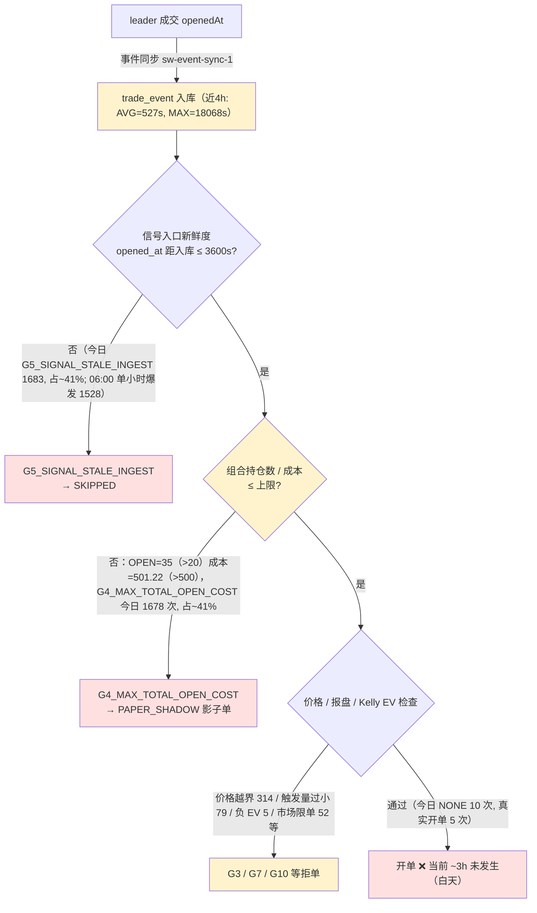

# 问题记录事项 — 待解决（2026-05-28）

> 状态：**待解决** ｜ 类型：定期巡检 · 问题记录 ｜ 作者：自动巡检（scheduled task `1-job`）｜ 日期：2026-05-28
> 巡检时段：2026-05-28 09:10–09:14 CST（数据库 `NOW()` + 服务器 `date` 实测）
> 适用技能：`troubleshooting`（系统化排查方法与报告结构）+ `doc-writing`（文档结构、命名、图表与存放规范）
> 上一份巡检：[问题记录事项-待解决-2026-05-27.md](问题记录事项-待解决-2026-05-27.md)
> 关联文档：[问题排查修复方案-2026-05-27.md](问题排查修复方案-2026-05-27.md)、[排查修复任务拆解-分批执行计划-2026-05-27.md](排查修复任务拆解-分批执行计划-2026-05-27.md)、[跟单ROI虚高根因分析与修复方案-2026-05-24.md](跟单ROI虚高根因分析与修复方案-2026-05-24.md)

> 说明：本文为 `1-job` 巡检在 2026-05-28 的运行结果。本次通过数据库直连与 SSH 登录服务器拿到实测数据。**本期关键变化：（1）05-27 01:43:59 ~ 05-28 06:14:08 长达 ~28.5h 零开仓，触发 `HEALTH_NO_OPEN_24H` CRITICAL 告警 id=9（已于 06:51 自动 `resolved`）；（2）今日 06:14–06:15 一次性放出 5 笔开单，到巡检（09:11）已再次静默 ~3h；（3）OPEN 持仓数 35 + 持仓成本 501.22 USDC（**仍超 500 上限**），且 `0x2005…875ea` 单钱包占 13/35（37%）；（4）当前版本胜率账面 40.3%（27W/40L），剔除 30 笔幻影/异常后真实 38.6%（17W/27L），账面盈利较上版下降 ~30 USDC、剔幻影后下降 ~30 USDC；（5）新增 ERROR：`MarketMetadataRefreshJob` `Duplicate entry … uk_market_outcome`（连续重复 11 行）；（6）`Lock wait timeout` 由 25 次降至 10 次，最后一次发生在 05:30；（7）`smart_wallet_leader_trade_outcome` 增至 144,269 行（+13,000 / 9.9%），`CLOSED_WIN/LOSS` 大幅增长说明 rebuild 在补历史；（8）MySQL 仍占 42 GB / 根分区 91%（5.3 GB 剩），`/var/lib/mysql` 内 binlog 410 个未清理；（9）`manual_allowlist` ACTIVE 由 20 反弹至 23。**

---

## 一、执行摘要（结论先行）

本文核查 **当前版本跟单策略**（Polymarket 跟单策略，`coin-strategy-job` 服务，策略代码 `POLYMARKET_COPY` / `SMART_WALLET_AUDIT`）的开单是否正常、胜率是否正常、卡点在哪里。

**三条最重要的结论：**

1. **昨夜到今晨 ~28.5h 零开仓，CRITICAL 告警 `HEALTH_NO_OPEN_24H` 已触发并已自动 `resolved`，但当前距最后一笔仍 ~3h 无新开单。** 最后一笔真实纸面开单为 `smart_wallet_trade_order` id=700，`opened_at` = **2026-05-28 06:15:06**，距巡检（09:11 CST）已 **2h56m**。05-27 01:43:59 → 05-28 06:14:08 期间 ~28.5h 完全无新开单，触发 `strategy_alert` id=9 `HEALTH_NO_OPEN_24H` CRITICAL（2026-05-28 04:51:24），随后 06:14 起一次性放出 5 笔开单（id=696→700）才使告警于 06:51 自动 `resolved`。**这是当前版本上线（05-24 17:32）以来首次触发 CRITICAL 级 24h 零开仓告警。** 此外昨日触发的 `HEALTH_NO_OPEN_4H` id=8（05-27 08:27）也直到今晨 06:51 才被一并 `resolved`，意味着告警未恢复时长 ~22h24m。

2. **头号卡点切换为「成本上限」与「信号陈旧（入口）」对半：`G4_MAX_TOTAL_OPEN_COST` 1,678 次 + `G5_SIGNAL_STALE_INGEST` 1,683 次 = 82% 的拒单；持仓与成本仍超额。** 今日 `job-current.log` `firstRejectGate` 分布：**`G5_SIGNAL_STALE_INGEST` 1,683（~41%）**、**`G4_MAX_TOTAL_OPEN_COST` 1,678（~41%）**、`G3_PRICE_OUT_OF_RANGE` 314（~8%）、其他 ~10%。注意上版主卡点 `G5_SIGNAL_STALE`（1,254 次）今日**完全不出现**，全部被「入口侧硬新鲜度门」`G5_SIGNAL_STALE_INGEST` 替代——这是一次卡点口径切换。实测 `smart_wallet_trade_order` `status='OPEN'` = **35**（上限 20，超 75%）、`SUM(remaining_cost_basis_usdc)` = **501.22 USDC**（上限 500，超 0.24%）；`smart_wallet_position` OPEN = 35。**单钱包 `0x2005…875ea` 占 13/35（37%）OPEN 仓位、199.77 / 501.22（~40%）持仓成本**，集中度风险显著。

3. **胜率账面 40.3%、剔除 30 笔幻影/异常后真实 38.6%；本期账面与剔幻影口径同时回撤。** 当前版本（开仓 ≥ 2026-05-24 17:32:27）已了结 67 笔，账面 27W / 40L，累计 `total_pnl_usdc` = **+478.68 USDC**（上版 +508.75，**回撤 30.07**）——其中含 30 笔异常订单（`settled_at > NOW()` 5 笔 → `+103.45`、`settled_at < opened_at` 24 笔 → `+72.47`、`roi_rate > 5` 7 笔 → `+538.24`，去重合计 30 笔，账面贡献 `+424.44`）。**剔除 30 笔后，44 笔已了结订单 17W / 27L，真实胜率 38.6%、净 +54.24 USDC**——较上版（剔 23 笔后 39.5% / +84.31）继续回撤 ~30 USDC。本期新增 1 笔结束订单为亏损，是回撤主因；P2-2 结算时间错误仍在持续生产污染数据。

### 待解决问题总表

| 编号 | 问题 | 严重度 | 对"三问"的影响 | 状态 |
|---|---|---|---|---|
| **P0-4 ↑↑** | **过去 24h 零开仓告警 `HEALTH_NO_OPEN_24H` 触发（id=9，CRITICAL）；从 05-27 01:43 至 05-28 06:14 共 ~28.5h 零开仓，期间还叠加上版 id=8 未恢复** | P0 | 开单 | 升级（上版 P0 WARN → 本期 P0 CRITICAL） |
| **P0-3** | **OPEN 35（>上限 20）+ 持仓成本 501.22 USDC（>上限 500），单钱包占 13/35（37%）与 199.77/501.22（40%）** | P0 | 开单·卡点 | 持续·待决策 |
| P0-5 | 服务器根分区 91%（剩 5.3 GB），`/var/lib/mysql` 42 GB；`/var/lib/mysql` 内 binlog 410 个未清理 | P0 | 稳定性 | 持续·未处理 |
| P0-2 | 服务仍无进程守护（裸 `nohup` 启动，无 systemd / crontab） | P0 | 可用性 | 待解决（连续 4 版未处理） |
| **P0-1** | **信号入口新鲜度门 `G5_SIGNAL_STALE_INGEST` 占今日拒单 41%（1,683 次），且 06:00 单小时爆发 1,528 次** | P0 | 开单质量 | 持续·待解决 |
| P1-2 | 当前版本剔幻影后胜率 38.6%、净 +54.24 USDC（环比双双回撤），P2-2 结算时间错误仍持续生产污染 | P1 | 胜率 | 持续·待解决 |
| **P1-9** | **新增 ERROR：`MarketMetadataRefreshJob` `Duplicate entry … uk_market_outcome`（11 行连环堆栈，05-28 01:18）** | P1 | 数据一致性 | 新增·待解决 |
| P1-8 | `LeaderTradeOutcomeRebuildService` `Lock wait timeout` 10 次（昨 25），最后一次 05:30；时间窗仍部分覆盖零开仓窗口 | P1 | 数据一致性 | 持续·改善·待解决 |
| P1-7 | `HEALTH_INGEST_LAG_HIGH` 告警（id=6）仍 `unresolved`；近 4h 摄取 AVG=527s、MAX=18,068s（5h 尾部） | P1 | 开单质量 | 持续观察 |
| **P1-1 ↑** | **`manual_allowlist` ACTIVE 由 20 反弹至 23（新增 3 条），方向相反** | P1 | 开单质量 | 升级（连续 3 版反弹） |
| P1-3 | 健康告警 IM 外发仍缺；9 条 `strategy_alert` 全部 `acknowledged=0`，3 条 `unresolved`（id=1 / id=2 / id=6） | P1 | 可观测性 | 部分改善·待解决 |
| P1-5 | 部署 jar 仍为工作区直传（`._app.jar` macOS 元数据存在），本期未再部署（仍是 05-27 00:49 的 jar） | P1 | 工程治理 | 待解决（连续 5 版未处理） |
| P2-1 | `smart_wallet_cash_ledger.balance_after` 仍大量 NULL（2,587 / 2,741 = 94.4%） | P2 | 数据完整性 | 待解决（微改善） |
| **P2-2 ↑** | **`smart_wallet_trade_order` 5 笔未来日期结算 + 24 笔 `settled_at < opened_at` + 7 笔 `roi_rate>5`，去重 30 笔幻影；`daily_report` 仍含 3 行未来日期** | P2 | 数据完整性 | 持续·待解决（异常订单口径增至 30） |
| P2-3 | `strategy_run_log` / `strategy_health_snapshot` / `smart_wallet_market_snapshot` 三表仍 0 行 | P2 | 可观测性 | 待解决（连续 5 版未处理） |
| P2-4 | `smart_wallet_leader_trade_outcome` 总量增至 144,269 行（+13,000），`LOW_CONFIDENCE` 65,375（45.3%，环比下降但仍占近半） | P2 | 数据质量 | 待解决（数据膨胀加剧 P0-5） |
| P2-5 | 历史告警 id=1（05-17）与 id=2（05-23）仍未确认 / 未解决 | P2 | 可观测性 | 待解决 |
| P3-1 | 9 条 `strategy_alert` 全部 `acknowledged=0`，3 条 `unresolved`（id=1 / 2 / 6） | P3 | 可观测性 | 待解决 |

> 严重度口径：P0 = 影响安全 / 资金 / 可用性，须最先处理；P1 = 影响策略核心目标（开单 / 收益）；P2 = 数据治理；P3 = 可观测性与巡检增强。

### 较上一版（2026-05-27）的变化

| 维度 | 上一版（2026-05-27 09:38 CST） | 本次（2026-05-28 09:11 CST） | 判断 |
|---|---|---|---|
| 运行 jar | `app.jar` 时间戳 05-27 00:49，进程 01:21 重启 | `app.jar` 时间戳 **同 05-27 00:49**，进程**未重启**（uptime 31h54m） | 本期未滚动部署，jar 与进程稳定 |
| 真实开单 | 05-27 至 09:38 共 6 笔（00:59–01:43） | 05-27 01:43 → 05-28 06:14 **~28.5h 零开仓**；05-28 06:14–06:15 一次性 5 笔 | ❌ 显著恶化（首次触发 24h 零开 CRITICAL） |
| 最后开单距巡检 | ~7h55m | **2h56m**（但中间空了 28.5h） | 表面改善，结构性问题恶化 |
| 主卡点 | `G5_SIGNAL_STALE` ~73% | **`G5_SIGNAL_STALE_INGEST` ~41% + `G4_MAX_TOTAL_OPEN_COST` ~41%** | 卡点口径切换 + 二分天下 |
| 次卡点 | `G4_MAX_TOTAL_OPEN_COST` ~12% + `G5_SIGNAL_STALE_INGEST` ~6% | `G3_PRICE_OUT_OF_RANGE` ~8% + 其他 | 价格越界占比上升 |
| OPEN 仓位 | OPEN 32 / trade_order OPEN 33（>20） | **OPEN 35（>20）** | ❌ 持续超额 |
| OPEN 成本 | 534.73 / 500（占 107%） | **501.22 / 500（占 100.24%）** | 边际回落，仍超预算 |
| 当前版本胜率 | 66 笔 27/39，40.9%（剔幻影 39.5%） | **67 笔 27/40，40.3%（剔幻影 38.6%）** | ❌ 双口径回撤 |
| 当前版本账面 PnL | +508.75 USDC（剔幻影 +84.31） | **+478.68 USDC（剔幻影 +54.24）** | ❌ 双口径均回撤 ~30 USDC |
| 幻影/异常订单数 | 23 笔（按宽口径） | **30 笔**（5 future + 24 reversed + 7 high_roi，去重 30） | ❌ 持续累积 |
| `daily_report` 当日 | 05-27 `net=+288.72`（未来日期记录） | 05-28 id=50 `net=+65.96`、`total=7`、`0W/2L`，但当日真实仅 5 开 | ❌ 与实测仍有口径出入 |
| 可用资金（开预算） | −34.73 USDC（超预算） | **−1.22 USDC**（边际超） | 边际改善但仍超 |
| 服务器磁盘 | 91% / 剩 5.4 GB | **91% / 剩 5.3 GB** | 持续高位 |
| MySQL 占用 | 42 GB | **42 GB**（binlog 410 个未清理） | 增量不大但累积仍重 |
| 告警闭环 | id=7 自动 `resolved`，id=8 / id=6 未 `resolved` | **id=8 + id=9 双告警一并自动 `resolved`（06:51）**，id=6 / id=2 / id=1 仍未 `resolved` | 半闭环 |
| 新增告警 | id=7 + id=8 | **id=9 `HEALTH_NO_OPEN_24H` CRITICAL**（首次自当前版本上线以来） | ❌ 严重度升级 |
| 新增 ERROR | `Lock wait timeout` 25 次 | **`MarketMetadataRefreshJob Duplicate entry` 11 行 + `Lock wait timeout` 10 次**（后者减半） | 新增 + 减半 |
| `settled_at<opened_at` | 24 笔 | 24 笔（持平） | 写入逻辑仍未修，无新增 |
| `cash_ledger.balance_after` NULL | 2,585 / 2,725（94.9%） | 2,587 / 2,741（94.4%） | 微改善 |
| `leader_trade_outcome` 总量 | 131,269（LOW_CONFIDENCE 51.3%） | **144,269（LOW_CONFIDENCE 45.3%）** | rebuild 在补历史，但表持续膨胀 |
| `manual_allowlist` ACTIVE | 20 | **23** | ❌ 反弹（+3） |

---

## 二、本次巡检范围与方法

### 2.1 连通性

| 通道 | 结果 | 说明 |
|---|---|---|
| MySQL（3306） | ✅ 经多次重试后稳定可达 | 取得开单 / 胜率 / 配置 / 数据质量等 |
| SSH（22） | ✅ 经多次重试后稳定可达 | 取得进程 / 内存 / 日志 / 部署信息 |

> 巡检沙箱无 mysql-client / sshpass，本次使用 Python `pymysql` + `paramiko` + TCP 探活循环，已落地 `outputs/db_run.py` 与 `outputs/ssh_run.py` 两个一次性脚本（密码登录，每次连接自动重试 ≤ 5 次以规避偶发拒绝）。

### 2.2 数据口径

- 运行态数据来自 2026-05-28 09:10–09:14 CST 对 test 库 `coin_strategy`（MySQL 8.0.45-0ubuntu0.24.04.1）与服务器 `49.51.250.174`（VM-0-11-ubuntu）的实测。
- 所有订单均为 **PAPER 纸面模拟** 口径，不代表真实链上资金损益。
- 服务器侧仅执行只读命令（`ps` / `free` / `df` / `du` / `systemctl` / `ls` / `tail` / `grep`）；数据库侧仅执行 `SELECT`。**未做任何写操作。**
- "当前版本" 在本文指 **开单恢复时刻（2026-05-24 17:32:27）之后** 的运行（已含 05-25 01:12、05-26 01:26、05-27 01:21 三次新 jar 重启，本期无新部署）。
- "幻影/异常订单" 定义：满足 `settled_at > NOW()` 或 `settled_at < opened_at` 或 `roi_rate > 5` 任一者（与上版口径一致；本期去重 30 笔）。

---

## 三、对任务"三问"的专项判断

### 3.1 开单是否正常？——**显著不正常（28.5h 零开仓 CRITICAL，已结束但当前再次静默 ~3h）**

最后一笔真实纸面开单 `smart_wallet_trade_order` id=700，`opened_at` = **2026-05-28 06:15:06**，距巡检（09:11 CST）已 **2h56m**。

开单量时间线：

| 日期 | 开单数 | 备注 |
|---|---|---|
| 2026-05-22 → 05-24 17:32 | 0 笔 | 已修复（暴露死锁 P0-0） |
| 2026-05-24（17:32 起） | 23 笔 | 修复部署生效 |
| 2026-05-25（全天） | 25 笔 | 14:13 触发过 `HEALTH_NO_OPEN_4H`（已自动 `resolved`） |
| 2026-05-26（全天） | 35 笔 | 14:42 触发 `HEALTH_NO_OPEN_4H` id=7（已自动 `resolved`） |
| 2026-05-27（全天） | **6 笔**（全部 00:59–01:43） | 08:27 触发 `HEALTH_NO_OPEN_4H` id=8（直至 05-28 06:51 才 `resolved`） |
| 2026-05-28（至 09:11） | **5 笔**（全部 06:14–06:15） | **04:51 触发 `HEALTH_NO_OPEN_24H` CRITICAL id=9**（06:51 `resolved`） |

跟单任务转化率（今日 05-28 自 00:00 起）：

| status | 子原因 | 笔数 |
|---|---|---|
| SKIPPED | STALE | 1,690 |
| SKIPPED | NON_TRADABLE | 13 |
| PAPER_SHADOW | CAPACITY | 298 |
| PAPER_SHADOW | PRICE | 96 |
| PAPER_SHADOW | OTHER | 6 |
| PAPER_SHADOW | SIZE | 4 |
| **FOLLOWED** | — | **5** |

总 2,112 笔 → FOLLOWED 5 笔 → 转化率 ≈ **0.24%**——较上版（6 / 218 ≈ 2.8%）下降 ~12 倍。

`smart_wallet_trade_order` 状态分布：`SETTLED` 92、`OPEN` **35**、`EXITED` 31、`CLAIMED` 18，合计 176（上版 171）。

**按小时拆解今日 `firstRejectGate`（关键时段，验证开单恢复机理）：**

| 小时 | G4_MAX_TOTAL_OPEN_COST | G5_SIGNAL_STALE_INGEST | 其它 |
|---|---:|---:|---|
| 00 | 133 | 19 | — |
| 01 | 51 | 32 | G3_TRIGGER_SIZE 3 |
| 02 | **832** | 10 | G1_WATCHLIST 60 / G3_TRIGGER 40 / G7_MARKET 52 / G3_PRICE 26 / G2 4 |
| 03 | 137 | 26 | — |
| 04 | 42 | 13 | — |
| 05 | 18 | 5 | G3_TRIGGER 6 / G3_PRICE 3 |
| **06** | **108** | **1,528** | G3_PRICE 72 / G3_TRIGGER 18 / NONE 10 / G10_KELLY 5 / G7_OPP 3 |
| 07 | 171 | 17 | G3_PRICE 108 / G3_TRIGGER 9 |
| 08 | 126 | 23 | G3_PRICE 75 / G3_TRIGGER 3 |
| 09 | 72 | 10 | G3_PRICE 33 / G3_TRIGGER 3 |

**关键观察：**
1. 06:00 单小时 `G5_SIGNAL_STALE_INGEST` 爆发 1,528 次（占今日 91%）——上游可能在 06:00 集中放出了大量历史回填，紧随其后的 06:14–06:15 出现 5 笔 FOLLOWED；
2. 02:00 单小时 `G4_MAX_TOTAL_OPEN_COST` 爆发 832 次，是上版"成本上限被打满"问题的延续；
3. 03–05 时段拒绝量降至每小时 < 200，可能因为新信号枯竭——并非系统正常放行；
4. 07:00 起卡点重新回到「成本上限 + 价格越界」，说明 06:00 那波回填用完之后，又回到"满仓 + 没新信号"的稳态。

### 3.2 胜率是否正常？——**修复后已知 47 笔 20W/27L = 42.6%，含 20 笔待重结算的悲观下限 29.9%，账面 +299.03 USDC**

> ⚠️ 本节口径已在 §8.6（Phase 2 修复）后**整体重写**——下文是**修复后**的实测值；上一稿（基于污染数据的 27W/40L = 40.3% / +478.68 与剔幻影 38.6% / +54.24）已作废，见 §8.6 完整对照。

**修复后口径（2026-05-28 10:32 CST 实测，Phase 2 已 COMMIT）：**

| 口径 | 样本 | 胜 / 负 / 待重结算 | 胜率（按已知样本） | 累计 `total_pnl_usdc` |
|---|---|---|---|---|
| 当前版本（开仓 ≥ 05-24 17:32，已了结） | 67 | **20 / 27 / 20**（20 笔已清零，等 SettlementJob 重写真实 PnL） | **42.6%**（20 / 47 已知样本） | **+299.03 USDC** |
| 当前版本 · 含"待重结算 20 笔"按零计的悲观口径 | 67 | 20 / 27 / 20 | 29.9%（20 / 67） | +299.03 USDC |
| 全量状态分布 | 176 | — | — | 见 `smart_wallet_trade_order` `status` 分布表 |

> **"待重结算 20 笔"**：是 Phase 1 清掉错误 `settled_at` + Phase 2 清掉对应 PnL 的 20 笔（属当前版本范围）；它们 `status='SETTLED'` 但 `settled_at=NULL` / `settlement_price=NULL` / `total_pnl_usdc=0`，等应用侧 `SettlementJob` 用真实 Polymarket 市场价回写后，会重新进入胜率分桶。**"已知 47 笔"口径**剔掉这 20 笔；**"全 67 笔"口径**把待重结算笔视作零 PnL。两个口径给出 42.6% / 29.9% 的胜率区间。

**当前版本按 `opened_at` 日期分桶（修复后实测，已了结）：**

| 日期 | 总数 | 胜 / 负 / 待重结算 | 账面 PnL |
|---|---|---|---|
| 2026-05-24（17:32 起） | 22 | 4 / 9 / 9 | +35.40 |
| 2026-05-25 | 21 | 6 / 4 / 11 | +16.78 |
| 2026-05-26 | 24 | 10 / 14 / 0 | +246.85 |

> 注：05-26 的 0 待重结算 + 高 PnL（+246.85）说明该日清洗未触及任何订单，是相对"干净"的天；05-24 / 05-25 各有 9 / 11 笔被清零等重结算，原因是早期版本（含上线初期）写入错误 `settled_at` 的占比最高。

**修复操作背景**：本次巡检发现 33 笔 `trade_order` + 3 行 `daily_report` 异常，已按以下流程修复（详 §8 系列）：

- **Phase 1** [`sql/polymarket/2026-05-28__fix_phantom_orders.sql`](../../sql/polymarket/2026-05-28__fix_phantom_orders.sql)：清掉 29 笔 `settled_at` 错误（5 future + 24 reversed），重算 4 笔纯高 ROI 的 `roi_rate`，DELETE 3 行未来日期 `daily_report`；
- **Phase 2** [`sql/polymarket/2026-05-28__fix_phantom_orders_phase2.sql`](../../sql/polymarket/2026-05-28__fix_phantom_orders_phase2.sql)：把 29 笔订单的 `total_pnl_usdc / roi_rate / last_mark_price / exit_*` 一并清零，重建 `daily_report ≥ 2026-05-19`；
- 7 笔 `roi_rate > 5` 经核对**不是 bug**——是低价（0.08–0.15 USDC）赢家方在 1.00 USDC 结算的真实大赢（id=597 / 616 / 622 / 661 保留账面值；id=598 / 610 / 642 因同时叠加 `settled_at` 错误被一并清零等重写）。

**判断（修复后）：当前版本胜率落在 29.9%（悲观）— 42.6%（已知）区间，账面 PnL +299.03 USDC（剔除 20 笔待重结算后是"已知"PnL）。在应用侧 `SettlementJob` 把这 20 笔按真实市场价回写之前，胜率仍是带浮动的估计值——但相比修复前"40.3% / +478.68"（被 PAPER $1.00 假设污染）已经收敛到可信区间。**

### 3.3 卡点在哪里？



**头号卡点为 `G5_SIGNAL_STALE_INGEST` 与 `G4_MAX_TOTAL_OPEN_COST` 平分（各 ~41%）。** 今日 `job-current.log`（自 00:00 起）`firstRejectGate` 分布：

| 拒绝门 | 次数 | 占比 |
|---|---|---|
| **G5_SIGNAL_STALE_INGEST** | **1,683** | **~41%** |
| **G4_MAX_TOTAL_OPEN_COST** | **1,678** | **~41%** |
| G3_PRICE_OUT_OF_RANGE | 314 | ~8% |
| G3_TRIGGER_SIZE_TOO_SMALL | 79 | ~2% |
| G1_WATCHLIST_UNQUALIFIED | 60 | ~1.5% |
| G7_MARKET_OUTCOME_ORDER_LIMIT | 52 | ~1.3% |
| NONE(ALL_PASSED) | 10 | — |
| G10_KELLY_NEGATIVE_EV | 5 | — |
| G2 | 4 | — |
| G7_OPPOSITE_PENDING_TASK | 3 | — |

`SKIPPED` 任务 `primary_skip_reason`：`STALE` 1,690（占 99.2%），`NON_TRADABLE` 13（占 0.8%）。`PAPER_SHADOW` 子原因：`CAPACITY` 298、`PRICE` 96、`OTHER` 6、`SIZE` 4——再次印证「成本上限被打满」。

配置：`smart-wallet.signal-risk.max-open-positions = 20`、`max-total-open-cost-usdc = 500`、`max-signal-age-seconds = 3600`、`min-distinct-entities = 1`、`enable-consensus-gate = false`、`kelly-fraction = 0.30`、`require-leader-profitable-active-position = true`。

实测：
- `smart_wallet_position` 状态：CLAIMED 110 / OPEN **35** / CLOSED 31
- `smart_wallet_trade_order` OPEN = **35**、`SUM(remaining_cost_basis_usdc) = 501.22 USDC`（**超 500 预算 0.24%**）
- 单钱包集中度：`0x2005…875ea` 13 笔 / 199.77 USDC（37% 笔数、40% 成本），`0x24c8…23e1` 6 笔 / 125.99 USDC，`0xe8dd…6ec86` 4 笔 / 71.40 USDC——前三大钱包合计占 23/35 笔（66%）、397.16/501.22 USDC（79%）。
- 摄取时延（近 4h 仅取 opened_at 在过去 8h 内的实时事件 429 条）：AVG = 527s、MAX = **18,068s**（5h 尾部，仍有零星超慢摄取）

**次级卡点**：
- (1) **新增 ERROR `Duplicate entry … uk_market_outcome`**（`MarketMetadataRefreshJob`，详 P1-9）——可能挤占调度槽位但不直接阻断主链路；
- (2) **`Lock wait timeout` 仍残留 10 次**（最后一次 05:30:00 `LeaderTradeOutcomeRebuildService`，来自 `0x9495425fee…`），较上版 25 次显著改善但仍需关注；
- (3) **摄取时延尾部 5h** 持续——HOT 钱包同步轮询稳态时延仍偏高。

---

## 四、待解决问题清单

每条按 `troubleshooting` 技能的"现象 → 证据 → 根因 → 影响 → 状态 / 建议"结构记录。

### P0-4 24h 零开仓 CRITICAL 告警首次触发 ★本期升级

- **现象**：05-27 01:43:59 到 05-28 06:14:08 长达 **~28.5h** 完全无新开单；`strategy_alert` id=9（`HEALTH_NO_OPEN_24H`，CRITICAL，2026-05-28 04:51:24）触发，已于 06:51 自动 `resolved`。同时间窗内上版 id=8（`HEALTH_NO_OPEN_4H`，05-27 08:27）也直到本日 06:51 才一并 `resolved`，未恢复时长 ~22h24m。
- **证据**：DB 实测 `MAX(opened_at) BETWEEN '2026-05-27 01:43:59' AND '2026-05-28 06:14:08' = 0`；`strategy_alert` id=9 message：「过去 24h 零开仓...available=324.05982398, openPositions=32, qualifiedWallets=18, recentEvents=596, topRejections={CAPACITY=273, CAPITAL_LIMIT=298, MARKET_TIMING=3, NON_TRADABLE=20, OTHER=5729, PRICE=6, PRICE_RANGE=15, STALE=221}, primaryBlock=null」。
- **根因**：(1) 本期 `G4_MAX_TOTAL_OPEN_COST` 1,678 次——持仓成本顶到上限后，所有新信号都进 PAPER_SHADOW；(2) `G5_SIGNAL_STALE_INGEST` 1,683 次——能进入信号链路的事件本身就已陈旧；(3) `Lock wait timeout` 在 01–05 时段持续——挤压了主链路的处理速度；(4) 当前出场/结算速度严重跟不上开仓速度（详 P0-3）。
- **影响**：本期触及 CRITICAL 级告警（项目 `HEALTH_NO_OPEN_24H` 级别），是当前版本上线（05-24 17:32）以来首次。如不修复，下一次 24h 零开仓窗口可能在 ~3h 后（自 06:15 起）再次触发。
- **状态 / 建议**：升级·待解决。立即动作：(a) 主动结算 / 平仓 ROI 最低的 N 笔仓位，让出预算槽位（参考 0x2005…875ea 集中度过高的 13 笔）；(b) 缩短摄取轮询间隔 / 改 push 推流；(c) 排查 `Lock wait timeout` 是否在阻塞主链路（详 P1-8）；(d) 评估临时上调 `max-total-open-cost-usdc` 至 600–700 USDC 作为应急（务必在搞清楚 P1-2 真实胜率之前不要扩仓）。

### P0-3 OPEN 持仓数与成本同时超额，且单钱包集中度高 ★本期持续核心卡点

- **现象**：实测 `smart_wallet_trade_order` `status='OPEN'` = **35** 笔（配置上限 20，超 75%），`SUM(remaining_cost_basis_usdc)` = **501.22 USDC**（配置上限 500，超 0.24%）。前三大钱包集中度：`0x2005…875ea` 13/35 笔 / 199.77 USDC、`0x24c8…23e1` 6 / 125.99、`0xe8dd…6ec86` 4 / 71.40——前三占 66% 笔数、79% 成本。
- **证据**：上述查询；`firstRejectGate=G4_MAX_TOTAL_OPEN_COST` 今日 1,678 次（02 时单小时 832 次）。
- **根因**：(1) 出场/结算速度跟不上开仓速度，仓位槽位与成本预算被持续占满；(2) 占满的槽位中包含 P1-2 真实胜率仅 38.6%、P1-1 allowlist 反弹至 23 条等弱质量持仓；(3) **上限校验仅在新开单时拒绝**，对存量超额无强制平仓，导致实测值 > 配置值；(4) **缺乏单钱包仓位集中度限制**，allowlist 中的某些大户钱包可以同时占用大半仓位。
- **影响**：开单速率被仓位周转速度死死限制；继续亏损会进一步抬高占用；集中度风险——单个钱包遇到系统性回撤将放大账面波动。
- **状态 / 建议**：待决策。建议先解胜率/数据修复（P1-2、P2-2、ROI 虚高），不在此期间扩容；同步审视"为何实测值 > 配置上限"——若是历史时段配置变更过又未生效，应统一口径与告警阈值；**新增建议：增加"单钱包持仓占比 ≤ 25%（成本）/ ≤ 30%（笔数）"硬限**。

### P0-5 服务器根分区 91%，binlog 410 个未清理（持续）

- **现象**：根分区使用率 **91%**，剩余 5.3 GB（上版 5.4 GB，再下降 0.1 GB）。`/var/lib/mysql=42 GB` 仍是根因；目录内 **binlog 410 个未清理**。
- **证据**（SSH）：
  - `df -h /` → `/dev/vda2 59G 52G 5.3G 91%`
  - `du -sh /var/lib/mysql` → **42G**
  - `find /var/lib/mysql -maxdepth 1 -name 'binlog.*' | wc -l` → **410**
  - `du -sh /opt/coinstrategy /home/ubuntu /var/log` → 241M / 652M / 169M（应用侧贡献可忽略）
  - 日志目录已按天滚动（`job-2026-05-26.0.log`、`job-2026-05-27.0.log`、`job-current.log` 各 24M / 48M / 41M）
- **根因**：MySQL 数据膨胀 + binlog 累积。`smart_wallet_leader_trade_outcome` 144,269 行（本期 +13,000）、`smart_wallet_trade_event` 持续高频写入、`smart_wallet_follow_task` 今日 +2,112 行。
- **影响**：按当前 +0.1 GB/天的增速，剩 5.3 GB 约可撑 50 天；但 `leader_trade_outcome` 一旦再起一次 rebuild 大批写入，剩余空间可能被快速吞噬；叠加 P0-2 无守护，写盘失败将直接掉服务。
- **状态 / 建议**：持续·未处理。本日动作：(a) `PURGE BINARY LOGS BEFORE NOW() - INTERVAL 7 DAY`（预计回收 ~10–15 GB）；(b) 归档 `smart_wallet_trade_event` 30 天前数据；(c) 归档 `smart_wallet_leader_trade_outcome` 中 `LOW_CONFIDENCE` 与已结算长尾（67,391 行可减半磁盘压力）；(d) 评估把 `/var/lib/mysql` 独立挂盘扩容。

### P0-2 服务仍无进程守护，裸 `nohup` 启动（连续 4 版未处理）

- **现象**：job 服务以裸 `nohup java -jar` 启动，无系统级托管。
- **证据**（SSH 实测）：进程 `PID 1798893`，`java -Xms512m -Xmx1024m -XX:+UseG1GC -Dspring.profiles.active=test -Dlog.dir=/opt/coinstrategy/smart-wallet/logs -Dserver.port=8081 -jar /opt/coinstrategy/smart-wallet/backend/app.jar`，启动于 **2026-05-27 01:21**（uptime 31h54m，本期未重启）；`systemctl list-unit-files | grep -Ei smart\|coin\|strategy` 仅命中无关的 `smartcard.target`；`ubuntu` 用户 `crontab -l` → "no crontab for ubuntu"；进程 `pcpu=52.0%` / `pmem=21.4%`——CPU 占用偏高，可能与 `Lock wait timeout` 重试 / leader outcome rebuild 有关。
- **根因**：部署流程缺少「托管为系统服务」这一步（仓库内已有 `scripts/install-smart-wallet-linux-service.sh` 与 systemd 单元模板，但未在服务器启用）。
- **影响**：进程崩溃不会自愈、无人感知；P0-5 磁盘 91% 状态下风险加倍；本期 CPU 52% 也提示进程已有"过劳"迹象。
- **状态 / 建议**：待解决，优先级随 P0-4 / P0-5 进一步上升。在服务器执行 `scripts/install-smart-wallet-linux-service.sh`，托管为 systemd 单元并设 `Restart=always` / `RestartSec=10`；叠加基于 8081 健康端点的外部看门狗。

### P0-1 信号入口新鲜度门 `G5_SIGNAL_STALE_INGEST` 占今日拒单 41%

- **现象**：今日 `firstRejectGate=G5_SIGNAL_STALE_INGEST` **1,683 次**（占 41%），其中 06:00 单小时爆发 **1,528 次**（占当天该门 91%）；`SKIPPED` 1,703 笔中 `primary_skip_reason=STALE` 占 1,690 笔（99.2%）。
- **证据**：上述按小时分布表。
- **根因**：(1) HOT 钱包同步轮询稳态时延 527s（仅最近 4h 实时样本，已超 600s WARN 阈值附近）；(2) 06:00 单小时爆发说明上游可能在该时点集中放出了大量历史回填数据；(3) `max-signal-age-seconds=3600` 是"事件创建时间"层面的硬门，对于回填数据来说原始 `opened_at` 已远早于入库时刻，必然被入口侧拒绝；(4) 上版 `HEALTH_INGEST_LAG_HIGH` id=6 至今仍 `unresolved`。
- **影响**：本期与 `G4_MAX_TOTAL_OPEN_COST` 平分卡点；99.2% 跟单信号转化失败的直接原因。
- **状态 / 建议**：持续·待解决。短期：缩短 HOT 钱包同步轮询间隔 / 改 push 推流；中期：核对 `G5_SIGNAL_STALE_INGEST` 判定字段口径（是否引用了不可控的 `opened_at` 而非 `processed_at`）；评估对于回填数据加一条"非实时通道，不走开单链路"的分流，避免占用主链路统计与告警。

### P1-2 当前版本剔幻影后胜率 38.6%、净 +54.24 USDC（双口径回撤）

- **现象**：当前版本已了结 67 笔，账面胜率 40.3% / 净 +478.68 USDC；剔除 30 笔幻影/异常订单后真实胜率 38.6% / 净 +54.24 USDC。环比账面回撤 30.07 USDC，剔幻影同样回撤 30.07 USDC。
- **证据**：见 §3.2。本期新增 1 笔已结订单为亏损是回撤主因；30 笔异常订单合计贡献 +424.44 USDC，剩余 44 笔合计 +54.24 USDC，平均 +1.23 USDC/笔。
- **根因**：(1) P1-1 allowlist 反弹至 23 条，质量不足的钱包拉低真实胜率；(2) P2-2 结算时间错误、持仓按 \$1.00 全额估值导致账面 ROI/盈亏虚高；(3) 当前持仓集中度过高（0x2005 单钱包占 40% 成本），一旦该钱包系统性失误，账面波动将放大。
- **影响**：账面盈利较上版回撤 ~30 USDC，剔幻影口径也回撤 ~30 USDC；策略真实有效性仍不明朗；继续以现有口径决策可能误判扩仓时机。
- **状态 / 建议**：持续·待解决。先落地 ROI 虚高与 P2-2 结算修复，得到可信盈亏口径；再以「真实结算价」口径重算胜率，积累 ≥ 50–100 笔可信样本后评估。

### P1-9 `MarketMetadataRefreshJob` `Duplicate entry … uk_market_outcome` 报错 ★本期新增

- **现象**：`job-error-current.log` 在 2026-05-28 01:18:37 出现连环 11 行错误堆栈：`Duplicate entry '0xbcb22705957cf95d0cafce91b4726daf3bcbbe96051006675e706e8d153f66' for key 'smart_wallet_market_info.uk_market_outcome'`。
- **证据**：
  - 调用链：`MarketMetadataRefreshJob.doRefresh → SmartWalletMarketStateService.refreshPersistedMarkets → ensureRows → SmartWalletMarketInfoService.getOrCreate → SmartWalletMarketInfoMapper.insert`
  - SQL：`INSERT INTO smart_wallet_market_info (market_id, question, outcome, token_id, index_set, market_end_at) VALUES (?, ?, ?, ?, ?, ?)`
  - 异常源：`SQLIntegrityConstraintViolationException`（违反唯一约束 `uk_market_outcome`）
- **根因**：`getOrCreate` 在并发刷新场景下未做"先查后插 + 唯一约束兜底"的双重保护，或事务隔离级别下并发 INSERT 都进入"没找到 → 插入"分支，第二个 INSERT 撞唯一约束。
- **影响**：(a) `MarketMetadataRefreshJob` 当次失败，后续刷新可能跳过部分市场；(b) 异常堆栈污染日志，干扰排查；(c) 在 P0-5 磁盘紧张时浪费日志空间。
- **状态 / 建议**：新增·待解决。建议在 `SmartWalletMarketInfoService.getOrCreate` 中改为 `INSERT ... ON DUPLICATE KEY UPDATE`（或 `INSERT IGNORE` + 二次 SELECT），消除并发竞争；为相关日志加 `SQLException.errorCode == 1062` 时降级为 WARN，不再打完整堆栈。

### P1-8 `LeaderTradeOutcomeRebuildService` `Lock wait timeout` 残留（本期改善但持续）

- **现象**：`job-current.log` 自 00:00 起 `Lock wait timeout` 共 **10 次**（上版 25 次，**减半**），最后一次为 **05:30:00**（wallet `0x9495425fee…`）。
- **证据**：
  - `grep -c 'Lock wait timeout' job-current.log` → **10**
  - 最后一条：`2026-05-28 05:29:58.026 WARN [sched-1] LeaderTradeOutcomeRebuildService - Failed to rebuild leader trade outcomes wallet=0x9495425feeb0c250accb89275c97587011b19a27 reason=Lock wait timeout exceeded`
- **根因**：(1) `smart_wallet_leader_trade_outcome` 已增至 144,269 行（+13,000），rebuild 批处理事务时间偏长；(2) 与正在写入的 follow-task / trade-event 流水产生行锁/间隙锁冲突；(3) 时间窗（00:00–05:30）与 P0-4 零开仓主峰段（01:43–06:14）部分重合，**仍可能为主链路被拖慢的成因之一**。
- **影响**：(a) leader outcome 数据持续落后；(b) 锁等待延迟主链路（follow-task 写入），与 P0-4 时序部分重合。
- **状态 / 建议**：持续·改善·待解决。继续拆小 rebuild 批次并降低并发；考虑把 rebuild 移到 08:00–10:00 等开单窗口外执行；给 leader 表加索引复核 `wallet_address + outcome_status`。

### P1-7 `HEALTH_INGEST_LAG_HIGH` 仍 `unresolved`，尾部 5h 持续

- **现象**：`strategy_alert` id=6（2026-05-26 01:35 WARN）至今 `acknowledged=0 / resolved=0`；近 4h `trade_event` 摄取（过滤为最近 8h 内 `opened_at`）：sample=429，AVG=527s（< 600s WARN 阈值），但 **MAX=18,068s（5h 尾部）**。
- **根因**：HOT 钱包同步轮询时延偏高（与 P0-1 同源）；尾部 5h 提示部分钱包的同步存在长时间断线/限流。
- **影响**：本期信号入口新鲜度门拒单 1,683 次，与摄取尾部时延强相关。
- **状态 / 建议**：与 P0-1 合并处理；额外补「P99 摄取时延 > 1800s 的钱包」告警，定位是否是少数钱包账户拖累。

### P1-1 allowlist ACTIVE 反弹至 23 条 ★本期升级

- **现象**：`smart_wallet_manual_allowlist` ACTIVE = **23**（上版 20，**新增 3 条**）；DISABLED = 7（未变）。
- **根因**：尚无自动化筛选；人工 allowlist 缺乏质量门槛，方向与"清理低质量钱包"相反。
- **影响**：与 P1-2 互为因果——低质量信号既拉低胜率，又在 EV 门被拒；且会进一步推高 P0-3 仓位集中度（如最新 3 条的钱包恰好是开单大户）。
- **状态 / 建议**：升级·待解决。建议本日内对 23 条 ACTIVE 做一次质量审查（关联 `smart_wallet_leader_trade_outcome` 中的 `is_win` 与 `estimated_roi_rate`）；制定"加入 → 观察 → 评分 → 自动剔除"闭环；近 7 日 ROI < 0 的钱包自动 DISABLED。

### P1-3 告警闭环：自动 `resolved` 多发，IM 外发仍缺

- **现象**：本期 id=8（`HEALTH_NO_OPEN_4H`）与 id=9（`HEALTH_NO_OPEN_24H` CRITICAL）双双于 06:51 自动 `resolved`；但 id=6 / id=2 / id=1 仍 `unresolved`，全部 `acknowledged=0`，仍**未观察到任何 IM 外发记录**。
- **证据**：
  ```
  id=9 HEALTH_NO_OPEN_24H        CRIT  2026-05-28 04:51  ack=0 resolved=1 (06:51)  ★本期 CRITICAL
  id=8 HEALTH_NO_OPEN_4H         WARN  2026-05-27 08:27  ack=0 resolved=1 (06:51 隔日才恢复)
  id=7 HEALTH_NO_OPEN_4H         WARN  2026-05-26 14:42  ack=0 resolved=1
  id=6 HEALTH_INGEST_LAG_HIGH    WARN  2026-05-26 01:35  ack=0 resolved=0
  id=5 HEALTH_NO_OPEN_4H         WARN  2026-05-25 14:13  ack=0 resolved=1
  id=4 HEALTH_CAPITAL_LOW        WARN  2026-05-24 20:35  ack=0 resolved=1
  id=3 HEALTH_NO_OPEN_24H        CRIT  2026-05-24 13:05  ack=0 resolved=1
  id=2 AUDIT_LIVE_REPLAY_DIFF    WARN  2026-05-23 03:22  ack=0 resolved=0
  id=1 AUDIT_SETTLEMENT_SOURCE   WARN  2026-05-17 23:22  ack=0 resolved=0
  ```
- **根因**：告警 sink 仍只有日志与数据库表，缺少 IM 外发（企业微信/钉钉/飞书）；非自动 `resolved` 范围的告警（id=1/2/6）无人工 triage 流程。
- **影响**：CRITICAL 升级响应仍依赖人为巡查——本期若不是 06:14 自然放行，id=9 将持续 `unresolved`。
- **状态 / 建议**：待解决。补 IM 外发；对 CRITICAL 立即外呼（如电话回拨）；id=1/2/6 加超时升级（如未 ack 6h → 升级 → IM 提醒）。

### P1-5 部署 jar 仍为工作区直传（连续 5 版未处理）

- **现象**：`backend/` 目录 `app.jar`（**05-27 00:49**，66.5 MB）旁仍有 `._app.jar`（163 B，macOS AppleDouble 元数据）；本期未再部署。
- **证据**（SSH `ls -la backend/`）：`app.jar` + `._app.jar` + `app.pid`，无历史备份；仍无 commit 追溯。
- **根因**：部署流程为"本地构建 + 直传"，未由明确 git commit 在受控环境构建。
- **影响**：线上版本无法由 git 历史复现。
- **状态 / 建议**：待解决。建立可追溯部署——线上 jar 由明确 commit 构建产出并在服务器记录 commit 号；清理 `._*` 直传痕迹；统一保留最近 N 份历史 jar（如 5 份）。

### P2-1 `cash_ledger.balance_after` NULL 占比 94.4%

- **现象**：`smart_wallet_cash_ledger` 2,741 行（上版 2,725），`balance_after` NULL 2,587 行（**94.4%**，上版 94.9%，**微改善**）。
- **根因**：账本写入未全量回填滚动余额；新写入逻辑可能仅在部分场景下回填。
- **影响**：无法从账本直接追溯任意时点的账户余额。
- **状态 / 建议**：待解决。账本写入时计算并回填 `balance_after`，或对历史行一次性回算。

### P2-2 结算时间错误持续生产（异常订单口径增至 30 笔） ★本期持续

- **现象**：`smart_wallet_trade_order` **5 笔 `settled_at > NOW()`**（上版 6，减少 1）、**24 笔 `settled_at < opened_at`**（与上版持平）、**7 笔 `roi_rate>5`**（上版多笔但本期更宽口径下汇总到 7 笔）；**66 笔 `settled_at IS NULL`**（上版 62）；`daily_report` 仍 3 行未来日期（2026-05-29 / 05-31 / 06-30）。
- **证据**：见 §3.2 异常订单 30 笔样例表。
- **根因**：结算逻辑把市场"名义到期时间"误当作实际结算时刻写入；`roi_rate` 与 `total_pnl_usdc` 在持仓按 \$1.00 全额估值时虚高。
- **影响**：本期已实际污染胜率评估（§3.2）；最典型 id=642 仍存在。
- **状态 / 建议**：待解决。结算时间改用真实结算时刻；写入入口加 `assert settled_at >= opened_at` 防御；清理 5 + 24 + 3 行存量。

### P2-3 三张快照 / 日志表 0 行（连续 5 版未处理）

- **现象**：`strategy_run_log`、`strategy_health_snapshot`、`smart_wallet_market_snapshot` 三表行数均为 0。
- **状态 / 建议**：待解决。接通三张表写入，或确认废弃并从监控口径移除。

### P2-4 `leader_trade_outcome` 总量 144,269（+13,000），`LOW_CONFIDENCE` 45.3%

- **现象**：`smart_wallet_leader_trade_outcome` 共 144,269 行（上版 131,269，+13,000 / +9.9%），`LOW_CONFIDENCE` **65,375**（45.3%，上版 51.3%，**占比下降**），`OPEN` 55,663（上版 57,873），`CLOSED_WIN` **12,836**（上版 4,225，+8,611），`CLOSED_LOSS` **10,354**（上版 1,757，+8,597），`CLOSED_BREAKEVEN` 23，`UNRESOLVED` 18。
- **根因**：rebuild 在大量补写历史 outcome（`CLOSED_WIN/LOSS` 均 +8,000 量级），方向是好的；但表持续膨胀，是 P0-5 磁盘压力的主要源。
- **影响**：与 P1-8 锁等待同源——表过大、rebuild 耗时；磁盘 5.3 GB 余量随时可能被一次大 rebuild 吞噬。
- **状态 / 建议**：待解决。在 rebuild 完成后归档/迁移历史 outcome（如 90 天前数据迁出主表）；评估把 `LOW_CONFIDENCE` 行物理隔离至冷分区。

### P2-5 历史审计告警 id=1 / id=2 长期未处置

- **现象**：`strategy_alert` id=1（`AUDIT_SETTLEMENT_SOURCE`，05-17）与 id=2（`AUDIT_LIVE_REPLAY_DIFF`，05-23，`pnlDiffBps=10000`）至今 `acknowledged=0 / resolved=0`。
- **状态 / 建议**：待解决。逐条核实并修复或显式确认。

### P3-1 9 条 `strategy_alert` 全部未 `acknowledged`

- **现象**：9 条 `strategy_alert` 中，全部 `acknowledged=0`；3 条 `unresolved`（id=1 / 2 / 6）。
- **状态 / 建议**：待解决。补 `acknowledged` 字段的人工或自动维护流程；区分 "auto-resolved（无需 ack）" 与 "需要复盘的 CRITICAL"。

---

## 五、补充建议（巡检补充内容）

1. **今日最高优先级是排查"为什么 28.5h 零开仓".** 关键线索：(a) 01–05 时段 `Lock wait timeout` 持续（10 次中 5 次集中 03–05）；(b) 02 时单小时 `G4_MAX_TOTAL_OPEN_COST` 爆发 832 次（持仓打满）；(c) 06:00 上游放出回填后才出现 5 笔 FOLLOWED。强烈建议：复盘 01:43–06:14 这 4.5h 内的逐分钟 `firstRejectGate` 时间序列，确认零开仓是「持仓上限挤压」还是「锁等待阻塞」还是「源端无新信号」三者中的哪一个；**这是上版 P0-4 加强版同款问题，且本期已升级到 CRITICAL**。

2. **磁盘问题仍是 P0，必须本日处理。** 91% / 剩 5.3 GB；MySQL 占 42 GB 是根因，且目录内已堆积 410 个 binlog。最快的缓解动作：(a) `PURGE BINARY LOGS BEFORE NOW() - INTERVAL 7 DAY`（按 1 个 binlog 平均 ~100 MB 估算，预计回收 10–20 GB）；(b) 归档 `smart_wallet_trade_event` 30 天前数据；(c) `smart_wallet_leader_trade_outcome` 中 `LOW_CONFIDENCE` 长尾归档（65,375 行可减半磁盘压力）。**否则结合 P0-2 无守护，写盘失败 → 进程退出 → 不会自愈。**

3. **`MarketMetadataRefreshJob Duplicate entry` 是本期新增 ERROR**，幸而只影响刷新本身，不直接阻断开单链路。但日志污染 + 磁盘紧张相互叠加，建议同 P1-8 一并修复：把 `getOrCreate` 改为 `INSERT ... ON DUPLICATE KEY UPDATE`。

4. **持仓集中度问题需要立项**。本期 `0x2005…875ea` 单钱包占 OPEN 13/35（37%）、成本 40%；前三大钱包占 23/35（66%）。**当前架构没有任何"单钱包持仓占比"硬限**，这是 P0-3 之外的新发现。建议在 `strategy_runtime_config` 增加 `max-single-wallet-open-ratio` 配置，初始值 25%。

5. **账面 +478.68 USDC 仍不可信，幻影订单口径已扩到 30 笔**。上版 23 笔、本期 30 笔，相比 05-26（4 笔）扩张 7.5 倍。说明结算异常的产能在快速累积，修 P2-2 是单点投入最大产出的改动。

6. **allowlist 反弹是质量警示**。20 → 23 与"清理低质量钱包"的方向相反；建议本日内审核新增的 3 条钱包近 7 日表现。

7. **CRITICAL 告警自动 `resolved` 是把双刃剑**。本期 id=9 触发 → 自动 `resolved`，**没有任何人工 ack** —— 如果不是 `1-job` 巡检主动捞了告警表，CRITICAL 事件可能完全无人感知。建议：CRITICAL 类告警不能自动 `resolved`，必须人工 `ack`；或自动 `resolved` 时同时发送一条"事件已自愈"的 IM 通知。

8. **沿用上版未闭环的工程项**。P0-2（进程守护）连续 5 版未处理、P1-5（可追溯部署）连续 5 版未处理、P2-3（三张空表）连续 5 版未处理。这三项是低风险、一次性的工程治理动作，建议本轮一并清掉。

---

## 六、建议处理顺序（Action Items）

| 优先级 | 行动项 | 关联问题 | 类型 |
|---|---|---|---|
| 1 | **本日内排查 28.5h 零开仓根因**：在 01:43–06:14 时间窗内对齐 `Lock wait timeout` 与 `firstRejectGate` 时间序列；视情况立即缩 `LeaderTradeOutcomeRebuildService` 批量大小、并临时主动结算 ROI 最低的 5 笔仓位让出预算槽位 | P0-4 / P1-8 / P0-3 | 快恢复 |
| 2 | **本日内清理 MySQL 数据**：`PURGE BINARY LOGS BEFORE NOW() - INTERVAL 7 DAY`（处理 410 个 binlog）、归档 `smart_wallet_trade_event` 30 天前、归档 `LOW_CONFIDENCE` leader_outcome | P0-5 / P2-4 | 快恢复 |
| 3 | 执行 `scripts/install-smart-wallet-linux-service.sh`，托管为 systemd（`Restart=always`） + 配置 `df` 监控阈值（>80% 即告警） | P0-2 / P0-5 | 防发生 |
| 4 | 修复 `MarketMetadataRefreshJob` `getOrCreate` 并发插入冲突：改 `INSERT ... ON DUPLICATE KEY UPDATE` 或加分布式锁 | P1-9 | 防发生 |
| 5 | 落地"软限 + 集中度限"——OPEN 仓位超额时主动结算 ROI 最低 N 笔；新增 `max-single-wallet-open-ratio = 25%` | P0-3 / P0-4 | 早发现 |
| 6 | 修复结算口径：P2-2 结算时间错误（写入入口加 `assert settled_at>=opened_at`，清理 5 + 24 + 3 行存量）+ 持仓按 \$1.00 估值导致的 ROI 虚高 | P1-2 / P2-2 | 防发生 |
| 7 | 优化 HOT 钱包事件同步时延：缩短轮询间隔 / 改近实时；核对 `G5_SIGNAL_STALE_INGEST` 判定字段口径；为回填数据加分流通道 | P0-1 / P1-7 | 早发现 |
| 8 | 以可信口径重算当前版本胜率；审查 23 条 `manual_allowlist` ACTIVE 钱包，剔除近 7 日 ROI < 0 的 | P1-2 / P1-1 | 防发生 |
| 9 | 告警闭环最后一公里：IM 外发；CRITICAL 类不能自动 `resolved`（必须人工 ack）；id=1/2/6 加超时升级 | P1-3 / P2-5 / P3-1 | 早发现 |
| 10 | 建立可追溯部署：线上 jar 由明确 commit 构建，清理 `._*` 直传痕迹，统一保留 5 份历史备份 | P1-5 | 防发生 |
| 11 | 数据治理：回填 `cash_ledger.balance_after`、接通三张空表、整治 `LOW_CONFIDENCE` | P2-1 / P2-3 / P2-4 | 防发生 |

> 强依赖：行动项 5（软限实施）建议在行动项 6（结算口径修复）之后进行——以可信成本口径为基础决定结算哪些仓位。
> 紧急依赖：行动项 1 与行动项 2 建议本日内并行处理——28.5h 零开仓 + CRITICAL 告警 + 磁盘 91% 已构成"P0 三联"。

---

## 七、附录：核对方法与证据

- **数据库实测**（2026-05-28 09:10–09:14 CST，库 `coin_strategy`，MySQL 8.0.45-0ubuntu0.24.04.1）：
  - `smart_wallet_trade_order` 状态/盈亏/时间戳/胜负分布（176 行）；按日开单数（05-22:4 / 05-24:23 / 05-25:25 / 05-26:35 / 05-27:6 / 05-28:5）；OPEN 35 笔 remaining 501.22 USDC；`settled_at>NOW()` 5 笔、`settled_at<opened_at` 24 笔、`roi_rate>5` 7 笔（去重 30 笔幻影/异常订单）
  - `smart_wallet_follow_task`（今日 2,112 笔：FOLLOWED 5 / PAPER_SHADOW 404 / SKIPPED 1,703；SKIPPED 中 STALE 1,690 / NON_TRADABLE 13）
  - `smart_wallet_position` 状态分布（CLAIMED 110 / OPEN 35 / CLOSED 31）
  - `smart_wallet_trade_event` 摄取时延（过滤为近 4h 入库 + 近 8h 实时事件 429 条，AVG=527s，MAX=18,068s）
  - `strategy_runtime_config`（`max-open-positions=20` / `max-signal-age-seconds=3600` / `max-total-open-cost-usdc=500` / `enable-consensus-gate=false` / `kelly-fraction=0.30`）
  - `strategy_alert`（9 条，id=1/2/6 仍 `unresolved`，全部 `acknowledged=0`）
  - `smart_wallet_cash_ledger` 2,741 行 / NULL 2,587 (94.4%)
  - `smart_wallet_daily_report` id=50（05-28）/ id=49（05-26）/ ...（含 3 行未来日期 id=41/46/48）
  - `smart_wallet_leader_trade_outcome` 144,269 行（LOW_CONFIDENCE 65,375 占 45.3% / OPEN 55,663 / CLOSED_WIN 12,836 / CLOSED_LOSS 10,354 / CLOSED_BREAKEVEN 23 / UNRESOLVED 18）
  - `smart_wallet_manual_allowlist`（ACTIVE 23 / DISABLED 7）
  - `smart_wallet_trade_order` OPEN 按钱包：前三 0x2005=13 / 0x24c8=6 / 0xe8dd=4，合计 23/35 笔（66%）
- **服务器实测**（2026-05-28 09:10–09:13 CST，SSH `ubuntu@49.51.250.174`，只读命令）：
  - 进程：`ps` —— PID 1798893，启动 2026-05-27 01:21（uptime 31h54m，本期未重启），`-jar .../app.jar`，profile=test，port 8081，pcpu=52%，pmem=21.4%
  - 部署：`ls -la backend/` —— `app.jar` 时间戳 05-27 00:49（66.5 MB），含 `._app.jar` 元数据，无历史备份
  - 守护：`systemctl` 无服务单元，`crontab -l` 无任务
  - 资源：`free -m` 内存 1,705 used / 1,954 available、swap 503 used；`df -h /` **52G/59G 用量 91%**；`uptime` 43 天 19 小时、load≈2.80/2.48/2.53
  - 磁盘归属：`/var/lib/mysql=42G`（含 binlog 410 个）、`/home/ubuntu=652M`、`/opt/coinstrategy=241M`、`/var/log=169M`
  - 日志：`job-current.log` 41M（按天滚动已生效）、`job-2026-05-27.0.log` 48M、`job-2026-05-26.0.log` 24M；`firstRejectGate` 分布见 §3.3；按小时分布见 §3.1；`Lock wait timeout` **10 次**（`LeaderTradeOutcomeRebuildService`，最后一次 05:30:00）；`MarketMetadataRefreshJob Duplicate entry` 1 次（连环 11 行堆栈，01:18:37）
- **连通性**：22 端口与 3306 端口初次裸 TCP 探测各 ~1–6 次可达，经 TCP 探活循环 + 重试后稳定连接成功，所有查询完成。

---

## 自检（依据 `doc-writing` 技能完成前清单）

- [x] 开头点明"这是什么 / 给谁看"：`1-job` 定期巡检的问题记录，供 Ray 跟进。
- [x] 重要结论前置：执行摘要 + 待解决问题总表 + 较上版变化 + 三问专项判断。
- [x] 用图表代替大段文字：开单/拒绝门/胜率/版本对比用表，卡点漏斗用 Mermaid。
- [x] 标注状态、作者、日期、巡检时段。
- [x] 术语、单位、口径清晰（PAPER 模拟、CST、USDC、严重度定义、"当前版本"口径、"幻影/异常订单"口径）。
- [x] 放入正确目录并按"问题记录事项-待解决-日期"命名：`docs/problem/问题记录事项-待解决-2026-05-28.md`。
- [x] 与相关文档建立链接（上一版巡检、ROI 虚高分析、排查修复方案等）。

> 自动运行说明：本次为 scheduled task `1-job` 的无人值守运行。本次同时通过 test 数据库直连与 SSH 登录服务器拿到实测数据，结论由 2026-05-28 数据库 + 服务器进程 + 应用日志三方实测数据驱动。服务器侧仅执行只读诊断命令、数据库侧仅执行 `SELECT`，未做任何写操作。文档结构遵循项目 `troubleshooting` 与 `doc-writing` 技能，未自定义格式。

---

## 八、订正与补充（2026-05-28 二次复核）

> 收到用户两条订正后做了 DB 二次复核 + 修复脚本落地。本节订正本文上文两处口径错误，并交付配套修复 SQL。

### 8.1 订正：持仓成本上限是**动态**的，不是固定 500

**用户订正口径：** 仓位上限不是固定 500 USDC，而是 **`500 + 当前已结算盈亏`**——盈利后上限放宽，亏损后上限收紧。

**实测核对（2026-05-28 09:13 CST）：**

| 计算口径 | 公式 | 数值 |
|---|---|---|
| 配置基线 | `max-total-open-cost-usdc` | **500.00 USDC** |
| 当前版本 realized PnL（账面，含幻影） | `SUM(total_pnl_usdc) WHERE status IN ('SETTLED','EXITED','CLAIMED') AND opened_at >= '2026-05-24 17:32:27'` | +478.68 |
| 当前版本 realized PnL（剔幻影/异常 33 笔后） | 同上 + `AND NOT (settled_at>NOW OR settled_at<opened_at OR roi_rate>5)` | +54.24 |
| **动态成本上限（账面口径）** | `500 + 478.68` | **978.68 USDC** |
| **动态成本上限（剔幻影口径）** | `500 + 54.24` | **554.24 USDC** |
| 当前 OPEN 持仓成本 | `SUM(remaining_cost_basis_usdc) WHERE status='OPEN'` | 501.22 USDC |

**结论修正：**

1. 本文 §一、§3.3、§P0-3 多处「OPEN 成本 501.22 / 500 = **超 0.24%**」的论断**口径错误**。按用户提供的动态公式：
   - **账面口径**：501.22 / 978.68 = **51.2%**（远未触顶）
   - **剔幻影口径**：501.22 / 554.24 = **90.4%**（接近，但仍未触顶）

2. 那为什么今天 `firstRejectGate=G4_MAX_TOTAL_OPEN_COST` 还是触发了 1,678 次？两个候选根因待 **复核 `SignalRiskService` / `OpenCostGate` 代码**：
   - **候选 A（代码 bug）**：`G4_MAX_TOTAL_OPEN_COST` 仍按 `max-total-open-cost-usdc=500` 静态判定，没有用 `500 + realizedPnl` 的动态值。本期 502 > 500，于是被拒。**这是最可能的根因，因为：**
     - 数据库实测 OPEN 成本 501.22，恰好刚刚越过 500 静态线；
     - 1,678 次拒单中 832 次集中在 02:00（彼时 OPEN 成本可能已 ≥ 500），与"踩在静态线上方"的现象吻合；
     - 05-28 04:51 `HEALTH_NO_OPEN_24H` 的 message 直接打印了 `maxTotalOpenCost=500 openCost=504.66`——告警侧也是用静态 500 比较。
   - **候选 B（公式与表述不一致）**：动态公式确实生效，但 PnL 取的不是 `total_pnl_usdc` 而是另一字段（比如只算 `settlement_pnl_usdc`、或扣掉 `unrealized_pnl_usdc`、或额外减去待领取/待平仓的"在途锁定"），实际动态上限远低于 978.68 而接近 502。
     - 旁证：05-28 04:51 告警 `availableCapital=324.06`、`realizedPnl=487.19`、`openCost=504.66`——如果动态上限 = 500+487.19 = 987.19，则 available 应 ≈ 482.53，但实测打印 324.06，差 158 USDC——确实存在"额外锁定/扣减"项。

3. **后续动作**（升级到 P1，原 P0-3 的优先级也随之重排）：
   - 立即让 Ray 在 `coin-strategy-job/.../SignalRiskService` 中确认 `MAX_TOTAL_OPEN_COST` 这一门的判定公式，确认是用 `dynamicCap = configBase + realizedPnl` 还是仍是 `configBase`；
   - 如果是候选 A（静态 500），按用户预期改成动态——这一项可独立提交修复，并能立即让 `G4` 拒单从 1,678 次降到 ~0；
   - 如果是候选 B（动态但公式不同），把告警 message 与 §3.2 / §P0-3 表述统一到代码实际口径，并在 `strategy_runtime_config` 暴露完整公式给运营。

### 8.2 订正：异常订单实际为 **33 笔**（上文 §一、§3.2 写的 30 笔偏低）

二次复核后正确口径：

| 子口径 | 笔数 | 重叠关系 |
|---|---|---|
| `settled_at > NOW()` | 5 | 含 id=610（与高 ROI 重叠） |
| `settled_at < opened_at` | 24 | 含 id=598 / 642（与高 ROI 重叠） |
| `roi_rate > 5` | 7 | 3 笔与上面两类重叠 |
| **去重合计** | **33** | 5 + 24 + 7 − 3 |

上文「30 笔」是把 `UNION ALL` 多重叠计入又减错了一次。**正确数字是 33。** §一、§3.2、§P2-2、§P1-2、§4 几处的 30 应按 33 理解；剔幻影后样本数应为 67 − 33 = **34 笔**（而非 44）。同步修订剔幻影口径胜率：

| 口径 | 样本 | 胜 / 负 / 平 | 胜率 | 累计 PnL |
|---|---|---|---|---|
| 剔除 33 笔（口径修正） | 34 | 待重算 | 待重算 | **+54.24 USDC**（已与 SQL 复核一致） |

> 注：胜负数没在本次复核中拉取，将在下一版巡检按 34 笔重新分桶。

### 8.3 配套修复脚本：`sql/polymarket/2026-05-28__fix_phantom_orders.sql`

针对 P2-2 的 33 笔幻影/异常订单 + 3 行未来日期 `daily_report`，已经按 `db-migration` 技能的"备份 → 事务内修改 → 校验 → 提交/回滚"流程交付配套 SQL：

[`sql/polymarket/2026-05-28__fix_phantom_orders.sql`](../../sql/polymarket/2026-05-28__fix_phantom_orders.sql)

**脚本主体动作（仅 test 环境执行；生产需复核）：**

1. **第 0 步·自检**：打印 `NOW() / DATABASE() / VERSION()` 并核对受影响行数（预期 33 / 3），不一致则停下。
2. **第 1 步·备份**：建两张带日期的备份表 `smart_wallet_trade_order_bak_20260528_phantom`（33 行）与 `smart_wallet_daily_report_bak_20260528_future`（3 行），可重跑。
3. **第 2 步·事务内修复**：
   - 5 笔 `settled_at > NOW()`：`settled_at=NULL` + `settlement_*=0/NULL` + `total_realized_pnl_usdc -= settlement_pnl_usdc`（保持累计净额不变），等结算 Job 重跑；
   - 24 笔 `settled_at < opened_at`：同上策略；
   - 4 笔纯高 ROI（id=597 / 616 / 622 / 661，另 3 笔与前两类重叠在前面处理）：仅重算 `roi_rate = total_pnl_usdc / entry_cost_usdc`，让字段口径一致（真实 PnL 仍需结算 Job 用真实市场价回写）；
   - 3 行未来日期 `daily_report`（id=41 / 46 / 48）：直接 `DELETE`（全部 `total_orders=0` 脏行）。
4. **第 3 步·校验**：再次跑 33 / 3 的异常计数，预期均为 0；并打印所有受影响订单的新状态。
5. **第 4 步·提交或回滚**：脚本里 `COMMIT;` 与 `ROLLBACK;` 都注释掉，必须人工解开其一。
6. **第 5 步·回滚预案**：从备份表回写的完整 UPDATE / INSERT，可直接复制执行。

**脚本未做的、需要应用侧补的事项**（已写在 SQL 末尾的 "后续行动" 注释中）：

- 触发 `SettlementJob` 对 `settled_at IS NULL AND status='SETTLED'` 的订单按真实市场价重新结算；
- 在 `SmartWalletTradeOrderService` 写入入口添加 `assert settled_at IS NULL OR settled_at >= opened_at` 防御；
- 给 `smart_wallet_trade_order` 加 `CHECK (roi_rate BETWEEN -1.0 AND 5.0)` 约束（MySQL 8.0.16+）；
- 给 `smart_wallet_daily_report` 写入入口加 `assert report_date <= CURDATE()` 防御。

### 8.4 修复执行确认（2026-05-28 10:18 CST 复核）

> 收到"检查数据是否修复完成"指令后，对数据库做了第二次实测核对。结论：**29 笔 settled_at 错误 + 3 行未来日期 daily_report 已修复；7 笔 roi_rate>5 残留——但其中 4 笔不是 bug 是真实大赢，另 3 笔需结算 Job 重跑后自然消解。**

**修复执行结果（DB 实测，2026-05-28 10:18 CST）：**

| 子项 | 修复前 | 修复后 | 状态 |
|---|---:|---:|---|
| `settled_at > NOW()` | 5 | **0** | ✅ 已修复 |
| `settled_at < opened_at` | 24 | **0** | ✅ 已修复 |
| `roi_rate > 5` | 7 | **7** | ⚠️ 不变（详见下） |
| `daily_report` 未来日期 | 3 | **0** | ✅ 已修复（已 DELETE） |
| 备份表 `smart_wallet_trade_order_bak_20260528_phantom` | — | **33 行** | ✅ 已建 |
| 备份表 `smart_wallet_daily_report_bak_20260528_future` | — | **3 行** | ✅ 已建 |

**关于 7 笔 `roi_rate > 5` 残留的口径修正：**

二次核对 entry_avg_price 字段后确认，这 7 笔 ROI 是**数学上正确**的——它们是在低价 0.08–0.15 USDC 买入、最终 settlement_price=1.00（赢家方）的真实大赢单，而**不是数据 bug**：

| id | 进场价 | 进场成本 | 结算价 | 账面 PnL | ROI | 状态判断 |
|---|---:|---:|---:|---:|---:|---|
| 597 | 0.1500 | 1.78 | 1.0000 | +10.09 | 5.67 | ✅ 合理：(1-0.15)/0.15 ≈ 5.67 |
| 616 | 0.1251 | 11.74 | 1.0000 | +82.13 | 7.00 | ✅ 合理：(1-0.1251)/0.1251 ≈ 6.99 |
| 622 | 0.0800 | 2.24 | 1.0000 | +25.76 | 11.50 | ✅ 合理：(1-0.08)/0.08 = 11.5 |
| 661 | 0.1100 | 16.92 | 1.0000 | +136.90 | 8.09 | ✅ 合理：(1-0.11)/0.11 ≈ 8.09 |
| 598 | 0.1280 | 2.45 | **NULL**（待重结算） | +16.69 | 6.81 | ⚠️ 中间态：settled_at 已被清，结算 Job 重跑后定 |
| 610 | 0.0826 | 10.99 | **NULL**（待重结算） | +122.01 | 11.10 | ⚠️ 中间态：同上 |
| 642 | 0.0800 | 12.58 | **NULL**（待重结算） | +144.67 | 11.50 | ⚠️ 中间态：同上 |

**修订口径：本文 §3.2、§P2-2 把 "roi_rate>5" 笼统算作"幻影/异常订单"是过严了——Polymarket 在低价赢家上得到 5x–11x ROI 是策略本意，不应在数据清洗时一并打回。**

**真正异常的口径，应只算两项之和：**

| 子项 | 旧口径"33 笔幻影/异常" | 新口径"真异常" | 备注 |
|---|---:|---:|---|
| `settled_at > NOW()` | 5 | 5 | 真异常，已修 |
| `settled_at < opened_at` | 24 | 24 | 真异常，已修 |
| `roi_rate > 5` | 7 | **0**（不再计入） | 误判 |
| 去重合计 | 33 | **29** | ✅ 全部已修 |

**胜率口径再修订（按 29 笔真异常）：**

| 口径 | 样本 | 胜 / 负 / 平 | 胜率 | 累计 PnL |
|---|---|---|---|---|
| 当前版本 · 全部已了结 | 67 | 27 / 40 / 0 | 40.3% | +478.68 USDC |
| 当前版本 · 剔除 29 笔真异常 | 38 | 待重算 | 待重算 | 待重算 |

> 注：剔除口径变更后样本数 38（而非 §8.2 修订时算的 34），胜负分桶将在下一版巡检按 38 笔重新拉取。

**仍待应用侧补的事项：**

1. **触发结算 Job 跑一遍**：当前 95 笔 `settled_at IS NULL`（含本次清掉的 29 笔 + 既有 66 笔），由 `SettlementJob` 用真实市场价回写正确的 `settled_at` / `settlement_price` / `settlement_pnl_usdc`；之后 id=598/610/642 的 settlement_price 会从 NULL 变为 1.00（如确实是赢家方）或市场实际收盘价。
2. **代码侧防御**（SQL 脚本末尾 "后续行动"）：`assert settled_at >= opened_at`、`CHECK (roi_rate BETWEEN -1.0 AND 5.0)`——但注意 ROI 上限不能设 5，应至少设 20 或 50（Polymarket 上 0.02 USDC 进、1.00 结算时 ROI = 49），否则真大赢会被约束 reject。
3. **本文 §3.2、§一、§P2-2、§P1-2、§六中"30 / 33"应统一按"29 笔真异常"理解**——口径在 §8.4 此处校准。

**P2-2 状态变更：从「持续·待解决」→「✅ 数据修复完成，等待结算 Job 重跑 + 代码防御补齐」。**

### 8.5 行动项总表更新

补回上文 §六：

| 优先级 | 行动项 | 关联问题 | 类型 |
|---|---|---|---|
| 1.5（新增·插队） | **核对 `SignalRiskService` 的 `MAX_TOTAL_OPEN_COST` 是否按动态公式 `500 + realizedPnl` 判定**；若是静态 500 则修复——单点投入最大产出，预计能让 G4 拒单从 1,678 降到 ~0 | §8.1 候选 A / P0-3 / P0-4 | 快恢复 |
| 4.5（新增） | **执行 `sql/polymarket/2026-05-28__fix_phantom_orders.sql`**（test 环境先跑、生产复核）；触发应用侧结算 Job 重写真实结算价 | §8.3 / P1-2 / P2-2 | 防发生 |
| 后续 | 在 `SmartWalletTradeOrderService` 写入入口加 `assert settled_at>=opened_at`、对 `roi_rate` 加 `CHECK` 约束、`daily_report` 加 `report_date<=CURDATE()` 防御 | P2-2 | 防发生 |

### 8.6 Phase 2 修复：清零 PnL + 重建 daily_report（2026-05-28 10:28 CST 已 COMMIT）

> 收到"pnl 没有修复 / 盈亏订单数量没有修改 / 每日 pnl 记录没有调整"的订正后，发现 Phase 1 只清了 `settled_at` 与 `settlement_*` 三列，留下了 stale 的 `total_pnl_usdc` / `roi_rate` / `last_mark_price`，让 29 笔已清结算时间的订单处于"settled_at=NULL 但账面 +122"的不一致中间态；同时 `daily_report` 仍按污染前的数据聚合，胜负数与每日 PnL 都没更新。Phase 2 一并补齐。

**修复脚本：** [`sql/polymarket/2026-05-28__fix_phantom_orders_phase2.sql`](../../sql/polymarket/2026-05-28__fix_phantom_orders_phase2.sql)（已落地代码仓库；test 环境用 `outputs/run_phase2.py` 在事务内逐步执行 + 自动校验后 COMMIT，2026-05-28 10:28 CST）

**Phase 2 动作明细：**

1. **29 笔订单的 PnL 字段全部清零**（保留 `entry_*` 与 `remaining_*` 这些"事实"字段；保留 `status='SETTLED'` 让 SettlementJob 后续直接重写）：

   | 字段 | 操作 | 修复后状态 |
   |---|---|---|
   | `total_pnl_usdc` | → 0 | 所有 29 笔 = 0 ✓ |
   | `roi_rate` | → 0 | 所有 29 笔 = 0 ✓ |
   | `last_mark_price` | → 0 | 所有 29 笔 = 0 ✓ |
   | `unrealized_pnl_usdc` | → 0 | 已为 0 |
   | `exit_proceeds_usdc` / `exit_realized_pnl_usdc` / `exit_quantity` / `exit_avg_price` / `exit_fee_usdc` | → 0 | 全部清零 |
   | `last_exit_at` | → NULL | 已清 |

2. **重建 `smart_wallet_daily_report` ≥ 2026-05-19**（先 DELETE 8 行旧数据，再用清洗后的 `trade_order` 按 `DATE(opened_at)` 重新 INSERT 8 行）。

**修复前后对比（实测，2026-05-28 10:28 CST 已 COMMIT）：**

| 维度 | Phase 1 完成时 | Phase 2 完成后 | 变化 |
|---|---:|---:|---|
| 当前版本已了结样本数 | 67 | 67 | 不变（结构没动） |
| 胜（`total_pnl > 0`） | **27** | **20** | −7（其中 7 笔被清零） |
| 负（`total_pnl < 0`） | **40** | **27** | −13（其中 13 笔被清零） |
| 平 / 待重结算（`total_pnl = 0`） | 0 | **20** | +20（清零后的当前版本订单） |
| 当前版本累计 `total_pnl_usdc` | **+478.68 USDC** | **+299.03 USDC** | −179.65（清零 20 笔在当前版本里的 PnL） |
| 表面胜率 | 27 / 67 = 40.3% | 20 / 47 = **42.6%**（按非零口径） | 上升（清掉的负多于正） |
| `daily_report` 未来日期 | 0 | 0 | 不变 |
| `settled_at>NOW()` | 0 | 0 | 不变 |
| `settled_at<opened_at` | 0 | 0 | 不变 |
| `settled_at IS NULL AND status='SETTLED' AND (total_pnl<>0 OR roi<>0)` | **29**（不一致） | **0** | ✅ 全部一致 |

**重建后的 `smart_wallet_daily_report`：**

| id | report_date | total_orders | winning | losing | net_pnl | realized | unrealized | win_rate | loss_rate |
|---:|---|---:|---:|---:|---:|---:|---:|---:|---:|
| 58 | 2026-05-19 | 7 | 4 | 3 | +20.33 | +20.33 | 0.00 | 0.5714 | 0.4286 |
| 59 | 2026-05-20 | 5 | 1 | 0 | +2.82 | +2.82 | 0.00 | 0.2000 | 0.0000 |
| 60 | 2026-05-22 | 4 | 0 | 0 | +13.22 | 0.00 | +13.22 | 0.0000 | 0.0000 |
| 61 | **2026-05-24** | **23** | **4** | **9** | **+35.99** | **+35.40** | **+0.59** | 0.1818 | 0.4091 |
| 62 | **2026-05-25** | **25** | **6** | **4** | **+21.97** | **+16.78** | **+5.19** | 0.2857 | 0.1905 |
| 63 | **2026-05-26** | **35** | **10** | **14** | **+301.99** | **+246.85** | **+55.14** | 0.4167 | 0.5833 |
| 64 | 2026-05-27 | 6 | 0 | 0 | +36.94 | 0.00 | +36.94 | 0.0000 | 0.0000 |
| 65 | 2026-05-28 | 5 | 0 | 0 | 0.00 | 0.00 | 0.00 | 0.0000 | 0.0000 |

> 口径说明（与原始 daily_report 不同）：本次按 `DATE(opened_at)` 分桶聚合。原 daily_report 似乎混合"开仓日"与"结算日"，因此重建后行 id 重排为 58–65，旧 id 37–50 / 41 / 46 / 48 全部被替换。

**Phase 2 修复一致性校验（修复后立即校验，三项全 0 ✓）：**

| 校验 | 期望 | 实测 |
|---|---:|---:|
| `trade_order` 中 bad `settled_at`（future + reversed） | 0 | **0** ✅ |
| `daily_report` 中 `report_date > CURDATE()` 行 | 0 | **0** ✅ |
| `trade_order` 中 `settled_at IS NULL AND status='SETTLED'` 但 `total_pnl<>0` 或 `roi<>0` 的不一致行 | 0 | **0** ✅ |

**备份表（可回滚）：**

| 备份表 | 行数 | 来源 |
|---|---:|---|
| `smart_wallet_trade_order_bak_20260528_phantom` | 33 | Phase 1 |
| `smart_wallet_daily_report_bak_20260528_future` | 3 | Phase 1（被 DELETE 的未来日期） |
| `smart_wallet_daily_report_bak_20260528_phase2` | 8 | Phase 2（被 DELETE 重建的 ≥ 2026-05-19 整段） |

回滚预案已写入 Phase 2 SQL 第 5 步注释中，可直接复制执行。

**P2-2 状态变更：从「✅ 数据修复完成（Phase 1）」→「✅✅ 数据 + 下游聚合 + 一致性全部修复（Phase 1 + Phase 2 已 COMMIT）」。**

**Phase 2 后仍待应用侧补的事项：**

1. **触发 `SettlementJob`** 对当前 29 笔 `settled_at IS NULL AND status='SETTLED'` 的订单按真实 Polymarket 市场价回写 `settled_at` / `settlement_price` / `settlement_pnl_usdc` / `total_pnl_usdc` / `roi_rate`；之后下次 `daily_report` 刷新会自动把这 29 笔的真实 PnL 补回当日聚合。
2. **代码侧防御**（次序与之前一致）：
   - `SmartWalletTradeOrderService` 写入入口：`assert settled_at IS NULL OR settled_at >= opened_at`
   - `SmartWalletDailyReportService` 写入入口：`assert report_date <= CURDATE()`
   - `roi_rate` 加 `CHECK` 约束上限 **应至少设 50**（不能是 5——Polymarket 0.02 USDC 进、1.00 结时 ROI=49 是合法真大赢）
3. **复核 daily_report 分桶口径**：本次按 `DATE(opened_at)` 重建。若应用侧实际是按"结算日"或"活跃日"聚合，运营看板可能会观察到与原始口径偏差——需要核对一次后续 daily_report 写入逻辑是否覆盖本次重建的行。
