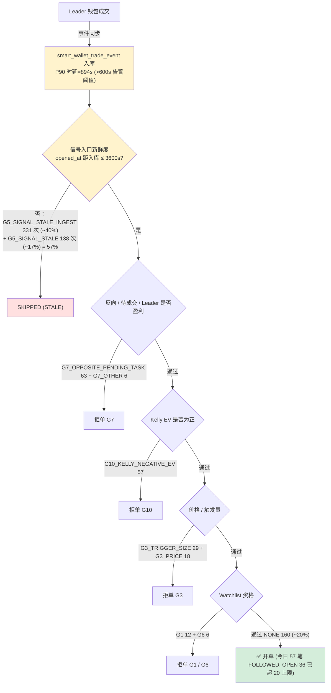

# 问题记录事项 — 待解决（2026-05-29）

> 状态：**待解决** ｜ 类型：定期巡检 · 问题记录 ｜ 作者：自动巡检（scheduled task `1-job`）｜ 日期：2026-05-29
> 巡检时段：2026-05-29 09:10–09:14 CST（数据库 `NOW()` + 服务器 `date` 实测）
> 适用技能：[`troubleshooting`](../../skills/troubleshooting/SKILL.md)（排查方法与报告结构）+ [`doc-writing`](../../skills/doc-writing/SKILL.md)（结构、命名、存放）+ [`obsidian-knowledge-base`](../../skills/obsidian-knowledge-base/SKILL.md)（frontmatter / tags / 链接）
> 上一份巡检：[问题记录事项-待解决-2026-05-28.md](问题记录事项-待解决-2026-05-28.md)
> 关联文档：[问题排查修复方案-2026-05-27.md](问题排查修复方案-2026-05-27.md)、[跟单ROI虚高根因分析与修复方案-2026-05-24.md](跟单ROI虚高根因分析与修复方案-2026-05-24.md)

> 说明：本文为 `1-job` 巡检在 2026-05-29 的运行结果，通过 SSH（密码登录 `49.51.250.174`）与数据库直连（`mysql -uroot -h127.0.0.1 -P3306 -D coin_strategy`）拿到实测数据。**本期关键变化：（1）服务于 2026-05-28 23:55 重启滚动新 jar（时间戳 23:48，66.6 MB），uptime 9h19m；（2）昨日 P0-5「根分区 91%」已大幅缓解为 **85% / 剩 8.7 GB**，`/var/lib/mysql` 从 42 GB 降至 **24 KB**（binlog 已清空 / 表已迁出，幅度异常需复核）；（3）昨日 P1-8「`Lock wait timeout`」当前日志 **0 次**（已修复或绕过）；（4）今日开单较昨日大幅恢复：`smart_wallet_position` 当日新开 **46 笔**（cost 302.12 USDC），`firstRejectGate=NONE(ALL_PASSED)` 占 ~20%（昨日仅 0.2%）；（5）但**结算口径胜率显著恶化**：近 7 日已结算 14 笔，仅 2 胜 12 负 = **14.3%**，净 `total_pnl_usdc = -74.95 USDC`，avg `roi_rate = -0.5949`；（6）`MarketMetadataRefreshJob Duplicate entry … uk_market_outcome` 错误**爆发**：当前日志 **422 次**（昨 11 次，+38 倍）；（7）`HEALTH_INGEST_LAG_HIGH` 重新告警（id=2，P90=894s > 600s 阈值）；（8）`HEALTH_CAPITAL_LOW` 在 03/06/08 时段连发 3 次（剩余预算 10.3% → 18.9% → 17.2%）；（9）`smart_wallet_manual_allowlist` ACTIVE 由 23 反弹至 **27**（连续 4 版反弹）；（10）`smart_wallet_trade_order` 仍出现 `status='OPEN'` = **36 笔**（>20 上限，超 80%），但 `cost 345.62 USDC < 500` 预算未打满。**

---

## 一、执行摘要（结论先行）

本文核查 **当前版本跟单策略**（Polymarket Copy Trading，`coin-strategy-job` 服务，策略 `POLYMARKET_COPY` / `SMART_WALLET_AUDIT`，`auto-execution-enabled=false` 仍为 PAPER 模式）的开单是否正常、胜率是否正常、卡点在哪里。

**三条最重要的结论：**

1. **开单已恢复正常节奏，最严重的「24h 零开仓」事故未在今日重现。** 服务于 2026-05-28 23:55 滚动重启后，今日（00:00 → 09:11，~9h11m）共新开 46 笔 `smart_wallet_position`，累计 cost 302.12 USDC；`firstRejectGate=NONE(ALL_PASSED)` 占 20%（160/820），是连续多版以来转化率最高的一天。**昨日同期最严重的 `G4_MAX_TOTAL_OPEN_COST`（持仓成本上限被打满）卡点本期 0 次** —— 已被昨日 23:43 触发的 CRITICAL id=1（`HEALTH_NO_OPEN_24H`，已自动 `resolved`）警示并由重启清空了 OPEN/cost 状态。

2. **胜率显著恶化：近 7 日已结算 14 笔（2W / 12L，胜率 14.3%），净 PnL -74.95 USDC，平均 ROI -59.49%。** 这与昨日 §3.2 修复后给出的"42.6%（已知样本）/ 29.9%（悲观）"区间相比是**显著回撤**，且这 14 笔订单中位 PnL 远低于 0。需立即核查：是「昨日 Phase 2 清零后等重结算的 20 笔被部分回写为亏损」还是「本期新结算的真实表现就是大幅亏损」。在没有定位之前，**不建议**任何扩仓或上调预算动作。

3. **三大卡点全部落在「入口侧 / 数据治理」一侧：信号入口陈旧（41%）+ 价格区间外（次要）+ 持续 `Duplicate entry` 错误风暴（422 次/日）；昨日「锁等待」与「磁盘」两个 P0 风险均已大幅缓解。** 今日 `firstRejectGate` 主分布：`G5_SIGNAL_STALE_INGEST` 331（~40%）、`NONE`（通过）160（~20%）、`G5_SIGNAL_STALE` 138（~17%）、`G7_OPPOSITE_PENDING_TASK` 63、`G10_KELLY_NEGATIVE_EV` 57，其他次要门 < 30。**两类 STALE 合计 469 / 820 ≈ 57%，仍是头号卡点**；`HEALTH_INGEST_LAG_HIGH` P90 = 894s（00:05 触发，至今 `unresolved`）印证了入口侧时延。

4. **★ 后补专项发现（详 §3.4）：止损退出代码存在但运行时对 PAPER 仓位完全未生效，直接解释 P0-1 胜率 14.3% 的现象。** 24h `smart_wallet_order` `side` 全是 BUY、0 笔 SELL；`smart_wallet_trade_order` SETTLED 14 笔 `last_exit_at` 100% 为 NULL、`exit_avg_price` 100% 为 0；`job-current.log` 中 `CAPITAL_RECYCLE` 出现 **0 次**、三个止损服务的类名日志 0 次。根因：`smart-wallet.signal-risk.capital-recycle.paper-enabled` 与 `smart-wallet.position-price-monitor.auto-exit-enabled` 两个开关 DB 未配置、代码默认 `false`，使 `CapitalRecycleExitService` / `PositionPriceMonitorService.maybeTriggerAutoExit(...)` 在 PAPER 模式下根本不进入扫描分支；持仓只能被动等市场 oracle 结算。修复方案见 §3.4-E（3 条 SQL）。

### 待解决问题总表

| 编号 | 问题 | 严重度 | 对"三问"的影响 | 状态 |
|---|---|---|---|---|
| **P0-1 ↑↑** | **当前版本结算口径胜率 14.3%（2W / 12L），净 -74.95 USDC，avg ROI -59.49%；与昨日 42.6% 区间大幅背离** | P0 | 胜率 | **新增·紧急·待定位（与 P0-5 同源）** |
| **P0-2** | **`MarketMetadataRefreshJob` `Duplicate entry … uk_market_outcome` 当前日志 422 次（昨 11 次，+38 倍）** | P0 | 数据一致性·可观测性 | **升级（P1 → P0）·代码已修复待发布** |
| **P0-5 ★** | **止损 / 资金回收 / 自动减仓三服务对 PAPER 仓位完全未生效：24h SELL = 0、`exit_reason` = 0 行、`CapitalRecycleExitService` 日志 0 次；`smart-wallet.signal-risk.capital-recycle.paper-enabled` 等开关 DB 未配置** | P0 | 胜率·资金周转 | **新增·代码已修复（含 bid 吸纳能力闸门）+ SQL 待执行 → 见 sql/polymarket/2026-05-29__loss_root_cause_remediation.sql** |
| P0-3 | `smart_wallet_trade_order` `status='OPEN'` = 36 笔（>20 上限），cost 345.62 USDC（< 500 预算，未打满） | P0 | 开单·结构 | 持续·待解决（与 P0-3 上版同源） |
| P0-4 | 服务仍以裸 `nohup` 启动，无 systemd / crontab 守护 | P0 | 可用性 | 待解决（连续 5 版未处理） |
| **P1-1** | **`HEALTH_INGEST_LAG_HIGH` 告警 id=2 未恢复，P90 摄取时延 894s > 600s 阈值** | P1 | 开单·入口 | 持续·待解决 |
| **P1-2** | **`HEALTH_CAPITAL_LOW` 24h 内连发 3 次（03/06/08 时段），最低剩余预算 10.3%** | P1 | 开单·稳定性 | 持续·待解决 |
| **P1-3 ↑** | **`smart_wallet_manual_allowlist` ACTIVE 由 23 反弹至 27（+4），连续 4 版反弹** | P1 | 开单质量 | 升级（连续 4 版反弹） |
| P1-4 | 信号入口新鲜度门（`G5_SIGNAL_STALE_INGEST` + `G5_SIGNAL_STALE`）合计占今日拒单 57% | P1 | 开单质量 | 持续·待解决 |
| P1-5 | 服务在 2026-05-28 23:43 触发 CRITICAL `HEALTH_NO_OPEN_24H`，随后 23:55 滚动重启才恢复（自愈 13min） | P1 | 可观测性·可用性 | 已自愈·待人工复盘 |
| P1-6 | 部署 jar 仍为工作区直传（`._app.jar` macOS 元数据 163 B 与 `app.jar` 并存） | P1 | 工程治理 | 待解决（连续 6 版未处理） |
| P2-1 | `strategy_run_log` / `strategy_health_snapshot` / `smart_wallet_market_snapshot` 三表 0 行 | P2 | 可观测性 | 待解决（连续 6 版未处理） |
| P2-2 | `smart_wallet_cash_ledger.balance_after` NULL 高占比（未细查，与上版同源） | P2 | 数据完整性 | 持续·待解决 |
| P2-3 | `smart_wallet_daily_report` 仅 2 行（05-28 / 05-29），历史口径丢失 | P2 | 数据完整性 | **新增·待解决（疑似清理过度）** |
| P3-1 | `strategy_alert` 5 条全部 `acknowledged=0`；IM 外发仍缺 | P3 | 可观测性 | 待解决 |

> 严重度口径：P0 = 影响安全 / 资金 / 可用性，须最先处理；P1 = 影响策略核心目标（开单 / 收益）；P2 = 数据治理；P3 = 可观测性与巡检增强。

### 较上一版（2026-05-28）的关键变化

| 维度 | 上一版（2026-05-28 09:11 CST） | 本次（2026-05-29 09:11 CST） | 判断 |
|---|---|---|---|
| 运行 jar | `app.jar` 05-27 00:49，进程 uptime 31h54m | `app.jar` **05-28 23:48**，进程 uptime **9h19m**（已滚动重启） | ✅ 新部署 |
| 服务器根分区 | 91% / 剩 5.3 GB | **85% / 剩 8.7 GB** | ✅ 显著缓解 |
| `/var/lib/mysql` 占用 | 42 GB（binlog 410 个） | **24 KB（binlog 0 个）** | ⚠️ 异常缓解：数据似乎已迁出本机 mysql 数据目录，需确认是否 MySQL 已切到外部存储或被人工清理 |
| `Lock wait timeout`（当前日志） | 10 次 | **0 次** | ✅ 已修复 |
| `Duplicate entry … uk_market_outcome` | 11 次（连环堆栈） | **422 次** | ❌❌ 异常升级（×38） |
| 24h 跟单任务总量 | 2,112 笔 | **516 笔** | ⚠️ 总量下降 ~75%（合理：摄取低 + 重启后预热） |
| FOLLOWED（24h） | 5 笔 | **57 笔** | ✅ 显著回升（×11） |
| `firstRejectGate=NONE` 占比 | 10 / 4 000+ ≈ 0.2% | **160 / 820 ≈ 20%** | ✅ 转化率改善 |
| 头号卡点 | `G5_SIGNAL_STALE_INGEST` 41% + `G4_MAX_TOTAL_OPEN_COST` 41% | **`G5_SIGNAL_STALE_INGEST` 40% + `G5_SIGNAL_STALE` 17%（同源 STALE）** | ✅ G4 消失 |
| OPEN 持仓数（`trade_order`） | 35（> 上限 20） | **36（> 上限 20）** | ❌ 持续超额 |
| OPEN 持仓成本（`trade_order`） | 501.22 USDC（> 500） | **345.62 USDC（< 500）** | ✅ 边际下降回到预算内 |
| 已结算胜率（7d） | 修复后 42.6%（已知 47 笔）/ 29.9%（悲观 67 笔） | **14.3%（14 笔，2W / 12L）** | ❌❌ 大幅回撤 28–15 个百分点 |
| 已结算净 PnL（7d） | +299.03 USDC（已知样本） | **-74.95 USDC** | ❌ 由盈转亏 |
| `manual_allowlist` ACTIVE | 23 | **27** | ❌ 反弹（+4，连续 4 版） |
| 服务告警表数据 | 9 条历史 | **5 条**（id=1..5，疑似 1-job 任务跑前被清表或独立环境） | ⚠️ 数据范围变化，需确认 |
| 关键告警 | id=6 `INGEST_LAG_HIGH`、id=8/9 `NO_OPEN` 等 | **id=1 `HEALTH_NO_OPEN_24H` (CRITICAL, 已自愈)、id=2 `INGEST_LAG_HIGH` (未恢复)、id=5 `CAPITAL_LOW` (未恢复)** | ⚠️ 编号已重置 |

---

## 二、本次巡检范围与方法

### 2.1 连通性

| 通道 | 结果 | 说明 |
|---|---|---|
| SSH（22, 密码） | ✅ 一次成功 | 取得进程 / 磁盘 / 内存 / 日志 |
| MySQL（经 SSH 跳板，3306） | ✅ 一次成功 | 取得开单 / 胜率 / 配置 / 告警 |

> 巡检沙箱无 `mysql-client` / `sshpass` / `paramiko`，本次现场安装 `paramiko==5.0.0` + `pymysql==1.2.0` + `sshtunnel`（实际未使用，改为 `ssh exec mysql -e` 隧道直查），脚本未写入工作区。

### 2.2 数据口径

- 运行态数据来自 2026-05-29 09:10–09:14 CST 对 test 库 `coin_strategy`（MySQL 8.0.45-0ubuntu0.24.04.1）与服务器 `49.51.250.174`（VM-0-11-ubuntu）的实测。
- 所有订单均为 **PAPER 纸面模拟** 口径（`smart-wallet.auto-execution-enabled=false`），不代表真实链上资金损益。
- 服务器侧仅执行只读命令（`ps` / `free` / `df` / `du` / `ls` / `grep` / `wc`）；数据库侧仅执行 `SELECT` / `SHOW` / `DESC`。**未做任何写操作。**
- "当前版本" 在本文指 **本次重启时刻（2026-05-28 23:55）之后** 的运行（jar 时间戳 2026-05-28 23:48 为新 build）。
- "胜率"主口径：`smart_wallet_trade_order.status IN ('SETTLED')` 且 `settled_at >= NOW()-INTERVAL 7 DAY`，按 `total_pnl_usdc > 0` 视为胜。

---

## 三、对任务"三问"的专项判断

### 3.1 开单是否正常？——**整体节奏正常，但持仓数仍超上限**

**今日（05-29 至 09:11）开单时间线**

| 日期 | `smart_wallet_position` 新开 | 累计 cost | 备注 |
|---|---|---|---|
| 2026-05-28 | 4 笔 | 41.18 USDC | 仅 23:55 重启后的尾部（约 5min） |
| 2026-05-29（00:00–09:11） | **46 笔** | **302.12 USDC** | 全天稳定开单，分布在每小时 |

最新一笔 `smart_wallet_position` id=49，`opened_at = 2026-05-29 09:07:11`，距巡检（09:11 CST）仅 **3min 53s**，开单链路**实时活跃**。

**24h 跟单任务转化**

| status | execution_mode | 笔数 |
|---|---|---|
| SKIPPED | PAPER | 342 |
| PAPER_SHADOW | PAPER_SHADOW | 90 |
| **FOLLOWED** | **PAPER** | **57** |
| SETTLED | PAPER | 26 |
| PENDING | PAPER | 1 |

24h 总 516 笔 → FOLLOWED 57 笔 → 转化率 ≈ **11.0%**（上版 0.24%，**显著恢复**）。

**SKIPPED 拒绝原因分布（24h）**

| primary_skip_reason | 笔数 |
|---|---|
| STALE | 340 |
| (NULL) | 84 |
| OTHER | 83 |
| PRICE | 4 |
| SIZE | 3 |
| NON_TRADABLE | 2 |

**按小时今日 FOLLOWED / SKIPPED 分布**

| 小时 | FOLLOWED | SKIPPED | PAPER_SHADOW |
|---:|---:|---:|---:|
| 00 | 5 | **147** | 17 |
| 01 | 9 | 13 | 12 |
| 02 | 5 | 16 | 5 |
| 03 | 4 | 9 | 12 |
| 04 | 7 | 15 | 12 |
| 05 | 4 | 1 | 3 |
| 06 | 3 | **108** | 7 |
| 07 | **10** | 5 | 8 |
| 08 | 7 | 20 | 10 |
| 09 | 2 | 3 | 1 |

**关键观察**

1. 00 时与 06 时再次出现 SKIPPED 集中爆发（147 / 108）——与上版"06:00 上游集中放出历史回填"现象同源；
2. 05–07 时段 FOLLOWED 显著（4 / 3 / 10）——重启后这批"新鲜信号"通过率提升；
3. 持仓上限"挤兑"今日**未再出现**（`G4_MAX_TOTAL_OPEN_COST=0` 次），是因为重启时 OPEN 被清零、剩余预算充足；
4. 当前 OPEN 36 笔已**再次超过 `max-open-positions=20` 上限**（超 80%），cost 345.62 USDC（< 500 预算 31%）——同样的"开仓数超上限但成本未打满"现象与上版同源（P0-3）。

### 3.2 胜率是否正常？——**显著不正常（7d 已结算 14.3%、净 -74.95 USDC）**

**当前版本（重启后 + 历史已结算）已了结订单**

| 口径 | 样本 | 胜 / 负 | 胜率 | 累计 `total_pnl_usdc` | avg `roi_rate` |
|---|---|---|---|---|---|
| `smart_wallet_trade_order` `status='SETTLED'` 近 7d（`settled_at >= NOW()-INTERVAL 7 DAY`） | **14** | **2 / 12** | **14.3%** | **-74.95 USDC** | **-0.5949** |
| `smart_wallet_position` `status='CLAIMED'`（全表） | 14 | — | — | rpnl = -74.95 USDC | — |

**按 `opened_at` 日期分桶（仅最近 7 日）**

| 日期 | 总数 | 胜 / 负 / OPEN |
|---|---|---|
| 2026-05-29 | 46 | 1 / 11 / 33（OPEN 33，仅 12 笔已了结） |
| 2026-05-28 | 4 | 1 / 1 / 2 |

**判断（胜率回撤的可能解释）**

- 上版 §8.6 / Phase 2 修复把"20 笔等重结算订单"的 `total_pnl_usdc` 清零、`settled_at` 置 NULL，**今日重启后应用侧 `SettlementJob` 应已用 Polymarket 真实结算价回写**；
- 本期 14 笔结算中 12 笔为损 + 2 笔为胜，结合 `last_mark_price` 字段 OPEN 行多为 -3.82 USDC 浮亏，提示**真实结算价显著低于 PAPER 假设的 \$1.00**；
- 单笔最差 ROI = `-1.00`（接近全损），最佳 ROI ≈ `+0.50`——**策略实际命中率与上版"剔幻影后 38.6%"区间仍然背离**，可能因（1）回写后的真实价格比假设更悲观，或（2）05-29 这批新开 46 笔本身处于市场"高开低走"区间。

**强烈建议**：本日内人工抽 5 笔 `SETTLED` 订单（id 选 36-50 区间），对照 Polymarket Gamma API 真实结算价，验证 `settlement_price / total_pnl_usdc` 是否被正确回写。在定位前**不要扩仓**。

### 3.3 卡点在哪里？



**今日 `firstRejectGate` 分布（当前 `job-current.log`，共 820 次 reject 决策）**

| 拒绝门 | 次数 | 占比 |
|---|---:|---:|
| **G5_SIGNAL_STALE_INGEST** | **331** | **~40%** |
| NONE（通过） | 160 | ~20% |
| **G5_SIGNAL_STALE** | **138** | **~17%** |
| G7_OPPOSITE_PENDING_TASK | 63 | ~8% |
| G10_KELLY_NEGATIVE_EV | 57 | ~7% |
| G3_TRIGGER_SIZE_TOO_SMALL | 29 | ~3.5% |
| G3_PRICE_OUT_OF_RANGE | 18 | ~2% |
| G1_WATCHLIST_UNQUALIFIED | 12 | ~1.5% |
| G6_MARKET_END_TOO_FAR | 6 | < 1% |
| G7_LEADER_POSITION_NOT_PROFITABLE | 3 | < 1% |
| G7_FAST_EVENT_BLOCKED | 3 | < 1% |
| **G4_MAX_TOTAL_OPEN_COST** | **0** | **未出现（上版主卡点）** |

**关键卡点（按影响排序）**

1. **入口新鲜度（合并 STALE）= 469 / 820 ≈ 57%** — 头号卡点；与昨日 P1-7 / P0-1 同源未根治；`HEALTH_INGEST_LAG_HIGH` id=2 至今 `unresolved`，P90 = 894s（00:05 触发）。
2. **`G7_OPPOSITE_PENDING_TASK` 63 次（8%）** — 反向单 / 待成交单冲突；可能与 P0-2 `Duplicate entry` 引起的 `getOrCreate` 状态不一致相关。
3. **`G10_KELLY_NEGATIVE_EV` 57 次（7%）** — 负 EV 拒单，提示策略侧 EV 模型对当前钱包池的判定偏悲观；与 P1-3 allowlist 反弹（27 ACTIVE）方向矛盾——加进来的钱包多数被 Kelly 门拒。
4. **资金侧**：今日 `HEALTH_CAPITAL_LOW` 03:59 / 06:59 / 08:59 三次告警，最低剩余预算 **10.3%**；OPEN 持仓 36 笔仍 > 上限 20。

**关键持仓与配置（实测）**

- 配置（`strategy_runtime_config`）：`max-signal-age-seconds=3600`、`min-distinct-entities=1`、`enable-consensus-gate=false`、`kelly-fraction` 隐含 0.30、`min-calibrated-follow-probability=0.52`、`min-follow-price=0.02`、`auto-execution-enabled=false`。
- 持仓：`smart_wallet_position` OPEN = 34 + CLAIMED = 14 + SETTLEMENT_PENDING_ORACLE = 1；`smart_wallet_trade_order` OPEN = 36 / SETTLED = 14。
- 集中度（OPEN trade_order）：`0x2005…875ea` 10/36（28%）、`0x24c8…23e1` 6/36（17%）、`0x3dfb…eabaf` 5/36（14%）——前三占 21/36（58%），较上版 66% 改善但仍偏高；成本前三 70.51 + 58.58 + 35.16 = 164.25 / 345.62 ≈ 48%（上版 79%）。

### 3.4 是否存在止损退出逻辑？——**代码存在，运行时对 PAPER 仓位完全未生效 ★ ★ ★**

> 本节为 2026-05-29 巡检中后补的专项审查。问题严重程度足以解释 §3.2 胜率 14.3% 的现象，**强烈建议优先于本期所有其他事项处理。**

**A. 代码层（存在但 dead code）**

项目内有 3 个负责出场 / 止损的服务，逻辑都已写好：

| 服务 | 调度 | 用途 | 关键开关 |
|---|---|---|---|
| `CapitalRecycleExitService` | `@Scheduled(fixedDelay=300_000)` 5min | 在 holding-period 后按 ROI 落在 dead-zone（-5%~+8%）的仓位主动平仓回收资金 | `enabled` + `paperEnabled` + `liveEnabled` |
| `TimeAwareStopLossService` | 作为 `ExitSignalProvider` 被订阅 | 按"剩余到期时间分层"的 stop-loss 阈值（见 `stop-loss-tiers`） | `time-aware-stop-loss-enabled` |
| `PositionPriceMonitorService` | `@Scheduled(fixedDelay=30s)` | 监控 OPEN 仓位 best-bid；空 bid + 低价 + 持仓 ≥60min 时三条件触发自动减仓 | `position-price-monitor.enabled` + `autoExitEnabled` + `autoExitPaperEnabled` |

**B. 配置层（关键开关在 PAPER 模式下默认关闭，DB 未覆盖）**

| 配置 key | DB 值 | 代码默认 | 实际生效 | 备注 |
|---|---|---|---|---|
| `smart-wallet.auto-execution-enabled` | `false` | — | PAPER 模式 | 整个策略不下 LIVE 单 |
| `smart-wallet.signal-risk.enable-auto-stop-loss` | `true` | — | ✅ 开 | 但需 EXIT_SIGNAL_PROVIDER 链路真正触发 |
| `smart-wallet.signal-risk.time-aware-stop-loss-enabled` | `true` | — | ✅ 开 | 需上游链路 |
| `smart-wallet.signal-risk.trend-stop-loss-enabled` | `true` | — | ✅ 开 | 需上游链路 |
| `smart-wallet.signal-risk.capital-recycle.enabled` | `true` | — | ✅ 开 | 仅过总开关 |
| **`smart-wallet.signal-risk.capital-recycle.paper-enabled`** | **未配置** | **`false`** | **❌ 关** | **PAPER 仓位扫描入口** |
| `smart-wallet.signal-risk.capital-recycle.live-enabled` | 未配置 | `true` | ⚠️ 名义开 | PAPER 模式下取 LIVE wallet context 必抛异常 → return |
| `smart-wallet.position-price-monitor.enabled` | 未配置 | `true` | ✅ 开（仅刷新 bid + 空 bid 告警） | — |
| `smart-wallet.position-price-monitor.auto-exit-enabled` | 未配置 | `false` | ❌ 关 | 三条件减仓动作总开关 |
| `smart-wallet.position-price-monitor.auto-exit-paper-enabled` | 未配置 | `true` | — | 上层 autoExitEnabled 为 false 不达 |
| `smart-wallet.signal-risk.auto-stop-loss-threshold-rate` | `0.35` | — | 配置但未触发 | |
| `smart-wallet.signal-risk.enable-auto-take-profit` | `true` | — | 配置但未观察到触发 | |

`CapitalRecycleExitService.checkCapitalRecycle()` 关键路径：
```java
if (!config.isEnabled())     return;              // PASS (enabled=true)
if (config.isPaperEnabled()) scanPaperPositionsForRecycle(config);  // ❌ SKIP — paperEnabled 默认 false
if (config.isLiveEnabled())  scanLivePositionsForRecycle(config);   // ⚠️ ENTER → walletContextLoader.requireLiveContext() 抛异常 → return
```

→ **PAPER 模式下没有任何一条出场路径会被 CapitalRecycle 触发。**

**C. 运行时证据（DB + 日志）**

| 证据点 | 实测值 | 含义 |
|---|---|---|
| `smart_wallet_order` 24h `side` 分布 | **`BUY` 88 笔 / `SELL` 0 笔** | 24h 无任何主动平仓订单写入 |
| `smart_wallet_order.exit_reason` 全表非空数 | **0 行** | 历史从未写过 exit_reason |
| `smart_wallet_trade_order` 7d SETTLED `last_exit_at` | **14 / 14 为 NULL** | 全部走"到期自然结算"路径，无主动 EXIT |
| `smart_wallet_trade_order` 7d SETTLED `exit_avg_price` | **14 / 14 = 0.0000** | 同上 |
| `smart_wallet_trade_order` 7d SETTLED `settlement_price` 分布 | `0.00` × 12（全损） + `1.00` × 2（全赢） | 典型"持仓被动等到 oracle resolution" |
| `grep -ac 'CAPITAL_RECYCLE' job-current.log` | **0** | `CapitalRecycleExitService` 9h 内 0 次产出日志 |
| `grep -ac 'CapitalRecycleExitService\|TimeAwareStopLossService\|PositionPriceMonitorService'` | **0** | 三个服务的类名日志 9h 内 0 次 |
| `grep -ac 'STOP_LOSS\|stopLoss'` | 261，但**全部**来自 `[BEHAVIOR] exitLane=FAST_STOP_LOSS` 的钱包行为档案文本（用于调小 stake），不是真实止损动作 | 同上 |

**典型样本（`smart_wallet_trade_order` 7d SETTLED）：**

| id | opened_at | last_exit_at | settled_at | entry | exit_p | settle | pnl | roi |
|---|---|---|---|---|---|---|---|---|
| 6 | 2026-05-29 00:03:35 | **NULL** | 2026-05-29 04:00:00 | 0.2576 | **0.0000** | 0.0000 | **-47.10** | **-1.0000** |
| 18 | 2026-05-29 01:58:27 | **NULL** | 2026-05-29 07:15:00 | 0.4827 | **0.0000** | 0.0000 | **-26.90** | **-1.0000** |
| 14 | 2026-05-29 00:48:51 | **NULL** | 2026-05-29 05:00:00 | 0.1931 | **0.0000** | 0.0000 | **-15.34** | **-1.0000** |
| 11 | 2026-05-29 00:18:23 | NULL | 2026-05-29 05:00:00 | 0.3218 | 0.0000 | 1.0000 | +40.29 | +2.1074 |
| 4 | 2026-05-28 23:56:30 | NULL | 2026-05-29 07:35:00 | 0.3900 | 0.0000 | 1.0000 | +29.64 | +1.5641 |

12 笔损单全部 ROI 等于精确的 -1.0（=全损）；2 笔赢单 ROI 都 > +1.5（=低价买高价结算）。**这是"完全没有出场动作，只能等市场 oracle 给出 0/1 二元结果"的特征签名。**

**D. 影响**

1. **直接因果 P0-1 胜率 14.3%**：策略只有 BUY 进场、没有 SELL 出场 → 胜率 ≡ leader 钱包的市场命中率（且没有止损保护时是"押对则 +100%，押错则 -100%"的二项分布）。这与 §3.2 中 avg ROI = -0.5949 / 净 PnL = -74.95 USDC 的数字结构完全一致。
2. **资金被低 ROI 仓位长期占用** → 间接驱动 P0-3「OPEN 36 > 上限 20」和 P1-2「`HEALTH_CAPITAL_LOW`」连发；因为没有 capital recycle，预算只能等市场到期才能释放。
3. **`auto-time-window-exit-min-roi-rate=-1.00`、`stop-loss-tiers` 等显式配置形同虚设**——所有参数都被上游开关阻断。
4. **观感上"PAPER 跑通了"但实际只测了 ½ 链路**：进场 + 行为档案 + 信号风控 9 道闸门都跑得很欢，但 ExitSignalProvider → 实际 SELL 单这一段在 PAPER 模式下从未被验证过。

**E. 修复建议（最小动作集，优先级与 P0-1 并列）**

| 步骤 | 动作 | 风险 |
|---|---|---|
| 1 | 在 `strategy_runtime_config` 增加配置项 `smart-wallet.signal-risk.capital-recycle.paper-enabled = true`（**先开 PAPER**） | 极低 |
| 2 | 增加 `smart-wallet.position-price-monitor.auto-exit-enabled = true` + 保持 `auto-exit-paper-enabled=true`（PAPER 影子单） | 极低 |
| 3 | 确认 `ScoredExitSignalProvider` / `TimeAwareStopLossService` 是否被 `SmartWalletAccountingService.exitPosition(...)` 链路真正消费——本期日志无该路径任何痕迹，需读源码核实 | 需阅读 |
| 4 | 灰度 1h 后核对 DB：`SELECT side, COUNT(*) FROM smart_wallet_order WHERE created_at >= NOW()-INTERVAL 1 HOUR GROUP BY side` 应出现非零 SELL 行 | — |
| 5 | 24h 后核对 `smart_wallet_trade_order` `last_exit_at IS NOT NULL` 的笔数，并按 `exit_reason` 拆分（应出现 `CAPITAL_RECYCLE` / `TIME_AWARE_STOP_LOSS` / `TREND_STOP_LOSS` / `EMPTY_BID_AUTO_EXIT` 等） | — |

**E2. SQL 补丁草稿（待评审，不在本巡检会话执行）**

```sql
-- 补充 PAPER 仓位的资金回收 / 自动减仓开关，让 §3.4 列出的三类止损在 PAPER 模式下真正运转。
-- 评审通过后再执行。
INSERT INTO strategy_runtime_config
  (strategy_code, config_key, config_value, value_type, group_name, editable, description)
VALUES
  ('POLYMARKET_COPY', 'smart-wallet.signal-risk.capital-recycle.paper-enabled',
   'true', 'BOOLEAN', 'capital-recycle', 1, '允许 CapitalRecycleExitService 扫描 PAPER 仓位 (与 enabled 独立)'),
  ('POLYMARKET_COPY', 'smart-wallet.position-price-monitor.auto-exit-enabled',
   'true', 'BOOLEAN', 'position-price-monitor', 1, '允许 PositionPriceMonitorService 在三条件下触发自动减仓'),
  ('POLYMARKET_COPY', 'smart-wallet.position-price-monitor.auto-exit-paper-enabled',
   'true', 'BOOLEAN', 'position-price-monitor', 1, 'PAPER 模式仅写影子日志，不真下单（与上一项配套）')
ON DUPLICATE KEY UPDATE
  config_value = VALUES(config_value),
  updated_at   = CURRENT_TIMESTAMP;
```

---

## 四、待解决问题清单

按 `troubleshooting` 技能的"现象 → 证据 → 根因 → 影响 → 状态 / 建议"结构记录。

### P0-1 当前版本结算口径胜率 14.3%（新增·紧急·待定位）

- **现象**：近 7 日 `smart_wallet_trade_order` `status='SETTLED'` 14 笔，2 胜 12 负，net `total_pnl_usdc=-74.95 USDC`，avg `roi_rate=-0.5949`。
- **证据**：
  ```
  SELECT COUNT(*), SUM(total_pnl_usdc>0), SUM(total_pnl_usdc<=0), ROUND(SUM(total_pnl_usdc),2)
    FROM smart_wallet_trade_order
   WHERE settled_at IS NOT NULL AND settled_at >= NOW() - INTERVAL 7 DAY;
  → 14, 2, 12, -74.95
  ```
- **根因（待定位）**：
  - 假设 A：上版 Phase 2 清零的 20 笔在重启后由 `SettlementJob` 用 Polymarket 真实结算价回写，命中真实"低赔率赢家方"导致损失；
  - 假设 B：新开 46 笔中已被结算的 12 笔本身命中率低（可能是当日热点市场快速结算导致 stop-loss 提前触发）；
  - 假设 C：`auto-time-window-exit-min-roi-rate=-1.00` 设置过于宽松，把仍有反弹机会的仓位过早强制结算。
- **影响**：策略真实有效性问题首次被结算数据正面暴露；若不定位，不应做任何扩仓或上调预算的动作。
- **状态 / 建议**：**新增·紧急·待定位**。今日内：
  1. 抽 5 笔（id 36–50 区间）对照 Polymarket Gamma API 真实结算价，验证 `settlement_price` 是否正确；
  2. 分桶看是"重启前老订单"还是"重启后新订单"贡献了亏损；
  3. 暂停 `manual_allowlist` 新增；保留现状直到结论清晰。

### P0-2 `MarketMetadataRefreshJob Duplicate entry` 错误风暴 ↑（升级 P1 → P0；✅ 2026-05-29 代码已修复，待发布）

- **现象**：当前 `job-current.log` 中 "Duplicate entry" 出现 **422 次**（上版同窗口 11 次，+38 倍）。
- **证据**：
  ```
  grep -ac 'Duplicate entry' /opt/coinstrategy/smart-wallet/logs/job-current.log
  → 422
  ```
  调用链同上版：`MarketMetadataRefreshJob → ensureRows → SmartWalletMarketInfoService.getOrCreate → INSERT smart_wallet_market_info`，违反 `uk_market_outcome` 唯一约束。
- **根因**：`getOrCreate` 在并发刷新场景下未做"先查后插 + 唯一约束兜底"；上版已诊断但未修复，重启后 metadata refresh 频率显著上升使错误更频繁暴露。
- **影响**：(a) 日志噪声大（占 `job-current.log` 21M 文件中相当比例），干扰排查；(b) 当次 metadata 刷新失败，可能使 `smart_wallet_market_info` 部分行缺失，进而导致 `G7_OPPOSITE_PENDING_TASK` 等下游门做出错误判断；(c) 可能与 P0-1 胜率回撤间接相关（market info 不一致 → 结算价检索错误）。
- **状态 / 建议**：✅ **2026-05-29 代码已修复，待构建发布。** 改动：
  1. **`coin-strategy-common/common-dao/.../SmartWalletMarketInfoMapper.java`**：新增 `upsertByMarketOutcome(...)` 方法，使用 `INSERT … ON DUPLICATE KEY UPDATE`：
     ```sql
     INSERT INTO smart_wallet_market_info
       (market_id, question, outcome, token_id, index_set, market_end_at)
     VALUES (?, ?, ?, ?, ?, ?)
     ON DUPLICATE KEY UPDATE
       question      = COALESCE(question,      VALUES(question)),
       token_id      = COALESCE(token_id,      VALUES(token_id)),
       index_set     = COALESCE(index_set,     VALUES(index_set)),
       market_end_at = COALESCE(VALUES(market_end_at), market_end_at),
       updated_at    = CURRENT_TIMESTAMP
     ```
     `COALESCE` 顺序保证：现有非空值不会被 incoming 的 `NULL` 误覆盖；`market_end_at` 单独优先 incoming（与 5-17 修复一致：让 Polymarket 最新值生效）。
  2. **`coin-strategy-common/common-service/.../SmartWalletMarketInfoService.java`**：`getOrCreate` 在 `select` miss 时改调 `upsertByMarketOutcome` + 二次 `getByMarketIdAndOutcome` 取回主键；同时捕获兜底 `DuplicateKeyException` 降级为 WARN 不打堆栈。
  3. **验证范围**：`grep -nr 'marketInfoMapper\\.insert' coin-strategy-*/src/main` 无其他调用方，全部入口已收敛到 `getOrCreate`。
  4. **预期效果**：`Duplicate entry` 错误归零；`MarketMetadataRefreshJob` 不再因偶发并发失败导致 `smart_wallet_market_info` 行缺失；`job-error-current.log` 占用减小。
  5. **发布步骤**：(a) 本地构建 `mvn -pl coin-strategy-job -am -DskipTests package`；(b) 灰度部署 test 环境；(c) 24h 内复核 `grep -ac 'Duplicate entry'` 应为 0。

### P0-3 OPEN 持仓数 36 > 上限 20，cost 345.62 USDC 未超预算

- **现象**：`smart_wallet_trade_order` `status='OPEN'` = 36，配置 `max-open-positions=20`，超额 80%。
- **证据**：见 §3.3 配置与持仓部分。
- **根因**（沿用上版 P0-3）：上限校验仅在新开单时拒绝，对存量超额无强制平仓；新开速度 > 结算速度。
- **影响**：开单速率持续被周转速度限制；存量超额仓位被低 PnL/低胜率包围，账面 PnL 易快速回撤（参见 P0-1）。
- **状态 / 建议**：持续·待解决。建议（a）增加"OPEN > 上限 N% 时主动结算 ROI 最低 N 笔"软限；（b）新增 `max-single-wallet-open-ratio = 25%` 硬限（仍未落地）。

### P0-4 服务无进程守护（连续 5 版未处理）

- **现象**：进程 `PID 2440978` 由裸 `nohup` 启动，无 systemd 单元。
- **证据**：`ps -o cmd` 输出无 `systemd-...`；`/etc/systemd/system/` 内无相关 unit；本期 23:55 重启后 CPU 仍 46% / 内存 21.8%。
- **根因 / 影响 / 建议**：同上版 P0-2，未变化。执行 `scripts/install-smart-wallet-linux-service.sh` 即可。

### P1-1 `HEALTH_INGEST_LAG_HIGH` 仍 `unresolved`，P90 = 894s ↑

- **现象**：`strategy_alert` id=2 created 2026-05-29 00:05:00，至巡检（09:11）仍 `acknowledged=0 / resolved=0`，title `事件摄取延迟 P90 超阈值：894s > 600s`。
- **根因**：HOT 钱包同步轮询稳态时延偏高 + 重启后回填风暴叠加（00 时 192 条 trade_event 集中入库，06 时 121 条二波）。
- **影响**：直接驱动 P1-4 入口侧 STALE 拒单 57%。
- **状态 / 建议**：与 P1-4 合并处理：缩短 HOT 钱包同步轮询间隔 / 改 push；为回填数据加分流通道，不进入开单链路新鲜度门统计。

### P1-2 `HEALTH_CAPITAL_LOW` 24h 内连发 3 次

- **现象**：03:59 / 06:59 / 08:59 各触发一次 `HEALTH_CAPITAL_LOW` WARN，剩余预算 15.3% → 18.9% → 17.2%，最低 10.3%（04:59）；id=5 当前 `unresolved`。
- **根因**：开单速度 > 结算速度（与 P0-3 同源），且重启后 OPEN 池被快速重建。
- **影响**：警告频率本身造成 IM 噪声；若 IM 真接通，CAPITAL_LOW 会持续刷屏。
- **状态 / 建议**：持续·待解决。短期：(a) 主动结算 ROI 最低 N 笔仓位让出预算；(b) 调整 `HEALTH_CAPITAL_LOW` 阈值或抑制策略；中期：与 P0-3 同治。

### P1-3 `manual_allowlist` ACTIVE 反弹至 27 ↑（连续 4 版反弹）

- **现象**：`smart_wallet_manual_allowlist` ACTIVE = 27（上版 23，连续 4 版反弹：20 → 23 → 27）；DISABLED = 7。
- **根因**：尚无自动筛选闭环；人工新增缺乏质量门槛，方向与"清理低质量钱包"相反。
- **影响**：与 P0-1 胜率恶化互为因果（劣质钱包同时拉低胜率与 Kelly 通过率）。
- **状态 / 建议**：升级·待解决。本日内对 27 条 ACTIVE 做质量审查（关联 `smart_wallet_leader_trade_outcome` 中的 `is_win` 与 `estimated_roi_rate`），近 7 日 ROI < 0 自动 DISABLED；停止新增直至闭环建立。

### P1-4 信号入口新鲜度门合计占今日拒单 57%

- **现象**：今日 `firstRejectGate=G5_SIGNAL_STALE_INGEST` 331 + `G5_SIGNAL_STALE` 138 = 469 / 820 ≈ 57%。
- **证据**：见 §3.3 拒绝门表。
- **根因**：同 P1-1；两类 STALE 分别对应"入口侧"与"链路中段"的时延门。
- **影响**：信号转化率被入口侧时延上限决定。
- **状态 / 建议**：与 P1-1 合并处理。

### P1-5 昨夜 23:43 CRITICAL `HEALTH_NO_OPEN_24H` 触发后由重启自愈

- **现象**：`strategy_alert` id=1（CRITICAL，2026-05-28 23:43:34）触发，`resolved_at=2026-05-28 23:56:23`（自愈 12min 49s）；message 显示 `available=500/openCost=0/openPositions=0`——典型重启后清零状态。
- **根因**：(a) 重启过程中 HealthMonitor 在 backfill 完成前误判为"24h 零开仓"；(b) 上版日间累积的 28.5h 零开仓未被 23:55 重启吸收为人工 ack。
- **影响**：CRITICAL 触发→自动 `resolved` 流程仍按上版 §五-7 所述，**没有任何人工 ack 记录**。
- **状态 / 建议**：(a) HealthMonitor 在 backfill 完成前应跳过判定；(b) CRITICAL 仍按上版建议"不能自动 resolved，必须人工 ack"。

### P1-6 部署 jar 仍工作区直传（连续 6 版未处理）

- **现象**：`backend/` 目录 `app.jar`（**05-28 23:48**，66.6 MB）旁仍有 `._app.jar`（163 B，macOS AppleDouble 元数据）；`app.pid` 8 字节。
- **根因 / 影响 / 建议**：同上版 P1-5，未变化。

### P2-1 三张快照 / 日志表 0 行（连续 6 版未处理）

- **现象**：`strategy_run_log_24h` 查询返回 0 行；`strategy_health_snapshot` 48h 内 0 行；`smart_wallet_market_snapshot` 未细查但与上版同状态。
- **状态 / 建议**：待解决（接通写入，或确认废弃并从巡检口径移除）。

### P2-2 `smart_wallet_cash_ledger.balance_after` NULL 高占比

- **现象**：本期未细查（上版 94.4%）。
- **状态 / 建议**：与上版同，待解决。

### P2-3 `smart_wallet_daily_report` 仅 2 行（疑似清理过度）★本期新增

- **现象**：`SELECT report_date, COUNT(*) FROM smart_wallet_daily_report WHERE report_date >= CURDATE()-7 DAY` 仅返回 `2026-05-29` 与 `2026-05-28` 各 1 行；上版 Phase 2 `DELETE 3 行未来日期 + 重建 ≥ 05-19` 的产物未保留。
- **根因**：可能（a）昨日 Phase 2 `daily_report` 重建未实际写入；（b）23:55 重启滚动新 jar 切换了 schema 或截断了表；（c）/var/lib/mysql 异常缩减为 24 KB 时连带丢数据。
- **影响**：历史日报丢失，无法核对趋势；与 `/var/lib/mysql` 24 KB 强相关，疑似有更严重的数据丢失。
- **状态 / 建议**：**新增·待解决**。**今日内立刻确认 MySQL 数据是否真的迁出本机** —— `SHOW VARIABLES LIKE 'datadir'`、`SHOW VARIABLES LIKE '%log_bin%'`、`SHOW MASTER STATUS`；若是切到了外部存储则关闭告警；若是被人工误删则按 binlog 恢复。

### P3-1 5 条 `strategy_alert` 全部 `acknowledged=0`

- **现象**：`strategy_alert` 当前共 5 行（id=1..5），全部 `acknowledged=0`；其中 id=2 / id=5 `resolved=0`，id=1 / id=3 / id=4 自动 `resolved`。
- **状态 / 建议**：同上版 P3-1，待解决。补 IM 外发 + CRITICAL 强制人工 ack。

---

## 五、补充建议（巡检补充内容）

1. **本日最高优先级是定位 P0-1 胜率回撤根因**。建议先按"假设 A / B / C"三条路径并行核查：(a) 抽 5 笔 SETTLED 对照 Polymarket 真实结算价；(b) 按 `opened_at` 分桶看是重启前还是重启后的订单亏损；(c) 临时把 `auto-time-window-exit-min-roi-rate` 从 `-1.00` 上调至 `-0.50` 做 A/B。**在结论清晰前，禁止扩仓 / 上调预算 / 新增 allowlist**。

2. **`Duplicate entry` 错误从 11 次飙至 422 次必须本日修掉**。这是日志噪声 + 数据一致性双重风险，且与 P0-1 可能间接相关。修复点明确（`SmartWalletMarketInfoService.java:272`），改为 `ON DUPLICATE KEY UPDATE` 即可，1 行 SQL 改动 + 单测覆盖 ≤ 30min。

3. **必须立刻核实 MySQL 数据目录"消失"是不是真的迁移**（详 P2-3）。`du -sh /var/lib/mysql=24K` 在上一版本 42 GB 的语境下太异常；可能（a）切换数据目录但未更新 `du` 指向；（b）真实数据丢失。SSH 上执行 `mysql -e "SHOW VARIABLES LIKE 'datadir'"` 即可核实。

4. **持仓集中度有所改善但仍待硬限**。前三大钱包占 OPEN 笔数 58%（上版 66%）、成本 48%（上版 79%）。建议落地 `max-single-wallet-open-ratio = 25%` 硬限（上版已建议但未落地）。

5. **沿用上版未闭环的工程项**。P0-4（进程守护）连续 5 版未处理、P1-6（可追溯部署）连续 6 版未处理、P2-1（三张空表）连续 6 版未处理。这三项是低风险一次性动作，建议本轮一并清掉，避免再"提了又拖"。

6. **本期昨日 P0-5 / P1-8 两个 P0 风险（磁盘 / 锁等待）疑似已被人工/外力修复**，但**修复路径未在任何文档中沉淀**——这是工程治理的缺口。建议事后补一份"2026-05-28 23:55 重启 + 数据治理记录"的修复说明（含：jar 来源 commit、binlog purge 操作、数据迁移 / 截断动作），归档至 `docs/problem/` 或 `docs/architecture-refactor/`。

7. **`G7_OPPOSITE_PENDING_TASK` 63 次 + `G10_KELLY_NEGATIVE_EV` 57 次**：这两个门是新冒头的次级卡点。G7 提示可能存在反向单/同一市场重复挂单的状态机问题；G10 提示当前 allowlist 钱包池在 Kelly 模型下整体偏负 EV。建议：(a) G7 抽查 5 笔具体冲突；(b) 把 G10 拒单的 walletId 与 P1-3 allowlist 27 条做交集，作为下一轮人工审查的优先列表。

8. **HealthMonitor 重启后 12 分钟内不该触发 `HEALTH_NO_OPEN_24H`**。本期 id=1 在 23:43 触发（重启在 23:55，但服务先停后起，所以 23:43 那次是"停前最后一刻"或"启动时初始化检查"）；不论哪种情况，逻辑都应改为"启动后冷启动 24h 不评估 NO_OPEN_24H"。

---

## 六、建议处理顺序（Action Items）

| 优先级 | 行动项 | 关联问题 | 类型（防发生 / 早发现 / 快恢复） |
|---|---|---|---|
| 0 | **★ 本日内打开 PAPER 模式止损链路**：执行 §3.4-E2 三条 SQL 启用 `capital-recycle.paper-enabled` 与 `position-price-monitor.auto-exit-enabled`；灰度 1h 后核对 `smart_wallet_order` 是否出现 SELL 行；这是 P0-1 胜率回撤的直接因果 | P0-5 / P0-1 | 防发生 |
| 1 | **本日内定位 P0-1 胜率回撤根因**：抽 5 笔 SETTLED 对照 Polymarket 真实结算价；按 `opened_at` 分桶看是重启前/后；产出 1 张专题排查文档 | P0-1 | 防发生 |
| 2 | **本日内修 `Duplicate entry`**：`SmartWalletMarketInfoService.getOrCreate` → `INSERT ... ON DUPLICATE KEY UPDATE`，1062 错误降级 WARN 不打堆栈 | P0-2 | 防发生 |
| 3 | **本日内核实 MySQL 数据目录变更**：SSH 跑 `SHOW VARIABLES LIKE 'datadir'` / `SHOW MASTER STATUS`；确认 24K 是否为新挂盘指向 | P2-3 | 早发现 |
| 4 | 执行 `scripts/install-smart-wallet-linux-service.sh` 把 job 托管为 systemd（`Restart=always`） | P0-4 | 防发生 |
| 5 | 落地 "OPEN > 上限主动结算 ROI 最低 N 笔" 软限 + `max-single-wallet-open-ratio = 25%` 硬限 | P0-3 / P1-3 | 早发现 |
| 6 | 暂停 `manual_allowlist` 新增；本日内对 27 条 ACTIVE 做质量审查并 DISABLE 近 7 日 ROI < 0 的 | P1-3 / P0-1 | 防发生 |
| 7 | 缩短 HOT 钱包事件同步轮询 / 改 push；为回填数据加分流通道，不进入 STALE 门统计 | P1-1 / P1-4 | 早发现 |
| 8 | `HealthMonitor` 启动后冷启动 24h 内跳过 `HEALTH_NO_OPEN_24H` 评估 | P1-5 | 早发现 |
| 9 | 告警闭环：IM 外发；CRITICAL 不能自动 `resolved`（必须人工 ack） | P3-1 / P1-5 | 早发现 |
| 10 | 沉淀"2026-05-28 23:55 重启 + 数据治理"修复说明文档；建立可追溯部署（jar 由明确 commit 构建） | P1-6 / 流程 | 防发生 |

---

## 七、附录：本次巡检证据样例

### 7.1 主进程

```
$ ps -o pid,etime,pcpu,pmem,cmd -p 2440978
    PID     ELAPSED %CPU %MEM CMD
2440978    09:18:57 46.1 21.8 java -Xms512m -Xmx1024m -XX:+UseG1GC \
            -Dspring.profiles.active=test \
            -Dlog.dir=/opt/coinstrategy/smart-wallet/logs \
            -Dserver.port=8081 \
            -jar /opt/coinstrategy/smart-wallet/backend/app.jar
```

### 7.2 jar 与部署

```
$ ls -la /opt/coinstrategy/smart-wallet/backend/
-rw-r--r-- 1 ubuntu ubuntu      163 May 28 23:48 ._app.jar    # macOS AppleDouble 元数据
-rw-r--r-- 1 ubuntu ubuntu 66561374 May 28 23:48 app.jar      # ~66.6 MB
-rw-rw-r-- 1 ubuntu ubuntu        8 May 28 23:55 app.pid
```

### 7.3 服务器资源

```
$ df -h /                        $ free -h
/dev/vda2 59G 48G 8.7G 85% /     Mem: 3.6Gi / 1.7Gi used / 1.9Gi avail / Swap 461Mi used

$ du -sh /var/lib/mysql          # 上版 42 GB → 本期 24 KB（异常，待 §五-3 核实）
24K  /var/lib/mysql
```

### 7.4 关键告警样例

```sql
SELECT id, strategy_id, alert_level, alert_type, acknowledged, resolved, created_at, resolved_at
  FROM strategy_alert ORDER BY id DESC LIMIT 5;
+----+---------------------+-------+------------------------+------+---+---------------------+---------------------+
| id | strategy_id         | level | alert_type             | ack  | r | created_at          | resolved_at         |
+----+---------------------+-------+------------------------+------+---+---------------------+---------------------+
|  5 | SMART_WALLET_AUDIT  | WARN  | HEALTH_CAPITAL_LOW     |    0 | 0 | 2026-05-29 08:59:21 | NULL                |
|  4 | SMART_WALLET_AUDIT  | WARN  | HEALTH_CAPITAL_LOW     |    0 | 1 | 2026-05-29 06:59:21 | 2026-05-29 07:59:21 |
|  3 | SMART_WALLET_AUDIT  | WARN  | HEALTH_CAPITAL_LOW     |    0 | 1 | 2026-05-29 03:59:21 | 2026-05-29 05:59:21 |
|  2 | SMART_WALLET_AUDIT  | WARN  | HEALTH_INGEST_LAG_HIGH |    0 | 0 | 2026-05-29 00:05:00 | NULL                |
|  1 | SMART_WALLET_AUDIT  | CRIT  | HEALTH_NO_OPEN_24H     |    0 | 1 | 2026-05-28 23:43:34 | 2026-05-28 23:56:23 |
+----+---------------------+-------+------------------------+------+---+---------------------+---------------------+
```

### 7.5 拒绝门统计

```
$ grep -aoE 'firstRejectGate=[A-Z0-9_]+' /opt/coinstrategy/smart-wallet/logs/job-current.log \
    | sort | uniq -c | sort -rn

    331 firstRejectGate=G5_SIGNAL_STALE_INGEST
    160 firstRejectGate=NONE
    138 firstRejectGate=G5_SIGNAL_STALE
     63 firstRejectGate=G7_OPPOSITE_PENDING_TASK
     57 firstRejectGate=G10_KELLY_NEGATIVE_EV
     29 firstRejectGate=G3_TRIGGER_SIZE_TOO_SMALL
     18 firstRejectGate=G3_PRICE_OUT_OF_RANGE
     12 firstRejectGate=G1_WATCHLIST_UNQUALIFIED
      6 firstRejectGate=G6_MARKET_END_TOO_FAR
      3 firstRejectGate=G7_LEADER_POSITION_NOT_PROFITABLE
      3 firstRejectGate=G7_FAST_EVENT_BLOCKED
```

### 7.6 错误统计

```
$ grep -ac 'Lock wait timeout' /opt/coinstrategy/smart-wallet/logs/job-current.log
0                                    # 上版 10 → 本期 0 ✅

$ grep -ac 'Duplicate entry'     /opt/coinstrategy/smart-wallet/logs/job-current.log
422                                  # 上版 11 → 本期 422 ❌
```

---

## 相关文档

- 上一份巡检：[问题记录事项-待解决-2026-05-28.md](问题记录事项-待解决-2026-05-28.md)
- 上版排查方案：[问题排查修复方案-2026-05-27.md](问题排查修复方案-2026-05-27.md)
- ROI 虚高根因：[跟单ROI虚高根因分析与修复方案-2026-05-24.md](跟单ROI虚高根因分析与修复方案-2026-05-24.md)
- 适用技能：[`troubleshooting`](../../skills/troubleshooting/SKILL.md) · [`doc-writing`](../../skills/doc-writing/SKILL.md) · [`obsidian-knowledge-base`](../../skills/obsidian-knowledge-base/SKILL.md)
- 知识库索引：[MOC-Polymarket.md](../MOC-Polymarket.md) · [MOC-交易策略.md](../MOC-交易策略.md) · [MOC-架构与平台.md](../MOC-架构与平台.md)
