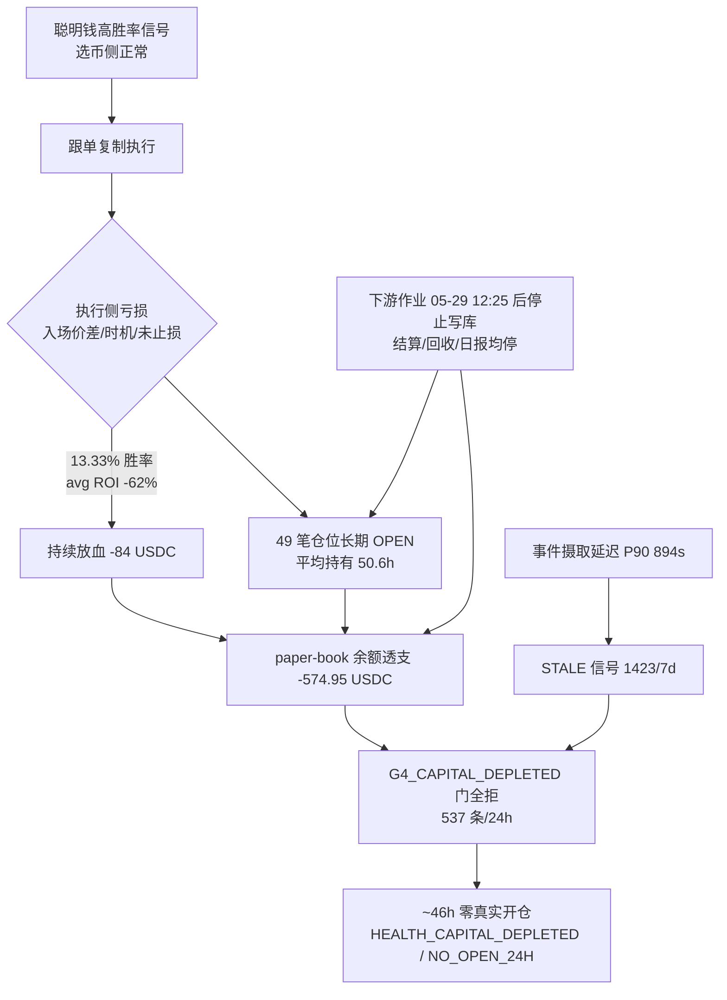

# 问题记录事项 — 待解决（2026-05-31）

> 状态：**待解决** ｜ 类型：定期巡检 · 问题记录 ｜ 作者：自动巡检（scheduled task `1-job`）｜ 日期：2026-05-31
> 巡检时段：2026-05-31 09:11 CST（数据库 `NOW()` 实测，库 `coin_strategy`@`49.51.250.174`，MySQL `8.0.45`）
> 适用技能：[`troubleshooting`](../../skills/troubleshooting/SKILL.md)（排查方法与报告结构）+ [`doc-writing`](../../skills/doc-writing/SKILL.md)（结构、命名、存放）。**结构未自定义，沿用 skill 模板。**
> 上一份巡检：[问题记录事项-待解决-2026-05-30.md](问题记录事项-待解决-2026-05-30.md)
> 关联文档：[订单未结算根因排查-2026-05-30.md](订单未结算根因排查-2026-05-30.md)、[亏损根因分析-2026-05-29.md](亏损根因分析-2026-05-29.md)

> 取数方式：本期沙箱网络对 `49.51.250.174:3306` 与 `:22` **均可达**，通过 `pymysql` 直连库取得全部实测数据，**只读、未执行任何写操作**（未改配置、未下单、未改库）。诊断脚本见同目录 [`问题记录事项-待解决-2026-05-31/diagnose.py`](问题记录事项-待解决-2026-05-31/README.md)。
>
> **本期关键变化（对比 05-30）：**（1）**停摆从 ~24h 延长到 ~46h**：最后一笔真实跟单开仓（`smart_wallet_order` / `follow_task.status=FOLLOWED`）仍停在 **2026-05-29 10:50:37**，至本次巡检 `NOW()=2026-05-31 09:11`，已 **连续 ~46h20m 零真实开仓**；`HEALTH_NO_OPEN_24H`（CRITICAL）于 **05-30 11:04 再次触发且未恢复**。（2）**新结论：不仅是「资金耗尽」，更是「下游执行/结算/资金回收链路整体冻结」**——`smart_wallet_cash_ledger` 最后一条记账 = **2026-05-29 12:25:13**（~44h 无任何资金流水）、`smart_wallet_trade_order` 最后一次结算 = **2026-05-29 07:35**、最后一次更新 = **2026-05-29 12:25:19**，且 **05-30、05-31 两天的 `smart_wallet_daily_report` 完全未生成**。即一系列后台作业在 05-29 中午之后停止写库。（3）**所有「胜率/资金/持仓」数字与 05-30 完全一致、纹丝不动**：`trade_order` SETTLED 仍 15 笔 2 胜 13 负 = **13.33%**、净 **-84.01 USDC**、avg ROI **-62.19%**；OPEN 仍 **49 笔**、锁定成本 **415.09 USDC**；paper-book 余额仍 **-574.95 USDC**——这恰好印证「链路已冻结、无新增结算与回收」。（4）入口侧仍然活着：`smart_wallet_trade_event` 摄取最新到 **09:09:03**（延迟 ~2min），`follow_task` / `signal_shadow` 仍在持续评估，但产出 100% 是 `PAPER_SHADOW` + `SKIPPED`。

---

## 一、执行摘要（结论先行）

本文核查**当前版本跟单策略**（Polymarket Copy Trading，`coin-strategy-job` 服务，策略 `POLYMARKET_COPY`，`smart-wallet.auto-execution-enabled = false` 仍为 PAPER / 测试模式）三件事：开单是否正常、胜率是否正常、卡点在哪里。

**三条最重要的结论：**

1. **开单不正常 —— 已连续约 46 小时零真实开仓，策略事实上停摆且较昨日进一步恶化。** 最后一笔真实跟单单 `smart_wallet_order` 落在 `2026-05-29 10:50:37`（库 `NOW()=2026-05-31 09:11`，间隔 ~46h20m）。最近 30 小时逐小时统计中 `FOLLOWED` **恒为 0**，仅剩 `PAPER_SHADOW`（影子模拟）+ `SKIPPED`。`HEALTH_NO_OPEN_4H`（05-29 15:23）与 `HEALTH_NO_OPEN_24H`（05-30 11:04，CRITICAL）**均未恢复**。

2. **胜率不正常，且已无新增样本可供改善。** 已结算口径：`smart_wallet_trade_order` SETTLED 15 笔 = **2 胜 13 负（13.33%）**，净 **-84.01 USDC**，平均 ROI **-62.19%**；`smart_wallet_order` SETTLED 28 笔 = 8 WIN / 20 LOSS（**28.57%**）。被跟随的聪明钱本身 30 日 `closed_win_rate` 高达 0.82~0.92（`order_stats_snapshot`），但跟单复制后大幅亏损 —— 边际利润在「执行/时机/陈旧入场/未止损」环节被吃光。**这批数字与 05-30 完全相同，因为 05-29 之后再无任何结算发生。**

3. **卡点链路升级：表层是「资金门 G4 全拒」，底层是「下游作业链路整体冻结」。** 近 24h `signal_shadow` 决策被拒主因 `G4_CAPITAL_DEPLETED` **537 条**；`follow_task` 近 7 日 skip 主因 `STALE` 1423、`CAPACITY` 1034、`PRICE` 232。但更关键的是：**记账（cash_ledger）、结算（trade_order.settled）、资金回收、日报（daily_report）四类后台写入在 2026-05-29 12:25 之后全部停止**，49 笔 OPEN 仓位平均已持有 **50.6 小时**（最长 57h，远超 `holding-period-hours=8`）却无一被回收/结算。

> 一句话：**这不是数据库或网络故障。表面是「亏损 → 资金透支 → G4 门全拒 → 停止开单」的资金链断裂，底层叠加了「05-29 中午后下游执行/结算/回收/日报作业疑似停摆」**。属策略/参数 + 已知未修项 + 疑似作业挂死，需人工处置。

### 待解决问题总表

| 编号 | 问题 | 严重度 | 对"三问"的影响 | 状态 |
|---|---|---|---|---|
| **P0-1** | **下游作业链路冻结：`cash_ledger` 末条 05-29 12:25、`trade_order` 末次结算 05-29 07:35 / 末次更新 05-29 12:25、`daily_report` 05-30 与 05-31 两天未生成。结算/资金回收/日报作业在 05-29 中午后疑似停摆** | P0 | 开单·胜率·可观测性（总闸） | **新增·紧急·待处置** |
| **P0-2** | **~46h20m 零真实开仓：最后一笔 `smart_wallet_order` = 2026-05-29 10:50:37；`HEALTH_NO_OPEN_24H`（CRITICAL，05-30 11:04）未恢复** | P0 | 开单 | **延续·恶化（昨 ~24h → 今 ~46h）** |
| **P0-3** | **可用资金耗尽：`HEALTH_CAPITAL_DEPLETED`（CRITICAL，05-29 11:23）未恢复；paper-book `balance_after = -574.95 USDC`（透支，自 05-29 12:25 起冻结）；近 24h 537 条信号在 `G4_CAPITAL_DEPLETED` 门被拒** | P0 | 开单（总闸） | **延续·未缓解** |
| **P0-4** | **结算胜率 13.33%（2W/13L），净 -84.01 USDC，avg ROI -62.19%；`daily_report` 05-29 win_rate=0.1333 / net -93.11** | P0 | 胜率 | **延续·坐实（无新样本）** |
| **P0-5** | **49 笔 `trade_order.status=OPEN` 长期不回收（占用成本 415.09 USDC，平均持有 50.6h / 最长 57h），止损/资金回收对 PAPER 仓位仍未生效** | P0 | 胜率·资金周转 | **延续·未缓解（持续多版）** |
| **P1-1** | **新增审计告警未恢复：`AUDIT_SETTLEMENT_SOURCE`（05-30 01:00）、`AUDIT_LIVE_REPLAY_DIFF`（05-30 02:22，metric=10000 ≫ 阈值 100）** | P1 | 结算一致性·可观测性 | 延续·待解决 |
| **P1-2** | **`HEALTH_INGEST_LAG_HIGH`（05-29 00:05，P90=894s>600s）告警仍 `resolved=0`；7 日 skip 主因 `STALE` 1423（信号陈旧），`max-signal-age-seconds=3600`** | P1 | 开单质量·入口 | 延续·待解决 |
| **P1-3** | **8 笔 `smart_wallet_order.status=SETTLEMENT_PENDING_ORACLE` 自 05-29 00:32 起挂起未结算** | P1 | 结算闭环 | 延续·待解决 |
| **P1-4** | **`G3_PRICE_OUT_OF_RANGE` 24h 52 条 + skip `PRICE` 232：跟单到达时价格已越过滑点缓冲（0.02）** | P1 | 开单质量 | 延续·待解决 |
| P2-1 | `strategy_run_log` / `strategy_health_snapshot` 两表 **0 行**，运行级可观测性缺失（连续多版） | P2 | 可观测性 | 延续·待解决 |
| P2-2 | `smart_wallet_cash_ledger.balance_after` 多行 NULL（仅部分 entry 回写余额） | P2 | 数据完整性 | 延续·待解决 |
| P3-1 | `strategy_alert` 多条 `acknowledged=0`、`resolved=0`，缺 IM 外发与闭环 | P3 | 可观测性 | 延续·待解决 |

> 严重度口径：P0 = 影响安全 / 资金 / 可用性，须最先处理；P1 = 影响策略核心目标（开单 / 收益 / 结算）；P2 = 数据治理；P3 = 可观测性增强。

### 较上一版（2026-05-30）的关键变化

- **恶化**：零真实开仓由 ~24h → **~46h**；`HEALTH_NO_OPEN_24H`（CRITICAL）于 05-30 11:04 再次触发未恢复。
- **新增根因线索**：`cash_ledger` / `trade_order` 结算 / `daily_report` 三类写入在 **05-29 12:25 后全部停止**，**05-30、05-31 日报缺失** —— 强烈提示下游执行/结算/回收/报表作业在 05-29 中午后挂死或停调度，而非仅「被 G4 门拒」。
- **未改善（数字冻结）**：胜率 13.33%、49 笔 OPEN、锁定 415.09 USDC、paper-book -574.95 USDC，**与昨日逐位一致**，正是「无新增结算/回收」的体现。
- **仍存活**：`trade_event` 摄取实时（最新 09:09:03，延迟 ~2min），`follow_task`/`signal_shadow` 评估持续运行 —— 故障集中在**下游执行/结算侧**，上游摄取与信号评估侧仍正常。

---

## 二、巡检方法与口径（troubleshooting 第 0–2 步）

- **方法**：按 `troubleshooting` 七步法——先定位、再修复；以日志/数据为证，不以猜测代结论。本期为无人值守自动运行，**只读取数、不执行任何写操作**。
- **取数**：`pymysql` 直连 `coin_strategy`，`NOW()=2026-05-31 09:11`，MySQL `8.0.45`。
- **链路模型**：`聪明钱事件(trade_event) → 信号/影子(signal_shadow) → 跟单任务(follow_task) → 订单(order) → 成交(fill) → 持仓/交易单(trade_order) → 结算(settled) → 资金回收(cash_ledger) → 日报(daily_report)`。任一环断点即为「卡点」。
- **当前版本范围**：策略 `POLYMARKET_COPY`，服务 `coin-strategy-job`，`execution_mode=PAPER`，`auto-execution-enabled=false`（**无 LIVE 资金敞口，本期问题均在 PAPER 账本内**）。
- **关键运行参数**（`strategy_runtime_config`）：`max-open-positions=20`、`max-total-open-cost-usdc=500`、`holding-period-hours`（资金回收）、`max-signal-age-seconds=3600`、`price-slippage-rate=0.02`、`max-stake-usdc=150`。当前 OPEN 49 笔已远超 `max-open-positions=20`，锁定成本 415.09 逼近 500 预算 —— 这是 G4 门触发的直接算术解释。

---

## 三、排查过程与证据（troubleshooting 第 3–4 步）

### 3.1 开单是否正常 —— ❌ 否（已停摆 ~46h）

`follow_task` 按状态分布（全量）：`SKIPPED` 1542、`PAPER_SHADOW` 1366、`FOLLOWED` 85、`SETTLED` 28；`FOLLOWED` 的最大 `created_at` 仅到 **2026-05-29 10:50:06**。`smart_wallet_order` 全部 `execution_mode=PAPER`、共 113 笔，最后一笔 **2026-05-29 10:50:37**。

最近 30 小时逐小时（节选，UTC+8）显示 `FOLLOWED` **整段恒为 0**：

| 时段 | FOLLOWED | PAPER_SHADOW | SKIPPED | 合计 |
|---|---|---|---|---|
| 05-30 22 | **0** | 19 | 73 | 92 |
| 05-31 00 | **0** | 45 | 26 | 71 |
| 05-31 04 | **0** | 39 | 29 | 68 |
| 05-31 05 | **0** | 69 | 35 | 104 |
| 05-31 06 | **0** | 30 | 25 | 55 |
| 05-31 08 | **0** | 33 | 46 | 79 |
| 05-31 09 | **0** | 7 | 11 | 18 |

> 判定：近 24h 真实开仓 = 0（评估任务 1056 个全部走 PAPER/SKIP），远超「最近开单距今 > 2h 即告警」基准 ⇒ **开单异常（停摆，且较昨日延长一倍）**。

### 3.2 胜率是否正常 —— ❌ 否（13.33%，且无新增样本）

| 口径 | 样本 | 胜 | 负 | 胜率 | 净 PnL(USDC) | 平均 ROI |
|---|---|---|---|---|---|---|
| `trade_order` SETTLED | 15 | 2 | 13 | **13.33%** | **-84.01** | **-62.19%** |
| `trade_order` OPEN（浮动） | 49 | — | — | — | -9.71（未实现） | — |
| `smart_wallet_order` SETTLED | 28 | 8(WIN) | 20(LOSS) | **28.57%** | — | — |
| `daily_report` 2026-05-29 | 109 单 | 2 | 13 | 0.1333 | net -93.11 | — |

- 单笔最大亏损（SETTLED，`roi_rate=-1.00` 即整仓归零）：`-47.10`（market 6713）、`-26.90`（27883）、`-15.34`（6702）、`-11.39`（4206）、`-9.06`（24496）…… 多笔「整仓归零」是亏损主体。
- **反差证据**：被跟随钱包 30 日 `closed_win_rate` 普遍 0.66~0.92（如 `0x03f8…`=0.9250/160 单、`0xf9c1…`=0.8261）。**领头的赢、跟随的亏** ⇒ 亏损产生在复制执行侧（入场价差/时机/缺止损），而非选币侧。
- **无新增样本**：自 05-29 07:35 之后无任何新结算（见 3.4），故胜率数字与 05-30 完全相同，无法靠新交易自然修复。

> 判定：以「跟随高胜率聪明钱」为目标，13.33% 的结算胜率与 -62% 平均 ROI **严重偏离正常区间** ⇒ **胜率异常**，与 05-29 / `亏损根因分析-2026-05-29.md` 结论一致且未改善。

### 3.3 卡点在哪里 —— 表层资金门（总闸）+ 底层作业冻结（成因）

近 24h `signal_shadow` 决策：`PAPER_SHADOW` 541、`REJECTED` 70。`reject_layer` 分布：

| reject_layer | 近 24h 计数 | 含义 |
|---|---|---|
| **`G4_CAPITAL_DEPLETED`** | **537** | **可用资金耗尽 —— 当前总闸** |
| `G3_PRICE_OUT_OF_RANGE` | 52 | 到达时价格越过滑点缓冲（0.02） |
| `G3_TRIGGER_SIZE_TOO_SMALL` | 22 | 触发单过小（< min-trigger-size 5 USDC） |

`follow_task.primary_skip_reason`（近 7 日）：`STALE` 1423、`CAPACITY` 1034、`PRICE` 232、`NON_TRADABLE` 119、`OTHER` 95、`SIZE` 4。

**资金账本证据**：`smart_wallet_cash_ledger` 最新有效 `balance_after = -574.95 USDC`（paper-book，已透支为负），全账本 `IN-OUT` 净额 **-584.01 USDC**。49 笔 `trade_order.status=OPEN` 占用 `remaining_cost_basis` **415.09 USDC**。

### 3.4 关键新证据 —— 下游写入链路在 2026-05-29 12:25 后整体停止

| 信号 | 最新时间戳 | 距 `NOW()=05-31 09:11` | 解读 |
|---|---|---|---|
| `cash_ledger` 末条记账 | **2026-05-29 12:25:13** | ~44h45m | 无任何资金流水（开/平/回收都会写此表） |
| `trade_order` 末次结算 `settled_at` | **2026-05-29 07:35:00** | ~49h36m | 结算作业停摆 |
| `trade_order` 末次 `updated_at` | **2026-05-29 12:25:19** | ~44h45m | 持仓/价格回写停摆 |
| `daily_report` 最新日期 | **2026-05-29** | 05-30、05-31 **缺失** | 日报作业未运行 |
| OPEN 仓位最长持有 | opened 2026-05-28 23:46 | **57h**（avg 50.6h） | 远超 `holding-period-hours=8`，无一被回收 |
| `trade_event` 摄取（对照组） | **2026-05-31 09:09:03** | ~2min | 上游仍正常实时 |

> 这组对照说明：**上游事件摄取与信号评估仍在跑，但「下游执行/结算/资金回收/日报」这一段在 05-29 中午之后停止写库**。这既解释了「数字纹丝不动」，也解释了「资金永不回正 → G4 门永久全拒 → 永不开单」的闭锁。

### 3.5 根因（troubleshooting 第 4 步：直接原因 vs 根本原因）

- **直接原因**：`G4_CAPITAL_DEPLETED` 门把所有新信号拒绝 ⇒ 不再开单。
- **根本原因（三条，均为已知未修或新发现）**：
  1. **下游执行/结算/资金回收/日报作业在 05-29 12:25 后停摆**（本期新发现，P0-1）：`cash_ledger`/`trade_order` 结算/`daily_report` 均无新写入，资金永不回正，G4 门永久闭锁。需先确认 `coin-strategy-job` 中结算调度（`SettlementRun` / `smart_wallet_settlement_run`）与资金回收（`CapitalRecycleExitService`）线程是否存活、是否抛异常后停调度。
  2. **资金回收/止损链路对 PAPER 仓位不生效**（延续 P0-5）：`holding-period-hours=8`，但 49 笔仓位持有 50.6h 仍 OPEN，资金不归还 bankroll。
  3. **执行侧无正向边际利润**（延续 P0-4）：跟随的钱包胜率 80%+，复制后 13% 胜率、多笔归零，入场价/时机/缺止损吃光全部 alpha。
- **次级成因**：事件摄取延迟（`HEALTH_INGEST_LAG_HIGH` P90 894s）→ 大量 `STALE` 信号（1423/7d）被跳过，进一步压低有效开单质量。

---

## 四、影响评估

- **资金**：PAPER 模式，**无真实资金损失**；但 paper-book 已透支 -574.95 USDC，纸面权益严重受损，策略评估口径失真。
- **可用性**：当前版本策略**事实停摆 ~46h**，且下游结算/日报作业疑似挂死，仅影子模拟与上游摄取在跑。
- **数据可信度**：`AUDIT_LIVE_REPLAY_DIFF`（metric=10000 ≫ 阈值 100）与 `AUDIT_SETTLEMENT_SOURCE` 提示 Live↔Replay 一致性与结算源存在偏差；叠加 05-30/05-31 日报缺失，**胜率/PnL 口径需在作业恢复并补算后复核**。

---

## 五、建议处置（仅建议，本次自动运行未执行任何写操作）

> 遵循 `troubleshooting`「未定位根因不乱改」，以下为定位后的处置建议，按优先级排序；**涉及资金逻辑改动须灰度后再全量**。

1. **P0｜先查「作业是否还活着」**：登录服务器查 `coin-strategy-job` 日志（`logs/`），确认结算调度（`smart_wallet_settlement_run` / `SettlementRun`）、资金回收（`CapitalRecycleExitService`）、持仓价格监控（`PositionPriceMonitorService`）、日报生成这几条定时任务在 05-29 12:25 后是否抛异常停调度或线程死锁。这是 05-30、05-31 日报缺失与「数字冻结」的最可能解释。**先恢复作业，再谈资金与开单。**
2. **P0｜恢复资金链**：作业恢复后，对 49 笔超期（>8h）OPEN 仓位做一次性结算/回收，使 paper-book 余额回正；落地 PAPER 模式下的资金回收/止损分支。验证：`G4_CAPITAL_DEPLETED` 计数归零、`FOLLOWED` 恢复、`cash_ledger` 重新出现流水。
3. **P0｜止血胜率**：在执行侧加入「入场价偏离/滑点上限收紧」与「强制止损」，对照「领头钱包赢、跟随亏」定位具体丢分环节，方向见 `亏损根因分析-2026-05-29.md`。
4. **P1｜结算/审计闭环**：处理 8 笔 `SETTLEMENT_PENDING_ORACLE`（自 05-29 00:32 挂起）；跟进 `AUDIT_LIVE_REPLAY_DIFF` / `AUDIT_SETTLEMENT_SOURCE`，修复后重算 05-28~05-31 胜率与 PnL。
5. **P1｜入口提速**：处置 `HEALTH_INGEST_LAG_HIGH`（P90 894s），降低 `STALE`（1423/7d）跳过比例。
6. **P2/P3｜可观测性**：补 `strategy_run_log` / `strategy_health_snapshot` 落库；`strategy_alert` 接 IM 外发并做 ack/resolve 闭环（当前 CRITICAL 告警全部 `acknowledged=0`）。

---

## 六、状态与闭环

- **本期状态**：**待解决**。已定位卡点（表层资金门 G4 全拒 + 底层下游作业 05-29 12:25 后冻结 + 执行侧无边际 + 入口陈旧），未做任何修复（自动巡检只读）。
- **待人工跟进**：上节 P0-1（作业是否挂死，最高优先）、P0-2/P0-3/P0-4/P0-5 需优先处置；处置后将结果回填本记录「五、建议处置」对应项并更新 `status`。
- **复核入口（可复跑）**：诊断脚本见同目录 [`问题记录事项-待解决-2026-05-31/diagnose.py`](问题记录事项-待解决-2026-05-31/README.md)；本期实测 SQL 口径以本文 §3 为准（已按真实表结构 `created_at` / `status` / `reject_layer` / `total_pnl_usdc` / `balance_after` 校准，非占位）。

---

> 自检（doc-writing 完成前清单）：✅ 开头点明「是什么/给谁看」；✅ 结论前置；✅ 链路用 Mermaid 图；✅ 标注状态/作者/日期；✅ 金额单位 USDC、阈值标清；✅ 放入 `docs/problem/`、命名 `问题记录事项-待解决-2026-05-31.md`；✅ 与上一版及关联文档建立链接。
