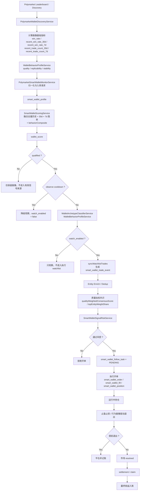

# Smart Wallet 跟单策略回溯分析

## 1. 目的与范围

本文档基于当前仓库代码，对 Polymarket smart-wallet 模块的以下内容做回溯分析：

- 地址画像策略
- 开单逻辑
- 止盈止损逻辑
- 结算逻辑
- 地址画像与开单之间的关联关系

本文聚焦当前代码中的“主生产链路”，即：

`leaderboard/discovery -> profile -> watchlist -> trade_event -> follow_task -> risk evaluation -> execution -> position/order/fill/accounting -> settlement -> claim`

需要特别说明：

- 当前仓库里同时存在两个入口：
  - `SmartWalletFollowService`：偏演示/扫描式入口，按“钱包 x 市场机会”直接生成可执行信号。
  - `SmartWalletFollowTaskService`：当前真实主链路，按“监听到的地址成交事件”生成跟单任务并驱动后续执行。
- 本文将 `SmartWalletFollowTaskService` 视为主流程，因为定时任务、风控、执行、记账、结算、归因均围绕它展开。

---

## 2. 总体架构结论

当前策略不是“先选市场再选地址”，而是“先选地址，再跟地址的真实交易行为”。

核心特征有 5 个：

1. 地址画像分层
   - 第一层是基础画像：`smart_wallet_profile`
   - 第二层是行为画像：`wallet archetype + behavior profile`
   - 第三层是实体画像：把疑似同一真实交易者的多钱包做 entity 去重

2. 开单是事件驱动
   - 不是主动全市场扫描开仓，而是监控 watchlist 地址的新成交，生成 `smart_wallet_trade_event`
   - 再由 `smart_wallet_follow_task` 驱动开单

3. 风控不是单点规则，而是多层门控
   - watchlist 准入
   - 新鲜度/价格/仓位/资金限制
   - 共识门控
   - 单钱包 override
   - 浓度门控
   - 概率/滑点/收益率模型门控
   - Kelly 仓位 sizing

4. 平仓不是只靠“固定止损”
   - 已实现时间分层止损
   - 趋势加速止损
   - 自动止盈
   - 行为画像会反向调整止盈止损阈值

5. 结算是独立后台链路
   - 开平仓和结算分离
   - 市场到期后由 settlement sync 扫描解析
   - unresolved 市场进入 retry 队列
   - resolved 后持仓进入 `RESOLVED_UNCLAIMED`
   - claim 再把结算收益入账并转为 `CLAIMED`

---

## 3. 地址画像策略

## 3.1 画像数据来源

地址画像不是一次性写死，而是由多类数据逐步构成：

1. Leaderboard / Discovery 数据
   - `PolymarketWalletDiscoveryService`
   - 从 Polymarket leaderboard 拉取候选地址
   - 生成 `PolymarketWalletMetricsRequest`
   - 写入 `smart_wallet_profile`

2. 地址历史交易与成交事件
   - `PolymarketWalletDiscoveryService.syncWatchlistTrades()`
   - 将 watchlist 地址近期成交同步成 `smart_wallet_trade_event`

3. 交易效果标签
   - `smart_wallet_trade_effect_label`
   - 给地址在不同时间窗口下的交易效果打标签，例如 30s/5m/rule 维度是否正收益

4. 每日特征快照
   - `WalletFeatureDailyService`
   - 生成 `smart_wallet_wallet_feature_daily`
   - 统计 7d/30d trade 数、市场集中度、followable rate、30d pnl 等

5. 闭环订单分析
   - `SmartWalletOrderAnalysisService`
   - 生成 `smart_wallet_order_analysis`
   - 识别地址的历史 exit style，例如：
     - `EARLY_PROFIT`
     - `EARLY_STOP`
     - `SETTLED_WIN`
     - `SETTLED_LOSS`

6. 多钱包实体聚类
   - `wallet_entity_map`
   - `wallet_follow_candidate`
   - `WalletEntityResolutionService`
   - 用于识别“一个真实交易者多个地址”的情况，避免把多地址误当成多共识

---

## 3.2 基础画像：`smart_wallet_profile`

`smart_wallet_profile` 是最核心的地址画像表，承载：

- `win_rate`
- `realized_pnl_usdc`
- `total_trades`
- `average_roi_rate`
- `max_drawdown_rate`
- `wallet_score`
- `qualified`
- `watch_enabled`
- `recent_win_rate_7d`
- `recent_win_rate_30d`
- `recent_trade_count_7d`
- `recent_trade_count_30d`
- `observe_cooldown_until`
- `observe_cooldown_reason`
- `last_trade_at`
- `dominant_session`

### 基础评分公式

`SmartWalletScoringService` 的核心评分大致为：

- 先计算 `baseScore`
- `baseScore` 不再只看全量历史胜率，而是融合全量 / 30d / 7d 胜率
- `realized_pnl_usdc` 权重 15%
- `total_trades` 权重 10%
- `average_roi_rate` 权重 10%
- `recent_trade_count_7d / 30d` 作为近期活跃度与近期样本可信度因子
- `max_drawdown_rate` 作为惩罚项 10%
- 再计算 `behaviorComposite`
  - `0.45 * replicabilityScore + 0.35 * qualityScore + 0.20 * stabilityScore`
- 最终 `wallet_score = 0.85 * baseScore + 0.15 * behaviorComposite`

另外：

- 若有 `recent_win_rate_7d / 30d`，会按样本量感知的方式融合，7d 和 30d 样本越充分，近期表现权重越高
- 当前最大近期权重大致为：`30d <= 25%`，`7d <= 20%`，剩余权重回落到全量历史胜率
- `7d` 窗口样本充足但胜率快速恶化时，会明显拉低 `wallet_score`，防止地址“历史很好但最近失真”
- 近期活跃度还会通过 `recent_trade_count_7d / 30d` 提供一个小权重加成，避免长期不动但历史分很高的地址被高估
- 行为画像缺失时，评分回退为 `baseScore`，不阻断 discovery / qualification
- 最终分数被裁剪到 `[0,1]`

### 为什么要补 7d 胜率

原来的问题是：

- 若地址历史 `win_rate` 很高、`30d` 也还不错，但最近 7 天连续失误，旧评分会反应不够快
- 这会导致地址仍然保有较高 `wallet_score`，从而继续通过基础画像筛选

这次补充 `7d` 维度后，策略更接近“近期是否仍然可跟”：

- 若近 7 日样本足够且胜率快速下滑，评分会明显回撤
- 若近 7 日样本很少，则只给很小权重，避免被短期噪声误伤
- 因此评分对“近期失真”更敏感，但不会因为一两笔偶发亏损就过度惩罚

### 数据如何进入评分

这次不是只改打分函数，而是把 `7d/30d` 指标打通成完整链路：

1. `PolymarketWalletDiscoveryService.buildMetrics()`
   - 基于 closed positions 统计：
   - 全量 `win_rate`
   - `recent_win_rate_30d`
   - `recent_win_rate_7d`
   - `recent_trade_count_30d`
   - `recent_trade_count_7d`
2. `PolymarketSmartWalletMonitorService`
   - 对上述指标做非负与区间归一化
3. `SmartWalletProfileStoreService.upsertMetrics()`
   - 将新增指标写入 `smart_wallet_profile`
   - 同时用新公式重算 `wallet_score`
4. `SmartWalletFollowService`
   - 把这些字段带到运行时 `SmartWalletProfile`，供后续流程使用

### 当前新增字段

`smart_wallet_profile` 现已额外持久化：

- `recent_win_rate_7d`
- `recent_win_rate_30d`
- `recent_trade_count_7d`
- `recent_trade_count_30d`
- `observe_cooldown_until`
- `observe_cooldown_reason`

对应也补了：

- schema 维护逻辑
- 初始化 SQL
- 增量 migration SQL

这样无论是新环境建表，还是老环境平滑升级，都可以落地这套评分逻辑。

### 基础准入规则

`SmartWalletProfileStoreService.isQualified()` 使用以下条件决定 `qualified`：

- `win_rate >= smart-wallet.min-win-rate`，当前默认 `0.62`
- `wallet_score >= smart-wallet.min-wallet-score`，当前默认 `0.70`
- `total_trades >= smart-wallet.min-total-trades`，当前默认 `25`
- `realized_pnl_usdc >= smart-wallet.min-realized-pnl-usdc`，当前默认 `1000`
- `max_drawdown_rate <= smart-wallet.max-drawdown-rate`，当前默认 `0.25`

结论：

- `qualified=true` 代表“这地址够强”
- 其中 `wallet_score` 已经隐含吸收了全量 / 30d / 7d 胜率、近期样本数和近期活跃度
- 但不代表一定会进入执行 watchlist

### 近期退化观察态

当前不是把“近期失真”的地址直接踢出画像，而是进入 observe cooldown：

- 若 `recent_trade_count_7d >= 6`，且满足以下任一：
  - `recent_win_rate_7d < 0.45`
  - `recent_win_rate_30d - recent_win_rate_7d >= 0.20`
  - `win_rate - recent_win_rate_7d >= 0.25`
- 则保留 `qualified=true`，但会写入：
  - `observe_cooldown_until`
  - `observe_cooldown_reason`
- 并强制 `watch_enabled=false`

恢复条件是：

- `recent_trade_count_7d >= 6`
- `recent_win_rate_7d >= 0.55`
- 且 `recent_win_rate_30d - recent_win_rate_7d < 0.10`

观察期默认 7 天；到期后若仍满足退化条件，会续期。  
若 `manualWatchEnabled=true`，人工 override 仍拥有最高优先级，可以强制恢复执行 watchlist。

---

## 3.3 行为画像：`archetype + behavior profile`

当前策略不只看“赚不赚钱”，还看“这类地址是否可复制”。

### Archetype 分类

`WalletArchetypeClassifierService` 会把地址分成：

- `HF`
- `THEMATIC`
- `LOW_FREQ_VALUE`
- `SWING`
- `NOISE`

并派生：

- `followLane`
  - `HF_FOLLOW`
  - `THEMATIC_FOLLOW`
  - `VALUE_FOLLOW`
  - `SWING_FOLLOW`
  - `OBSERVE_ONLY`
- `followFitScore`
- `recommendedSyncIntervalMs`

其输入包括：

- 30s/5m/rule 三种 alpha 正收益占比
- 最近 7/30 天交易频率
- 市场集中度
- 跟随可复制率 `followableRate30d`
- 近 30 日胜率

### Behavior Profile

`WalletBehaviorProfileService` 会进一步生成：

- `qualityScore`
- `replicabilityScore`
- `stabilityScore`
- `settlementWinRate`
- `latencyAlphaRate`
- `swingAlphaRate`
- `medianHoldMinutes`
- `recommendedExitLane`

`recommendedExitLane` 是后续止盈止损的重要输入，常见值包括：

- `HOLD_TO_SETTLEMENT`
- `EARLY_TAKE_PROFIT`
- `FAST_STOP_LOSS`
- `HYBRID_EARLY_EXIT`
- `FAST_EXIT_OR_SKIP`
- `FOLLOW_ARCHETYPE`

### 可执行 watchlist 规则

`SmartWalletProfileStoreService.isExecutableCandidate()` 在 `qualified=true` 基础上继续筛：

- 若地址处于 observe cooldown，默认不进执行 watchlist
- 若 `recommendedExitLane == FAST_EXIT_OR_SKIP`，直接不进执行 watchlist
- 若 archetype 证据足够且 `followLane == OBSERVE_ONLY`，不进执行 watchlist
- 若 `followFitScore < 0.42`，不进执行 watchlist

结论：

- `qualified` 是“地址质量过关”
- `watch_enabled` 是“地址质量过关、近期没有明显退化、且本地复制性过关”

---

## 3.4 实体画像：entity dedup

这是当前策略的重要升级点。

背景问题：

- 同一个真实交易者可能控制多个钱包
- 如果直接按 wallet address 做共识统计，会把“一个人多钱包同向下单”误判成“多人共识”

当前实现：

- `wallet_entity_map` 将地址映射到 `entity_id`
- `WalletEntityResolutionService` 在生成 follow task 前解析实体
- `PolymarketConsensusSignalService` 计算共识时改用实体去重后的 `dedupedEntityCount`
- `consensusScore` 不再只看简单实体均值，而是支持“质量加权 + 时间感知”：
  - `entityWeight = 0.60 + 0.25 * behaviorComposite + 0.15 * recencyWeight`
  - `recencyWeight` 按实体在共识窗口中的最新触发时间线性衰减
- 共识结果额外输出：
  - `qualityWeightedConsensusScore`
  - `topEntityWeightShare`

这意味着：

- 地址画像不再只停留在 wallet 层
- 开单风控已经开始使用 entity 层，而且开始衡量“是谁在带共识”和“这个共识是不是被单强实体拖起来的”

---

## 4. 开单逻辑

## 4.1 主开单链路

当前主链路如下：

1. `PolymarketWalletDiscoveryService`
   - 发现地址并更新画像

2. `syncWatchlistTrades()`
   - 同步 watchlist 地址最近真实交易

3. `PolymarketSmartWalletMonitorService.ingestTradeEvent()`
   - 写入 `smart_wallet_trade_event`

4. `SmartWalletFollowTaskService.recordTradeEvent()`
   - 去重后创建 follow task

5. `createFollowTaskIfQualified()`
   - 先做 entity enrich
   - 再做 signal risk evaluate
   - 最后落 `smart_wallet_follow_task`

6. `processPendingTasks()`
   - 定时扫描 `PENDING` follow task
   - 调用执行网关下单

7. `SmartWalletAccountingService.recordExecution()`
   - 落 order / fill / position / cash ledger / daily report

---

## 4.2 Follow Task 生成逻辑

生成任务前会先检查：

- 地址是否在 `watch_enabled` 列表中
- 同一 `source_event_id` 是否已生成过任务

然后进入两段式处理：

### 第 1 段：Intelligence Enrich

`enrichAndSaveCandidate()` 会：

- 解析地址对应的 `entity_id`
- 记录聚类置信度与聚类方法
- 判断该实体是否是本市场首次触发
- 记录实体去重后的共识数
- 落表 `wallet_follow_candidate`

若实体解析结果仍是 `PENDING`：

- 不直接丢弃
- 会创建一个 `SKIPPED` task
- 原因写入 `error_message`
- 后续由 `scheduledReevaluateDeferredCandidates()` 再次回补

这说明系统对“实体解析未完成”做了延迟容忍，而不是直接损失信号。

### 第 2 段：Risk Evaluation

调用 `SmartWalletSignalRiskService.evaluate(profile, event)`，输出：

- `accepted`
- `recommendedStakeUsdc`
- `reasons`
- 各类模型分数、概率、共识信息

最终：

- `accepted=true` -> task 状态 `PENDING`
- `accepted=false` -> task 状态 `SKIPPED`

---

## 4.3 开单风控门控

`SmartWalletSignalRiskService` 是开单的核心判定器，主要门控如下。

### A. 地址本身是否可跟

- `profile == null` 或 `qualified/watch_enabled` 不满足 -> 拒绝
- archetype 为 `OBSERVE_ONLY` -> 拒绝
- behavior profile 的 `recommendedExitLane == FAST_EXIT_OR_SKIP` -> 拒绝

### B. 基础交易规则

- 不允许 SELL 信号时，`SELL` -> 拒绝
- `trigger_size < min-trigger-size-usdc` -> 拒绝
- `price` 不在 `[min-follow-price, max-follow-price]` -> 拒绝
- 信号超过 `max-signal-age-seconds` -> 拒绝
- 市场已结束或距离结束太远 -> 拒绝

当前默认关键参数：

- `max-signal-age-seconds = 300`
- `min-trigger-size-usdc = 5`
- `min-follow-price = 0.05`
- `max-follow-price = 0.95`
- `max-hours-to-market-end = 720`

### C. 组合容量约束

- `openPositions >= max-open-positions` -> 拒绝
- `totalOpenCost >= max-total-open-cost-usdc` -> 拒绝
- `availableCapital <= 0` -> 拒绝

当前默认：

- `max-open-positions = 20`
- `max-total-open-cost-usdc = 500`

### D. 重复仓位/冲突仓位

- 同市场同 outcome 已有 open position -> 拒绝
- 同市场反向 outcome 已有 open position -> 拒绝
- 同市场同 outcome 已有 pending task -> 拒绝
- 同市场反向 outcome 已有 pending task -> 拒绝

### E. 共识门控

`PolymarketConsensusSignalService.buildConsensusForEvent()` 会统计同一市场、同一方向、同一 outcome 在时间窗口内的共识。

使用的是：

- 原始地址数 `distinctWallets`
- 实体去重后的 `dedupedEntityCount`
- 默认启用的 `qualityWeightedConsensusScore`
- 诊断字段 `topEntityWeightShare`
- `leaderFollowerScore`
- `entityIndependenceScore`
- `recentConsistencyScore`

当前默认：

- `enable-consensus-gate = true`
- `consensus-window-seconds = 3600`
- `min-distinct-entities = 2`
- `min-consensus-score = 0.65`
- `quality-weighted-consensus-enabled = true`
- `consensus-entity-base-weight = 0.60`
- `consensus-behavior-weight = 0.15`
- `consensus-recency-weight = 0.10`
- `consensus-leader-follower-weight = 0.05`
- `consensus-independence-weight = 0.05`
- `consensus-recent-consistency-weight = 0.05`

也就是说，默认要求“至少两个去重后的真实实体、且质量加权后的共识分达到阈值”。

这意味着当前共识不再只是“人数 + 平均分”，而是同时看：

- 是否真的是多个独立实体
- 这些实体之间是不是存在合理的 leader / follower 时序
- 这些实体最近 7d / 30d 是否仍然稳定
- 是否被单一强实体拖起来

额外还有一条只告警不拦截的诊断：

- 若 `topEntityWeightShare > 0.75 && dedupedEntityCount < 3`
- 会打出 `CONSENSUS_DOMINANCE` 提示，说明当前共识可能被单一强实体主导
- 若 `entityIndependenceScore / recentConsistencyScore / leaderFollowerScore` 过低
- 也会留下对应 risk reason，帮助识别“同向但低质量”的伪共识

### F. 单钱包 override

若共识人数不够，可以走 `SINGLE_WALLET_OVERRIDE`，当前默认已经开启，但门槛非常严格，而且不是全量放开：

- `enable-single-wallet-override = true`
- `enable-single-wallet-override-canary = true`
- `single-wallet-override-canary-rate = 0.10`
- 支持 `single-wallet-override-whitelist`

即使启用，也要满足：

- `wallet_score >= single-wallet-override-min-wallet-score`
- `win_rate >= single-wallet-override-min-win-rate`
- `total_trades >= single-wallet-override-min-trades`
- `recent_trade_count_7d >= single-wallet-override-min-recent-trades-7d`
- `recent_win_rate_7d >= single-wallet-override-min-recent-win-rate-7d`
- `replicabilityScore >= single-wallet-override-min-replicability-score`
- `qualityScore >= single-wallet-override-min-quality-score`
- `trigger_size >= single-wallet-override-min-trigger-size-usdc`
- `recommendedStakeUsdc >= single-wallet-override-min-recommended-stake-usdc`
- 地址不能处于 observe cooldown

同时还会拦截“胜率 100%，但样本很小”的 leaderboard 幸存者偏差地址。

更关键的是：

- override 只能绕过“实体数不足”
- 不能绕过 `consensusScore` 不达标
- 还必须命中 whitelist / canary
- 也就是说，如果是“单强钱包但市场层面的质量共识很差”，仍然不会放单

### G. 浓度门控

`MarketConcentrationService` 可用于识别被大户控盘的市场。

当前默认：

- `enable-concentration-gate = true`
- `concentration-high-risk-mode = DOWNSIZE`
- `whale-signal-source-mode = DOWNSIZE`

打开后会：

- 市场过度集中 -> 可按 `BLOCK / DOWNSIZE / WARN_ONLY` 处理
- 市场处于警戒区 -> 下调 stake
- 若触发信号的钱包本身就是 top holder，可按 `BLOCK / DOWNSIZE / WARN_ONLY` 处理

当前实际默认是更保守的灰度方式：

- 高风险集中市场先记 `CONCENTRATION_DOWNSIZE`
- 警戒区继续叠加 `CONCENTRATION_PENALTY`
- 触发钱包本身是 top holder，则再走一层 `WHALE_SIGNAL`

### H. 模型门控

`TradeProfitabilityScoringService` 产出：

- `estimatedNetProfitabilityUsdc`
- `estimatedFeeUsdc`
- `estimatedSlippageUsdc`
- `calibratedFollowProbability`
- `slippageSpikeProbability`

默认门控：

- `enable-probability-gate = true`
- `min-calibrated-follow-probability = 0.56`
- `enable-slippage-gate = true`
- `max-expected-slippage-usdc = 1.00`
- `max-slippage-spike-probability = 0.55`

EV gate 在配置对象中叫 `enableProfitabilityGate`，当前 YAML 通过兼容字段 `enable-ev-gate` 驱动。

---

## 4.4 开单金额计算

推荐下单金额分两层：

### 第一层：传统公式

先计算：

- `preliminaryStake = triggerSize * walletScore * bankrollUtilizationRate`
- 再裁剪到 `maxStakeUsdc`
- 再根据 archetype / behavior / available capital 做进一步缩放

### 第二层：Kelly 仓位

若 `kelly-stake-enabled = true`，则改用：

- 输入：`calibratedFollowProbability`、`entryPrice`、`availableCapital`
- 输出：Kelly stake

当前默认：

- `kelly-stake-enabled = true`
- `kelly-fraction = 0.30`

如果 Kelly 结果为 0，说明 EV 为负，信号直接拒绝。

结论：

- 当前开单金额已经从“简单固定比例”进化为“画像 + 模型概率 + 资金约束”的综合 sizing
- 而且在 Kelly 之后，又增加了更细的 advanced stake 调整：
  - `stabilityScore` 低时缩仓，高时只做很小幅度 boost
  - `estimatedSlippageUsdc / recommendedStakeUsdc` 过高时缩仓
  - `slippageSpikeProbability` 过高时进一步缩仓
  - 若当前已有多个同主题 open positions，会触发 `THEME_CORRELATION`，避免仓位过度堆到同一类事件风险上

---

## 4.5 执行逻辑

`SmartWalletFollowTaskService.executeTask()` 执行任务时：

1. 先再次做一次风控评估
   - 防止任务排队期间市场状态变化

2. 通过 `PolymarketExecutionGateway` 执行
   - `PAPER`：直接模拟成 `FILLED`
   - `LIVE`：走 Polymarket CLOB 下单

3. task 更新状态
   - 成功 -> `FOLLOWED`
   - 失败 -> `FAILED`
   - 风控不再通过 -> `SKIPPED`

4. 进入 `SmartWalletAccountingService.recordExecution()`
   - 生成 `smart_wallet_order`
   - 若立即成交，再生成 `smart_wallet_fill`
   - 更新/创建 `smart_wallet_position`
   - 写入 `smart_wallet_cash_ledger`
   - 回建 `smart_wallet_daily_report`

---

## 5. 止盈止损逻辑

## 5.1 触发方式

`SmartWalletPositionSyncService` 中有两个 5 分钟定时任务：

- `checkStopLoss()`
- `checkTakeProfit()`

说明：

- 止盈止损不是在开单时预埋 OCO
- 而是后台轮询本地持仓状态后主动触发退出

---

## 5.2 止损逻辑

### 基础止损

默认配置：

- `enable-auto-stop-loss = true`
- `auto-stop-loss-threshold-rate = 0.35`

表示当未实现收益率 `<= -35%` 时触发止损。

### 时间感知止损

若 `time-aware-stop-loss-enabled = true`，止损阈值会随着离结算越近而收紧。

当前默认分层：

- 距离结算 >= 168h -> `35%`
- 距离结算 >= 24h -> `25%`
- 距离结算 >= 6h -> `15%`
- 距离结算 >= 0h -> `5%`

含义：

- 越接近结算，越不容忍继续亏损

### 趋势加速止损

若 `trend-stop-loss-enabled = true`：

- 记录每次扫描的 mark price
- 当持仓本身已亏损，且最近 N 个周期价格严格连续下跌时，触发 `TREND_STOP_LOSS_AUTO_EXIT`

当前默认：

- `trend-stop-loss-consecutive-periods = 3`

### Scored Exit 模式

系统还支持将退出信号提供者从 `RULES` 切换到 `SCORING`：

- `RULES`：`TimeAwareStopLossService`
- `SCORING`：`ScoredExitSignalProvider`

`SCORING` 的含义是：

- 先按剩余时间给一个基础止损阈值
- 再根据当前亏损幅度额外收紧阈值
- 亏得越深，止损越紧

当前默认：

- `exit-signal-provider-mode = SCORING`

另外，现在不只是 provider 本身在打分，`SmartWalletPositionSyncService` 里还会继续叠加上下文退出压力：

- `consensusDecay`
  - 当前市场同方向共识相对 `exit-scoring-baseline-consensus` 的衰减程度
- `sourceWalletReduction`
  - 驱动这个仓位的源地址在开单后是否出现继续减仓 / `SELL`
- `sourceWalletAdd`
  - 源地址是否继续加仓
- `orderbookDeterioration`
  - 用最新 snapshot 的 `spread / vol / imbalance` 衡量盘口恶化

这些维度通过以下配置组合：

- `exit-scoring-consensus-decay-weight`
- `exit-scoring-orderbook-deterioration-weight`
- `exit-scoring-source-wallet-reduction-weight`
- `exit-scoring-source-wallet-add-weight`

再映射成：

- 止损阈值更紧
- 止盈阈值更早

---

## 5.3 止盈逻辑

默认配置：

- `enable-auto-take-profit = true`
- `auto-take-profit-threshold-rate = 0.60`

即当未实现收益率 `>= 60%` 时，后台会触发自动止盈。

另外有一层 binary market 特殊处理：

- 如果入场价格已经很高，理论上能赚到的空间有限
- 系统会动态计算“可实现的最大收益率”
- 再取其 `80%` 作为 reachable threshold
- 避免因为阈值过高而永远无法止盈

---

## 5.4 行为画像对止盈止损的影响

这是当前策略的关键联动点。

`SmartWalletPositionSyncService.adjustThresholdByWalletBehavior()` 会根据“驱动这个仓位的源地址”画像来调节阈值：

- `EARLY_TAKE_PROFIT`
  - 止盈阈值乘 `0.75`
- `FAST_STOP_LOSS`
  - 止损阈值乘 `0.80`
- `FAST_EXIT_OR_SKIP`
  - 止损阈值乘 `0.70`
  - 止盈阈值乘 `0.60`
- `HYBRID_EARLY_EXIT`
  - 止损阈值乘 `0.85`
  - 止盈阈值乘 `0.80`

结论：

- 行为画像不仅影响“要不要开单”
- 还会影响“开单后怎么退出”

---

## 5.5 PAPER / LIVE 的退出差异

### PAPER

- 直接调用 `SmartWalletAccountingService.exitPosition()`
- 本地生成一笔 `EXIT` 卖单
- 立即记账

### LIVE

- 走 `PolymarketClobExecutionService.executeLiveExit()`
- 发真实 CLOB 卖单
- 由 `SmartWalletOrderPollingService` 轮询订单状态
- 成交后再由 `processOrderFill()` 进入记账

---

## 6. 结算逻辑

## 6.1 结算涉及的状态

持仓状态主线如下：

- `OPEN`
- `PARTIALLY_CLOSED`
- `SETTLEMENT_PENDING_ORACLE`
- `RESOLVED_UNCLAIMED`
- `CLAIMED`

订单状态中也会同步出现：

- `FILLED`
- `MATCHED`
- `SETTLEMENT_PENDING_ORACLE`
- `SETTLED_WIN`
- `SETTLED_LOSS`

---

## 6.2 结算扫描

`SmartWalletSettlementSyncService` 负责调度，核心落在 `SmartWalletAccountingService.syncSettlements()`。

默认配置：

- `settlement-sync.enabled = true`
- `fixed-delay-ms = 300000`
- `position-limit = 50`
- `market-limit = 20`

执行逻辑：

1. 找出状态为：
   - `OPEN`
   - `PARTIALLY_CLOSED`
   - `SETTLEMENT_PENDING_ORACLE`

2. 按 `marketId` 去重

3. 拉取市场 metadata

4. 分三类处理：
   - 市场未到期 -> 跳过
   - 市场到期但尚未 resolved -> 标记 oracle pending + 写 retry 队列
   - 市场已 resolved -> 结算仓位

---

## 6.3 Oracle pending 逻辑

若市场已经过了结束时间，但 Polymarket / UMA 还没给出最终结果：

- 持仓状态改为 `SETTLEMENT_PENDING_ORACLE`
- 订单状态改为 `SETTLEMENT_PENDING_ORACLE`
- 生成 `SettlementRetryCandidate`
- 写入 `smart_wallet_settlement_retry`

这块的核心目的：

- 不把“到期未出结果”误当成结算失败
- 允许后台持续重试，直到 oracle 落地

---

## 6.4 已结算市场的处理

若 metadata 已 resolved：

1. 同步纸面订单状态
   - matching outcome -> `SETTLED_WIN`
   - non-matching outcome -> `SETTLED_LOSS`
   - 提前平仓的 `EXIT` 单，不再按最终 outcome 重算盈亏，只保留 early exit 结果

2. 调用 `resolvePosition(position, metadata)`

处理方式是：

- `settlementProceeds = quantity * settlementPrice`
  - 赢方价格记为 `1`
  - 输方价格记为 `0`
- `realizedDelta = settlementProceeds - costBasis`
- 写入 `REALIZED_PNL` ledger
- 仓位 quantity 清零
- `costBasisUsdc` 清零
- `status = RESOLVED_UNCLAIMED`

注意：

- 提前止盈/止损的仓位，如果已经把 quantity 降到 0，就不会再参与结算
- 所以提前退出和最终结算是两套互斥路径

---

## 6.5 Claim 逻辑

当仓位进入 `RESOLVED_UNCLAIMED` 后，`SmartWalletClaimService` 会继续处理 claim。

对 PAPER：

- 可以自动模拟 claim
- 入账 `SETTLEMENT_PROCEEDS`
- 仓位改为 `CLAIMED`

对 LIVE：

- 默认 `MANUAL_CONFIRM`
- 即链上 claim 完成后再人工确认
- 也支持 relayer 模式

同时这两条后台链路的状态可观测性已经补强：

- `SmartWalletSettlementSyncService.status()`
  - `pendingRetryCount`
  - `dueRetryCount`
  - `oraclePendingPositionCount`
  - `staleOraclePendingCount`
  - `manualConfirmRetryCount`
  - `anomalyNotes`
- `SmartWalletClaimService.status()`
  - `resolvedUnclaimedCount`
  - `dueRetryCount`
  - `waitingConfirmationRetryCount`
  - `staleResolvedUnclaimedCount`
  - `anomalyNotes`

结论：

- settlement 负责“确认输赢并把仓位转为待领取”
- claim 负责“把最终可领取资金落到资金账上”
- LIVE 侧虽然仍以 `MANUAL_CONFIRM` 为主，但 backlog、超时和人工确认积压已经能直接从状态接口看到

---

## 7. 地址画像与开单的关联关系

这是本文最重要的部分。

## 7.1 画像影响开单的 4 个层级

### 第一层：决定能否进入候选池

`smart_wallet_profile` 决定：

- `qualified`
- `watch_enabled`
- `observe_cooldown_until / reason`

即：

- 画像不达标，连 trade event 都不会被当成有效跟单信号来源
- 近期退化明显，即使历史画像仍然优秀，也会被降级到 observe-only

### 第二层：决定是否具备本地可复制性

`WalletArchetypeClassifierService` 和 `WalletBehaviorProfileService` 决定：

- 这个地址是否只是“会赚钱”，还是“可跟”
- `OBSERVE_ONLY` / `FAST_EXIT_OR_SKIP` 会直接阻止进入执行 watchlist

### 第三层：决定信号通过哪条开单路由

`SmartWalletSignalRiskService + SmartWalletEntryStrategyRouter` 决定：

- 走 `CONSENSUS`
- 还是走 `SINGLE_WALLET_OVERRIDE`

当前默认：

- `enabledEntryStrategies = [CONSENSUS, SINGLE_WALLET_OVERRIDE]`
- `entryStrategyRouteMode = ANY`
- `enable-single-wallet-override = true`

所以当前真实效果是：

- 仍然主要依赖 `CONSENSUS` 开单
- 但当“只有 1 个去重实体、且该实体本身近期表现、复制性、质量都很强”时，允许严格版单钱包 override 放行
- override 本身又受 whitelist / canary 控制，不会一次性全量放开
- 若只是 `consensusScore` 太低，则 override 不会兜底

### 第四层：决定开多大、怎么退出

画像会继续影响：

- `walletScore` -> 影响 preliminary stake
- `followFitScore / behavior lane` -> 影响 stake 调整
- `stabilityScore / expected slippage / theme correlation` -> 影响 advanced stake 调整
- `recommendedExitLane` -> 影响止盈止损阈值
- `源地址后续交易 + 当前共识衰减 + 盘口恶化` -> 影响 SCORING 退出压力

也就是说，画像贯穿：

- 准入
- 开单
- 仓位 sizing
- 出场

不是只在最前面做一次筛选。

---

## 7.2 一个完整例子

一个地址从“被发现”到“驱动开单”的过程可以概括为：

1. 地址上榜 leaderboard，被 discovery 抓到
2. discovery 计算全量 / 30d / 7d 胜率与近期样本数
3. 写入 `smart_wallet_profile`
4. 刷新 behavior profile，并得到 `behaviorComposite`
5. `SmartWalletScoringService` 生成 `wallet_score`
   - 此时 `wallet_score` 已包含近期 7d 失真惩罚
   - 同时已吸收 `replicability / quality / stability`
6. 根据基础画像决定 `qualified`
7. 根据 observe cooldown + archetype + behavior 决定 `watch_enabled`
8. watchlist 地址真实下单，生成 `smart_wallet_trade_event`
9. 事件先经过 entity enrich，避免同一人多钱包灌共识
10. 风控计算：
   - 地址够不够强
   - 信号够不够新
   - 市场是否合适
   - 资金是否足够
   - 质量加权后的共识是否足够
   - 是否满足严格版 single-wallet override
   - 模型估计是否划算
11. 若通过，生成 `PENDING` follow task
12. 定时任务执行开单
13. 仓位运行期间，退出逻辑再依据该地址的 behavior profile 调整止盈止损
14. 若未提前退出，则最终进入 settlement/claim

对应流程图如下：



---

## 8. 关键表关系

核心链路表关系如下：

`smart_wallet_profile`
-> 描述地址画像与 watchlist 状态

`smart_wallet_trade_event`
-> 记录 watchlist 地址真实交易事件

`wallet_follow_candidate`
-> 记录 event 经 entity enrich 后的候选跟单信号

`smart_wallet_follow_task`
-> 跟单任务主表，记录是否通过风控、建议 stake、执行状态

`smart_wallet_order`
-> 跟单订单

`smart_wallet_fill`
-> 成交明细

`smart_wallet_position`
-> 仓位轮次

`smart_wallet_cash_ledger`
-> 现金流与盈亏流水

`smart_wallet_settlement_run` / `smart_wallet_settlement_retry`
-> 结算运行与重试

`smart_wallet_claim_run` / `smart_wallet_claim_retry`
-> claim 运行与重试

---

## 9. 回放/回测验证能力

当前代码已经补上独立的 replay/backtest 服务：

- 入口：`POST /smart-wallet/follow-tasks/replay-backtest`
- 请求体：
  - `windowDays`，默认 `[30, 60, 90]`
  - `maxEventsPerWindow`，默认 `2000`
- 返回：
  - `baseline`
  - `candidate`
  - 每个窗口下的：
    - `scannedEvents`
    - `acceptedEvents`
    - `acceptedWithLabelEvents`
    - `acceptanceRate`
    - `labelCoverageRate`
    - `policyTag`
    - `exitMode`
    - `overrideCount`
    - `recentDegradationBlockCount`
    - `winRate`
    - `realizedPnlUsdc`
    - `settlementProxyPnlUsdc`
    - `maxDrawdownUsdc`
    - `averageHoldMinutes`
    - `skipReasonDistribution`

调用示例：

```bash
curl -X POST "http://127.0.0.1:8081/strategy/api/smart-wallet/follow-tasks/replay-backtest" \
  -H "Content-Type: application/json" \
  -d '{
    "windowDays": [30, 60, 90],
    "maxEventsPerWindow": 2000
  }'
```

### baseline 与 candidate 的差异

当前 replay 服务里：

- `baseline`
  - 关闭 `qualityWeightedConsensus`
  - 关闭 `single-wallet override`
  - 关闭 override canary / concentration gate
  - 资格判定时不启用 observe cooldown
  - `policyTag = baseline-v1`
  - `exitMode = RULES`
- `candidate`
  - 使用当前默认生产配置
  - 启用 observe cooldown
  - 启用行为画像加权评分
  - 启用质量加权共识
  - 启用严格版 `single-wallet override`
  - 启用 whitelist / canary
  - 启用浓度 downsizing
  - `exitMode = SCORING`

### 回测收益口径

当前 replay 不是重建盘口撮合，而是：

- 复用真实的 `SmartWalletSignalRiskService`
- 用历史 `smart_wallet_trade_event` 做信号回放
- `RULES` 模式下，优先使用 `smart_wallet_trade_effect_label.net_pnl_rule`
- `SCORING` 模式下，优先使用 `net_pnl_5m` 作为提前退出代理
- 另外统一保留 `settlementProxyPnlUsdc = net_pnl_rule`，用于观察“若不提前退出”的收益代理
- 按 `recommendedStakeUsdc / paperStakeUsdc` 对收益做比例缩放

因此它更适合做：

- baseline vs 新策略的相对比较
- 拦截原因分析
- override / observe cooldown / 共识加权 / concentration / exit mode 的结构对比
- entry -> exit proxy -> settlement proxy 的统一评估

### 参数治理能力

这轮代码也把一部分参数治理做成了可实验、可观测的能力：

- `policyTag`
  - risk decision 和 replay 结果都会带上当前策略标签
- risk simulation
  - 可以临时覆盖共识权重、override canary、concentration mode、exit mode
- preset catalog
  - 会暴露更多实际运行中的 signal-risk 关键参数
- replay
  - baseline / candidate 可直接做结构对比，而不是只看单次线上结果

而不适合用来当作高精度成交模拟器。

### 当前这台机器上的验证边界

本次代码层面的回放能力已经落地，但这台环境里没有直接完成“真实库回放执行”：

- 本地 `127.0.0.1:8081` 服务未启动
- 当前 shell 也没有可直接连接本地 MySQL 的 `DB_PASSWORD`

因此本次已完成的是：

- 回放服务实现
- 回放接口暴露
- replay 结果模型定义
- 针对 replay 的单元测试样例补充
- 主模块编译通过

未完成的是：

- 基于本地真实数据库跑出一轮 `30d / 60d / 90d` 的实测 replay 指标

如果本地服务和数据库就绪，下一步可以直接调用该接口输出真实窗口结果。

---

## 10. 当前策略的真实侧重点

从现有代码看，当前系统的真正策略重点不是“猜哪个市场会赢”，而是：

1. 先识别哪些地址值得跟
2. 再识别这些地址的行为是否可复制
3. 只跟可复制、且具备多实体共识的事件
4. 用较小仓位、强风控、独立结算链路做闭环验证

换句话说，当前系统本质上是：

- 一个“地址驱动的复制交易系统”
- 而不是“传统 market-making 或主观预测系统”

---

## 11. 当前实现的几个重要现状

### 11.1 当前主开单逻辑依赖共识

虽然系统已经实现了单钱包 override、浓度门控、Kelly、行为止损等增强能力，但当前默认配置下：

- 单钱包 override 已开启，但门槛非常严格，且还受 whitelist / canary 约束
- 浓度门控已开启，但默认采用 `DOWNSIZE` 而不是硬拒单
- 主要还是走“watchlist 地址 + 多实体共识 + 概率/滑点门控”这一主线，只是在强单钱包场景下补了一条严格兜底
- 共识本身也已经升级为“实体去重 + 质量加权 + 时间感知”

### 11.2 画像已经不只是 leaderboard 分数

当前画像已经形成三层结构：

- 基础盈利画像
- 可复制性画像
- 实体去重画像

这比简单看“胜率、PnL、交易数”成熟很多。

### 11.3 出场逻辑已经开始和画像联动

这是当前策略比较好的地方：

- 行为画像不是只用来选地址
- 而是已经实际影响止盈止损阈值

### 11.4 结算链路相对完整

当前系统在执行后链路上已经具备：

- order polling
- fill accounting
- position mark-to-market
- settlement sync
- oracle pending retry
- claim lifecycle

这是整个 smart-wallet 模块里相对完整的一段。

### 11.5 已具备策略回放能力

当前已经不只是“能线上跑”，也已经具备：

- baseline / candidate 双策略回放
- 30d / 60d / 90d 窗口对比
- skip reason 分布分析
- 近期退化拦截统计
- override 触发统计

也就是说，后续对阈值的优化已经可以从“只靠线上观察”逐步转成“先 replay，再灰度”。

---

## 12. 最终结论

当前 smart-wallet 模块已经形成一套比较完整的闭环：

- 地址画像负责筛选“谁值得跟”
- 行为画像负责筛选“谁能跟、怎么跟、怎么退”
- 实体画像负责防止多钱包伪造共识
- 开单逻辑基于真实地址成交事件驱动
- 风控逻辑同时控制新鲜度、容量、重复仓位、共识、概率、滑点、收益率
- 止盈止损已从固定阈值进化到“时间感知 + 趋势 + 行为画像联动”
- 结算逻辑与 claim 逻辑独立运行，能把交易链路闭合到最终到账

如果用一句话概括当前系统：

**它本质上是一套“基于地址画像与复制性评估的事件驱动跟单系统”，而不是单纯的地址排行榜系统。**
