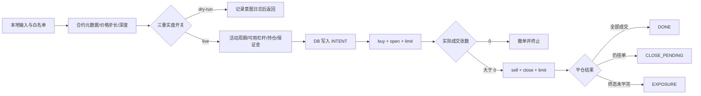

# HTX USDT 永续合约交易模式设计

> 状态：v1 已实现（2026-08-07）
> 模块：`coin-strategy-common/common-client`、`coin-strategy-htx`

## 1. 结论与范围

参考现货 locked-pair 的“先校验、写前落库、两腿限价、异常 fail-closed”模式，新增 HTX USDT 本位永续合约执行能力。v1 收敛为：

- 逐仓（`isolated`）、双向持仓模式（`dual_side`）；
- 只做多周期：`buy/open` 开多，按实际成交张数 `sell/close` 限价平多；
- 杠杆可按请求设置，并受本地 `max-leverage` 与 HTX 可用杠杆双重限制；
- 默认白名单：`BTC-USDT`、`ETH-USDT`、`XAUT-USDT`；
- 默认整个合约模块关闭，启用后仍为 dry-run；实盘需要三重开关；
- HTTP 手动触发，不做自动策略调度。

不实现币本位、交割合约、全仓、做空、止盈止损、强平接管或市价兜底。限价平仓未完成时保持挂单并返回 `CLOSE_PENDING`；终态部分平仓返回 `EXPOSURE`，不静默改成市价平仓。

## 2. HTX 接口与资产语义

合约 API 单独使用 `https://api.hbdm.com`，因为签名串包含 host，不能复用现货 `api.huobi.pro` 的签名主机。

| 能力 | HTX 接口 |
|---|---|
| 合约元数据 | `GET /linear-swap-api/v1/swap_contract_info` |
| 深度 | `GET /linear-swap-ex/market/depth` |
| 账户/持仓 | `POST /swap_account_info`、`POST /swap_position_info` |
| 可用杠杆/切换杠杆 | `POST /swap_available_level_rate`、`POST /swap_switch_lever_rate` |
| 下单/查单/撤单 | `POST /swap_order`、`POST /swap_order_info`、`POST /swap_cancel` |

`volume` 的单位是“张”，不是基础币数量。名义额按 `contract_size × volume × open_price` 计算；深度档位数量同样按张校验。价格必须整除合约的 `price_tick`。

2026-08-07 公共元数据确认：`XAUT-USDT` 可交易（`contract_status=1`），支持逐仓，`contract_size=0.001 XAUT/张`，`price_tick=0.01 USDT`。运行时仍会每单实时查询元数据，不依赖该快照硬编码。

## 3. 执行流与状态

状态图源文件：[`diagrams/2026-08-07-htx-contract-long-cycle.drawio`](diagrams/2026-08-07-htx-contract-long-cycle.drawio)。



开仓超时会先撤单再查最终状态。发生部分成交时，只按 HTX 返回的实际整数张数挂平仓单。查单基础设施连续失败时不撤、不重下，以 `OPEN_UNKNOWN` 或 `EXPOSURE` 留待人工核对。

## 4. 持久化与并发边界

新增 `htx_contract_cycle`，在发送第一条实盘开仓指令前写入 `INTENT`。主要状态：

`INTENT → OPEN_SENT → OPEN_FILLED → CLOSE_PENDING → DONE`

异常状态 `OPEN_UNKNOWN`、`EXPOSURE` 视为活动周期。同一合约存在任一活动周期时拒绝新开仓；数据库读写失败同样拒绝。单进程内按 `contractCode` 使用非阻塞互斥，防止并发请求穿透“查活动周期→写意图”的间隙。

v1 部署约束：仅支持单实例。当前没有自动恢复任务；重启后活动状态会阻止继续开仓，运维需结合 `htx_contract_cycle`、HTX 订单/持仓和服务日志完成核对。自动恢复与多实例分布式锁是后续工作，未完成前不得水平扩容实盘实例。

## 5. 配置与接口

```bash
HTX_CONTRACT_ENABLED=true
HTX_CONTRACT_DRY_RUN=true
HTX_CONTRACT_LIVE_ENABLED=false
HTX_CONTRACT_CODES=BTC-USDT,ETH-USDT,XAUT-USDT
HTX_CONTRACT_LEVERAGE=3
HTX_CONTRACT_MAX_LEVERAGE=5
HTX_CONTRACT_MAX_SINGLE_NOTIONAL=50
```

实盘必须同时满足：`ENABLED=true`、`DRY_RUN=false`、`LIVE_ENABLED=true`。只设置 API Key 不会下单。API 前缀继承服务 context path `/htx/api`：

- `GET /htx/api/htx/contract/depth?contractCode=XAUT-USDT&step=6`
- `POST /htx/api/htx/contract/leverage`
- `POST /htx/api/htx/contract/long-cycle`

长周期示例（价格仅示意，必须使用请求时符合 tick 和风险约束的价格）：

```json
{
  "contractCode": "XAUT-USDT",
  "volume": 2,
  "openPrice": 3300.00,
  "closePrice": 3310.00,
  "leverage": 3,
  "clientOrderId": 1786035000001,
  "waitFillTimeoutMs": 10000
}
```

## 6. 安全不变量

1. 非白名单、停牌、非 swap、逐仓不支持、价格步长不符直接拒绝。
2. 开仓前双边 depth、单笔名义额、保证金安全系数全部通过才继续。
3. 实盘前确认无 HTX 既有仓位，也无本地未完成周期，避免误平人工仓位。
4. 杠杆不得超过本地上限，且必须出现在 HTX 当前可用杠杆列表。
5. 开仓前写数据库失败不发送订单；订单发送后的数据库更新失败保留阻塞性 `INTENT`。
6. 只限价开/平，不以市价单掩盖深度不足或平仓异常。

## 7. 官方依据

- [HTX USDT Margined Contracts API Reference](https://huobiapi.github.io/docs/usdt_swap/v1/en/)
- [HTX XAUT-USDT contract metadata](https://api.hbdm.com/linear-swap-api/v1/swap_contract_info?contract_code=XAUT-USDT&business_type=swap)

## 8. v2：XAUT 50x 自动 dry-run 周期（2026-08-09）

为替代现货做市测试，新增 `HtxContractAutoTestScheduler`：仅当
`HTX_CONTRACT_AUTO_TEST_ENABLED=true` 且 `dry-run=true/live-enabled=false` 时运行。
每轮只接受配置中唯一的合约代码，从当前 best ask 生成模拟开多价，并按
`auto-test-target-return-pct` 向上对齐 `price_tick` 生成限价平多价；调用既有公共元数据、
双边深度、名义额和本地杠杆门禁后，将成功周期记为 `DRY_RUN_DONE`。

本模式不调用账户、持仓、切杠杆或下单私有接口，不代表账户已具备 50x 实盘能力。
切换实盘前仍必须由 `swap_available_level_rate` 明确返回 50，且 TD-021/TD-023 的恢复、
账户/API 兼容和单实例约束全部验收通过。自动测试调度器在非 dry-run 配置下硬拒绝运行。
